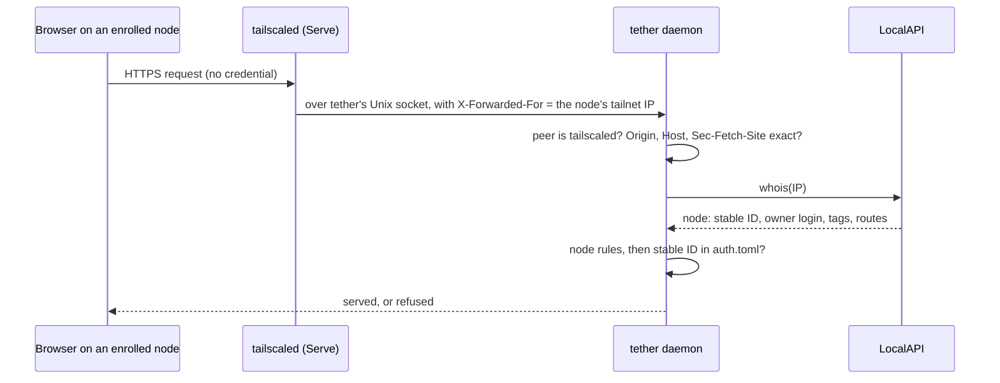

# Browser and PWA authentication, first phase (draft for approval)

Status: draft, revision 4, 2026-10-23. Nothing here is built. Sections 3–5 are the
text to land in the specs once §2 is answered. Where an answer changes the text, the
text says so. The [Review disposition](#review-disposition) table at the end records
what became of every review finding, and what this revision replaced.

## 1. Summary

**A browser or installed PWA is admitted as an enrolled tailnet node: no cookie, no
token, no secret in the browser at all.** Every request a browser makes reaches the
daemon through `tailscale serve`, which writes the requesting node's tailnet address
into `X-Forwarded-For`. The daemon resolves that address with tailscaled's LocalAPI
`/localapi/v0/whois` and admits the request when the node's stable ID is an
**enrolled node** in `auth.toml`. Jimmy enrols a node the way he enrols the phone app:
he runs `tether enroll` on the server and types the code into tether's first screen.
The node then appears in `tether device list` and is revoked with `tether device
remove`. The native iOS app is unchanged: a device token behind Face ID.



A node holds nothing a sibling server could copy and replay. Any HTTPS server on the
same hostname receives a cookie (cookies ignore ports), so a cookie scheme has to hunt
for such servers and revoke when it finds one. Node identity needs none of that.

Three things carry the weight instead, and each is specified as a required control:

- **Proof that a request came through tailscaled.** `X-Forwarded-For` is only as
  trustworthy as whoever wrote it. The daemon listens on a Unix socket in its own
  `0700` runtime directory, which tailscaled's Serve proxies to, and checks the
  connecting process's uid with `SO_PEERCRED`. A process of another Unix user on the
  dev box can't connect at all, so it can't forge the header or flood the daemon
  (decision D1).
- **Exact `Origin`, `Host` and `Sec-Fetch-Site` rules.** Node identity is ambient:
  every page open in any browser on an enrolled node reaches tether with that node's
  identity. The rules make sure only tether's own page is admitted.
- **Node rules.** Tagged nodes, subnet routers, nodes shared in from another
  tailnet, nodes owned by another login, and the dev box's own node are never
  admitted, because for each of them "this node" doesn't mean "Jimmy's device".

### Read before approving

- **Enrolling a node trusts everything on it.** Every browser profile, the PWA, every
  app, and every OS user account on that machine reach tether as the node. That is
  wider than a cookie, which only one browser profile held. On the iPhone it means
  Safari and the PWA reach a host with no Face ID step once the phone's node is
  enrolled; the native app's Face ID lock then guards only the native app. If Jimmy
  wants Face ID to stay the gate on the phone, he enrols only his laptop's node and
  uses the native app on the phone (D2).
- **A new Tailscale node needs a new enrolment.** A Tailscale logout, a reinstall or
  a reset makes a new node with a new stable ID. The old row stops matching and the
  device re-enrols with a code. Stable IDs are never reused, so an old row can't be
  inherited by anything.
- **Publishing tether changes once.** `tailscale serve` must proxy to tether's Unix
  socket (`unix:/run/user/<uid>/tether/http.sock`), which needs Tailscale 1.94 or
  later on the dev box (D1).
- **Several Unix users on one box each run their own tether, and none can borrow
  another's enrolments.** Each daemon reads only its own `auth.toml`, admits only
  through its own socket, and refuses the box's own node, so another user's processes
  can't reach it as an enrolled device.

### Vocabulary

| Term | Meaning |
|---|---|
| **node** | a Tailscale node: one machine or phone on the tailnet, as tailscaled's netmap knows it |
| **stable ID** | the node's `StableID` (`n…CNTRL`): fixed for the node's life and never reused after it is deleted |
| **enrolled node** | a device of kind `node` in `auth.toml`: a stable ID, the login that owned the node at enrolment, and a name |
| **native device** | a device of kind `native`: the iOS app's token, as today |
| **node lane** / **native lane** | how a request is judged: by its node (it presents no credential) or by its token (it presents one) |
| **canonical origin** | the one `https://` origin that tether's own Serve publication answers on, derived from the serve config |
| **tailscaled peer** | a connection to tether's socket whose process uid is tailscaled's |
| **browser client** | the web UI running in a browser or PWA (not in the iOS app) |

"Browser device", "browser credential" and the `__Host-tether` cookie no longer
exist. The UI says "this device" for an enrolled node, because a node is a machine,
not a browser.

## 2. Decisions

Jimmy delegated auth to the tech lead. The tech lead chose node identity over a
cookie, and owns D4 and everything under "Settled". D1–D3 change Jimmy's workflow or
the risk he carries, so they need his yes.

| # | Question | Recommended answer | Alternatives |
|---|---|---|---|
| D1 | How the daemon proves a request came through tailscaled | **Listen on a Unix socket, `$XDG_RUNTIME_DIR/tether/http.sock`, in a `0700` directory, and publish with `tailscale serve --bg --https=443 unix:/run/user/<uid>/tether/http.sock`.** Only tailscaled (root) and Jimmy's own processes can connect. `SO_PEERCRED` on each accepted connection says which: the node lane admits only tailscaled peers. **Cost:** Tailscale 1.94 or later on the dev box; the serve command changes once; the dev proxy and tests connect to the socket instead of a port | (b) Keep `127.0.0.1:<port>` and look up each accepted connection's owner uid with a netlink `sock_diag` query. Works on any Tailscale version, but every local user can still connect, so any of them can fill the 64 connection permits; it is Linux-only code with no macOS counterpart. (c) Keep today's loopback trust: any local process can forge `X-Forwarded-For` with an enrolled node's address (they are listed by `tailscale status`) and get a shell as Jimmy. Ruled out by requirement 3 |
| D2 | What an enrolled node admits | **Everything on that node: accept it.** Enrol the laptop's node. Enrol the phone's node only if Safari and the PWA on the phone are wanted, knowing they bypass Face ID for that host. Refuse the dev box's own node always | Enrol no phone node, and use only the native app on the phone: Face ID stays the gate there. (Per-browser credentials would need the cookie this design removes) |
| D3 | What "log out" means | **"Remove this device":** a button in Settings that deletes this node's enrolment, after a confirmation that says every browser and the PWA on this machine lose access. Local drafts stay; "Clear local data" is a separate action | No logout in the client, only `tether device remove` on the server. A per-browser "log out" that only hides the UI: it protects nothing, because the node is still admitted |
| D4 | One pending code for both kinds | **Settled: yes.** `tether enroll` prints one code; native redeems it at `POST /auth/enroll`, a node at `POST /auth/node/enroll`. Both share the pending code, its 5-try counter and its expiry | `tether enroll --node`: a second CLI mode for no security gain |

### D1 in detail

`X-Forwarded-For` decides who a node-lane request is, so the daemon must know that
tailscaled wrote it. Serve overwrites `X-Forwarded-For` with the source address of
the tailnet connection, and its reverse proxy (Go's `httputil.ReverseProxy` in
`Rewrite` mode) drops any inbound `X-Forwarded-*` before that. So the header is
trustworthy exactly when the connection to tether is tailscaled's own.

| | (a) Unix socket | (b) loopback TCP + `sock_diag` |
|---|---|---|
| Who can connect | root and Jimmy (directory `0700`) | every local user |
| How a tailscaled peer is recognised | `SO_PEERCRED` uid equals tailscaled's uid, which the daemon reads with `SO_PEERCRED` on its own LocalAPI connection | a netlink `INET_DIAG` query for the accepted connection's 4-tuple returns the client socket's uid; same comparison |
| Another user floods the permits | impossible | possible: denial of service |
| Needs | Tailscale ≥ 1.94 (first release with `unix:` proxy targets) | any Tailscale; a netlink client |
| macOS, if the daemon ever runs there | `getpeereid` does the same | no equivalent |

Native-lane requests are unaffected by the uid: a dev proxy running as Jimmy still
connects and presents a native token, as today.

### D2 in detail

What a node-lane request proves is "a process on node X, owned by login Y, sent this
through a browser page on tether's origin", and the origin part holds only for
browsers. A process on an enrolled node that isn't a browser (`curl`, a container
routed through the host, another OS user's shell) can send any headers it likes, so
the origin rules don't stop it. Requirement 6 accepts the unlocked-device risk; this
is the same risk widened from "someone at the unlocked device" to "anything running
on it". It is accepted on the grounds that the laptop and phone are Jimmy's own, and
the guard against everything *else* on the tailnet (other machines, other users,
pages on other origins) is unchanged.

### Settled without Jimmy

- An enrolled node has native's full power: the WebSocket is the shell, so a
  narrower scope buys nothing in this phase.
- The native scheme is unchanged, and native requests never consult node identity.
- tether authenticates with no cookie, ever, again: the daemon sets none and ignores
  any it receives.
- Identity is resolved per request, never cached between requests (§3.5).
- The node rules in §3.5, and the origin rules in §3.7.

### Next to D1: a separate dev-only hole (review L5)

`web/vite.config.ts` proxies to the daemon and injects a fixed `Tailscale-User-Login`
header and a native token from `tether.dev.token`, for any caller that reaches the
Vite port. A published spike therefore lets any tailnet peer that reaches it act as
Jimmy. This predates the draft and is dev-only. Fix, outside this spec: the proxy
forwards the incoming `Tailscale-User-Login` instead of inventing one, and refuses
requests without it. Tracked as a follow-up, not a ship gate.

## 3. Proposed text for `auth.md`

Written as the current rule, in auth.md's voice, for the recommended answers. It
replaces the summary paragraph, "Threat model", "Tailscale identity", "Carrying the
token" → "No `Origin` check", "State on disk", "CLI" and "Endpoints". It adds
"Tailscaled peers", "Node identity", "Canonical origin", "Browser admission",
"Lanes", "Live sockets", "Removing a device" and "Seams". The Face ID, Keychain and
recovery sections stay as written; they describe native.

### 3.1 Replacement for the opening paragraph

> Every request reaches the daemon through `tailscale serve`, and must carry an
> allowlisted Tailscale login. Past that, a request is admitted on one of two
> **lanes**. The iOS app presents a **device token**, issued at enrolment, kept in the
> Keychain behind Face ID and sent as a bearer token or a WebSocket subprotocol. A
> browser or PWA presents nothing: it is admitted as an **enrolled node**, because
> the tailnet node it runs on, which the daemon learns from tailscaled, is in
> `auth.toml`. Both kinds of device are enrolled with the same one-time code from
> `tether enroll` and revoked with `tether device remove`. tether never authenticates
> with a cookie.

### 3.2 Threat model (replaces the section)

> One user, a tailnet with only his own devices, tailnet-only hosts. The dev box may
> have other Unix users, each running their own tether. The daemon is remote code
> execution for whoever passes it, so the checks guard against:
>
> - another tailnet user reaching the daemon, if the tailnet is ever shared (the login
>   allowlist, and the node's owner);
> - his other tailnet devices, or anything running on them, unless he enrolled them
>   (the device token; the enrolled-node list);
> - **pages on any other origin using an enrolled node's identity through the
>   browser**: other sites, pages served by other machines in the tailnet (all one
>   "site", since `ts.net` is a public suffix), other ports on the dev box, another
>   user's tether ([Browser admission](#browser-admission));
> - **another Unix user on the dev box** forging Tailscale headers, flooding the
>   daemon, or reaching it from the box's own node (the socket directory, the
>   tailscaled-peer check, the self-node rule);
> - machines that only *look* like a tailnet node: devices behind a subnet router,
>   tagged servers, nodes shared in from another tailnet, Funnel traffic from the
>   internet ([Node identity](#node-identity));
> - someone holding the phone unlocked, or who adds a face to it, **for the native
>   app only** (the Face ID lock, `.biometryCurrentSet`);
> - a process on the server that forges headers to enrol itself (the enrolment code,
>   readable only from a shell as Jimmy);
> - anything that passes the Tailscale check exhausting memory through HTTP (the
>   per-route caps, the connection backstop and the buffer limits in
>   [daemon-core.md §6](daemon-core.md#6-limits-and-the-memory-ceiling)). Such a
>   client can still deny service, by holding every connection; only tailscaled and
>   Jimmy's own processes can connect.
>
> **Accepted:**
>
> - **An enrolled node is trusted whole.** Every browser profile, app and OS account
>   on it reaches the daemon as that node, with no further check, until `tether
>   device remove`. On a phone whose node is enrolled, Safari and the PWA reach the
>   host without Face ID.
> - Anyone holding Jimmy's unlocked laptop or phone can use the browser client. A lock
>   screen drawn by the page would protect nothing the node isn't already sending.
> - An HTTP response already streaming when its device is removed runs to its end
>   ([Live sockets](#live-sockets-and-revocation)).
> - Removing a node in the Tailscale admin console takes effect in tether only once
>   tailscaled on the dev box learns of it, with no documented bound. `tether device
>   remove` takes effect at once, and is the revocation tether relies on.
>
> Out of scope: processes on the server that run as Jimmy, or as root (they can
> drive tmux directly), a jailbroken phone, malware on an enrolled device, browser
> extensions granted access to `*.ts.net`, and script injected into tether's own
> origin. The last is kept small by the CSP, DOMPurify, and raw files that never run
> ([fs.md](fs.md#get-fsrawpath)).
>
> The node lane exists only on the tailnet: off it there is no Serve, no
> `X-Forwarded-For` from tailscaled and no whois. **A public origin admits browsers
> only with a portable credential (passkeys, [Seams](#seams)), and must revise this
> section first.**

### 3.3 Constants (rows added)

| Constant | Value |
|---|---|
| tether's socket | `$XDG_RUNTIME_DIR/tether/http.sock`; the directory `0700`, the socket `0600` |
| whois calls in flight | 2 daemon-wide; up to 16 waiting, the 17th `503 busy` |
| whois timeout; response limit | 2 s (the LocalAPI timeout); 64 KiB (a real answer is 1.5–2.5 KB) |
| live-socket identity re-check | the existing 10 s re-check; 3 consecutive whois failures close with 4503 |
| minimum browsers | Safari and iOS 16.4, Chrome 76, Firefox 90: the first versions that send `Sec-Fetch-Site` |
| minimum Tailscale on the server | 1.94 (`unix:` proxy targets) |

### 3.4 Tailscale identity and tailscaled peers (replaces "Tailscale identity")

> The daemon listens only on its Unix socket. At startup it creates
> `$XDG_RUNTIME_DIR/tether/` with mode `0700` (refusing to start if the directory
> exists with other permissions or another owner), removes a stale socket, and binds.
> Only root and Jimmy can connect. tailscaled runs as root and reaches the socket
> through `tailscale serve`'s `unix:` proxy target.
> `$XDG_RUNTIME_DIR` is `/run/user/<uid>`, which systemd keeps while the user
> unit runs under lingering, as the daemon's unit already requires.
>
> **Which process connected.** On every accepted connection the daemon reads
> `SO_PEERCRED` once. A connection whose uid is tailscaled's is a **tailscaled
> peer**. The daemon learns tailscaled's uid from `SO_PEERCRED` on its own LocalAPI
> connection, at startup and again whenever it reconnects to LocalAPI. A connection
> from any other uid (Jimmy's dev proxy, a test, Playwright) is a local peer: it may
> use the native lane, never the node lane. If tailscaled itself runs as Jimmy (a
> userspace-networking setup), Jimmy's processes count as tailscaled peers, which
> changes nothing, since processes running as Jimmy are out of scope.
>
> **The Tailscale check, on every route, before anything else:**
>
> - `Tailscale-Funnel-Request` is absent. Serve sets it on Funnel traffic and strips
>   a spoofed copy. The daemon also refuses to start with Funnel on its publication;
>   this catches Funnel turned on later.
> - `Tailscale-User-Login` is present and in the allowlist (auto-detected from
>   LocalAPI `/localapi/v0/status`, overridable with `--allow-login`). Serve sets it
>   for user-owned nodes and strips spoofed copies; it sends none for tagged nodes or
>   Funnel.
>
> A failure is `403 forbidden`. Probed on the dev box on 2026-10-21: `tailscale serve`
> adds `Tailscale-User-Login` and forwards `Sec-WebSocket-Protocol` and `Origin`
> unchanged on a WebSocket upgrade.

### 3.5 Node identity (new section)

> **Resolving the node.** A node-lane request must come from a tailscaled peer
> (else `403 forbidden`). It must carry exactly one `X-Forwarded-For` field holding
> exactly one address, with no comma, and the address must be a Tailscale address
> (`100.64.0.0/10` or `fd7a:115c:a1e0::/48`). Anything else is `403 forbidden`: Serve
> always writes one address, so a list means something appended to it. The daemon
> then calls `GET /localapi/v0/whois?addr=<address>` and takes `Node` and
> `UserProfile` from the answer.
>
> **Node rules.** The node is admitted only if all hold; otherwise the request is
> `403 node_refused` with the reason, and the node can't be enrolled either:
>
> | Rule | Why |
> |---|---|
> | `Tags` is empty | A tagged node belongs to the tailnet, not a person; Serve sends it no login header, so the Tailscale check refuses it already. The rule keeps the node lane from depending on that |
> | `UserProfile.LoginName` equals the request's `Tailscale-User-Login` | Both come from the same netmap; disagreement means the two lookups saw different nodes, so neither is trusted |
> | `Sharer` is zero | A node shared in from another tailnet is someone else's machine, whatever user it shows |
> | `AllowedIPs` holds only the node's own `Addresses`, apart from the exit-node routes `0.0.0.0/0` and `::/0` | A subnet router masquerades every host on its LAN as itself, so its identity says nothing about which device sent the request. An exit node forwards only outbound traffic, so it can't do that |
> | the stable ID isn't the daemon's own node (`Self.StableID` from `/status`) | Every local user on the dev box reaches Serve from the box's own node. Admitting it would let any of them in, through the front door |
>
> Then, on the auth lane, the device lookup: a `node` device whose `node_id` equals
> the stable ID **and** whose `login` equals the node's login. No match is `401
> not_enrolled`. `auth::admit` then judges the found device, as for native.
>
> **Per request, never cached.** tailscaled pools its connections to the daemon and
> reuses them for requests from different nodes, so identity is resolved per
> request, never per connection. Results are not kept between requests, because an
> address can later belong to a different node, and only the current netmap says
> which. Concurrent lookups of the same address share one call: the result is
> shared only by requests that arrived while it was in flight. At most 2 calls run at
> once; up to 16 requests wait, and the 17th gets `503 busy` at once. A whois answer
> is about 2 KB and costs tailscaled a map lookup, so a request pays well under a
> millisecond on a loopback socket (G4 measures it on the dev box). The shell routes
> and `GET /auth/info` never call whois.
>
> **Failure.** A whois that fails, times out (2 s), or answers more than 64 KiB is
> `503 identity_unavailable`: the daemon can't decide, so it fails closed but
> retryable, never as "not enrolled". A whois that answers "no such peer" is `403
> node_refused` (`unknown_node`).
>
> **Order, and what a flood costs.** For a node-lane request: the tailscaled-peer
> check, the pure [admission rules](#browser-admission) on headers alone, the
> `X-Forwarded-For` parse, whois, the node rules, then the auth lane's read of
> `auth.toml`. A cross-origin request is refused before any LocalAPI call or file
> read.

### 3.6 Canonical origin (new section)

> Browsers are admitted from exactly one origin per daemon, the **canonical origin**:
> `https://<host>` or `https://<host>:<port>`, lowercase, no trailing dot or path. The
> daemon derives it from tailscaled's serve config (the same LocalAPI read as the
> Funnel check): the `Web` entry, in the background config, a foreground config or a
> Tailscale Service, that puts a proxy to **this daemon's socket path** at mount path
> `/`. The socket path is per user, so another user's tether never matches it.
>
> - Exactly one such publication: it is the canonical origin.
> - Several: the config key `browser_origin` picks one and must equal one exactly.
>   Otherwise browsers are refused (`ambiguous_origin`, or `browser_origin_unpublished`
>   when `browser_origin` names nothing tether publishes at `/`).
> - Published only under a non-root path: refused (`not_at_root`), since the shell and
>   the API assume the root.
> - Published only over plain HTTP: refused (`not_https`). Browsers need a secure
>   context for the service worker, and Serve marks only TLS requests `https`.
>
> The daemon reads the serve config at startup and on `GET /auth/node/session`, which
> the shell calls at every boot, reusing a result younger than 10 s, with concurrent
> reads sharing one call. A publication moved to another port is therefore picked up
> at the next boot. A read that fails keeps the last result. Request headers (`Host`,
> `X-Forwarded-Host`) never choose the origin.
>
> `GET /auth/info` reports `browserOrigin` (or `null`, with `browserRefused` set to
> the reason). The shell compares it with `location.origin` before connecting, and on
> a mismatch shows "Open tether at `<browserOrigin>`" and opens no socket.

### 3.7 Browser admission (new section, replaces "No `Origin` check")

> Node identity is ambient: a page on any origin, open in a browser on an enrolled
> node, can make the browser send requests that arrive with that node's identity.
> These rules make sure a node-lane request was sent by tether's own page. The
> browser sets `Origin`, `Host` and `Sec-Fetch-*` itself and no page can change them,
> so they are trustworthy for browsers. They are no barrier to a non-browser process
> on an enrolled node, which is accepted ([Threat model](#threat-model)).
>
> The rules apply to every node-lane request on the device routes (`/ws`, `/fs/*`,
> `/complete`, the debug endpoint) and to `/auth/node/*`. They are pure, on headers
> alone.
>
> | Check | Rule | Why this rule |
> |---|---|---|
> | Host | equals the canonical origin's authority (case-insensitive; a default port may be omitted) | Admission compares everything with one origin; a request addressed to another name the same Serve entry answers (a Service name, a second publication) is not from that origin. It also refuses DNS rebinding, in which a foreign page's own host resolves to the dev box, before TLS would |
> | Origin, on WebSocket upgrades and every method but `GET` and `HEAD` | present and equal to the canonical origin, byte for byte after lowercasing; `null`, missing, prefix and suffix matches all fail | **The required control on upgrades and mutations.** Browsers send `Origin` on every cross-origin upgrade and POST, and a WebSocket has no CORS: without it, any page in a browser on an enrolled node could open the shell (cross-site WebSocket hijacking) or submit a form |
> | `Sec-Fetch-Site`, on upgrades and mutations | if present, `same-origin` | Defence in depth. Not required, because WebKit added fetch metadata to WebSocket handshakes late, and the exact `Origin` already decides |
> | `Sec-Fetch-Site`, on `GET` and `HEAD` | present and `same-origin` | **The required control on reads.** Browsers usually send no `Origin` on a GET, so ``, `<video>`, `<script>` or a link from another page would otherwise load `/fs/raw` media, or leak a file's size and dimensions, under the node's identity |
> | Origin, on `GET` and `HEAD` | if present, equal to the canonical origin | Cheap, and refuses the few cross-origin GETs that do carry it |
>
> A refusal is `403 bad_origin`; a refused upgrade gets a plain 403 and no socket.
> Each route keeps its own body rule (JSON routes take `application/json` through
> axum's `Json`; `POST /fs/upload` takes a raw body); the content type is no
> cross-site defence, the exact `Origin` is. **No CORS:** the daemon sends no
> `Access-Control-*` header and answers no preflight. **No anti-CSRF token:** every
> admitted mutation carries an exact `Origin`, which no page can forge. A browser
> older than the minimums sends no `Sec-Fetch-Site`, so its GETs are refused; tether
> doesn't support it.
>
> The shell routes (`/`, `/manifest.webmanifest`, `/sw.js`, `/icons/*`,
> `/apple-touch-icon.png`, `/favicon.ico`, `/assets/*`) and `GET /auth/info` judge
> no identity and apply none of these rules: a bookmark, a cold PWA launch or a link
> from another app sends `Sec-Fetch-Site: none` or `cross-site`, and gets the shell.
> The shell is the client's code and carries no host data.

### 3.8 Lanes (new section)

> The daemon looks at what the request presents. Any `Authorization` header counts,
> whatever its scheme (matched case-insensitively), and so does a `tether.auth.`
> WebSocket subprotocol. `Cookie` is ignored.
>
> | Presented | Lane |
> |---|---|
> | exactly one `Authorization: Bearer <token>`, or exactly one `tether.auth.<token>` subprotocol | native: today's rules, no origin check, no node identity. Another scheme, or an empty token, is `401 auth_required` |
> | nothing | node: [Node identity](#node-identity) and [Browser admission](#browser-admission) |
> | two `Authorization` headers, two `tether.auth.` subprotocols, or one of each | ambiguous: `401 auth_required` / close 4401 |
>
> A request that presents a token never falls back to the node lane when the token
> is wrong: it is 401. A native token works from any node; a node lane needs no
> token. The iOS app always presents its token, so its requests are judged on the
> native lane even from an enrolled phone node.
>
> **Native enrolment refuses browsers.** `POST /auth/enroll` returns a token in JSON,
> so it refuses any request carrying `Origin` or `Sec-Fetch-Site` with `403
> bad_origin`. A browser never needs a portable token, and refusing keeps script on
> tether's origin that sees a typed code from trading it for one.
>
> **Statuses and close codes for browsers:**
>
> | Answer | Meaning | The browser client |
> |---|---|---|
> | `401 not_enrolled`; close 4401 | this node isn't enrolled, or was removed | asks `GET /auth/node/session` why, then shows the enrolment screen |
> | `403 node_refused` (reason) | this node can never be admitted | a screen naming the reason ("This device is a subnet router"), no retry |
> | `403 bad_origin` | the page isn't tether's | never seen by tether's page: the shell checks `browserOrigin` first |
> | `503 identity_unavailable`, `auth_unavailable`, `busy`; close 4503 | the daemon can't decide now | keeps its state and retries with the usual backoff |
> | close 4005 | over the socket cap | "Too many connections" |
>
> A refused node-lane upgrade for identity reasons (not enrolled, node refused,
> whois failed) completes the upgrade and closes at once with 4401 or 4503, as native
> does, because a browser WebSocket can't see a refused upgrade's status. The codes
> `403 unlock_required` and close 4423 are reserved for passkey unlock and are not
> sent in this phase.
>
> **`auth::admit(device, now) -> Grant` is the one policy over a found device**, for
> both lanes, at the initial check and every re-check. Today it returns `Full` for
> every device that exists. Conditions added later (an expiry, a scope, a passkey
> unlock) go here and nowhere else ([Seams](#seams)).

### 3.9 Enrolment (additions to the section)

> Steps 1–2 and 5–6 are unchanged and shared by both kinds: one pending code, one
> wrong-try counter, one atomic write that consumes the code and adds the device. A
> node enrols at its own route:
>
> 3b. **In a browser**, the shell calls `GET /auth/node/session`. For a node that
>    isn't enrolled it answers `401 {error: "not_enrolled", node: {name}}`, `name`
>    being the node's MagicDNS machine name, and the shell shows the enrolment screen:
>    the host's name from `GET /auth/info`, a code field, and the device name,
>    prefilled with the node's name, which Jimmy can edit. The screen says "This
>    lets every browser and app on <node> use tether on <host>." A refused node gets
>    `403 node_refused` and no code field.
>
> 4b. The page sends `POST /auth/node/enroll {code, deviceName}`. It passes the
>    node lane up to the device lookup: tailscaled peer, admission (mutation), whois,
>    node rules. On the auth lane, `Store::enroll` runs with `kind = Node`, the stable
>    ID and the node's login, and `enrolled_by` = the login. If the node is already
>    enrolled, it answers `200` with the existing name and leaves the code unconsumed.
>    The answer is `200 {deviceName}`, `Cache-Control: no-store`. Nothing secret is
>    issued: the node is the credential.

### 3.10 Live sockets and revocation (replaces the revocation bullet)

> A node-lane socket records its node's stable ID and address at the upgrade. The
> connection's existing 10 s re-check then does two things:
>
> 1. Reads `auth.toml` and looks up the device by stable ID and login, as for a new
>    request. Gone: close 4401. File unreadable: close 4503 (as native).
> 2. Calls whois for the recorded address. A different stable ID, "no such peer", or
>    a node that now fails a node rule: close 4401. A failed or slow call keeps the
>    socket and counts a failure; 3 in a row close it with 4503. Any success resets
>    the count.
>
> An upgraded connection carries one client for its whole life, so the identity
> recorded at the upgrade stays the identity of every message on it; the whois
> re-check catches the node leaving the tailnet or changing hands. Tolerating two
> failed calls keeps a briefly slow tailscaled on a busy box from dropping every
> live socket, which would cost each a reconnect; `tether device remove` still takes
> effect within 10 s, because step 1 needs no LocalAPI call. The cost is at most one
> whois per open node-lane socket per 10 s, and none when only native or nobody is
> connected.
>
> **In-flight HTTP is not cut.** A response already streaming when its device is
> removed runs to its end: in practice a `/fs/raw` range, which holds one of 2 raw
> slots and dies after a 30 s stall ([fs.md](fs.md#constants)). Every new request is
> checked, and video makes a new `Range` request every few seconds, so playback
> stops within one range. Cancelling responses by device would need a registry,
> which costs more than one range is worth.

### 3.11 Removing a device from the browser (new section)

> Settings has "Remove this device". After a confirmation ("Every browser and app on
> <node> will lose access to <host>"), the client closes its own sockets and sends
> `POST /auth/node/remove {}`. It passes the node lane up to the device lookup; if
> this node is enrolled, the daemon removes it in one locked write. It answers `204`
> either way, and the shell shows the enrolment screen. Any other socket from the
> node, in another tab, browser or the PWA, closes with 4401 at its next re-check.
> Local drafts stay; "Clear local data" is a separate action
> ([browser-setup.md](client/browser-setup.md#drafts-installation-and-lifecycle)).
>
> A browser learns it isn't enrolled only from the daemon: `GET /auth/node/session`
> at boot, 401 or 4401 afterwards. It stores no enrolment state of its own.

### 3.12 State on disk (row change)

> `auth.toml`: `[[device]]` with `name`, `kind` (`native` or `node`; absent means
> `native`, so files written before nodes parse unchanged), `enrolled_at`,
> `enrolled_by` (the Tailscale login, or `cli`), and per kind: `token_sha256` for
> native; `node_id` (the stable ID) and `login` (the node's owner at enrolment) for
> node. Optional `[pending]` as today.
>
> **A device row with a field the daemon doesn't know is refused, alone**, and logged
> by name; other rows keep working. A later version may add fields that narrow a
> device (an expiry, a scope); an older daemon that ignored them would grant that
> device full power.

```toml
[[device]]
name = "iphone"
token_sha256 = "…"          # kind absent: native
enrolled_at = "2026-10-21T09:12:00Z"
enrolled_by = "jimmy@github"

[[device]]
name = "jimmys-macbook-air"
kind = "node"
node_id = "nMM5jYAKHC11CNTRL"
login = "jimmy@github"
enrolled_at = "2026-10-23T08:00:00Z"
enrolled_by = "jimmy@github"
```

### 3.13 CLI (table change)

> | Command | Effect |
> |---|---|
> | `tether enroll [--ttl 10m]` | Print a new code, the host URL for the app, and the browser URL (`browserOrigin`, or why browsers are refused). The code works for either kind |
> | `tether device list` | Devices with name, kind, enrolled date and `enrolled_by`; for nodes, the stable ID and whether tailscaled currently knows a peer with it (from `/status`) |
> | `tether device remove <name>` | Remove a device of either kind; its requests are refused at once and its sockets close at the next re-check |
> | `tether device add <name>` | Add a **native** device and print its token once, for the dev shim or Playwright against a real daemon |

### 3.14 Endpoints (replaces the route table)

> Every route sits behind the Tailscale check (`403 forbidden`). API paths are
> reserved before static routing (`/ws`, `/auth/`, `/fs/`, `/complete`, `/debug`): an
> unknown path under them is a JSON 404, never the shell.
>
> | Route | Native lane | Node lane | Request → response |
> |---|---|---|---|
> | shell paths, `GET`/`HEAD` | not judged | not judged | the packaged files, under the shell caps ([daemon-core.md](daemon-core.md#static-shell)) |
> | `GET /auth/info` | not judged | not judged | `{hostId, name, daemonVersion, protocol, browserOrigin, browserRefused}` |
> | `POST /auth/enroll` | redeems the code | refused: any `Origin` or `Sec-Fetch-Site` is `403 bad_origin` | `{code, deviceName}` → `{token, deviceName}` |
> | `POST /auth/node/enroll` | a token is `400 bad_request` | admission (mutation), whois, node rules | `{code, deviceName}` → `200 {deviceName}`; `403 bad_code`, `node_refused`; `503` |
> | `GET /auth/node/session` | a token is `400 bad_request` | admission (GET), whois, node rules, lookup; refreshes the canonical origin | `200 {deviceName}`; `401 {error, node: {name}}`; `403 node_refused`; `503` |
> | `POST /auth/node/remove` | a token is `400 bad_request` | admission (mutation), whois, node rules | `{}` → `204` |
> | `GET /ws` | subprotocol token | only `tether.v1` offered; admission (upgrade), whois, node rules, lookup | upgrade; not enrolled → close 4401; can't decide → 4503; bad origin → plain 403 |
> | `GET /fs/*` | `Authorization: Bearer` | admission (GET) and the node lane | as fs.md |
> | `POST /fs/*`, `POST /complete` | `Authorization: Bearer` | admission (mutation) and the node lane | as fs.md, complete.md |
> | debug endpoint | `Authorization: Bearer` | admission for its method and the node lane | as plan.md |
>
> Every non-shell response carries `Cache-Control: no-store`, `X-Content-Type-Options:
> nosniff` and `Cross-Origin-Resource-Policy: same-origin`, so another origin can't
> embed one with `` or `<video>`. New errors: `403 bad_origin`, `403
> node_refused` (with `reason`: `tagged`, `login_mismatch`, `shared`, `routes`,
> `self`, `unknown_node`), `401 not_enrolled`, `503 identity_unavailable`.
>
> **Shell responses** carry `Content-Security-Policy: default-src 'none'; script-src
> 'self'; style-src 'self' 'unsafe-inline'; img-src 'self' blob: data:; media-src
> 'self' blob:; font-src 'self'; connect-src 'self' wss://<canonical host>;
> manifest-src 'self'; worker-src 'self'; frame-src 'none'; frame-ancestors 'none';
> object-src 'none'; base-uri 'none'; form-action 'none'`, plus `nosniff`,
> `Referrer-Policy: no-referrer` and `Cross-Origin-Opener-Policy: same-origin`.
> Hashed assets get `Cache-Control: public, max-age=31536000, immutable`; `/`,
> `/sw.js` and the manifest get `no-cache` and an `ETag` (the content hash), and
> answer `If-None-Match` with 304. The service worker answers only shell paths and
> never calls `respondWith` for anything else, so API, file, media and socket
> traffic never pass through it.

### 3.15 Module shape (additions)

> - `node.rs` (new, pure): `forwarded_addr(headers) -> Result<IpAddr, Refused>`;
>   `node_rules(&Whois, login_header, self_id) -> Result<NodeId, Refusal>`;
>   `Origin::canonical` and its derivation from a `ServeConfig` and the socket path;
>   `admission(method, upgrade, headers, &Origin) -> Result<(), Refused>`;
>   `presented(headers) -> Presented { None, Native(Authorization | Subprotocol),
>   Ambiguous }`.
> - `identity.rs`: `whois(addr)` with the 64 KiB limit, single-flight by address and
>   the 2-in-flight cap; `Self.StableID` from `/status`; tailscaled's uid from
>   `SO_PEERCRED`; `ServeConfig` parses mount paths, `unix:` proxy targets and
>   `Services`; the canonical-origin cell, refreshed as §3.6 says.
> - `store.rs`: `Device.kind` (serde default `Native`) and per-kind fields;
>   `deny_unknown_fields` on the device row, applied row by row so one bad row is
>   refused alone; `enroll(code, name, by, Kind, now)`; `remove_node(node_id)`.
> - `mod.rs`: `check` dispatches on `presented`; `admit(device, now) -> Grant` is
>   the single post-lookup policy, called by `check` and `recheck`.
> - `http/mod.rs`: the accept loop on the Unix socket inserts the peer's uid class
>   (`Peer::Tailscaled | Local`) into every request's extensions, replacing
>   `ConnectInfo<SocketAddr>`. `device_check` runs `admission` for the node lane before
>   whois. The `/auth/node/*` routes sit outside the `devices` router, like
>   `/auth/enroll`, and call the same steps.
> - Dependencies: `hyper` gains `server`; `hyper-util` gains `server`, `http1` and
>   `service`. `SO_PEERCRED` comes from `tokio::net::UnixStream::peer_cred`.
> - The log never carries `Authorization` or `Sec-WebSocket-Protocol` values;
>   refusals log the reason, the path and, for the node lane, the stable ID.

### 3.16 Seams (new section)

> **Public HTTPS (passkeys).** On a public origin no request comes through Serve, so
> the node lane doesn't exist there: such a connection isn't a tailscaled peer.
> Browsers then need a portable credential, and `presented` gains a third lane for
> it. The planned one is a passkey: a device of kind `passkey` holding a WebAuthn
> credential's public key, registered with the enrolment code; an assertion with
> user verification opens a short session the public phase specifies, whose RP ID is
> the public hostname. `auth::admit` judges that device like any other. Nothing of
> this is built. The same `admit` can later require a passkey unlock for node devices
> on the tailnet (closing the unlocked-device risk); `403 unlock_required` and close
> 4423 are reserved for it.
>
> **Guest devices.** A guest would be another person's tailnet node, given one
> session read-only until an expiry. Its row would add `scope` (the session name and
> `read-only`) and `expires_at`, and `admit` would return a `Grant` narrower than
> `Full` that the hub enforces on every message. The guest's login is outside the
> allowlist, so the allowlist would become per device: the owner's login for full
> devices, the guest's own for a guest row. Nothing of this is built. The rule that
> refuses unknown row fields means an older daemon never reads a guest row as a full
> device.

## 4. `decisions.md` entry

```markdown
### Browsers are admitted as enrolled tailnet nodes, not by cookie

- **Decided:** 2026-10-23, tech lead (Jimmy delegated auth); D1 (Unix socket), D2
  (an enrolled node is trusted whole) and D3 ("Remove this device") by Jimmy.
- **What:** a browser or PWA presents no credential. tether listens on a Unix socket
  in a `0700` directory, which `tailscale serve` proxies to (`unix:` target,
  Tailscale ≥ 1.94); `SO_PEERCRED` marks tailscaled's own connections. For those,
  the daemon takes the one address in `X-Forwarded-For`, which Serve overwrites,
  resolves it per request with LocalAPI whois, refuses tagged, shared-in,
  subnet-router, mismatched-login and self nodes, and admits the node when its stable
  ID and owner login are an enrolled `node` device in `auth.toml`. Enrolment uses the
  `tether enroll` code; `tether device remove` revokes, and live sockets close at the
  10 s re-check, which also re-resolves the socket's node. Exact `Host`, `Origin` (on
  upgrades and mutations) and `Sec-Fetch-Site: same-origin` (on reads) against one
  canonical origin derived from the serve config. Native admission is unchanged.
- **Why:** a cookie is a bearer secret that any HTTPS server on the same hostname
  receives, because cookies ignore ports, and could replay; it forced sibling
  detection, revocation on detection, plain-HTTP spikes and serve-config polling. A
  node gives a sibling server nothing to replay. Stable IDs are never reused, Serve
  strips spoofed identity headers, and whois needs only LocalAPI read access. The
  socket closes the gap that header trust left once other Unix users share the box.
- **Changes:** "No `Origin` check" holds for the native lane only. "tether never
  authenticates with a cookie" stays. "The daemon serves no UI" no longer holds. The
  daemon binds a Unix socket instead of `127.0.0.1:PORT`, and the Tailscale check
  gains the Funnel-header refusal.
- **Rejected:**
  - An `HttpOnly` device cookie (revision 3 of the design): replayable by any sibling
    server on the hostname, and detection of siblings can't be complete, since
    tailscaled announces no serve-config changes.
  - A token in browser JS storage: readable by injected script, and `<video src>`
    can't add a header.
  - Tailscale identity alone (any device of Jimmy's login): no per-device enrolment
    or revocation.
  - Tailscale app capabilities or grants as the device list: node-wide, so every
    Unix user's tether would share one list, and changing it needs the admin console.
  - Caching whois by address: an address can move to another node; per-request calls
    are cheap and single-flight covers bursts.
  - Trusting a loopback TCP peer: any local user could forge `X-Forwarded-For`.
    Looking up the TCP peer's uid with `sock_diag`: works, but every local user can
    still connect and fill the permits, and it has no macOS counterpart.
  - Failing a live socket on the first failed whois re-check: a slow tailscaled would
    drop every socket; three in a row are tolerated, and removal never needs whois.
  - Ignoring unknown device-row fields: a later scoped row would be read as full
    power by an older daemon.
```

## 5. Other spec sections that must change

### plan.md

- **"Tailnet only"**: "Bind to a Unix socket, `$XDG_RUNTIME_DIR/tether/http.sock`, and
  publish with `tailscale serve --bg --https=443 unix:/run/user/<uid>/tether/http.sock`
  (Tailscale 1.94 or later)."
- **"Identity"**: replace "tether accepts a request only from loopback … closed by the
  enrolment code" with: every request needs an allowlisted login and no Funnel
  marker; the node lane needs a tailscaled peer, which other Unix users can't fake
  because they can't reach the socket ([auth.md](auth.md#tailscale-identity-and-tailscaled-peers)).
- **"Device token and Face ID lock"** → **"Devices"**: "Two kinds: a token behind
  Face ID for the iOS app, and an enrolled tailnet node for browsers and the PWA,
  admitted only from the canonical origin. Both are checked on every route but the
  shell, `/auth/info` and the enrolment routes…" (keep the fail-closed sentence).
- **"Web hardening"**: "No cookies anywhere" stays. Replace "so there is no cross-site
  request to forge" with "but a browser on an enrolled node carries its node's
  identity on every request, so node-lane requests must pass exact Origin, Host and
  fetch-metadata checks ([auth.md](auth.md#browser-admission))." Add the shell CSP
  pointer. Drop "The daemon serves no UI".
- **"Server platform"**: add "The browser lane also depends on LocalAPI (whois) and on
  `SO_PEERCRED`. A Mac is a fine *client*: its browsers are judged by whois on the
  server, and need nothing from the Mac's Tailscale app."
- **"Running the phone spikes"**: unchanged. Publishing a spike on `--https=8443` is
  harmless, because nothing tether issues can leak to it.

### daemon-core.md, and the accept loop that resource-limits.md moves there

resource-limits.md §3.6 moves "One rule bounds HTTP" and "The accept loop" from this
draft into daemon-core with the memory budget, and keeps the shell rows marked †.
Their text there must carry these corrections (see
[browser-auth-rev4-notes.md](browser-auth-rev4-notes.md) for the line list):

- **The listener is the Unix socket** (§3.4 above). The loop reads `SO_PEERCRED` per
  accepted connection and inserts the peer class instead of `ConnectInfo`.
  `small_buffers` sets `SO_SNDBUF`/`SO_RCVBUF` on the Unix stream as it does on TCP.
  The kernel's listen backlog is `somaxconn` (mio passes −1 for Unix listeners on
  Linux); only tailscaled and Jimmy can queue in it.
- **Graceful shutdown.** hyper-util's `GracefulShutdown` has no impl for hyper's
  `http1` upgradeable connection, and the `auto` types that have one pull in h2. So
  each connection task runs `tokio::select!` between the connection future and a
  shutdown `watch` receiver; on the signal it calls
  `UpgradeableConnection::graceful_shutdown()` and keeps polling the connection. That
  is what axum's own `serve` does. Tasks live in a `JoinSet`; at the 2 s deadline the
  loop aborts what is left. Upgraded sockets close with 4004 through `stop`, as today.
- **Waiters.** "Waiters are bounded by count, never by a timer" holds for every route
  but the auth lane, whose waiters are time-bounded (10 s).
- **The whois cap** joins the route table: 2 in flight, 16 waiting, the 17th `503
  busy` at once. The backstop's headroom grows by up to 18 such waiting requests,
  which still sum (about 60 with the auth lane's handful and tailscaled's 2 idle connections) under 64; G12 records
  the peak.

**Static shell** keeps revision 3's text (packaging, gzip encoding, 4 slots, 16
waiters, 64 KiB static slices) with one change:

- **No whole-response deadline.** The 30 s stall deadline alone bounds a slow reader:
  it guarantees about 17 kbit/s per 64 KiB slice. A whole-response deadline of 60 s
  would fail the 1 MiB fonts on every attempt below about 142 kbit/s, and with them
  the service worker's precache. The stall deadline is enough, since only tailscaled
  can hold a slot. G12 records whether the daemon-side transfer time tracks a
  throttled client or tailscaled's buffering; if it tracks the client, the waiters
  rise to 32.

§5.1–5.2: a browser offers only `tether.v1`; 4401 also means "node not enrolled or
removed"; 4503 also means "identity unavailable"; 4423 is reserved. The browser client
sends `hello.client.kind = "web"`, an existing value.

### resource-limits.md

- **Memory ceiling, new row:** whois, 2 in flight × (64 KiB body + parse) ≈ 0.2 MB,
  unreclaimable, fixed across tiers. The 72 tier's unreclaimable ceiling becomes
  about 64.0 MB against 72 MiB (75.5 MB), still inside the 4 MiB headroom.
- **Units:** state the ceiling in MiB, or convert `MemoryMax` once (72 MiB is
  75.5 MB); the rows mix the two today.
- **Pass rule:** `anon + shmem + file_dirty + file_writeback + kernel + sock −
  slab_reclaimable` ≤ the row's computed ceiling. The paste files (tmpfs, `shmem`) and
  the upload's dirty pages are file pages the kernel can't drop, and today's rule
  leaves them out.
- **Limits table:** remove "response deadline 60 s" from the shell row; correct the
  backlog wording.

### fs.md

- `GET /fs/raw`: `Cache-Control: private, no-cache` → `no-store`; add
  `Cross-Origin-Resource-Policy: same-origin`. In a browser, raw responses share the
  UI's origin, so "It sends nothing a browser runs" (text/plain for script-like
  types, `nosniff`, `sandbox`) is what keeps a repository file from running as tether
  or registering as its service worker; changes to the type table are security
  changes.
- Video plays with `<video src>` on the same origin; `Content-Range` and `ETag` are
  readable because the request is same-origin. "No CORS headers" stays.
- "Shutdown must not wait on a stream": the accept loop now aborts a stalled raw
  response's task at the 2 s deadline. `main` still calls `HubHandle::stop`.
- Errors: add `bad_origin`, `node_refused`, `not_enrolled` and `identity_unavailable`
  to the shared table and to `HttpError`.

### ios-shell.md

- "Where the web UI comes from": "The daemon serves no UI" becomes "The daemon also
  serves the browser build at its canonical origin; the app never loads it. It
  bundles its own copy and never registers the service worker."
- The app's requests always present its token, so they stay on the native lane even
  when the phone's node is enrolled.
- "Dev mode": unchanged. The Vite proxy connects to the daemon's socket
  (`socketPath`) and presents a native token; as a local peer it can never use the
  node lane.
- The bridge: `Native.kind` gains a browser adapter for production builds with no
  native bridge: no `token()`, no subprotocol token, `httpOrigin` is
  `location.origin`, and `hostRejected` shows the enrolment screen.

### client/browser-setup.md

- "Roadmap and authentication status" and "Browser credential candidate": settled in
  [auth.md](../auth.md) as enrolled nodes; point there.
- "Required controls": anti-CSRF is an exact Origin on mutations and upgrades and
  `Sec-Fetch-Site: same-origin` on reads; Host is checked against the canonical
  origin; CORP and `no-store` on every API response.
- "Deployment trap": no longer applies. Other services on tether's hostname receive
  nothing that admits them.
- "Packaging and static delivery": bounds in daemon-core "Static shell"; replace "a
  small build/resource spike" with G12.
- "Threat-model decision required": resolved; an enrolled node is trusted whole,
  passkey unlock is the follow-up seam.
- One enrolment per machine, not per browser profile. "Remove this device" replaces
  logout; drafts kept; "Clear local data" is separate.

### client/connection-roadmap.md

- "Authentication versus reachability": the tailnet trust model is chosen (enrolled
  nodes). The node lane doesn't exist on a public origin; passkeys remain the
  public-phase plan, plugged in as a third lane judged by `auth::admit`, with the
  public hostname as RP ID.

### running.md

- The serve command and the Tailscale minimum; removing a stale socket is the
  daemon's job, so a restart needs nothing manual.

## 6. Probe gates and acceptance checks

### Probe gates: check on the real deployment before shipping

None of these was run for this draft.

| # | Gate | Decides |
|---|---|---|
| G1 | On the dev box: Tailscale version ≥ 1.94; `tailscale serve --https=443 unix:<socket>` proxies HTTP and a WebSocket upgrade to tether's socket in `/run/user/<uid>/tether/` (tailscaled's unit doesn't hide `/run/user`); `SO_PEERCRED` shows tailscaled's uid; another Unix user gets `EACCES` connecting | D1 as written. If the version is older or the unit hides the path, D1 falls back to (b) |
| G2 | Through Serve, from a laptop, a phone browser and the PWA: the daemon sees exactly one `X-Forwarded-For` address, the node's own tailnet IP, on GET, POST and the upgrade. A request sent with a forged `X-Forwarded-For`, `Tailscale-User-Login` or `Tailscale-Funnel-Request` arrives with only Serve's values. `Origin`, `Host` (with or without `:443`) and `Sec-Fetch-*` arrive unchanged. Safari 26's HTTP/2 WebSocket (extended CONNECT) reaches the daemon as an HTTP/1.1 upgrade with these headers | The node lane's trust in the header, and the Host rule as written |
| G3 | whois for each test node returns `StableID`, the owner login, `Tags`, `Sharer` and `AllowedIPs` as §3.5 reads them; a subnet router (with and without SNAT), a tagged node and the dev box itself are refused with the right reason; a laptop with `--advertise-exit-node` is admitted | The node rules |
| G4 | whois latency and tailscaled CPU on the dev box under its usual load: p50 and p99 of 1,000 calls, and of 20 concurrent; response sizes | The per-request, uncached rule. If p99 exceeds 10 ms, revisit a per-request-burst cache |
| G5 | iOS Safari and the PWA, with Private Relay on: requests to the tailnet name go through the Tailscale VPN and arrive with the phone's address | Phone browsers work at all |
| G6 | The app's `URLSession` sends no `Origin` or `Sec-Fetch-*` on `POST /auth/enroll` | The native-enrol refusal doesn't break native |
| G7 | Canonical-origin derivation agrees with `tailscale serve status` for: the `unix:` target, tether in a Service, two publications with and without `browser_origin`, a non-root mount, plain HTTP; another user's tether publication is never matched | §3.6 |
| G8 | A raw `.svg` and `.html` opened top-level from `/fs/raw` run no script under `CSP: sandbox`; a raw `.js` is refused as `<script>` and by `serviceWorker.register` | Same-origin raw files can't run as tether |
| G9 | From a page on another tailnet machine, another port of the dev box (a spike, another user's tether), and an internet site, in a browser on an enrolled node: WebSocket hijack, `fetch` POST, form POST and ``/`<video>` of `/fs/raw` all fail (403 or blocked by CORP) | The cross-origin defence end to end |
| G10 | In Safari, iOS Safari, the PWA and Chrome: a typed URL, a bookmark, a PWA cold launch and a link from another app load the shell, which then connects; `<video>` range requests carry `Sec-Fetch-Site: same-origin` (WebKit may load media through AVFoundation) | The shell routes judge nothing; if media GETs omit the header, allow a missing one on `GET /fs/raw` only, with CORP guarding the response |
| G11 | `tether device remove` closes a node's live socket within 10 s; stopping tailscaled's LocalAPI for 15 s keeps sockets open, and for 40 s closes them with 4503 | §3.10 |
| G12 | On the dev box, under the systemd unit at the default budget, every cap held: two browsers cold-loading and a service-worker precache, 3 sockets, a raw stream and an upload, some readers throttled to 64 kbit/s, a burst of node-lane requests filling the whois waiters; then 64 connections. Sample `memory.stat` every 100 ms. **Pass:** the largest `anon + shmem + file_dirty + file_writeback + kernel + sock − slab_reclaimable` is at most the tier's computed ceiling; no shell request gets 503 in the two-browser load; a 65th connection waits and is served when one closes; a native reconnect during the load doesn't wait; a stalled reader is cut at 30 s; an idle keep-alive closes at 100 s, after tailscaled's 90 s. Record `memory.peak`, the backend connection count, and whether daemon-side shell transfer time tracks the throttled client | The ceiling rows, the shell waiters, the backstop's headroom |

### Acceptance checks (automated in `tests/http_auth.rs` where a socket suffices)

Tests stand in for tailscaled with a fake LocalAPI on a Unix socket and a test hook
that marks a connection as a tailscaled peer.

- **Peers:** a node-lane request from a local peer is 403; the same with a native
  token is admitted. The socket directory is `0700`; a directory with other modes or
  owner stops startup.
- **Tailscale check:** `Tailscale-Funnel-Request` present is 403 on every route,
  shell included; a missing or unlisted login is 403.
- **Forwarded address:** none, two fields, a comma list, a non-Tailscale address: all
  403 and no whois call.
- **Node rules:** fixtures for tagged, login mismatch, `Sharer` set, a subnet route,
  an exit-node route only (admitted), and self: each refused with its reason, at
  request and at enrolment.
- **Lookup:** an enrolled stable ID with a different login is 401; a stable ID not
  enrolled is 401 `not_enrolled` with the node's name on `/auth/node/session`.
- **Per request:** two requests on one keep-alive connection with different
  forwarded addresses are judged as their own nodes. Concurrent requests for one
  address make one whois call; sequential ones make one each. With 2 calls held, 16
  more wait and the 17th is `503 busy`. A whois timeout is `503
  identity_unavailable`, never 401; an oversized answer is 503.
- **Lanes:** a token and nothing else uses the native lane, from a tailscaled peer
  or a local one; a bad token from an enrolled node is 401, never node-admitted;
  ambiguous combinations are 401; a `Cookie` header changes nothing.
- **Origin and fetch metadata:** for each node-lane route, a missing, `null`,
  other-port, other-host, suffix-extended and scheme-changed Origin on an upgrade or
  POST is `403 bad_origin`; an exact Origin without `Sec-Fetch-Site` is admitted; with
  `same-site`, `cross-site` or `none` it is 403. A GET without `Sec-Fetch-Site: same-origin`
  is 403. A wrong Host is 403. A refused upgrade never sees 101. None of these calls
  whois or reads `auth.toml`.
- **Shell:** shell paths and `/auth/info` answer 200 with no whois call, whatever
  `Sec-Fetch-Site` says.
- **Enrolment:** a node enrol consumes the shared code; a wrong code counts against
  the shared counter; an already-enrolled node gets 200 and the code survives;
  `POST /auth/enroll` with `Origin` is 403; nothing secret appears in any body or
  header.
- **Live sockets:** a removed node's socket closes 4401 at the next re-check; a
  whois answer with a different stable ID closes 4401; two failed whois re-checks
  keep the socket and the third closes 4503.
- **Remove this device:** 204; the row is gone; a second socket from the node closes
  within 10 s; an unenrolled node also gets 204.
- **State:** a device row with an unknown field is refused alone and logged; other
  rows work; an old file with no `kind` parses as native.
- **Static shell, accept loop:** as revision 3 listed them (304 on `If-None-Match`,
  JSON 404 under API prefixes, the 17th shell waiter, the 30 s stall, gzip and 406,
  431 over 16 KiB, the 100 s header timeout, the 65th connection), plus shutdown
  through the per-connection select: sockets get 4004 and a stalled raw response is
  closed by the 2 s deadline.
- **Native unchanged:** the existing native suite passes untouched.

## Sources

- Tailscale source (fetched 2026-10-23): `ipn/ipnlocal/serve.go`
  `addProxyForwardedHeaders` (sets `X-Forwarded-For` from the Serve context's source
  address) and `addTailscaleIdentityHeaders` (deletes inbound login, name, profile,
  Funnel and headers-info; Funnel gets only the marker; tagged nodes get no user
  headers); the reverse proxy uses `Rewrite`, and both hooks run for `unix:` targets
  too. `unix:` proxy targets appear first in v1.94.0 (absent in v1.92.3).
  `ipn/localapi/localapi.go` whois requires `PermitRead`, takes `addr`.
  `ipn/ipnlocal/local.go` `WhoIs` normalises mapped addresses and looks up the node by
  address. `tailcfg.Node`: `StableID`, `Sharer`, `AllowedIPs`, `Tags`.
- [Node identity research](../tailscale-serve-node-identity-research.md): official
  docs on Serve identity headers, LocalAPI identity, stable IDs never reused, device
  removal, node key expiry, IPs changing after a re-join.
- Measured 2026-10-23 on the Mac (Tailscale 1.104.1): `tailscale whois --json` answers
  of 1,432–2,296 bytes, with the fields above.
- mio 1.2.4 `sys/unix/uds/listener.rs`: backlog −1 on Linux and Apple (the kernel's
  maximum). hyper 1.12 `http1.rs`: `UpgradeableConnection::graceful_shutdown`.
  hyper-util 0.1.21 `graceful.rs`: `GracefulConnection` impls only for `http1`,
  `http2`, `auto::Connection` and `auto::UpgradeableConnection`. axum 0.8.9
  `serve/mod.rs`: per-connection `select!` with a shutdown watch.
- Code at the current checkout: `src/auth/identity.rs` (loopback-peer and login
  check; the two LocalAPI socket paths), `src/auth/store.rs` (no
  `deny_unknown_fields`), `src/http/mod.rs` and `src/main.rs` (`TcpListener` on
  `127.0.0.1`, `ConnectInfo`, `small_buffers`), `Cargo.toml` (hyper `client`, `http1`).
- Docs: `docs/design/auth.md`, `plan.md` "Security" and "Server platform",
  `daemon-core.md` §5–6, `fs.md`, `ios-shell.md`, `client/browser-setup.md`,
  `client/connection-roadmap.md`; [resource-limits.md](resource-limits.md).
- Reviews: [1](browser-auth-review-1.md), [2](browser-auth-review-2.md),
  [3](browser-auth-review-3.md). [Public Suffix List](https://publicsuffix.org/list/public_suffix_list.dat)
  (`ts.net`), [RFC 6265 §8.5](https://httpwg.org/specs/rfc6265.html#section-8.5),
  [OWASP WebSocket cheat sheet](https://cheatsheetseries.owasp.org/cheatsheets/WebSocket_Security_Cheat_Sheet.html).

## Review disposition

Revision 4 replaces the cookie credential of revisions 1–3 with enrolled nodes. Rows
marked *moot* concerned the cookie and have no counterpart.

| Finding | Disposition | Landed in |
|---|---|---|
| **Round 1** | | |
| H1 sibling servers receive the cookie | **Moot:** no cookie. A sibling gets nothing that admits it | §1, §4 |
| H2 static HTTP unbounded | **Kept.** Embedded shell, per-route caps, backstop, buffers (now in resource-limits / daemon-core) | §5 |
| M1 shell contradicts admission | **Kept.** Shell and `/auth/info` judge no identity | §3.7, §3.14 |
| M2 `Sec-Fetch-Site` fallback | **Kept**, each rule now justified | §3.7, G10 |
| M3 serve-config rule unbuildable | **Reduced** to the canonical-origin derivation; no sibling detection | §3.6, G7 |
| M4 C seam half real | **Replaced** by the passkey and guest seams at `auth::admit` | §3.16 |
| M5 body rule false for uploads | **Kept** | §3.7 |
| L1 duplicate-cookie rationale | **Moot** | — |
| L2 credential-table gaps | **Kept** for tokens | §3.8 |
| L3 tailnet-only bound | **Kept:** the node lane doesn't exist off the tailnet | §3.2, §3.16 |
| L4 in-flight HTTP not cut | **Accepted** as before | §3.10 |
| L5 Vite proxy forges the login | **Accepted, follow-up** | §2 |
| L6 phone-only re-enrol every 30 days | **Moot:** no expiry; a new Tailscale node re-enrols | §1 |
| **Round 2** | | |
| N1, N2, N6, N7 (sibling residual, spike workflow, enrol/revoke race, refresh triggers) | **Moot** with sibling detection | — |
| N3, N4, N5, N8, N10 (backstop, waiters, ceiling, idle timeout, buffers) | **Kept**, now in resource-limits | §5 |
| N9 unlock slides on pings | **Carried** to the passkey seam: only `input` and `paste` count | §3.16 (phase spec) |
| **Round 3** | | |
| M1 graceful shutdown doesn't compile | **Fixed:** per-connection `select!` and `UpgradeableConnection::graceful_shutdown`, as axum does | §5 daemon-core |
| M2 MiB units and missing file pages | **Fixed** in the pass rule and noted for resource-limits | §5 resource-limits, G12 |
| M3 60 s whole-response deadline | **Fixed:** dropped; G12 records pacing; waiters to 32 if pacing is real | §5 daemon-core, G12 |
| M4 LocalAPI failure on re-check drops sockets | **Fixed** for whois: 3 consecutive failures; removal never needs LocalAPI; the serve-config re-read keeps its last result | §3.6, §3.10, G11 |
| Low: backlog, auth-lane waiters, dependencies, slab naming | **Fixed** (backlog now `somaxconn` on the Unix socket) | §3.15, §5 |
| Low: 3 tabs lock out native with 4005 | **Open risk**, reported | report |
| D6 (third control client) | **Withdrawn:** resource-limits' default budget of 72 keeps 3 | resource-limits |
