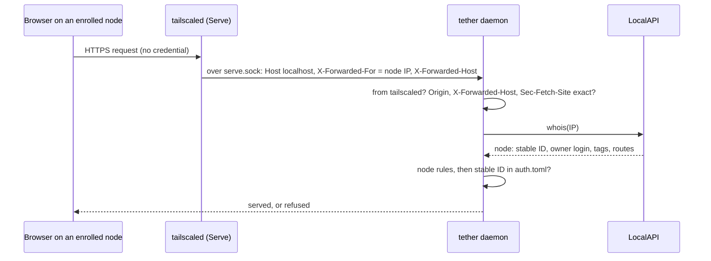

# Browser and PWA authentication, first phase (draft)

Status: draft, revision 5, 2026-10-23. Nothing here is built. Every decision in §2 is
settled; the draft goes to a review round, then its sections 3–5 land in the specs.
The [Review disposition](#review-disposition) table at the end records what became of
every review finding.

## 1. Summary

**A browser or installed PWA is admitted as an enrolled tailnet node: no cookie, no
token, no secret in the browser at all.** Every request a browser makes reaches the
daemon through `tailscale serve`, which writes the requesting node's tailnet address
into `X-Forwarded-For`. The daemon resolves that address with tailscaled's LocalAPI
`/localapi/v0/whois` and admits the request when the node's stable ID is an
**enrolled node** in `auth.toml`. Jimmy enrols a node the way he enrols the phone app:
he runs `tether enroll` on the server and types the code into tether's first screen.
The node then appears in `tether device list` and is revoked with `tether device
remove`. The native iOS app is unchanged: a device token behind Face ID.



A node holds nothing a sibling server could copy and replay. Any HTTPS server on the
same hostname receives a cookie (cookies ignore ports), so a cookie scheme has to hunt
for such servers and revoke when it finds one. Node identity needs none of that.

Four things carry the weight instead, and each is specified as a required control:

- **Proof that a request came through tailscaled.** `X-Forwarded-For` is only as
  trustworthy as whoever wrote it. The daemon listens on Unix sockets in its own
  `0700` runtime directory. Serve proxies to one of them, `serve.sock`, and only
  connections accepted there from tailscaled's uid can use the node lane. A process
  of another Unix user can't connect at all, so it can't forge the header (D1).
- **Exact `Origin`, `X-Forwarded-Host` and `Sec-Fetch-Site` rules.** Node identity is
  ambient: every page open in any browser on an enrolled node reaches tether with that
  node's identity. The rules make sure only tether's own page is admitted.
- **tether alone at its origin.** Browsers are admitted only while tether is the one
  handler in its Serve entry, because anything else served there is same-origin with
  tether and the origin rules can't tell it apart.
- **Node rules.** Tagged nodes, subnet routers, nodes shared in from another
  tailnet, nodes owned by another login, and the dev box's own node are never
  admitted, because for each of them "this node" doesn't mean "Jimmy's device".

One rule runs through all of them: **security state is read when it is used**
([§3.3](#33-security-state-is-read-when-it-is-used-new-section)). Every check reads
its inputs on the request or re-check it judges, within a stated age, never only at
startup or at some earlier event.

### What Jimmy carries

- **Publishing needs root, and so does every later `tailscale serve` change.** Since
  Tailscale 1.100, a serve config that contains a `unix:` target can be written only
  by root. tether is published with `sudo tailscale serve --bg --https=443
  unix:/run/user/<uid>/tether/serve.sock`. Afterwards every `tailscale serve` change
  on the box needs sudo (a spike on `:8443`, `serve off` on another port), because
  the CLI posts the whole config, tether's handler included. Another Unix user who
  wants their own tether needs root to publish it once. In exchange, only root can
  re-point tether's origin or add a handler beside it.
- **Enrolling a node trusts everything on it.** Every browser profile, the PWA, every
  app, and every OS user account on that machine reach tether as the node. On the
  iPhone it means Safari and the PWA reach a host with no Face ID step once the
  phone's node is enrolled; the native app's Face ID lock then guards only the native
  app. To keep Face ID the gate on the phone, enrol only the laptop's node and use the
  native app on the phone.
- **A new Tailscale node needs a new enrolment.** A Tailscale logout, a reinstall or
  a reset makes a new node with a new stable ID. The old row stops matching and the
  device re-enrols with a code.
- **Upgrading from today's publication.** Until the serve command above replaces
  today's `http://127.0.0.1:7850` publication, the iOS app gets 502 from Serve. The
  daemon logs the exact commands at startup, and `tether enroll` prints them
  ([§3.7](#37-canonical-origin-new-section)).
- **Several Unix users on one box each run their own tether, and none can borrow
  another's enrolments.** Each daemon reads only its own `auth.toml`, admits nodes
  only through its own `serve.sock`, and refuses the box's own node, so another
  user's processes can't reach it as an enrolled device.

### Vocabulary

| Term | Meaning |
|---|---|
| **node** | a Tailscale node: one machine or phone on the tailnet, as tailscaled's netmap knows it |
| **stable ID** | the node's `StableID` (`n…CNTRL`): fixed for the node's life; Tailscale's control plane never reuses one |
| **enrolled node** | a device of kind `node` in `auth.toml`: a stable ID, the login that owned the node at enrolment, and a name |
| **native device** | a device of kind `native`: the iOS app's token, as today |
| **front** | which of the daemon's sockets a connection arrived on: `serve.sock` (from tailscaled) or `local.sock` (the dev proxy, tests) |
| **node lane** / **native lane** | how a request is judged: by its node (it presents no credential) or by its token (it presents one) |
| **canonical origin** | the one `https://` origin browsers are admitted from: tether's own Serve entry, while tether is alone in it |
| **tailnet state** | what the daemon reads from LocalAPI to judge requests: the serve config, and from `/status` the self node, its owner login and tailscaled's version |
| **browser client** | the web UI running in a browser or PWA (not in the iOS app) |

"Browser device", "browser credential", "tailscaled peer", `http.sock`,
`browser_origin` and the `__Host-tether` cookie no longer exist. The UI says "this
device" for an enrolled node, because a node is a machine, not a browser.

## 2. Decisions

Jimmy delegated auth to the tech lead, who settled every decision below. None needs
Jimmy's yes; the costs he carries are listed in [§1](#what-jimmy-carries).

| # | Decision | Rejected |
|---|---|---|
| D1 | **The daemon listens on Unix sockets in `$XDG_RUNTIME_DIR/tether/` (`0700`), and Serve proxies to `serve.sock`.** The node lane exists only on `serve.sock`, and only for tailscaled's uid. Minimum Tailscale 1.100. **Cost:** every `tailscale serve` change on the box needs sudo afterwards; root publishes each user's tether; the dev proxy and tests connect to `local.sock` instead of a port. **Gain:** other Unix users can't connect, forge headers or flood the permits; only root can re-point Serve or add a handler beside tether | (b) Keep `127.0.0.1:<port>` and look up each connection's owner uid with a netlink `sock_diag` query: every local user can still connect and fill the 64 permits; Linux-only. (c) Keep today's loopback trust: any local process can forge `X-Forwarded-For` with an enrolled node's address (`tailscale status` lists them) and get a shell as Jimmy |
| D2 | **An enrolled node is trusted whole**: everything on it is admitted. Enrol the laptop's node; enrol the phone's node only if Safari and the PWA on the phone are wanted, knowing they bypass Face ID for that host. The dev box's own node is always refused | Per-browser credentials: they need the cookie this design removes |
| D3 | **"Remove this device"** replaces logout: a button in Settings that deletes this node's enrolment, after a confirmation that says every browser and the PWA on this machine lose access. Local drafts stay; "Clear local data" is a separate action | No logout in the client, only `tether device remove`. A per-browser "log out" that only hides the UI: it protects nothing, because the node is still admitted |
| D4 | **One pending code for both kinds.** `tether enroll` prints one code; native redeems it at `POST /auth/enroll`, a node at `POST /auth/node/enroll`. Both share the pending code, its 5-try counter and its expiry | `tether enroll --node`: a second CLI mode for no security gain |
| D5 | **Security state is read when it is used** (§3.3) | Reading the serve config, the self node or the allowlist at startup or at shell boot: three review rounds found a hole in each event-based refresh |

Also settled: an enrolled node has native's full power (the WebSocket is the shell, so
a narrower scope buys nothing yet); native requests never consult node identity;
tether never authenticates with a cookie, sets none and ignores any it receives; the
node rules (§3.6); the origin rules (§3.8).

### Why the Unix socket, and why 1.100

`X-Forwarded-For` decides who a node-lane request is, so the daemon must know that
tailscaled wrote it. Serve overwrites `X-Forwarded-For` with the source address of
the tailnet connection, and its reverse proxy (Go's `httputil.ReverseProxy` in
`Rewrite` mode) drops any inbound `X-Forwarded-*` before that. So the header is
trustworthy exactly when the connection to tether is tailscaled's own.

| | Unix socket (chosen) | loopback TCP + `sock_diag` |
|---|---|---|
| Who can connect | root and Jimmy (directory `0700`) | every local user |
| How the lane is chosen | by the socket: `serve.sock` or `local.sock`; on `serve.sock` the `SO_PEERCRED` uid must be tailscaled's | a netlink `INET_DIAG` query for each connection's owner uid |
| Another user floods the permits | can't connect | possible: denial of service |
| Needs | Tailscale ≥ 1.100 | any Tailscale; a netlink client |
| macOS, if the daemon ever runs there | `getpeereid` does the same | no equivalent |

`unix:` proxy targets first appear in Tailscale 1.94. The minimum is 1.100 because
from 1.100 tailscaled lets only a local admin (root, or the operator who can also run
`sudo tailscale`) write a serve config that serves a `unix:` target. On 1.94–1.98 the
Tailscale operator can rewrite the config without sudo; on a box where the operator
isn't Jimmy, that operator could re-point tether's origin at their own server, which
could then plant a service worker on tether's origin that survives the re-point back.
The daemon reads tailscaled's version with the rest of the tailnet state and refuses
browsers below 1.100 (§3.7).

### What an enrolled node proves

A node-lane request proves "a process on node X, owned by login Y, sent this through
a browser page on tether's origin", and the origin part holds only for browsers. A
process on an enrolled node that isn't a browser (`curl`, a container routed through
the host, another OS user's shell) can send any headers it likes, so the origin rules
don't stop it. Requirement 6 accepts the unlocked-device risk; D2 widens it from
"someone at the unlocked device" to "anything running on it". The laptop and phone
are Jimmy's own, and the guard against everything *else* on the tailnet (other
machines, other users, pages on other origins) is unchanged.

### Next to D1: a separate dev-only hole

`web/vite.config.ts` proxies to the daemon and injects a fixed `Tailscale-User-Login`
header and a native token from `tether.dev.token`, for any caller that reaches the
Vite port. A published spike therefore lets any tailnet peer that reaches it act as
Jimmy. This predates the draft and is dev-only. Fix, outside this spec: the proxy
forwards the incoming `Tailscale-User-Login` instead of inventing one, and refuses
requests without it. Tracked as a follow-up, not a ship gate.

## 3. Proposed text for `auth.md`

Written as the current rule, in auth.md's voice. It replaces the summary paragraph,
"Threat model", "Tailscale identity", "Carrying the token" → "No `Origin` check",
"State on disk", "CLI" and "Endpoints". It adds "Security state is read when it is
used", "Sockets", "Node identity", "Canonical origin", "Browser admission", "Lanes",
"Live sockets", "Removing a device" and "Seams". The Face ID, Keychain and recovery
sections stay as written; they describe native.

### 3.1 Replacement for the opening paragraph

> Every request reaches the daemon through `tailscale serve`, and must carry an
> allowlisted Tailscale login. Past that, a request is admitted on one of two
> **lanes**. The iOS app presents a **device token**, issued at enrolment, kept in the
> Keychain behind Face ID and sent as a bearer token or a WebSocket subprotocol. A
> browser or PWA presents nothing: it is admitted as an **enrolled node**, because
> the tailnet node it runs on, which the daemon learns from tailscaled, is in
> `auth.toml`. Both kinds of device are enrolled with the same one-time code from
> `tether enroll` and revoked with `tether device remove`. tether never authenticates
> with a cookie.

### 3.2 Threat model (replaces the section)

> One user, a tailnet with only his own devices, tailnet-only hosts. The dev box may
> have other Unix users, each running their own tether. The daemon is remote code
> execution for whoever passes it, so the checks guard against:
>
> - another tailnet user reaching the daemon, if the tailnet is ever shared (the login
>   allowlist, and the node's owner);
> - his other tailnet devices, or anything running on them, unless he enrolled them
>   (the device token; the enrolled-node list);
> - **pages on any other origin using an enrolled node's identity through the
>   browser**: other sites, pages served by other machines in the tailnet (all one
>   "site", since `ts.net` is a public suffix), other ports on the dev box, another
>   user's tether ([Browser admission](#browser-admission));
> - **anything else served at tether's origin**: another app mounted beside tether in
>   its Serve entry ([Canonical origin](#canonical-origin));
> - **another Unix user on the dev box** forging Tailscale headers or reaching the
>   daemon from the box's own node (the socket directory, the front rules, the
>   self-node rule);
> - machines that only *look* like a tailnet node: devices behind a subnet router,
>   tagged servers, nodes shared in from another tailnet, Funnel traffic from the
>   internet ([Node identity](#node-identity));
> - someone holding the phone unlocked, or who adds a face to it, **for the native
>   app only** (the Face ID lock, `.biometryCurrentSet`);
> - a process on the server that forges headers to enrol itself (the enrolment code,
>   readable only from a shell as Jimmy);
> - anything that passes the Tailscale check exhausting memory through HTTP (the
>   per-route caps, the connection backstop and the buffer limits in
>   [daemon-core.md §6](daemon-core.md#6-limits-and-the-memory-ceiling)).
>
> **Who can hold connections.** Only root and Jimmy's processes can connect to the
> sockets. But tailscaled opens a backend connection for each in-flight request from
> any tailnet node the ACLs let reach port 443, including nodes the Tailscale check
> then refuses. So whoever the ACLs let reach the box's port 443 can deny service by
> holding the 64 connection permits; other Unix users on the box can't.
>
> **Accepted:**
>
> - **An enrolled node is trusted whole.** Every browser profile, app and OS account
>   on it reaches the daemon as that node, with no further check, until `tether
>   device remove`. On a phone whose node is enrolled, Safari and the PWA reach the
>   host without Face ID.
> - Anyone holding Jimmy's unlocked laptop or phone can use the browser client. A lock
>   screen drawn by the page would protect nothing the node isn't already sending.
> - An HTTP response already streaming when its device is removed runs to its end
>   ([Live sockets](#live-sockets-and-revocation)).
> - Removing a node in the Tailscale admin console takes effect in tether only once
>   tailscaled on the dev box learns of it, with no documented bound. `tether device
>   remove` takes effect at once, and is the revocation tether relies on.
> - Tailnet state is up to 10 s old when used (§3.3): a handler added beside tether,
>   or a change to the box's own node, is acted on within 10 s.
>
> **Trusted, out of scope:** root and the Tailscale operator (they can write the
> serve config, or drive tmux directly), processes on the server that run as Jimmy,
> a jailbroken phone, malware on an enrolled device, browser extensions granted
> access to `*.ts.net`, and script injected into tether's own page. The last is kept
> small by the CSP, DOMPurify, and raw files that never run
> ([fs.md](fs.md#get-fsrawpath)).
>
> The node lane exists only on the tailnet: off it there is no Serve, no
> `X-Forwarded-For` from tailscaled and no whois. **A public origin admits browsers
> only with a portable credential (passkeys, [Seams](#seams)), on its own socket, and
> must revise this section first.**

### 3.3 Security state is read when it is used (new section)

> **Every check reads its inputs when it judges a request or a live socket, within a
> stated age.** Nothing that admits or refuses is derived once at startup, at shell
> boot, or at any other event and then trusted until the next one, because nothing
> announces when that state changes: tailscaled's IPN bus carries no serve-config
> change, and `auth.toml` is edited by another process.
>
> | State | Read from | Read when | Used by | If the read fails |
> |---|---|---|---|---|
> | device rows | `auth.toml` | every auth-lane lookup and every live-socket re-check | both lanes | `503 auth_unavailable`; a socket closes 4503 |
> | the requesting node | whois | every node-lane request; every node-lane re-check | node lane | `503 identity_unavailable`; a socket tolerates 2 failures, the 3rd closes 4503 |
> | the serve config | `GET /localapi/v0/serve-config` | when a node-lane request or re-check needs the canonical origin, from a value at most 10 s old | canonical origin | below |
> | the self node's stable ID and owner login; tailscaled's version | `GET /localapi/v0/status?peers=false` | when any request needs the allowlist, or a node-lane request needs the self rule or the version, from a value at most 10 s old | the Tailscale check (auto-detected allowlist); node rules; canonical origin | below |
> | tailscaled's uid | `SO_PEERCRED` on the daemon's own LocalAPI connection | at each connect to LocalAPI; compared at every accept on `serve.sock` | the front rules | keeps the uid of the last connection |
> | tether's own socket | `stat` of `serve.sock` at bind | compared with the serve config at each read | canonical origin | — |
>
> **The tailnet-state cells.** The serve config and `/status` are each held in one
> cell. A request that finds its cell older than 10 s refreshes it and waits for the
> read; concurrent requests share one read. A failed read keeps the last value until
> it is 30 s old; after that the cell is unknown, and a request that needs it gets
> `503 identity_unavailable` (a socket re-check counts a failure). This reaches native
> too, through the allowlist; a LocalAPI down for 30 s almost always means tailscaled
> is down, and Serve with it, so only `local.sock` notices. The cells are read
> only while requests need them: about one read of each per 10 s while browsers are
> active, and one `/status` read per 10 s while only native is. Both reads go over
> their own keep-alive LocalAPI connection, apart from whois, with the 2 s timeout and
> a 64 KiB answer limit.

### 3.4 Constants (rows added)

| Constant | Value |
|---|---|
| tether's runtime directory | `$XDG_RUNTIME_DIR/tether/`, `0700`, owned by the daemon's user. Holds `lock`, `serve.sock`, `local.sock` (both `0600`) and `paste/` |
| whois calls in flight | 2 daemon-wide; up to 16 distinct addresses waiting, the 17th `503 busy` |
| LocalAPI timeout; answer limit | 2 s; 64 KiB (a real whois answer is 1.5–2.5 KB) |
| tailnet-state cells | a value at most 10 s old is used; a failed read keeps the last value until it is 30 s old |
| live-socket re-check | the existing 10 s re-check; 3 consecutive whois failures close with 4503 |
| minimum browsers | Safari and iOS 16.4, Chrome 76, Firefox 90: the first versions that send `Sec-Fetch-Site` |
| minimum Tailscale on the server | 1.100: serve-config writes with a `unix:` target need root |

### 3.5 Sockets and the Tailscale check (replaces "Tailscale identity")

> **Startup**, in this order:
>
> 1. **The runtime directory.** `$XDG_RUNTIME_DIR/tether/`. On Linux, without
>    `XDG_RUNTIME_DIR` the daemon refuses to start: a fallback under `/tmp` is a path
>    another user can create first. On macOS it is the per-user temporary directory
>    (`confstr(_CS_DARWIN_USER_TEMP_DIR)`). The daemon creates the directory with mode
>    `0700` if it is missing. If it exists, it must be a directory, not a symlink,
>    owned by the daemon's user, with mode `0700`; otherwise the daemon refuses to
>    start. The directory is never deleted or recreated.
> 2. **The lock.** The daemon opens `tether/lock` (creating it, `0600`) and takes a
>    non-blocking `flock` on it, held for its whole life. If another daemon holds it,
>    this one exits with "tether is already running". The kernel drops the lock when
>    its holder dies, so a crash leaves nothing to clean up.
> 3. **The sockets**, only once the lock is ours: unlink a stale `serve.sock` and
>    `local.sock`, and bind both.
> 4. **Leftovers**, once the lock is ours: empty `tether/paste/` (a subdirectory,
>    never the runtime directory itself) and delete stale upload part files.
>
> Refusals at steps 1–2 for the directory exit 78, since a restart can't fix them;
> "already running" exits 1. `$XDG_RUNTIME_DIR` is `/run/user/<uid>`, which systemd
> keeps while the user unit runs under lingering, as the daemon's unit already
> requires. tailscaled runs as root and reaches `serve.sock` through Serve's `unix:`
> proxy target.
>
> **Fronts.** Each socket is a **front**, and the front decides what a connection may
> do:
>
> | Front | Who connects | Lanes | Host |
> |---|---|---|---|
> | `serve.sock` | tailscaled: an accepted connection whose `SO_PEERCRED` uid isn't tailscaled's is closed at once | node and native | must be `localhost` |
> | `local.sock` | Jimmy's dev proxy, tests, Playwright | native only | not checked |
>
> On `serve.sock`, every request's `Host` must be exactly `localhost`, because Serve
> rewrites it to that for every `unix:` target; the browser's host travels in
> `X-Forwarded-Host`. Any other `Host` means the request didn't come through Serve's
> proxy, and it is `403 forbidden`. On `local.sock`, a request that presents no token
> is `401 auth_required`: the node lane doesn't exist there.
>
> The uid rule on `serve.sock` guards against a confused deputy: a forwarder Jimmy
> runs, pointed at `serve.sock` by mistake, that relays tailnet traffic with Serve's
> headers intact. It isn't what keeps other users out; the directory does that. If
> tailscaled runs as Jimmy (a userspace-networking setup), the rule admits Jimmy's own
> processes, which are out of scope anyway.
>
> **The Tailscale check, on every route of both fronts, before anything else:**
>
> - `Tailscale-Funnel-Request` is absent. Serve sets it on Funnel traffic and strips
>   a spoofed copy.
> - `Tailscale-User-Login` is present and, once decoded (Serve Q-encodes a non-ASCII
>   value, RFC 2047), in the allowlist: the self node's owner login from the
>   `/status` cell (§3.3), or the logins given with `--allow-login`. Serve sets the
>   header for user-owned nodes and strips spoofed copies; it sends none for tagged
>   nodes or Funnel.
>
> A failure is `403 forbidden`. The daemon doesn't refuse to start when Funnel is on:
> the Funnel header refuses each such request, and the canonical origin refuses an
> entry with Funnel on (§3.7).

### 3.6 Node identity (new section)

> **Resolving the node.** A node-lane request must arrive on `serve.sock`. It must
> carry exactly one `X-Forwarded-For` field holding exactly one address, with no
> comma, and the address must be a Tailscale address (`100.64.0.0/10` or
> `fd7a:115c:a1e0::/48`). Anything else is `403 forbidden`: Serve always writes one
> address, so a list means something appended to it. The daemon then calls `GET
> /localapi/v0/whois?addr=<address>` and takes `Node` and `UserProfile` from the
> answer.
>
> **Node rules.** The node is admitted only if all hold; otherwise the request is
> `403 node_refused` with the reason, and the node can't be enrolled either:
>
> | Rule | Why |
> |---|---|
> | `Tags` is empty | A tagged node belongs to the tailnet, not a person; Serve sends it no login header, so the Tailscale check refuses it already. The rule keeps the node lane from depending on that |
> | `UserProfile.LoginName` equals the decoded `Tailscale-User-Login` | Both come from the same netmap; disagreement means the two lookups saw different nodes, so neither is trusted |
> | `Sharer` is zero | A node shared in from another tailnet is someone else's machine, whatever user it shows |
> | `AllowedIPs` holds only the node's own `Addresses`, apart from the exit-node routes `0.0.0.0/0` and `::/0` | A subnet router masquerades every host on its LAN as itself, so its identity says nothing about which device sent the request. An exit node forwards only outbound traffic, so it can't do that |
> | the stable ID isn't the box's own (the `/status` cell's `Self.StableID`) | Every local user on the dev box reaches Serve from the box's own node. Admitting it would let any of them in, through the front door |
>
> Then, on the auth lane, the device lookup: a `node` device whose `node_id` equals
> the stable ID **and** whose `login` equals the node's login. No match is `401
> not_enrolled`. `auth::admit` then judges the found device, as for native.
>
> **Stable IDs.** Tailscale documents that its control plane never reuses a node ID
> (`tailcfg.NodeID`: "global within a control plane URL"). A self-hosted control plane
> such as Headscale makes no such promise; there, a deleted node's ID could in
> principle return, and the `login` match is the remaining guard.
>
> **Per request, never cached.** tailscaled pools its connections to the daemon and
> reuses them for requests from different nodes, so identity is resolved per
> request, never per connection. Results are not kept between requests, because an
> address can later belong to a different node, and only the current netmap says
> which. Concurrent lookups of the same address share one call: the result is
> shared only by requests that arrived while it was in flight, and a request that
> joins a call already queued or running takes no waiting slot. So the caps count
> distinct addresses: at most 2 calls run at once over 2 keep-alive LocalAPI
> connections; up to 16 more addresses wait, and a request for a 17th gets `503 busy`
> at once. One page loading 20 thumbnails makes one call. A whois answer is about
> 2 KB and costs tailscaled a map lookup (G4 measures it on the dev box). The shell
> routes and `GET /auth/info` never call whois.
>
> **Failure.** A whois that fails, times out (2 s), or answers more than 64 KiB is
> `503 identity_unavailable`: the daemon can't decide, so it fails closed but
> retryable, never as "not enrolled". A whois that answers "no such peer" is `403
> node_refused` (`unknown_node`).
>
> **Order, and what a flood costs.** For a node-lane request: the front rules, the
> canonical origin, the pure [admission rules](#browser-admission) on headers alone,
> the `X-Forwarded-For` parse, whois, the node rules, then the auth lane's read of
> `auth.toml`. A cross-origin request is refused before any whois or file read; it
> costs at most a shared read of the serve-config cell.

### 3.7 Canonical origin (new section)

> Browsers are admitted from exactly one origin per daemon, the **canonical origin**:
> `https://<host>` or `https://<host>:<port>`, lowercase, no trailing dot or path.
>
> **The rule.** Among the `Web` entries of the serve config (the background config,
> every foreground config, every Tailscale Service), take those with any handler
> whose proxy target is a `unix:` path naming this daemon's `serve.sock`, matched by
> `stat` identity (device and inode), not by string, as tailscaled's own
> `isTailscaledSocket` does. Another user's socket can't be `stat`ed through their
> `0700` directory, so it never matches. The canonical origin exists when all hold:
>
> - exactly one entry matches;
> - its port serves HTTPS;
> - its `Handlers` hold exactly one handler: mount path `/`, proxy `unix:<serve.sock>`;
> - Funnel is off for its `host:port`;
> - tailscaled's version (the `/status` cell) is 1.100 or later.
>
> Otherwise there is no canonical origin and every node-lane request is `403
> bad_origin`. The refusal is one message that names the entry and what is wrong,
> and the commands that fix it.
>
> | Rule | Why |
> |---|---|
> | tether is the only handler in its entry | A second handler on the same `host:port` (`--set-path /grafana 3000`, a `Path` handler serving a directory, a `Text` handler) serves pages with tether's origin. They can open `/ws`, `fetch` `/fs/*` and post to `/complete` with exact `Origin` and `Sec-Fetch-Site: same-origin`, and no header tells them apart from tether's page |
> | exactly one entry | Several publications of one tether is a state `sudo tailscale serve --https=<port> off` fixes; choosing among them isn't worth a setting |
> | mount path `/` | The shell and the API assume the root |
> | HTTPS | Browsers need a secure context for the service worker, and Serve marks only TLS requests `https` |
> | Funnel off | Funnel puts the entry on the internet; the node lane is tailnet-only |
> | tailscaled ≥ 1.100 | Below it, the Tailscale operator can rewrite the config without root, so "only root can add a handler beside tether" doesn't hold |
>
> **When it is read.** From the serve-config and `/status` cells (§3.3): on every
> node-lane request, every node-lane socket re-check, `GET /auth/info` and `tether
> enroll`. A handler added beside tether is therefore acted on within 10 s, by new
> requests and by live sockets alike. Request headers (`Host`, `X-Forwarded-Host`)
> never choose the origin.
>
> **Upgrading from loopback TCP.** When no entry matches and some entry proxies to a
> loopback TCP address, the message says so and gives the two commands:
> `sudo tailscale serve --https=<port> off` for that entry, then `sudo tailscale
> serve --bg --https=443 unix:/run/user/<uid>/tether/serve.sock`. The daemon logs it
> at startup, `tether enroll` prints it, and `GET /auth/info` carries it in
> `browserRefused`.
>
> `GET /auth/info` reports `browserOrigin` (or `null`, with `browserRefused` set to
> the message). The shell compares it with `location.origin` before connecting, and
> on a mismatch shows "Open tether at `<browserOrigin>`" and opens no socket; with
> `null` it shows the message.

### 3.8 Browser admission (new section, replaces "No `Origin` check")

> Node identity is ambient: a page on any origin, open in a browser on an enrolled
> node, can make the browser send requests that arrive with that node's identity.
> These rules make sure a node-lane request was sent by tether's own page. The
> browser sets `Origin`, its `Host` and `Sec-Fetch-*` itself and no page can change
> them; Serve copies the browser's `Host` into `X-Forwarded-Host` after deleting any
> inbound copy. So they are trustworthy for browsers. They are no barrier to a
> non-browser process on an enrolled node, which is accepted ([Threat
> model](#threat-model)).
>
> The rules apply to every node-lane request on the device routes (`/ws`, `/fs/*`,
> `/complete`, the debug endpoint) and to `/auth/node/*`. They are pure, on headers
> and the canonical origin.
>
> | Check | Rule | Why this rule |
> |---|---|---|
> | X-Forwarded-Host | exactly one field, equal to the canonical origin's authority (case-insensitive; a default port may be omitted) | Admission compares everything with one origin. A request whose browser-side host isn't that origin's wasn't addressed to it, whatever else it carries |
> | Origin, on WebSocket upgrades and every method but `GET` and `HEAD` | present and equal to the canonical origin, byte for byte after lowercasing; `null`, missing, prefix and suffix matches all fail | **The required control on upgrades and mutations.** Browsers send `Origin` on every cross-origin upgrade and POST, and a WebSocket has no CORS: without it, any page in a browser on an enrolled node could open the shell (cross-site WebSocket hijacking) or submit a form |
> | `Sec-Fetch-Site`, on upgrades and mutations | if present, `same-origin` | Defence in depth. Not required, because WebKit added fetch metadata to WebSocket handshakes late, and the exact `Origin` already decides |
> | `Sec-Fetch-Site`, on `GET` and `HEAD` | present and `same-origin` | **The required control on reads.** Browsers usually send no `Origin` on a GET, so ``, `<video>`, `<script>` or a link from another page would otherwise load `/fs/raw` media, or leak a file's size and dimensions, under the node's identity |
> | Origin, on `GET` and `HEAD` | if present, equal to the canonical origin | Cheap, and refuses the few cross-origin GETs that do carry it |
>
> These rules stop pages on other origins. Pages on tether's own origin are kept to
> tether's by the canonical-origin rule that tether is alone in its entry.
>
> A refusal is `403 bad_origin`; a refused upgrade gets a plain 403 and no socket.
> Each route keeps its own body rule (JSON routes take `application/json` through
> axum's `Json`; `POST /fs/upload` takes a raw body); the content type is no
> cross-site defence, the exact `Origin` is. **No CORS:** the daemon sends no
> `Access-Control-*` header and answers no preflight. **No anti-CSRF token:** every
> admitted mutation carries an exact `Origin`, which no page can forge. A browser
> older than the minimums sends no `Sec-Fetch-Site`, so its GETs are refused; tether
> doesn't support it.
>
> The shell routes (`/`, `/manifest.webmanifest`, `/sw.js`, `/icons/*`,
> `/apple-touch-icon.png`, `/favicon.ico`, `/assets/*`) and `GET /auth/info` judge
> no identity and apply none of these rules: a bookmark, a cold PWA launch or a link
> from another app sends `Sec-Fetch-Site: none` or `cross-site`, and gets the shell.
> The shell is the client's code and carries no host data.

### 3.9 Lanes (new section)

> The daemon looks at what the request presents. Any `Authorization` header counts,
> whatever its scheme (matched case-insensitively), and so does a `tether.auth.`
> WebSocket subprotocol. `Cookie` is ignored.
>
> | Presented | Lane |
> |---|---|
> | exactly one `Authorization: Bearer <token>`, or exactly one `tether.auth.<token>` subprotocol | native, on either front: today's rules, no origin check, no node identity. Another scheme, or an empty token, is `401 auth_required` |
> | nothing | node, on `serve.sock` only: [Node identity](#node-identity), [Canonical origin](#canonical-origin) and [Browser admission](#browser-admission). On `local.sock`, `401 auth_required` |
> | two `Authorization` headers, two `tether.auth.` subprotocols, or one of each | ambiguous: `401 auth_required` / close 4401 |
>
> A request that presents a token never falls back to the node lane when the token
> is wrong: it is 401. A native token works from any node; a node lane needs no
> token. The iOS app always presents its token, so its requests are judged on the
> native lane even from an enrolled phone node.
>
> **Native enrolment refuses browsers.** `POST /auth/enroll` returns a token in JSON,
> so it refuses any request carrying `Origin` or `Sec-Fetch-Site` with `403
> bad_origin`. A browser never needs a portable token, and refusing keeps script on
> tether's origin that sees a typed code from trading it for one.
>
> **Statuses and close codes for browsers:**
>
> | Answer | Meaning | The browser client |
> |---|---|---|
> | `401 not_enrolled`; close 4401 | this node isn't enrolled, or was removed; or, for a socket, the canonical origin changed | asks `GET /auth/node/session` why: `401` shows the enrolment screen, `403 bad_origin` reloads `/auth/info` |
> | `403 node_refused` (reason) | this node can never be admitted | a screen naming the reason ("This device is a subnet router"), no retry |
> | `403 bad_origin` | the page isn't at the canonical origin, or there is none | reloads `GET /auth/info` and shows "Open tether at …" or the refusal message |
> | `503 identity_unavailable`, `auth_unavailable`, `busy`; close 4503 | the daemon can't decide now | keeps its state and retries with the usual backoff |
> | close 4005 | over the socket cap | "Too many connections" |
>
> A refused node-lane upgrade for identity reasons (not enrolled, node refused,
> whois failed) completes the upgrade and closes at once with 4401 or 4503, as native
> does, because a browser WebSocket can't see a refused upgrade's status. The codes
> `403 unlock_required` and close 4423 are reserved for passkey unlock and are not
> sent in this phase.
>
> **`auth::admit(device, now) -> Grant` is the one policy over a found device**, for
> both lanes, at the initial check and every re-check. Today it returns `Full` for
> every device that exists. Conditions added later (an expiry, a scope, a passkey
> unlock) go here and nowhere else ([Seams](#seams)).

### 3.10 Enrolment (additions to the section)

> Steps 1–2 and 5–6 are unchanged and shared by both kinds: one pending code, one
> wrong-try counter, one atomic write that consumes the code and adds the device. A
> node enrols at its own route:
>
> 3b. **In a browser**, the shell calls `GET /auth/node/session`. For a node that
>    isn't enrolled it answers `401 {error: "not_enrolled", node: {name}}`, `name`
>    being the node's MagicDNS machine name, and the shell shows the enrolment screen:
>    the host's name from `GET /auth/info`, a code field, and the device name,
>    prefilled with the node's name, which Jimmy can edit. The screen says "This
>    lets every browser and app on <node> use tether on <host>." A refused node gets
>    `403 node_refused` and no code field.
>
> 4b. The page sends `POST /auth/node/enroll {code, deviceName}`. It passes the
>    node lane up to the device lookup: front, canonical origin, admission (mutation),
>    whois, node rules. On the auth lane, `Store::enroll` runs with `kind = Node`, the
>    stable ID and the node's login, and `enrolled_by` = the login. If the node is
>    already enrolled, it answers `200` with the existing name and leaves the code
>    unconsumed. The answer is `200 {deviceName}`, `Cache-Control: no-store`. Nothing
>    secret is issued: the node is the credential.

### 3.11 Live sockets and revocation (replaces the revocation bullet)

> A node-lane socket records its node's stable ID, its address and the canonical
> origin at the upgrade. The connection's existing 10 s re-check then does three
> things:
>
> 1. Reads `auth.toml` and looks up the device by stable ID and login, as for a new
>    request. Gone: close 4401. File unreadable: close 4503 (as native).
> 2. Reads the canonical origin from the cells (§3.3). None, or not the recorded one:
>    close 4401. A cell that is unknown counts a failure, as in step 3.
> 3. Calls whois for the recorded address. A different stable ID, "no such peer", or
>    a node that now fails a node rule: close 4401. A failed or slow call keeps the
>    socket and counts a failure; 3 in a row close it with 4503. Any success resets
>    the count.
>
> An upgraded connection carries one client for its whole life, so the identity
> recorded at the upgrade stays the identity of every message on it; the whois
> re-check catches the node leaving the tailnet or changing hands. Tolerating two
> failed calls keeps a briefly slow tailscaled on a busy box from dropping every
> live socket, which would cost each a reconnect; `tether device remove` still takes
> effect within 10 s, because step 1 needs no LocalAPI call. The cost is at most one
> whois per open node-lane socket per 10 s, plus the shared cell reads, and none when
> only native or nobody is connected.
>
> **In-flight HTTP is not cut.** A response already streaming when its device is
> removed runs to its end: in practice a `/fs/raw` range, which holds one of 2 raw
> slots and dies after a 30 s stall ([fs.md](fs.md#constants)). Every new request is
> checked, and video makes a new `Range` request every few seconds, so playback
> stops within one range. Cancelling responses by device would need a registry,
> which costs more than one range is worth.

### 3.12 Removing a device from the browser (new section)

> Settings has "Remove this device". After a confirmation ("Every browser and app on
> <node> will lose access to <host>"), the client closes its own sockets and sends
> `POST /auth/node/remove {}`. It passes the node lane up to the device lookup; if
> this node is enrolled, the daemon removes it in one locked write. It answers `204`
> either way, and the shell shows the enrolment screen. Any other socket from the
> node, in another tab, browser or the PWA, closes with 4401 at its next re-check.
> Local drafts stay; "Clear local data" is a separate action
> ([browser-setup.md](client/browser-setup.md#drafts-installation-and-lifecycle)).
>
> A browser learns it isn't enrolled only from the daemon: `GET /auth/node/session`
> at boot, 401 or 4401 afterwards. It stores no enrolment state of its own.

### 3.13 State on disk (row change)

> `auth.toml`: `[[device]]` with `name`, `kind` (`native` or `node`; absent means
> `native`, so files written before nodes parse unchanged), `enrolled_at`,
> `enrolled_by` (the Tailscale login, or `cli`), and per kind: `token_sha256` for
> native; `node_id` (the stable ID) and `login` (the node's owner at enrolment) for
> node. Optional `[pending]` as today.
>
> **A device row with a field the daemon doesn't know is refused, alone**, and logged
> by name; other rows keep working. A later version may add fields that narrow a
> device (an expiry, a scope); an older daemon that ignored them would grant that
> device full power.

```toml
[[device]]
name = "iphone"
token_sha256 = "…"          # kind absent: native
enrolled_at = "2026-10-21T09:12:00Z"
enrolled_by = "jimmy@github"

[[device]]
name = "jimmys-macbook-air"
kind = "node"
node_id = "nMM5jYAKHC11CNTRL"
login = "jimmy@github"
enrolled_at = "2026-10-23T08:00:00Z"
enrolled_by = "jimmy@github"
```

### 3.14 CLI (table change)

> | Command | Effect |
> |---|---|
> | `tether enroll [--ttl 10m]` | Print a new code, the host URL for the app, and the browser URL (`browserOrigin`, or the refusal message with its fix). The code works for either kind |
> | `tether device list` | Devices with name, kind, enrolled date and `enrolled_by`; for nodes, the stable ID and whether tailscaled currently knows a peer with it (from `/status` with peers) |
> | `tether device remove <name>` | Remove a device of either kind; its requests are refused at once and its sockets close at the next re-check |
> | `tether device add <name>` | Add a **native** device and print its token once, for the dev shim or Playwright against a real daemon |

### 3.15 Endpoints (replaces the route table)

> Every route on both fronts sits behind the Tailscale check (`403 forbidden`), and
> every route on `serve.sock` behind the `Host: localhost` rule. API paths are
> reserved before static routing (`/ws`, `/auth/`, `/fs/`, `/complete`, `/debug`): an
> unknown path under them is a JSON 404, never the shell.
>
> | Route | Native lane | Node lane (`serve.sock`) | Request → response |
> |---|---|---|---|
> | shell paths, `GET`/`HEAD` | not judged | not judged | the packaged files, under the shell caps ([daemon-core.md](daemon-core.md#static-shell)) |
> | `GET /auth/info` | not judged | not judged | `{hostId, name, daemonVersion, protocol, browserOrigin, browserRefused}` |
> | `POST /auth/enroll` | redeems the code | refused: any `Origin` or `Sec-Fetch-Site` is `403 bad_origin` | `{code, deviceName}` → `{token, deviceName}` |
> | `POST /auth/node/enroll` | a token is `400 bad_request` | canonical origin, admission (mutation), whois, node rules | `{code, deviceName}` → `200 {deviceName}`; `403 bad_code`, `bad_origin`, `node_refused`; `503` |
> | `GET /auth/node/session` | a token is `400 bad_request` | canonical origin, admission (GET), whois, node rules, lookup | `200 {deviceName}`; `401 {error, node: {name}}`; `403 bad_origin`, `node_refused`; `503` |
> | `POST /auth/node/remove` | a token is `400 bad_request` | canonical origin, admission (mutation), whois, node rules | `{}` → `204` |
> | `GET /ws` | subprotocol token | only `tether.v1` offered; canonical origin, admission (upgrade), whois, node rules, lookup | upgrade; not enrolled → close 4401; can't decide → 4503; bad origin → plain 403 |
> | `GET /fs/*` | `Authorization: Bearer` | admission (GET) and the node lane | as fs.md |
> | `POST /fs/*`, `POST /complete` | `Authorization: Bearer` | admission (mutation) and the node lane | as fs.md, complete.md |
> | debug endpoint | `Authorization: Bearer` | admission for its method and the node lane | as plan.md |
>
> Every non-shell response carries `Cache-Control: no-store`, `X-Content-Type-Options:
> nosniff` and `Cross-Origin-Resource-Policy: same-origin`, so another origin can't
> embed one with `` or `<video>`. New errors: `403 bad_origin`, `403
> node_refused` (with `reason`: `tagged`, `login_mismatch`, `shared`, `routes`,
> `self`, `unknown_node`), `401 not_enrolled`, `503 identity_unavailable`.
>
> **Shell responses** carry `Content-Security-Policy: default-src 'none'; script-src
> 'self'; style-src 'self' 'unsafe-inline'; img-src 'self' blob: data:; media-src
> 'self' blob:; font-src 'self'; connect-src 'self' wss://<canonical host>;
> manifest-src 'self'; worker-src 'self'; frame-src 'none'; frame-ancestors 'none';
> object-src 'none'; base-uri 'none'; form-action 'none'`, plus `nosniff`,
> `Referrer-Policy: no-referrer` and `Cross-Origin-Opener-Policy: same-origin`. With
> no canonical origin, `connect-src` is `'self'` alone. Hashed assets get
> `Cache-Control: public, max-age=31536000, immutable`; `/`, `/sw.js` and the
> manifest get `no-cache` and an `ETag` (the content hash), and answer
> `If-None-Match` with 304. The service worker answers only shell paths and never
> calls `respondWith` for anything else, so API, file, media and socket traffic never
> pass through it.

### 3.16 Module shape (additions and deletions)

> - `node.rs` (new, pure): `forwarded_addr(headers) -> Result<IpAddr, Refused>`;
>   `node_rules(&Whois, login, self_id) -> Result<NodeId, Refusal>`;
>   `Origin::canonical(&ServeConfig, &SocketId, version) -> Result<Origin,
>   OriginRefusal>`, where `OriginRefusal` carries the entry and the fix;
>   `admission(method, upgrade, headers, &Origin) -> Result<(), Refused>`;
>   `presented(headers) -> Presented { None, Native(Authorization | Subprotocol),
>   Ambiguous }`; `decode_login(&HeaderValue)` for Serve's Q-encoding.
> - `identity.rs`: one keep-alive LocalAPI connection for the tailnet-state cells and
>   a pool of 2 for whois, each with the 2 s timeout and the 64 KiB limit; whois
>   single-flight by address, waiters counted by distinct address; the two cells
>   (§3.3); tailscaled's uid from `SO_PEERCRED` at each LocalAPI connect; `ServeConfig`
>   parses `Web` entries, `Handlers`, `unix:` targets, `AllowFunnel` and `Services`.
> - `store.rs`: `Device.kind` (serde default `Native`) and per-kind fields;
>   `deny_unknown_fields` on the device row, applied row by row so one bad row is
>   refused alone; `enroll(code, name, by, Kind, now)`; `remove_node(node_id)`.
> - `mod.rs`: `check` dispatches on the front and `presented`; `admit(device, now) ->
>   Grant` is the single post-lookup policy, called by `check` and `recheck`.
> - `http/mod.rs`: the accept loop (resource-limits §3.7) accepts on both sockets and
>   inserts `Front::Serve | Front::Local` into every request's extensions, replacing
>   `ConnectInfo<SocketAddr>`; `serve.sock` closes a connection from another uid at
>   accept. `device_check` runs the canonical origin and `admission` for the node lane
>   before whois. The `/auth/node/*` routes sit outside the `devices` router, like
>   `/auth/enroll`, and call the same steps.
> - `main.rs`: startup in §3.5's order: directory, lock, sockets, then the paste
>   directory and part files ("once the lock is ours" replaces "once the port is
>   ours"). The startup Funnel refusal goes; startup logs the canonical origin or the
>   refusal message.
> - `config.rs`: `runtime_dir()` returns `$XDG_RUNTIME_DIR/tether` on Linux or an error
>   (exit 78), the per-user temporary directory on macOS; the paste directory is its
>   `paste/`.
> - **Deleted in the same change:** `Config.port` and `DEFAULT_PORT` (config's
>   "unknown keys are ignored" keeps old files with `port` parsing);
>   `ServeConfig::reaches`, `url_for(port)` and `funnels_to(port)`, replaced by
>   `Origin::canonical`; the loopback check in `identity::check` and
>   `IdentityError::NotLoopback`; the `TcpListener` bind and its log line;
>   `runtime_dir()`'s `/tmp/tether-<uid>` fallback. `small_buffers` takes the Unix
>   stream instead of `&TcpStream`. In `web/vite.config.ts`, `TETHER_PORT` and the
>   `http://127.0.0.1:7850` target become `TETHER_SOCKET` and a `socketPath` target
>   on `local.sock`. Tests that bind ports connect to the sockets.
> - Dependencies: `hyper` gains `server`; `hyper-util` gains `server`, `http1` and
>   `service`. `SO_PEERCRED` comes from `tokio::net::UnixStream::peer_cred`; `flock`
>   from `rustix::fs::flock`.
> - The log never carries `Authorization` or `Sec-WebSocket-Protocol` values;
>   refusals log the reason, the path and, for the node lane, the stable ID.

### 3.17 Seams (new section)

> **Public HTTPS (passkeys).** A public origin gets its own front, `public.sock`, for
> a public reverse proxy. Its connections never reach the node lane and ignore every
> `Tailscale-*` and `X-Forwarded-*` header, so a proxy that passes client headers
> through, even one running as root, can't make an internet client look like a
> tailnet node. Browsers there need a portable credential, and `presented` gains a
> third lane for it. The planned one is a passkey: a device of kind `passkey` holding
> a WebAuthn credential's public key, registered with the enrolment code; an
> assertion with user verification opens a short session the public phase specifies,
> whose RP ID is the public hostname. `auth::admit` judges that device like any other.
> Nothing of this is built. The same `admit` can later require a passkey unlock for
> node devices on the tailnet (closing the unlocked-device risk); `403
> unlock_required` and close 4423 are reserved for it.
>
> **Guest devices.** A guest would be another person's tailnet node, given one
> session read-only until an expiry. Its row would add `scope` (the session name and
> `read-only`) and `expires_at`, and `admit` would return a `Grant` narrower than
> `Full` that the hub enforces on every message. The guest's login is outside the
> allowlist, so the allowlist would become per device: the owner's login for full
> devices, the guest's own for a guest row. A guest's node shared into Jimmy's
> tailnet may show a non-zero `Sharer`, which the shared-node rule refuses; the guest
> phase revisits that rule. Nothing of this is built. The rule that refuses unknown
> row fields means an older daemon never reads a guest row as a full device.

## 4. `decisions.md` entry

```markdown
### Browsers are admitted as enrolled tailnet nodes, not by cookie

- **Decided:** 2026-10-23, tech lead (Jimmy delegated auth).
- **What:** a browser or PWA presents no credential. tether listens on Unix sockets
  in a `0700` runtime directory: `serve.sock`, which `tailscale serve` proxies to
  (`unix:` target, Tailscale ≥ 1.100), and `local.sock` for the dev proxy and tests.
  The node lane exists only on `serve.sock`, from tailscaled's uid. For those
  requests the daemon takes the one address in `X-Forwarded-For`, which Serve
  overwrites, resolves it per request with LocalAPI whois, refuses tagged, shared-in,
  subnet-router, mismatched-login and self nodes, and admits the node when its stable
  ID and owner login are an enrolled `node` device in `auth.toml`. Enrolment uses the
  `tether enroll` code; `tether device remove` revokes, and live sockets close at the
  10 s re-check, which also re-resolves the node and the origin. Exact
  `X-Forwarded-Host`, `Origin` (on upgrades and mutations) and `Sec-Fetch-Site:
  same-origin` (on reads) against one canonical origin: the one HTTPS Serve entry
  whose only handler is `/` → tether's socket. Security state (devices, node, serve
  config, self node, allowlist) is read when it is used, at most 10 s old. Native
  admission is unchanged.
- **Why:** a cookie is a bearer secret that any HTTPS server on the same hostname
  receives, because cookies ignore ports, and could replay. A node gives a sibling
  server nothing to replay. Serve strips spoofed identity headers, and whois needs
  only LocalAPI read access. The socket closes the gap that header trust left once
  other Unix users share the box, and from Tailscale 1.100 only root can re-point it.
- **Costs:** every `tailscale serve` change on the box needs sudo once tether is
  published; root publishes each user's tether. An enrolled node is trusted whole.
- **Changes:** "No `Origin` check" holds for the native lane only. "tether never
  authenticates with a cookie" stays. "The daemon serves no UI" no longer holds. The
  daemon binds Unix sockets instead of `127.0.0.1:PORT`, holds a lock file, and keeps
  pastes in `paste/`. The Tailscale check gains the Funnel-header refusal; the
  startup Funnel refusal goes.
- **Rejected:**
  - An `HttpOnly` device cookie (revisions 1–3 of the design): replayable by any
    sibling server on the hostname, and detection of siblings can't be complete,
    since tailscaled announces no serve-config changes.
  - A token in browser JS storage: readable by injected script, and `<video src>`
    can't add a header.
  - Tailscale identity alone (any device of Jimmy's login): no per-device enrolment
    or revocation.
  - Tailscale app capabilities or grants as the device list: node-wide, so every
    Unix user's tether would share one list, and changing it needs the admin console.
  - Caching whois by address: an address can move to another node; per-request calls
    are cheap and single-flight covers bursts.
  - Trusting a loopback TCP peer: any local user could forge `X-Forwarded-For`.
    Looking up the TCP peer's uid with `sock_diag`: every local user can still connect
    and fill the permits, and it has no macOS counterpart.
  - Choosing the lane by the peer's uid on one socket: a root-run public proxy would
    pass as tailscaled. The socket decides the lane; the uid only guards `serve.sock`.
  - A `browser_origin` setting to choose among several publications: one `serve off`
    fixes that state.
  - Reading the serve config at startup and shell boot: a handler added beside tether
    while it runs went unnoticed until the next boot.
  - Failing a live socket on the first failed whois re-check: a slow tailscaled would
    drop every socket; three in a row are tolerated, and removal never needs whois.
  - Ignoring unknown device-row fields: a later scoped row would be read as full
    power by an older daemon.
```

## 5. Other spec sections that must change

### plan.md

- **"Tailnet only"**: "Bind Unix sockets in `$XDG_RUNTIME_DIR/tether/`, and publish
  with `sudo tailscale serve --bg --https=443 unix:/run/user/<uid>/tether/serve.sock`
  (Tailscale 1.100 or later). Every later `tailscale serve` change on the box needs
  sudo."
- **"Identity"**: replace "tether accepts a request only from loopback … closed by the
  enrolment code" with: every request needs an allowlisted login and no Funnel
  marker; the node lane exists only on `serve.sock` from tailscaled, which other Unix
  users can't reach ([auth.md](auth.md#sockets-and-the-tailscale-check)).
- **"Device token and Face ID lock"** → **"Devices"**: "Two kinds: a token behind
  Face ID for the iOS app, and an enrolled tailnet node for browsers and the PWA,
  admitted only from the canonical origin. Both are checked on every route but the
  shell, `/auth/info` and the enrolment routes…" (keep the fail-closed sentence).
- **"Web hardening"**: "No cookies anywhere" stays. Replace "so there is no cross-site
  request to forge" with "but a browser on an enrolled node carries its node's
  identity on every request, so node-lane requests must pass exact Origin,
  forwarded-host and fetch-metadata checks, and tether must be alone in its Serve
  entry ([auth.md](auth.md#browser-admission))." Add the shell CSP pointer. Drop "The
  daemon serves no UI".
- **"Server platform"**: add "The browser lane also depends on LocalAPI (whois,
  status, serve config) and on `SO_PEERCRED`. A Mac is a fine *client*: its browsers
  are judged by whois on the server, and need nothing from the Mac's Tailscale app."
- **"Running the phone spikes"**: publishing a spike on `--https=8443` needs `sudo`
  now, and is harmless, because nothing tether issues can leak to it and it isn't in
  tether's entry.

### daemon-core.md, through resource-limits.md

resource-limits.md revision 2 owns "One rule bounds HTTP", the route table and the
accept loop (its §3.7, landing as daemon-core §6.4). This draft doesn't restate them.
Its §3.7 needs these changes for revision 5 (the line list is in
[browser-auth-rev4-notes.md](browser-auth-rev4-notes.md)):

- The loop accepts on two sockets, `serve.sock` and `local.sock`, and inserts the
  front (`Front::Serve | Front::Local`) instead of the `SO_PEERCRED` peer class.
  `serve.sock` closes a connection from any uid but tailscaled's at accept. Both
  share the 64 permits.
- The whois row's 16 waiters count distinct addresses: a request joining an
  in-flight or queued call takes no slot.
- The memory row for whois becomes "LocalAPI answers: 2 whois + 1 cell read, each
  64 KiB + parse", about 0.3 MiB.
- Its "Still open" item on browser auth's startup refusals: the runtime directory's
  refusals (missing `XDG_RUNTIME_DIR` on Linux, wrong owner, mode or type) exit 78;
  "already running" exits 1; Funnel is no longer a startup refusal.

§5.1–5.2: a browser offers only `tether.v1`; 4401 also means "node not enrolled or
removed, or the canonical origin changed"; 4503 also means "identity unavailable";
4423 is reserved. The browser client sends `hello.client.kind = "web"`, an existing
value.

### fs.md

- `GET /fs/raw`: `Cache-Control: private, no-cache` → `no-store`; add
  `Cross-Origin-Resource-Policy: same-origin`. In a browser, raw responses share the
  UI's origin, so "It sends nothing a browser runs" (text/plain for script-like
  types, `nosniff`, `sandbox`) is what keeps a repository file from running as tether
  or registering as its service worker; changes to the type table are security
  changes.
- Video plays with `<video src>` on the same origin; `Content-Range` and `ETag` are
  readable because the request is same-origin. "No CORS headers" stays.
- "Shutdown must not wait on a stream": the accept loop now aborts a stalled raw
  response's task at the 2 s deadline. `main` still calls `HubHandle::stop`.
- Paste files live in `$XDG_RUNTIME_DIR/tether/paste/`.
- Errors: add `bad_origin`, `node_refused`, `not_enrolled` and `identity_unavailable`
  to the shared table and to `HttpError`.

### ios-shell.md

- "Where the web UI comes from": "The daemon serves no UI" becomes "The daemon also
  serves the browser build at its canonical origin; the app never loads it. It
  bundles its own copy and never registers the service worker."
- The app's requests always present its token, so they stay on the native lane even
  when the phone's node is enrolled.
- "Dev mode": the Vite proxy connects to `local.sock` (`socketPath`, from
  `TETHER_SOCKET`) and presents a native token; the node lane doesn't exist there.
- The bridge: `Native.kind` gains a browser adapter for production builds with no
  native bridge: no `token()`, no subprotocol token, `httpOrigin` is
  `location.origin`, and `hostRejected` shows the enrolment screen.

### client/browser-setup.md

- "Roadmap and authentication status" and "Browser credential candidate": settled in
  [auth.md](../auth.md) as enrolled nodes; point there.
- "Required controls": anti-CSRF is an exact Origin on mutations and upgrades and
  `Sec-Fetch-Site: same-origin` on reads; `X-Forwarded-Host` is checked against the
  canonical origin; tether is alone in its Serve entry; CORP and `no-store` on every
  API response.
- "Deployment trap": replaced. Another app on tether's own `host:port` refuses
  browsers until it moves to another port; other ports and hosts receive nothing that
  admits them.
- "Packaging and static delivery": bounds in daemon-core "Static shell"; replace "a
  small build/resource spike" with G12.
- "Threat-model decision required": resolved; an enrolled node is trusted whole,
  passkey unlock is the follow-up seam.
- One enrolment per machine, not per browser profile. "Remove this device" replaces
  logout; drafts kept; "Clear local data" is separate.

### client/connection-roadmap.md

- "Authentication versus reachability": the tailnet trust model is chosen (enrolled
  nodes). The node lane doesn't exist on a public origin; passkeys remain the
  public-phase plan, on their own socket, plugged in as a third lane judged by
  `auth::admit`, with the public hostname as RP ID.

### running.md

- Publishing: `sudo tailscale serve --bg --https=443
  unix:/run/user/<uid>/tether/serve.sock`; Tailscale 1.100 or later; every later
  `tailscale serve` change needs sudo; another Unix user's tether is published by
  root. A restart needs nothing manual: the daemon removes stale sockets under its
  lock.
- **Upgrading from loopback TCP:** run `sudo tailscale serve --https=443 off`, then
  the command above. Until then the iOS app gets 502; the daemon's startup log and
  `tether enroll` print both commands. The `port` key in `config.toml` is ignored and
  can be deleted. The `CHANGELOG.md` `[Unreleased]` bullet says the same.

## 6. Probe gates and acceptance checks

### Probe gates: check on the real deployment before shipping

None of these was run for this draft.

| # | Gate | Decides |
|---|---|---|
| G1 | On the dev box: Tailscale version ≥ 1.100; `sudo tailscale serve --https=443 unix:<serve.sock>` proxies HTTP and a WebSocket upgrade to the socket in `/run/user/<uid>/tether/`; the same command without sudo is refused; afterwards an unrelated `tailscale serve --https=8443 3000` without sudo is refused; `SO_PEERCRED` shows tailscaled's uid; another Unix user gets `EACCES` connecting | D1 as written, and the sudo cost in running.md |
| G2 | Through Serve, from a laptop, a phone browser and the PWA: the daemon sees `Host: localhost`, exactly one `X-Forwarded-Host` carrying the browser's host (with and without `:443`), and exactly one `X-Forwarded-For` address, the node's own tailnet IP, on GET, POST and the upgrade. A request sent with a forged `X-Forwarded-For`, `X-Forwarded-Host`, `Tailscale-User-Login` or `Tailscale-Funnel-Request` arrives with only Serve's values. `Origin` and `Sec-Fetch-*` arrive unchanged. Safari 26's HTTP/2 WebSocket (extended CONNECT) reaches the daemon as an HTTP/1.1 upgrade with these headers | The node lane's trust in the headers, and the forwarded-host rule |
| G3 | whois for each test node returns `StableID`, the owner login, `Tags`, `Sharer` and `AllowedIPs` as §3.6 reads them; a subnet router (with and without SNAT), a tagged node and the dev box itself are refused with the right reason; a laptop with `--advertise-exit-node` is admitted. `/status?peers=false` returns `Self.StableID`, the owner and `Version` | The node rules, the `/status` cell |
| G4 | whois latency and tailscaled CPU on the dev box under its usual load: p50 and p99 of 1,000 calls over a new LocalAPI connection each and over a keep-alive connection, and of 20 concurrent; response sizes; `/status?peers=false` and `serve-config` answer sizes | The per-request, uncached rule; the keep-alive pool. If p99 exceeds 10 ms, revisit a per-request-burst cache |
| G5 | iOS Safari and the PWA, with Private Relay on: requests to the tailnet name go through the Tailscale VPN and arrive with the phone's address | Phone browsers work at all |
| G6 | The app's `URLSession` sends no `Origin` or `Sec-Fetch-*` on `POST /auth/enroll` | The native-enrol refusal doesn't break native |
| G7 | The canonical origin agrees with `tailscale serve status` for: the `unix:` target alone; tether in a Service; a co-resident `--set-path` proxy, a `Path` handler and a `Text` handler in tether's entry (each refused); two publications (refused); a non-root mount; plain HTTP; Funnel on; the socket path spelled through a symlink (matched); another user's tether publication (never matched); today's loopback TCP publication (refused with the upgrade commands) | §3.7 |
| G8 | A raw `.svg` and `.html` opened top-level from `/fs/raw` run no script under `CSP: sandbox`; a raw `.js` is refused as `<script>` and by `serviceWorker.register` | Same-origin raw files can't run as tether |
| G9 | From a page on another tailnet machine, another port of the dev box (a spike, another user's tether), and an internet site, in a browser on an enrolled node: WebSocket hijack, `fetch` POST, form POST and ``/`<video>` of `/fs/raw` all fail (403 or blocked by CORP). With a `--set-path` app added beside tether while a tab is open: the tab's socket closes 4401 within 10 s and new requests are 403 | The cross-origin defence end to end; drift |
| G10 | In Safari, iOS Safari, the PWA and Chrome: a typed URL, a bookmark, a PWA cold launch and a link from another app load the shell, which then connects; `<video>` range requests carry `Sec-Fetch-Site: same-origin` (WebKit may load media through AVFoundation) | The shell routes judge nothing; if media GETs omit the header, allow a missing one on `GET /fs/raw` only, with CORP guarding the response |
| G11 | `tether device remove` closes a node's live socket within 10 s; stopping tailscaled's LocalAPI for 15 s keeps sockets open, and for 40 s closes them with 4503 | §3.3, §3.11 |
| G12 | resource-limits R3, with this draft's rows: two browsers cold-loading, a burst of node-lane requests for distinct addresses filling the whois waiters, a 64-connection flood through Serve | The shell waiters, the backstop's headroom |

### Acceptance checks (automated in `tests/http_auth.rs` where a socket suffices)

Tests stand in for tailscaled with a fake LocalAPI on a Unix socket, run by the test
process, so the test's own uid is "tailscaled's" and its connections to `serve.sock`
pass the front rule.

- **Startup:** with no `XDG_RUNTIME_DIR` on Linux, a runtime directory of another
  owner, mode `0755`, or a symlink: exit 78. A second daemon on the same directory
  exits 1 with "already running", and the first one's sockets, pastes and part files
  are untouched and it still answers. After `kill -9`, a new daemon starts and
  removes the stale sockets. `paste/` is emptied; the runtime directory itself isn't
  recreated.
- **Fronts:** a request with no token on `local.sock` is 401; with a native token it
  is admitted. On `serve.sock`, a `Host` other than `localhost` is 403 on every
  route; a connection whose uid isn't the fake LocalAPI's is closed at accept.
- **Tailscale check:** `Tailscale-Funnel-Request` present is 403 on every route,
  shell included; a missing or unlisted login is 403; a Q-encoded non-ASCII login is
  decoded and matched.
- **Forwarded address:** none, two fields, a comma list, a non-Tailscale address: all
  403 and no whois call.
- **Node rules:** fixtures for tagged, login mismatch, `Sharer` set, a subnet route,
  an exit-node route only (admitted), and self: each refused with its reason, at
  request and at enrolment.
- **Lookup:** an enrolled stable ID with a different login is 401; a stable ID not
  enrolled is 401 `not_enrolled` with the node's name on `/auth/node/session`.
- **Per request:** two requests on one keep-alive connection with different
  forwarded addresses are judged as their own nodes. Concurrent requests for one
  address make one whois call; sequential ones make one each. With 2 calls held, 16
  more distinct addresses wait and a 17th is `503 busy`; 20 concurrent requests for
  one queued address all wait and none is refused. A whois timeout is `503
  identity_unavailable`, never 401; an oversized answer is 503.
- **Canonical origin:** with a second handler (`/grafana` proxy, `Path`, `Text`) in
  tether's entry, two entries, a non-root mount, Funnel on, or a version below
  1.100: every node-lane request is `403 bad_origin`, and `/auth/info` reports `null`
  with a message naming the entry. A handler added while a node-lane socket is open
  closes it 4401 at the next re-check; removed again, new requests are admitted
  within 10 s. A serve-config read failing for 20 s keeps admitting; past 30 s,
  node-lane requests are 503.
- **Read at use:** the fake `/status` changing the self node's stable ID or owner is
  acted on within 10 s, without restart.
- **Lanes:** a token and nothing else uses the native lane on either front; a bad
  token from an enrolled node is 401, never node-admitted; ambiguous combinations are
  401; a `Cookie` header changes nothing.
- **Origin and fetch metadata:** for each node-lane route, a missing, `null`,
  other-port, other-host, suffix-extended and scheme-changed Origin on an upgrade or
  POST is `403 bad_origin`; an exact Origin without `Sec-Fetch-Site` is admitted; with
  `same-site`, `cross-site` or `none` it is 403. A GET without `Sec-Fetch-Site:
  same-origin` is 403. A missing, doubled or wrong `X-Forwarded-Host` is 403, with
  `Host: localhost` and the real host in `X-Forwarded-Host` admitted. A refused
  upgrade never sees 101. None of these calls whois or reads `auth.toml`.
- **Shell:** shell paths and `/auth/info` answer 200 with no whois call, whatever
  `Sec-Fetch-Site` says.
- **Enrolment:** a node enrol consumes the shared code; a wrong code counts against
  the shared counter; an already-enrolled node gets 200 and the code survives;
  `POST /auth/enroll` with `Origin` is 403; nothing secret appears in any body or
  header.
- **Live sockets:** a removed node's socket closes 4401 at the next re-check; a
  whois answer with a different stable ID closes 4401; two failed whois re-checks
  keep the socket and the third closes 4503.
- **Remove this device:** 204; the row is gone; a second socket from the node closes
  within 10 s; an unenrolled node also gets 204.
- **State:** a device row with an unknown field is refused alone and logged; other
  rows work; an old file with no `kind` parses as native, and an old `config.toml`
  with `port` parses.
- **Accept loop and static shell:** as resource-limits §3.7 lists them, on both
  sockets.
- **Native unchanged:** the existing native suite passes, connecting to `local.sock`.

## Sources

- Tailscale source (fetched 2026-10-23; review 4 checked `v1.92.3` through `v1.104.2`
  and `main` `f8ad538`): `ipn/ipnlocal/serve.go` `addProxyForwardedHeaders` (sets
  `X-Forwarded-For` from the Serve context's source address, `X-Forwarded-Host` from
  the inbound host) and `addTailscaleIdentityHeaders` (deletes inbound login, name,
  profile, Funnel and headers-info; Funnel gets only the marker; tagged nodes get no
  user headers; non-ASCII values Q-encoded by `encTailscaleHeaderValue`);
  `reverseProxy.ServeHTTP` sets `Host` to `localhost` for `unix:` targets; the
  reverse proxy uses `Rewrite`, and both hooks run for `unix:` targets. `unix:` proxy
  targets appear first in v1.94.0. `ipn/localapi/serve.go`
  `authorizeServeConfigForGOOSAndUserContext` requires `IsLocalAdmin` for configs
  with `IsServingUnixAny` from v1.100.0. `ipn/serve.go` `WebServerConfig.Handlers`
  (several mount paths per entry). `ipn/backend.go` `Notify` (no serve-config
  field). `ipn/localapi/localapi.go` whois requires `PermitRead`, takes `addr`.
  `ipn/ipnlocal/local.go` `WhoIs` normalises mapped addresses and looks up the node by
  address, the self node included. `tailcfg.Node`: `StableID`, `Sharer`,
  `AllowedIPs`, `Tags`; `tailcfg.NodeID` "global within a control plane URL".
- [Node identity research](../tailscale-serve-node-identity-research.md): official
  docs on Serve identity headers, LocalAPI identity, stable IDs, device removal, node
  key expiry, IPs changing after a re-join.
- Measured 2026-10-23 on the Mac (Tailscale 1.104.1): `tailscale whois --json` answers
  of 1,432–2,296 bytes, with the fields above.
- Probe in review 4: a Unix listener unlinked and rebound by a second process loses
  every new connection to the second.
- mio 1.2.4 `sys/unix/uds/listener.rs`: backlog −1 on Linux and Apple. hyper 1.12
  `http1.rs`: `UpgradeableConnection::graceful_shutdown`. axum 0.8.9 `serve/mod.rs`.
- Code at the current checkout: `src/auth/identity.rs` (loopback-peer and login
  check, `ServeConfig::funnels_to`, `url_for`, `reaches`), `src/main.rs` (startup
  Funnel refusal; `TcpListener` on `127.0.0.1`; `empty_dir` of the runtime directory
  after the bind), `src/config.rs` (`DEFAULT_PORT`, `runtime_dir()` with its `/tmp`
  fallback), `web/vite.config.ts` (`TETHER_PORT`).
- Docs: `docs/design/auth.md`, `plan.md` "Security" and "Server platform",
  `daemon-core.md` §5–6, `fs.md`, `ios-shell.md`, `client/browser-setup.md`,
  `client/connection-roadmap.md`; [resource-limits.md](resource-limits.md) revision 2.
- Reviews: [1](browser-auth-review-1.md), [2](browser-auth-review-2.md),
  [3](browser-auth-review-3.md), [4](browser-auth-review-4.md).
  [Public Suffix List](https://publicsuffix.org/list/public_suffix_list.dat) (`ts.net`),
  [RFC 6265 §8.5](https://httpwg.org/specs/rfc6265.html#section-8.5),
  [OWASP WebSocket cheat sheet](https://cheatsheetseries.owasp.org/cheatsheets/WebSocket_Security_Cheat_Sheet.html).

## Review disposition

Revision 4 replaced the cookie credential of revisions 1–3 with enrolled nodes; rows
marked *moot* concerned the cookie. Revision 5 applies review 4 and the tech lead's
decisions.

| Finding | Disposition | Landed in |
|---|---|---|
| **Round 1** | | |
| H1 sibling servers receive the cookie | **Moot:** no cookie. A sibling gets nothing that admits it | §1, §4 |
| H2 static HTTP unbounded | **Kept.** Embedded shell, per-route caps, backstop, buffers, now in resource-limits | §5 |
| M1 shell contradicts admission | **Kept.** Shell and `/auth/info` judge no identity | §3.8, §3.15 |
| M2 `Sec-Fetch-Site` fallback | **Kept**, each rule justified | §3.8, G10 |
| M3 serve-config rule unbuildable | **Reduced** to the canonical-origin rule, read at use | §3.3, §3.7, G7 |
| M4 C seam half real | **Replaced** by the passkey and guest seams at `auth::admit` | §3.17 |
| M5 body rule false for uploads | **Kept** | §3.8 |
| L1 duplicate-cookie rationale | **Moot** | — |
| L2 credential-table gaps | **Kept** for tokens | §3.9 |
| L3 tailnet-only bound | **Kept:** the node lane doesn't exist off the tailnet | §3.2, §3.17 |
| L4 in-flight HTTP not cut | **Accepted** as before | §3.11 |
| L5 Vite proxy forges the login | **Accepted, follow-up** | §2 |
| L6 phone-only re-enrol every 30 days | **Moot:** no expiry; a new Tailscale node re-enrols | §1 |
| **Round 2** | | |
| N1, N2, N6, N7 (sibling residual, spike workflow, enrol/revoke race, refresh triggers) | **Moot** with sibling detection; N1's class (state refreshed at events) recurred as review 4 H2 and is closed by D5 | §3.3 |
| N3, N4, N5, N8, N10 (backstop, waiters, ceiling, idle timeout, buffers) | **Kept**, now in resource-limits | §5 |
| N9 unlock slides on pings | **Carried** to the passkey seam: only `input` and `paste` count | §3.17 (phase spec) |
| **Round 3** | | |
| M1 graceful shutdown doesn't compile | **Fixed**, now in resource-limits §3.7 | §5 |
| M2 MiB units and missing file pages | **Fixed** in resource-limits revision 2 | §5 |
| M3 60 s whole-response deadline | **Fixed:** dropped, in resource-limits revision 2 | §5 |
| M4 LocalAPI failure on re-check drops sockets | **Fixed:** 3 consecutive whois failures; removal never needs LocalAPI; the tailnet-state cells keep their last value for 30 s | §3.3, §3.11, G11 |
| Low: backlog, auth-lane waiters, dependencies, slab naming | **Fixed**, in resource-limits revision 2 and §3.16 | §3.16, §5 |
| Low: 3 tabs lock out native with 4005 | **Open risk**, reported | report |
| D6 (third control client) | **Withdrawn:** resource-limits' default budget of 72 keeps 3 | resource-limits |
| **Round 4** | | |
| H1 `Host` is `localhost` through a `unix:` target | **Fixed:** `X-Forwarded-Host` (exactly one) is compared with the canonical origin; on `serve.sock`, `Host` must be `localhost`; the DNS-rebinding rationale is gone; G2 corrected, acceptance row added | §3.5, §3.8, G2 |
| H2 another app in tether's entry is same-origin | **Fixed:** tether must be the only handler in its entry; the serve config is read at use (≤ 10 s) on node-lane requests and in the socket re-check. `browser_origin`, `ambiguous_origin`, `browser_origin_unpublished` and `not_at_root` are gone; one message names the entry. The class is closed by D5, which applies to every security read in the draft (allowlist, self node, version, devices, node) | §2 D5, §3.3, §3.7, §3.11, G7, G9 |
| H3 socket in the paste directory; no singleton lock | **Fixed:** directory check, `flock` on `tether/lock`, then unlink and bind, then empty `paste/`; no `/tmp` fallback on Linux; directory refusals exit 78 | §3.4, §3.5, §3.16 |
| M1 D1 costs sudo from 1.100 | **Accepted by the tech lead:** minimum 1.100; the sudo cost and the root-only upside are stated; root and the operator are trusted; the daemon refuses browsers below 1.100 | §1, §2, §3.2, §3.7, running.md, G1 |
| M2 the uid doesn't make a public proxy safe | **Fixed:** the socket decides the lane (`serve.sock`, `local.sock`, later `public.sock`); the uid guards `serve.sock` against a confused deputy | §3.5, §3.9, §3.17 |
| L1 joined waiters count against 16 | **Fixed:** the cap counts distinct addresses; acceptance row | §3.6 |
| L2 no upgrade path; code left behind | **Fixed:** the refusal message, startup log and `tether enroll` give the commands; running.md and the CHANGELOG say it; §3.16 lists the deletions | §3.7, §3.16, running.md |
| L3 a LocalAPI connection per whois | **Fixed:** keep-alive connections, 2 for whois, 1 for the cells; G4 measures both | §3.3, §3.6, G4 |
| L4 Q-encoded login; stable-ID promise; path matching | **Fixed:** decoded before comparison; the never-reused claim is scoped to Tailscale's control plane; the socket is matched by `stat` identity | §3.5, §3.6, §3.7 |
| L5 who can hold connections | **Fixed:** whoever the ACLs let reach port 443 | §3.2 |
| D1, D2, D3 | **Settled** by the tech lead | §2 |
