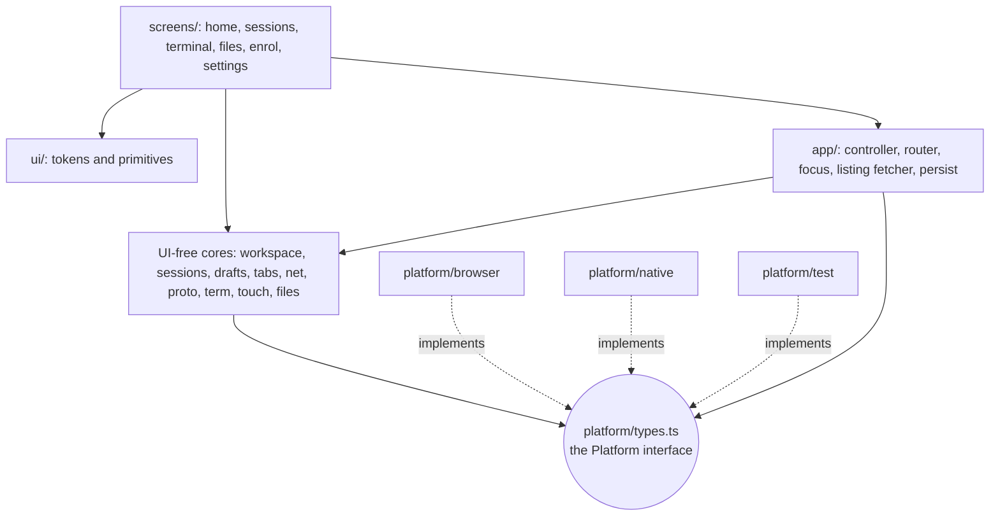
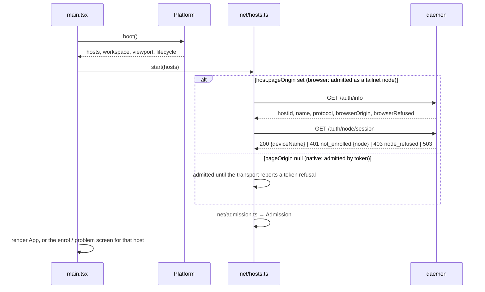
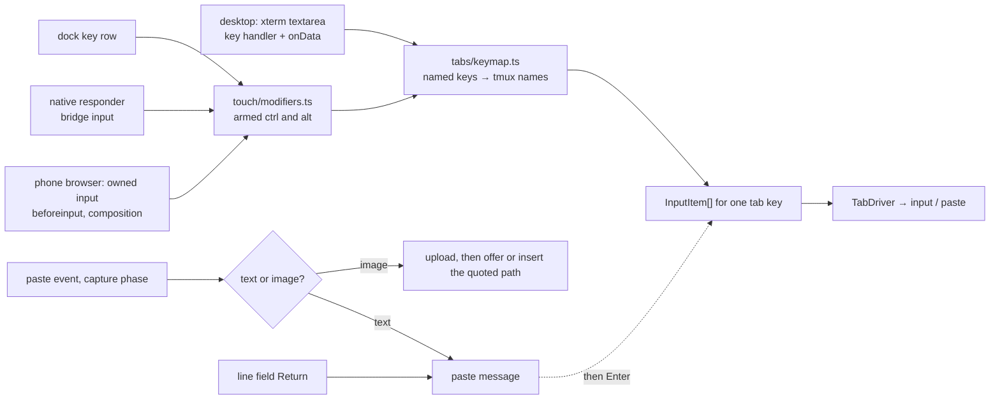
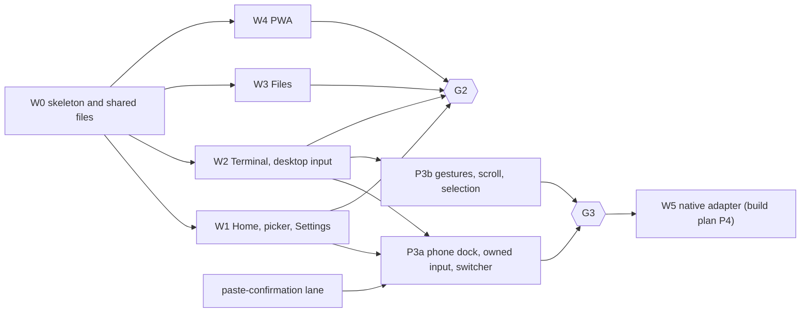

# Client architecture: the rebuilt web client

Status: current client architecture, revision 6, 2026-10-26. Revision 6 settles the
app-started native line owner, native-owned generations and draft-to-native sync rule for
the one-keyboard flow. Revision 5 settles the native line editor, mirror and growing
one-line box. Revision 4 answered
[review 1](client-architecture-review-1.md) and the
[alignment review](client-architecture-review-alignment.md); revision 3 applied
[review 2](client-architecture-review-2.md); revision 4 applies
[review 3](client-architecture-review-3.md), mostly by deleting mechanisms: the update
roll call, the second listing fetcher, the copies of navigation state, admission in the
adapter, and the browser's second focus owner. The
[disposition table](#review-disposition) at the end says where each finding went.

**Superseded in part by tabs-follow-a-session (2026-10-25).** A tab is a tmux *session*,
not a window; the current rules are in
[design-session-follow-and-folder-find.md](../design-session-follow-and-folder-find.md) §1,
`docs/design/daemon-core.md` (§3.6 sizing and claims, the protocol table) and
`docs/design/ios-shell.md` (bridge 5). Where this spec says `WindowRef`, a window tab, a
window in a list, bridge 2 or saved workspace version 1, read session; the passages that
carried the old rule are corrected in place (glossary, §5.4 band and re-watch, §6.1 tab
key, labels and saved workspace, §6.2 restore). Sections about other subjects, and the
review logs and disposition table, are historical and untouched.

This spec covers the web client that replaces today's `web/` views. That client runs
in three places: a desktop browser, a phone browser or installed PWA, and the native
iPhone app's WKWebView. Behaviour comes from
[the interaction contract](../../../../docs/design/client/browser-behaviors.md) and the
approved [mockup](../../../../docs/design/client/mockups/index.html). This spec decides
how the code is shaped to deliver that behaviour, and which mockup details to improve.
Admission follows [browser auth revision 4](browser-auth.md); session limits follow
[resource limits](resource-limits.md).

**Labels used below.** Daemon lanes from the [build plan](../build-plan.md): **L2**
browser admission and the static shell, **L3** wrap-preserving snapshots, **L4**
protocol gaps. Gates: **G1** daemon review, **G2** web review and browser probes,
**G3** Simulator and the real-iPhone checklist. Web lanes **W0–W5** and **P3a/P3b** are
defined in §11.

## 1. The answer

One Preact app, three **platform adapters**, and one rule for each hard boundary:

- **Keep the UI-free core and delete every view.** These survive with their tests:
  `proto/`, `net/`, `tabs/`, the terminal write pipeline, sizing and prompt tracker,
  the `/fs` client, and `Store`. Every component and stylesheet goes, along with the dev
  shim and the suggestion strip. A new pure **workspace** core owns tabs, the active
  tab, restore and pruning, and nothing else.
- **Every piece of state has one owner.** One fetcher feeds the sessions listing to
  Home and to pruning. Browser history is the navigation stack (overlays, Files
  folders, preview); everything else learns of it only as a `navigated` event.
- **One `Platform` interface holds everything environment-specific.** That covers boot,
  socket and HTTP transport, input and focus, viewport, lifecycle, storage, uploads,
  clipboard, links, video, haptics, restart and, in the browser, updates and install.
  It has one change channel and three implementations: `browser`, `native` and `test`.
  It exposes no environment name, so nothing can branch on one. Admission is daemon
  protocol, so it lives in `net/`, not in the adapter. Lint keeps every use of
  `window.webkit`, `visualViewport`, `indexedDB`, `navigator` and
  `document.visibilityState`, bare or through `window`/`globalThis`, inside
  `web/platform/`. The browser adapter holds no credential and has no dev mode.
- **The design system is owned primitives on native HTML, with no component library.**
  Tokens come in three tiers of CSS custom properties: primitive, semantic and
  component. There is a light and a dark theme. **Density** depends on the pointer:
  `compact` for a fine pointer, `touch` with 44 px targets. **Layout** depends on the
  screen size: the desktop top row, or phone Home. About fifteen primitives are built on
  `<dialog>`, `<button>` and `<input>`. No `preact/compat`. Only `app/focus.ts` moves
  DOM focus.
- **Terminal input depends on the input device, not the user agent.** A desktop with a
  fine pointer keeps xterm's own textarea, under a strict key-handler contract. Phone
  browsers use a tether-owned input that sends only committed text. Native keeps native
  input. Named keys always go to tmux by name. Paste is intercepted before xterm sees
  it. On touch, a web-drawn dock is the same in the browser, the PWA and the app: at
  rest one row (tab chip, one-line field, keyboard toggle), with the key row above it
  while the keyboard is up. The current-tab button opens the sessions overlay. The line field's
  Return sends its line and then Enter.
- **Touch gestures have one owner.** A sans-IO recognizer decides between tap,
  scroll, long-press and cancel before anything reaches tmux or raises the keyboard.
  A long-press highlights the word under the finger at once; dragging while held extends
  it, and lifting shows the edit menu. The text comes from a bounded snapshot.
- **The PWA's service worker serves the shell from cache and nothing else.** It
  precaches the whole build and never touches `/ws`, `/auth`, `/fs` or `/complete`. A
  new version takes over only when Jimmy taps Update, and only the page he tapped
  reloads; other pages keep running on the previous build's cache and offer Reload.
  Nothing typed offline is ever queued.
- **Lanes own disjoint files in one checkout.** One writer lays the skeleton and every
  shared file (W0), and stays on as their owner, taking change requests from the other
  lanes. Home, Terminal, Files and the PWA then proceed in parallel, the touch input
  after Terminal and the native adapter after that, each against named daemon
  prerequisites. Coders don't commit: the lead commits each change by pathspec and
  preflights a clean export of exactly that commit.



### Fixed choices this design keeps

These are Jimmy's explicit choices. No lane changes them without his say:

- Desktop terminal `+` opens the sessions picker directly, and the phone's current-tab
  button opens the sessions sheet directly. There is no intermediate menu, and Files is
  in neither.
- No dot status markers. No middle-dot separators in any copy (§8.6 checks it).
- On touch, Terminal ends in the phone dock, in the browser, the PWA and the app. At
  rest it is one row: the current-tab button and the keyboard toggle (the line field replaces the button while the keyboard is up). While the
  keyboard is up, the fixed key row (esc ↑ ↓ ^R ^C tab ctrl alt | ~ / -) sits above it.
  Tabs on top were rejected ("hard to reach").
- The current-tab button opens one sessions sheet: search and every session on top,
  the open tabs and + at the bottom (2026-10-27 redesign; supersedes the tall switcher).
- A long-press fires with a haptic and selects the word at once; held and dragged it
  extends the selection, released it shows the menu.
- The keyboard toggle opens and closes the keyboard. A tap on the cursor's row or the row
  above or below it also opens it; no tap closes it.
- The line field is one line; Return sends the text and then Enter, and clears it.

## 2. Vocabulary

One name per concept. The code, the specs and the UI copy use these.

| Term | Meaning | Not to be confused with |
|---|---|---|
| **host** | One tether daemon endpoint, identified by `hostId` (`/auth/info.hostId`, `welcome.host.id`). The browser has exactly one, the daemon behind its page origin. Native has a saved list | `SessionRef.server`, a tmux server *instance*. UI copy shows the host's name (`pop-os`) with no label word; native settings call the list "Servers" (connection-roadmap.md) |
| **tab** | A tether tab: one tmux session open in tether, showing whichever window the session shows. Its identity is the **tab key**, `(hostId, SessionRef)` | A browser tab. Closing a tether tab never touches tmux |
| **route** | Home or the active tab: the top level of navigation. The screen on screen (Home, Terminal or Files) follows from the route and the active tab's kind | |
| **overlay** | A modal surface stacked on a route: sessions, a creation dialog, Settings, a confirmation. Back closes it first | Files' folder stack and preview, which belong to Files; the **status band** |
| **navigation stack** | The browser history entries tether pushes: route, overlay, Files folder and preview (§6.6). Its only writer is the router | The tab strip, which never enters history |
| **listing** | One host's tmux sessions and windows, from `listSessions`. One fetcher gets it (§6.3) | |
| **status band** | The band on the terminal's top edge that says a tab is reconnecting, limited or failed, with Retry, or that its window is sized for another terminal, with Fit (§5.4, §8.2) | an overlay |
| **persist now** | `app/persist.ts`: hand every pending draft and workspace write to storage at once (§5.5) | |
| **sessions overlay** | The one overlay behind the desktop `+` and the phone's current-tab button: a picker dialog on desktop, a half-height sheet over the tab on the phone (search, sessions, the open tabs and + at the bottom) | the picker and switcher overlays of P3a |
| **dock** | On touch, the bottom of Terminal: at rest one row (tab chip, line field, keyboard toggle); while the keyboard is up, the key row above it. Always visible; rides on the keyboard | The desktop tab strip |
| **current-tab button** | The phone's control naming the active tab and the open-tab count; opens the sessions overlay | a tab pill |
| **line field** | The dock's one-line text field, with the platform's autocorrect, dictation and IME. Return sends its line and then Enter | **direct input**; the shell's own line editor |
| **draft** | The line field's unsent text for one tab key, saved locally | |
| **key row** | The dock's row of terminal keys, shown above the resting row while the keyboard is up | an app-drawn keyboard; it supplements the system keyboard |
| **keyboard toggle** | The one control that opens and closes the on-screen keyboard on touch, at the right of the resting row | |
| **direct input** | Keystrokes that go to tmux as they are typed | the line field |
| **terminal input** | The element that takes direct input: xterm's textarea, the owned input, or native's responder | the line field |
| **admission** | Whether the daemon lets this client in (§4.2) | A credential. The browser holds none |
| **stable box** | The terminal's box with no software keyboard and nothing that appears with it. tmux is sized from it alone | The visible box |
| **layout** | `desktop` (one top row) or `phone` (Home, full-screen terminal and Files above the dock), chosen by screen size | **density** |
| **density** | `compact` or `touch` (44 px targets), chosen by pointer | layout |

## 3. What survives, what goes, and the new layout

### 3.1 Dispositions

Dispositions come from the p25 inventory and from reading each module's imports. "Keep"
means kept with its tests; "Revise" names the change.

| Today | Disposition | Why |
|---|---|---|
| `proto/generated/`, `frames.ts`, `window.ts` | **Keep** | UI-free, tested, the wire contract |
| `proto/link.ts` | **Revise**: `token` becomes optional. `tether.v1` is always offered, and `tether.auth.<token>` only when a token exists. `hello.client.kind` is `"web"` in the browser (it defaults to `"ios"` today) | Auth rev 4 §3.14 and §5: the node lane offers only `tether.v1` |
| `net/host.ts` | **Revise**: takes its socket from `platform.transport` (§5.2). Routes paste replies by `req` to the paste's tab (§7.5) | Reconnect, backoff and request routing already match plan.md "Reconnect" |
| `net/http.ts`, `net/fakes.ts` | **Keep** | |
| `tabs/connection.ts`, `tabs/driver.ts` | **Keep**. The driver gains the `limited` state (§6.4) and the paste result (§7.5) | Tested state machine. `cover`/`uncover` already end and resume the watch; `Terminals` calls them |
| `tabs/input.ts` | **Keep**. `InputEvent` moves to `platform/types.ts` | `toMessages` and `shellQuote` are pure |
| `term/pipeline.ts`, `term/index.ts` | **Keep**, unchanged. The pipeline gets no wrap map: L3 replays soft wraps inside the snapshot bytes, so xterm marks the continuation rows itself. `term/index.ts` gains the renderer API P3 needs (§11) | Serialized writes, renderer boundary |
| `term/prompt.ts` | **Keep** | Tap-to-position on the prompt line reads its OSC 133 marks (plan.md "Cursor movement"; §7.6) |
| `term/size.ts` | **Revise**: one formula over `Viewport` (§5.4), with no per-environment branch and no `reason`. A trailing 150 ms debounce is added | Rotation with the keyboard up must keep its rows (`size.test.ts` keeps that case) |
| `term/xterm.ts` | **Revise**: stdin is on only when direct input is `xterm`. One renderer instance lives for the page's life and moves between layouts. `terminalBottomPan` reads the pan area (§5.4), not `container.clientHeight` | It is hard-wired inert today; recreating it would lose the buffer; the browser's container never shrinks for the keyboard |
| `app/sync.ts` (`HostSync`) | **Revise** into `app/listing.ts`, the one listing fetcher (§6.3). It feeds `sessions/` and the workspace reducer, forwards `windowRenamed` as `renamed`, and retries a failed listing while any tab is `restoring` | Its triggers and debounce are right; a second fetcher in `sessions/` would double every listing |
| `app/status.ts` (`describe`) | **Keep**, moved to `tabs/status.ts`, with copy for `limited`. Host copy (4005, admission) goes to `ui/hostProblem.ts` | Pure; tab-state copy belongs with the tab state |
| `app/hosts.ts` | **Revise** into `net/hosts.ts`. The registry stays, and gains each host's admission state (§4). `TokenLink` moves into the native transport | The token is a native concern |
| (new) `net/admission.ts` | **New**: pure. `/auth/info`, the session reply, close codes and native token refusals in; `Admission` out (§4.2) | Admission is daemon protocol, the same in every environment, so it is unit-tested once |
| `app/app.ts`, `app/windows.ts` | **Delete**. Their logic moves into `workspace/` and `sessions/` | Sheet routing, native `prompt` for names, and `typeChip` all go |
| `app/Chrome.tsx`, `Sheets.tsx`, `TabBar.tsx`, `app.css` | **Delete** | Old views |
| `files/api.ts`, `browser.ts`, `kinds.ts`, `images.ts`, `fakes.ts` | **Keep**. `browser.ts` drops its Settings and root-picker places as navigation places; removing a root is a router overlay on Files (`screens/files/FolderDialogs.tsx`), and adding one is the path field (`screens/files/PathField.tsx`, whose editing is a `files/find` overlay) over `FileBrowser.addRoot` and `removeRoot` (decisions.md "Add folder becomes the path field"). The workspace holds a Files tab's place; `FileBrowser` follows it (§6.6) | Tested `/fs` client and navigation state |
| `files/markdown.ts`, `files/code.ts` | **Keep**, moved to `files/render/`, which may use the DOM | They build DOM and run DOMPurify |
| `files/FilesSheet.tsx`, `Viewers.tsx`, `files.css` | **Delete**. The viewers are rebuilt in `screens/files/` on `files/render/` | Old views |
| `complete/` (strip, suggester, its test) | **Delete** | The suggestion strip is deferred (client README). Git keeps it |
| `ui/store.ts` | **Keep** | Pure (`ui/format.ts`, which nothing called, is deleted) |
| `ui/theme.ts` | **Keep**. Reads the new `--term-*` tokens; takes the scheme from `Viewport.scheme` instead of calling `matchMedia` (lint rule 3) | Token-driven |
| `ui/hostProblem.ts` | **Revise**: copy per admission state (§4.2), worded by how the host admits this client (as a tailnet node, or by a native token), never by environment name. It also takes the host copy for 4005 | Today's copy names the iPhone |
| `ui/tokens.css`, `Tappable.tsx`, `Sheet.tsx`, `icons.tsx` | **Delete**. Replaced by `ui/tokens/` and `ui/primitives/` | Hand-rolled, and built for native-owned focus |
| `native/bridge.ts` | **Revise** into `platform/native/bridge.ts`, at bridge version 2 (§5.10) | |
| `dev/shim.ts` | **Delete** | Desktop development uses the real browser adapter (§5.11) |
| `main.tsx`, `index.html` | **Rewrite**: pick the adapter, boot, render `<App>` | |
| `eslint.config.js` | **Rewrite** the focus and boundary rules (§3.3) | |
| `vite.config.ts` | **Revise**: `base: "/"`, budget output, `manualChunks` for the grammar allowlist (§8.4), and the dev proxy of §5.11. It imports `sw/vite-plugin.ts`, which W4 owns: the worker entry, the precache list, and the manifest link and `theme-color` metas injected into `index.html` | W4 iterates on the worker without touching W0's files |

| `tsconfig.json` | **Revise**: exclude `sw/`. `sw/tsconfig.json` uses the `WebWorker` lib | The worker has different globals |

### 3.2 New layout

```text
web/
  main.tsx, index.html   pick the Platform, boot, render <App>
  platform/
    types.ts         the Platform interface and every type it names (§5). No implementation
    browser/         index.ts (assembles the Platform) and one file per capability: boot.ts,
                     transport.ts, viewport.ts, lifecycle.ts, storage.ts, uploads.ts,
                     clipboard.ts, links.ts, pwa.ts (updates and install)
    native/          bridge.ts (v2) and adapter.ts
    test/            in-memory Platform for vitest and the harness
  proto/             wire types, frames, link
  net/               host.ts, http.ts, hosts.ts (registry, admission state), admission.ts (pure)
  tabs/              connection.ts, driver.ts, input.ts, keymap.ts (KeyboardEvent → InputItem),
                     status.ts (describe)
  term/              pipeline, size, prompt, xterm renderer, xterm-input.ts (desktop source)
  touch/             touch-only: owned-input.ts, modifiers.ts (armed ctrl and alt, pure),
                     gesture.ts (recognizer), selection.ts
  workspace/         pure: tabs, active tab, restore, pruning, labels
  sessions/          pure: listing cache per host, search, expansion, creation requests
  drafts/            pure: per-tab line-field drafts, Return send state, eviction
  files/             /fs client and FileBrowser (the browsing state); render/ (markdown, code)
  app/               <App> root and its context, controller, router.ts (the navigation
                     stack), focus.ts (the focus controller), listing.ts (the listing
                     fetcher), persist.ts (persist now)
  screens/
    shell/           top row (desktop), screen frame, host banner
    home/            open tabs, sessions list, creation dialogs, bottom nav (phone)
    sessions/        the sessions overlay (phone sheet, desktop picker) and the session rows Home shares
    terminal/        tab strip, terminal surface, status band; dock/ (the phone dock)
    files/           folder list, preview, upload, insert path
    enrol/           enrolment and admission-problem screens
    settings/        Remove this device, Clear local data, Add to Home Screen
  ui/
    tokens/          primitives.css, semantic.css, components.css, fonts.css
    primitives/      Button, IconButton, Tooltip, TextField, SearchField, Dialog (with a
                     sheet variant), Disclosure, Row, RovingList, TabStrip, Banner, Toast,
                     StatusBand, EmptyState, Spinner, Icon, LineField, KeyRow
    store.ts, theme.ts, hostProblem.ts
  sw/                the service worker, built as its own entry; vite-plugin.ts
  public/            icons, apple-touch-icon
  harness/           harness entry, to look at each state; never in a production build.
                     index.ts imports one fixture directory per lane (harness/<lane>/)
  e2e/               opt-in end-to-end scripts (`*.real.ts`) on a real daemon, one directory per lane
```

**Screens call their own cores directly.** `app/` provides one context (`useApp()`):
the platform, the host registry, the router, the focus controller and persist now. A
screen's own logic (creation, upload, insert path, line field send) lives in the screen or
its core and calls through that context, so a lane adds behaviour without editing
`app/`. The controller in `app/` runs only the workspace reducer's effects. Each screen
styles itself with a CSS module (`*.module.css`) beside it, so five lanes writing CSS
at once can't collide on class names.

### 3.3 Lint rules

Today's rule bans `<button>`, `<input>`, `<textarea>`, `<select>` and `contenteditable`
everywhere, because native owned all focus. The new rules keep one focus controller per
environment, and let the web have forms. Every rule uses core ESLint
(`no-restricted-syntax`, `no-restricted-imports`, `no-restricted-globals`,
`no-restricted-properties`) in per-directory `files:` blocks, so no plugin is needed.
W0 seeds each rule, and each form of rule 3, with a violation in a lint fixture that
its tests expect to fail.

1. **Raw editable and interactive elements appear only in `ui/primitives/`,
   `term/xterm-input.ts`, `touch/owned-input.ts` and `platform/browser/uploads.ts`**
   (its hidden file input, §5.7). Screens use `TextField`, `SearchField` and `Button`.
2. **`.focus()` and `.blur()` are called only in `app/focus.ts`.** Elements that can
   hold focus register with the focus controller instead (§6.5).
3. **Environment globals appear only in `platform/`.** The names are `webkit`,
   `visualViewport`, `indexedDB`, `localStorage`, `sessionStorage`, `navigator`,
   `open`, `matchMedia`, `BroadcastChannel`, plus `document.visibilityState` and
   `document.hasFocus`. `no-restricted-globals` alone catches only the bare name, so the
   rule has three parts:
   - `no-restricted-globals` for each bare name;
   - `no-restricted-properties` for `window`, `globalThis` and `self` with each name,
     and for `document` with `visibilityState` and `hasFocus`;
   - `no-restricted-syntax` for any `MemberExpression` whose property is `webkit`, and
     for destructuring from `window`, `globalThis` or `self`
     (`VariableDeclarator[init.name=/^(window|globalThis|self)$/] > ObjectPattern`).
4. **Import boundaries.**
   - Only `main.tsx` imports `platform/browser/` or `platform/native/`.
   - Only tests and `harness/` import `platform/test/`.
   - Only `term/` imports xterm.
   - `screens/` never imports a platform implementation.
5. **No Preact and no `window` or `document` in `workspace/`, `sessions/`, `drafts/`,
   `tabs/`, `net/admission.ts` or `touch/gesture.ts`.** These are sans-IO where they
   hold state: events in,

   state and effects out, as plan.md asks of the daemon's cores. `proto/link.ts` may use
   `WebSocket`, and `files/render/` may use the DOM.

**Native keeps its single focus controller.** The native app no longer bans web text
fields. Instead, the web tells native which focus mode a screen needs, whenever the
screen or overlay changes (§6.5). With Home, Files or any dialog on screen, native
is in `webText`: its guard is down, so any field can take the keyboard on the user's tap
with no handshake. That replaces ios-shell.md's "no other web text inputs" rule and the
`prompt` bridge message.

## 4. Hosts, admission and boot

### 4.1 Boot



- **Admission is daemon protocol, so it lives in `net/`.** `net/admission.ts` is pure:
  the `/auth/info` reply, the session reply, the page origin, close codes (4401, 4503)
  and native token refusals go in, and an `Admission` comes out. `net/hosts.ts` holds
  each host's admission state, runs the two GETs through `transport.httpBase`, and
  retries `deciding` with that host's backoff. The adapter supplies only facts: each
  `HostEntry`'s `pageOrigin`, and the transport. The same mapping therefore runs, and is
  unit-tested, in every environment.
- **The browser holds no credential.** Auth rev 4 admits a browser as an enrolled
  tailnet node, decided by the daemon from the peer address Serve forwards. There is no
  cookie and no token in JavaScript. The browser transport opens `/ws` offering only
  `tether.v1`, and fetches `/fs/*` with relative URLs.
- **Admission is read from the daemon at every launch.** For a host with a
  `pageOrigin`: first `GET /auth/info`, then `pageOrigin` is compared with
  `browserOrigin`, then `GET /auth/node/session`. Nothing about enrolment is stored in
  the browser.
- **Native** boots as today through the bridge, with the saved workspace, hosts and
  lock state. Its hosts have no `pageOrigin`: a token admits them, and the token never
  reaches page code. A `{ notEnrolled }` token reply, or native's `hostRejected`,
  reaches `net/admission.ts` as a token refusal through the transport (§5.2).
- **Protocol mismatch.** It is detected when `/auth/info.protocol` falls outside the
  range the client speaks, or when the socket closes with 4001 and `incompatible { min,
  max }`. Input is disabled on that host's tabs. The host banner says the page is out
  of date and offers Update where `platform.updates` exists (§9.3), else "Update the
  app". It is never retried.

### 4.2 Admission states

| Daemon answer (auth rev 4 §3.8) | `Admission` | What the client shows |
|---|---|---|
| `200 {deviceName}` | `admitted { deviceName }` | the app; Settings names the device |
| `browserOrigin` ≠ the host's `pageOrigin` | `wrongOrigin { origin }` | "Open tether at `<origin>`", with a link. No socket opens |
| `browserOrigin: null`, `browserRefused: <reason>` | `originRefused { reason }` | why browsers can't use this host (`ambiguous_origin`, `not_https`…), with the `tether` command that fixes it. No retry |
| `401 not_enrolled {node: {name}}`, or close 4401 then that answer | `notEnrolled { nodeName }` | the Enrol screen (§4.3) |
| `403 node_refused {reason}` | `nodeRefused { reason }` | the reason in words ("This device is a subnet router"). No form, no retry |
| `503 identity_unavailable`, `auth_unavailable`, `busy`; close 4503 | `deciding` | keeps the current screen and workspace, retries with the host's backoff, and says "Checking access…" after 10 s |
| no answer | `unreachable` | Home's offline state (§9.4), drafts included |

A 4401 close mid-session is not taken as `notEnrolled` on its own. `net/hosts.ts` first
asks `GET /auth/node/session` why, because the node may now be refused. While it waits,
tabs and drafts stay. Enrolling again resumes where Jimmy was. For a token-admitted host
`notEnrolled` means the app's server pairing is gone; its copy points to the app's
Servers settings, and no Enrol screen is shown.

### 4.3 The Enrol screen and Settings

- **Enrol** shows the host's name from `/auth/info` and a code field. It also shows a
  device-name field, prefilled with `nodeName` and editable, and the sentence "This lets
  every browser and app on `<node>` use tether on `<host>`." The instruction above the
  code field says to run `tether enroll` on the server. Submitting calls
  `hosts.enrol(host, code, deviceName)` in `net/hosts.ts`, which posts
  `POST /auth/node/enroll` through `httpBase` and then checks admission again.
  `EnrolResult` is `enrolled`, `badCode` ("That code is wrong or has
  expired", under the field), `nodeRefused { reason }` (the refusal screen), or
  `tryAgain` for a `503` ("tether is busy, try again"; the code is not consumed).
- **Settings** is an overlay opened from a Settings row at the bottom of Home. It holds:
  - **Remove this device**, for a host admitted as a tailnet node (its entry has a
    `pageOrigin`). It asks for confirmation: "Every browser and app on `<node>` will
    lose access to `<host>`." Then it closes this page's sockets, calls
    `hosts.removeDevice(host)` (`POST /auth/node/remove` through `httpBase`) and shows
    Enrol. Drafts stay.
  - **Clear local data.** After a confirmation it deletes drafts and the saved workspace
    on this device only.
  - **Add to Home Screen**, when `platform.install` is present and reports the page not
    installed, in the phone layout. It shows the iOS steps: Share, then Add to Home
    Screen. It is never a forced screen.

- One enrolment covers the whole machine: Safari, the installed PWA and any other
  browser on that node. Storage is not shared, though: Safari and the PWA keep separate
  drafts and workspaces. The Enrol screen and the install steps say both.

## 5. The platform adapter

### 5.1 The interface

Methods that can fail return typed results rather than throwing, so screens can render
the failure. **Optional members are capabilities only some environments have**
(`updates`, `install`, `uploads.send`). Code checks for the member, never for an
environment: the interface has no `kind`. W0 writes every type named here into
`platform/types.ts` before the lanes fork.

```ts
interface Platform {
  boot(): Promise<BootResult>;
  /** The one change channel. The controller in app/ routes each event to its owner. */
  subscribe(listener: (event: PlatformEvent) => void): Unsubscribe;
  transport: Transport;          // §5.2
  input: InputPlatform;          // §5.3
  storage: PlatformStorage;      // §5.6
  uploads: Uploads;              // §5.7
  clipboard: Clipboard;          // §5.8
  openURL(url: string): void;                       // http(s) only
  playVideo(handle: string, path: string): "handled" | "inline"; // native player, or a <video> in the page
  haptic(kind: HapticKind): void;                   // browser: no-op
  restart(reason: "stuck" | "update"): void;        // native: recreateWebView; browser: reload, bounded (§5.2)
  updates?: Updates;                                // §9.3; present where a service worker runs
  install?: { installed(): boolean };               // §4.3; present in the browser
}

interface BootResult {
  hosts: HostEntry[];                    // browser: exactly one, this origin's daemon
  workspace: unknown;                    // as stored; workspace/saved.ts parses it (§6.1)
  viewport: Viewport;                    // §5.4
  lifecycle: Lifecycle;                  // §5.5
}

interface HostEntry {
  /** The adapter's handle for this endpoint; transport methods take it. */
  handle: string;
  /** The daemon's identity and name, when the adapter already knows them (native's
   *  saved list). Browser: null until net/hosts.ts reads /auth/info or `welcome.host`. */
  hostId: string | null;
  name: string | null;         // "pop-os"
  /** The page origin the daemon must name as browserOrigin. Set when the daemon admits
   *  this client as a tailnet node; null when a native token admits it (§4.1). */
  pageOrigin: string | null;
}

type PlatformEvent =
  | { type: "hosts"; hosts: HostEntry[] }                    // native host list changed
  | { type: "viewport"; viewport: Viewport }                 // §5.4
  | { type: "lifecycle"; lifecycle: Lifecycle }              // §5.5
  | { type: "input"; tab: TabKey; events: InputEvent[] }     // native responder (§5.3)
  | { type: "draftChanged"; key: TabKey }                    // another page changed a draft
  | { type: "storage"; state: "closing" | "closed" }         // §5.6, IndexedDB upgrade
  | { type: "update"; state: UpdateState };                  // §9.3, only with `updates`

interface Updates { check(): Promise<void>; apply(): void }   // §9.3
type UpdateState = "none" | "ready" | "reload";   // reload: another page applied an update (§9.3)
type HapticKind = "selection" | "rigid" | "key" | "modifier";   // ios-shell "Haptics"
interface SafeArea { top: number; right: number; bottom: number; left: number }
type Unsubscribe = () => void;
```

`Admission`, `EnrolResult` and the admission calls are not here: they live in `net/`
(§4). `TabKey`, `InputEvent`, `SavedWorkspace` and `DraftRecord` are defined in §6.1,
§7 and §5.6, and exported from `platform/types.ts` because the adapters carry them.

### 5.2 Transport

```ts
interface Transport {
  /** Returns a Link at once. A refusal arrives as a synthetic close, like 4401. */
  openSocket(handle: string, handlers: LinkHandlers): Link;
  /** Where every /auth, /fs and /complete URL starts. */
  httpBase(handle: string): string;  // browser: "" (same origin); native: "tether-app://h-<id>"
}
```

- **Native** asks the bridge `socket { host }` asynchronously inside the `Link` and gets
  `{ url, token }`, `{ locked }` or `{ notEnrolled }`. The URL and token stay in the
  Link (`platform/native/transport.ts`); only the daemon's 4401 sends the exact token back
  as `hostRejected`. `{ locked }` closes the link as a retryable loss (`lifecycle.locked`
  stops and restarts the sockets), and `{ notEnrolled }` closes it with 4401, which
  `net/admission.ts` reads as a token refusal. `Host`'s synchronous `open` stays as it is.
  A republished `hosts` event lets a refused host try again.
- **Browser** opens `wss://<origin>/ws` offering `tether.v1` only.
- **Stuck sockets.** When two sockets in a row stick in CONNECTING, `Host` reports
  `stuck`. The controller runs persist now, then calls `platform.restart("stuck")`.
  Native recreates the web view. The browser reloads at most once per 10 minutes,
  tracked by a `sessionStorage` timestamp. After that it halts with "Can't reach
  pop-os" and Retry, so a slow cellular link can't loop reloads.

### 5.3 Input and focus

```ts
interface InputPlatform {
  /** The focus mode the screen needs (§6.5). Native: bridge `focus`. Browser: no-op,
   *  because app/focus.ts already moved DOM focus in the same dispatch. */
  setFocus(mode: "terminal" | "line" | "hidden" | "webText" | "select"): void;
  /** Replace native's editing copy; native advances and returns its own generation. */
  setLine(text: string, caret: number, tab: TabKey): Promise<number>;
  /** Native line editing controls. Browser and test adapters are no-ops. */
  setLineCaret(index: number): void;
  insertLine(text: string): void;
  selectAllLine(): void;
  setArmedModifier(armed: "ctrl" | "alt" | null): void;
}
```

Native terminal keys arrive as `input` events; line edits arrive as `lineEdit` with a
native generation, tab binding and UTF-16 selection ranges. The app-started, non-React
native line owner waits for drafts, reconciles the boot snapshot, applies tab-bound edits
and handles Return. A valid delayed edit still updates its bound draft after focus changes;
an older generation is ignored. `lineReturn` captures its generation, text and tab at the
key press; native clears and advances before sending it, so delayed handling cannot send
later typing or retarget the Return. The web sends `lineSet` only when the bound draft
differs from the last native-reported text, and native owns generation assignment. If the
page is not ready, Return stays in the native field and warns instead of being queued. The
adapter buffers startup events until the app-started owner subscribes; the owner buffers
them only until draft hydration.

`directInput` picks the terminal input source (§7). It is `xterm` when the primary
pointer is fine and can hover (`(pointer: fine) and (hover: hover)`), `owned` when the
primary pointer is coarse, and `native` in the app. It is a `Viewport` field, from the
same pointer media query as `density`, so a change (an iPad gaining a trackpad) arrives
as a `viewport` event. User-agent sniffing is not used.

### 5.4 Viewport, keyboard and the stable box

```ts
interface Viewport {
  layout: "desktop" | "phone";
  density: "compact" | "touch";
  directInput: "xterm" | "owned" | "native";   // §5.3
  scheme: "light" | "dark";
  width: number;           // CSS px of the window or web view
  stableHeight: number;    // its height with no software keyboard
  visibleHeight: number;   // on screen now
  keyboardInset: number;   // how far the keyboard (or Safari's form bar) covers the bottom of the stable box; 0 with none
  safeArea: SafeArea;      // of the keyboard-hidden layout
  keyboard: boolean;
  hardwareKeyboard: boolean | null;   // native only (GCKeyboard); null in the browser
}
```

**The invariant: tmux is sized only from the stable box.** That box excludes the
software keyboard and everything that appears with it: overlays, and the dock's lift
onto the keyboard. The dock itself is chrome, in flow in the keyboard-hidden layout. Nothing that only shows or hides ever resizes tmux.

**One sizing formula, in every environment.** `term/size.ts` computes

```text
cols = floor((width − safeArea.left − safeArea.right − chrome.x) / cell.width)
rows = floor((stableHeight − safeArea.top − safeArea.bottom − chrome.y) / cell.height)
```

and recomputes whenever an input changes. `chrome` is the tether chrome in flow around
the terminal in the keyboard-hidden layout (the top row, the dock's
resting slot), measured by the terminal screen in a short window after layout, density,
width or the safe area change, and at the start, never per resize. A
keyboard opening changes none of these inputs, so it never resizes tmux, and the sizer
needs no event reason. Only the adapters differ, in how they define `stableHeight`:

- **Native**: `collapsedHeight`, as today. Every `viewport` message carries the
  keyboard-hidden safe area, so a rotation with the keyboard up still yields the
  collapsed layout's rows.
- **Browser**: the app root, which is `100svh` tall: the small viewport height, which
  doesn't change when Safari's toolbars collapse or the keyboard opens. On desktop that
  is the window's height. On touch the terminal container and the dock's resting slot
  share that root, in flow, so no tmux row sits under the dock. While the keyboard is
  up, the dock is translated out of its slot by `keyboardInset`: the distance from the
  stable box's bottom to the visual viewport's bottom edge, which is above Safari's form
  accessory bar. The browser computes it from the visual viewport (so Safari scrolling the
  layout when a field takes focus is counted) and `applyViewport` publishes it as
  `--keyboard-inset`; the dock, sheets (`Dialog`) and toasts rise by it in CSS, and
  `keyboard` comes from the height alone
  (see Keyboard detection), so Safari scrolling the page cannot lower it. `chrome.y` measures the dock without its bottom safe-area
  padding, which `safeArea.bottom` already counts.
- **The pan area** is what remains visible of the terminal: `visibleHeight` minus the
  key row and translated dock. `terminalBottomPan` reads this number, not `container.clientHeight`,
  which in the browser never shrinks. Native passes its shrunken web view's height; a
  changed `visibleHeight` also refreshes the measured area when `keyboardInset` remains 0.
- **Applying a size.** Only the trailing size is sent, 150 ms after the last change, so
  dragging a window edge doesn't resize tmux for every cell. Fit (below) re-sends the
  current size at once. A tab's first `watch` waits
  until the font is loaded and the box has been measured once, so tmux never sees the
  80×24 placeholder.
- **The pane keeps tmux's size, whatever the box.** A window takes the size of the
  client that acted on it last ([daemon-core.md §3.6](../../../../docs/design/daemon-core.md#36-sizing)):
  `watch`, `resize`, `input` and `paste` claim it for this tab, and the laptop typing
  takes it back. So the pane can be larger than the tab's own size (another terminal
  has it) or smaller (that terminal has fewer rows or columns, or the window is
  split). The renderer takes the pane's size from the snapshot and `Layout` and draws
  it at the tab's own font. The font never scales to fit, so the sizer's inputs, and
  the size the tab claims with, stay the tab's own.
  - **Larger:** the pane is anchored to the left edge and clipped at the right, with no
    horizontal pan (horizontal swipes stay the system's, §7.6). Rows below the box are
    reached by the terminal-bottom pan, which keeps the last row above the dock unless
    that would put the cursor above the area's top, in which case the cursor row meets
    the bottom instead: the terminal element is the pane's height, and the pan area is
    what is visible of it. While the buffer is scrolled into history the pan anchors to
    the top, so no row is skipped; back at the bottom it keeps the last row visible.
    While larger, the tab
    renders with xterm's DOM renderer and drops the WebGL addon, which returns once the
    pane fits: a WebGL canvas is the pane's size in device pixels, so a 250×70 laptop
    window at the phone's font and 3× density would be about 17 M pixels, past
    WebKit's canvas limit and mostly clipped.
  - **The band.** The status band says "Sized for another terminal" with **Fit**, which
    sends `resize` with the tab's own size at once and so claims the window; typing,
    pasting and rotating claim it as well. It shows once the window's size, as the last
    `watching` reported it, has differed from the size the tab last sent for longer than
    max(1 s, ping round trip + 0.5 s), in either direction, so a rotation's debounce, a
    claim's round trip and a first snapshot that predates the vote don't flash it. Each
    claiming send restarts the wait, a match clears the band, and no wait runs while the
    tab is not live. The band is presentation only; nothing decides ownership from it.
    Reconnecting, limited and failed replace it.
  - **Smaller:** drawn from the top-left corner on the terminal background, with the
    band after the same wait: a claim caps the window and never grows it past the size
    of the client tmux sizes it by. With two tether tabs on one window, the smaller
    holds it until the other acts (two phones aren't designed for).
  - **Re-watching by itself.** A tab that comes on screen through the user (opened,
    switched to, back from Home, Files or a native screen, the app unlocked or brought
    forward) sends `watch` as a claim (`claimNext`). A re-watch the client makes by
    itself (a reconnect while visible, a daemon restart, a backoff retry) sends
    `claim: false` unless the tab still holds the window: the size of the shown window in
    the last `watching` equals the size the tab last sent (`holdsWindow`). That compares
    two facts the tab already has; it never reads the band. Before the first `watching`
    nothing is known, and `claimNext` is set, so the first watch claims. A network blip
    therefore never takes a window the laptop holds, even inside the band's wait.
  - Taps, selection and `cellAt` already map through measured cells and the pan, so
    they hold at any pane size.
- **Keyboard detection (browser).** `keyboard` is true when all of these hold: a text
  owner is focused (`platform/browser/viewport.ts` tracks `focusin` and `focusout`),
  `directInput` is `owned` (in either layout: an iPad without a
  trackpad gets the desktop layout and a software keyboard), `visualViewport.scale` is
  about 1 (pinch zoom excluded), and the visible height is at least 120 px less than
  `stableHeight`. It is driven by `visualViewport` resize and scroll events. No timer.
- **Colour scheme.** The viewport also carries `scheme: "light" | "dark"`, from
  `prefers-color-scheme` in the browser and the system appearance in native; a change
  arrives as a `viewport` event, and `ui/theme.ts` re-themes xterm from it.
- **Layout** is `phone` when `min(width, stableHeight) < 600` CSS px, else `desktop`. A
  landscape phone therefore stays in the phone layout. Changing layout never recreates
  the terminal renderer: one instance is reparented.
- **Pinch zoom stays allowed outside the terminal.** The viewport meta drops
  `maximum-scale` and `user-scalable=no`, and adds `viewport-fit=cover` and
  `interactive-widget=resizes-visual`. The terminal surface sets `touch-action: none`,
  so the gesture recognizer, not the browser, owns every touch on it; pinch zoom is
  therefore unavailable over the terminal. The surface also sets
  `-webkit-touch-callout: none` and `user-select: none` (the selection layer excepted),
  so iOS shows no callout or text selection of its own.

### 5.5 Lifecycle

```ts
interface Lifecycle {
  visible: boolean;
  online: boolean;
  locked: boolean;   // browser: false
  covered: boolean;  // a native screen covers Terminal; browser: false
}
```

The browser listens to `visibilitychange`, `pagehide`/`pageshow` and `online`/`offline`;
it always reports `covered: false`. Native's boot result sets the initial `covered` value,
and each full `lifecycle` snapshot carries the current `covered`. Native also
listens to `lifecycle`, `network` and its app lock. Each lifecycle update reaches the
controller, which splits the work between owners:

- **Persistence** has one owner, `app/persist.ts`. Its `persistNow()` hands every
  pending draft write (`drafts/` debounces them) and the assembled workspace to
  storage at once. The controller calls it when the page is hidden, before
  `platform.restart`, before `updates.apply()`, and on `storage: closing`.
- **Sockets** have one owner, `net/hosts.ts`, which imports no persistence. The
  registry runs a host's socket only while `visible && !locked`:
  - **Hidden or locked:** every socket closes cleanly, after persist now. The daemon
    ends the watches, so tmux gets its size back.
  - **Visible and unlocked:** reconnect at once and rewatch the tab on screen.
  - **Online:** reset backoff. `online: true` is a hint, never proof the host is
    reachable.

Nothing is written in an unload handler.

### 5.6 Storage

```ts
interface PlatformStorage {
  saveWorkspace(ws: SavedWorkspace): void;          // coalesced, latest wins
  drafts: DraftStore;
  clearLocalData(): Promise<void>;
}
interface DraftStore {
  get(key: TabKey): Promise<DraftRecord | null>;
  put(record: DraftRecord, baseRevision: number): Promise<"ok" | "conflict" | "failed">;
  delete(key: TabKey): Promise<void>;
  list(): Promise<DraftRecord[]>;
}
interface DraftRecord { key: TabKey; text: string; revision: number; editedAt: number }
```

The saved workspace arrives in `BootResult` as `unknown` (an older build wrote it), and
`workspace/saved.ts` is the one parser that turns it into the current version or null; a draft another page changed arrives as a
`draftChanged` event.

**Browser.**

- **Database.** One IndexedDB database, `tether`, schema version 1, with two stores.
  `workspace` holds the one saved workspace; `drafts` is keyed by tab key. Every write is
  one small record, never the whole workspace per keystroke.
- **Schema upgrades.** A later build may open `tether` at a higher version while pages
  on the old build still hold connections, and the upgrade is blocked until they close.
  So every page handles `versionchange`: the adapter emits `storage: closing`, the
  controller runs persist now, and once those writes complete the adapter closes the
  database and emits `storage: closed`. The page then shows "Reload to finish
  updating". Later writes stay in memory, and the line field says they won't survive
  a reload.
- **Persistence.** `navigator.storage.persist()` is requested on the first draft save;
  the client promises nothing about the result. If IndexedDB is unavailable, the
  workspace lives in memory and the line field says drafts won't survive a reload.
- **Several pages at once.** A page writes its workspace only while it has focus
  (`document.hasFocus()`), and once more when it gains focus. The saved workspace is
  therefore the one from the page used last, even with two desktop windows visible side
  by side. Draft
  writes compare revisions: a `put` whose base revision is older than the stored one
  returns `conflict`, and the line field reloads the newer text with "Edited in another
  window". A `BroadcastChannel` named `tether` carries one message, `{ draft: <tab key
  string> }`, to tell other pages a draft changed; pages ignore any other message, so
  builds of different versions never depend on each other's messages.

**Native.** The workspace goes to native through `saveWorkspace`, because native's copy
survives a crash of the web content process. Drafts go through the same `DraftStore`
interface over the bridge (`draftGet`, `draftPut`, `draftDelete`, `draftList`), and
native persists the records. The browser/PWA's line field is an editable web control; in
the app, `LineMirror` shows the same web-owned draft while the native `UITextField` owns
editing. The web applies every draft rule (§7.4) beyond the write check; the app-started
native line owner reconciles native's retained line snapshot after the initial draft list
and keeps the editing copy in step with changes in the bound draft. **The revision check runs
natively:** `draftPut` returns `conflict` when the stored record's revision is greater than
`baseRevision`, and writes otherwise. A put's base is the last revision the web *issued*, not
the last stored, so a retry after a `failed` put is ahead of the store and still writes.
Native has one page, so no other writer can slip between the check and the write.


### 5.7 Uploads, file pick and image paste

```ts
interface Uploads {
  /** Call synchronously in the tap. Ends on completion, failure, or the picker's cancel. */
  pick(handle: string, signal: AbortSignal): AsyncIterable<UploadEvent>;
  /** One pasted image the page already holds. A capability: present in the browser;
   *  native receives image paste in its own input. */
  send?(handle: string, file: File, signal: AbortSignal): AsyncIterable<UploadEvent>;

}
type UploadEvent =
  | { id: string; progress: number }
  | { id: string; path: string }
  | { id: string; error: string };
```

- **Browser.** `pick` calls `click()` on a hidden `<input type="file">` (owned by
  `platform/browser/uploads.ts`) inside the tap, and ends on the input's `cancel` event.
  A new pick removes the superseded pick's listeners from the shared input first, so one
  pick's files are never enqueued twice. A file over 128 MiB is refused before a byte is
  sent.
  Both `pick` and `send` stream the upload to `/fs/upload`. The daemon takes one upload
  at a time, so the client sends one file at a time and queues at most four. A fifth is
  refused with "Wait for the current uploads to finish".
- **Native** keeps its own picker and uploader. The web names the upload: `pickMedia { id,
  host }` carries the host Files shows and an id the web chose, and every `upload` event
  carries that id back, so the adapter routes by id alone and needs no open tab. A dismissed
  picker ends the stream with an `upload { cancelled }` event. An image read by the edit
  menu's Paste uploads natively too under its own id (§5.8).
- **The insertion target is never the adapter's concern.** The caller captures the tab
  key when the action starts and offers or performs insertion into that tab only
  (§7.5).

### 5.8 Clipboard

```ts
interface Clipboard {
  writeText(text: string): Promise<"ok" | "denied">;
  /** Paste in the terminal's edit menu (§7.6). Call synchronously in its tap. */
  read(tab: TabKey): Promise<{ text: string } | { image: File } | { uploading: string } | "empty" | "denied">;
}
```

The browser calls `navigator.clipboard.writeText` inside the gesture, and `read()` calls
`navigator.clipboard.read()` in the tap (Safari shows its own Paste confirmation): text
comes back as `text`, an image as `image`, which the caller sends through
`uploads.send`. Native routes both through the bridge to `UIPasteboard` (`copy`,
`readPasteboard`), because WebKit may not treat the `tether-app://` scheme as a secure
context for the Clipboard API (a G3 probe); an image there uploads natively and comes
back as `uploading`, followed by `upload` events under the id `readPasteboard` carried
(native sends the first after its reply).

### 5.9 Three implementations

| Capability | browser | native | test |
|---|---|---|---|
| boot | one host with `pageOrigin: location.origin`; IndexedDB | bridge `ready`; hosts with no `pageOrigin` | fixture |
| events | viewport, lifecycle, `draftChanged`, `storage`, `update` | bridge `hosts`, `viewport`, `lifecycle`, `network`, lock, `input` | `emit(event)` |
| transport | same-origin `/ws` offering `tether.v1` | `tether-app://h-<id>`, token subprotocol; `{ notEnrolled }` and `hostRejected` as token refusals | fake `Link` (`net/fakes.ts`); fake `/auth` replies, so the real `net/admission.ts` runs |
| direct input | `xterm` or `owned` | `native` | scripted events |
| focus / line editing | focus and line editing methods are no-ops: `app/focus.ts` moves DOM focus | bridge `focus` and line editing messages | records requests |
| viewport | `visualViewport`, media queries, `100svh` | bridge `viewport` | settable |
| lifecycle | page visibility, online; never locked | bridge `lifecycle`, `network`, app lock | settable |
| storage | IndexedDB, `BroadcastChannel`, `versionchange` | bridge `saveWorkspace` and draft records | in memory; can be told to fail or to close |
| uploads | file input, `/fs/upload` | bridge `pickMedia`, `upload` | scripted |
| clipboard | `navigator.clipboard` in the gesture | bridge `copy`, `readPasteboard` | records; scripted reads |
| links | `window.open(url, "_blank", "noopener")` | bridge `openURL` | records |
| video | inline `<video src="/fs/raw/…">` | bridge `playVideo` | records |
| haptics | none | bridge `haptic` | records |
| restart | bounded reload | bridge `recreateWebView` | records |
| updates | the service worker (`pwa.ts`) | absent | scripted |
| install | `display-mode: standalone` (`pwa.ts`) | absent | settable |

### 5.10 Bridge version 5 and the ios-shell.md edits

The native shell and web adapter keep the typed bridge contract and the fixtures in step.
Bridge version 5 keeps native line editing and moves generation ownership to native; it
also removes the old location-based handoff introduced in the prior contract.

| ios-shell.md section | Change |
|---|---|
| "Boot and host payloads" | `boot { tabs, active }` and `SavedTab` become `workspace: SavedWorkspace`, which still carries each tab's last label, so restored pills have names before the listing; Bridge v5 carries `Boot.focusMode` and an optional tab-bound `lineSnapshot` so native focus and live line editing survive a web-content-process restart |
| "The bridge": `saveTabs` | becomes `saveWorkspace { workspace }` |
| "The bridge": `prompt` | removed. Web forms take the keyboard in `webText` (§3.3) |
| "Focus: one controller, native" | One hidden native `UITextField` stays first responder for `terminal` and `line`; the web sends `focus line` on a box tap and exact target restoration after interruption. Only sheet fields and terminal selection give WebKit first responder. |
| "The bridge": line field | `lineSet { text, caret, tab }` has no web generation; native advances and returns the generation. `lineEdit { gen, text, tab, selection, marked }` and `lineReturn { gen, text, tab }` carry native generations; `lineReturn` captures its text and tab and clears before delivery. `lineCaret { index }`, `lineInsert { text }`, `lineSelectAll {}` and `modifiers { armed }` remain. `lineSelectAll` is the small required addition for the mirror menu's Select all; tab bindings preserve the originating draft across focus/tab changes and prevent a restart from attaching old text to a new tab. |
| "Keyboard geometry" | unchanged for native sizing. The new invariant (§5.4) is stated in the shared terms |
| "The bridge": `input` | gains `tab` (the tab key native targeted). The web drops events whose tab key is no longer that tab's. the web sends `activeTab { tab }` whenever the active tab changes (native no longer calls the page); it serves keyboard batches only |
| "The bridge": drafts | new. Web → native `draftGet`, `draftPut`, `draftDelete`, `draftList` back the `DraftStore` (§5.6). Native has no draft UI, so nothing flows back |
| "The bridge": `upload` | Carries the web-chosen `id` only (no `host`/`tab`); `cancelled` ends a dismissed pick. On `path`, a Files upload offers "Insert path into `<tab>`" and a pasted image inserts (§7.5) |
| "The bridge": clipboard | new `copy { text }` → `UIPasteboard`. `readPasteboard` is already in the spec (2026-10-24) |
| "Haptics" | unchanged kinds. The entries for suggestion chips go, along with the strip |
| "What is native and what is web" | the suggestion strip leaves the web column. The accessory and compose field are already gone from the spec (2026-10-24) |
| "Project layout" | `web/native/bridge.ts` becomes `web/platform/native/bridge.ts`; the `--safe-*` tokens move to `ui/tokens/semantic.css` |
| "Hosts" | `socket { host }` returns `{ url, token }` (never in `PlatformHost`); `manageHosts` opens the native server sheet; `copy` always writes; `hostRejected` stays. The native transport turns it into a token refusal, which `net/admission.ts` maps to `notEnrolled` |
| "The bridge": lock | the app lock state rides the `lifecycle` event as `locked` (§5.5) |
| "The bridge": terminal coverage | `boot` includes the initial `covered` value; each `lifecycle` snapshot carries `covered`. It updates `Lifecycle.covered` (§5.5), which the terminal's one watch predicate combines with `shownTab(workspace)` |


### 5.11 Development without a shim

Desktop development runs the **browser adapter** against Vite's dev server. The only
dev-only code is Vite's proxy, which follows auth rev 4's "Dev mode":

- It connects to the daemon's socket as a local peer and presents a native token. On
  HTTP that is `Authorization`; on `/ws` it adds `tether.auth.<token>` to the offered
  subprotocols. The token lives in the proxy process. Page code never sees it.
- It answers `GET /auth/node/session` itself with `200 {deviceName: "vite dev"}`, since
  a token-bearing request there is a `400`. It rewrites `/auth/info.browserOrigin` to
  Vite's own origin, so the unchanged adapter and `net/admission.ts` admit the page.
- It refuses callers that did not come through Serve (rev 4's L5).

Consequences:

- The Enrol and admission-problem screens cannot be reached through Vite. They are
  exercised on the `test` adapter in `harness/`.
- There is no `dev/` directory, no fake keyboard and no simulated phone geometry. Phone
  layouts are checked in a real phone browser or the iOS Simulator.
- The production build fails if its module graph contains any module under
  `platform/test/` or `harness/`. A check in `scripts/preflight.sh` reads Vite's
  `manifest.json` to enforce this.

## 6. App state and routing

### 6.1 The workspace core

`workspace/` is a pure reducer over the open tabs and nothing else. Events go in:
`opened` (a terminal tab), `filesOpened` (a Files tab, with an id the caller generated),
`closed`, `activated`, `listing`, `sessionClosed`, `serverExited`, `hostsKnown`,
`navigated`, `restored`, `watching`. State and effects come out: `save`, `navigate`,
`focus`, `notice`. The controller in `app/` runs the effects against the router, the focus
controller and persist now. `TabDriver` keeps owning its own watch and its connection states,
`limited` included. The workspace only says which tab is selected for the terminal screen, through
`shownTab(state)` (the active tab while `screenOf(state)` is `terminal`); the terminal lane's `Terminals` owns every driver and uses one predicate
for the watch: the shown tab only when `Lifecycle.covered` is false. It covers or uncovers
every driver from that predicate, so no second copy owns which tab is shown or whether its
watch is active.

```ts
type TabKey = { host: string; session: SessionRef };   // SessionRef = { server, session: $N }
type Tab = TerminalTab | FilesTab;       // both: stable `id`, `host` (the daemon's hostId)
interface TerminalTab { kind: "terminal"; id: string; host: string; key: TabKey; session: string; window: string; restoring: boolean }
interface FilesTab { kind: "files"; id: string; host: string; place: FilesPlace }
interface WorkspaceState {
  tabs: Tab[];                    // in strip order
  active: string | null;          // the active tab's id
  route: "home" | "tab";          // from `navigated` only; never set any other way
  lastTerminal: Record<string, string>;  // per host: the terminal tab last activated and still open
}
// screenOf(state): "home" | "terminal" | "files", from the route and the active tab's kind
```

**State that is not here has its own owner.** Overlays and the history of Files drill-ins
are the navigation stack (§6.6). The listing is `sessions/`'s, the focus owner
`app/focus.ts`'s, the folder cache the host's `Folders` (reached through `filesSession`). A Files tab's place is the
workspace's own, and only `navigated` writes it. Each lane therefore extends its own
state without asking W0.

**The saved workspace is assembled, not owned.** `app/persist.ts` builds it from the
workspace when it saves, and `workspace/saved.ts`, the one parser, reads it back at boot:

```ts
interface SavedWorkspace {
  version: 3;                       // the parser returns this version or null: v2 and v1 are discarded whole, never converted, and drafts are not touched
  tabs: ({ kind: "terminal"; key: TabKey; session: string; window: string }   // the last names, so restored pills have them
       | { kind: "files"; id: string; host: string; place: FilesPlace })[];
  active: string | null;            // by id
  hostName?: string;
}
```

A tab's `host` is the daemon's `hostId`. Saved tabs attach to a host once
`net/hosts.ts` knows that host's `hostId` (§6.2). Storage hands the workspace over as
`unknown`: an older build wrote it, so the parser checks its shape, and the adapters
know no versions.

- **Identity** is the tab key for a terminal tab (`id = tabId(key)`, so drafts keep their
  keys), never a name or an index; a Files tab's id is generated when it opens. Opening a
  session that already has a tab activates that tab; opening Files always makes a new one.
- **Insert target.** `lastTerminal[host]` is set when a terminal tab is activated or
  opened, and cleared when that tab closes. Insert path and uploads go to the active
  tab's host's entry, never to the active tab. After a restore, each host's first
  terminal tab stands in until one is activated.
- **Labels** are derived in `workspace/labels.ts`:
  - A terminal tab's label is the session name, then the window the session shows now
    (`watching`'s, else the listing's current window). A Files tab's is its folder or
    file name, "Files" at the folder list, full name "Files: <name>".
  - When the label is truncated, the window part goes first.
  - The host's name is appended only when tabs from more than one host are open
    (native).
  - The full label is the pill's tooltip and accessible name.
- **On screen.** Only the active terminal tab while the terminal screen shows is
  uncovered (`shownTab`). `Terminals.sync()` runs on every app change and covers every other driver
  and uncovers that one, once the box is measured; both calls are idempotent. Leaving
  Terminal for Home or Files covers it, which ends its watch and returns tmux its size.
  Returning uncovers it and repaints from a fresh snapshot. Native's `input` events reach
  the same `Terminals`, and a native screen covering the terminal is Swift's own state, so
  W5 needs no reducer effect: nothing in the reducer or the controller addresses a driver.
- **Closing** follows the contract. Closing the active tab activates its right
  neighbour, else its left. Closing the last tab returns Home (a `navigate` effect), and
  on desktop focuses Home search.
- **Navigation and focus.** A change that moves a tab and the screen together has one
  owner, the reducer:
  - `opened`, `filesOpened` and `activated` emit `navigate: tab` when the route is Home;
    on the tab route they emit nothing (switching tabs adds no history entry) and
    `focus: terminal` when the tab they show is a terminal. Closing the last tab from a
    tab route emits `navigate: home`.
  - The controller runs `navigate` through the router, which emits `navigated` at once,
    so `route` (and with it `screenOf` and `shownTab`) follows before any `focus` effect
    runs. It also tells the focus controller whenever `screenOf` or the overlay changes,
    including a switch between a terminal and a Files tab that moved no route.
  - Arriving at the terminal screen (`navigated`: a tab tap from Home, Back, a deep link)
    emits `focus: terminal`.
  - The controller runs `focus` effects after the render the change queued (a microtask
    after the store update): the target may be on a screen that has not mounted or is
    still hidden. On touch they do nothing, as before.
- **Unchanged is unchanged.** A rename, a listing or any event that changes no tab
  returns the same state object, so nothing saves and no view re-renders. Views read
  the store with `useAppView(select)` and re-render only when their slice changes.

### 6.2 Restore after reload

1. Boot loads the saved workspace through the parser (a version other than 3 is null:
   no tabs). Its terminal tabs come back in state `restoring`, shown in the
   reconnecting colour with "Checking…", with input disabled; a Files tab comes back
   with its place and loads it when it is shown. A clean launch opens Home whatever was
   active.
2. The active tab's `watch` is sent once the socket is up and the stable box is
   measured, in parallel with the listing. A reload therefore costs one round trip on a
   slow link. A `watching` reply proves the daemon found the session: the tab becomes
   live and takes input.
3. The **first authoritative listing** from that host decides every tab still
   `restoring` whose `server` is the listing's tmux server. Such a tab is kept if a
   session in the listing has its `SessionRef`, and closed otherwise. One notice reports
   the closures: "2 tabs closed: their sessions are gone". Same-named sessions are never
   substituted. Tabs on another server instance follow plan.md's rule: the listing
   covers the `main` server only, so it never prunes scratch tabs.
4. A refused or failed listing decides nothing. The listing fetcher (§6.3) retries it
   with the host's backoff while any tab is `restoring`.
5. Saved tabs wait, in `restoring`, until `net/hosts.ts` learns their host's `hostId`
   (from `/auth/info` in the browser, from the saved list in native, and checked again
   against `welcome.host.id`). Saved tabs of either kind whose `hostId` no current host
   reports are discarded then (a Files tab is never proved by a listing, so its host
   alone decides). Drafts keyed to the old host stay in storage until
   cleared or evicted, but never attach to the new host's tabs.

### 6.3 The sessions listing

`sessions/` caches one listing per host and exposes session search as pure functions
over it. It never fetches. The controller owns the cache (`app.sessions`) and feeds it
the fetcher's events.

- **One fetcher.** `app/listing.ts` joins each host as a `TabPort` and is the only code
  that sends `listSessions`. Each result goes two ways from the same reply: to
  `sessions/` as `listed`, which Home and the picker render, and to the workspace
  reducer as `listing`, which drives pruning (§6.2). Both therefore see the same
  listing. Window labels come from each tab's `watching` event.
- **When it fetches:**
  - entering Home;
  - opening the picker;
  - every socket `linkUp`;
  - a `sessionsChanged` hint, debounced 300 ms, while the page is visible;
  - a retry with the host's backoff while any tab is `restoring` (§6.2).

  At most one request per host is in flight; a trigger during it queues one more. There
  is no polling timer and no fetch per keystroke: search filters the cached listing.
- **The socket stays up while Home or the picker is visible**, even with no tab open, so
  `sessionsChanged` keeps arriving. This costs one of the daemon's three sockets while
  Home is on screen. It closes 30 s after both are gone if no tab needs it.
- **Cached first, then fresh.** Home shows the last listing at once, with a quiet
  "Updating" from the moment the fetcher sends a request (it emits `requested`, and the
  cache sets the flag; screens set nothing) until the answer. A relist that only a
  `sessionsChanged` hint asked for is not announced. A failure keeps the cached rows, marks them stale and offers Retry. These
  are distinct states, each with its own copy:
  - loading;
  - no tmux server ("No tmux server is running on pop-os". tether never starts one);
  - a server with no sessions;
  - network failure.
- **Expansion** is a set of session ids per host, owned by `sessions/` and saved in the
  saved workspace. Search expands
  matching parents temporarily; clearing search restores the saved set.
- **Creation** sends `newSession` or `newWindow` with an optional name and an optional
  absolute directory. The `created` reply opens and activates the new window's tab. The
  server's validation message is shown in the form.

**Screen rules** that W1 and W2 implement from the contract, listed here so none is
lost:

- **Rows.** Session rows show the name and "N windows", singular for one. Window rows
  show "index: name", a terminal glyph and no chevron. Open windows are marked Open. The
  session disclosure chevron rotates down when expanded; a folder chevron points right.
- **attachedElsewhere** shows "Another terminal is attached. Opening may resize it."
- **Picker focus** (desktop). It focuses the picker's search. Closing it by the close
  button, an outside click or Escape leaves the active tab unchanged. Focus then
  returns to the terminal input, or to `+` when no tab is open.
- **Sessions sheet focus** (phone). Nothing is focused on open, so the keyboard stays down;
  closing it without a choice returns focus to the current-tab button, without raising the
  keyboard.
- **Creation dialogs.** Cancel and Escape restore focus to the exact control that
  opened the dialog.
- **Terminal context.** Bold session, regular window, and a smaller muted host,
  separated by spacing, with no "on" and no dots.
- **Disabled controls say why.**

### 6.4 Refusals and limits

- **A refused session.** The default memory budget of 72 MiB lets the daemon run 3
  tmux sessions at once. Watching a window in a fourth gets `watchEnded { reason:
  "limit", message }`. The tab goes to state `limited`:
  - Its pill turns the error colour.
  - The status band shows the daemon's message ("tether on pop-os allows 3 tmux
    sessions at a time").
  - Under it: "Close tabs from other sessions, in this or another tether window or the
    app, to open this one." Then Retry.
  - Retries climb the backoff from the tab's attempt count (resource-limits.md §3.6).
    Nothing is closed for the user.
- **Any other failed watch** (`watchEnded { reason: "error", message }`) climbs the same
  backoff, and the status band shows the daemon's message instead of blaming the network.
  A tab never retries a refused watch at a fixed rate.
- **Requests.** A request waits 5 s for a socket to send it on, then up to 30 s for the
  reply. Once sent, the daemon may already be acting on it (a create), so a short wait
  only invites a duplicate; a dead socket is the link's to find (25 s silent) and fails
  the request as `lost`.
- **4005, the socket cap,** is a host problem, not a tab problem. The host banner says
  "Too many connections to pop-os. Close tether in another browser or the app, then
  Retry." `Host` reports a 4005 close through `onCapped(true)` and clears it when a socket
  is welcomed or nothing is trying; `HostClient.overCap` carries it and `HostBanner` reads
  it. The socket keeps its normal backoff and the tabs read "Reconnecting"; Retry on the
  banner reconnects at once.
- **`busy`** on a listing or a watch retries soon, silently, as today. A paste is never
  retried silently (§7.5).

### 6.5 The focus controller

There is one focus controller per environment. In the web it is `app/focus.ts`, the only
code that calls `.focus()` or `.blur()` (lint rule 2); in the app Swift's
`ios/Tether/Input/FocusController.swift` is the only code that changes first responder.
The browser follows DOM focus. In the app a hidden native `KeyboardInput: UITextField`
owns both Terminal targets, while the web's `LineMirror` is non-editable and reports its
caret, selection and menu actions to that same responder.

Browser elements that can hold focus register with `app/focus.ts`: the direct-input
element once (`term/xterm-input.ts` hands over xterm's textarea, `touch/owned-input.ts`
its own), fields, and dialogs. A dialog's initial focus and its focus return are the
controller's, run in the same dispatch that called `showModal()` or closed it. The field
a fine pointer starts in is the one marked `data-initial-focus=""` (else the close button);
no screen queries the page for it. The control that opened an overlay is recorded by
`app.openOverlay(overlay, opener)` (Safari leaves a clicked button unfocused, so
`document.activeElement` is not it) and gets focus back on close; `useOverlay(screen,
name?)` gives a dialog its `open`, params and `close`. Native focus modes are sent via
`platform.input.setFocus`.

| Owner | Held by | Entered by |
|---|---|---|
| `terminal` | browser direct-input element, or native `KeyboardInput` in terminal target | tab activation, closing an overlay and returning to Terminal (desktop); toggle from none; terminal cursor-row tap |
| `line` | browser `LineInput`; app's web `LineMirror` plus native `KeyboardInput` in line target | box tap; restore after interruption or web-content-process restart |
| `field` | a `TextField` or `SearchField` | user focusing it |
| `overlay` | top dialog or sheet | opening one |
| `select` | terminal selection layer (§7.6) | long press on terminal |
| `none` | nothing | Home/Files with no field; toggle while `terminal` or `line` owns the keyboard |

Native includes its current `focusMode` in `Boot`. If WKWebView's content process restarts,
the app restores `terminal` or `line` as the web owner and preserves the route fragment;
this prevents the new page's initial hidden owner from closing a still-live native line
responder. For `line`, `Boot.lineSnapshot` carries the native editing copy, generation,
selection/marked ranges and owning tab. The native line owner, created at app start beside
`lineDrafts`, reconciles the single snapshot after the initial draft list and remains the
only owner of native generations, edits and Return-to-send. It buffers events only until
draft storage is ready. Native refuses Return while the page receiver is not ready and
leaves the text in the field; it does not keep a Return queue.

On touch, opening a sheet captures the current keyboard owner before navigation clears it.
A tap that closes the sheet restores that owner in the same gesture; Escape or Back leaves
the keyboard down. A native line paste reads the clipboard asynchronously but keeps the tab
and window captured before the prompt, so a later tab or focus change cannot retarget it.

- **A terminal tap never changes the owner on touch.** The recognizer (§7.6) cancels
  compatibility events in the browser; native keeps the responder unless the tap is on
  the cursor row or the row above/below it to open `terminal` from hidden.
- **Focus effects run synchronously inside `dispatch`, in the event handler's call
  stack.** iOS raises the keyboard only for a focus made during a user gesture. A focus
  run after a render, timeout or microtask chain would leave the keyboard down.
- **The direct-input element and terminal surface are mounted once**, outside the routed
  screens, and hidden rather than unmounted. The element therefore exists when a tap
  arrives.
- **Touch never focuses programmatically** except synchronously inside the tap that
  asked. In touch density a dialog's initial focus is the dialog or its close button,
  never a text field. Opening the switcher therefore doesn't raise the keyboard.
- **Native target.** `terminal` and `line` share the native responder. The keyboard toggle
  selects `terminal` from hidden and closes either active target; a box tap selects
  `line` and places its caret. Switching targets changes the return label and reloads the
  same input view without dismissing the keyboard.
  The app-started native line owner compares the bound draft's text with the last text native
  reported. It sends `lineSet` on a tab bind or when those texts differ; Return already clears
  the native field, so send does not echo another line load.
- **Resting mode.** On Terminal with no overlay, the web asks native for `line` when the
  app line owner is active, otherwise `terminal` if an input holds the keyboard, else
  `hidden`. Other screens and overlays ask for `webText`. Native therefore remains
  first responder only on Terminal; search, rename, Files and other sheet fields use
  WebKit normally.
- **Selection takes priority.** While the selection layer is active, the resting target is
  `select` even if the native line target owns the keyboard; ending selection restores
  `line` without changing that owner.
- **Owner changes.** In browser/PWA, `terminal` and `line` follow DOM focus events, so
  Safari's Done and ⌃ ⌄ keep the toggle right. In the app, `nativeLineFocus` and
  `nativeLineBlur` update the web owner when the mirror is tapped or toggle closes it.
  A viewport keyboard drop blurs the corresponding owner but keeps the draft.
- **Overlays.** Opening an overlay remembers which input owned the keyboard, moves focus
  into the dialog, and lowers the keyboard. On a tap that closes it, native raises the
  held mode again; the browser refocuses the held field synchronously in that tap. A
  close without a tap (back gesture, Escape) leaves the keyboard down.
- **A background event never moves focus away from a focused text field.** Background
  events include listings, reconnects and renames.

### 6.6 Routes and browser history

**Browser history is the navigation stack, and `app/router.ts` is its only writer.**
Each entry's `history.state` holds the route (`home` or `tab`), the overlay open on it,
and for a tab route a record of the tab and, for a Files tab, the place it held. The URL
carries only the route, so file paths never enter it and browser history sync never sees
them. Everything else learns of navigation one way: the router emits `navigated { entry }`
after every push, replace and `popstate`.

- The workspace reducer takes `route` from it, and writes the active Files tab's place
  from the entry's record (the only writer of that place).
- A tap in Files asks the controller to push (`openPlace`); the tab's place, and so what
  `FileBrowser` shows, changes only when the resulting `navigated` arrives. `FileBrowser`
  follows the active Files tab's place and, when the daemon answers with a canonical path
  (or a folder where a file was named), reports it back (`resolvedPlace`): the router
  replaces the entry's place and the workspace follows. `openPlace` and `resolvedPlace` act
  on the active Files tab. A late answer is dropped by one cancellation, the pane's
  per-place effect, which a Markdown link's resolve uses too.
- A screen renders the overlay named in the top entry. An overlay is
  `{ screen, name, params }`, opaque to the router, so each lane adds overlays in its own
  screen.
- The focus controller sends native its resting mode from the derived screen (§6.5).

| Route | Screen |
|---|---|
| `#/` | Home |
| `#/tab` | The active tab: terminal or Files, by its kind |

- **Entries.** Each of these pushes an entry: Home to a tab, a tab to Home, opening an
  overlay, drilling into a folder or preview. Switching between tabs while a tab shows,
  of either kind, pushes nothing: the tabs live in the workspace.
- **The current entry names the active tab.** While a tab route shows, the controller
  replaces the current entry with `{tab, place}` whenever the active tab changes (a replace
  adds no entry, so switching still pushes nothing). A drill-in is then a plain push, and
  Back returns to this place in this tab. An entry is never trusted as a copy of the
  workspace's active tab: it is rewritten, or recognised as stale on a pop.
- **Back** closes the top overlay first, then the preview, then pops folders, then leaves
  to Home. It never touches tmux. A pop that lands on an entry whose tab is gone or is
  not the active one is stale: the router goes to the nearest Home entry below it in one
  `history.go(-n)`, computed from its in-memory stack, announcing nothing for the stale
  entry (with no Home below, as after a reload, it replaces the entry with Home). A tab
  switch under an open overlay rewrites the overlay's entry too, so closing it lands on
  an entry for the active tab (the router replaces it when the base entry names another).
- **Closing an overlay by an action**, such as picking a window, is `history.back()`
  plus the tab activation. The activation writes no history, so the two can't race.
  A finished Settings action closes its confirmation and Settings together with
  `closeAllOverlays()`: one `history.go(-n)`, because a second `back()` issued before the
  first pops is lost in WebKit.
- **In-app back buttons.** To Home: if the previous entry is Home they call
  `history.back()`; otherwise, after a reload or a deep link, they `replaceState` to
  Home, so Back never leaves the app unexpectedly. Inside a Files tab the parent is the
  enclosing place: `toPlace(tab, place)` goes back when the previous entry holds that
  place in that tab, else replaces the top entry.
- **Reload** always opens Home: the router replaces the first entry with Home's, and the
  tabs and each Files tab's place come from the saved workspace. A pop to an entry from
  before the reload stands alone: it is kept if its tab is active, else replaced with
  Home. Overlays do not survive a reload. Returning from the background keeps the screen,
  since the page was never reloaded.
- **Native** uses the same router.
 WKWebView's back gestures are off, so only in-app
  controls navigate.

## 7. Terminal input, gestures and copy

### 7.1 Three sources, one stream



Exactly one direct-input source is live per environment, so no keystroke is delivered
twice. The key row and the line field are added sources on touch, each with its own
element. Every
item targets the tab key that was active when its event arrived.

### 7.2 Desktop: xterm's textarea

On a fine pointer, keep xterm's helper textarea for direct input. It already handles
keyboard layouts, dead keys, macOS Option and IME composition, which an owned input
would have to rebuild.

**The key handler contract** (`attachCustomKeyEventHandler`, in `term/xterm-input.ts`):

1. **During composition it does nothing.** If `event.isComposing` is set, or `keyCode`
   is 229, it returns `true` and routes nothing, so the IME keeps its arrows, Enter and
   Escape.
2. **Routed keys go by name.** These are arrows, Home, End, PageUp, PageDown, Insert
   (`IC`), Delete (`DC`), F1–F4 and F7–F10, with `C-`, `M-` and `S-` modifiers; and
   Escape, Tab and Shift-Tab (`BTab`), with `C-` and `M-` only (`S-` is dropped, since
   daemon-core's regex allows it only before navigation and F-keys). Every name the
   handler can produce is listed in `tests/fixtures/proto/keys.json`, which the Rust
   tests check against the regex. For a routed key, on
   `keydown`, the handler calls `preventDefault()`, which suppresses `keypress` and
   `input`. It sends `{ key }` and returns `false`, and also returns `false` for that
   key's `keypress` and `keyup`. tmux then encodes each key for the pane's real modes,
   which xterm may have rebuilt incompletely after a snapshot.
3. **Shift+Enter** goes as the CSI-u bytes `ESC [ 13 ; 2 u`, by the same
   `preventDefault` rule, because tmux 3.4 types `S-Enter` as text.
4. **Everything else** reaches xterm, and its `onData` and `onBinary` output (printable
   text, Ctrl-letters, mouse reports) becomes `text` or `bytes` items through the kept
   `toMessages`.

**What stays the browser's:**

- On macOS, every Cmd combination, so Cmd+T, W, L, N, C and V keep their browser
  meaning. Ctrl+letter on macOS always goes to the terminal: Ctrl+W, L, N and T are
  everyday shell keys.
- Elsewhere, Ctrl+T, Ctrl+W and Ctrl+N, which browsers don't deliver anyway. Paste is
  Ctrl+Shift+V; Ctrl+V sends `^V`, as in a native terminal.
- F5, F6, F11 and F12 (reload, focus the address bar or next pane, full screen,
  devtools). F6 stays the browser's so keyboard users have a way out of the terminal.

**Copy.** A capture-phase `copy` listener on the terminal surface supplies the
selection's logical text (§7.6) and calls `preventDefault`, mirroring paste; xterm's own
`copy` listener never runs. On macOS that is Cmd+C. Elsewhere the handler also takes
Ctrl+Shift+C with `preventDefault` (xterm doesn't consume it, and Chrome would open its
inspector) and writes the logical text through `platform.clipboard`.

**Other rules:**

- **Option on macOS** types characters (`macOptionIsMeta: false`), as in Terminal.app.
  No Option-as-Meta setting is built; it can be added if Jimmy asks.
- **Tab** belongs to the terminal while it is focused. Keyboard users leave the terminal
  with the browser's own focus keys (F6 everywhere, Cmd+L on macOS). This is accepted,
  and logged.
- **Escape** goes to the terminal unless an overlay is open.

### 7.3 Phone browser: a tether-owned input

xterm's textarea works by diffing its own value, and it relies on composition events
that iOS and Android keyboards don't always send. Open upstream issues show the
failures:

- dropped punctuation under iOS 26 IMEs (xterm #5835);
- broken Korean syllables in WKWebView (#6084);
- duplicated text under Gboard (#3600);
- committed text corrupted by dictation's replacement edits (#6012).

An owned input gives tether one place to define what each edit means.

- **The element.** A `<textarea>` in `touch/owned-input.ts`. It is mounted once, inside
  the terminal surface and inside the viewport, because an off-screen or
  `pointer-events: none` input may not raise the iOS keyboard. It is transparent, with
  `autocapitalize="off"`, `autocorrect="off"`, `spellcheck="false"`, `inputmode="text"`,
  no `enterkeyhint` (its Return is the plain key, a focus cue, §7.4), and `tabindex="-1"` so Safari's form bar's ⌃ ⌄ never moves
  into it from the line field. xterm's own textarea stays inert in this mode.
- **A sentinel.** The element always holds two spaces, with the caret at the end. The
  sentinel is restored after each commit and never during composition. A delete
  therefore always has a target, and the OS repeats it while Backspace is held.
- **`beforeinput` decides, and cancels what it doesn't map:**

| `inputType` | Sent | Then |
|---|---|---|
| any, while composing (`isComposing`, or between `compositionstart` and `compositionend`) | nothing | never cancel: the IME owns the element, including its own deletes and `deleteCompositionText` / `insertFromComposition` |
| (`compositionend`) | the committed string as `text` | restore sentinel |
| `insertText` | `text` | cancel, restore sentinel |
| `insertLineBreak`, `insertParagraph` | `{ key: "Enter" }` | cancel |
| `deleteContentBackward` | `{ key: "BSpace" }`, once per event | cancel, restore sentinel |
| `deleteWordBackward` | `{ key: "C-w" }` | cancel, restore sentinel |
| `deleteContentForward` | `{ key: "DC" }` | cancel |
| `insertReplacementText` outside composition | nothing | cancel, restore sentinel. With autocorrect off, the element never holds committed text, so there is nothing tether could correctly replace. This ships first; the G3 gate may switch to keeping the current word after the sentinel so replacements have a real target |
| `insertFromPaste`, `insertFromDrop` | nothing: the capture `paste` listener has already routed it (§7.5) | cancel |
| anything else (`historyUndo`, `insertFromYank`…) | nothing | cancel |

- **Hardware keys** on a phone go through `keymap.ts` from `keydown`. In owned mode it
  consumes the routed set of §7.2, Ctrl+printable as `C-<key>` and Alt+printable as
  `M-<key>`, each with `preventDefault`, because a paired keyboard's Ctrl+C fires
  `keydown` and no `beforeinput`. Plain printable keys arrive once, through
  `beforeinput`.
- **Armed modifiers.** An armed ctrl or alt from the key row (`touch/modifiers.ts`)
  turns the next committed character into `C-<key>` or `M-<key>`, then disarms.
- **Raising the keyboard.** Only the keyboard toggle focuses the owned input,
  synchronously in its tap (§6.5). A terminal tap never does. Opening the switcher
  lowers it and never raises it.

This is the riskiest part of the client. It ships behind the G3 gate (§12), with a
fallback.

### 7.4 The phone dock and the session switcher

The dock (`screens/terminal/dock/`) is the bottom of Terminal whenever `directInput` is
`owned` or `native`. One web implementation serves the phone browser, the PWA and the
app; native draws nothing above the keyboard. The browser/PWA uses an editable textarea;
the app uses a non-editable web mirror for its native text field. Its behaviour is the contract's
[Phone dock](../../../../docs/design/client/browser-behaviors.md#phone-dock).

```text
keyboard up only:  KeyRow      esc ↑ ↓ ^R ^C tab ctrl alt | ~ / -   (scrolls)
always:            DockRow     [TabChip] [LineField .............] [Toggle]
```

**Layout.** `Dock.tsx` stacks `KeyRow` (mounted while the focus owner is `terminal` or
`line`) above the resting row (inlined in `Dock.tsx`; the current-tab button is `dock/CurrentTabButton.tsx`). Row items are 34 px, keys 32 px (`--dock-control-height`, `--dock-key-height`); each control's touch area extends to its row's height. The line field's font is
16 px, below which Safari zooms on focus. The dock adds the bottom safe area only while
the keyboard is down. tmux is sized from the stable box (§5.4), which includes the
resting row and excludes the key row, since the key row only appears with the keyboard;
so showing it never resizes tmux. Portrait and landscape use the same layout. In the
desktop layout with touch input, the tab strip stays on top and `DockRow` has no
current-tab button.

**The current-tab button** (`dock/CurrentTabButton.tsx`) fills the phone's resting row
beside the keyboard toggle, and is the only control of a Files screen's bar. It shows the
active tab's label (session bold, window regular, the window truncating first as in
§8.6's tab labels; a Files tab's folder or file name) and the open-tab count, and opens
the `sessions` overlay. With no tabs it reads "Sessions". While the keyboard is up the
button gives its place to the line field, which stays mounted but `hidden` at rest so
its draft and refs outlive the keyboard and nothing can focus it. The attention dot
(plan.md "Bell attention") is not drawn yet.

**The line field** is `screens/terminal/dock/LineField.tsx`. The browser/PWA uses the
styled `ui/primitives/LineInput.tsx` textarea (raw elements stay in primitives by lint
rule 1) with `enterkeyhint="send"`, `autocapitalize="off"`, autocomplete/autocorrect and
spellcheck disabled. The app uses `LineMirror.tsx`; the native `KeyboardInput` owns
editing, with all autocorrection, capitalization, spelling, smart-punctuation and inline
prediction traits disabled, using `keyboardType = .default` to keep IMEs and dictation
available. The app-started `dock/nativeLine.ts` owner applies tab-bound `lineEdit` events
to the same web-owned draft store; `LineField` renders its native selection,
caret and marked composition. It chooses the mirror
from the existing `directInput: native` capability; `Platform` deliberately has no
environment-name switch. Every send and draft rule below lives in `dock/`, not the primitive.

- **Return** captures `{ tab key, text }`, checks that the tab is live, and sends one
  `paste { req, watch, text, enter: true }`: the daemon runs the Enter in the same tmux
  group, after the paste and only if it succeeded (daemon-core.md §3.4). The web clears
  the draft and keeps the line target active. An empty Return sends `{ key: "Enter" }` alone. With the tab
  not live it keeps the text and says "Not connected"; nothing is queued. It never
  retargets after a tab switch.
- **Send states** (`drafts/`, keyed by tab id and `req`: `req` counts per host, so the
  tab names the host). The terminal hands every paste answer to the one claimant, the
  line drafts, which takes those for lines it sent; the rest become notices.
  `pasted { req }` deletes the pending
  line. A refusal (`error { req }`: `inputTooLarge`, `busy`, `badRequest`) puts the line
  back into the originating tab's draft, ahead of anything typed since, marked "Not
  sent" with the daemon's message. A `tmux` error, which may follow a paste that ran,
  puts it back marked "May not have been sent", as does a socket drop before the
  answer. Nothing is retried automatically. A line still unanswered after 2 s
  shows "Sending…" beside the field. There is no client timeout, and the paste does not
  use `Host.request`'s 30 s one: the daemon answers every paste while the socket lives
  (its own reply timeout ends a stuck control client and answers its pastes), and a
  silent link ends in the socket's 25 s idle close. A timeout shorter than the daemon's
  answer would restore a line that ran, inviting a duplicate.
- **One line.** A `paste` event whose text holds a line break is cancelled in the field
  and sent to the terminal as one paste, without Enter (§7.5), with a notice. One whose
  `clipboardData.files` holds an image takes the image paste route (§7.5). A single
  line is inserted for editing, as the platform does. The box wraps and grows from one
  to five visual lines, then scrolls inside; Return still sends and never inserts a newline.
- **Armed modifiers.** The web's `apply()` is the only chord rule. In the browser field,
  `beforeinput` cancels a chordable single-character insert and sends its chord; an
  unchordable character or multi-character insert disarms and remains in the line. In the
  app, native diverts only one grapheme inserted at a collapsed caret. The web sends a
  chordable character to the terminal, disarms and restores an unchordable character with
  `lineInsert` at the caret, and lets any other insert shape stay in UIKit after clearing
  native's armed state; its next `lineEdit` disarms the web state. The key row follows the
  same `chord()` rule; an unchordable key inserts into the line only while line owns the
  keyboard, and is never sent bare to tmux. Composition disarms the modifier.
- **Drafts.** The field shows the active tab's draft and swaps it on a tab switch. Each
  edit saves the draft per tab key, debounced 300 ms and flushed when the page is
  hidden; Return deletes it. At most 64 KiB per draft; the field refuses more and says
  so. At most 32 drafts. Past 32, the least recently edited draft of a window with no
  open tab is evicted. If every one belongs to an open tab, a new draft is refused with
  "Too many saved drafts: clear one". A closed tab's draft is kept and returns when
  that window opens again. Clear local data removes all drafts.
- **Offline.** The field can be edited; Return says "Not connected".
- **Native editing.** A tap on the app mirror selects `line` on the same native
  responder as `terminal`. Tap places the caret; the spacebar trackpad moves it; a
  long-press menu offers Paste / Select all / Clear, without selection handles. The
  bridge carries `lineSet { text, caret, tab }` (native returns its generation),
  `lineEdit { gen, text, tab, selection, marked }`, `lineReturn`, `lineCaret`, `lineInsert`,
  `lineSelectAll` and armed modifiers.
  `Boot.focusMode` restores this owner after WebKit content-process restart, and a
  tab-bound `lineSnapshot` reconciles native's retained text/caret/composition with the
  draft list. The native buffer is not reloaded from stale storage; the app-started line
  owner buffers native edits through draft hydration and applies them against native's
  generation. WebKit remains the
  editor for sheet and Files fields, whose keyboard chrome stays ordinary.

**Focus cues** follow the focus owner (§6.5), not keyboard geometry. Owner `terminal`:
xterm's cursor is a solid block (`cursorStyle: "block"` with the terminal focused or,
natively, drawn as focused) and the field shows its placeholder. Owner `line`: the
terminal cursor is drawn as a hollow outline (xterm's `cursorInactiveStyle: "outline"`,
the terminal being unfocused) and the field has the caret. The keyboard's Return key
follows from the owner: plain for the terminal input
(`enterkeyhint` unset; natively `returnKeyType = .default`), Send for the line
(`enterkeyhint="send"`; natively `returnKeyType = .send`). W2's `term/index.ts` sets both
cursor options for every terminal.

**The key row** (`screens/terminal/dock/KeyRow.tsx`): one fixed row, esc, ←, ↑, ↓, →, ^R,
^C, tab, ctrl, alt, `|`, `~`, `/`, `-`, in a horizontal scroller. The arrows repeat
while held. No row that changes with the pane's program.

- Every key cancels its `pointerdown`, so a tap never moves focus, and acts on
  `pointerup` inside the key. Native also gets `haptic("key")` on `pointerdown`.
- Control keys send `{ key }` to the active tab: `Escape`, `Up`, `Down`, `C-r`, `C-c`,
  `Tab`. ↑ and ↓ repeat while held: 400 ms, then every 33 ms.
- Character keys insert at the line field's caret when `line` owns the keyboard
  (native uses bridge `lineInsert`), else send `{ text }` to the tab.
- ctrl and alt toggle an armed state in `touch/modifiers.ts`, shown pressed, applied to
  the next key from any touch source, then cleared. Native gets `haptic("modifier")`.
- The row is the same with a hardware keyboard attached.

**The keyboard toggle** follows §6.5. Its label is "Show keyboard" with owner `none`
and "Hide keyboard" otherwise, from the focus owner rather than keyboard geometry, so it
works with a hardware keyboard too.

**The sessions overlay** (`screens/sessions/Sessions.tsx`) is the one router overlay
`{ screen: "sessions", name: "open" }`, opened by the current-tab button and the desktop
`+`; it replaces the P3a `picker` and `switcher` overlays. Its presentation follows the
layout, over one `HostSessionLists` (the same session rows as Home) and one search box
that resets on close. Contract:
[session picker and switcher](../../../../docs/design/client/browser-behaviors.md#session-picker-desktop-and-session-switcher-phone).

- *Phone: the half-height `Dialog` sheet* (`variant="sheet"`, `header` for its top row)
  over the current tab. Top row: Home and the search field, not auto-focused (initial
  focus is the dialog, §6.5). The list is every listable server, grouped by server, rows
  marked "here" (the active terminal tab's session) and "open". The active session's
  row, when it has several windows, lists them beneath it ("index: name", the tab's
  latest `watching` window marked "shown"; `selectWindow` for another, nothing for the
  shown one); other rows show a window count. A row tap calls `openSession` and the
  sheet stays: the tab opens behind it. The footer, `SheetTabs.tsx`, is the open tabs
  of both kinds as a `TabStrip` (tap switches the tab behind the sheet, × on the active
  tab only, closing never touches tmux) and `+` (New session; Browse files, a new Files
  tab at the server's roots), both for the active tab's server, else the first. Dismissal
  is the backdrop, Back or Escape (Escape closes the `+` menu first).
- *Desktop: the centred picker dialog,* today's content: search focused, sessions, a
  choice closes the overlay and then opens the tab. The windows menu (`WindowsMenu`)
  keeps desktop's window access until the `+` popover (slice 2b).
- *History.* Tabs switch under an open sheet by replacing its entry (`switchTab`), which
  leaves the entry below naming the earlier tab. Closing by Back lands on that entry;
  `Router.popped` then replaces it with the overlay entry's tab and place, instead of
  treating it as stale, so Back closes the sheet in place and the next Back leaves the
  tab for Home. Closing by an action is `history.back()` and takes the same path.
- *Listing.* Opening the overlay refreshes the listing like Home (`syncListing`).

**P3a build notes (2026-10-24; where the build differs from the text above).**

- *Messages sit in a strip above the row, not beside the field.* "Sending…", "Not sent",
  "May not have been sent", "Not connected", "Edited in another window" and the draft caps
  share one strip over the terminal's bottom edge (out of flow, so tmux is never resized; the
  cursor pan counts it).
- *A narrow window with a mouse* (`layout: phone`, `directInput: xterm`) has no dock: it keeps
  the bottom tab strip with `+`, which opens the sessions overlay (a sheet at that layout).
- *`Dialog` gained `footer`* (since slice 2 also `header`, replacing `actions`); a sheet
  lifts onto the keyboard in CSS by `--keyboard-inset`, and `DockButton` cancels every
  `pointerdown`, so no dock control moves focus; `CreateDialog` moved from Home to
  the shell so Home and the sessions overlay share it.
  Slice 2 replaced the switcher's expansion with windows under the active row.
- *A line paste ending in one line break* is a single line and is inserted for editing; only a
  break inside the text goes to the terminal.
- *A draft whose write loses to a newer revision* adopts the stored text, marked "Edited in
  another window" (§5.6), also when it had unwritten edits.
- *The owned input* sits at the surface's top-left (1 px, transparent) so Safari has no reason
  to scroll the page for it. Its aria-label is "Terminal keyboard".
- *Keyboard dropping* (`viewport.keyboard` true to false) blurs the held input only through
  `FocusController.viewportChanged`, as §6.5 says; the iPhone gate in §12 covers its misfires.
- *The resting row is inlined in `Dock.tsx`* (the spec names `DockRow`); the current-tab
  button's accessible name is `<label>, N tabs, open sessions`.
- *The W0 port `blur`* became `FocusController.toggleKeyboard` and `returnKeyboardInTap`.
- *Armed ctrl/alt* is a store in `touch/armed.ts` over the pure `touch/modifiers.ts`;
  `Terminals` owns the instance and types through it.
- *Native's keyboard toggle does nothing yet:* native registers no `terminal` element, so
  `toggleKeyboard` has nothing to focus, the owner never becomes `terminal`, and the key row
  never shows. W5 hand-off (`web/.context/TODO`): native sends `keyboardInset` and the
  toggle reaches Swift's responder.
- *Not verified in the Simulator:* the Simulator here has no window or touch injection
  (`simctl` has no tap), so keyboard-up behaviour and landscape were exercised in a desktop
  browser with a scripted viewport and are on the real-iPhone checklist
  (`.meridian/work/tether-mvp/g3-iphone-checklist.md`).

### 7.5 Paste and image paste

- **Text paste into a focused terminal** is caught by a capture-phase `paste` listener
  on the terminal surface, from either browser source. The listener calls
  `stopPropagation()` and `preventDefault()`, because xterm listens on both its textarea
  and its element. The text goes as one `paste` message for the tab key. xterm's
  `paste()` is never called, so the browser and tmux can't both bracket it.
- **Size.** Text over 256 KiB in UTF-8 is refused before sending: "Too large to paste
  (N KiB; the limit is 256 KiB)". A paste is never split, because splitting breaks
  bracketing.
- **Results.** Every `paste` carries a `req` and gets exactly one answer, `pasted` or
  `error { req }`. A refusal is shown on the tab and never retried silently.
- **The edit menu's Paste** (§7.6) calls `platform.clipboard.read(tab)` in its tap (§5.8).
  Text goes as one `paste` for that tab, without Enter, under the size rule above; an
  image goes the image paste route below (browser) or uploads natively (app).
- **Image paste.** If `clipboardData.files` holds an image, the same listener captures
  the tab key and uploads the first image through `platform.uploads.send`. It then
  inserts the shell-quoted absolute path into that tab, with no Enter. If the tab has
  gone or disconnected by then, the file stays in Files and a notice says the path
  wasn't inserted. A tab that is not on screen (Files covers it) takes the path at its
  next `watching`, and the notice says so. A browser that exposes no image data shows "Paste images from Files
  → Upload". W2 owns this route.
- **Upload from Files.** When it completes, Files shows the preview and "Insert path
  into `<tab label>`" for the tab active when the upload started. With no connected
  tab, the action is disabled with "Open a terminal tab first", and with "That tab isn't
  connected" while the target is reconnecting, refused for the session limit or closed.
  A path waiting for its watch is dropped, with a notice, if the watch fails first. Native's
  Files uploads follow the same offer. A pasted image is the exception in both platforms: the
  user pasted into that tab, so its path is inserted automatically (the image-paste rule above).
- **One owner decides.** `Terminals.canInsert(id)` and `Terminals.insertPath(id, path)` read
  the driver's own state: a connecting or live tab takes the path (it waits for the watch, or
  for the tab to be on screen), a reconnecting, limited or closed one refuses it. Files and
  image paste both call them. A refusal gets one notice from `insertPath`; a path dropped
  while waiting gets the driver's. The result is `typed`, `queued` or `refused`, so callers
  never claim an insertion that did not happen.
- **Insert path** from a preview uses the same rules. The target is captured on click,
  the path is quoted, no Enter is sent, and then Terminal opens on that tab. A path
  holding a C0 control or DEL (CR, LF, ESC, ^C) is refused with a notice: typed into a
  pane it would submit or act as a key, which quoting cannot prevent.

**Protocol prerequisite (the paste-confirmation lane, §10).** Today `paste` has
refusals but no positive answer, and its refusals carry no `req`, so `Host` drops them.
The lane adds `req` and `enter` to `paste`, the `pasted { req, watch }` reply, and `req`
on every paste refusal, as specified in
[daemon-core.md](../../../../docs/design/daemon-core.md#53-json-messages). `Host` routes
both answers to the request's owner by `req`. Until it lands, the client reports
`sent`, never `inserted`.

### 7.6 Gestures, scrollback, selection and copy

**Desktop.** xterm owns the mouse. Its mouse reports arrive through `onBinary` and are
sent as bytes. The wheel scrolls xterm's buffer; above it, older lines come from tmux
through `history` into the DOM history view (plan.md "Scroll"). Selection is xterm's
own. Copy (Cmd+C on macOS, Ctrl+Shift+C elsewhere) writes the selection's logical text
with `platform.clipboard`.

**Touch** has one gesture owner, `touch/gesture.ts`. It is a sans-IO recognizer:
pointer events go in; `tap`, `scroll(dy, velocity)`, `scrollEnd`, `longPress`,
`selectMove(x, y)`, `selectEnd` and `cancel` come out. What a `tap` or a
`scroll` means depends on the terminal's mouse mode, which the shell around the
recognizer reads.
The long-press rules are Jimmy's (2026-10-24). The long-press fires with
`haptic("rigid")` natively. Nothing reaches tmux, and the keyboard doesn't come up,
until it decides.

| Resolved as | Then |
|---|---|
| `tap`, app mouse mode on (xterm's tracking mode, seeded by the snapshot) | press and release sent as one click at the tapped cell |
| `tap`, no mouse mode | on the cursor's row or the row above or below it, with no input holding the keyboard, raise the keyboard for the terminal; otherwise no focus change. On the prompt's input row (OSC 133, `term/prompt.ts`), only if the terminal's own input already held the keyboard before the tap, move the cursor there with ←/→ |
| `scroll`, normal screen | scroll the buffer with momentum; history as on desktop |
| `scroll`, alternate screen or mouse mode | SGR wheel events, or ↑/↓ when the app has no mouse mode, scaled by velocity |
| `longPress` | at once: snapshot the screen and highlight the word under the finger. The snapshot layer is inert while the finger is down. No mouse event, in mouse-mode apps too |
| `selectMove` (held finger moves) | the selection's far end follows by cell, across rows; the anchor word stays inside it |
| `selectEnd` (lift) | enter selection mode (focus owner `select`, native `setFocus("select")`, sent now and not at the long-press) and show the edit menu; WebKit's handles extend it. Over a blank cell: Paste alone |
| `cancel` (`pointercancel`, a system gesture) | nothing is sent |

- **Rules from terminal-interaction-design.md.** A remote mouse-down is never sent on
  touch start. Horizontal swipes do nothing, which leaves the system back gesture
  alone. Coordinates come from measured cell metrics, the visual viewport offset and the
  pan, never a guessed font size.
- **Selection mode** (`touch/selection.ts`). It renders an immutable text snapshot of
  the visible rows, plus up to 2,000 rows above the view and at most 512 KiB (counted up from the view's bottom, so it holds wherever in the buffer the view is), as selectable
  DOM text. Native selection handles work on it; dragging past the word extends it. New
  output keeps streaming under it; the snapshot stays anchored. tether's edit menu
  (`screens/terminal/selection/EditMenu.tsx`) offers Copy, which calls
  `platform.clipboard.writeText` inside the tap with failure feedback, and Paste
  (§7.5). A long-press released over a blank cell opens the menu with Paste alone and
  no selection. Dismissing selection frees the snapshot.
- **Logical copy.** Two sources, each carrying its own wrap facts:
  - **Rows in xterm's buffer.** L3 keeps the snapshot's wrap map inside the daemon: it
    replays each soft wrap in the snapshot bytes without a cursor move, so xterm marks
    the continuation row `isWrapped` itself. The pipeline gets no wrap map, and copy
    joins rows by `isWrapped` (`term/lines.ts` reads them, `touch/selection.ts` joins).
  - **Rows in the history view.** Each `history` chunk carries `wraps`, a packed bitmap
    (bit *i*: row *i* continues on the next). The DOM history view keeps it per row,
    and copy joins at the marked boundaries.

  Until L3 lands, copy after a reconnect, a tab switch or a history fetch is not claimed
  to keep newlines correct.

**As built (P3b).** Where the build differs from, or settles, the text above:

- *Files.* `touch/gesture.ts` (the recognizer), `touch/momentum.ts` and `touch/selection.ts`
  (word, logical-text and budget rules) are pure; `screens/terminal/touchControl.ts` is the
  pointer shell, `scroll.ts` and `history.ts` the scroll and the history view,
  `selection/` the snapshot layer, the control and `EditMenu.tsx`, `rows/` the DOM rows both
  views draw. `view.ts` owns all four for the tab on screen (below). `term/` gained `mouse.ts`
  (report bytes), `rows.ts` and `lines.ts` (styled rows for the DOM views).
- *One view per shown tab.* A coast, a held selection drag, a selection and the
  fetched history are state of one tab on the surface every tab shares. `TerminalView` is told
  which tab is shown and resets all of it when that changes, on a snapshot, and when the app is
  hidden or a pointer is lost; its input is bound to the tab it began on and dropped if another
  is shown.
- *The recognizer's timings.* Long-press 380 ms, slop 10 px, pad dead zone 16 px; the pad
  repeats every 260 ms at the dead zone's edge down to 45 ms 96 px out and changes direction at
  once. Motion before the long-press is a scroll when it is more vertical than horizontal and
  nothing when it is more horizontal. A second finger cancels. A touch that stops a coasting
  scroll is not a tap.
- *Scroll.* JS momentum (an exponential decay, time constant 500 ms, like iOS's deceleration)
  carries a release. The buffer moves by whole rows; past its top the terminal slides down by
  `translate` onto the history view, which moves by pixels. History (`driver.history`, now one entry
  per physical row with its wrap flag) is fetched 200 rows at a time, two screens ahead, anchored
  by tmux's numbering (`-(scrollback rows + 1)` and up, shifted by the rows tmux gained since).
  Each chunk is asked for with up to 8 rows already known as its newest (the oldest fetched; for
  the first chunk, xterm's first rows) and finds them: where they sit says how far the numbering
  moved (tmux gained rows xterm has not yet received), the rows before them are the new ones, and a
  later chunk that does not contain them means tmux or xterm trimmed, so the view starts over.
  A refused chunk is
  not asked again for 1.5 s. The rows are dropped on every snapshot, on a tab change, and on
  return to the newest line. Full-screen and mouse-mode applications get SGR wheel events at the
  gesture's cell (classic or UTF-8 reports as the application selected, none from X10 mode: ↑/↓
  instead) or ↑/↓; momentum scales them. Typing returns to the newest line, and a
  "Jump to latest" button shows while the view is above it.
- *Desktop wheel.* The wheel scrolls xterm's own buffer; at its top, or already in the history,
  the surface takes it and slides onto the history view as a swipe does. "Jump to latest" follows
  the renderer's scroll state, so it shows for a wheel inside the buffer too.
- *Mouse encoding.* xterm keeps it private, so `term/xterm.ts` watches DECSET 1005 and 1006 in
  the parser (the snapshot replays them). A tap sends press and release (press alone in X10
  mode), and only while the view is on the newest line.
- *The snapshot is rows, not CSS-wrapped lines.* One DOM element per physical row, exactly one
  cell tall, with the logical text joined from the wrap flags (`isWrapped` for xterm's rows,
  `wraps` for history). Alignment then never depends on how the browser wraps. The layer
  scrolls itself (touch-action `pan-y`) through up to 2,000 rows above the screen. A row
  carries its cells: from xterm's own widths for buffer rows, from a width rule matching
  xterm's (East Asian wide, emoji presentation) for history rows. Words and the prompt-row tap
  work in cells. A long-press
  over history rows selects there too: the snapshot holds the fetched rows.
- *Selection mode* is the layer with a non-collapsed selection; collapsing it (a tap on the
  snapshot, Escape) ends the mode. A touch on the layer belongs to the system (handles, scrolling
  its rows): the recognizer ignores it. Over a blank cell there is no layer, only the menu, which any
  touch outside dismisses without doing anything else. `FocusController.selecting(on)` sends
  native `setFocus("select")` and returns to the screen's resting mode.
- *Copy* writes `SelectionLayer.text()`: the logical lines between the selection's two
  boundaries, trailing blanks dropped where a line's end is copied. Paste reads
  `platform.clipboard.read` in the tap and goes through the terminal's one paste path.
- *Desktop touch.* On a touch screen whose direct input is xterm's, a tap focuses it (the
  recognizer cancels the click that would), and scroll and selection work as on the phone.
- *Not verified here:* the haptic, momentum feel, native selection handles on a programmatic
  selection and the system back gesture are device-only (`g3-iphone-checklist.md`, P3b).

P3b's gates are in §12.

## 8. Design system

### 8.1 Components: owned primitives, no library

| Option | Verdict |
|---|---|
| **Owned primitives on native HTML** (`<dialog>.showModal()`, `<button>`, `<input>`, `inert`) | **Chosen.** Preact-native, about 10 KB of tether's own code for the whole set, and no compat layer. `showModal` gives the top layer, modal focus containment and Escape on Safari 15.4 and later. The screens need about fifteen simple widgets, and none of them needs a combobox, grid or menu |
| Radix, React Aria, Headless UI or Ariakit via `preact/compat` | Rejected. None supports Preact 11. Each is an integration bet with known compat breakage (Preact #4539, a React Aria ListBox failure), and each adds compat plus the library to a shell sent over weak links. Base UI is React-only by design |
| Zag.js, with its official Preact adapter | Not now. It is the one credible Preact-targeted headless option. It stays the escape hatch if a widget with real state-machine complexity, such as a combobox or menu, is ever added |

**Owning the primitives means owning their accessibility.** They must implement:

- initial focus and focus return for dialogs, run by the focus controller;
- Escape and backdrop dismissal in app code, since Safari lacks `closedby`;
- roving focus with arrows, Home and End in long lists;
- an accessible name on every icon button;
- one live region for notices.

The harness fixtures keep that cost bounded: every state has one, to look at it in both themes
and both densities and to walk it by keyboard. There is no UI test suite (decisions.md,
"Harness UI tests removed").

### 8.2 Primitives the screens need

| Primitive | Built on | Used by |
|---|---|---|
| `Button` (primary, secondary, quiet) | `<button>` | creation actions, dialogs, Retry, Insert path |
| `IconButton`, `Tooltip` | `<button aria-label>`; the tooltip shows on hover and keyboard focus | top row, close, back, keyboard |
| `TextField`, `SearchField` | `<input>` | search, creation name and directory, enrol code and device name |
| `Dialog` | `<dialog>.showModal()` | desktop picker, creation forms, Settings, confirmations |
| `Dialog` sheet variant | the same `<dialog>` and code, styled as a half-height bottom sheet with safe-area padding and an optional `header` row | the sessions sheet; phone creation forms and Settings |
| `Disclosure` | `<button aria-expanded>` and a region. Controlled, because search forces expansion | session groups |
| `Row` | `<button>` with fixed slots: leading icon, label, metadata, trailing | session, window, folder, file and open-tab rows; Home's Settings row |
| `RovingList` | a list with arrow-key roving `tabindex` | Home and picker lists, file list |
| `TabStrip` | buttons with `aria-current`, a separate close button on the active pill, horizontal scroll, the active pill scrolled into view | terminal tabs. Not an ARIA `tablist`: the tabs carry their own close buttons and share one panel |
| `Banner` | a `role="status"` region | host problems, offline, Update ready |
| `Toast` | one polite live region, one message at a time | "2 tabs closed", insertion results |
| `StatusBand` | a band over the terminal's top edge | reconnecting, limited, failed, with Retry; sized for another terminal, with Fit |
| `EmptyState`, `Spinner` | | no tabs, no matches, empty folder, loading |
| `Icon` | inline SVG from one owned set (a Lucide subset, ISC licence), sizes 16, 20 and 24 | everywhere |
| `LineInput` | styled `<textarea>` with one logical line and five-line growth | the browser/PWA dock, §7.4 |
| `DockButton` | `<button>` that cancels `pointerdown`, so a tap never moves focus | the dock's chip, toggle and keys, §7.4 |

### 8.3 Token tiers

Three tiers of CSS custom properties live in `ui/tokens/`. **Colour goes through the
semantic tier:** only `semantic.css` reads the colour primitives (`--gray-*`,
`--green-*`, `--amber-*`, `--red-*`, `--blue-*`), and a preflight grep fails on any
other use. Screens and components may read the spacing, radius, type and duration
scales directly, since those don't change with theme. Components read component or
semantic tokens for everything else.

| Tier | Examples | Changes with |
|---|---|---|
| **Primitive** (`primitives.css`) | `--gray-0…12` (OKLCH, slightly blue-tinted); `--green-3…9`, `--amber-3…9`, `--red-3…9`, `--blue-3…9`; `--space-1…8` in 4 px steps (4, 8, 12, 16, 20, 24, 32, 40); `--radius-1…4` (4, 8, 12, 20); `--font-size-1…6`; `--duration-1…3` | nothing: raw values |
| **Semantic** (`semantic.css`) | `--color-bg`, `--color-bg-raised`, `--color-bg-sunken`, `--color-bg-hover`; `--color-text`, `--color-text-muted`, `--color-border`, `--color-accent`, `--color-focus-ring`; `--color-status-live`, `--color-status-reconnecting`, `--color-status-error`, `--color-status-gone`; `--space-gutter`, `--size-target`; `--font-ui`, `--font-mono`, `--text-body`, `--text-meta`; `--safe-*`; `--term-*` (the xterm theme) | theme (light, dark) and density |
| **Component** (`components.css`) | `--row-height`, `--row-pad-x`, `--tab-height`, `--tab-bg`, `--tab-bg-active`, `--toolbar-height`, `--sheet-radius`, `--sheet-bg`, `--dialog-width` | density |

- **Theme.** Dark by default; light follows `prefers-color-scheme`. Each semantic colour
  has a dark and a light value. Every text and background pair meets WCAG AA (4.5:1).
  Status colours used as text meet it on `--color-bg-raised` and on the active tab's
  background. `ui/theme.ts` reads `--term-*` and re-themes xterm when the scheme changes.
- **Density** is `data-density="compact"` or `"touch"` on `<html>`, set by the platform
  from the pointer.
  - `touch`: `--size-target` 44 px, `--row-height` 48 px, toolbar 52 px.
  - `compact`: 32, 40 and 44 px.

  A touchscreen laptop whose primary pointer is coarse gets `touch`.
- **Type.**
  - The UI font is the system stack (`system-ui, -apple-system, …`): zero bytes, and
    native on each platform.
  - The scale is 12 (meta), 13 (small), 15 (body), 17 (heading) and 20 (title). Body is
    14 in `compact`.
  - The terminal font is JetBrains Mono NL, `--term-font-size`: 13 px in `compact` and
    12 px in `touch`. The phone size is kept because it gives about 52 columns on a
    393 px phone.
- **Connection colour without dots.** The pill's label and the host label take one of
  three colours: `--color-status-live` (green), `--color-status-reconnecting` (amber),
  or `--color-status-error` (red: halted, limited, not admitted). The active pill is
  marked by fill (`--tab-bg-active`) and weight, never by hue, so status and selection
  never share a channel. The status band's text and the accessible label carry the
  state too, so colour is never the only signal.

### 8.4 Fonts and the shell budget

Today's build is 2.49 MiB gzipped (2,614,021 bytes in 52 files; 5.1 MB raw), already
within 0.5 MiB of the daemon's cap. Two 1.06 MB Nerd Font files make up 2.1 MB of the raw
size, and 3.1 MB is JavaScript, most of it Shiki grammars (the C++ grammar alone is
800 KB raw). Thirteen of the 52 files are 44-byte re-export stubs Vite emits for the
grammars. The daemon embeds the build within 8 MiB raw, at most 1.5 MiB per file
and 192 files (browser auth, daemon-core "Static shell"). Every byte also crosses a weak
link on first load. Preflight enforces these budgets on gzipped output, and counts every
emitted file, stubs included:

| Asset | Budget | How |
|---|---|---|
| Initial JS (app, xterm, WebGL, unicode11) | 196 KB gz | xterm is about 135 KB gz of it; the app's own code stays under 60 KB. Measured 194.9 KB with Files tabs and the top row (194.0 before) |
| Initial CSS | 15 KB gz | |
| Terminal font, regular and bold | 2 × 120 KB | JetBrains Mono NL subset to Latin, Latin-1, box drawing, block elements and Powerline |
| Nerd Font symbols | 150 KB | a fallback file subset to the glyph ranges Jimmy's prompt and tmux status line use. It is listed after the core font in `--font-mono`, loaded after first paint, and the renderer clears its glyph atlas once it arrives |
| Lazy chunks (markdown, Shiki core, viewers) | loaded on first use | precached by the service worker like everything else (§9.2) |
| Mermaid (`files/render/mermaid.ts` and what only it loads: 115 files) | 1.4 MiB gz, apart from the shell | loaded when a Markdown preview holds a `mermaid` fence; embedded in the daemon but left out of the precache and the shell budget (`scripts/diagrams.mjs` finds them in the manifest). KaTeX is stubbed out |
| Shiki grammars | an allowlist: shell, JSON, YAML, TOML, Markdown, TS/TSX/JS, Python, Rust, Go, Swift, C and diff | each is its own lazy chunk; `manualChunks` keeps Vite from emitting re-export stubs for them |
| Whole embedded shell, diagram files not counted | ≤ 1.5 MiB gz, ≤ 64 files | the precached shell, so growth stays visible |
| Everything embedded | ≤ 8 MiB raw, ≤ 192 files | the daemon's caps (`build.rs`), which Mermaid raised from 3 MiB and 128 |

W0 measures the subsets and commits the font files together with the script that made
them, so the build itself needs no Python. A budget is raised only with its measurement
in the commit. The initial-JS cap is 197 KB: Mermaid's lazy-loading glue took it from 195.8 to 196.2 KB
gzipped (2026-10-27); screen splitting remains the way to earn it back.

### 8.5 Mockup details improved

Each change is a deliberate departure, logged in decisions.md and reflected in
browser-behaviors.md in the same commit as its code. None touches the fixed choices in
§1.

| Mockup | Change | Reason |
|---|---|---|
| Spacing, type, radii and icon sizes are chosen per element: gaps from 4 to 25 px, text from 11 to 20 px, six radii, icons from 15 to 21 px | One scale per property (§8.3). Icons are 16, 20 or 24 px | Hand-tuned values read as unrelated. Tokens make light/dark and density possible |
| The phone sheet is light over a dark app | The sheet uses the current theme's raised surface: dark in dark mode, light in light mode (tech-lead call, 2026-10-23) | With light/dark theming, a fixed light sheet is the one surface that ignores the theme. `--sheet-bg` alone reverts it |

| Search fields are 42 px; dialog buttons are about 41 px | At least 44 px in `touch` | The contract's 44 px target |
| Inactive phone pills clip mid-label ("notes /") | The window part is always shown before the session part. A fade mask at the strip's scrolling edge signals overflow | The contract keeps the window portion visible first |
| New session and New window are muted text rows | Secondary buttons, with their labels | Creation is a distinct, consequential action |
| The reconnect notice floats over output at fixed offsets | A compact band on the terminal's top edge, the same in both layouts. It does not reserve space | Reserving space would resize tmux on every reconnect (§5.4) |
| There are no loading, error, empty-folder, permission, offline, refused-session, enrol or Settings states | Each is designed with the primitives (§4, §6.3, §6.4, §9.4) | The contract asks that loading and errors not look like empty lists |
| Desktop Home is a 640 px column | A centred column, `min(720px, 100% − 2 × gutter)` | Long session and window names. Still no sidebar |
| Top-row icons are named by `title` only | `Tooltip` on hover and keyboard focus, plus `aria-label` | `title` is invisible to keyboard and touch users |
| One focus ring, with no token | `--color-focus-ring`, 2 px, offset 2 px, on every interactive primitive, the active pill included | |

### 8.6 The visual copy rule

The contract bans middle-dot separators in chrome, labels, headings and descriptive
copy, and dot-shaped status markers anywhere. Metadata is separated by layout or a short
phrase. Preflight fails on a `·` (U+00B7), `•` (U+2022) or `●` (U+25CF) anywhere in
`web/` outside tests.

## 9. PWA

### 9.1 Manifest

The daemon serves the manifest at `/manifest.webmanifest`:

- `id: "/"`, `start_url: "/#/"`, `scope: "/"`, `display: "standalone"`;
- `background_color` and `theme_color` from the dark theme;
- icons at 192 px, 512 px and a maskable 512 px;
- an `apple-touch-icon`, and a `theme-color` meta tag per colour scheme in `index.html`.

`name` is "tether <host>" ("tether pop-os"), so two installed servers can be told apart
(tech-lead call, 2026-10-23). The daemon fills that one field of an embedded template;
L2 owns it. The phone browser works uninstalled. Settings offers Add to Home Screen with
the iOS steps.

### 9.2 Service worker

`sw/sw.ts` is built as its own entry to `/sw.js`, with scope `/`. Only the browser
adapter registers it; the native app never does.

| Request | Strategy |
|---|---|
| Navigation (`/`, `/index.html`) | Cache first, from the active worker's precache. The network is used only when nothing is cached. The worker's version *is* the page's version |
| `/assets/*`, `/manifest.webmanifest`, icons | Cache first, looked up with `caches.match(request)` across every `tether-shell-*` cache, so a page still running the previous build finds its own chunks after a newer worker takes control. A path in no cache (evicted storage) goes to the network, which has the current build's |
| `/ws`, `/auth/*`, `/fs/*`, `/complete`, `/debug`, any non-GET | never intercepted (`respondWith` is not called) and never cached |

- **The precache list** is generated at build time and holds the whole build: every JS
  and CSS chunk, the fonts, the icons and the manifest. The 1.5 MiB budget bounds it.
  A lazy chunk is therefore always cached by the version that refers to it. A failed
  dynamic import still shows "Update required" rather than a broken viewer.
- **Precaching respects the daemon's shell caps** (4 served at once, 16 waiting, then
  `503`). The worker is registered after the page's `load` event, so it never competes
  with first paint. It fetches at most 4 files at a time, and retries a `503` up to 3
  times, honouring `Retry-After`, before failing the install. On an update it first
  copies every URL already present in an older `tether-shell-*` cache (hashed assets
  are immutable), so an update downloads only what changed.
- **Caches** are named `tether-shell-<build hash>`, and the worker knows its own hash
  from the build. **One cleanup rule, at activation only:** the activating worker keeps
  its own cache and the cache of the build it replaced, and deletes every other
  `tether-shell-*` cache. It learns the replaced build from a one-entry cache,
  `tether-meta`, whose `/active` entry holds the active build's hash; activation reads
  it, then writes its own. The record lives in Cache Storage, not worker memory, so it
  survives the browser terminating an idle worker. A cache left by a worker that waited
  and was superseded before activating is neither kept build, so it goes too.
- **A page two builds behind** has a designed outcome: its next lazy chunk misses in
  every cache, and it shows "Update required" with Reload. Nothing tracks which build
  each page runs.

### 9.3 Update flow

`platform/browser/pwa.ts` implements `updates` and `install`; screens see only the
capability and the `update` event.

1. **Checks follow the lifecycle.** On launch, and on becoming visible at most once an
   hour, the controller calls `updates.check()`, which is `registration.update()`: one
   conditional GET of `/sw.js`. No timer.
2. **Install.** A new worker installs the complete new shell, then waits. Nothing
   reloads.
3. **Offer.** An `update: ready` event makes Home and Files show "Update ready" in a
   Banner, never over the terminal, with an Update button.
4. **Update.** The controller runs persist now, then `updates.apply()` tells the
   waiting worker to `skipWaiting`, and the tapping page reloads on
   `controllerchange` (a hard-reloaded page has no controller and never gets one, so it
   reloads when the worker reaches `activated`). Every other page also sees `controllerchange`: it raises `update: reload`, which
   shows "Reload to finish updating" (a banner of its own, separate from the schema
   upgrade's) and keeps working on the previous build, whose cache the new
   worker kept. Activation doesn't touch another page's drafts, IME composition or
   database connection, so nothing is asked of those pages and no message passes
   between builds. No `clients.claim`, and no reload without a tap in that page. If the
   new build upgrades the IndexedDB schema, the other pages close their connections
   through `versionchange` (§5.6).
5. **Protocol mismatch**
 (§4.1). With `updates` present, the page calls
   `updates.check()` first, then offers Update, or Reload if no new worker exists.
   Without it (native), the banner says "Update the app". Input stays disabled. It is
   never retried.


### 9.4 Offline

An offline launch opens Home from the cached shell, with the saved workspace:

- The host banner says "Can't reach pop-os". The name is the last one saved with the
  workspace (`SavedWorkspace.hostName`), since `/auth/info` cannot answer.
- Open tabs show as reconnecting.
- The listing shows its offline state.
- Each tab's draft shows in the line field and can be edited; Return says "Not connected".

Nothing shows a pretend live terminal, nothing typed is queued, and there is no
Background Sync. The enrolment covers the whole machine, but Safari and an installed PWA
keep separate drafts (§4.3).

## 10. Daemon prerequisites

The web lanes depend on daemon work in other lanes. Each lane stubs the missing piece
through the `test` adapter until it lands.

| Needed by | Daemon work | Lane | Stub until then |
|---|---|---|---|
| W0 boot, Enrol, Settings | `/auth/info.browserOrigin`, `/auth/node/session`, `/auth/node/enroll`, `/auth/node/remove`, `tether.v1`-only node sockets | L2 | fake `/auth` replies in the `test` adapter, so the real `net/admission.ts` runs; Vite proxy (§5.11) |
| W2 `limited` state | `watchEnded { reason: "limit" }`; `limit` in `WatchEndReason` | resource-limits build | a fake host that sends it |
| W2 paste states; **P3a line field Return** | `paste { req, watch, text, enter? }`; `pasted { req, watch }` once the tmux paste group succeeds; `req` on every paste refusal; Enter in the paste's own tmux group (daemon-core.md §3.4, §4.4, §5.3) | **paste-confirmation lane** (PC), built before or alongside P3a; it closes the paste half of L4. It lands the daemon change and its web counterpart in one commit, since a required `req` in the generated `messages.ts` fails `tsc` until every sender sets it: `src/proto/`, `src/hub/`, `src/http/` (the connection's own refusals), `tests/fixtures/proto/`, the regenerated `web/proto/generated/messages.ts`, `web/tabs/input.ts` (a `req` on every paste), `web/net/host.ts` (`pasted` and `error { req }` routed to the request's owner, with no timeout for a paste; a W0 hand-off made in this commit) and `web/screens/terminal/terminals.ts` (terminal paste results: W2 is finished, so PC takes the file over for this change) | the harness's fake host answers `pasted`; the real-tmux checks wait for it |
| P3b logical copy | soft wraps replayed inside snapshot bytes; `wraps` on `history` chunks | L3 | copy without the newline claim |

| W4 served-bundle checks | the static shell, the templated manifest | L2 | none: W4's served checks wait for L2 |

## 11. Build lanes

Repository policy: one checkout, commits straight to `main`, no worktrees (a tech-lead
call: no worktree exception for this build). Lanes therefore own disjoint files, with
one writer per file, and the few files several lanes must change have one owner and a
hand-off protocol.



W5 follows the build plan: native is P4, after P3. Its bridge-v2 types are in W0's
`platform/types.ts` from the start, and the dock, `drafts/` and the touch input are
finished when it begins, so it builds against settled code. P3a and P3b both write
`screens/terminal/TerminalScreen.tsx` only through the slots W2 left: P3a mounts the
dock, P3b the selection layer. W1 is finished, so P3a takes over the one W1 file it
must change, `screens/picker/` (its sheet variant goes), and asks for the
`screens/sessions/` renderer's `active` prop through the hand-off below.

The "Verifies" column is the original lane plan. Its Playwright and axe items on the harness were
removed on 2026-10-27 (decisions.md, "Harness UI tests removed"); the harness fixtures remain.

| Lane | Owns (writes only these) | Delivers | Verifies |
|---|---|---|---|
| **W0 skeleton** | the deletions; every shared file: `package.json` and its lock, `index.html`, both `tsconfig`s, `eslint.config.js`, `vite.config.ts`, `main.tsx`; `platform/types.ts`, `platform/browser/{index,boot,transport,viewport,lifecycle,storage,clipboard,links}.ts`, `platform/test/`; `net/`, `proto/link.ts`; `app/`, `workspace/`, `ui/` (except `ui/primitives/LineInput.tsx`); `screens/shell/`, `screens/enrol/`; `harness/index.ts`, `harness/shared/`, `e2e/shared/`; `scripts/` checks and `.githooks/pre-push`. It also creates, then hands over, one stub per lane: `sw/vite-plugin.ts` and `platform/browser/pwa.ts` (W4), and `harness/<lane>/index.ts` (each lane) | Old views gone. Every dependency any lane will need (Playwright, axe) is installed before the lanes fork. Tokens, every primitive, CSS modules, the workspace core with restore and pruning, the listing fetcher, persist now, `net/admission.ts`, the router, the focus controller, the `useApp()` context, stub screens on their routes, the Enrol screen, the font subsets, `preflight.sh --commit` | Unit tests for workspace, admission, router, labels and restore. The kept suites stay green. Each lint rule, and each form of rule 3, fails on a seeded violation. Playwright on the harness opens every route in both layouts, themes and densities. Budgets are enforced |
| **W1 Home, picker, Settings** | `screens/home/`, `screens/picker/`, `screens/settings/`, `screens/sessions/` (the host session lists both render), `sessions/`, `harness/home/`, `e2e/home/` | Open tabs; the sessions list with search and expansion; creation dialogs; the picker as dialog and sheet; listing states; Settings | `sessions/` unit tests (search, expansion, 24+ groups). Playwright through the Vite proxy against isolated `tmux -L` servers on 3.4 and 3.7b: create, open, attachedElsewhere, pruning after a kill under an off-screen tab, one `listSessions` per reconnect |
| **W2 Terminal and desktop input** | `screens/terminal/` (except `dock/` and `selection/`), `term/`, `tabs/`, `harness/terminal/`, `e2e/terminal/`, additions to `tests/fixtures/proto/keys.json` | The tab strip, the terminal surface, sizing from the stable box, desktop direct input, paste and image paste interception, the status band including `limited`. **For P3**, in `term/index.ts` and `tabs/keymap.ts`: `mouseMode()`, `cellAt(x, y)`, `setPanArea(px)`, and the owned-mode keymap branch (Ctrl/Alt+printable, §7.3) | keymap tests against `keys.json`. Playwright in Chromium and WebKit: typing; named keys in vim and less; Shift+Enter in `cat -v` shows `^[[13;2u` once; Japanese IME candidate selection with arrows; paste with bracketed mode on and off, never double-bracketed; 300 KiB paste refused; the 4th session refused with its message; reconnect after a socket kill; window drag resizes tmux once |
| **W3 Files** | `screens/files/`, `files/`, `platform/browser/uploads.ts`, `harness/files/` | Folder list, preview with the kept viewers, inline video, upload, the insert-path offer | `files/` tests kept. Playwright: browse, preview, Back through folders and preview, upload then insert the quoted path into the captured tab, the target gone mid-upload, a fifth queued upload refused |
| **W4 PWA** | `sw/` (including `vite-plugin.ts`), `public/`, `platform/browser/pwa.ts`, `harness/pwa/` | Service worker, its build plugin (entry, precache list, manifest link and `theme-color` metas), `updates` and `install`, the Update banner's state, offline Home. The manifest template's content is handed to L2 | Built bundle served by the daemon through Serve, from an enrolled second machine: install in Chromium; offline launch; the multi-window and two-updates gates (§12); no API response in Cache Storage |
| **P3a phone dock, owned input and switcher** (after W1, W2 and the paste-confirmation lane, §10) | `touch/owned-input.ts`, `touch/modifiers.ts`, `drafts/`, `ui/primitives/LineInput.tsx`, `screens/terminal/dock/`, `screens/switcher/`, `screens/picker/` (taken over from W1), `harness/dock/` (renamed from `harness/draft/`), `e2e/dock/`; the phone toolbar in `TerminalScreen.tsx`, which becomes the dock (its disabled keyboard button goes). W0 hand-offs below | The dock as chosen (one row at rest: tab chip, line field, toggle; the key row above it while the keyboard is up), the line field with drafts and Return, the key row with armed ctrl and alt, the one keyboard toggle, the focus cues; the owned input; the `line` focus owner; the switcher replacing the phone picker sheet and tab row. Built against real tmux, with UI quality as the bar | `drafts/` and `modifiers.ts` unit tests (caps, eviction, revisions, send states by `req`, arming). Playwright WebKit at phone size against a real daemon on scratch tmux 3.4 and 3.7b: Return runs `echo hi` once in zsh and bash and submits a prompt in Claude Code and Codex; a `busy` paste refusal puts the line back and no Enter runs; every key-row key and an armed ctrl+c reach tmux; a multiline paste into the field goes to the terminal unsent; a tab switch swaps drafts; reload restores one; the switcher switches by pill, opens a window from the list, closes a tab, filters, and creates a session. Simulator Safari: the toggle raises and lowers the keyboard from both inputs and a terminal tap changes nothing; the key row appears only with the keyboard; the cursor and Return-key cues follow the owner; tmux size is unchanged with the keyboard up and the prompt on tmux's last row stays above the dock; portrait and landscape. Screenshots of every dock and switcher state, keyboard up and down, reviewed against the mockup. The real-iPhone checklist (§12) queued for Jimmy |
| **P3b gestures, scroll and selection** (after W2) | `touch/gesture.ts`, `touch/selection.ts`, `screens/terminal/selection/`, `harness/gesture/` | The recognizer (a tap raises the keyboard only on or beside the cursor row), touch scroll with history, wheel translation, tap-to-position, the long-press with its haptic and held drag, word selection with handles and the selection layer, the edit menu (Copy, Paste) | Recognizer unit tests (tap, hold then release, hold then drag, release over a blank cell, scroll, cancel, long-press while streaming). Simulator probes against real tmux: a tap far from the cursor never changes the keyboard; ← and → move the shell cursor and vim's, repeating while held; a long-press selects a word at once, a drag extends it, Copy keeps logical newlines, Paste sends one paste without Enter; vertical swipe in less and vim sends ↑/↓ or wheel events; scroll in a shell, in less and in Claude Code. The selection-versus-click and logical-copy gates (§12) |
| **W5 native adapter** (P4, after G3) | `platform/native/`, with the native lane's `ios/` and ios-shell.md (§5.10) | Bridge v5, native transport, `saveWorkspace`, the draft store bridge, native line mirror contract, `readPasteboard`, `copy` | Bridge fixtures decoded by both sides. Simulator: boot, rotate with the keyboard up (tmux rows unchanged), background and resume, tap Home search from Terminal with the keyboard up, and restore both keyboard targets. Then ios-shell.md's device checklist on Jimmy's iPhone |

**How a commit lands.** Coders don't commit (a tech-lead call). For each reviewed change:

1. The lead commits it with explicit pathspecs within the lane's files, never
   `git add -A`.
2. The lead pushes that one commit. The pre-push hook runs
   `scripts/preflight.sh full --commit <sha>`, which exports exactly that commit
   (`git archive <sha> | tar -x -C <tmp>`), links `web/node_modules` into it, shares the
   checkout's Cargo target directory to keep builds incremental, and runs the full
   preflight there. Another lane's uncommitted file can neither rescue a commit that
   depends on it nor block one that doesn't, and every commit on `main` is one that
   passed.
3. Lanes still keep their own files compiling and lint-clean at every save, so the
   lead's working-tree checks stay useful.

**Hot spots and the hand-off protocol.** After W0, `ui/`, `workspace/`, `app/`, `net/`,
`platform/types.ts`, `platform/browser/index.ts`, `harness/index.ts` and the repo-level
config belong to the W0 writer, who stays on as design-system and shared-file owner. The
design keeps these requests rare: each lane extends its own state, overlays, harness
fixtures and build plugin in its own files. When a lane still needs a change in a
W0-owned file:

1. It sends the lead the request: the file, the exact change, and why.
2. It keeps working against a local stand-in in its own files, never by editing the
   W0 file.
3. The W0 writer makes the change as its own commit, which the lead lands first.
4. The lane's next commit deletes the stand-in and uses the real change.

W2-owned code that P3 needs is named in W2's Delivers column, so P3 starts against a
finished API rather than a request.

**W0 hand-offs for P3a** (the phone dock replaced the compose design these files were
written for):

- `platform/types.ts`: the original P3a hand-off proposed `setLineFieldRect` alongside
  the `Clipboard` interface with `read` (§5.8), `keyboardInset` (§5.4), and `HapticKind`
  `key` and `modifier`. The settled Bridge v5 removes the rect and adds native line-edit
  operations; the unrelated compose removals below remain historical hand-offs.
- `platform/types.ts`: drop `composeResult`, `composeShow`, `DraftStatus`, and the
  `composeEdit` and `composeInsert` events.
  interface with `read` (§5.8), `keyboardInset` (§5.4), and `HapticKind` `key` and
  `modifier`. `platform/browser/clipboard.ts` gains `read`; `viewport.ts` reports
  `keyboardInset`.
- `app/controller.ts`: remove the compose cases.
- `ui/focus.ts`: `FocusTarget` `draft` becomes `line`; the port gains `blur`, which the
  toggle needs under lint rule 2.
- `app/focus.ts`: the `line` owner, owners from `focusin`/`focusout` on touch, and
  `restingMode` from the owner rather than `viewport.keyboard` (§6.5).
- `lint/rules.js`: `touch/modifiers.ts` joins the sans-IO cores; `LineInput` joins the
  raw-element allowance through `ui/primitives/`.
- `harness/index.ts`: import `./dock` instead of `./draft`.
- `app/router.ts`: a `switcher` overlay; on the phone layout the Terminal tab chip opens
  it and nothing opens the picker.
- `screens/sessions/` (W1's renderer, now with the W0 owner): an optional `active` tab
  key, so window rows say "here" for it and "open" for other open tabs; Home passes
  none and keeps "Open".

`docs/design/decisions.md`, `browser-behaviors.md`, plan.md and `CHANGELOG.md` are
edited only by the lead, from each lane's notes, in that lane's commit.

## 12. Risks and probe gates

| Risk | Gate before calling it done |
|---|---|
| The owned phone input mistranslates IME, dictation or autocorrect | Real iPhone, in Safari and the installed PWA: English with autocorrect on, Chinese and Korean IMEs, dictation, double-space period, Backspace held, Backspace with nothing typed, emoji, hardware keyboard (no doubled characters; Ctrl+C reaches tmux as `^C`). Android Chrome with Gboard if available. Fallback: xterm's textarea with targeted fixes, with the line field as the reliable route |
| The keyboard toggle misbehaves | iPhone Safari and PWA: the toggle raises the keyboard on the first tap and lowers it from the owned input and from the line field; a terminal tap and a key-row tap never change it; Safari's Done lowers it and the toggle's label follows, and one toggle tap after Done raises it again; ⌃ ⌄ in Safari's form bar never moves into the owned input |
| The dock under the keyboard | iPhone Safari and PWA, portrait and landscape: the dock sits directly above Safari's form bar with no gap or overlap, follows the keyboard's animation, and stays put while Safari's toolbars collapse. The cursor row stays visible above the dock. With a hardware keyboard, iOS still shows a short shortcut bar (about 50 px, under §5.4's keyboard threshold): the resting row must sit above it, which may need the dock lifted whenever the visual viewport's bottom is above the layout's |
| Return into agent CLIs | Real tmux 3.4 and 3.7b: Return from the line field submits once in Claude Code and Codex, whose Enter arrives in the same tmux group as the paste. If either absorbs it into the paste, fall back to `enter: false` and send `{ key: "Enter" }` after `pasted` |
| Keyboard detection misfires (iOS 26 offset bugs, hardware keyboard, zoom, toolbar collapse) | iPhone: open and close the keyboard; rotate with it up; pinch zoom; scroll until Safari's toolbars collapse; connect a hardware keyboard; focus the line field. tmux size never changes |
| Gesture arbitration | Tap in a mouse-aware app versus a plain shell; press and hold; press then scroll; `pointercancel`; long-press while output streams. No mouse event is sent while selecting |
| Logical copy | The terminal-interaction-design.md matrix: soft wrap, hard break at the exact column, blank lines, indentation, CJK, emoji and combining cells, partial selection, after reconnect and history fetch (after L3) |
| Native clipboard and focus | Simulator then device: `copy` through the bridge; Home search tapped from Terminal with the keyboard up; the switcher with its search focused; rotation |
| `<dialog>` sheet on iOS: focus, scroll, keyboard | iPhone Safari and WKWebView: a long list in the switcher with its search at the bottom focused, which must stay above the keyboard; rotation |
| Multi-window update | Two Chromium windows and a PWA open, each with an unsent line in the field; Update in one. Only that window reloads; the others show "Reload to finish updating", keep their drafts, and still open a lazy viewer (Markdown) after the worker has been idle long enough to be terminated |
| Two updates in a row | Build h1 open in one window; update to h2 in another, then to h3. The h1 window's next lazy chunk shows "Update required"; Cache Storage holds only `tether-shell-h2` and `tether-shell-h3` |
| IndexedDB schema upgrade | A harness build that opens `tether` at version 2 while a version-1 page is open: the old page persists, closes and shows "Reload to finish updating"; the upgrade is not blocked; no draft is lost |
| No paste confirmation yet | The paste-confirmation lane (§10); until then the UI says "sent" |
| The font subset misses glyphs | Render Jimmy's real prompt and tmux status line on a scratch server |
| Shell budgets too tight | Measured in W0; raised only with the measurement in the commit |

## 13. Decisions to log, and spec edits

For `docs/design/decisions.md`, each with the alternatives rejected:

1. **Keep the UI-free core; delete every view, the dev shim and the strip.** Rejected:
   porting the old components, which were built for native-owned focus and sheets;
   keeping `complete/` dormant (dead code; git keeps it).
2. **One `Platform` interface with three implementations, one change channel and no
   environment name, enforced by lint.** Optional members are capabilities. Rejected:
   `if (native)` branches in shared code (scattered and untestable); a public `kind`
   field (it invites those branches); one change channel per concern (five ways to
   learn of a change); a separate browser app (two terminal implementations);
   promoting the dev shim (it injects identity and fakes a keyboard).
3. **Admission is protocol, in `net/admission.ts`, the same in every environment.**
   Rejected: admission inside the browser adapter (split across the adapter, the
   transport and `Host`, and replaced by fixtures in tests, so the real mapping was never
   tested).
4. **The browser adapter holds no credential and has no dev mode. Dev uses a
   token-injecting proxy.** Rejected: a JS-held token (readable by script); a dev branch
   in the adapter (one flag away from production auth); a `vite build --watch` loop
   through Serve (no hot reload).
5. **Every piece of state has one owner.** The workspace is a pure reducer over tabs
   keyed by `(hostId, WindowRef)`. Restore is decided by `watching` or the first
   listing. One fetcher gets the listing for Home and pruning. Browser history is the
   navigation stack (overlays, Files folders, preview), written only by the router; the
   URL carries the destination only. Rejected: names or indices as identity; tabs in
   history entries (Back would walk tabs, which the contract forbids); file paths in the
   URL (they would leak into history sync); a listing fetch in both `HostSync` and
   `sessions/` (two round trips per event, two caches that disagree); overlays and the
   Files position copied into the workspace (two stores to keep in step after Back).
6. **tmux is sized only from the stable box, by one formula over `Viewport`. Layout
   follows `min(width, stableHeight)`; density follows the pointer.** Rejected: the
   visible box (the keyboard would resize tmux); a sizer branch per environment; width
   alone (a landscape phone would get the desktop layout); density from width (a touch
   laptop would get small targets).
7. **Owned primitives on native HTML, no `preact/compat`; only `app/focus.ts` moves DOM
   focus.** Rejected: Radix, React Aria, Headless UI, Ariakit and Base UI (no Preact 11
   support, compat risk, bytes); focus calls in primitives and the adapter (several
   focus controllers). Zag stays the escape hatch.
8. **Three token tiers; colour only through the semantic tier.** Rejected: one flat
   token file, as today, which can't express density or per-component overrides;
   semantic-only tokens for screens (every spacing step would need an alias).
9. **Desktop keeps xterm's textarea under the key-handler contract. Phone browsers use
   an owned input with a sentinel. Named keys go by tmux name.** Rejected: xterm's
   textarea on phones (open IME and dictation bugs); an owned input on desktop (it would
   rebuild keyboard layouts and dead keys); xterm-encoded arrows (wrong after an
   incomplete mode restore).
10. **Paste is intercepted before xterm and sent as one `paste`. Image paste uploads,
   then inserts into the captured tab.** Rejected: `term.paste()` (double bracketing);
   inserting into whichever tab is active when the upload completes; splitting large
   pastes (breaks bracketing).
11. **One gesture recognizer owns touch.** Rejected: separate click, scroll and
    selection handlers (the remote click fires before a long-press is recognized).
12. **Native focus mode is set by the screen, not by field focus.** Rejected:
    borrowing on pointer-down (races the native guard); releasing to `terminal` on blur
    (raises the keyboard over Home). The line field is the one exception, lent by touch
    location on native's side (2026-10-24).
13. **The service worker serves the shell cache-first, precaches the whole build, and
    updates on a tap in one page. Activation keeps the current and the replaced cache;
    every page handles IndexedDB `versionchange`.** Rejected: network-first navigation
    (installs updates without the tap, and waits on weak links); caching on use (an old
    page loses lazy chunks after an upgrade); a cross-window roll call before
    `skipWaiting` (activation doesn't touch other pages' drafts or composition, so it
    protects nothing, and a waiting worker's `clients.matchAll` counts no windows);
    cache cleanup by build hashes pages report (the reports live in worker memory and
    die when the browser terminates the worker); caching API or file responses;
    Background Sync; `skipWaiting` on install; a worker in the native app.
14. **Drafts are owned by the web in both environments, persisted by the platform.**
    Rejected: native-only rules for native compose (two rule sets for one feature).
    Since 2026-10-24 native has no compose field at all: the dock is web
    (decisions.md "The phone dock is web, in every touch client").
15. **Lanes in one checkout: coders don't commit; the lead commits by pathspec and
    preflights a clean export of each pushed commit.** Rejected: preflight on the
    working tree (it checks other lanes' uncommitted files, not the commit); serializing
    lanes on a clean tree (loses the parallelism); worktrees (repository policy).
16. **Snapshot soft wraps are restored inside the daemon; only history chunks carry a
    wrap bitmap.** Rejected: a wrap map in the snapshot frame applied by the pipeline
    (the daemon already composes the repaint bytes; a client-side map duplicates it).
17. **The mockup departures** in §8.5, one line each.

Spec edits that land with the code (the lead applies them in the owning lane's commit):

- **plan.md "Code structure and standards".** Replace the `web/` tree with §3.2.
  Replace the Frontend bullet with §3.3's rules. Owned by W0.
- **plan.md "Stack".** "Web assets: none in the daemon" becomes the embedded shell
  (with L2).
- **ios-shell.md.** The table in §5.10. Owned by W5.
- **browser-behaviors.md.** The §8.5 departures, the Settings overlay and the
  upload-completion offer. Owned by W1 and W3.
- **browser-setup.md.** "Offline shell and updates" follows §9. Owned by W4.

## 14. Open questions for Jimmy

None open from the phone dock. Settled on 2026-10-24 (decisions.md, "Phone input
follows Termius"): the one-row dock with the switcher, the long-press word selection, the fixed key row, the focus cues, and auto-capitalization off in the line
field.

Earlier: **Drafts of closed tabs** (settled by Jimmy, 2026-10-23): kept, and back
when the window is opened again, at most 32 drafts; not deleted with the tab.

Settled by the tech lead on 2026-10-23, and logged with the decisions: phone sheets
follow the theme (§8.5), and each server's installed PWA is named
"tether <host>", with the daemon filling the manifest (§9.1).


## Review disposition

| Finding | Disposition | Where |
|---|---|---|
| R1 H1 sizing breaks native | Fixed: stable-box invariant; native keeps `collapsedHeight`; browser root at `100svh` with overlays out of flow | §5.4 |
| R1 H2 native borrow race | Fixed: the screen sets the native mode; `borrow`/`release` removed | §3.3, §6.5, §5.10 |
| R1 H3 key handler double delivery | Fixed: key-handler contract; F-key policy | §7.2 |
| R1 H4 owned input deletes | Fixed: sentinel; full `inputType` table | §7.3 |
| R1 H5 dev can't authenticate | Fixed: token-injecting proxy answers session and origin | §5.11 |
| R1 H6 lanes not disjoint | Fixed: W0 owns every shared file and installs every dependency; per-file ownership; daemon prerequisites; working-tree rules | §10, §11 |
| R1 H7, A H1 gestures missing | Fixed: recognizer, selection, copy, P3b, gates | §7.6, §11, §12 |
| R1 H8 SW navigation | Fixed: cache-first navigation; whole-build precache; update before Update. Cache retention superseded by R3 F1 | §9.2, §9.3 |
| R1 M1 transport | Fixed: `Link` returned at once, synthetic refusal close; `tether.v1` | §5.2, §3.1 |
| R1 M2, A H2 admission vs rev 4 | Fixed: rev 4 routes and states; device name; Settings; enrolment is per machine | §4 |
| R1 M3 restore | Fixed: `watching` decides; listing retried; first watch waits for size; only the listing's server is pruned | §6.2 |
| R1 M4 paste | Fixed: 256 KiB check; `req` on refusals in L4; timeouts uncertain; `stopPropagation` | §7.5 |
| R1 M5 focus timing | Fixed: synchronous effects; mounted once; touch dialogs don't focus fields; file list in rule 2 | §6.5, §3.3 |
| R1 M6 landscape phone | Fixed: `min(width, height)`; one renderer reparented | §5.4 |
| R1 M7 missing capabilities | Fixed: `playVideo`, `restart`, `subscribe`, native clipboard | §5.1, §5.8 |
| R1 M8 cores and DOM | Fixed: rule restated; `files/render/`; core ESLint only | §3.3, §3.1 |
| R1 M9 reload loop | Fixed: one automatic reload per 10 minutes | §5.2 |
| R1 M10 reserved shortcuts | Fixed: Cmd on macOS only; Ctrl+V; Option | §7.2 |
| R1 M11 draft persistence | Fixed: flush on hide; web owns drafts in both; full case refused | §5.5, §5.6, §7.4 |
| R1 L1 `prompt.ts` dead | Rejected: tap-to-position uses it | §3.1, §7.6 |
| R1 L2 protocol range | Fixed | §4.1 |
| R1 L3 harness string check | Fixed: module graph check | §5.11 |
| R1 L4 two homes for phone Files | Fixed: `#/files` only. The back-then-switch ordering is gone with R3 F3 | §6.6 |
| R1 L5 duplicate watch state | Fixed: the active tab is covered off Terminal. Later superseded: `Terminals` derives cover and uncover from `shownTab`, and the reducer emits neither | §6.1 |
| R1 L6 `TabKey` types | Fixed: derived from `WindowRef` | §6.1 |
| R1 L7 `pick` can hang | Fixed: synchronous click, `cancel`, `AbortSignal` | §5.7 |
| R1 L8 symbols font size | Fixed: subset with a 150 KB budget, committed with its script | §8.4 |
| R1 L9 drag resizes | Fixed: trailing 150 ms | §5.4 |
| R1 L10 Home with no tabs | Fixed: the socket stays while Home or the picker shows | §6.3 |
| R1 L11 viewport meta | Fixed: zoom allowed; `interactive-widget` | §5.4 |
| A M1 multi-window | Fixed: revisioned drafts; focused page writes the workspace. The update coordination is superseded by R3 F1 | §9.3, §5.6 |
| A M2 rotation with keyboard up | Fixed with R1 H1 | §5.4 |
| A M3 unnamed ios-shell changes | Fixed: the full table | §5.10 |
| A M4 Files state | Fixed: the Files place survives reloads and destinations. Superseded in mechanism by R3 F3: the navigation stack and `FileBrowser` own it, the saved workspace persists it | §6.1, §6.6 |
| A M5 plan.md stale | Fixed: spec-edit list | §13 |
| A M6 release raises keyboard | Fixed with R1 H2 | §6.5 |
| A L1 screen rules | Fixed: screen-rules list | §6.3 |
| A L2 upload completion | Fixed: the offer and the disabled copy, both adapters | §7.5 |
| A L3 column vs breakpoint | Fixed: `min()` column; new breakpoint | §8.5, §5.4 |
| A L4 lane overlaps | Fixed: `touch/` for P3; per-file browser adapter | §3.2, §11 |
| A L5 middle dots | Fixed: rule and preflight check | §8.6 |
| A L6 `limited` hint | Fixed | §6.4 |
| A L7 "Home's overflow" | Fixed: a Settings row | §4.3 |
| A L8 fixed choices | Fixed: listed | §1 |
| A L9 cold reader | Fixed: labels glossed; sources linked | header, Sources |
| A L10 native draft parity | Fixed with R1 M11 | §5.6 |
| A L11 lane gaps | Fixed: owners for uploads, clipboard, links; W5 → G3 | §11 |
| A L12 a11y maintenance | Fixed: harness fixtures for every state | §8.1 |
| A L13 pasted-image bound | Fixed: first image only; at most four queued | §5.7, §7.5 |
| R2 N1 phone rows hidden under toolbar and keyboard | Fixed: toolbar's resting slot in flow; pan area feeds `cursorPan`; keyboard detection follows `owned`, not layout | §5.4, §3.1 |
| R2 N2 precache burst vs shell caps | Fixed: register after `load`, 4 in flight, bounded `503` retry, copy unchanged assets from old caches | §9.2 |
| R2 N3 cross-version cache behaviour | `caches.match` across versions kept. Hash reports and the roll call deleted by R3 F1 | §9.2, §9.3 |
| R2 N4 native draft rules | Fixed: option (a): `draftEdit` to the web, `draftChanged` back; W5's draft bridge waits for P3a | §5.6, §5.10, §11 |
| R2 N5 owned-input gaps | Fixed: composition row; replacement cancelled and sent as nothing first; Ctrl/Alt+printable from `keydown`; Ctrl+C gate | §7.3, §12 |
| R2 N6 F6 | Fixed: F6 stays the browser's | §7.2 |
| R2 N7 copy keys | Fixed: capture `copy` listener; Ctrl+Shift+C | §7.2 |
| R2 N8 `theme.ts` and lint | Fixed: `Viewport.scheme` | §5.4, §3.1 |
| R2 N9 unowned files | Fixed: shell, enrol, DraftEditor, terminal sub-slots listed; P3a verifies with the keyboard button | §11 |
| R2 N10 two visible windows | Fixed: only the focused page writes | §5.6 |
| R2 N11 key-name spelling | Fixed: `BTab`, `IC`, `DC`; `S-` only where the regex allows | §7.2 |
| R2 N12 touch details | Fixed: no zoom over the terminal; callout and selection suppressed | §5.4 |
| R2 N13 `hello.client.kind` | Fixed | §3.1 |
| R2 smaller: `EnrolResult`, end of selection | Fixed | §4.3, §5.10 |
| R3 F1 update roll call; cache cleanup; IndexedDB upgrade | Fixed by deletion: no roll call, no `update`/`ready` messages, no build-hash reports. The tapping page persists, calls `skipWaiting` and reloads; others offer Reload. Activation keeps its own and the replaced cache, learned from `tether-meta` in Cache Storage. Every page handles `versionchange`. New gates for two updates and a schema upgrade | §9.2, §9.3, §5.6, §12, §13 |
| R3 F2 two listing fetchers; impure `workspace/` | Fixed: `app/listing.ts` is the only fetcher, feeding `sessions/` (`listed`) and the reducer (`listing`) from one reply; forwards renames; retries while restoring. `workspace/sync.ts` deleted | §3.1, §3.2, §6.2, §6.3 |
| R3 F3 Files position and overlays with two owners | Fixed: history is the navigation stack, written only by the router; `FileBrowser` follows `navigated`; `files` and `overlay` leave `WorkspaceState`; the ordering rule is gone | §6.1, §6.6 |
| R3 F4 adapter shape | Fixed: admission in `net/admission.ts` and `net/hosts.ts`; one `subscribe` channel (lock in `lifecycle`, `directInput` in `Viewport`, no admission); no `kind`; `enrol` and `removeDevice` moved to `net/hosts.ts`; `updates` and `install` capabilities; named types defined | §4, §5.1–§5.6, §5.9, §9.3 |
| R3 F5 pre-push checks the working tree | Fixed with option (a): `preflight.sh full --commit <sha>` on a clean export, run by the hook; coders don't commit, the lead pushes one commit at a time | §11 |
| R3 F6 shared change surfaces | Fixed: `workspace/` shrunk to tabs; per-lane `harness/<lane>/`; `sw/vite-plugin.ts` owned by W4 injects into `index.html`; W2 delivers P3's renderer API and keymap branch; W5 moved to P4 to match the build plan; explicit hand-off protocol for W0 files | §3.1, §3.2, §11 |
| R3 F7 leaky lint; two DOM focus owners | Fixed: rule 3 in three parts (`no-restricted-globals`, `no-restricted-properties`, `no-restricted-syntax`), each seeded; uploads exempt from rule 1; only `app/focus.ts` focuses; `platform/browser/focus.ts` deleted | §3.3, §5.3, §6.5 |
| R3 F8 three sizer paths; no width | Fixed: `width` added, `reason` deleted, one formula; adapters differ only in `stableHeight` | §5.4, §3.1 |
| R3 F9 three lifecycle flushers | Fixed: `app/persist.ts` persist now, called by the controller; `net/hosts.ts` only runs sockets | §5.5, §5.2, §9.3 |
| R3 F10 "overlay" names two things | Fixed: the primitive is `StatusBand` | §2, §8.2, §6.4 |
| R3 F11 token rule, CSS scoping, `Sheet` | Fixed: the rule covers colour only, with a preflight grep; CSS modules; `Sheet` is a `Dialog` variant | §8.3, §3.2, §8.2 |
| R3 F12 budget units, stubs | Fixed: gzipped figure quoted; every file counted; `manualChunks` | §8.4 |
| R3 F13 native revision check | Settled natively: `DraftStore.put` conflicts only when the stored revision is greater than `baseRevision` | §5.6 |
| R3 F14 `effects.ts` hooks | Fixed by deletion: screens call their cores through `useApp()` | §3.2 |
| Wrap map stays in the daemon (snapshot-wrap review 1) | Applied: the pipeline gets no wrap map; history chunks carry `wraps` for the history view's copy | §3.1, §7.6, §10 |
| Tech-lead calls, 2026-10-23 | Applied: picker sheet follows the theme; PWA named "tether <host>"; no worktree exception; coders don't commit. Closed-tab drafts stay open for Jimmy | §8.5, §9.1, §11, §14 |


## Sources

- Contracts: [interaction contract](../../../../docs/design/client/browser-behaviors.md),
  [mockup](../../../../docs/design/client/mockups/index.html),
  [touch, clipboard, draft](../../../../docs/design/client/terminal-interaction-design.md),
  [browser setup](../../../../docs/design/client/browser-setup.md),
  [connection roadmap](../../../../docs/design/client/connection-roadmap.md),
  [plan.md](../../../../docs/design/plan.md) ("Reconnect", "Touch", "Code structure and
  standards"), [ios-shell.md](../../../../docs/design/ios-shell.md) ("Focus", "The
  bridge", "Keyboard geometry", "Lifecycle"),
  [daemon-core.md](../../../../docs/design/daemon-core.md) (input, key names, paste,
  limits).
- Work item: [build plan](../build-plan.md), [browser auth rev 4](browser-auth.md),
  [resource limits](resource-limits.md) §3.6 and §6.2,
  [snapshot wrap](snapshot-wrap.md), [mockup critique](../mockup-critique.md).
- Spawns: p25 (inventory of `web/`); p36 (component libraries and native HTML support);
  p37 (xterm mobile input: issues #3600, #5835, #6012, #6084; xterm 6.0.0 `Clipboard.ts`
  and `CompositionHelper.ts`); p38 (mockup critique and screenshots).
- Measured 2026-10-23: `web/dist` 5.1 MB (main JS 151 KB gz; fonts 2 × 1.06 MB); xterm
  88 KB gz, WebGL addon 36 KB gz, unicode11 11 KB gz.
