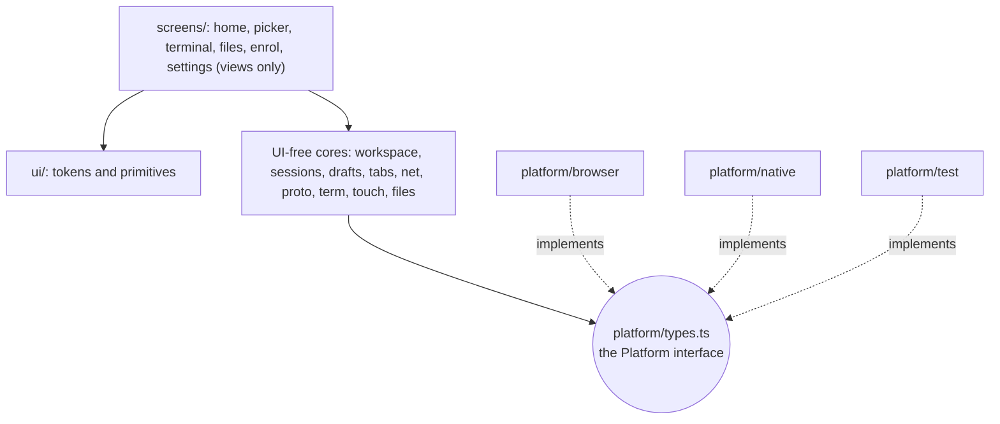
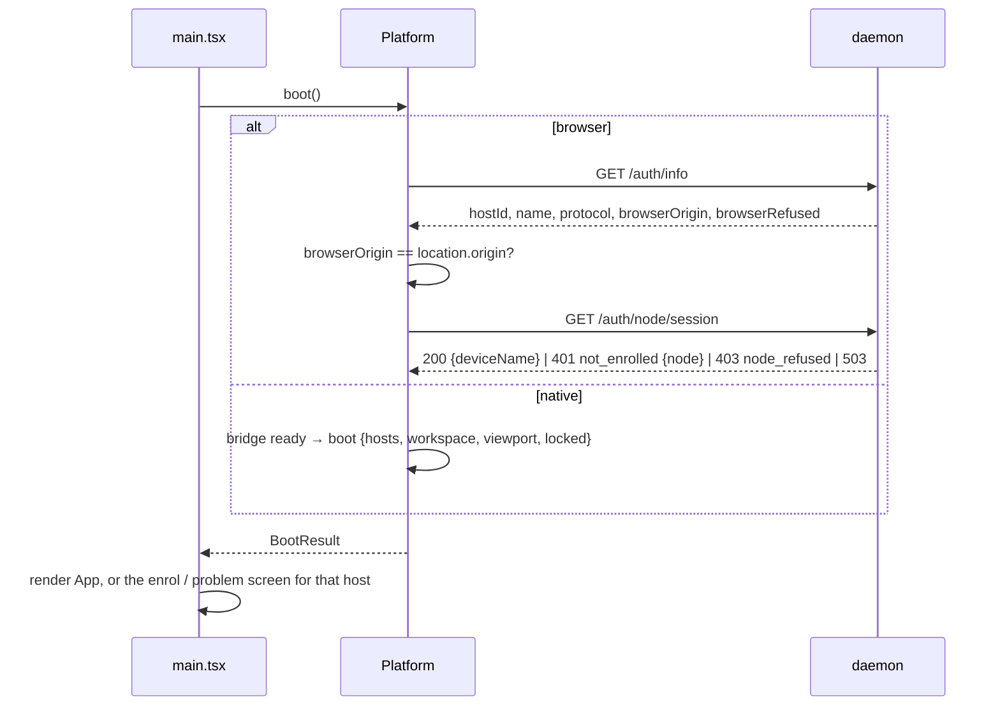
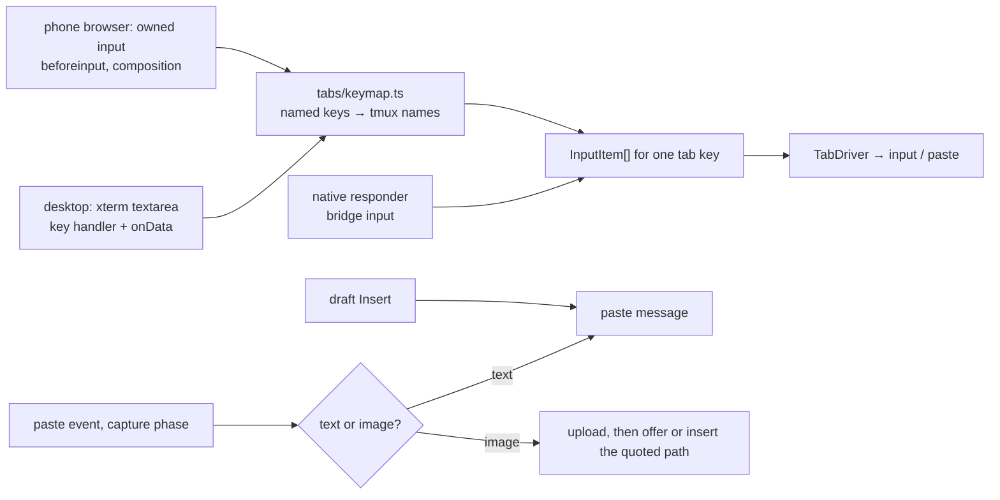
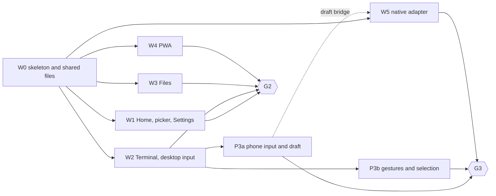

# Client architecture: the rebuilt web client

Status: design for review, revision 3, 2026-10-23. Nothing here is built. Revision 2
answered [review 1](client-architecture-review-1.md) and the
[alignment review](client-architecture-review-alignment.md); revision 3 applies the
local fixes from [review 2](client-architecture-review-2.md). The
[disposition table](#review-disposition) at the end says where each finding went.

This spec covers the web client that replaces today's `web/` views. That client runs
in three places: a desktop browser, a phone browser or installed PWA, and the native
iPhone app's WKWebView. Behaviour comes from
[the interaction contract](../../../../docs/design/client/browser-behaviors.md) and the
approved [mockup](../../../../docs/design/client/mockups/index.html). This spec decides
how the code is shaped to deliver that behaviour, and which mockup details to improve.
Admission follows [browser auth revision 4](browser-auth.md); session limits follow
[resource limits](resource-limits.md).

**Labels used below.** Daemon lanes from the [build plan](../build-plan.md): **L2**
browser admission and the static shell, **L3** wrap-preserving snapshots, **L4**
protocol gaps. Gates: **G1** daemon review, **G2** web review and browser probes,
**G3** Simulator and the real-iPhone checklist. Web lanes **W0–W5** and **P3a/P3b** are
defined in §11.

## 1. The answer

One Preact app, three **platform adapters**, and one rule for each hard boundary:

- **Keep the UI-free core and delete every view.** These survive with their tests:
  `proto/`, `net/`, `tabs/`, the terminal write pipeline, sizing and prompt tracker,
  the `/fs` client, and `Store`. Every component and stylesheet goes, along with the dev
  shim and the suggestion strip. A new pure **workspace** core owns tabs, restore,
  pruning, Files position and routes.
- **One `Platform` interface holds everything environment-specific.** That covers boot
  and admission, socket and HTTP transport, input and focus, viewport, lifecycle,
  storage, uploads, clipboard, links, video, haptics and restart. It has three
  implementations: `browser`, `native` and `test`. Lint keeps every use of
  `window.webkit`, `visualViewport`, `indexedDB`, `navigator` and
  `document.visibilityState` inside `web/platform/`. The browser adapter holds no
  credential and has no dev mode.
- **The design system is owned primitives on native HTML, with no component library.**
  Tokens come in three tiers of CSS custom properties: primitive, semantic and
  component. There is a light and a dark theme. **Density** depends on the pointer:
  `compact` for a fine pointer, `touch` with 44 px targets. **Layout** depends on the
  screen size: the desktop rail, or phone Home. About fifteen primitives are built on
  `<dialog>`, `<button>` and `<input>`. No `preact/compat`.
- **Terminal input depends on the input device, not the user agent.** A desktop with a
  fine pointer keeps xterm's own textarea, under a strict key-handler contract. Phone
  browsers use a tether-owned input that sends only committed text. Native keeps native
  input. Named keys always go to tmux by name. Paste is intercepted before xterm sees
  it. The local draft is a separate editor; its Insert sends one `paste` and never an
  Enter.
- **Touch gestures have one owner.** A sans-IO recognizer decides between tap,
  scroll, long-press and cancel before anything reaches tmux or raises the keyboard.
  Long-press selects text from a bounded snapshot.
- **The PWA's service worker serves the shell from cache and nothing else.** It
  precaches the whole build and never touches `/ws`, `/auth`, `/fs` or `/complete`. A
  new version replaces the old only when Jimmy taps Update, coordinated across
  windows. Nothing typed offline is ever queued.
- **Lanes own disjoint files in one checkout.** One writer lays the skeleton and every
  shared file (W0). Home, Terminal, Files, the PWA, the native adapter and the touch
  input then proceed in parallel, each against named daemon prerequisites.



### Fixed choices this design keeps

These are Jimmy's explicit choices. No lane changes them without his say:

- Terminal `+` opens the existing-session picker directly. There is no intermediate
  menu, and Files is not in it.
- No dot status markers. No middle-dot separators in any copy (§8.6 checks it).
- No custom browser keyboard strip. The phone browser uses the ordinary keyboard.
- The local draft's Insert sends the text with no added Enter.

## 2. Vocabulary

One name per concept. The code, the specs and the UI copy use these.

| Term | Meaning | Not to be confused with |
|---|---|---|
| **host** | One tether daemon endpoint, identified by `hostId` (`/auth/info.hostId`, `welcome.host.id`). The browser has exactly one, the daemon behind its page origin. Native has a saved list | `WindowRef.server`, a tmux server *instance*. UI copy shows the host's name (`pop-os`) with no label word; native settings call the list "Servers" (connection-roadmap.md) |
| **tab** | A tether tab: one tmux window open in tether. Its identity is the **tab key**, `(hostId, WindowRef)` | A browser tab. Closing a tether tab never touches tmux |
| **destination** | Home, Terminal or Files: the top level of navigation | |
| **overlay** | A modal surface stacked on a destination: the picker, a creation dialog, Settings, a confirmation. Back closes it first | Files' folder stack and preview, which belong to Files (§6.1) |
| **picker** | The Open session picker behind terminal `+`. It only attaches existing windows | Home's creation actions |
| **draft** | The local multiline text for one tab key. It is edited in the draft editor and sent only by Insert | Direct input |
| **direct input** | Keystrokes that go to tmux as they are typed | |
| **admission** | Whether the daemon lets this client in (§4.2) | A credential. The browser holds none |
| **stable box** | The terminal's box with no software keyboard and nothing that appears with it. tmux is sized from it alone | The visible box |
| **layout** | `desktop` (rail) or `phone` (Home with bottom nav, full-screen terminal), chosen by screen size | **density** |
| **density** | `compact` or `touch` (44 px targets), chosen by pointer | layout |

## 3. What survives, what goes, and the new layout

### 3.1 Dispositions

Dispositions come from the p25 inventory and from reading each module's imports. "Keep"
means kept with its tests; "Revise" names the change.

| Today | Disposition | Why |
|---|---|---|
| `proto/generated/`, `frames.ts`, `window.ts` | **Keep** | UI-free, tested, the wire contract |
| `proto/link.ts` | **Revise**: `token` becomes optional. `tether.v1` is always offered, and `tether.auth.<token>` only when a token exists. `hello.client.kind` is `"web"` in the browser (it defaults to `"ios"` today) | Auth rev 4 §3.14 and §5: the node lane offers only `tether.v1` |
| `net/host.ts` | **Revise**: takes its socket from `platform.transport` (§5.2). Routes errors with no `req` that answer a paste to the paste's tab (§7.5) | Reconnect, backoff and request routing already match plan.md "Reconnect" |
| `net/http.ts`, `net/fakes.ts` | **Keep** | |
| `tabs/connection.ts`, `tabs/driver.ts` | **Keep**. The driver gains the `limited` state (§6.4) and the paste result (§7.5) | Tested state machine. `cover`/`uncover` already end and resume the watch |
| `tabs/input.ts` | **Keep**. `InputEvent` moves to `platform/types.ts` | `toMessages` and `shellQuote` are pure |
| `term/pipeline.ts`, `term/index.ts` | **Keep**. The pipeline takes the wrap map once L3 lands | Serialized writes, renderer boundary |
| `term/prompt.ts` | **Keep** | Tap-to-position on the prompt line reads its OSC 133 marks (plan.md "Cursor movement"; §7.6) |
| `term/size.ts` | **Revise**: three ways to produce the stable box (§5.4). Native keeps `collapsedHeight`. A trailing 150 ms debounce is added | Rotation with the keyboard up must keep its rows (`size.test.ts` keeps that case) |
| `term/xterm.ts` | **Revise**: stdin is on only when direct input is `xterm`. One renderer instance lives for the page's life and moves between layouts. `cursorPan` reads the pan area (§5.4), not `container.clientHeight` | It is hard-wired inert today; recreating it would lose the buffer; the browser's container never shrinks for the keyboard |
| `app/sync.ts` (`HostSync`) | **Keep**, moved to `workspace/sync.ts`. Retries a failed listing while any tab is `restoring` | Lists on connect and on a debounced `sessionsChanged`, and prunes |
| `app/status.ts` (`describe`) | **Keep**, moved to `workspace/status.ts`, with copy for `limited`, 4005 and admission | Pure |
| `app/hosts.ts` | **Revise** into `net/hosts.ts`. The registry stays; `TokenLink` moves into the native transport | The token is a native concern |
| `app/app.ts`, `app/windows.ts` | **Delete**. Their logic moves into `workspace/` and `sessions/` | Sheet routing, native `prompt` for names, and `typeChip` all go |
| `app/Chrome.tsx`, `Sheets.tsx`, `TabBar.tsx`, `app.css` | **Delete** | Old views |
| `files/api.ts`, `browser.ts`, `kinds.ts`, `images.ts`, `fakes.ts` | **Keep**. `browser.ts` drops its Settings and root-picker places, which are outside the minimal pass | Tested `/fs` client and navigation state |
| `files/markdown.ts`, `files/code.ts` | **Keep**, moved to `files/render/`, which may use the DOM | They build DOM and run DOMPurify |
| `files/FilesSheet.tsx`, `Viewers.tsx`, `files.css` | **Delete**. The viewers are rebuilt in `screens/files/` on `files/render/` | Old views |
| `complete/` (strip, suggester, its test) | **Delete** | The suggestion strip is deferred (client README). Git keeps it |
| `ui/store.ts`, `ui/format.ts` | **Keep** | Pure |
| `ui/theme.ts` | **Keep**. Reads the new `--term-*` tokens; takes the scheme from `Viewport.scheme` instead of calling `matchMedia` (lint rule 3) | Token-driven |
| `ui/hostProblem.ts` | **Revise**: copy per platform and per admission state (§4.2) | Today's copy names the iPhone |
| `ui/tokens.css`, `Tappable.tsx`, `Sheet.tsx`, `icons.tsx` | **Delete**. Replaced by `ui/tokens/` and `ui/primitives/` | Hand-rolled, and built for native-owned focus |
| `native/bridge.ts` | **Revise** into `platform/native/bridge.ts`, at bridge version 2 (§5.10) | |
| `dev/shim.ts` | **Delete** | Desktop development uses the real browser adapter (§5.11) |
| `main.tsx`, `index.html` | **Rewrite**: pick the adapter, boot, render `<App>` | |
| `eslint.config.js` | **Rewrite** the focus and boundary rules (§3.3) | |
| `vite.config.ts` | **Revise**: `base: "/"`, a service-worker entry, budget output, and the dev proxy of §5.11 | |
| `tsconfig.json` | **Revise**: exclude `sw/`. `sw/tsconfig.json` uses the `WebWorker` lib | The worker has different globals |

### 3.2 New layout

```text
web/
  main.tsx, index.html   pick the Platform, boot, render <App>
  platform/
    types.ts         the Platform interface and its shared types (§5). No implementation
    browser/         one file per capability: boot.ts, transport.ts, focus.ts, viewport.ts,
                     lifecycle.ts, storage.ts, uploads.ts, clipboard.ts, links.ts, pwa.ts
    native/          bridge.ts (v2) and adapter.ts
    test/            in-memory Platform for vitest and the Playwright harness
  proto/             wire types, frames, link
  net/               host.ts, http.ts, hosts.ts (registry)
  tabs/              connection.ts, driver.ts, input.ts, keymap.ts (KeyboardEvent → InputItem)
  term/              pipeline, size, prompt, xterm renderer, xterm-input.ts (desktop source)
  touch/             phone-only: owned-input.ts, gesture.ts (recognizer), selection.ts
  workspace/         pure: tabs, active tab, restore, pruning, routes, Files position,
                     focus owner, labels, status; sync.ts (HostSync)
  sessions/          pure: listings per host, search, expansion, creation requests
  drafts/            pure: draft records, Insert state machine, eviction
  files/             /fs client and browser state; render/ (markdown, code)
  app/               <App> root, controller, router, focus.ts (the focus controller)
  screens/
    shell/           rail (desktop), destination frame, host banner
    home/            open tabs, sessions list, creation dialogs, bottom nav (phone)
    picker/          the Open session picker
    terminal/        tab strip, terminal surface, overlays, draft slot
    files/           folder list, preview, upload, insert path
    enrol/           enrolment and admission-problem screens
    settings/        Remove this device, Clear local data, Add to Home Screen
  ui/
    tokens/          primitives.css, semantic.css, components.css, fonts.css
    primitives/      Button, IconButton, Tooltip, TextField, SearchField, Dialog, Sheet,
                     Disclosure, Row, RovingList, TabStrip, Banner, Toast, Overlay,
                     EmptyState, Spinner, Icon, DraftEditor
    store.ts, format.ts, theme.ts, hostProblem.ts
  sw/                the service worker, built as its own entry
  public/            icons, apple-touch-icon
  harness/           test-mode entry for Playwright; never in a production build
  e2e/               Playwright specs, one directory per lane
```

Each screen module exports an `effects.ts` that the controller registers. A lane can
then add the effects its screen needs (creation, upload, insert path, draft insert)
without editing `app/`.

### 3.3 Lint rules

Today's rule bans `<button>`, `<input>`, `<textarea>`, `<select>` and `contenteditable`
everywhere, because native owned all focus. The new rules keep one focus controller per
environment, and let the web have forms. Every rule uses core ESLint
(`no-restricted-syntax`, `no-restricted-imports`, `no-restricted-globals`) in
per-directory `files:` blocks, so no plugin is needed.

1. **Raw editable and interactive elements appear only in `ui/primitives/`,
   `term/xterm-input.ts` and `touch/owned-input.ts`.** Screens use `TextField`,
   `SearchField` and `Button`.
2. **`.focus()` and `.blur()` are called only in** `app/focus.ts`,
   `ui/primitives/Dialog.tsx`, `ui/primitives/Sheet.tsx`, `term/xterm-input.ts`,
   `touch/owned-input.ts` and `platform/browser/focus.ts`. Everything else asks the
   focus controller (§6.5).
3. **Environment globals appear only in `platform/`.** These are `window.webkit`,
   `visualViewport`, `indexedDB`, `localStorage`, `sessionStorage`, `navigator`,
   `document.visibilityState`, `window.open`, `matchMedia` and `BroadcastChannel`.
4. **Import boundaries.**
   - Only `main.tsx` imports `platform/browser/` or `platform/native/`.
   - Only tests and `harness/` import `platform/test/`.
   - Only `term/` imports xterm.
   - `screens/` never imports a platform implementation.
5. **No Preact and no `window` or `document` in `workspace/`, `sessions/`, `drafts/`,
   `tabs/` or `touch/gesture.ts`.** These are sans-IO where they hold state: events in,
   state and effects out, as plan.md asks of the daemon's cores. `proto/link.ts` may use
   `WebSocket`, and `files/render/` may use the DOM.

**Native keeps its single focus controller.** The native app no longer bans web text
fields. Instead, the web tells native which focus mode a screen needs, whenever the
destination or overlay changes (§6.5). With Home, Files or any dialog on screen, native
is in `webText`: its guard is down, so any field can take the keyboard on the user's tap
with no handshake. That replaces ios-shell.md's "no other web text inputs" rule and the
`prompt` bridge message.

## 4. Hosts, admission and boot

### 4.1 Boot



- **The browser holds no credential.** Auth rev 4 admits a browser as an enrolled
  tailnet node, decided by the daemon from the peer address Serve forwards. There is no
  cookie and no token in JavaScript. The browser transport opens `/ws` offering only
  `tether.v1`, and fetches `/fs/*` with relative URLs.
- **Boot reads admission from the daemon at every launch.** First `GET /auth/info`.
  Then the page origin is compared with `browserOrigin`. Then `GET /auth/node/session`.
  Nothing about enrolment is stored in the browser.
- **Native** boots as today through the bridge, with the saved workspace, hosts and
  lock state. Its tokens never reach page code; they stay inside the native transport.
- **Protocol mismatch.** It is detected when `/auth/info.protocol` falls outside the
  range the client speaks, or when the socket closes with 4001 and `incompatible { min,
  max }`. Input is disabled on that host's tabs. The host banner says the page is out
  of date and offers Update (browser, §9.3) or "Update the app" (native). It is never
  retried.

### 4.2 Admission states

| Daemon answer (auth rev 4 §3.8) | `Admission` | What the client shows |
|---|---|---|
| `200 {deviceName}` | `admitted` | the app |
| `browserOrigin` ≠ `location.origin` | `wrongOrigin { origin }` | "Open tether at `<origin>`", with a link. No socket opens |
| `browserOrigin: null`, `browserRefused: <reason>` | `originRefused { reason }` | why browsers can't use this host (`ambiguous_origin`, `not_https`…), with the `tether` command that fixes it. No retry |
| `401 not_enrolled {node: {name}}`, or close 4401 then that answer | `notEnrolled { nodeName }` | the Enrol screen (§4.3) |
| `403 node_refused {reason}` | `nodeRefused { reason }` | the reason in words ("This device is a subnet router"). No form, no retry |
| `503 identity_unavailable`, `auth_unavailable`, `busy`; close 4503 | `deciding` | keeps the current screen and workspace, retries with the host's backoff, and says "Checking access…" after 10 s |
| no answer | `unreachable` | Home's offline state (§9.4), drafts included |

A 4401 close mid-session is not taken as `notEnrolled` on its own. The client first asks
`GET /auth/node/session` why, because the node may now be refused. While it waits, tabs
and drafts stay. Enrolling again resumes where Jimmy was.

### 4.3 The Enrol screen and Settings

- **Enrol** shows the host's name from `/auth/info` and a code field. It also shows a
  device-name field, prefilled with `nodeName` and editable, and the sentence "This lets
  every browser and app on `<node>` use tether on `<host>`." The instruction above the
  code field says to run `tether enroll` on the server. Submitting calls
  `platform.enrol(code, deviceName)`, which posts `POST /auth/node/enroll`, and then
  boots again. `EnrolResult` is `enrolled`, `badCode` ("That code is wrong or has
  expired", under the field), `nodeRefused { reason }` (the refusal screen), or
  `tryAgain` for a `503` ("tether is busy, try again"; the code is not consumed).
- **Settings** is an overlay opened from a Settings row at the bottom of Home. It holds:
  - **Remove this device** (browser only). It asks for confirmation: "Every browser and
    app on `<node>` will lose access to `<host>`." Then it closes this page's sockets,
    calls `platform.removeDevice()` (`POST /auth/node/remove`) and shows Enrol. Drafts
    stay.
  - **Clear local data.** After a confirmation it deletes drafts and the saved workspace
    on this device only.
  - **Add to Home Screen** (phone browser, not installed). It shows the iOS steps: Share,
    then Add to Home Screen. It is never a forced screen.
- One enrolment covers the whole machine: Safari, the installed PWA and any other
  browser on that node. Storage is not shared, though: Safari and the PWA keep separate
  drafts and workspaces. The Enrol screen and the install steps say both.

## 5. The platform adapter

### 5.1 The interface

Methods that can fail return typed results rather than throwing, so screens can render
the failure.

```ts
interface Platform {
  readonly kind: "browser" | "native" | "test";

  boot(): Promise<BootResult>;
  subscribe(listener: (change: PlatformChange) => void): Unsubscribe;
  transport: Transport;          // §5.2
  input: InputPlatform;          // §5.3
  viewport: ViewportSource;      // §5.4
  lifecycle: LifecycleSource;    // §5.5
  storage: PlatformStorage;      // §5.6
  uploads: Uploads;              // §5.7
  clipboard: { writeText(text: string): Promise<"ok" | "denied"> };
  openURL(url: string): void;                       // http(s) only
  playVideo(host: string, path: string): "handled" | "inline"; // native player, or a <video> in the page
  haptic(kind: HapticKind): void;                   // ios-shell's semantic kinds; browser: no-op
  restart(reason: "stuck" | "update"): void;        // native: recreateWebView; browser: reload, bounded (§5.2)
  enrol?(code: string, deviceName: string): Promise<EnrolResult>; // browser only
  removeDevice?(): Promise<"ok" | "failed">;        // browser only
}

interface BootResult {
  hosts: HostEntry[];                    // browser: exactly one, this origin's daemon
  admission: Record<string, Admission>;  // §4.2
  workspace: SavedWorkspace | null;
  viewport: Viewport;
  directInput: "xterm" | "owned" | "native";
}

type PlatformChange =
  | { type: "hosts"; hosts: HostEntry[] }              // native host list changed
  | { type: "lock"; locked: boolean }                  // native app lock
  | { type: "admission"; host: string; admission: Admission }
  | { type: "directInput"; directInput: BootResult["directInput"] }; // pointer changed
```

### 5.2 Transport

```ts
interface Transport {
  /** Returns a Link at once. A refusal arrives as a synthetic close, like 4401. */
  openSocket(host: string, handlers: LinkHandlers): Link;
  /** Where every /fs and /complete URL starts. */
  httpBase(host: string): string;  // browser: "" (same origin); native: "tether-app://h-<id>"
}
```

- **Native** fetches the token from the bridge asynchronously inside the `Link`. A
  `{ locked }` reply closes the link with a synthetic code that `Host` maps to the
  halt `locked`, and `{ notEnrolled }` maps to `notEnrolled`. `Host`'s synchronous
  `open` therefore stays as it is.
- **Browser** opens `wss://<origin>/ws` offering `tether.v1` only.
- **`onStuck`**: two sockets in a row stuck in CONNECTING. It calls
  `platform.restart("stuck")`. Native recreates the web view. The browser reloads at
  most once per 10 minutes, tracked by a `sessionStorage` timestamp, and flushes
  drafts first. After that it halts with "Can't reach pop-os" and Retry, so a slow
  cellular link can't loop reloads.

### 5.3 Input and focus

```ts
interface InputPlatform {
  /** Native only: keystrokes from native's responder, with the tab key native targeted. */
  onInput(listener: (target: TabKey, events: InputEvent[]) => void): Unsubscribe;
  /** The focus mode the screen needs (§6.5). Browser: DOM focus. Native: bridge `focus`. */
  setFocus(mode: "terminal" | "hidden" | "webText" | "select"): void;
}
```

`directInput` picks the terminal input source (§7). It is `xterm` when the primary
pointer is fine and can hover (`(pointer: fine) and (hover: hover)`), `owned` when the
primary pointer is coarse, and `native` in the app. It is re-evaluated when that media
query changes, for example when an iPad gains a trackpad, and reported as a
`PlatformChange`. User-agent sniffing is not used.

### 5.4 Viewport, keyboard and the stable box

```ts
interface Viewport {
  layout: "desktop" | "phone";
  density: "compact" | "touch";
  scheme: "light" | "dark";
  visibleHeight: number;   // on screen now
  stableHeight: number;    // with no software keyboard (native: collapsedHeight)
  safeArea: SafeArea;      // of the keyboard-hidden layout
  keyboard: boolean;
  reason: "initial" | "keyboard" | "resize" | "rotation";
}
```

**The invariant: tmux is sized only from the stable box.** That box excludes the
software keyboard and everything that appears with it: the draft editor, the
keyboard-open toolbar and overlays. Nothing that only shows or hides ever resizes tmux.

- **Native** computes rows exactly as today: from `collapsedHeight`, minus the safe-area
  insets and the measured chrome heights. Every `viewport` message carries the
  keyboard-hidden safe area, so a rotation with the keyboard up still yields the
  collapsed layout's rows.
- **Browser, phone layout.** The app root is `100svh` tall: the small viewport height,
  which doesn't change when Safari's toolbars collapse or the keyboard opens. The
  terminal container and the bottom toolbar's resting slot share that root, in flow, so
  the stable box is the root minus the toolbar's resting height, and no tmux row sits
  under the toolbar. While the keyboard is up, the toolbar is translated out of its slot
  to sit on the visual viewport's bottom edge. The draft editor is always positioned
  over the terminal, never in flow. The container's `ResizeObserver` box is the stable
  box.
- **Browser, desktop layout.** The container's box is the stable box.
- **The pan area** is what remains visible of the terminal: `visibleHeight` minus the
  translated toolbar and the draft editor when they cover it. `cursorPan` reads this
  number, not `container.clientHeight`, which in the browser never shrinks. Native keeps
  passing its shrunken web view's height, as today.
- **Applying a size.** Only the trailing size is sent, 150 ms after the last change, so
  dragging a window edge doesn't resize tmux for every cell. A tab's first `watch` waits
  until the font is loaded and the box has been measured once, so tmux never sees the
  80×24 placeholder.
- **Keyboard detection (browser).** `keyboard` is true when all of these hold: a text
  owner is focused, `directInput` is `owned` (in either layout: an iPad without a
  trackpad gets the desktop layout and a software keyboard), `visualViewport.scale` is
  about 1 (pinch zoom excluded), and the visible height is at least 120 px less than
  `stableHeight`. It is driven by `visualViewport` resize and scroll events. No timer.
- **Colour scheme.** The viewport also carries `scheme: "light" | "dark"`, from
  `prefers-color-scheme` in the browser and the system appearance in native; a change
  arrives as a `viewport` update, and `ui/theme.ts` re-themes xterm from it.
- **Layout** is `phone` when `min(width, height) < 600` CSS px, else `desktop`. A
  landscape phone therefore stays in the phone layout. Changing layout never recreates
  the terminal renderer: one instance is reparented.
- **Pinch zoom stays allowed outside the terminal.** The viewport meta drops
  `maximum-scale` and `user-scalable=no`, and adds `viewport-fit=cover` and
  `interactive-widget=resizes-visual`. The terminal surface sets `touch-action: none`,
  so the gesture recognizer, not the browser, owns every touch on it; pinch zoom is
  therefore unavailable over the terminal. The surface also sets
  `-webkit-touch-callout: none` and `user-select: none` (the selection layer excepted),
  so iOS shows no callout or text selection of its own.

### 5.5 Lifecycle

```ts
interface LifecycleSource {
  subscribe(listener: (state: { visible: boolean; online: boolean }) => void): Unsubscribe;
}
```

The browser listens to `visibilitychange`, `pagehide`/`pageshow` and `online`/`offline`.
Native listens to `lifecycle` and `network`. One owner, `net/hosts.ts`, reacts:

- **Hidden:** pending draft and workspace writes are flushed, then every socket closes
  cleanly. The daemon ends the watches, so tmux gets its size back.
- **Visible:** reconnect at once and rewatch the tab on screen.
- **Online:** reset backoff. `online: true` is a hint, never proof the host is
  reachable.

Nothing is written in an unload handler.

### 5.6 Storage

```ts
interface PlatformStorage {
  loadWorkspace(): Promise<SavedWorkspace | null>;
  saveWorkspace(ws: SavedWorkspace): void;          // coalesced, latest wins
  drafts: DraftStore;
  clearLocalData(): Promise<void>;
}
interface DraftStore {
  get(key: TabKey): Promise<DraftRecord | null>;
  put(record: DraftRecord, baseRevision: number): Promise<"ok" | "conflict" | "failed">;
  delete(key: TabKey): Promise<void>;
  list(): Promise<DraftRecord[]>;
  onChange(listener: (key: TabKey) => void): Unsubscribe;   // another page changed it
}
```

**Browser.**

- **Database.** One IndexedDB database, `tether`, schema version 1, with two stores.
  `workspace` holds one record per host; `drafts` is keyed by tab key. Every write is
  one small record, never the whole workspace per keystroke.
- **Persistence.** `navigator.storage.persist()` is requested on the first draft save;
  the client promises nothing about the result. If IndexedDB is unavailable, the
  workspace lives in memory and the draft editor says drafts won't survive a reload.
- **Several pages at once.** A page writes its workspace only while it has focus
  (`document.hasFocus()`), and once more when it gains focus. The saved workspace is
  therefore the one from the page used last, even with two desktop windows visible side
  by side. Draft
  writes compare revisions: a `put` whose base revision is older than the stored one
  returns `conflict`, and the editor reloads the newer text with "Edited in another
  window". A `BroadcastChannel` named `tether` tells other pages a draft changed.

**Native.** The workspace goes to native through `saveWorkspace`, because native's copy
survives a crash of the web content process. Drafts go through the same `DraftStore`
interface over the bridge (`draftGet`, `draftPut`, `draftDelete`, `draftList`), and
native persists the records. **The web applies every draft rule (§7.4) in both
environments.** Native compose never writes a record itself: each edit goes to the web
as `draftEdit { tab, text, baseRevision }`, debounced 300 ms in Swift. The web applies
the cap, the revision check and eviction, persists through `draftPut`, and answers
`draftResult { status }` (`ok`, `tooLarge`, `full`, `conflict` with the newer text).
When a draft changes from elsewhere, the web sends native `draftChanged { tab, text,
revision }` so compose shows it. Swift holds no draft rules.

### 5.7 Uploads, file pick and image paste

```ts
interface Uploads {
  /** Call synchronously in the tap. Ends on completion, failure, or the picker's cancel. */
  pick(host: string, signal: AbortSignal): AsyncIterable<UploadEvent>;
  /** One pasted image the page already holds. Browser only. */
  send?(host: string, file: File, signal: AbortSignal): AsyncIterable<UploadEvent>;
}
type UploadEvent =
  | { id: string; progress: number }
  | { id: string; path: string }
  | { id: string; error: string };
```

- **Browser.** `pick` calls `click()` on a hidden `<input type="file">` (owned by
  `platform/browser/uploads.ts`) inside the tap, and ends on the input's `cancel` event.
  Both `pick` and `send` stream the upload to `/fs/upload`. The daemon takes one upload
  at a time, so the client sends one file at a time and queues at most four. A fifth is
  refused with "Wait for the current uploads to finish".
- **Native** keeps its own picker and uploader (`pickMedia` and `upload` events) and
  receives image paste in its own input.
- **The insertion target is never the adapter's concern.** The caller captures the tab
  key when the action starts and offers or performs insertion into that tab only
  (§7.5).

### 5.8 Clipboard

The browser calls `navigator.clipboard.writeText` inside the gesture. Native routes it
through the bridge to `UIPasteboard`, because WebKit may not treat the `tether-app://`
scheme as a secure context for the Clipboard API (a G3 probe).

### 5.9 Three implementations

| Capability | browser | native | test |
|---|---|---|---|
| boot | `/auth/info`, `/auth/node/session`, IndexedDB | bridge `ready` | fixture |
| changes | admission from 401, 4401, 4503 | bridge `hosts`, `lock`, `hostRejected` | settable |
| transport | same-origin `/ws` offering `tether.v1` | `tether-app://h-<id>`, token subprotocol | fake `Link` (`net/fakes.ts`) |
| direct input | `xterm` or `owned` | `native` | scripted events |
| focus | DOM, through `app/focus.ts` | bridge `focus` | records requests |
| viewport | `visualViewport`, media queries, `100svh` | bridge `viewport` | settable |
| lifecycle | page visibility, online | bridge `lifecycle`, `network` | settable |
| storage | IndexedDB, `BroadcastChannel` | bridge `saveWorkspace` and draft records | in memory; can be told to fail |
| uploads | file input, `/fs/upload` | bridge `pickMedia`, `upload` | scripted |
| clipboard | `navigator.clipboard` in the gesture | bridge to `UIPasteboard` | records |
| links | `window.open(url, "_blank", "noopener")` | bridge `openURL` | records |
| video | inline `<video src="/fs/raw/…">` | bridge `playVideo` | records |
| haptics | none | bridge `haptic` | records |
| restart | bounded reload | bridge `recreateWebView` | records |
| enrol, remove device | `/auth/node/enroll`, `/auth/node/remove` | absent (native enrols natively) | scripted |
| service worker | registered | never | never |

### 5.10 Bridge version 2 and the ios-shell.md edits

The native lane (W5) lands these with ios-shell.md and `Bridge.swift`. `BRIDGE_VERSION`
becomes 2.

| ios-shell.md section | Change |
|---|---|
| "Boot and host payloads" | `boot { tabs, active }` and `SavedTab` become `workspace: SavedWorkspace`, which still carries each tab's last label, so restored pills have names before the listing |
| "The bridge": `saveTabs` | becomes `saveWorkspace { workspace }` |
| "The bridge": `prompt` | removed. Web forms take the keyboard in `webText` (§3.3) |
| "Focus: one controller, native" | "No other web text inputs" is replaced. The web sends the resting mode on every destination or overlay change: `terminal` or `hidden` on Terminal with no overlay, and `webText` everywhere else. The `select` mode is entered by touch selection (§7.6); when selection ends the web sends the resting mode again. Native's own restore after interruptions (foreground, native sheets, content-process restart) stays as written |
| "Keyboard geometry" | unchanged for native sizing. The new invariant (§5.4) is stated in the shared terms |
| "The bridge": `input` | gains `tab` (the tab key native targeted). The web drops events whose tab key is no longer that tab's. `window.__tether.activeTab()` stays, so native knows the target |
| "The bridge": drafts | new. Web → native `draftGet`, `draftPut`, `draftDelete`, `draftList` back the `DraftStore`. Native → web `draftEdit { id, tab, text, baseRevision }` and `draftInsert { id, tab, text, revision }`, each answered by web → native `draftResult { id, status }`. Web → native `draftChanged { tab, text, revision }` (§5.6, §7.4) |
| "The bridge": `upload` | `tab` becomes the tab key. On `path`, the web no longer inserts automatically: it offers "Insert path into `<tab>`" (§7.5) |
| "The bridge": clipboard | new `copy { text }` → `UIPasteboard` |
| "Haptics" | unchanged kinds. The entries for suggestion chips go, along with the strip |
| "What is native and what is web", "The accessory" | the suggestion strip leaves the web column. The compose field's draft rules point to §7.4; "retention remains to settle" is replaced by its retention rule |
| "Project layout" | `web/native/bridge.ts` becomes `web/platform/native/bridge.ts`; the `--safe-*` tokens move to `ui/tokens/semantic.css` |
| "Hosts" | `hostRejected` stays and surfaces as an `admission` change |

### 5.11 Development without a shim

Desktop development runs the **browser adapter** against Vite's dev server. The only
dev-only code is Vite's proxy, which follows auth rev 4's "Dev mode":

- It connects to the daemon's socket as a local peer and presents a native token. On
  HTTP that is `Authorization`; on `/ws` it adds `tether.auth.<token>` to the offered
  subprotocols. The token lives in the proxy process. Page code never sees it.
- It answers `GET /auth/node/session` itself with `200 {deviceName: "vite dev"}`, since
  a token-bearing request there is a `400`. It rewrites `/auth/info.browserOrigin` to
  Vite's own origin, so the unchanged adapter boots.
- It refuses callers that did not come through Serve (rev 4's L5).

Consequences:

- The Enrol and admission-problem screens cannot be reached through Vite. They are
  exercised on the `test` adapter in `harness/`.
- There is no `dev/` directory, no fake keyboard and no simulated phone geometry. Phone
  layouts are checked in a real phone browser or the iOS Simulator.
- The production build fails if its module graph contains any module under
  `platform/test/` or `harness/`. A check in `scripts/preflight.sh` reads Vite's
  `manifest.json` to enforce this.

## 6. App state and routing

### 6.1 The workspace core

`workspace/` is a pure reducer. Events go in: `opened`, `closed`, `activated`,
`listing`, `windowClosed`, `serverExited`, `renamed`, `navigated`, `restored`,
`watching`, `limited`. State and effects come out: `cover`, `uncover`, `save`, `focus`,
`notice`. The controller in `app/` runs the effects against `TabDriver`, the router and
the platform. `TabDriver` keeps owning its own watch; the workspace only says which tab
is on screen.

```ts
type TabKey = { host: string; window: WindowRef };   // WindowRef = { server, window }
interface WorkspaceState {
  tabs: Tab[];                    // in strip order
  active: string | null;          // the active tab's key string
  destination: "home" | "terminal" | "files";
  overlay: Overlay | null;        // picker, create, settings, confirm
  files: { folders: string[]; preview: FileRef | null };  // a stack, kept across destinations
}
```

- **Identity is the tab key**, never a name or an index. Opening a window that already
  has a tab activates that tab.
- **Labels** are derived in `workspace/labels.ts`:
  - The label is `session / window`.
  - The real window index is appended when two open tabs' window names collide.
  - When the label is truncated, the window part is kept before the session part.
  - The host's name is appended only when tabs from more than one host are open
    (native).
  - The full label is the pill's tooltip and accessible name.
- **On screen.** Only the active tab on the Terminal destination is uncovered. Leaving
  Terminal for Home or Files covers it, which ends its watch and returns tmux its size.
  Returning uncovers it and repaints from a fresh snapshot.
- **Closing** follows the contract. Closing the active tab activates its right
  neighbour, else its left. Closing the last tab returns Home, and on desktop focuses
  Home search.

### 6.2 Restore after reload

1. Boot loads the saved workspace. Its tabs come back in state `restoring`, shown in the
   reconnecting colour with "Checking…", with input disabled.
2. The active tab's `watch` is sent once the socket is up and the stable box is
   measured, in parallel with the listing. A reload therefore costs one round trip on a
   slow link. A `watching` reply proves the daemon found the window: the tab becomes
   live and takes input.
3. The **first authoritative listing** from that host decides every tab still
   `restoring` whose `server` is the listing's tmux server. Such a tab is kept if a
   window in the listing has its `WindowRef`, and closed otherwise. One notice reports
   the closures: "2 tabs closed: their windows are gone". Same-named windows are never
   substituted. Tabs on another server instance follow plan.md's rule: the listing
   covers the `main` server only, so it never prunes scratch tabs.
4. A refused or failed listing decides nothing. `HostSync` retries it with the host's
   backoff while any tab is `restoring`.
5. If the host now reports a different `hostId`, the saved workspace for the old one is
   discarded. Drafts keyed to the old host stay in storage until cleared or evicted, but
   never attach to the new host's tabs.

### 6.3 The sessions listing

`sessions/` caches one listing per host and exposes search and expansion as pure
functions over it.

- **When it fetches:**
  - entering Home;
  - opening the picker;
  - every socket `linkUp`;
  - a `sessionsChanged` hint, debounced 300 ms, while the page is visible.

  There is no timer and no fetch per keystroke: search filters the cached listing.
- **The socket stays up while Home or the picker is visible**, even with no tab open, so
  `sessionsChanged` keeps arriving. This costs one of the daemon's three sockets while
  Home is on screen. It closes 30 s after both are gone if no tab needs it.
- **Cached first, then fresh.** Home shows the last listing at once, with a quiet
  "Updating". A failure keeps the cached rows, marks them stale and offers Retry. These
  are distinct states, each with its own copy:
  - loading;
  - no tmux server ("No tmux server is running on pop-os". tether never starts one);
  - a server with no sessions;
  - network failure.
- **Expansion** is a set of session ids per host, saved in the workspace. Search expands
  matching parents temporarily; clearing search restores the saved set.
- **Creation** sends `newSession` or `newWindow` with an optional name and an optional
  absolute directory. The `created` reply opens and activates the new window's tab. The
  server's validation message is shown in the form.

**Screen rules** that W1 and W2 implement from the contract, listed here so none is
lost:

- **Rows.** Session rows show the name and "N windows", singular for one. Window rows
  show "index: name", a terminal glyph and no chevron. Open windows are marked Open. The
  session disclosure chevron rotates down when expanded; a folder chevron points right.
- **attachedElsewhere** shows "Another terminal is attached. Opening may resize it."
- **Terminal rail with no tab** (desktop) opens the picker. Dismissing it leaves the
  empty state "Open a window with + or from Home." with the toolbar and `+` still
  visible.
- **Picker focus.** Desktop focuses the picker's search. Phone does not. Closing it by
  the close button, an outside tap or Escape leaves the active tab unchanged. Focus then
  returns to the terminal input on desktop, or to `+` when no tab is open. On phone,
  focus returns to `+` without raising the keyboard.
- **Creation dialogs.** Cancel and Escape restore focus to the exact control that
  opened the dialog.
- **Terminal context.** Bold session, regular window, and a smaller muted host,
  separated by spacing, with no "on" and no dots.
- **Disabled controls say why.**

### 6.4 Refusals and limits

- **A refused session.** The default memory budget of 72 MiB lets the daemon run 3
  tmux sessions at once. Watching a window in a fourth gets `watchEnded { reason:
  "limit", message }`. The tab goes to state `limited`:
  - Its pill turns the error colour.
  - The terminal overlay shows the daemon's message ("tether on pop-os allows 3 tmux
    sessions at a time").
  - Under it: "Close tabs from other sessions, in this or another tether window or the
    app, to open this one." Then Retry.
  - Retries climb the backoff from the tab's attempt count (resource-limits.md §3.6).
    Nothing is closed for the user.
- **4005, the socket cap,** is a host problem, not a tab problem. The host banner says
  "Too many connections to pop-os. Close tether in another browser or the app, then
  Retry."
- **`busy`** on a listing or a watch retries soon, silently, as today. A paste is never
  retried silently (§7.5).

### 6.5 The focus controller

There is one focus controller per environment. In the web it is `app/focus.ts`. In
native it remains Swift's `FocusController`, which the web reaches through
`platform.input.setFocus`.

| Owner | Held by | Entered by |
|---|---|---|
| `terminal` | the direct-input element (§7), or native's responder | tab activation, closing an overlay and returning to Terminal (desktop); a resolved tap on the terminal, or the keyboard button (touch) |
| `draft` | the draft editor | the draft toggle, or a tap in the editor |
| `field` | a `TextField` or `SearchField` | the user focusing it |
| `overlay` | the top dialog or sheet | opening one |
| `select` | the selection layer (§7.6) | a long-press on the terminal |
| `none` | nothing | Home and Files with no field focused |

- **Focus effects run synchronously inside `dispatch`, in the event handler's call
  stack.** iOS raises the keyboard only for a focus made during a user gesture. A focus
  run after a render, a timeout or a microtask chain would leave the keyboard down.
- **The direct-input element and the terminal surface are mounted once**, outside the
  routed screens, and hidden rather than unmounted. The element therefore exists when
  the tap arrives.
- **Touch never focuses programmatically** except synchronously inside the tap that
  asked. In `touch` density a dialog's initial focus is the dialog element or its close
  button, never a text field. Opening the picker on a phone therefore doesn't raise the
  keyboard.
- **Native resting mode.** Whenever the destination or overlay changes, the controller
  sends native the mode that screen needs. Terminal with no overlay sends `terminal`
  if the keyboard was up there, else `hidden`. Everything else sends `webText`. Leaving
  a field changes nothing; only a screen change does.
- **A background event never moves focus away from a focused text field.** Background
  events include listings, reconnects and renames.

### 6.6 Routes and browser history

The URL carries only the destination. Overlays and the Files position live in
`history.state` and the workspace. File paths never enter the URL, so browser history
sync never sees them.

| Route | Destination |
|---|---|
| `#/` | Home's Sessions pane |
| `#/files` | Files: the rail destination on desktop, Home's Files pane on phone |
| `#/terminal` | Terminal, showing the active tab |

- **Entries.** Each of these pushes an entry: changing destination, opening an overlay,
  drilling into a folder, opening a preview. Switching or opening tabs never does; it
  replaces state.
- **Back** closes the top overlay first, then the preview, then pops folders, then
  leaves the destination. It never touches tmux.
- **Closing an overlay by an action**, such as picking a window, calls
  `history.back()`. The controller applies the tab switch only after the resulting
  `popstate`, so the switch's `replaceState` never races the pop.
- **In-app back buttons go to the logical parent.** If the previous entry is that
  parent (recorded in `history.state.parent`), they call `history.back()`. Otherwise,
  after a reload or a deep link, they `replaceState` to the parent, so Back never leaves
  the app unexpectedly.
- **Reload** restores the destination from the hash, and the tabs and Files position
  from the workspace. Overlays do not survive a reload.
- **Native** uses the same router. WKWebView's back gestures are off, so only in-app
  controls navigate.

## 7. Terminal input, gestures and copy

### 7.1 Three sources, one stream



Exactly one source is live per environment, so no keystroke is delivered twice. Every
item targets the tab key that was active when its event arrived.

### 7.2 Desktop: xterm's textarea

On a fine pointer, keep xterm's helper textarea for direct input. It already handles
keyboard layouts, dead keys, macOS Option and IME composition, which an owned input
would have to rebuild.

**The key handler contract** (`attachCustomKeyEventHandler`, in `term/xterm-input.ts`):

1. **During composition it does nothing.** If `event.isComposing` is set, or `keyCode`
   is 229, it returns `true` and routes nothing, so the IME keeps its arrows, Enter and
   Escape.
2. **Routed keys go by name.** These are arrows, Home, End, PageUp, PageDown, Insert
   (`IC`), Delete (`DC`), F1–F4 and F7–F10, with `C-`, `M-` and `S-` modifiers; and
   Escape, Tab and Shift-Tab (`BTab`), with `C-` and `M-` only (`S-` is dropped, since
   daemon-core's regex allows it only before navigation and F-keys). Every name the
   handler can produce is listed in `tests/fixtures/proto/keys.json`, which the Rust
   tests check against the regex. For a routed key, on
   `keydown`, the handler calls `preventDefault()`, which suppresses `keypress` and
   `input`. It sends `{ key }` and returns `false`, and also returns `false` for that
   key's `keypress` and `keyup`. tmux then encodes each key for the pane's real modes,
   which xterm may have rebuilt incompletely after a snapshot.
3. **Shift+Enter** goes as the CSI-u bytes `ESC [ 13 ; 2 u`, by the same
   `preventDefault` rule, because tmux 3.4 types `S-Enter` as text.
4. **Everything else** reaches xterm, and its `onData` and `onBinary` output (printable
   text, Ctrl-letters, mouse reports) becomes `text` or `bytes` items through the kept
   `toMessages`.

**What stays the browser's:**

- On macOS, every Cmd combination, so Cmd+T, W, L, N, C and V keep their browser
  meaning. Ctrl+letter on macOS always goes to the terminal: Ctrl+W, L, N and T are
  everyday shell keys.
- Elsewhere, Ctrl+T, Ctrl+W and Ctrl+N, which browsers don't deliver anyway. Paste is
  Ctrl+Shift+V; Ctrl+V sends `^V`, as in a native terminal.
- F5, F6, F11 and F12 (reload, focus the address bar or next pane, full screen,
  devtools). F6 stays the browser's so keyboard users have a way out of the terminal.

**Copy.** A capture-phase `copy` listener on the terminal surface supplies the
selection's logical text (§7.6) and calls `preventDefault`, mirroring paste; xterm's own
`copy` listener never runs. On macOS that is Cmd+C. Elsewhere the handler also takes
Ctrl+Shift+C with `preventDefault` (xterm doesn't consume it, and Chrome would open its
inspector) and writes the logical text through `platform.clipboard`.

**Other rules:**

- **Option on macOS** types characters (`macOptionIsMeta: false`), as in Terminal.app.
  No Option-as-Meta setting is built; it can be added if Jimmy asks.
- **Tab** belongs to the terminal while it is focused. Keyboard users leave the terminal
  with the browser's own focus keys (F6 everywhere, Cmd+L on macOS). This is accepted,
  and logged.
- **Escape** goes to the terminal unless an overlay is open.

### 7.3 Phone browser: a tether-owned input

xterm's textarea works by diffing its own value, and it relies on composition events
that iOS and Android keyboards don't always send. Open upstream issues show the
failures:

- dropped punctuation under iOS 26 IMEs (xterm #5835);
- broken Korean syllables in WKWebView (#6084);
- duplicated text under Gboard (#3600);
- committed text corrupted by dictation's replacement edits (#6012).

An owned input gives tether one place to define what each edit means.

- **The element.** A `<textarea>` in `touch/owned-input.ts`. It is mounted once, inside
  the terminal surface and inside the viewport, because an off-screen or
  `pointer-events: none` input may not raise the iOS keyboard. It is transparent, with
  `autocapitalize="off"`, `autocorrect="off"`, `spellcheck="false"`, `inputmode="text"`
  and `enterkeyhint="send"`. xterm's own textarea stays inert in this mode.
- **A sentinel.** The element always holds two spaces, with the caret at the end. The
  sentinel is restored after each commit and never during composition. A delete
  therefore always has a target, and the OS repeats it while Backspace is held.
- **`beforeinput` decides, and cancels what it doesn't map:**

| `inputType` | Sent | Then |
|---|---|---|
| any, while composing (`isComposing`, or between `compositionstart` and `compositionend`) | nothing | never cancel: the IME owns the element, including its own deletes and `deleteCompositionText` / `insertFromComposition` |
| (`compositionend`) | the committed string as `text` | restore sentinel |
| `insertText` | `text` | cancel, restore sentinel |
| `insertLineBreak`, `insertParagraph` | `{ key: "Enter" }` | cancel |
| `deleteContentBackward` | `{ key: "BSpace" }`, once per event | cancel, restore sentinel |
| `deleteWordBackward` | `{ key: "C-w" }` | cancel, restore sentinel |
| `deleteContentForward` | `{ key: "DC" }` | cancel |
| `insertReplacementText` outside composition | nothing | cancel, restore sentinel. With autocorrect off, the element never holds committed text, so there is nothing tether could correctly replace. This ships first; the G3 gate may switch to keeping the current word after the sentinel so replacements have a real target |
| `insertFromPaste`, `insertFromDrop` | nothing: the capture `paste` listener has already routed it (§7.5) | cancel |
| anything else (`historyUndo`, `insertFromYank`…) | nothing | cancel |

- **Hardware keys** on a phone go through `keymap.ts` from `keydown`. In owned mode it
  consumes the routed set of §7.2, Ctrl+printable as `C-<key>` and Alt+printable as
  `M-<key>`, each with `preventDefault`, because a paired keyboard's Ctrl+C fires
  `keydown` and no `beforeinput`. Plain printable keys arrive once, through
  `beforeinput`.
- **No key strip.** The ordinary keyboard may lack Esc, Ctrl and arrows; that limit is
  accepted (contract). A hardware keyboard and the draft editor are the ways around it.
- **Raising the keyboard.** The toolbar's keyboard button, or a tap on the terminal
  that the recognizer has resolved (§7.6), focuses the owned input synchronously in
  that handler. Opening the picker never raises it.

This is the riskiest part of the client. It ships behind the G3 gate (§12), with a
fallback.

### 7.4 The local draft editor

A normal multiline `<textarea>` (`ui/primitives/DraftEditor.tsx`) for the phone browser,
available while the software keyboard is open. Native uses its compose field, under the
same rules, through the bridge-backed `DraftStore`.

- **Enter adds a newline.** Nothing reaches tmux until Insert.
- **Insert** captures `{ tab key, text, revision }`. It checks that the tab is connected
  and still on that window, then sends one `paste` with the text exactly as written: no
  added Enter, no newline conversion. tmux's `paste-buffer -p` adds bracketing only if
  the pane asked for it. Insert never retargets after a tab switch or a reconnect.
- **Insert states:**
  - `sending`;
  - `inserted`, on acknowledgement;
  - `failed`, on a refusal, with the reason shown;
  - `uncertain`, if the socket drops or the request times out before either.

  An uncertain Insert is never retried automatically. The draft stays, marked "May not
  have been inserted".
- **Persistence.** Saved per tab key on each change, debounced 300 ms, and flushed when
  the page is hidden. The draft survives keyboard hide, blur, navigation and reload. It
  is kept after Insert until cleared, as terminal-interaction-design.md proposes.
- **Bounds.** At most 64 KiB per draft; the editor refuses more and says so. At most 32
  drafts. Past 32, the least recently edited draft of a window with no open tab is
  evicted. If every one belongs to an open tab, a new draft is refused with "Too many
  saved drafts: clear one".
- **Closed tabs.** The draft is kept, and reappears when that window is opened again
  (open question 1). Clear local data removes all drafts.
- **Offline.** The editor works. Insert is disabled with "Not connected". Nothing is
  queued.

P3a prototypes the editor's keyboard-open layout first, because no mockup exists for
it.

### 7.5 Paste and image paste

- **Text paste into a focused terminal** is caught by a capture-phase `paste` listener
  on the terminal surface, from either browser source. The listener calls
  `stopPropagation()` and `preventDefault()`, because xterm listens on both its textarea
  and its element. The text goes as one `paste` message for the tab key. xterm's
  `paste()` is never called, so the browser and tmux can't both bracket it.
- **Size.** Text over 256 KiB in UTF-8 is refused before sending: "Too large to paste
  (N KiB; the limit is 256 KiB)". A paste is never split, because splitting breaks
  bracketing.
- **Results** use the same states as Insert. A refusal (`inputTooLarge`, `busy`) is
  shown on the tab and never retried silently.
- **Image paste.** If `clipboardData.files` holds an image, the same listener captures
  the tab key and uploads the first image through `platform.uploads.send`. It then
  inserts the shell-quoted absolute path into that tab, with no Enter. If the tab has
  gone or disconnected by then, the file stays in Files and a notice says the path
  wasn't inserted. A browser that exposes no image data shows "Paste images from Files
  → Upload". W2 owns this route.
- **Upload from Files.** When it completes, Files shows the preview and "Insert path
  into `<tab label>`" for the tab active when the upload started. With no connected
  tab, the action is disabled with "Open a terminal tab first". Native's `upload` events
  follow the same offer instead of inserting automatically.
- **Insert path** from a preview uses the same rules. The target is captured on click,
  the path is quoted, no Enter is sent, and then Terminal opens on that tab.

**Protocol gap, for L4.** `paste` has refusals but no positive acknowledgement, and its
refusals carry no `req`, so `Host` drops them today. L4 adds an optional `req` to
`paste`, a `pasted { req }` reply once the tmux paste group succeeds, and `req` on its
refusals. Until it lands, the client reports `sent`, never `inserted`.

### 7.6 Gestures, scrollback, selection and copy

**Desktop.** xterm owns the mouse. Its mouse reports arrive through `onBinary` and are
sent as bytes. The wheel scrolls xterm's buffer; above it, older lines come from tmux
through `history` into the DOM history view (plan.md "Scroll"). Selection is xterm's
own. Copy (Cmd+C on macOS, Ctrl+Shift+C elsewhere) writes the selection's logical text
with `platform.clipboard`.

**Touch** has one gesture owner, `touch/gesture.ts`. It is a sans-IO recognizer:
pointer events and the terminal's mouse mode go in; `tap`, `scroll(dy, velocity)`,
`longPress`, `selectDrag` and `cancel` come out. Nothing reaches tmux, and the keyboard
doesn't come up, until it decides.

| Resolved as | Then |
|---|---|
| `tap`, app mouse mode on (xterm's tracking mode, seeded by the snapshot) | press and release sent as one click at the tapped cell |
| `tap`, no mouse mode | focus the owned input (raises the keyboard). On the prompt's input row (OSC 133, `term/prompt.ts`), also move the cursor there with ←/→ |
| `scroll`, normal screen | scroll the buffer with momentum; history as on desktop |
| `scroll`, alternate screen or mouse mode | SGR wheel events, or ↑/↓ when the app has no mouse mode, scaled by velocity |
| `longPress` | selection mode: focus owner `select`, native `setFocus("select")` |
| `cancel` (`pointercancel`, a system gesture) | nothing is sent |

- **Rules from terminal-interaction-design.md.** A remote mouse-down is never sent on
  touch start. Horizontal swipes do nothing, which leaves the system back gesture
  alone. Coordinates come from measured cell metrics, the visual viewport offset and the
  pan, never a guessed font size.
- **Selection mode** (`touch/selection.ts`). It renders an immutable text snapshot of
  the visible rows, plus up to 2,000 rows of history and at most 512 KiB, as selectable
  DOM text. Native selection handles work on it. New output keeps streaming under it;
  the snapshot stays anchored. Copy calls `platform.clipboard.writeText` inside the tap,
  with failure feedback. Dismissing selection frees the snapshot.
- **Logical copy.** Soft wraps are joined using the wrap map. Until L3 lands it, copy
  after a reconnect, a tab switch or a history fetch is not claimed to keep newlines
  correct.

P3b owns this. Its gates are in §12.

## 8. Design system

### 8.1 Components: owned primitives, no library

| Option | Verdict |
|---|---|
| **Owned primitives on native HTML** (`<dialog>.showModal()`, `<button>`, `<input>`, `inert`) | **Chosen.** Preact-native, about 10 KB of tether's own code for the whole set, and no compat layer. `showModal` gives the top layer, modal focus containment and Escape on Safari 15.4 and later. The screens need about fifteen simple widgets, and none of them needs a combobox, grid or menu |
| Radix, React Aria, Headless UI or Ariakit via `preact/compat` | Rejected. None supports Preact 11. Each is an integration bet with known compat breakage (Preact #4539, a React Aria ListBox failure), and each adds compat plus the library to a shell sent over weak links. Base UI is React-only by design |
| Zag.js, with its official Preact adapter | Not now. It is the one credible Preact-targeted headless option. It stays the escape hatch if a widget with real state-machine complexity, such as a combobox or menu, is ever added |

**Owning the primitives means owning their accessibility.** They must implement:

- initial focus and focus return for dialogs and sheets;
- Escape and backdrop dismissal in app code, since Safari lacks `closedby`;
- roving focus with arrows, Home and End in long lists;
- an accessible name on every icon button;
- one live region for notices.

A G2 suite keeps that cost bounded: axe on every route in both themes and both
densities, and keyboard-only Playwright walks of Home, the picker, Terminal and Files.

### 8.2 Primitives the screens need

| Primitive | Built on | Used by |
|---|---|---|
| `Button` (primary, secondary, quiet) | `<button>` | creation actions, dialogs, Retry, Insert |
| `IconButton`, `Tooltip` | `<button aria-label>`; the tooltip shows on hover and keyboard focus | rail, toolbar, close, back, keyboard |
| `TextField`, `SearchField` | `<input>` | search, creation name and directory, enrol code and device name |
| `Dialog` | `<dialog>.showModal()` | desktop picker, creation forms, Settings, confirmations |
| `Sheet` | the same `<dialog>`, styled as a tall bottom sheet with safe-area padding | phone picker |
| `Disclosure` | `<button aria-expanded>` and a region. Controlled, because search forces expansion | session groups |
| `Row` | `<button>` with fixed slots: leading icon, label, metadata, trailing | session, window, folder, file and open-tab rows; Home's Settings row |
| `RovingList` | a list with arrow-key roving `tabindex` | Home and picker lists, file list |
| `TabStrip` | buttons with `aria-current`, a separate close button on the active pill, horizontal scroll, the active pill scrolled into view | terminal tabs. Not an ARIA `tablist`: the tabs carry their own close buttons and share one panel |
| `Banner` | a `role="status"` region | host problems, offline, Update ready |
| `Toast` | one polite live region, one message at a time | "2 tabs closed", insertion results |
| `Overlay` | a band over the terminal's top edge | reconnecting, limited, failed, with Retry |
| `EmptyState`, `Spinner` | | no tabs, no matches, empty folder, loading |
| `Icon` | inline SVG from one owned set (a Lucide subset, ISC licence), sizes 16, 20 and 24 | everywhere |
| `DraftEditor` | `<textarea>` | §7.4 |

### 8.3 Token tiers

Three tiers of CSS custom properties live in `ui/tokens/`. Only the semantic tier reads
primitives. Screens read only semantic tokens. Components read component or semantic
tokens.

| Tier | Examples | Changes with |
|---|---|---|
| **Primitive** (`primitives.css`) | `--gray-0…12` (OKLCH, slightly blue-tinted); `--green-3…9`, `--amber-3…9`, `--red-3…9`, `--blue-3…9`; `--space-1…8` in 4 px steps (4, 8, 12, 16, 20, 24, 32, 40); `--radius-1…4` (4, 8, 12, 20); `--font-size-1…6`; `--duration-1…3` | nothing: raw values |
| **Semantic** (`semantic.css`) | `--color-bg`, `--color-bg-raised`, `--color-bg-sunken`, `--color-bg-hover`; `--color-text`, `--color-text-muted`, `--color-border`, `--color-accent`, `--color-focus-ring`; `--color-status-live`, `--color-status-reconnecting`, `--color-status-error`, `--color-status-gone`; `--space-gutter`, `--size-target`; `--font-ui`, `--font-mono`, `--text-body`, `--text-meta`; `--safe-*`; `--term-*` (the xterm theme) | theme (light, dark) and density |
| **Component** (`components.css`) | `--row-height`, `--row-pad-x`, `--tab-height`, `--tab-bg`, `--tab-bg-active`, `--rail-width` (56 px), `--toolbar-height`, `--sheet-radius`, `--sheet-bg`, `--dialog-width` | density |

- **Theme.** Dark by default; light follows `prefers-color-scheme`. Each semantic colour
  has a dark and a light value. Every text and background pair meets WCAG AA (4.5:1).
  Status colours used as text meet it on `--color-bg-raised` and on the active tab's
  background. `ui/theme.ts` reads `--term-*` and re-themes xterm when the scheme changes.
- **Density** is `data-density="compact"` or `"touch"` on `<html>`, set by the platform
  from the pointer.
  - `touch`: `--size-target` 44 px, `--row-height` 48 px, toolbar 52 px.
  - `compact`: 32, 40 and 44 px.

  A touchscreen laptop whose primary pointer is coarse gets `touch`.
- **Type.**
  - The UI font is the system stack (`system-ui, -apple-system, …`): zero bytes, and
    native on each platform.
  - The scale is 12 (meta), 13 (small), 15 (body), 17 (heading) and 20 (title). Body is
    14 in `compact`.
  - The terminal font is JetBrains Mono NL, `--term-font-size`: 13 px in `compact` and
    12 px in `touch`. The phone size is kept because it gives about 52 columns on a
    393 px phone.
- **Connection colour without dots.** The pill's label and the host label take one of
  three colours: `--color-status-live` (green), `--color-status-reconnecting` (amber),
  or `--color-status-error` (red: halted, limited, not admitted). The active pill is
  marked by fill (`--tab-bg-active`) and weight, never by hue, so status and selection
  never share a channel. The overlay's text and the accessible label carry the state
  too, so colour is never the only signal.

### 8.4 Fonts and the shell budget

Today's build is 5.1 MB. Two 1.06 MB Nerd Font files make up 2.1 MB of it, and 3.1 MB
is JavaScript, most of it Shiki grammars (the C++ grammar alone is 800 KB). The daemon
embeds the shell within 3 MiB gzipped, at most 1.5 MiB per file and 128 files (browser
auth, daemon-core "Static shell"). Every byte also crosses a weak link on first load.
Preflight enforces these budgets on gzipped output:

| Asset | Budget | How |
|---|---|---|
| Initial JS (app, xterm, WebGL, unicode11) | 190 KB gz | xterm is about 135 KB gz of it; the app's own code stays under 55 KB |
| Initial CSS | 15 KB gz | |
| Terminal font, regular and bold | 2 × 120 KB | JetBrains Mono NL subset to Latin, Latin-1, box drawing, block elements and Powerline |
| Nerd Font symbols | 150 KB | a fallback file subset to the glyph ranges Jimmy's prompt and tmux status line use. It is listed after the core font in `--font-mono`, loaded after first paint, and the renderer clears its glyph atlas once it arrives |
| Lazy chunks (markdown, Shiki core, viewers) | loaded on first use | precached by the service worker like everything else (§9.2) |
| Shiki grammars | an allowlist: shell, JSON, YAML, TOML, Markdown, TS/JS, Python, Rust, Go, Swift, C and diff | each is its own lazy chunk |
| Whole embedded shell | ≤ 1.5 MiB gz, ≤ 64 files | half the daemon's cap, so growth stays visible |

W0 measures the subsets and commits the font files together with the script that made
them, so the build itself needs no Python. A budget is raised only with its measurement
in the commit.

### 8.5 Mockup details improved

Each change is a deliberate departure, logged in decisions.md and reflected in
browser-behaviors.md in the same commit as its code. None touches the fixed choices in
§1.

| Mockup | Change | Reason |
|---|---|---|
| Spacing, type, radii and icon sizes are chosen per element: gaps from 4 to 25 px, text from 11 to 20 px, six radii, icons from 15 to 21 px | One scale per property (§8.3). Icons are 16, 20 or 24 px | Hand-tuned values read as unrelated. Tokens make light/dark and density possible |
| The phone picker is a light sheet over a dark app | The sheet uses the current theme's raised surface: dark in dark mode, light in light mode (open question 2) | With light/dark theming, a fixed light sheet is the one surface that ignores the theme. `--sheet-bg` alone reverts it |
| Search fields are 42 px; dialog buttons are about 41 px | At least 44 px in `touch` | The contract's 44 px target |
| Inactive phone pills clip mid-label ("notes /") | The window part is always shown before the session part. A fade mask at the strip's scrolling edge signals overflow | The contract keeps the window portion visible first |
| New session and New window are muted text rows | Secondary buttons, with their labels | Creation is a distinct, consequential action |
| The reconnect notice floats over output at fixed offsets | A compact band on the terminal's top edge, the same in both layouts. It does not reserve space | Reserving space would resize tmux on every reconnect (§5.4) |
| There are no loading, error, empty-folder, permission, offline, refused-session, enrol or Settings states | Each is designed with the primitives (§4, §6.3, §6.4, §9.4) | The contract asks that loading and errors not look like empty lists |
| Desktop Home is a 640 px column | A centred column, `min(720px, 100% − 2 × gutter)` | Long session and window names. Still no sidebar |
| Rail icons are named by `title` only | `Tooltip` on hover and keyboard focus, plus `aria-label` | `title` is invisible to keyboard and touch users |
| One focus ring, with no token | `--color-focus-ring`, 2 px, offset 2 px, on every interactive primitive, the active pill included | |

### 8.6 The visual copy rule

The contract bans middle-dot separators in chrome, labels, headings and descriptive
copy, and dot-shaped status markers anywhere. Metadata is separated by layout or a short
phrase. Preflight fails on a `·` (U+00B7), `•` (U+2022) or `●` (U+25CF) anywhere in
`web/` outside tests.

## 9. PWA

### 9.1 Manifest

The daemon serves the manifest at `/manifest.webmanifest`:

- `id: "/"`, `start_url: "/#/"`, `scope: "/"`, `display: "standalone"`;
- `background_color` and `theme_color` from the dark theme;
- icons at 192 px, 512 px and a maskable 512 px;
- an `apple-touch-icon`, and a `theme-color` meta tag per colour scheme in `index.html`.

`name` is "tether pop-os", using the host's name, so two installed servers can be told
apart. The daemon fills that one field of an embedded template; L2 owns it. The phone
browser works uninstalled. Settings offers Add to Home Screen with the iOS steps.

### 9.2 Service worker

`sw/sw.ts` is built as its own entry to `/sw.js`, with scope `/`. Only the browser
adapter registers it; the native app never does.

| Request | Strategy |
|---|---|
| Navigation (`/`, `/index.html`) | Cache first, from the active worker's precache. The network is used only when nothing is cached. The worker's version *is* the page's version |
| `/assets/*`, `/manifest.webmanifest`, icons | Cache only, looked up with `caches.match(request)` across every `tether-shell-*` cache, so a page still running an older build finds its own chunks after a newer worker takes control |
| `/ws`, `/auth/*`, `/fs/*`, `/complete`, `/debug`, any non-GET | never intercepted (`respondWith` is not called) and never cached |

- **The precache list** is generated at build time and holds the whole build: every JS
  and CSS chunk, the fonts, the icons and the manifest. The 1.5 MiB budget bounds it.
  A lazy chunk is therefore always cached by the version that refers to it. A failed
  dynamic import still shows "Update required" rather than a broken viewer.
- **Precaching respects the daemon's shell caps** (4 served at once, 16 waiting, then
  `503`). The worker is registered after the page's `load` event, so it never competes
  with first paint. It fetches at most 4 files at a time, and retries a `503` up to 3
  times, honouring `Retry-After`, before failing the install. On an update it first
  copies every URL already present in an older `tether-shell-*` cache (hashed assets
  are immutable), so an update downloads only what changed.
- **Caches** are named `tether-shell-<build hash>`. Each page posts its build hash to
  its controlling worker on load and on `controllerchange`. Activation, and every later
  `message` from a page, deletes the `tether-shell-*` caches whose hash no live window
  client has reported.

### 9.3 Update flow

1. **Checks follow the lifecycle.** On launch, and on becoming visible at most once an
   hour, the page calls `registration.update()`: one conditional GET of `/sw.js`. No
   timer.
2. **Install.** A new worker installs the complete new shell, then waits. Nothing
   reloads.
3. **Offer.** The page shows "Update ready" in a Banner on Home, never over the
   terminal, with an Update button.
4. **Update.** The tapping page asks the waiting worker how many window clients exist
   (`clients.matchAll({ type: "window" })`), then posts `update` on the `tether`
   `BroadcastChannel`. Every tether page flushes its drafts and replies `ready`. A page
   in IME composition replies after composition ends. When that many have replied
   (counting itself), or after 5 s, the tapping page tells the
   waiting worker to `skipWaiting`. On `controllerchange`, only the tapping page
   reloads. Every other page shows "Reload to finish updating" and keeps working on its
   old, still-cached assets. No `clients.claim`, and no reload without a tap in that
   page.
5. **Protocol mismatch** (§4.1). The page calls `registration.update()` first, then
   offers Update, or Reload if no new worker exists. Input stays disabled. It is never
   retried.

### 9.4 Offline

An offline launch opens Home from the cached shell, with the saved workspace:

- The host banner says "Can't reach pop-os".
- Open tabs show as reconnecting.
- The listing shows its offline state.
- Each tab's draft can be opened and edited, with Insert disabled.

Nothing shows a pretend live terminal, nothing typed is queued, and there is no
Background Sync. The enrolment covers the whole machine, but Safari and an installed PWA
keep separate drafts (§4.3).

## 10. Daemon prerequisites

The web lanes depend on daemon work in other lanes. Each lane stubs the missing piece
through the `test` adapter until it lands.

| Needed by | Daemon work | Lane | Stub until then |
|---|---|---|---|
| W0 boot, Enrol, Settings | `/auth/info.browserOrigin`, `/auth/node/session`, `/auth/node/enroll`, `/auth/node/remove`, `tether.v1`-only node sockets | L2 | `test` adapter admission fixtures; Vite proxy (§5.11) |
| W2 `limited` state | `watchEnded { reason: "limit" }`; `limit` in `WatchEndReason` | resource-limits build | a fake host that sends it |
| W2, P3a Insert and paste states | `paste { req }`, `pasted { req }`, `req` on refusals | L4 | the client reports `sent` |
| P3b logical copy | wrap maps in snapshots and history | L3 | copy without the newline claim |
| W4 served-bundle checks | the static shell, the templated manifest | L2 | none: W4's served checks wait for L2 |

## 11. Build lanes

Repository policy: one checkout, commits straight to `main`, no worktrees. Lanes
therefore own disjoint files, with one writer per file.



| Lane | Owns (writes only these) | Delivers | Verifies |
|---|---|---|---|
| **W0 skeleton** | the deletions; every shared file: `package.json` and its lock, `index.html`, both `tsconfig`s, `eslint.config.js`, `vite.config.ts`, `main.tsx`; `platform/types.ts`, `platform/browser/{boot,transport,focus,viewport,lifecycle,storage,clipboard,links}.ts`, `platform/test/`; `net/`, `proto/link.ts`; `app/`, `workspace/`, `ui/` (except `ui/primitives/DraftEditor.tsx`); `screens/shell/`, `screens/enrol/`; `harness/`, `e2e/shared/`; the budget, harness and copy-rule checks in `scripts/` | Old views gone. Every dependency any lane will need (Playwright, axe) is installed before the lanes fork. Tokens, every primitive, the workspace core with restore and pruning, the router, the focus controller, stub screens on their routes with `effects.ts` hooks, the Enrol screen, the font subsets | Unit tests for workspace, router, labels and restore. The kept suites stay green. Each lint rule fails on a seeded violation. Playwright on the harness opens every route in both layouts, themes and densities. Budgets are enforced |
| **W1 Home, picker, Settings** | `screens/home/`, `screens/picker/`, `screens/settings/`, `sessions/`, `e2e/home/` | Open tabs; the sessions list with search and expansion; creation dialogs; the picker as dialog and sheet; listing states; Settings | `sessions/` unit tests (search, expansion, 24+ groups). Playwright through the Vite proxy against isolated `tmux -L` servers on 3.4 and 3.7b: create, open, attachedElsewhere, pruning after a kill under an off-screen tab |
| **W2 Terminal and desktop input** | `screens/terminal/` (except `draft/` and `selection/`), `term/`, `tabs/`, `e2e/terminal/`, additions to `tests/fixtures/proto/keys.json` | The tab strip, the terminal surface, sizing from the stable box, desktop direct input, paste and image paste interception, the overlays including `limited` | keymap tests against `keys.json`. Playwright in Chromium and WebKit: typing; named keys in vim and less; Shift+Enter in `cat -v` shows `^[[13;2u` once; Japanese IME candidate selection with arrows; paste with bracketed mode on and off, never double-bracketed; 300 KiB paste refused; the 4th session refused with its message; reconnect after a socket kill; window drag resizes tmux once |
| **W3 Files** | `screens/files/`, `files/`, `platform/browser/uploads.ts`, `e2e/files/` | Folder list, preview with the kept viewers, inline video, upload, the insert-path offer | `files/` tests kept. Playwright: browse, preview, upload then insert the quoted path into the captured tab, the target gone mid-upload, a fifth queued upload refused |
| **W4 PWA** | `sw/`, `public/`, `platform/browser/pwa.ts`, `e2e/pwa/` | Service worker, update coordination, Update banner, offline Home. The manifest template's content is handed to L2 | Built bundle served by the daemon through Serve, from an enrolled second machine: install in Chromium; offline launch; update with an open terminal, an unsaved draft and a second window; no API response in Cache Storage |
| **W5 native adapter** | `platform/native/`, with the native lane's `ios/` and ios-shell.md (§5.10) | Bridge v2, native transport, `saveWorkspace`, `copy`. The draft bridge (`draftEdit`, `draftInsert`, `draftChanged`) waits for P3a's `drafts/` | Bridge fixtures decoded by both sides. Simulator: boot, rotate with the keyboard up (tmux rows unchanged), background and resume, tap Home search from Terminal with the keyboard up |
| **P3a phone input and draft** (after W2) | `touch/owned-input.ts`, `drafts/`, `ui/primitives/DraftEditor.tsx`, `screens/terminal/draft/` | The owned input; the draft editor, its keyboard-open layout prototyped first | `drafts/` unit tests (caps, eviction, revisions, Insert states). Simulator Safari probes, raising the keyboard with the keyboard button (terminal taps wait for P3b): opening the draft editor leaves tmux size unchanged; with the keyboard up, a prompt on tmux's last row stays visible above the toolbar and editor. The real-iPhone checklist (§12) queued for Jimmy |
| **P3b gestures and selection** (after W2) | `touch/gesture.ts`, `touch/selection.ts`, `screens/terminal/selection/` | The recognizer, touch scroll with history, the selection layer, copy | Recognizer unit tests (tap, hold, scroll, cancel, long-press while streaming). Simulator probes. The selection-versus-click and logical-copy gates (§12) |

**Working in one tree.** `scripts/preflight.sh full` checks the whole tree, so one lane's
half-written file fails every lane's push. Therefore:

- Every lane keeps the tree compiling and lint-clean at every save, stubbing rather than
  leaving broken code.
- Commits use explicit pathspecs within the lane's files, never `git add -A`.
- The lead serializes pushes.
- Shared files have one owner. After W0, `ui/`, `workspace/`, `app/`, `net/`,
  `platform/types.ts` and the repo-level config belong to the W0 writer, who stays on as
  design-system and shared-file owner. Other lanes ask for changes rather than edit.
- `docs/design/decisions.md`, `browser-behaviors.md`, plan.md and `CHANGELOG.md` are
  edited only by the lead, from each lane's notes, in that lane's commit.

If this proves too slow, the lead can ask Jimmy for a worktree exception for this build.

## 12. Risks and probe gates

| Risk | Gate before calling it done |
|---|---|
| The owned phone input mistranslates IME, dictation or autocorrect | Real iPhone, in Safari and the installed PWA: English with autocorrect on, Chinese and Korean IMEs, dictation, double-space period, Backspace held, Backspace with nothing typed, emoji, hardware keyboard (no doubled characters; Ctrl+C reaches tmux as `^C`). Android Chrome with Gboard if available. Fallback: xterm's textarea with targeted fixes, with the draft editor as the reliable route |
| The keyboard only comes up from certain events | iPhone: a tap on the terminal, and the keyboard button, raise it on the first tap, both from `pointerup` and from `click` |
| Keyboard detection misfires (iOS 26 offset bugs, hardware keyboard, zoom, toolbar collapse) | iPhone: open and close the keyboard; rotate with it up; pinch zoom; scroll until Safari's toolbars collapse; connect a hardware keyboard; open the draft editor. tmux size never changes |
| Gesture arbitration | Tap in a mouse-aware app versus a plain shell; press and hold; press then scroll; `pointercancel`; long-press while output streams. No mouse event is sent while selecting |
| Logical copy | The terminal-interaction-design.md matrix: soft wrap, hard break at the exact column, blank lines, indentation, CJK, emoji and combining cells, partial selection, after reconnect and history fetch (after L3) |
| Native clipboard and focus | Simulator then device: `copy` through the bridge; Home search tapped from Terminal with the keyboard up; picker sheet with its search focused; rotation |
| `<dialog>` sheet on iOS: focus, scroll, keyboard | iPhone Safari and WKWebView: a long list in the picker, its search focused, rotation |
| Multi-window update | Two Chromium windows and a PWA open; Update in one; no other window reloads; no lost draft |
| No paste acknowledgement yet | L4; until then the UI says "sent" |
| The font subset misses glyphs | Render Jimmy's real prompt and tmux status line on a scratch server |
| Shell budgets too tight | Measured in W0; raised only with the measurement in the commit |

## 13. Decisions to log, and spec edits

For `docs/design/decisions.md`, each with the alternatives rejected:

1. **Keep the UI-free core; delete every view, the dev shim and the strip.** Rejected:
   porting the old components, which were built for native-owned focus and sheets;
   keeping `complete/` dormant (dead code; git keeps it).
2. **One `Platform` interface with three implementations, enforced by lint.** Rejected:
   `if (native)` branches in shared code (scattered and untestable); a separate browser
   app (two terminal implementations); promoting the dev shim (it injects identity and
   fakes a keyboard).
3. **The browser adapter holds no credential and has no dev mode. Dev uses a
   token-injecting proxy.** Rejected: a JS-held token (readable by script); a dev branch
   in the adapter (one flag away from production auth); a `vite build --watch` loop
   through Serve (no hot reload).
4. **The workspace is a pure reducer keyed by `(hostId, WindowRef)`. Restore is decided
   by `watching` or the first listing. The URL carries the destination only.**
   Rejected: names or indices as identity; tabs in history entries (Back would walk
   tabs, which the contract forbids); file paths in the URL (they would leak into
   history sync).
5. **tmux is sized only from the stable box. Layout follows `min(width, height)`;
   density follows the pointer.** Rejected: the visible box (the keyboard would resize
   tmux); width alone (a landscape phone would get the desktop layout); density from
   width (a touch laptop would get small targets).
6. **Owned primitives on native HTML, no `preact/compat`.** Rejected: Radix, React Aria,
   Headless UI, Ariakit and Base UI (no Preact 11 support, compat risk, bytes). Zag
   stays the escape hatch.
7. **Three token tiers.** Rejected: one flat token file, as today, which can't express
   density or per-component overrides.
8. **Desktop keeps xterm's textarea under the key-handler contract. Phone browsers use
   an owned input with a sentinel. Named keys go by tmux name.** Rejected: xterm's
   textarea on phones (open IME and dictation bugs); an owned input on desktop (it would
   rebuild keyboard layouts and dead keys); xterm-encoded arrows (wrong after an
   incomplete mode restore).
9. **Paste is intercepted before xterm and sent as one `paste`. Image paste uploads,
   then inserts into the captured tab.** Rejected: `term.paste()` (double bracketing);
   inserting into whichever tab is active when the upload completes; splitting large
   pastes (breaks bracketing).
10. **One gesture recognizer owns touch.** Rejected: separate click, scroll and
    selection handlers (the remote click fires before a long-press is recognized).
11. **Native focus mode is set by the screen, not by field focus.** Rejected:
    borrowing on pointer-down (races the native guard); releasing to `terminal` on blur
    (raises the keyboard over Home).
12. **The service worker serves the shell cache-first, precaches the whole build, and
    updates on a coordinated tap.** Rejected: network-first navigation (installs updates
    without the tap, and waits on weak links); caching on use (an old page loses lazy
    chunks after an upgrade); caching API or file responses; Background Sync;
    `skipWaiting` on install; a worker in the native app.
13. **Drafts are owned by the web in both environments, persisted by the platform.**
    Rejected: native-only rules for native compose (two rule sets for one feature).
14. **The mockup departures** in §8.5, one line each.

Spec edits that land with the code (the lead applies them in the owning lane's commit):

- **plan.md "Code structure and standards".** Replace the `web/` tree with §3.2.
  Replace the Frontend bullet with §3.3's rules. Add Playwright (Chromium and WebKit
  desktop, the harness) to the Tests bullet. Owned by W0.
- **plan.md "Stack".** "Web assets: none in the daemon" becomes the embedded shell
  (with L2).
- **ios-shell.md.** The table in §5.10. Owned by W5.
- **browser-behaviors.md.** The §8.5 departures, the Settings overlay and the
  upload-completion offer. Owned by W1 and W3.
- **browser-setup.md.** "Offline shell and updates" follows §9. Owned by W4.

## 14. Open questions for Jimmy

1. **Drafts of closed tabs.** Proposed: kept, and back when the window is opened again,
   at most 32 drafts. Alternative: deleted with the tab, which is simpler but loses
   text.
2. **The phone picker sheet's colour.** Proposed: it follows the theme, so it is dark in
   dark mode. Alternative: always light, as the mockup and its review chose.
3. **Installed name.** Proposed: "tether pop-os" per server, which needs the daemon to
   template the manifest. Alternative: a static "tether": no daemon change, but two
   installed servers look the same until renamed by hand.

## Review disposition

| Finding | Disposition | Where |
|---|---|---|
| R1 H1 sizing breaks native | Fixed: stable-box invariant; native keeps `collapsedHeight`; browser root at `100svh` with overlays out of flow | §5.4 |
| R1 H2 native borrow race | Fixed: the screen sets the native mode; `borrow`/`release` removed | §3.3, §6.5, §5.10 |
| R1 H3 key handler double delivery | Fixed: key-handler contract; F-key policy | §7.2 |
| R1 H4 owned input deletes | Fixed: sentinel; full `inputType` table | §7.3 |
| R1 H5 dev can't authenticate | Fixed: token-injecting proxy answers session and origin | §5.11 |
| R1 H6 lanes not disjoint | Fixed: W0 owns every shared file and installs every dependency; per-file ownership; daemon prerequisites; working-tree rules | §10, §11 |
| R1 H7, A H1 gestures missing | Fixed: recognizer, selection, copy, P3b, gates | §7.6, §11, §12 |
| R1 H8 SW navigation | Fixed: cache-first navigation; whole-build precache; old caches kept while used; update before Update | §9.2, §9.3 |
| R1 M1 transport | Fixed: `Link` returned at once, synthetic refusal close; `tether.v1` | §5.2, §3.1 |
| R1 M2, A H2 admission vs rev 4 | Fixed: rev 4 routes and states; device name; Settings; enrolment is per machine | §4 |
| R1 M3 restore | Fixed: `watching` decides; listing retried; first watch waits for size; only the listing's server is pruned | §6.2 |
| R1 M4 paste | Fixed: 256 KiB check; `req` on refusals in L4; timeouts uncertain; `stopPropagation` | §7.5 |
| R1 M5 focus timing | Fixed: synchronous effects; mounted once; touch dialogs don't focus fields; file list in rule 2 | §6.5, §3.3 |
| R1 M6 landscape phone | Fixed: `min(width, height)`; one renderer reparented | §5.4 |
| R1 M7 missing capabilities | Fixed: `playVideo`, `restart`, `subscribe`, native clipboard | §5.1, §5.8 |
| R1 M8 cores and DOM | Fixed: rule restated; `files/render/`; core ESLint only | §3.3, §3.1 |
| R1 M9 reload loop | Fixed: one automatic reload per 10 minutes | §5.2 |
| R1 M10 reserved shortcuts | Fixed: Cmd on macOS only; Ctrl+V; Option | §7.2 |
| R1 M11 draft persistence | Fixed: flush on hide; web owns drafts in both; full case refused | §5.5, §5.6, §7.4 |
| R1 L1 `prompt.ts` dead | Rejected: tap-to-position uses it | §3.1, §7.6 |
| R1 L2 protocol range | Fixed | §4.1 |
| R1 L3 harness string check | Fixed: module graph check | §5.11 |
| R1 L4 two homes for phone Files | Fixed: `#/files` only; back-then-switch ordering | §6.6 |
| R1 L5 duplicate watch state | Fixed: the reducer emits `cover`/`uncover`; the active tab is covered off Terminal | §6.1 |
| R1 L6 `TabKey` types | Fixed: derived from `WindowRef` | §6.1 |
| R1 L7 `pick` can hang | Fixed: synchronous click, `cancel`, `AbortSignal` | §5.7 |
| R1 L8 symbols font size | Fixed: subset with a 150 KB budget, committed with its script | §8.4 |
| R1 L9 drag resizes | Fixed: trailing 150 ms | §5.4 |
| R1 L10 Home with no tabs | Fixed: the socket stays while Home or the picker shows | §6.3 |
| R1 L11 viewport meta | Fixed: zoom allowed; `interactive-widget` | §5.4 |
| A M1 multi-window | Fixed: `BroadcastChannel` coordination; revisioned drafts | §9.3, §5.6 |
| A M2 rotation with keyboard up | Fixed with R1 H1 | §5.4 |
| A M3 unnamed ios-shell changes | Fixed: the full table | §5.10 |
| A M4 Files state | Fixed: `files` in the workspace | §6.1, §6.6 |
| A M5 plan.md stale | Fixed: spec-edit list | §13 |
| A M6 release raises keyboard | Fixed with R1 H2 | §6.5 |
| A L1 screen rules | Fixed: screen-rules list | §6.3 |
| A L2 upload completion | Fixed: the offer and the disabled copy, both adapters | §7.5 |
| A L3 column vs breakpoint | Fixed: `min()` column; new breakpoint | §8.5, §5.4 |
| A L4 lane overlaps | Fixed: `touch/` for P3; per-file browser adapter | §3.2, §11 |
| A L5 middle dots | Fixed: rule and preflight check | §8.6 |
| A L6 `limited` hint | Fixed | §6.4 |
| A L7 "Home's overflow" | Fixed: a Settings row | §4.3 |
| A L8 fixed choices | Fixed: listed | §1 |
| A L9 cold reader | Fixed: labels glossed; sources linked | header, Sources |
| A L10 native draft parity | Fixed with R1 M11 | §5.6 |
| A L11 lane gaps | Fixed: owners for uploads, clipboard, links; W5 → G3 | §11 |
| A L12 a11y maintenance | Fixed: axe and keyboard suites | §8.1 |
| A L13 pasted-image bound | Fixed: first image only; at most four queued | §5.7, §7.5 |
| R2 N1 phone rows hidden under toolbar and keyboard | Fixed: toolbar's resting slot in flow; pan area feeds `cursorPan`; keyboard detection follows `owned`, not layout | §5.4, §3.1 |
| R2 N2 precache burst vs shell caps | Fixed: register after `load`, 4 in flight, bounded `503` retry, copy unchanged assets from old caches | §9.2 |
| R2 N3 cross-version cache behaviour | Fixed: `caches.match` across versions; pages report build hashes; roll call counted by the waiting worker | §9.2, §9.3 |
| R2 N4 native draft rules | Fixed: option (a): `draftEdit` to the web, `draftChanged` back; W5's draft bridge waits for P3a | §5.6, §5.10, §11 |
| R2 N5 owned-input gaps | Fixed: composition row; replacement cancelled and sent as nothing first; Ctrl/Alt+printable from `keydown`; Ctrl+C gate | §7.3, §12 |
| R2 N6 F6 | Fixed: F6 stays the browser's | §7.2 |
| R2 N7 copy keys | Fixed: capture `copy` listener; Ctrl+Shift+C | §7.2 |
| R2 N8 `theme.ts` and lint | Fixed: `Viewport.scheme` | §5.4, §3.1 |
| R2 N9 unowned files | Fixed: shell, enrol, DraftEditor, terminal sub-slots listed; P3a verifies with the keyboard button | §11 |
| R2 N10 two visible windows | Fixed: only the focused page writes | §5.6 |
| R2 N11 key-name spelling | Fixed: `BTab`, `IC`, `DC`; `S-` only where the regex allows | §7.2 |
| R2 N12 touch details | Fixed: no zoom over the terminal; callout and selection suppressed | §5.4 |
| R2 N13 `hello.client.kind` | Fixed | §3.1 |
| R2 smaller: `EnrolResult`, end of selection | Fixed | §4.3, §5.10 |

## Sources

- Contracts: [interaction contract](../../../../docs/design/client/browser-behaviors.md),
  [mockup](../../../../docs/design/client/mockups/index.html),
  [touch, clipboard, draft](../../../../docs/design/client/terminal-interaction-design.md),
  [browser setup](../../../../docs/design/client/browser-setup.md),
  [connection roadmap](../../../../docs/design/client/connection-roadmap.md),
  [plan.md](../../../../docs/design/plan.md) ("Reconnect", "Touch", "Code structure and
  standards"), [ios-shell.md](../../../../docs/design/ios-shell.md) ("Focus", "The
  bridge", "Keyboard geometry", "Lifecycle"),
  [daemon-core.md](../../../../docs/design/daemon-core.md) (input, key names, paste,
  limits).
- Work item: [build plan](../build-plan.md), [browser auth rev 4](browser-auth.md),
  [resource limits](resource-limits.md) §3.6 and §6.2,
  [snapshot wrap](snapshot-wrap.md), [mockup critique](../mockup-critique.md).
- Spawns: p25 (inventory of `web/`); p36 (component libraries and native HTML support);
  p37 (xterm mobile input: issues #3600, #5835, #6012, #6084; xterm 6.0.0 `Clipboard.ts`
  and `CompositionHelper.ts`); p38 (mockup critique and screenshots).
- Measured 2026-10-23: `web/dist` 5.1 MB (main JS 151 KB gz; fonts 2 × 1.06 MB); xterm
  88 KB gz, WebGL addon 36 KB gz, unicode11 11 KB gz.
