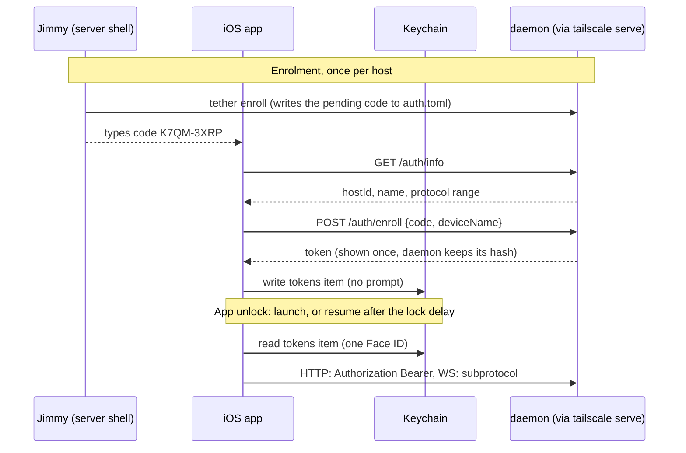
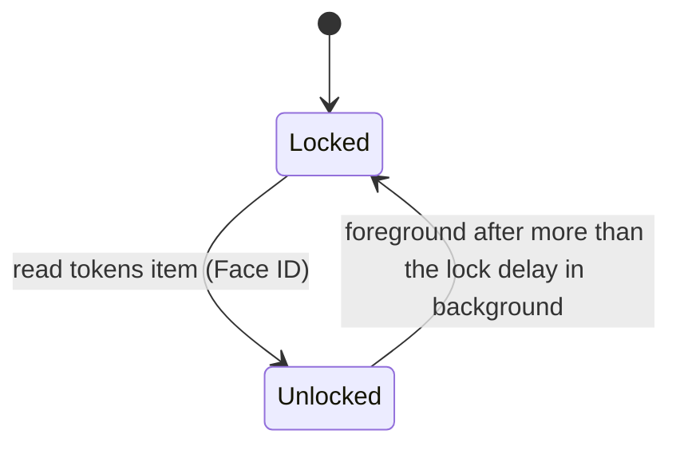

# Auth: device tokens, enrolment and the Face ID lock

Three checks guard every host. The daemon accepts only requests that `tailscale serve`
tags with Jimmy's Tailscale login. Each phone holds a random **device token** per host,
issued once at enrolment against a one-time code that `tether enroll` prints on the
server. The token sits in the iOS Keychain behind Face ID, so one Face ID prompt
unlocks the app and every host. The device token is the only credential: no session
tokens, no signatures, no cookies.

This spec covers both sides: the Swift app (`ios/Tether/Auth/`) and the daemon
(`src/auth/`, the `tether enroll` and `tether device` CLI). The app shell that uses the
token is [ios-shell.md](ios-shell.md); the WebSocket handshake that carries it is
[daemon-core.md](daemon-core.md#52-handshake-and-versions). Jimmy chose this scheme on
2026-10-21; the alternatives he rejected are in
[decisions.md](decisions.md#auth-a-device-token-behind-face-id).

## Threat model

One user, a tailnet with only his own devices, tailnet-only hosts. The daemon is
remote code execution for whoever holds a token, so the checks guard against:

- another tailnet user reaching the port, if the tailnet is ever shared (the login
  allowlist);
- his other tailnet devices, or anything running on them (the device token);
- someone holding the phone unlocked, or who adds a face to it (the Face ID lock,
  `.biometryCurrentSet`);
- a process on the server that forges Tailscale headers to enrol itself (the
  enrolment code, readable only from a shell as Jimmy).

Out of scope: processes on the server that already run as Jimmy (they can drive tmux
directly), a jailbroken phone, and malware on the phone that can read process memory
while the app is unlocked.

## Constants

| Constant | Value |
|---|---|
| device token | `tether_` + 43 characters: base64url, no padding, of 32 random bytes |
| enrolment code | 8 Crockford base32 characters (40 bits), shown as `XXXX-XXXX` |
| code lifetime | 10 minutes, single use |
| wrong codes before the pending code is deleted | 5 |
| app lock delay | default 5 minutes; immediately, 1, 5, 15 or 60 minutes |
| `host_id` | 10 random bytes, lowercase base32 (16 characters) |

A live socket is re-checked on the connection's own timer, the one that enforces the
idle timeout; its interval is in
[daemon-core.md §6](daemon-core.md#6-limits-and-the-memory-ceiling).

## Tailscale identity

Every route, the auth routes included, requires a loopback peer and a
`Tailscale-User-Login` in the allowlist auto-detected from LocalAPI, and the daemon
refuses to start with Funnel on ([plan.md](plan.md#security)). Probed on the dev box on
2026-10-21: `tailscale serve` adds `Tailscale-User-Login` and forwards
`Sec-WebSocket-Protocol` and `Origin` unchanged on a WebSocket upgrade.

## The device token

- **256 bits of entropy**, generated by the daemon. A guess is hopeless, so token
  checks need no rate limit or lockout.
- **The `tether_` prefix** makes a leaked token recognisable in logs, pastes and
  secret scanners. Every character is valid in an HTTP header and in a WebSocket
  subprotocol token.
- **The daemon stores only `sha256(token)`**, hex. Reading the state file (a dotfile
  backup, a `cat` on a shared screen) yields no credential. A check hashes the
  presented token and compares it with every device's hash in constant time, scanning
  the whole list with no early exit.
- **No expiry.** The token works until `tether device remove`; on the phone, the Face
  ID lock bounds who can use it.
- **No session token.** The device token goes on every request. A short-lived token
  derived from it would protect only against capture in transit or from the page, and
  transit is WireGuard plus TLS while the WebSocket alone is full control of the host.

## Enrolment

1. On the server, `tether enroll` prints a code such as `K7QM-3XRP` and the host's
   URL. Running it again replaces the previous code.
2. The CLI stores only `sha256(normalized code)`, the expiry and a wrong-try counter
   of 0, as `pending` in the state file. The daemon reads it when an enrol request
   arrives; nothing polls it.
3. In the app, Add host: Jimmy enters the host's MagicDNS name and the code. The app
   calls `GET /auth/info` and shows the host's name for confirmation.
4. The app sends `POST /auth/enroll {code, deviceName}`. It passes the Tailscale check
   first, and the login is recorded as `enrolled_by`.
5. On the auth lane, the daemon takes the state-directory `flock` (`files::lock`),
   reads the state file and checks the code against `pending` (constant time, unexpired):
   - **right:** generate the token, add the device with the token's hash, remove
     `pending`, and write the file once. Consuming the code and adding the device is
     one atomic write, so a crash leaves either both or neither.
   - **wrong:** add one to the counter and write the file; at 5, remove `pending`
     instead, and `tether enroll` must run again. The counter is in the file, so it
     survives a restart.
6. Device names are unique: a name that exists gets a `-2` suffix, so `tether device
   remove <name>` never has to guess.
7. The app adds the token to its Keychain item (below). Enrolment doesn't prompt: Add
   host is reachable only while the app is unlocked, and with no hosts there is
   nothing to unlock.

Normalization: uppercase, drop `-` and spaces, map `O`→`0` and `I`/`L`→`1`.

The code is what keeps a forged header or another tailnet device from enrolling: it is
readable only from a shell on the server, and it dies after one use, its lifetime, or
5 wrong guesses.

## Carrying the token

- **HTTP:** `Authorization: Bearer <token>`. In the app only native code sends HTTP to
  a host (the scheme handler's proxy, uploads, enrolment;
  [ios-shell.md](ios-shell.md#where-the-web-ui-comes-from)), on an ephemeral
  `URLSession` with cookies off. A bad or revoked token gets `401 auth_required`; if the
  daemon can't read `auth.toml` it can't judge the token, and answers `503
  auth_unavailable` instead.
- **WebSocket:** the web UI can't set headers on a WebSocket, so the token rides in the
  subprotocol list, `Sec-WebSocket-Protocol: tether.v1, tether.auth.<token>`, and never
  in a URL. At the upgrade of `GET /ws`:
  - Tailscale check fails → plain HTTP 403, no socket;
  - token missing, unknown or revoked → the daemon **completes the upgrade**
    (answering `tether.v1`), closes at once with `4401`, and reads nothing. A browser
    WebSocket can't see a refused upgrade's status (it reports 1006, like a network
    failure), so a 401 there would leave the app retrying a dead token;
  - `auth.toml` unreadable (below) → the same: complete the upgrade, close at once with
    `4503`;
  - token valid → upgrade, then `hello`.
- **Revocation on a live socket:** the connection re-checks its token on its own
  timer, not on client pings, so a client that stops pinging can't dodge it, and
  closes with `4401` when the device is gone, or `4503` when the file can't be read at
  that moment.
- **On 4401 or a 401,** the host is marked "not enrolled" and Add host is offered,
  with no retry: no token is rejected for a reason a retry would fix. A 401 is seen by
  native code directly; a 4401 is seen by the web, which reports it to native with
  `hostRejected` ([ios-shell.md](ios-shell.md#the-bridge)).
- **On 4503 or a 503,** the daemon could not decide, so the app keeps its token, does
  not mark the host "not enrolled", and retries with the usual backoff
  ([plan.md](plan.md#reconnect)); the pill says the host can't verify the device. Once
  the file parses again, the next retry succeeds with no re-enrolment.

**No `Origin` check.** Origin checks stop cross-site WebSocket hijacking, which needs
ambient credentials, and tether has none: no cookies, and a bearer token a foreign
page can't read. The invariant: **tether never authenticates with a cookie.** POST
bodies must be `Content-Type: application/json` (axum's `Json` rejects anything else),
so a page in a browser on the tailnet can't send them without a CORS preflight, which
the daemon never answers.

## Swift side: Keychain item and app lock

**One Keychain item holds every host's token**: a generic password, service
`tether.tokens`, whose data is JSON `{ "<host_id>": "<token>" }`.

- Access control: `SecAccessControlCreateWithFlags(nil,
  kSecAttrAccessibleWhenPasscodeSetThisDeviceOnly, .biometryCurrentSet, nil)`. Never
  synced, not in backups, deleted by iOS if the passcode is removed.
- **Reading the item is the unlock.** `SecItemCopyMatching` with an `LAContext` whose
  `localizedReason` is "Unlock tether" shows the Face ID prompt. One read returns every
  host's token, so one prompt unlocks every host. The tokens stay in memory until the
  app locks; requests never prompt.
- Adding or removing a host deletes the item and adds it again with the new map, which
  needs no prompt (only reads are gated).

**When the app asks for Face ID:**

- **On launch, and on foreground after more than the lock delay** in the background.
  There is no "never", which would undo the lock. iOS can't run a timer in a suspended
  app, so the check runs first thing on foreground, from the time the app entered the
  background.
- **Locking** drops the tokens from native memory and tells the web (`lock`), which
  drops its copies. The web closed its sockets when the app went to the background, so
  nothing is connected. A native lock screen covers the web view until the next read
  succeeds.
- **Cancel, a failed match or biometry lockout:** the app stays locked with an Unlock
  button. Nothing is deleted.

## Recovery

| Situation | What happens | Fix |
|---|---|---|
| Face ID re-enrolled, or an appearance added | `.biometryCurrentSet` makes the item unreadable for good. The read fails with an error that isn't cancel or lockout, possibly "item not found" (spike 1 records which); "not found" while `HostStore` lists hosts counts as this case | The lock screen offers "Reset tokens": it deletes the item and marks every host "not enrolled"; Jimmy runs `tether enroll` on each host and adds them again. The app never deletes on its own: a misread error would cost re-enrolling every host |
| Phone lost | Tokens stay on the lost phone, behind its Face ID | On each host, `tether device remove <name>`; live sockets close at the next re-check |
| Device removed while the app still has its token | 401 or close 4401 | The host shows "not enrolled" with Add host |
| `auth.toml` unreadable on the server (a bad hand edit) | 503 or close 4503, including on live sockets at their next re-check | Nothing on the phone: it keeps its token and retries. Fix the file on the server (the log names the line) |
| New phone, or restored from a backup | The host list (`UserDefaults`) came back; the tokens item (`ThisDeviceOnly`) didn't | Hosts without a token show "not enrolled"; Jimmy re-enrols and removes the old device |

Recovery needs a shell on the server that isn't tether (the laptop, or SSH).

## Daemon side

### State on disk

`$XDG_STATE_HOME/tether/` (default `~/.local/state/tether/`), directory mode 0700,
files 0600.

| File | Contents | Written by |
|---|---|---|
| `auth.toml` | `[[device]]` with `name`, `token_sha256`, `enrolled_at`, `enrolled_by` (the Tailscale login, or `cli`); optional `[pending]` with `code_sha256`, `expires_at`, `wrong_tries` | daemon on enrol; CLI on `enroll`, `device add`, `device remove` |
| `host_id` | the host id | whichever of daemon or CLI runs first; never rewritten |
| `lock` | empty; `flock` held by every writer for its whole read-modify-write | both |

Every write of `auth.toml` happens under the lock: write a temp file in the same
directory, `fsync` it, rename it over `auth.toml`, `fsync` the directory.

`host_id` is the host's identity: `welcome.host.id`, `/auth/info.hostId`, and the key
of the app's token map. It lives apart from `config.toml`, because config files get
copied between machines with dotfiles and two hosts must never share an id, and apart
from `auth.toml`, so the file that is rewritten can never take the identity with it.
Changing the MagicDNS name doesn't change it; the app updates the host's URL.

**Every check reads the file.** `auth::check` reads and parses `auth.toml` and scans
it, with no cache and no service: the file is a few rows, so a check costs tens of
microseconds, and `tether device remove` takes effect on the next request with no
watcher or IPC. A file that can't be read or doesn't parse **fails closed but
retryable**: every token check is refused until it parses, as `503 auth_unavailable`
over HTTP and close `4503` on a WebSocket (live sockets at their next re-check), never as
"not enrolled". A typo in a hand edit therefore costs retries, not a re-enrolment of
every device. The daemon never overwrites a file it can't parse; the log and the CLI's
error carry only the line number, never the file's contents.

### CLI

| Command | Effect |
|---|---|
| `tether enroll [--ttl 10m]` | Print a new enrolment code and the host URL |
| `tether device list` | Devices with name, enrolled date and `enrolled_by` |
| `tether device remove <name>` | Remove a device; its token stops working and its sockets close at the next re-check |
| `tether device add <name>` | Add a device and print its token once, for a desktop browser or Playwright against a real daemon |

The CLI works whether or not the daemon runs: it only edits files under the lock.

### Endpoints

JSON, camelCase, as in the WebSocket protocol. Errors are `{"error": "<code>"}`. The
request and response types are in `src/proto/auth.rs`; Swift mirrors them by hand
([daemon-core.md §5.5](daemon-core.md#55-type-generation)). Every route sits behind the
Tailscale check; only the two `/auth` routes skip the token check.

| Route | Request | Response | Errors |
|---|---|---|---|
| `GET /auth/info` | | `{hostId, name, daemonVersion, protocol: {min, max}}` | |
| `POST /auth/enroll` | `{code, deviceName}`, `Content-Type: application/json`, body at most 4 KiB | `{token, deviceName}` | 403 `bad_code` (wrong, expired or none pending); 400/415/422 `bad_request`; 413 `too_large`; 500 `internal`; 503 `busy` (auth lane wait) |
| `GET /ws` | subprotocol token | upgrade | bad token: upgrade, then close 4401; unreadable `auth.toml` or an auth-lane timeout: upgrade, then close 4503 |
| every other route (`/fs/*`, `/complete`, debug) | `Authorization: Bearer` | | 401 `auth_required`; 503 `auth_unavailable` |

Errors on any route, besides those in the table:

| Status | `error` | Cause |
|---|---|---|
| 403 | `forbidden` | The Tailscale check failed: not a loopback peer, or a login outside the allowlist. Sent for every route, unknown paths included, before anything else |
| 400, 415, 422 | `bad_request` | A body that isn't the route's JSON, with the status axum's `Json` extractor gives: 415 when it isn't `application/json`, 400 or 422 for malformed or mistyped JSON |
| 413 | `too_large` | The enrolment JSON body exceeds 4 KiB |
| 500 | `internal` | The enrolment transaction failed (the state file can't be read or written); the cause is logged, never sent. A broken `auth.toml` shows up here for `POST /auth/enroll`, which no token check guards |
| 503 | `busy` | The auth lane has no thread within 10 s for enrolment |
| 503 | `auth_unavailable` | The token check cannot read or parse `auth.toml`, or its auth-lane wait expires; retryable (see [Carrying the token](#carrying-the-token)) |

`/auth/info.name` (and `welcome.host.name`) is the config key `name`, else the machine
name from tailscaled's MagicDNS name ([plan.md](plan.md#config)). It is a label for the
host list; the host's identity is `hostId`.

### Module shape

`src/auth/` is plain functions over the state file; it owns no task. File reads, writes
and the shared state-directory flock use `files` on the auth lane. `Auth::recheck`
uses `token::find` just like the initial token check.

- `identity.rs`: the LocalAPI client, the allowlist, the Tailscale check.
- `token.rs`: pure `generate() -> String`, `hash(&str) -> [u8; 32]`, and
  `find(devices, token) -> Option<&Device>`, the constant-time scan.
- `store.rs`: `auth.toml` and `host_id` I/O under the lock; the enrol transaction.
- `mod.rs`: `check(headers) -> Result<Device, AuthError>`, used by the axum middleware
  in `src/http/` and by each connection's re-check.

### Crates

| Need | Crate |
|---|---|
| Token and code hashes | `sha2` |
| Constant-time compare | `subtle` |
| Tokens, `host_id` | `getrandom` |
| base64url | `base64` |
| Advisory file lock | `fs4` or `rustix::fs::flock` |

On the Swift side, Security and LocalAuthentication cover everything.
`ios/Tether/Auth/`:

- `TokenStore`: read the item with an `LAContext`, rewrite it, delete it.
- `Unlocker`: the lock state machine; holds the tokens while unlocked.
- `AuthClient`: `/auth/info` and `/auth/enroll` for one host, on an ephemeral
  `URLSession`.

## Open risks

- **The error after a Face ID change** is unconfirmed; spike 1 part B records it. The
  manual reset means the design doesn't depend on it.
- **An unreadable `auth.toml` locks every device out until it is fixed**, though none
  is forgotten: the app keeps its tokens and retries (503 and 4503). The fix needs a
  server shell, like recovery.
- **Face ID failure lockout:** with biometry-only access control, if Face ID won't
  recognise Jimmy (mask, injury), no host is reachable until it does. Accepted for a
  single-user tool.
- **A server shell is needed for recovery:** if the laptop is away and the phone has no
  SSH client, a Face ID change locks him out of every host. Keep an SSH client on the
  phone until tether has proved itself.
