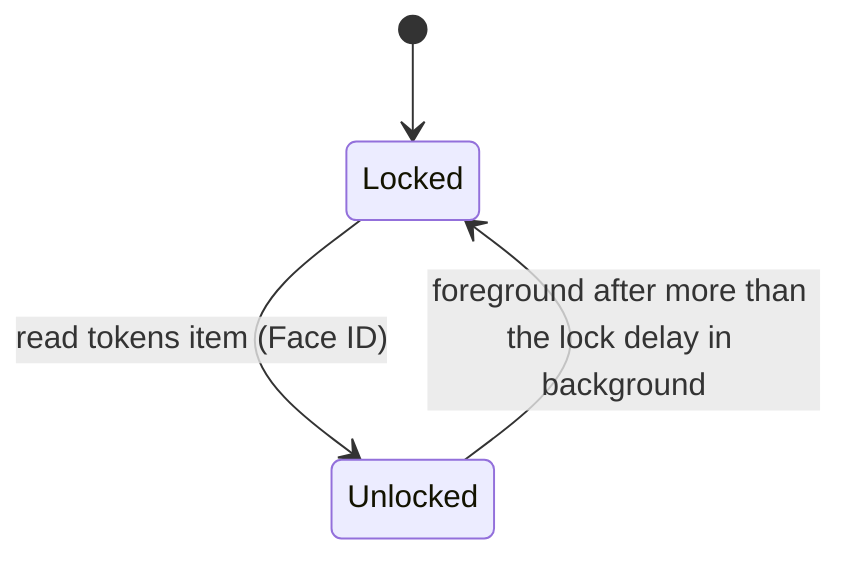

# Auth: device tokens, enrolment and the Face ID lock

Three checks guard every host. The daemon accepts only requests that `tailscale serve`
tags with Jimmy's Tailscale login. Each phone holds a random **device token** per host,
issued once at enrolment against a one-time code that `tether enroll` prints on the
server. The token sits in the iOS Keychain behind Face ID, so one Face ID prompt
unlocks the app and every host. The device token is the only credential: there are no
session tokens, no signatures and no cookies.

This spec covers both sides: the Swift app (`ios/Tether/Auth/`) and the daemon
(`src/auth/`, plus the `tether enroll` and `tether device` CLI). The app shell that
uses the token is in [ios-shell.md](ios-shell.md); the WebSocket handshake that
carries it is owned by [daemon-core.md](daemon-core.md).


## Decision

Jimmy decided on 2026-10-21: Tailscale login check, a Face ID lock on the phone, and a
per-device token enrolled once with a server-printed code.

*Rejected:* a Secure Enclave key per phone with signed challenges and short session
tokens (the previous version of this spec). Over a Keychain token, it adds only
protection when the token is copied off the phone, and the token is already
`ThisDeviceOnly` behind Face ID. For one user that isn't worth a challenge protocol, a
signature format shared by two languages, and a session-token scheme.
*Rejected:* Tailscale plus Face ID with no token. Any device on his tailnet (laptop,
server, anything he adds later) would get a shell without proving anything.
*Rejected:* passkeys. A native app can use a passkey only for a relying party in its
associated domains, which iOS verifies through Apple's CDN, and the CDN can't reach a
tailnet-only host ([ios-native.md §1](research/ios-native.md)).

**Threat model.** One user, a tailnet with only his own devices, tailnet-only hosts.
The daemon is remote code execution for whoever holds a token, so the checks guard
against:

- another tailnet user reaching the port, if the tailnet is ever shared (the login
  allowlist);
- his other tailnet devices, or anything running on them (the device token);
- someone holding the phone unlocked, or who adds a face to it (the Face ID lock,
  `.biometryCurrentSet`);
- a process on the server that forges Tailscale headers to enrol itself (the
  enrolment code, readable only from a shell as Jimmy).

Out of scope: processes on the server that already run as Jimmy (they can drive tmux
directly), a jailbroken phone, and malware on the phone that can read process memory
while the app is unlocked.

## Tailscale identity

Every route, the auth routes included, requires a loopback peer and a
`Tailscale-User-Login` in the allowlist auto-detected from LocalAPI, and the daemon
refuses to start with Funnel on ([plan.md §9](plan.md#9-security-and-auth)). Probed on
this box on 2026-10-21: `tailscale serve` adds `Tailscale-User-Login` and forwards
`Sec-WebSocket-Protocol` and `Origin` unchanged on a WebSocket upgrade.

## The device token

```text
tether_<43 characters: base64url, no padding, of 32 bytes from getrandom>
```

- **256 bits of entropy**, generated by the daemon. A guess is hopeless, so no rate
  limit or lockout is needed on token checks.
- **The `tether_` prefix** makes a leaked token recognisable in logs, pastes and secret
  scanners. Every character is valid in an HTTP header and in a WebSocket subprotocol
  token.
- **The daemon stores only `sha256(token)`**, hex, in `devices.toml`. Reading that file
  (a dotfile backup, a `cat` on a shared screen) doesn't yield a credential. To check a
  presented token, the daemon hashes it and compares it against every device's hash
  with a constant-time compare, scanning the whole list without an early exit.
- **No expiry.** The token works until `tether device remove`. On the phone, the Face
  ID lock bounds who can use it.

*Rejected:* a slow password hash (argon2, bcrypt). It protects low-entropy secrets; a
256-bit random token can't be brute-forced from its SHA-256, and a slow hash on every
request costs CPU on an overloaded box. *Rejected:* the phone generating the token.
It's equally secure, but generating it in the daemon keeps format and entropy in one
place, shared with `tether device add`. *Rejected:* expiring tokens with periodic
re-enrolment: a trip to the server shell every few weeks, for protection the Face ID
lock already gives.

**No session token.** The device token goes on every request. A short-lived session
token derived from it would protect only against capture in transit or from the page,
and both carry the device token's power anyway: transit is WireGuard plus TLS, and the
WebSocket alone is full control of the host. A session token would bring back the
minting, expiry and refresh machinery this design removed.

## Enrolment

1. On the server, `tether enroll` prints a code such as `K7QM-3XRP` and the host's URL.
   The code is 8 Crockford base32 characters (40 bits), valid 10 minutes, single use.
   Running the command again replaces the previous code.
2. The CLI stores only `sha256(normalized code)` and the expiry in `enroll.pending`.
   The daemon reads that file when an enrol request arrives; nothing polls it.
3. In the app, Add host: Jimmy enters the host's MagicDNS name and the code. The app
   calls `GET /auth/info` and shows the host's name for confirmation.
4. The app sends `POST /auth/enroll {code, deviceName}`. Like every route, it passes
   the Tailscale login check first, and the login is recorded as `enrolled_by`.
5. The daemon takes the `flock` (in `spawn_blocking`) and, holding it: reads
   `enroll.pending`, checks the code against the hash (constant time, unexpired),
   re-reads `devices.toml`, generates the token, appends the device with the token's
   hash, writes the file, and deletes `enroll.pending`. It returns the token and the
   device name. Holding one lock throughout means two requests with the same code
   can't both enrol, and the append can't overwrite a CLI `remove` the daemon hasn't
   seen.
6. Five wrong codes delete `enroll.pending`, and `tether enroll` must run again. The
   counter is in memory, keyed by the code's hash, so a new code starts at zero.
7. Device names are unique: a name that exists gets a `-2` suffix, so
   `tether device remove <name>` never has to guess.
8. The app adds the token to its Keychain item (below). Enrolment doesn't prompt:
   Add host is reachable only while the app is unlocked, and with no hosts yet there
   is nothing to unlock.

Normalization: uppercase, drop `-` and spaces, map `O`→`0` and `I`/`L`→`1`.

The code is what keeps a forged header or another tailnet device from enrolling: it is
readable only from a shell on the server, and it dies after one use, ten minutes or
five wrong guesses.

## Carrying the token

- **HTTP:** `Authorization: Bearer <token>`. In the app only native code sends HTTP to
  a host (the scheme handler's proxy, uploads, enrolment;
  [ios-shell.md](ios-shell.md#where-the-web-ui-comes-from)), using an ephemeral
  `URLSession` with cookies off. A bad or revoked token gets `401 auth_required`.
- **WebSocket:** the web UI can't set headers on a WebSocket, so the token rides in the
  subprotocol list: `Sec-WebSocket-Protocol: tether.v1, tether.auth.<token>`. The token
  never appears in a URL. At the upgrade:
  - Tailscale check fails → plain HTTP 403, no socket;
  - token missing, unknown or revoked → the daemon **completes the upgrade** (answering
    `tether.v1`), then closes at once with `4401` and reads nothing from the socket.
    A browser WebSocket can't see the status of a refused upgrade (it reports close
    1006, the same as a network failure), so a 401 there would leave the app retrying
    a dead token forever;
  - token valid → upgrade, then `hello`
    ([daemon-core.md §5.2](daemon-core.md#52-handshake-and-versions)).
- **Revocation on a live socket:** the connection task re-checks that its device is
  still enrolled on its own 10 s timer (the one that enforces the idle timeout), not on
  client pings, so a client that stops pinging can't dodge it, and closes with `4401`.
  The cost is one `stat` per connection every 10 s.
- **On 4401 or a 401,** the app marks that host "not enrolled" and offers Add host. It
  doesn't retry: a token is never rejected for any reason a retry would fix.

**No `Origin` check.** Origin checks stop cross-site WebSocket hijacking, which needs
ambient credentials. tether has none: no cookies anywhere, and a bearer token a
foreign page can't read. Dropping the check also means the app's `tether-app://ui`
origin and a desktop dev server need no daemon config. The invariant this rests on:
**tether never authenticates with a cookie.** POST bodies must be
`Content-Type: application/json` (axum's `Json` rejects anything else), so a page in a
browser on the tailnet can't send them without a CORS preflight, which the daemon never
answers.

## Swift side: Keychain item and app lock

**One Keychain item holds every host's token**: a generic password, service
`tether.tokens`, whose data is JSON `{ "<host_id>": "<token>" }`.

- Access control: `SecAccessControlCreateWithFlags(nil,
  kSecAttrAccessibleWhenPasscodeSetThisDeviceOnly, .biometryCurrentSet, nil)`. Never
  synced, not in backups, and deleted by iOS if the passcode is removed.
- **Reading the item is the unlock.** `SecItemCopyMatching` with an `LAContext` whose
  `localizedReason` is "Unlock tether" shows the Face ID prompt. One read returns every
  host's token, so one prompt unlocks every host. The tokens stay in memory until the
  app locks; requests never prompt.
- Adding a host deletes the item and adds it again with the new map, which needs no
  prompt (only reads are gated). Removing a host does the same.

*Rejected:* one item per host. One prompt for all hosts would then depend on an
evaluated `LAContext` covering several reads, which spike 1 would have to prove; one
item makes it true by construction. *Rejected:* a plain Keychain item behind an
app-level `evaluatePolicy` check. It makes Face ID a screen in front of the token
rather than the key to it, and costs the same code. *Rejected:* `.biometryAny`
(survives re-enrolment, so a face added later can unlock) and `.userPresence` (lets the
device passcode stand in for Face ID).

**When the app asks for Face ID:**



- **On launch**, and **on foreground after more than the lock delay** in the
  background. The default delay is 5 minutes; the setting offers immediately, 1, 5, 15
  or 60 minutes. There is no "never", which would undo the lock. iOS can't run a timer
  in a suspended app, so the check runs first thing on foreground, using the time the
  app entered the background.
- **Locking** drops the tokens from native memory and tells the web (`auth locked`),
  which drops its copies. The web closed its sockets when the app went to the
  background, so nothing is connected. A native lock screen covers the web view until
  the next read succeeds.
- **Cancel, failed match or biometry lockout:** the app stays locked with an Unlock
  button. Nothing is deleted.

## Recovery

| Situation | What happens | Fix |
|---|---|---|
| Face ID re-enrolled, or an appearance added | `.biometryCurrentSet` makes the item unreadable for good. The read fails with an error that isn't cancel or lockout, possibly "item not found" (spike 1 records which); "not found" while `HostStore` lists hosts counts as this case | The lock screen offers "Reset tokens". It deletes the item and marks every host "not enrolled"; Jimmy runs `tether enroll` on each host and adds them again. The app never deletes on its own: a misread error would cost a re-enrolment of every host |
| Phone lost | Tokens stay on the lost phone, behind its Face ID | On each host, `tether device remove <name>`. Live sockets close within 10 s |
| Device removed while the app still has its token | 401 or close 4401 | The app marks the host "not enrolled" and offers Add host |
| New phone, or restored from a backup | The host list (`UserDefaults`) came back; the tokens item (`ThisDeviceOnly`) didn't | Hosts without a token show "not enrolled"; Jimmy re-enrols and removes the old device |

Recovery needs a shell on the server that isn't tether (the laptop, or SSH).

## Daemon side

### State on disk

`$XDG_STATE_HOME/tether/` (default `~/.local/state/tether/`), directory mode 0700,
every file 0600, every write to a temp file then renamed.

| File | Contents | Written by |
|---|---|---|
| `devices.toml` | `[[device]]` with `name`, `token_sha256`, `enrolled_at`, `enrolled_by` (the Tailscale login, or `cli`) | daemon on enrol; CLI on `device add` and `device remove` |
| `host_id` | the host id, below | whichever of daemon or CLI runs first |
| `enroll.pending` | `code_sha256`, `expires_at` | CLI on `enroll`; daemon deletes it |
| `lock` | empty; `flock` held by any writer during read-modify-write | both |

`host_id` is the daemon's host identity, the `host` in every URL and message of
[daemon-core.md](daemon-core.md#51-transport) and `welcome.host.id`: 10 random bytes in
lowercase base32 (16 characters, URL-safe). It lives in the state directory, not in
`config.toml`, because config files get copied between machines with dotfiles and two
hosts must never share an id. Changing the MagicDNS name doesn't change it; the app
updates the host's URL.

**Picking up CLI changes.** `AuthService` is the only component that reads the state
files. Before answering a token check it `stat`s `devices.toml` and reloads it if the
inode or mtime changed. `device remove` therefore takes effect on the next check,
without a watcher or IPC. A `devices.toml` that doesn't parse fails closed: every
token check fails until it parses, and the error is logged.

### CLI

| Command | Effect |
|---|---|
| `tether enroll [--ttl 10m]` | Print a new enrolment code and the host URL |
| `tether device list` | Devices with name, enrolled date and `enrolled_by` |
| `tether device remove <name>` | Remove a device; its token stops working, its sockets close within 10 s |
| `tether device add <name>` | Add a device and print its token once, for a desktop browser or Playwright against a real daemon |

The CLI works whether or not the daemon runs: it only edits files under the lock.

### Endpoints

JSON with camelCase field names, as in the WebSocket protocol
([daemon-core.md §5.3](daemon-core.md#53-json-messages)). Errors are
`{"error": "<code>"}`. The request and response types are in `src/proto/auth.rs`, so
typeshare generates them for Swift and TypeScript with the WebSocket messages. Every
route sits behind the Tailscale check. Only the two `/auth` routes skip the token
check; everything else, the WebSocket upgrade included, goes through the one
middleware.

| Route | Request | Response | Errors |
|---|---|---|---|
| `GET /auth/info` | | `{hostId, name, daemonVersion, protocol: {min, max}}` | |
| `POST /auth/enroll` | `{code, deviceName}` | `{token, deviceName}` | 403 `bad_code` (wrong, expired or none pending) |
| any other HTTP route | `Authorization: Bearer` | | 401 `auth_required` |
| `GET /h/{host}/ws` | subprotocol token | upgrade | bad token: upgrade, then close `4401` |

The auth routes sit at the root, not under `/h/{host}`: each daemon is exactly one host,
and the app learns the host id from `/auth/info`.

### Module shape

`src/auth/`, following plan §11's rule that tasks own state:

- `identity.rs`: the LocalAPI client, the allowlist and the Tailscale check.
- `token.rs`: pure `generate() -> String`, `hash(&str) -> [u8; 32]` and
  `find(devices, token) -> Option<&Device>`, the constant-time scan.
- `store.rs`: `devices.toml`, `host_id` and `enroll.pending` I/O under the lock.
- `service.rs`: the `AuthService` task. It owns the device set and the enrol-attempt
  counter. Token checks, from the middleware and from connection timers, are requests
  to it over a bounded channel.
- `middleware.rs`: the single axum layer: the Tailscale check, then the token check,
  except on the two auth routes.

### Crates

| Need | Crate |
|---|---|
| Token and code hashes | `sha2` |
| Constant-time compare | `subtle` |
| Tokens, `host_id` | `getrandom` |
| base64url | `base64` |
| Advisory file lock | `fs4` or `rustix::fs::flock` |

On the Swift side, Security and LocalAuthentication cover everything; no third-party
package.

`ios/Tether/Auth/`:

- `TokenStore`: read the item with an `LAContext`, rewrite it, delete it.
- `Unlocker`: the lock state machine above; holds the tokens while unlocked and drops
  them on lock.
- `AuthClient`: `/auth/info` and `/auth/enroll` for one host, on an ephemeral
  `URLSession`.

## Open risks

- **The error after a Face ID change** is unconfirmed; spike 1 part B records it. The
  manual reset means the design doesn't depend on it.
- **Face ID failure lockout:** with biometry-only access control, if Face ID won't
  recognise Jimmy (mask, injury), no host is reachable until it does. Accepted for a
  single-user tool.
- **Server shell needed for recovery:** if the laptop is away and no SSH client is on
  the phone, a Face ID change locks him out of every host. Keep Termius (or another SSH
  client) installed until tether has proved itself.
