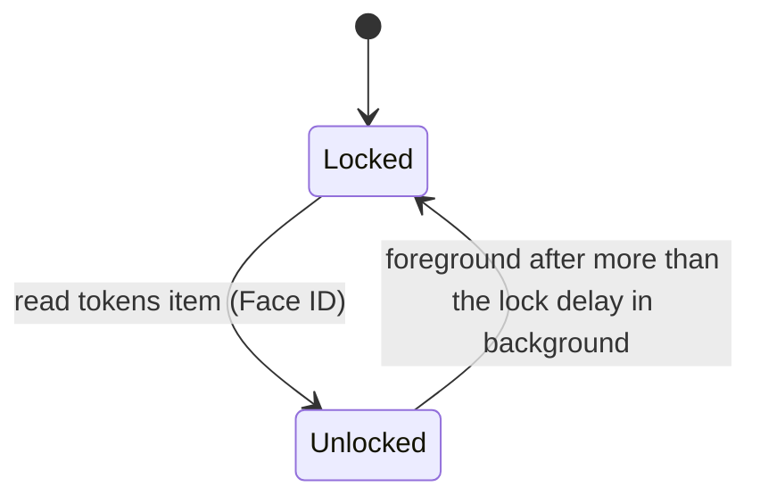

# Auth: device tokens and enrolled tailnet nodes

## Overview

Every request reaches the daemon through `tailscale serve`, and must carry an
allowlisted Tailscale login. Past that, a request is admitted on one of two
**lanes**. The iOS app presents a **device token**, issued at enrolment, kept in the
Keychain behind Face ID and sent as a bearer token or a WebSocket subprotocol. A
browser or PWA presents nothing: it is admitted as an **enrolled node**, because
the tailnet node it runs on, which the daemon learns from tailscaled, is in
`auth.toml`. Both kinds of device are enrolled with the same one-time code from
`tether enroll` and revoked with `tether device remove`. tether never authenticates
with a cookie.

## Threat model

One user, a tailnet with only his own devices, tailnet-only hosts. The dev box may
have other Unix users, each running their own tether. The daemon is remote code
execution for whoever passes it, so the checks guard against:

- another tailnet user reaching the daemon, if the tailnet is ever shared (the login
  allowlist, and the node's owner);
- his other tailnet devices, or anything running on them, unless he enrolled them
  (the device token; the enrolled-node list);
- **pages on any other origin using an enrolled node's identity through the
  browser**: other sites, pages served by other machines in the tailnet (all one
  "site", since `ts.net` is a public suffix), other ports on the dev box, another
  user's tether ([Browser admission](#browser-admission));
- **anything else served at tether's origin, or anything else reaching
  `serve.sock`**: another app mounted beside tether in its Serve entry, or a Serve
  TCP forward to the socket ([Canonical origin](#canonical-origin));
- **another Unix user on the dev box** forging Tailscale headers or reaching the
  daemon from the box's own node (the socket directory, the self-node rule);
- machines that only *look* like a tailnet node: devices behind a subnet router,
  tagged servers, nodes shared in from another tailnet, Funnel traffic from the
  internet ([Node identity](#node-identity));
- someone holding the phone unlocked, or who adds a face to it, **for the native
  app only** (the Face ID lock, `.biometryCurrentSet`);
- a process on the server that forges headers to enrol itself (the enrolment code,
  readable only from a shell as Jimmy);
- anything that passes the Tailscale check exhausting memory through HTTP (the
  per-route caps, the connection backstop and the buffer limits in
  [daemon-core.md §6](daemon-core.md#6-limits-and-the-memory-ceiling)).

**Who can hold connections.** Only root and Jimmy's processes can connect to the
sockets. But tailscaled opens a backend connection for each in-flight request from
any tailnet node the ACLs let reach port 443, including nodes the Tailscale check
then refuses. So whoever the ACLs let reach the box's port 443 can deny service by
holding the 64 connection permits; other Unix users on the box can't.

**Accepted:**

- **An enrolled node is trusted whole.** Every browser profile, app and OS account
  on it reaches the daemon as that node, with no further check, until `tether
  device remove`. On a phone whose node is enrolled, Safari and the PWA reach the
  host without Face ID.
- Anyone holding Jimmy's unlocked laptop or phone can use the browser client. A lock
  screen drawn by the page would protect nothing the node isn't already sending.
- An HTTP response already streaming when its device is removed runs to its end
  ([Live sockets](#live-sockets-and-revocation)).
- Removing a node in the Tailscale admin console takes effect in tether only once
  tailscaled on the dev box learns of it, with no documented bound. `tether device
  remove` takes effect at once, and is the revocation tether relies on.
- Tailnet state is up to 10 s old when used, and up to 30 s while LocalAPI is
  failing ([security state](#security-state-is-read-when-it-is-used)): a handler added beside tether, or a change to the box's own node,
  is acted on within 10 s while LocalAPI answers.

**Trusted, out of scope:** root and the Tailscale operator (they can write the
serve config, or drive tmux directly; [running.md](../running.md) says how to keep the
operator out), processes on the server that run as Jimmy,
a jailbroken phone, malware on an enrolled device, browser extensions granted
access to `*.ts.net`, and script injected into tether's own page. The last is kept
small by the CSP, DOMPurify, and raw files that never run
([fs.md](fs.md#get-fsrawpath)).

The node lane exists only on the tailnet: off it there is no Serve, no
`X-Forwarded-For` from tailscaled and no whois. **A public origin admits browsers
only with a portable credential (passkeys, [Seams](#seams)), on its own socket, and
must revise this section first.**

## Security state is read when it is used

**Every request reads its inputs when it is judged, within a stated age.** Nothing
that admits or refuses is derived once at startup, at shell boot, or at any other
event and then trusted until the next one, because nothing announces when that
state changes: tailscaled's IPN bus carries no serve-config change, and `auth.toml`
is edited by another process. A live socket's re-check re-reads what can revoke it:
its device on both lanes, and on the node lane its node and the canonical origin
([Live sockets](#live-sockets-and-revocation)). The allowlist is judged per request
and at the upgrade; `tether device remove` is the revocation for a live socket.

| State | Read from | Read when | If the read fails |
|---|---|---|---|
| device rows | `auth.toml` | every auth-lane lookup and every live-socket re-check | `503 auth_unavailable`; a socket closes 4503 |
| the requesting node | whois | every node-lane request and node-lane re-check | `503 identity_unavailable`; a socket tolerates 2 failures, the 3rd closes 4503 |
| tailnet state: the serve config, and the self node's stable ID and owner login | `GET /localapi/v0/serve-config` and `GET /localapi/v0/status?peers=false`, read together into one cell | when a request needs the allowlist, the self rule or the canonical origin, from a value at most 10 s old | below |

**The tailnet-state cell.** A request that finds the cell empty or older than 10 s
starts a read, unless one is in flight, and waits for it; concurrent requests share
it. When a read fails, requests use the held value without waiting while it is
under 30 s old. A background retry continues independently of request demand, with
backoff from 2 s to 30 s. Past 30 s, or with nothing held, a request that needs the
cell gets `503 identity_unavailable` at once (a socket re-check counts a failure).
If the held value has expired, LocalAPI recovery may take up to 30 s to be observed,
and requests needing the cell remain unavailable until a scheduled retry succeeds.
The reads go over one keep-alive LocalAPI connection, apart from whois, with the 2 s
timeout and a 64 KiB answer limit per answer. Native requests need the cell too for
the auto-detected allowlist; an open native WebSocket does not refresh it.

## Constants

| Constant | Value |
|---|---|
| tether's runtime directory | `$XDG_RUNTIME_DIR/tether/` on Linux, `$TMPDIR/tether/` on macOS; `0700`, owned by the daemon's user. Holds `lock`, `serve.sock`, `local.sock` (both `0600`) and `paste/` |
| whois calls in flight | 2 daemon-wide; up to 16 distinct addresses waiting, the 17th `503 busy` |
| LocalAPI timeout; answer limit | 2 s; 64 KiB (a real whois answer is 1.5–2.5 KB) |
| tailnet-state cell | a value at most 10 s old is used; after a failed read the held value is used until 30 s old; background retry starts at 2 s and doubles to 30 s |
| live-socket re-check | the existing 10 s re-check; 3 consecutive whois failures close with 4503 |
| minimum browsers | Safari and iOS 17.5, Chrome 123, Firefox 120: the minimums support `light-dark()` and send `Sec-Fetch-Site` |
| minimum Tailscale on the server | 1.94, the first with `unix:` proxy targets |

## Sockets and the Tailscale check

**Startup**, in this order:

1. **The runtime directory.** `$XDG_RUNTIME_DIR/tether/`. On Linux, without
   `XDG_RUNTIME_DIR` the daemon refuses to start: a fallback under `/tmp` is a path
   another user can create first. On macOS it is the per-user temporary directory
   (`$TMPDIR`). The daemon creates the directory with mode
   `0700` if it is missing. If it exists, it must be a directory, not a symlink,
   owned by the daemon's user, with mode `0700`; otherwise the daemon refuses to
   start. The directory is never deleted or recreated.
2. **The lock.** The daemon opens `tether/lock` (creating it, `0600`) and takes a
   non-blocking `flock` on it, held for its whole life. If another daemon holds it,
   this one exits with "tether is already running". The kernel drops the lock when
   its holder dies, so a crash leaves nothing to clean up.
3. **The sockets**, only once the lock is ours: unlink a stale `serve.sock` and
   `local.sock`, and bind both.
4. **Leftovers**, once the lock is ours: empty `tether/paste/` (a subdirectory,
   never the runtime directory itself) and delete stale upload part files.

Refusals at steps 1–2 for the directory exit 78, since a restart can't fix them;
"already running" exits 1. `$XDG_RUNTIME_DIR` is `/run/user/<uid>`, which systemd
keeps while the user unit runs under lingering, as the daemon's unit already
requires. tailscaled runs as root and reaches `serve.sock` through Serve's `unix:`
proxy target.

**Startup needs no LocalAPI.** The daemon starts even when tailscaled is down, so a
boot that starts tether first costs no restart loop. It starts one background fill
of the tailnet-state cell, retrying with backoff from 2 s to 30 s until it succeeds, then logs the
canonical origin or the refusal message; it logs again whenever that changes.

**Fronts.** Each socket is a **front**, and the front decides what a connection may
do:

| Front | Who connects | Lanes | Host |
|---|---|---|---|
| `serve.sock` | Serve's HTTP proxy, through tether's one HTTPS entry ([Canonical origin](#canonical-origin)) | node and native | must be `localhost` |
| `local.sock` | Jimmy's dev proxy, tests, Playwright | native only | not checked |

On `serve.sock`, every request's `Host` must be exactly `localhost`, because Serve
rewrites it to that for every `unix:` target; the browser's host travels in
`X-Forwarded-Host`. Any other `Host` is `403 forbidden`. This is a cheap check that
catches something else pointed at the socket by mistake; it proves nothing, since
anything that reaches the socket can write `localhost`. What establishes that
`serve.sock` carries only Serve's HTTP proxy is the directory and the
canonical-origin rule. On `local.sock`, a request that presents no token is `401
auth_required`: the node lane doesn't exist there.

**The Tailscale check, on every route of both fronts, before anything else:**

- `Tailscale-Funnel-Request` is absent. Serve sets it on Funnel traffic and strips
  a spoofed copy.
- `Tailscale-User-Login` is present and, once decoded (Serve Q-encodes a non-ASCII
  value, RFC 2047), in the allowlist: the self node's owner login from the
  tailnet-state cell ([security state](#security-state-is-read-when-it-is-used)), or the logins given with `--allow-login`. Serve sets the
  header for user-owned nodes and strips spoofed copies; it sends none for tagged
  nodes or Funnel.

A failure is `403 forbidden`. The daemon doesn't refuse to start when Funnel is on:
the Funnel header refuses each such request, and the canonical origin refuses an
entry with Funnel on ([canonical origin](#canonical-origin)).

## Node identity

**Resolving the node.** A node-lane request must arrive on `serve.sock`. It must
carry exactly one `X-Forwarded-For` field holding exactly one address, with no
comma, and the address must be a Tailscale address (`100.64.0.0/10` or
`fd7a:115c:a1e0::/48`). Anything else is `403 forbidden`: Serve always writes one
address, so a list means something appended to it. The daemon then calls `GET
/localapi/v0/whois?addr=<address>` and takes `Node` and `UserProfile` from the
answer.

**Node rules.** The node is admitted only if all hold; otherwise the request is
`403 node_refused` with the reason, and the node can't be enrolled either:

| Rule | Why |
|---|---|
| `Tags` is empty | A tagged node belongs to the tailnet, not a person; Serve sends it no login header, so the Tailscale check refuses it already. The rule keeps the node lane from depending on that |
| `UserProfile.LoginName` equals the decoded `Tailscale-User-Login` | Both come from the same netmap; disagreement means the two lookups saw different nodes, so neither is trusted |
| `Sharer` is zero | A node shared in from another tailnet is someone else's machine, whatever user it shows |
| `AllowedIPs` holds only the node's own `Addresses`, apart from the exit-node routes `0.0.0.0/0` and `::/0` | A subnet router masquerades every host on its LAN as itself, so its identity says nothing about which device sent the request. An exit node forwards only outbound traffic, so it can't do that |
| the stable ID isn't the box's own (`Self.StableID` in the tailnet-state cell) | Every local user on the dev box reaches Serve from the box's own node. Admitting it would let any of them in, through the front door |

Then, on the auth lane, the device lookup: a `node` device whose `node_id` equals
the stable ID **and** whose `login` equals the node's login. No match is `401
not_enrolled`. `auth::admit` then judges the found device, as for native.

**Stable IDs.** Tailscale documents that its control plane never reuses a node ID
(`tailcfg.NodeID`: "global within a control plane URL"). A self-hosted control plane
such as Headscale makes no such promise; there, a deleted node's ID could in
principle return, and the `login` match is the remaining guard.

**Per request, never cached.** tailscaled pools its connections to the daemon and
reuses them for requests from different nodes, so identity is resolved per
request, never per connection. Results are not kept between requests, because an
address can later belong to a different node, and only the current netmap says
which. Concurrent lookups of the same address share one call: the result is
shared only by requests that arrived while it was in flight, and a request that
joins a call already queued or running takes no waiting slot. So the caps count
distinct addresses: at most 2 calls run at once over 2 keep-alive LocalAPI
connections; up to 16 more addresses wait, and a request for a 17th gets `503 busy`
at once. One page loading 20 thumbnails makes one call. A whois answer is about
2 KB and costs tailscaled a map lookup (G4 measures it on the dev box). The shell
routes and `GET /auth/info` never call whois.

**Failure.** A whois that fails, times out (2 s), or answers more than 64 KiB is
`503 identity_unavailable`: the daemon can't decide, so it fails closed but
retryable, never as "not enrolled". A whois that answers "no such peer" is `403
node_refused` (`unknown_node`).

**Order, and what a flood costs.** For a node-lane request: the `Host` rule, the
canonical origin, the pure [admission rules](#browser-admission) on headers alone,
the `X-Forwarded-For` parse, whois, the node rules, then the auth lane's read of
`auth.toml`. A cross-origin request is refused before any whois or file read; it
costs at most a shared read of the tailnet-state cell.

## Canonical origin

Browsers are admitted from exactly one origin per daemon, the **canonical origin**:
`https://<host>` or `https://<host>:<port>`, lowercase, no trailing dot or path.

**The rule.** The daemon finds every reference to its `serve.sock` anywhere in the
serve config: every `TCP` forward and every `Web` handler, in the background config,
every foreground config and every Tailscale Service. A `unix:` target names
`serve.sock` when it is the same file by `stat` identity (device and inode), not by
string, as tailscaled's own `isTailscaledSocket` does; the daemon `stat`s
`serve.sock` once, at bind. Another user's socket can't be `stat`ed through their
`0700` directory, so it never matches. The canonical origin exists when `serve.sock`
is named exactly once, and that one reference is:

- the only handler of a `Web` entry: mount path `/`, proxy `unix:<serve.sock>`;
- on a port that serves HTTPS;
- with Funnel off for its `host:port`.

Otherwise there is no canonical origin and every node-lane request is `403
bad_origin`. The refusal is one message that names the offending entry or
reference and the command that fixes it.

| Rule | Why |
|---|---|
| `serve.sock` named nowhere else | A Serve `TCP` forward to the socket (`--tcp`, `--tls-terminated-tcp`, from Tailscale 1.102) relays raw bytes from tailscaled itself, so a client writes its own `Host`, `X-Forwarded-For`, `X-Forwarded-Host` and `Tailscale-User-Login`. Only the serve config can show that every connection on `serve.sock` is Serve's HTTP proxy. A second `Web` publication of the same tether is refused by the same count; choosing among several isn't worth a setting |
| tether is the only handler in its entry | A second handler on the same `host:port` (`--set-path /grafana 3000`, a `Path` handler serving a directory, a `Text` handler) serves pages with tether's origin. They can open `/ws`, `fetch` `/fs/*` and post to `/complete` with exact `Origin` and `Sec-Fetch-Site: same-origin`, and no header tells them apart from tether's page |
| mount path `/` | The shell and the API assume the root |
| HTTPS | Browsers need a secure context for the service worker, and Serve marks only TLS requests `https` |
| Funnel off | Funnel puts the entry on the internet; the node lane is tailnet-only |

**When it is read.** From the tailnet-state cell ([security state](#security-state-is-read-when-it-is-used)): on every node-lane request,
every node-lane socket re-check, `GET /auth/info` and `tether enroll`. A handler
added beside tether, or a stray reference to `serve.sock`, is therefore acted on
within 10 s, by new requests and by live sockets alike. Request headers (`Host`,
`X-Forwarded-Host`) never choose the origin.

**Upgrading from loopback TCP.** When there is no canonical origin and some entry
proxies to `http://127.0.0.1:7850`, today's default publication, the message names
that entry and gives the one command, `sudo tailscale serve --bg --https=443
unix:/run/user/<uid>/tether/serve.sock`, which replaces the `/` handler of the
entry it names. Any other loopback target is someone else's app and gets the plain
refusal. The daemon logs the message, `tether enroll` prints it, and `GET
/auth/info` carries it in `browserRefused`.

`GET /auth/info` reports `browserOrigin` (or `null`, with `browserRefused` set to
the message). The shell compares it with `location.origin` before connecting, and
on a mismatch shows "Open tether at `<browserOrigin>`" and opens no socket; with
`null` it shows the message.

## Browser admission

Node identity is ambient: a page on any origin, open in a browser on an enrolled
node, can make the browser send requests that arrive with that node's identity.
These rules make sure a node-lane request was sent by tether's own page. The
browser sets `Origin`, its `Host` and `Sec-Fetch-*` itself and no page can change
them; Serve copies the browser's `Host` into `X-Forwarded-Host` after deleting any
inbound copy. So they are trustworthy for browsers. They are no barrier to a
non-browser process on an enrolled node, which is accepted ([Threat
model](#threat-model)).

The rules apply to every node-lane request on the device routes (`/ws`, `/fs/*`,
`/complete`, the debug endpoint) and to `/auth/node/*`. They are pure, on headers
and the canonical origin.

| Check | Rule | Why this rule |
|---|---|---|
| X-Forwarded-Host | exactly one field, equal to the canonical origin's authority (case-insensitive; a default port may be omitted) | Admission compares everything with one origin. A request whose browser-side host isn't that origin's wasn't addressed to it, whatever else it carries |
| Origin, on WebSocket upgrades and every method but `GET` and `HEAD` | present and equal to the canonical origin, byte for byte after lowercasing; `null`, missing, prefix and suffix matches all fail | **The required control on upgrades and mutations.** Browsers send `Origin` on every cross-origin upgrade and POST, and a WebSocket has no CORS: without it, any page in a browser on an enrolled node could open the shell (cross-site WebSocket hijacking) or submit a form |
| `Sec-Fetch-Site`, on upgrades and mutations | if present, `same-origin` | Defence in depth. Not required, because WebKit added fetch metadata to WebSocket handshakes late, and the exact `Origin` already decides |
| `Sec-Fetch-Site`, on `GET` and `HEAD` | present and `same-origin` | **The required control on reads.** Browsers usually send no `Origin` on a GET, so ``, `<video>`, `<script>` or a link from another page would otherwise load `/fs/raw` media, or leak a file's size and dimensions, under the node's identity |
| Origin, on `GET` and `HEAD` | if present, equal to the canonical origin | Cheap, and refuses the few cross-origin GETs that do carry it |

These rules stop pages on other origins. Pages on tether's own origin are kept to
tether's by the canonical-origin rule that tether is alone in its entry.

A refusal is `403 bad_origin`; a refused upgrade gets a plain 403 and no socket.
Each route keeps its own body rule (JSON routes take `application/json` through
axum's `Json`; `POST /fs/upload` takes a raw body); the content type is no
cross-site defence, the exact `Origin` is. **No CORS:** the daemon sends no
`Access-Control-*` header and answers no preflight. **No anti-CSRF token:** every
admitted mutation carries an exact `Origin`, which no page can forge. A browser
older than the minimums sends no `Sec-Fetch-Site`, so its GETs are refused; tether
doesn't support it.

The shell routes (`/`, `/manifest.webmanifest`, `/sw.js`, `/icons/*`,
`/apple-touch-icon.png`, `/favicon.ico`, `/assets/*`) and `GET /auth/info` judge
no identity and apply none of these rules: a bookmark, a cold PWA launch or a link
from another app sends `Sec-Fetch-Site: none` or `cross-site`, and gets the shell.
The shell is the client's code and carries no host data.

## Carrying the token

The daemon looks at what the request presents. Any `Authorization` header counts,
whatever its scheme (matched case-insensitively), and so does a `tether.auth.`
WebSocket subprotocol. `Cookie` is ignored.

| Presented | Lane |
|---|---|
| exactly one `Authorization: Bearer <token>`, or exactly one `tether.auth.<token>` subprotocol | native, on either front: today's rules, no origin check, no node identity. Another scheme, or an empty token, is `401 auth_required` |
| nothing | node, on `serve.sock` only: [Node identity](#node-identity), [Canonical origin](#canonical-origin) and [Browser admission](#browser-admission). On `local.sock`, `401 auth_required` |
| two `Authorization` headers, two `tether.auth.` subprotocols, or one of each | ambiguous: `401 auth_required` / close 4401 |

A request that presents a token never falls back to the node lane when the token
is wrong: it is 401. A native token works from any node; a node lane needs no
token. The iOS app always presents its token, so its requests are judged on the
native lane even from an enrolled phone node.

**Native enrolment refuses browsers.** `POST /auth/enroll` returns a token in JSON,
so it refuses any request carrying `Origin` or `Sec-Fetch-Site` with `403
bad_origin`. A browser never needs a portable token, and refusing keeps script on
tether's origin that sees a typed code from trading it for one.

**Statuses and close codes for browsers:**

| Answer | Meaning | The browser client |
|---|---|---|
| `401 not_enrolled`; close 4401 | this node isn't enrolled, or was removed; or, for a socket, the canonical origin changed | asks `GET /auth/node/session` why: `401` shows the enrolment screen, `403 bad_origin` reloads `/auth/info` |
| `403 node_refused` (reason) | this node can never be admitted | a screen naming the reason ("This device is a subnet router"), no retry |
| `403 bad_origin` | the page isn't at the canonical origin, or there is none | reloads `GET /auth/info` and shows "Open tether at …" or the refusal message |
| `503 identity_unavailable`, `auth_unavailable`, `busy`; close 4503 | the daemon can't decide now | keeps its state and retries with the usual backoff |
| close 4005 | over the socket cap | "Too many connections" |

A refused node-lane upgrade for identity reasons (not enrolled, node refused,
whois failed) completes the upgrade and closes at once with 4401 or 4503, as native
does, because a browser WebSocket can't see a refused upgrade's status. The codes
`403 unlock_required` and close 4423 are reserved for passkey unlock and are not
sent in this phase.

**`auth::admit(device, now) -> Grant` is the one policy over a found device**, for
both lanes, at the initial check and every re-check. Today it returns `Full` for
every device that exists. Conditions added later (an expiry, a scope, a passkey
unlock) go here and nowhere else ([Seams](#seams)).

## Enrolment

Steps 1–2 and 5–6 are unchanged and shared by both kinds: one pending code, one
wrong-try counter, one atomic write that consumes the code and adds the device. A
node enrols at its own route:

3b. **In a browser**, the shell calls `GET /auth/node/session`. For a node that
   isn't enrolled it answers `401 {error: "not_enrolled", node: {name}}`, `name`
   being the node's MagicDNS machine name, and the shell shows the enrolment screen:
   the host's name from `GET /auth/info`, a code field, and the device name,
   prefilled with the node's name, which Jimmy can edit. The screen says "This
   lets every browser and app on <node> use tether on <host>." A refused node gets
   `403 node_refused` and no code field.

4b. The page sends `POST /auth/node/enroll {code, deviceName}`. It passes the
   node lane up to the device lookup: front, canonical origin, admission (mutation),
   whois, node rules. On the auth lane, `Store::enroll` runs with `kind = Node`, the
   stable ID and the node's login, and `enrolled_by` = the login. If the node is
   already enrolled, it answers `200` with the existing name and leaves the code
   unconsumed. The answer is `200 {deviceName}`, `Cache-Control: no-store`. Nothing
   secret is issued: the node is the credential.

## Live sockets and revocation

A node-lane socket records its node's stable ID, its address and the canonical
origin at the upgrade. The connection's existing 10 s re-check then does three
things:

1. Reads `auth.toml` and looks up the device by stable ID and login, as for a new
   request. Gone: close 4401. File unreadable: close 4503 (as native).
2. Reads the canonical origin from the tailnet-state cell ([canonical origin](#canonical-origin)). None, or not the
   recorded one: close 4401. A cell past its 30 s hold counts a failure, as in
   step 3.
3. Calls whois for the recorded address. A different stable ID, "no such peer", or
   a node that now fails a node rule: close 4401. A failed or slow call keeps the
   socket and counts a failure; 3 in a row close it with 4503. Any success resets
   the count.

An upgraded connection carries one client for its whole life, so the identity
recorded at the upgrade stays the identity of every message on it; the whois
re-check catches the node leaving the tailnet or changing hands. Tolerating two
failed calls keeps a briefly slow tailscaled on a busy box from dropping every
live socket, which would cost each a reconnect; `tether device remove` still takes
effect within 10 s, because step 1 needs no LocalAPI call. The cost is at most one
whois per open node-lane socket per 10 s, plus the shared cell read, and none when
only native or nobody is connected.

**In-flight HTTP is not cut.** A response already streaming when its device is
removed runs to its end: in practice a `/fs/raw` range, which holds one of 2 raw
slots and dies after a 30 s stall ([fs.md](fs.md#constants)). Every new request is
checked, and video makes a new `Range` request every few seconds, so playback
stops within one range. Cancelling responses by device would need a registry,
which costs more than one range is worth.

## Removing a device from the browser

Settings has "Remove this device". After a confirmation ("Every browser and app on
<node> will lose access to <host>"), the client closes its own sockets and sends
`POST /auth/node/remove {}`. It passes the node lane up to the device lookup; if
this node is enrolled, the daemon removes it in one locked write. It answers `204`
either way, and the shell shows the enrolment screen. Any other socket from the
node, in another tab, browser or the PWA, closes with 4401 at its next re-check.
Local drafts stay; "Clear local data" is a separate action
([browser-setup.md](client/browser-setup.md#drafts-installation-and-lifecycle)).

A browser learns it isn't enrolled only from the daemon: `GET /auth/node/session`
at boot, 401 or 4401 afterwards. It stores no enrolment state of its own.

## State on disk

`auth.toml`: `[[device]]` with `name`, `kind` (`native` or `node`; absent means
`native`, so files written before nodes parse unchanged), `enrolled_at`,
`enrolled_by` (the Tailscale login, or `cli`), and per kind: `token_sha256` for
native; `node_id` (the stable ID) and `login` (the node's owner at enrolment) for
node. Optional `[pending]` as today.

**A device row with a field the daemon doesn't know is refused, alone**, and logged
by name; other rows keep working. New device names avoid names in both admitted and
refused rows. A later version may add fields that narrow a
device (an expiry, a scope); an older daemon that ignored them would grant that
device full power. Refused rows remain as raw TOML values across writes to other
rows or `[pending]`; `tether device list` marks named refused rows, and
`tether device remove <name>` can remove one by name.

```toml
[[device]]
name = "iphone"
token_sha256 = "…"          # kind absent: native
enrolled_at = "2026-10-21T09:12:00Z"
enrolled_by = "jimmy@github"

[[device]]
name = "jimmys-macbook-air"
kind = "node"
node_id = "nMM5jYAKHC11CNTRL"
login = "jimmy@github"
enrolled_at = "2026-10-23T08:00:00Z"
enrolled_by = "jimmy@github"
```

## CLI

| Command | Effect |
|---|---|
| `tether enroll [--ttl 10m]` | Print a new code, the host URL for the app, and the browser URL (`browserOrigin`, or the refusal message with its fix). The code works for either kind |
| `tether device list` | Devices with name, kind, enrolled date and `enrolled_by`; for nodes, the stored stable ID; named refused rows are marked `refused` |
| `tether device remove <name>` | Remove a device of either kind; its requests are refused at once and its sockets close at the next re-check |
| `tether device add <name>` | Add a **native** device and print its token once, for the dev shim or Playwright against a real daemon |

## Endpoints

Every route on both fronts sits behind the Tailscale check (`403 forbidden`), and
every route on `serve.sock` behind the `Host: localhost` rule. API paths are
reserved before static routing (`/auth`, `/ws`, `/fs`, `/complete`, `/debug`): an
unknown path under them, for any method, is a JSON 404, never the shell.

| Route | Native lane | Node lane (`serve.sock`) | Request → response |
|---|---|---|---|
| shell paths, `GET`/`HEAD` | not judged | not judged | the packaged files, under the shell caps ([daemon-core.md](daemon-core.md#static-shell)) |
| `GET /auth/info` | not judged | not judged | `{hostId, name, daemonVersion, protocol, browserOrigin, browserRefused}` |
| `POST /auth/enroll` | redeems the code | refused: any `Origin` or `Sec-Fetch-Site` is `403 bad_origin` | `{code, deviceName}` → `{token, deviceName}` |
| `POST /auth/node/enroll` | a token is `400 bad_request` | canonical origin, admission (mutation), whois, node rules | `{code, deviceName}` → `200 {deviceName}`; `403 bad_code`, `bad_origin`, `node_refused`; `503` |
| `GET /auth/node/session` | a token is `400 bad_request` | canonical origin, admission (GET), whois, node rules, lookup | `200 {deviceName}`; `401 {error, node: {name}}`; `403 bad_origin`, `node_refused`; `503` |
| `POST /auth/node/remove` | a token is `400 bad_request` | canonical origin, admission (mutation), whois, node rules | `{}` → `204` |
| `GET /ws` | subprotocol token | only `tether.v1` offered; canonical origin, admission (upgrade), whois, node rules, lookup | upgrade; not enrolled → close 4401; can't decide → 4503; bad origin → plain 403 |
| `GET /fs/*` | `Authorization: Bearer` | admission (GET) and the node lane | as fs.md |
| `POST /fs/*`, `POST /complete` | `Authorization: Bearer` | admission (mutation) and the node lane | as fs.md, complete.md |
| debug endpoint | `Authorization: Bearer` | admission for its method and the node lane | as plan.md |

Every non-shell response carries `Cache-Control: no-store`, `X-Content-Type-Options:
nosniff` and `Cross-Origin-Resource-Policy: same-origin`, so another origin can't
embed one with `` or `<video>`. New shared error codes: `403 bad_origin`, `403
node_refused` (with `reason`: `tagged`, `login_mismatch`, `shared`, `routes`,
`self`, `unknown_node`), `401 not_enrolled`, and `503 identity_unavailable`.

**Shell responses** carry `Content-Security-Policy: default-src 'none'; script-src
'self'; style-src 'self' 'unsafe-inline'; img-src 'self' blob: data:; media-src
'self' blob:; font-src 'self'; connect-src 'self' wss://<canonical host>;
manifest-src 'self'; worker-src 'self'; frame-src 'none'; frame-ancestors 'none';
object-src 'none'; base-uri 'none'; form-action 'none'`, plus `nosniff`,
`Referrer-Policy: no-referrer` and `Cross-Origin-Opener-Policy: same-origin`. With
no canonical origin, `connect-src` is `'self'` alone; but when the daemon sits behind Tailscale serve and cannot read the origin right now, `/` answers `503` with `Retry-After`, so the service worker's precache never freezes a `'self'`-only copy for the life of a build. Hashed assets get
`Cache-Control: public, max-age=31536000, immutable`; `/`, `/sw.js` and the
manifest get `no-cache` and an `ETag` (the content hash), and answer
`If-None-Match` with 304. The service worker answers only shell paths and never
calls `respondWith` for anything else, so API, file, media and socket traffic never
pass through it.

## Module shape

- `node.rs`: pure forwarded-address parsing, node eligibility and browser-origin
  admission rules.
- `identity.rs`: the tailnet-state cell and LocalAPI clients; bounded, single-flight
  whois; Serve-config parsing and canonical-origin calculation; Tailscale login
  decoding. Cell fills and retries log changes in origin or availability.
- `store.rs`: `auth.toml` read-modify-write, native and node devices, and pending
  enrolment. Invalid device rows are kept as raw TOML when refused; writes preserve
  them, and removal can match their `name`.
- `mod.rs`: front and credential dispatch, device admission, and live-socket
  re-checks. Node re-checks use the freshly read device row before applying policy.
- `http/server.rs`: bounded Unix-socket accept loop, socket fronts, and shutdown.
  `http/mod.rs` orders shared Tailscale/login and device checks; `http/error.rs` is
  the shared HTTP error/status/body mapping; `http/shell.rs` serves only the
  build-time manifest; `http/ws.rs` keeps LocalAPI/auth re-check waits off the
  socket's I/O loop.
- `config.rs`: `runtime_dir()` returns `$XDG_RUNTIME_DIR/tether` on Linux or
  `$TMPDIR/tether` on macOS; both are private, checked directories.
- `build.rs`: embeds the shell assets and computes their gzip payloads and ETags at
  build time.
- The log never carries `Authorization` or `Sec-WebSocket-Protocol` values;
  node-lane refusals include the stable ID.

## Seams

**Public HTTPS (passkeys).** A public origin gets its own front, `public.sock`, for
a public reverse proxy. Its connections never reach the node lane and ignore every
`Tailscale-*` and `X-Forwarded-*` header, so a proxy that passes client headers
through, even one running as root, can't make an internet client look like a
tailnet node. Browsers there need a portable credential, and `presented` gains a
third lane for it. The planned one is a passkey: a device of kind `passkey` holding
a WebAuthn credential's public key, registered with the enrolment code; an
assertion with user verification opens a short session the public phase specifies,
whose RP ID is the public hostname. `auth::admit` judges that device like any other.
Nothing of this is built. The same `admit` can later require a passkey unlock for
node devices on the tailnet (closing the unlocked-device risk); `403
unlock_required` and close 4423 are reserved for it.

**Guest devices.** A guest would be another person's tailnet node, given one
session read-only until an expiry. Its row would add `scope` (the session name and
`read-only`) and `expires_at`, and `admit` would return a `Grant` narrower than
`Full` that the hub enforces on every message. The guest's login is outside the
allowlist, so the allowlist would become per device: the owner's login for full
devices, the guest's own for a guest row. A guest's node shared into Jimmy's
tailnet may show a non-zero `Sharer`, which the shared-node rule refuses; the guest
phase revisits that rule. Nothing of this is built. The rule that refuses unknown
row fields means an older daemon never reads a guest row as a full device.

## Native device token


- **256 bits of entropy**, generated by the daemon. A guess is hopeless, so token
  checks need no rate limit or lockout.
- **The `tether_` prefix** makes a leaked token recognisable in logs, pastes and
  secret scanners. Every character is valid in an HTTP header and in a WebSocket
  subprotocol token.
- **The daemon stores only `sha256(token)`**, hex. Reading the state file (a dotfile
  backup, a `cat` on a shared screen) yields no credential. A check hashes the
  presented token and compares it with every device's hash in constant time, scanning
  the whole list with no early exit.
- **No expiry.** The token works until `tether device remove`; on the phone, the Face
  ID lock bounds who can use it.
- **No session token.** The device token goes on every request. A short-lived token
  derived from it would protect only against capture in transit or from the page, and
  transit is WireGuard plus TLS while the WebSocket alone is full control of the host.


## Swift side: Keychain item and app lock


**One Keychain item holds every host's token**: a generic password, service
`tether.tokens`, whose data is JSON `{ "<host_id>": "<token>" }`.

- Access control: `SecAccessControlCreateWithFlags(nil,
  kSecAttrAccessibleWhenPasscodeSetThisDeviceOnly, .biometryCurrentSet, nil)`. Never
  synced, not in backups, deleted by iOS if the passcode is removed.
- **Reading the item is the unlock.** `SecItemCopyMatching` with an `LAContext` whose
  `localizedReason` is "Unlock tether" shows the Face ID prompt. One read returns every
  host's token, so one prompt unlocks every host. The tokens stay in memory until the
  app locks; requests never prompt.
- Adding or removing a host deletes the item and adds it again with the new map, which
  needs no prompt (only reads are gated).

**When the app asks for Face ID:**



- **On launch, and on foreground after more than the lock delay** in the background.
  There is no "never", which would undo the lock. iOS can't run a timer in a suspended
  app, so the check runs first thing on foreground, from the time the app entered the
  background.
- **Locking** drops the tokens from native memory and tells the web (`lock`), which
  drops its copies. The web closed its sockets when the app went to the background, so
  nothing is connected. A native lock screen covers the web view until the next read
  succeeds.
- **Cancel, a failed match or biometry lockout:** the app stays locked with an Unlock
  button. Nothing is deleted.


## Recovery


| Situation | What happens | Fix |
|---|---|---|
| Face ID re-enrolled, or an appearance added | `.biometryCurrentSet` makes the item unreadable for good. The read fails with an error that isn't cancel or lockout, possibly "item not found" (spike 1 records which); "not found" while `HostStore` lists hosts counts as this case | The lock screen offers "Reset tokens": it deletes the item and marks every host "not enrolled"; Jimmy runs `tether enroll` on each host and adds them again. The app never deletes on its own: a misread error would cost re-enrolling every host |
| Phone lost | Tokens stay on the lost phone, behind its Face ID | On each host, `tether device remove <name>`; live sockets close at the next re-check |
| Device removed while the app still has its token | 401 or close 4401 | The host shows "not enrolled" with Add host |
| `auth.toml` unreadable on the server (a bad hand edit) | 503 or close 4503, including on live sockets at their next re-check | Nothing on the phone: it keeps its token and retries. Fix the file on the server (the log names the line) |
| New phone, or restored from a backup | The host list (`UserDefaults`) came back; the tokens item (`ThisDeviceOnly`) didn't | Hosts without a token show "not enrolled"; Jimmy re-enrols and removes the old device |

Recovery needs a shell on the server that isn't tether (the laptop, or SSH).


## Crates


| Need | Crate |
|---|---|
| Token and code hashes | `sha2` |
| Constant-time compare | `subtle` |
| Tokens, `host_id` | `getrandom` |
| base64url | `base64` |
| Advisory file lock | `fs4` or `rustix::fs::flock` |

On the Swift side, Security and LocalAuthentication cover everything.
`ios/Tether/Auth/`:

- `TokenStore`: read the item with an `LAContext`, rewrite it, delete it.
- `Unlocker`: the lock state machine; holds the tokens while unlocked.
- `AuthClient`: `/auth/info` and `/auth/enroll` for one host, on an ephemeral
  `URLSession`.

## Probe gates

These deployment and device probes remain the ship gate; HTTP tests with a fake
LocalAPI do not replace them. `browser-setup.md` links here for the complete checklist.

| Gate | Check on the real system | Settles |
|---|---|---|
| G1 | On the dev box with Tailscale 1.104.1, publish `serve.sock` with `sudo tailscale serve --https=443 unix:<serve.sock>`; confirm sudo is required, later Serve changes need root, and another Unix user gets `EACCES` on the socket | Unix Serve publication and runtime-directory boundary |
| G2 | Through Serve from laptop, phone browser and PWA, inspect Host, forwarded host/address and identity headers on GET, POST and WebSocket upgrade; try forged identity headers and Safari HTTP/2 WebSocket | Serve header trust and browser authority |
| G3 | Check real whois fields and refusals for tagged, shared, subnet-router, self and login-mismatch nodes; admit only a plain owner node and an exit-node route; confirm `/status?peers=false` includes self ID and owner | Node rules and tailnet-state parsing |
| G4 | Measure whois latency, tailscaled CPU and response sizes for 1,000 calls over new and keep-alive connections and for 20 concurrent calls; measure status and Serve-config answers | Per-request whois and bounded keep-alive pools |
| G5 | With Private Relay on, use iOS Safari and the PWA to reach the tailnet hostname and confirm requests arrive with the phone's node address | Phone browser networking |
| G6 | Confirm the app's `URLSession` sends no Origin or `Sec-Fetch-*` on `POST /auth/enroll` | Native enrolment compatibility |
| G7 | Compare canonical-origin results with `tailscale serve status` across Unix target, Service, path/text handlers, duplicate publications, TCP forwards, non-root mount, HTTP, Funnel and symlink spellings | Serve-config origin classification |
| G8 | Open raw `.svg` and `.html` files top-level and verify scripts are sandboxed; verify raw `.js` is refused as a script and service worker | Same-origin file content isolation |
| G9 | From another tailnet machine, another host port, another user's tether and the internet, exercise WebSocket hijack, POST, forms and raw media; add a co-resident handler while a tab is open | Cross-origin defence and live revocation |
| G10 | In Safari, iOS Safari, PWA and Chrome, try typed URL, bookmark, cold PWA launch, external link and `<video>` Range requests | Cold shell and media fetch metadata |
| G11 | Remove an enrolled node and measure live close latency; stop LocalAPI for 15 s and 40 s and verify two re-check failures are tolerated but the third closes with 4503 | Revocation and outage behavior |
| G12 | Under the resource-limit R3 run, cold-load two browsers, fill distinct-address whois waiters and flood the 64-connection Serve backstop | Shell and admission headroom |

## Open risks

- The exact Keychain error after Face ID is re-enrolled remains unconfirmed. The
  manual reset flow means the design does not depend on identifying that error.
- The node lane still needs the real deployment probes: Serve's Unix-socket headers,
  Tailscale's `whois` fields and load, browser/PWA behavior (including iOS Safari),
  cross-origin refusal, and resource headroom under cold shell loads. These require
  the Linux dev box and the real browser/device matrix; a fake LocalAPI and HTTP tests
  do not replace them.
- A bad hand edit to `auth.toml` locks every device out until the file is fixed, though
  the app keeps its credentials and retries. Recovery needs a shell outside tether.
- Face ID failure lockout remains accepted for this single-user tool: if Face ID
  cannot recognize Jimmy, no host is reachable until it can.
- A server shell is needed for recovery if a Face ID change locks every host and the
  laptop is away. Keep an SSH client available until tether has proved itself.
