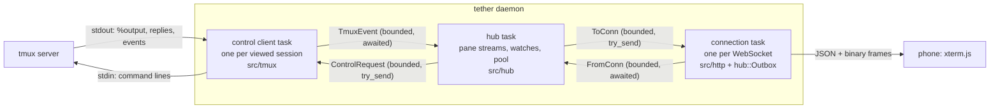
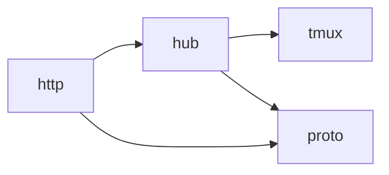
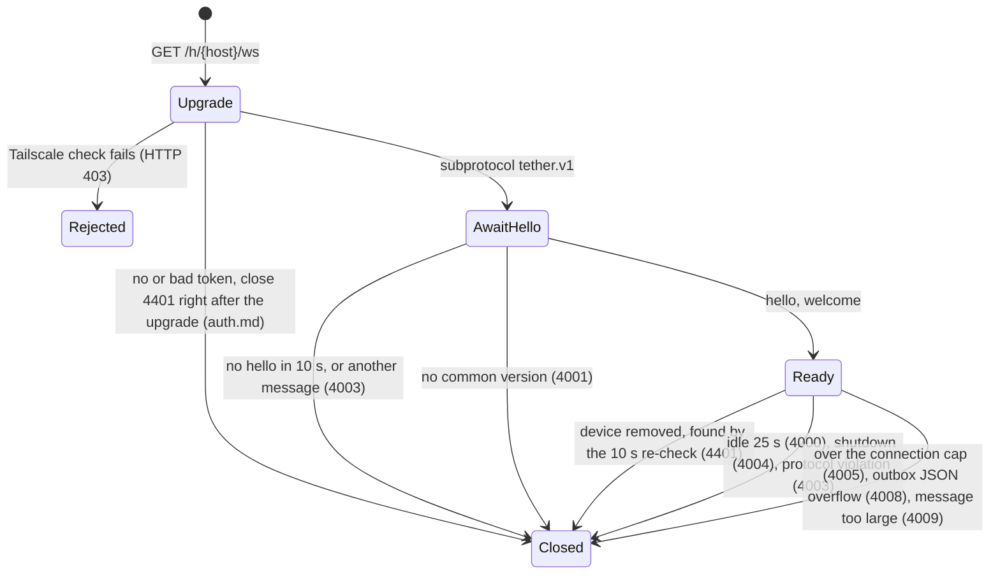

# Daemon core: tmux bridge, hub, wire protocol

The spec for `src/tmux/`, `src/hub/` and `src/proto/`. It replaces plan.md §4.2–4.4
as the source of truth for control mode, snapshots, reconnect and the WebSocket
protocol. Decisions settled elsewhere are inputs, not reopened here: tmux is the source
of truth and tether never starts its server; xterm.js on the phone is the only terminal
emulator; 1 tab = 1 tmux window showing its active pane; the resource budget
([plan.md §4.7](plan.md#47-resource-budget)) comes first.

**The design in one paragraph.** One task per `tmux -C` process (one control client
per tmux session with a viewed window) turns tmux's byte stream into ordered events. A
pure parser and reply matcher sit at the core of that task. A snapshot is one atomic
tmux command list. Its replies arrive at an exact position in the output stream, so the
task emits the assembled snapshot *in stream order*: output before it is already inside
it, output after it is live. No pausing is involved. A single hub task owns every pane
stream (byte offsets, ring buffer, generation) and fans output out to per-connection
outboxes. The outbox is where backpressure lives: when it overflows it drops output and
asks for a snapshot. The wire protocol is JSON control messages plus two binary frame
kinds (output and snapshot), behind a versioned `hello`/`welcome` handshake.



## 1. Vocabulary

One name per concept, used the same way in code and protocol.

| Term | Meaning |
|---|---|
| **control client** | One `tmux -C attach-session` child process and the task that owns it. |
| **command group** | One line written to a control client. It holds one or more tmux commands joined by ` ; ` and gets one reply per command that runs. |
| **pane stream** | The hub's state for one pane that someone views: generation, seq, ring buffer, watches. It exists only while the pane is viewed, plus the linger. |
| **generation** (`gen`) | An unbroken run of a pane stream's bytes. A new generation starts when the stream is created, when the pane's size changes, and when tmux discarded bytes. `u32`, from one daemon-wide counter. |
| **seq** | Byte offset within a generation, starting at 0. An output frame's seq is the offset of its first byte. `u64`. |
| **watch** | One connection viewing one tmux window, which plan.md calls a viewer. Its id is chosen by the client and is unique and never reused within a connection. A tab that is on screen has one watch. |
| **snapshot** | Everything needed to rebuild a pane on a freshly reset xterm.js: size plus **restore bytes**. It is valid at a `(gen, seq)` position. |
| **boundary** | The position in the control client's byte stream where a snapshot's command group replied. Pane output before it is inside the snapshot; output after it is live. |
| **size vote** | A per-window size the control client sets with `refresh-client -C '@W:WxH'`. It caps that window's size (§3.7). |
| **linger** | The time state outlives its last watch: 15 s for pane streams and control clients. |

## 2. Tasks, ownership, dependencies

| Task | Count | Owns | Never does |
|---|---|---|---|
| control client (`tmux::ControlClient`) | one per tmux session with a viewed window (max 4) | the child process and its stdin/stdout, the parser, the pending-reply FIFO, the set of *wanted* panes, the set of pauses it requested | decide who views what; touch HTTP |
| hub (`hub::Hub`) | exactly one | pane streams (rings, seq, gen), watches, the control-client pool, linger timers, the generation counter | await anything but its own inbox; block on a send |
| connection (`http`, using `hub::Outbox`) | one per WebSocket (max 4) | the socket, handshake state, its `Outbox` | talk to tmux |
| one-shot runner (`tmux::oneshot`) | short-lived, at most one at a time | one `tmux <command>` child process | attach; start a server |

**No shared mutable state.** Tasks talk over channels only: no `Arc<Mutex<…>>` maps,
no shared atomics. The parser hands each decoded `%output` line over as `bytes::Bytes`.
The ring copies it into one contiguous circular buffer, and the outbox copies it into
per-watch coalescing buffers. Memory is therefore bounded by payload bytes, not by
chunk count: a spinner's 3-byte chunks don't multiply allocator overhead.

**Channel rules**, which make deadlock impossible:

- The hub never awaits a send. It sends to control clients and connections with
  `try_send`. `Full` on a control client's channel fails that request with
  `error { code: busy }`; a client is killed only when a group gets no reply for 10 s
  (§6). `Full` on a connection's channel means the connection is wedged: the hub drops
  it, and the client reconnects and resyncs.
- Control clients and connections *do* wait for space in the hub's inbox, which is the
  backpressure path. **While waiting they keep draining their own inbox**
  (`select!` on `hub_tx.reserve()` and `rx.recv()`) into a bounded internal queue: 256
  requests for a control client, the outbox for a connection. A control client answers
  overflow with `Done { Err(Busy) }`. A slow hub therefore stalls only the control
  client's *reader*. That stalls tmux's writes to tether, and tmux then pauses the
  pane after `pause-after` seconds (§3.6), or, when tether is the pane's only client,
  stops reading the pane so the program blocks on its tty. Either way tmux never
  buffers without limit on tether's behalf.
- Replies to hub requests come back as `TmuxEvent`s on the same ordered channel as
  output, never through oneshots the hub would have to await.

**Module dependencies** (plan.md §11 rules, made concrete):



`tmux/` depends on nothing internal. `proto/` is a leaf of plain data types. `hub/`
maps tmux events to `proto` types and never sees sockets. `http/` never names a tmux
type.

## 3. `src/tmux/`: the bridge

```text
src/tmux/
  mod.rs        public API: ControlClient, ControlHandle, ControlRequest, TmuxEvent, ids
  parse.rs      pure: bytes -> Line events (guards, notifications, %output decoding)
  correlate.rs  pure: command groups <-> reply blocks (FIFO)
  command.rs    pure: typed command builders, quoting, key-name validation
  snapshot.rs   pure: state format, replies -> PaneSnapshot, restore-byte composer
  layout.rs     pure: layout string -> pane leaves (id, width, height)
  client.rs     the control-client task: process I/O around the pure core
  oneshot.rs    one-shot `tmux` commands: list, classify an exit
```

Everything except `client.rs` and `oneshot.rs` is pure and does no I/O, so it can be
tested from recorded fixtures (§7).

### 3.1 The control-client process

- **Spawn:** `tmux -f /dev/null [-L socket | -S path] -C attach-session -t
  '$<session-id>' -f pause-after=3`, with stdin and stdout as pipes (3.4 needs no pty;
  [probe-control-client.md](research/probe-control-client.md)), stderr captured (only
  the last 4 KiB is kept), `kill_on_drop(true)`. The socket comes from config and
  defaults to tmux's default; tests set `-L`.
- **`-f /dev/null` is what keeps tether from starting tmux.** `attach-session` carries
  tmux's start-server flag: with no server running, `tmux -C attach-session` starts one
  and loads the config, and a config that creates a session (tmux-continuum, a
  `new-session` line) leaves a server running inside tether's cgroup (review p11, on
  3.4). With `-f /dev/null`, the server that starts loads nothing, has no sessions,
  and exits at once; a running server ignores `-f`. The hub also attaches only to
  sessions it has just seen in a listing ([plan.md §4.1](plan.md#41-overview)).
- **Startup group.** The first group sent is `display-message -p '<version, pid,
  start_time, window_id, window_width, window_height>'`. It yields the server version
  (feature gates), the **server instance** `"<pid>-<start_time>"`, which scopes every
  tmux id (§5.3), and the size of the session's current window at attach, which
  becomes the control client's client size (§3.7). The version is parsed as an
  optional `name-` prefix, then `MAJOR.MINOR`, then an optional letter (`3.4`, `3.7b`,
  `next-3.6`). Below 3.4 the client exits with `TmuxTooOld`. A version it can't parse
  (for example `openbsd-7.5`) is treated as the newest known version, with a warning.
  3.4 is the tested floor; 3.7b is checked by fixtures.
- **Format strings** separate fields with a raw TAB byte (0x09) inside single quotes.
  `\t` inside single quotes is literal in tmux (review p10). A field that can hold
  user text (names) goes last and is split with `splitn`.
- **Writer rules:** one command group per line; lines never empty (an empty line
  detaches) and never contain `\n` or `\r`; at most 32 groups in flight, with up to
  256 requests queued behind them. Writes go straight to the pipe; a write error ends
  the task.
- **Close:** drop stdin (EOF makes `tmux -C` exit), wait up to 1 s, then kill.

### 3.2 Parser (`parse.rs`)

`Parser::push(&mut self, chunk: &[u8], out: &mut Vec<Line>) -> Result<(), ParseError>`
splits bytes into `\n`-terminated lines without UTF-8 decoding, keeping partial lines
across calls, and classifies them:

- **Outside a block:** `%begin T N F` opens a block. `%output %P <data>` and
  `%extended-output %P <age> … : <data>` are pane output (skip any extra fields up to
  ` : `). Other `%name …` lines are notifications. The parser recognises `%pause`,
  `%continue`, `%layout-change`, `%window-add`, `%window-close`,
  `%unlinked-window-add`, `%unlinked-window-close`, `%window-renamed`,
  `%unlinked-window-renamed`, `%window-pane-changed`, `%session-changed`,
  `%session-renamed`, `%sessions-changed`, `%session-window-changed`,
  `%client-session-changed`, `%paste-buffer-changed`, `%paste-buffer-deleted` and
  `%exit`. Anything else, including a line not starting with `%` (`load-buffer`
  prints its read errors outside any block), becomes `Line::Unknown(Bytes)`. It is
  logged at debug and is never fatal: newer tmux adds notifications.
- **Inside a block:** every line is body, even one starting with `%`, until `%end T N
  F` or `%error T N F` with the **same `N` and `F`** as the opening line. `%output` and
  most notifications are deferred while a block is open. On 3.4, though, the
  `%pause`/`%continue` that a `refresh-client -A` causes are written *inside* its block
  (tmux 3.8 moves them after `%end`). They are ignored as body, so the control client
  tracks the pauses it requested itself and never relies on seeing those lines.
- **`%output` decoding:** `\` followed by three octal digits is one byte; any other
  byte, including a lone `\` or a byte ≥ 0x80, passes through. The result is `Bytes`.
  Pane output may be invalid UTF-8.
- **Limits:** a line over 1 MiB, or a block body over 4 MiB, is
  `ParseError::TooLarge`. The task treats any `ParseError` as fatal for that control
  client (§6).

Residual ambiguity, accepted: a captured screen line that is byte-for-byte the matching
`%end T N F` (same time, number and flag) would end the block early. tmux's own
protocol carries this ambiguity, and the number is not predictable from inside a pane.

### 3.3 Command groups and reply matching (`correlate.rs`)

tmux answers a client's commands in order, but the number `N` in `%begin` comes from a
server-wide counter, so it can't be predicted. Replies are matched by position:

- `Correlator::submit(group) -> line` queues `Pending { tag, expected: k }`, where `k`
  is the number of commands in the group.
- A block with **flag 1** is the next reply for the head of the FIFO. `%end` records a
  success, and the group completes after `k` replies. `%error` completes the group at
  once as failed, carrying the replies so far: **tmux skips the rest of a list after an
  error and sends no blocks for the skipped commands.**
- A block with **flag 0** is not ours (the attach reply, or a hook firing). It is
  logged and dropped.
- A flag-1 block with an empty FIFO is a protocol error (§6).

The correlator yields `GroupDone { tag, result: Result<Vec<Body>, GroupError> }`
inline, in stream order with output and notifications.

### 3.4 Commands (`command.rs`)

Typed builders only. No caller assembles command text.

| Request | Command group |
|---|---|
| Resolve a window in this session | `list-windows -t '$S' -F '<window_id, pane_id, pane_width, pane_height>'`; the control client picks `@W`'s row. A missing row means the window isn't in this session (§4.3). Never `-t '$S:@W'`: on 3.4 it silently resolves to the session's current window. `display-message -t @W` is no check either, because it succeeds for a window in any session (reviews p10, p11). |
| Window exists anywhere | `display-message -p -t @W '<window_id, session_id>'`, used to tell a window close from a move (§4.6 events) |
| History (scrollback) | `capture-pane -p -e -t %P -S <start> -E <end>`, at most 200 lines per request |
| Pane facts | `display-message -p -t @W '<pane_id, pane_current_path>'`, for completion and the file manager |
| Select pane | `select-pane -t %P` (the "⧉ 2 panes" badge) |
| Snapshot of `%P` | §3.5 |
| Release `%P` | `refresh-client -A '%P:pause'` |
| Size vote (§3.7) | `refresh-client -C '@W:CxR'`; clear with `refresh-client -C '@W:'` |
| Client size | `refresh-client -C CxR` |
| Input text or bytes | `send-keys -t @W -H 68 69 …`, at most 512 bytes per command, several commands per group |
| Input key | `send-keys -t @W <name>`; `<name>` must match `^(?:[CM]-)*(?:(?:S-)?(?:Up\|Down\|Left\|Right\|Home\|End\|PageUp\|PageDown\|IC\|DC\|F(?:[1-9]\|1[0-2]))\|[A-Za-z0-9]\|Enter\|Escape\|Tab\|BTab\|BSpace\|Space)$`. `S-` is allowed only before keys tmux 3.4 encodes with Shift: it types `S-Enter` as literal text ([probe-tmux.md §6](research/probe-tmux.md)), so Shift+Enter goes as `{bytes}` (CSI-u), per plan.md §6.5. Every name the clients send is listed in `tests/fixtures/proto/keys.json`; the Rust tests check each against this regex ([ios-shell.md](ios-shell.md#how-input-reaches-the-terminal)) |
| Paste | `load-buffer -b tether-<n> '<file>' ; paste-buffer -p -d -b tether-<n> -t @W` (the control client writes the text to a 0600 file in `$XDG_RUNTIME_DIR/tether/`. `load-buffer` replies before it reads the file, so the file is deleted on the `%paste-buffer-deleted` that `-d` causes, or after 5 s at the latest. A read error appears as an unknown line outside any block, which is logged) |
| New window | `new-window -d -t '$S' [-n <name>] [-c <dir>] -P -F '#{window_id}'` |
| New session | `new-session -d [-s <name>] [-c <dir>] -P -F '#{session_id}\t#{window_id}'` |

- **Input and paste target the window** (`-t @W` resolves to its active pane inside
  tmux), so keystrokes always reach the pane the tab shows, with no race against an
  active-pane change and no wait for `watching`.
- **Why `-H` for text.** It needs no quoting, carries any byte (UTF-8 verified on 3.4),
  and can't be misread as a key name. Named keys go by name so tmux encodes them for
  the pane's current modes (for example, `Up` in application-cursor mode). From
  tmux's source, `send-keys` without `-K` writes to the pane (`window_pane_key`), so it
  skips the prefix, the key tables and `escape-time`. That is not yet confirmed at
  runtime; the fixture set covers it (§7, plan.md §13 spike 2).
- **Quoting:** user-supplied arguments (names, start directories) are wrapped in
  single quotes, with `'` written as `'\''`, after doubling every `#` (tmux
  format-expands `-n` and `-c`). Control characters are rejected before quoting.
- tether never sends commands that wait (`run-shell`, `if-shell`, `wait-for`,
  `confirm-before`, `command-prompt`). Any of them would stall the whole reply queue.

### 3.5 Snapshot

**Evidence.** On 3.4, tmux reads a pane, queues the bytes for control clients, and
only then parses them into the grid. A command list runs to completion inside one
command-queue pass, with no pane read in between. Reply lines and output blocks share
one ordered queue per client. So output queued before the group's first reply is
already in the captured grid, and output after the group's last reply is not. 198/198
and 196/196 captures matched exactly at full output speed
([probe-snapshot.md](research/probe-snapshot.md), p5). Pausing is lossy and not
needed (p3).

**The command group** for pane `%P`:

```text
refresh-client -A '%P:continue' ; display-message -p -t %P '<STATE>' ;
capture-pane -p -e -N -t %P ; capture-pane -p -P -C -t %P ;
capture-pane -p -e -N -a -q -t %P
```

- **`continue` always goes first.** On a pane that isn't paused it is a verified no-op
  on 3.4: empty reply, no `%continue`, nothing discarded (review p10). Always sending
  it means a snapshot is valid even when tmux auto-paused the pane while the request
  was in flight, or paused an unwanted pane the control client didn't know about.
  Without it, either case leaves the pane paused for good and the tab frozen.

The alternate-screen capture goes last with `-q`, so a pane without an alternate
screen returns an empty success instead of aborting the list. `<STATE>` is
tab-separated, in this order for 3.4: `pane_id pane_width pane_height alternate_on
alternate_saved_x alternate_saved_y cursor_x cursor_y cursor_flag insert_flag
keypad_cursor_flag keypad_flag wrap_flag origin_flag scroll_region_upper
scroll_region_lower mouse_standard_flag mouse_button_flag mouse_any_flag
mouse_utf8_flag mouse_sgr_flag pane_tabs`. The field list is a per-version table in
`snapshot.rs`; versions newer than the table use the newest entry.

**Boundary handling.** When the group completes, the control-client task builds a
`PaneSnapshot` and emits `TmuxEvent::Snapshot { tag, pane, snapshot }` **at that point
in its event stream**. It sends `%output` lines exactly as they arrive. Everything the
hub saw for `%P` before this event is inside the snapshot; everything after is live.
No buffering and no marker command are needed: stream order *is* the boundary.

**Torn snapshots.** User hooks run between the commands of a list (`after-*` hooks
are inserted right after each command). A hook that waits, such as `run-shell` without
`-b`, lets pane reads in mid-list, and the output that arrives then would be in neither
the capture nor the live stream (review p10, reproduced on 3.4). The control client
therefore marks a snapshot group *torn* if any `%output` line or flag-0 block arrives
between its first and last reply. A torn snapshot is discarded and retried, up to 3
times. After that the hub ends the watch with `watchEnded { error }` and a message
naming tmux hooks as the cause.

**Restore bytes** (`snapshot::compose`, pure). The result reproduces the pane when
written into a freshly reset terminal of `cols × rows`. The phone only resets, resizes
and writes, so the web and Swift clients carry no restore logic.

1. `CSI ?7l` (autowrap off), so a line that is too wide can't wrap and scroll the
   screen. Two things make lines too wide: while the alternate screen is on, tmux keeps
   the saved primary grid at its *old* size, and Unicode widths can drift. Rows past
   `rows` are dropped.
2. If `alternate_on`: write the saved primary grid (the `-a` capture), then `CSI 0 m`,
   then CUP to `alternate_saved`, then `CSI ?1049h` (save cursor, switch, clear).
3. Write the active grid. Line *i* is `CSI i+1;1H` followed by the captured line bytes.
   tmux's `-e` SGR state carries from one line to the next, so no reset goes between
   lines.
4. `CSI 0 m`. Tab stops: `CSI 3 g`, then `ESC H` at each column in `pane_tabs`. If the
   scroll region isn't the full height, `CSI top+1;bottom+1 r`. If `origin_flag`,
   `CSI ?6h`.
5. Modes: `CSI ?7h` if `wrap_flag` is 1 (else autowrap stays off), and those that are
   on: `CSI ?1h` (keypad_cursor), `ESC =` (keypad), `CSI 4h` (insert), `CSI ?1000h` /
   `?1002h` / `?1003h` / `?1005h` / `?1006h` (mouse standard, button, any, utf8, sgr).
6. CUP to the cursor (relative to the region when origin mode is on; a column past the
   last is clamped to the last). If `cursor_flag` is 0, `CSI ?25l`.
7. The pending parser bytes (`-P -C`, decoded with the `%output` decoder; review p11
   checked that 3.4 escapes backslashes there too), so the next live bytes complete the
   sequence tmux is holding.

Not restorable from tmux 3.4: bracketed paste, focus reporting, character sets, the
current SGR pen, a pending wrap at the last column, and the title. Paste goes through tmux (`paste-buffer -p`), which
checks the pane's real mode. The rest come back when the application next sets them.

### 3.6 Which panes produce output (wanted panes, pausing)

A control client gets output for every pane in its session. Only **wanted** panes
reach the hub:

- The hub makes a pane wanted by requesting its snapshot, and unwanted with
  `Release { pane }`.
- When output arrives from a pane that is neither wanted nor already paused, the
  control client sends `refresh-client -A '%P:pause'` and drops the output. This is
  event-driven and covers panes created later with no listing or polling. One chunk is
  parsed and discarded per pane per attach.
- `Release` sends the same pause. Pausing drops tmux's copy for this client only;
  tmux keeps reading the pane, so other clients and the program are unaffected.
- **`pause-after=3`** (attach flag) bounds what tmux queues for a stalled tether. A
  `%pause` for a *wanted* pane that tether did not request is an auto-pause: bytes were
  lost. The control client emits `TmuxEvent::Gap { pane }`, and the hub starts a new
  generation and requests a fresh snapshot (§4.2). Every snapshot carries `continue`
  (§3.5). With pause-after on, output
  arrives as `%extended-output`, which the parser treats like `%output`.
- **Never** `refresh-client -A '%P:off'`. It crashes tmux 3.2a, 3.4, 3.5a and 3.6b
  when output is queued, and it stops tmux reading the pane for every client
  ([tmux-control-mode.md §6](research/tmux-control-mode.md)).

### 3.7 Sizing

**tmux's rules on 3.4** ([probe-control-client.md](research/probe-control-client.md#sizing-the-part-that-shapes-the-resize-policy)):

- A control client counts for sizing only after it sets a size. From then on it counts
  for every window in its session.
- Attaching makes it `latest` for the session's current window.
- Under `window-size latest`, a window with several clients takes its size from
  `latest`. A per-window size (a size vote) is used in place of the client size for
  that window, and it also **caps** the window, whoever is `latest`.

**Policy:** while the phone views a window, the phone's size wins for that window;
otherwise tether leaves sizes alone.

- **Client size = the size of the session's current window at attach**, sent with the
  first `Size` a control client handles. For every window it doesn't watch, the control
  client then behaves like a client of the laptop's size. Where attaching made it
  `latest`, or where it is the session's only client, nothing shrinks.
- **A vote on each watched window, from a visible connection:** `refresh-client -C
  '@W:CxR'`. It makes the phone win on that window even when the laptop is `latest`
  there. `resize` (rotation, font change) re-sends the vote. **Opening or closing the
  keyboard never resizes**; that is the client's job.
- **On `unwatch` or `visibility: hidden`**, when no other visible watch is on that
  window: clear the vote (`refresh-client -C '@W:'`). The window goes back to
  `latest`'s size, or to the control client's laptop-sized client size where it is
  `latest`. On `visibility: visible` the hub re-sends the votes for that connection's
  watches.
- **Verified on 3.4** by review p10 (a 200×50 pty client plus a control client):
  unwatching the laptop's current window restored it to 200×49, and when the laptop
  grew its terminal, the unwatched windows followed to 220×59. The first design, a
  pinned per-window size on the current window, failed two ways in that run: it capped
  the laptop's window for the control client's whole life, and it was lost after the
  phone viewed that window.
- **Accepted costs:**
  - While the phone views a window, the laptop can't grow it; the vote is a cap.
  - A window whose vote was cleared, and on which no client is `latest`, keeps the
    phone's size until the laptop next types in it or the control client closes.
  - The laptop's size returns when the vote clears: at once on `unwatch` or
    `hidden`, or after the 25 s idle timeout if the phone is suspended without saying
    so.
- A size change of a viewed pane appears as `%layout-change` in stream order. The hub
  ends the generation at that point (§4.2).

### 3.8 One-shot commands and exit classification (`oneshot.rs`)

- `list(endpoint) -> Result<TmuxListing, TmuxError>`: `display-message -p
  '#{version}\t#{pid}\t#{start_time}'`, `list-windows -a -F <fmt>` and `list-clients -F
  '#{client_session}\t#{client_control_mode}'`. Laptop attachment counts non-control
  clients only. "no server running" and connection-refused map to
  `TmuxError::NoServer`.
- `classify_exit(endpoint, session, saw_exit_line) -> ExitKind`, run after a control
  client ends (`%exit` has no reason on 3.4): `ServerGone` if there's no server or the
  server instance changed; `SessionGone` if `display-message -p -t '$S' ''` fails;
  otherwise `Detached` when `%exit` was seen (someone ran `detach-client` or `attach
  -d`), or `Crashed` when EOF came without `%exit`.
- At most one one-shot runs at a time, each with a 2 s timeout. One-shots also run
  with `-f /dev/null` and use only commands without the start-server flag, so they
  fail with "no server running". The hub never awaits a one-shot: it spawns a short
  task that runs it and sends `HubMsg::OneShot { tag, result }` into the hub's inbox.

### 3.9 Public interface

```rust
pub struct ControlHandle { /* mpsc::Sender<ControlRequest>, client id */ }

impl ControlClient {
    /// Builds the client. The hub spawns `run` into its JoinSet, so a panic surfaces
    /// as a JoinError there; `run` resolves to the exit information.
    pub fn new(id: ClientId, endpoint: &TmuxEndpoint, session: SessionId,
               events: mpsc::Sender<(ClientId, TmuxEvent)>)
        -> (ControlHandle, impl Future<Output = ExitInfo> + Send + 'static);
}
pub struct ExitInfo { pub saw_exit_line: bool, pub stderr_tail: String, pub error: Option<ClientError> }

pub struct ControlRequest { pub tag: Tag, pub op: Op }
pub enum Op {
    Resolve { window: WindowId },        // in this client's session only
    Exists { window: WindowId },          // anywhere on the server
    Snapshot { pane: PaneId },            // makes the pane wanted; always continues it
    Release { pane: PaneId },
    Vote { window: WindowId, size: Size },   // the first one also sets the client size (§3.7)
    ClearVote { window: WindowId },
    History { pane: PaneId, start: i32, end: i32 },
    PaneFacts { window: WindowId },      // pane id, current path
    SelectPane { pane: PaneId },
    Input { window: WindowId, items: Vec<InputItem> },
    Paste { window: WindowId, text: Bytes },
    NewWindow { session: SessionId, name: Option<String>, dir: Option<PathBuf> },
    NewSession { name: Option<String>, dir: Option<PathBuf> },
}

pub enum TmuxEvent {
    Ready { server: ServerInstance, version: TmuxVersion, session: SessionId },
    Output { pane: PaneId, bytes: Bytes },          // wanted panes only
    Snapshot { tag: Tag, pane: PaneId, snapshot: PaneSnapshot },
    Done { tag: Tag, result: Result<Reply, TmuxError> },
    Gap { pane: PaneId },
    Layout { window: WindowId, panes: Vec<(PaneId, Size)> },  // visible layout leaves
    ActivePane { window: WindowId, pane: PaneId },
    WindowUnlinked { window: WindowId },             // %window-close, %unlinked-window-close: closed *or moved*
    WindowRenamed { window: WindowId, name: String }, // lossy UTF-8 for display
    SessionsChanged,                                  // %sessions-changed, %session-renamed
}
```

`PaneSnapshot { pane, size, restore: Bytes }` is all the hub forwards. The parsed state
stays inside `tmux/`, apart from `alternate_on`, which is exposed for logging.

## 4. `src/hub/`: streams, watches, backpressure

```text
src/hub/
  mod.rs      public API: Hub::spawn, HubHandle, FromConn, ToConn
  hub.rs      the hub task: inbox loop, routing, timers
  stream.rs   pure: PaneStream state machine and ring buffer
  pool.rs     pure: control-client pool policy (which client, when to spawn or close)
  outbox.rs   pure: per-connection delivery queue (budget, coalescing, resync)
```

### 4.1 State the hub owns

- `clients: Map<SessionId, ClientEntry>`: handle, server instance, streams it serves,
  linger deadline, a `JoinSet` entry for its `run` future.
- `streams: Map<PaneId, PaneStream>`.
- `watches: Map<(ConnId, WatchId), Watch>`: window, current pane, state (`Resolving`,
  `Attached`), whether the connection is visible, last size.
- `conns: Map<ConnId, ConnEntry>`: `mpsc::Sender<ToConn>`, visibility.
- `next_gen: u32`, `next_tag: u64`, and a min-heap of deadlines; the hub's `select!`
  sleeps until the earliest one. A timer is armed only while something lingers.

### 4.2 Pane stream

```rust
struct PaneStream {
    gen: u32, seq_end: u64, ring: Ring,   // contiguous circular buffer, last 256 KiB of this gen
    state: Live | Resyncing,              // Resyncing: output dropped until a valid snapshot
    inflight: Option<(Tag, u32)>,         // the snapshot request in flight and the gen it was sent for
    awaiting: Set<WatchKey>,              // watches that get the next snapshot
    watches: Set<WatchKey>, size: Size, linger: Option<Instant>,
}
```

| Event | Effect |
|---|---|
| created (first watch on a pane) | new `gen`, `Resyncing`, request `Snapshot` |
| `Output` while `Live` | append to the ring; `seq_end += len`; send `Output{watch, gen, seq, bytes}` to every watch |
| `Output` while `Resyncing` | drop: the coming snapshot already contains it |
| `Snapshot` whose tag isn't `inflight` | drop (orphaned by a generation break or a recreated stream) |
| `Snapshot` while `Resyncing` | `Live`, `seq_end = 0`, ring cleared, `size` = the snapshot's size; send `Snapshot{gen, seq: 0}` to every watch |
| `Snapshot` while `Live` | send `Snapshot{gen, seq: seq_end}` to `awaiting` only; the generation continues |
| `Layout` gives this pane a size other than `size` | generation break |
| `Gap` | generation break |
| generation break | new `gen`, `Resyncing`, every watch into `awaiting`, `inflight` dropped, and a **new** `Snapshot` request. A snapshot requested before the break may predate the break's cause, so it can't end `Resyncing`. |
| `Done { Err }` for the snapshot (pane gone, torn 3 times) | re-resolve the window for each watch (§4.3); the window's `ActivePane` or close event decides what happens next |
| a watch joins a `Resyncing` stream | add to `awaiting`; the pending snapshot serves it |
| a watch joins a `Live` stream | resume from the ring if possible (§4.3), else add to `awaiting` and request `Snapshot` unless one is in flight |
| `NeedSnapshot` from an outbox | same as joining a `Live` stream without resume |
| a watch leaves (unwatch, active-pane move, connection gone) | remove it from `watches` and `awaiting` |
| last watch leaves | `linger = now + 15 s`; the stream keeps filling the ring |
| linger expires | `Release` the pane, drop the stream |

At most one snapshot request is in flight per stream; other triggers join `awaiting`.
A snapshot doesn't start a new generation, so a joining or starved watch never disturbs
watches already live on the same pane.

### 4.3 Watching a window

`watch { watch, host, window, session, size, resume? }` runs as a small state
machine. Each step that needs tmux sends a tagged request and continues when the
matching `Done` or `Snapshot` arrives. Until step 4 completes, the watch is
`Resolving`. If its control client exits meanwhile, it ends with the same reason as
the client's other watches (§6).

1. **Check.** The host is this daemon's (else `error { code: badRequest }`), the caps
   hold (§4.6), and `window.server` matches the live server instance. A stale instance
   means the tab's window is gone: `watchEnded { reason: windowClosed }`.
2. **Control client** for `session`: reuse it, or spawn one (§4.5).
3. **Resolve** in that session. If the window isn't there (it was moved, or the hint
   is stale), the hub finds it with one `oneshot::list` and moves the watch to the
   control client of the session that now holds it. A window linked into several
   sessions stays in the hinted session if that session has it, else goes to the first
   listed. If it is in no session: `watchEnded { windowClosed }`. Then send `watching
   { watch, host, window, session, pane }` with the session actually used.
4. **Size**, if the connection is visible and `size` is present (§3.7).
5. **Stream:** `resume` is `{gen, seq}`. If the pane's stream is `Live` with the same
   `gen` and `seq_end − 64 KiB ≤ seq ≤ seq_end` (and the ring still holds `seq`), send
   `resumed { watch, gen, seq }` and then the ring bytes from `seq` as output frames.
   Otherwise the watch waits for a snapshot (§4.2). The 64 KiB replay cap keeps resume
   consistent with backpressure: past it, a snapshot of a few KB beats replaying a
   flood over cellular.

`ActivePane { window, pane }` moves every watch on that window to the new pane's
stream, which is created or joined, and sends `watching` again with the new pane. The
watches leave the old stream, which starts lingering if they were its last.

**Window unlinked.** `%window-close` and `%unlinked-window-close` also fire when a
window *moves* to another session (`move-window` produced `%unlinked-window-add` and
then `%unlinked-window-close` for a window that lived on; review p10). So
`WindowUnlinked` triggers `Exists { window }`. If the window is gone, the hub ends its
watches with `windowClosed` and broadcasts `windowClosed`. If it still exists, each of
its watches re-runs steps 3–5 in its new session.

**Tab switching is cheap without holding unviewed panes.** The client watches only the
visible tab. Switching sends `unwatch` for the old tab and `watch` with `resume` for
the new one. Within the 15 s linger the new tab replays from the ring instantly;
after it, the new tab gets a few-KB snapshot.

### 4.4 Outbox: backpressure and coalescing

`hub::Outbox` is a pure type owned by each connection task. The task moves every
`ToConn` from its inbox into the outbox at once (no I/O on that path), and writes
frames from the outbox when the socket is ready. All the drop-and-snapshot policy is in
this one type, plus the hub's reaction to `NeedSnapshot`.

- **Per watch, an ordered queue** of JSON messages, snapshot frames and output. Output
  appended behind output merges into one buffer when the seq is contiguous. Separate
  watches are independent, and connection-wide messages go on their own FIFO.
- **Sequence filter.** Each watch is `Starved` or `Live { gen, next_seq }`. Output is
  accepted only when `Live`, the gen matches and `seq == next_seq`. An overlap is
  trimmed, and a different gen or a `Starved` watch is dropped. A gap is a bug: the
  watch becomes `Starved`. A snapshot or `resumed` replaces the watch's queued output
  and sets `Live`. Because of this filter, the hub can send every live chunk to every
  watch without tracking which ones are starved.
- **Budget: 256 KiB** of queued output per connection. When a push would exceed it,
  the watch with the **most** queued output (normally the flooding one, not its quiet
  neighbour) loses its queue and becomes `Starved`.
- **Snapshots are pulled, not pushed.** A `Starved` watch emits `NeedSnapshot { watch
  }`, which the task forwards to the hub, only when three things hold: everything
  already queued for it has been written to the socket, no request of its own is
  outstanding, and at least 250 ms have passed since its last request. The snapshot
  rate is therefore bounded by what the link actually delivers. Pushing a new snapshot
  on every overflow would capture the screen hundreds of times a second during a
  flood, on a box that is already overloaded (review p10).
- **Not counted in the budget:** snapshots (at most one pending per watch; a newer one
  replaces it) and JSON messages. The connection-wide JSON queue coalesces
  `windowRenamed` (latest per window wins) and `sessionsChanged` (one pending), and
  is capped at 256 messages. Past the cap, the connection is closed with 4008 and the
  client reconnects with `resume`.
- **Coalescing: leading edge, 33 ms.** A watch's output goes out at once if its last
  frame left 33 ms ago or more; otherwise it waits until 33 ms have passed and goes out
  as one merged frame of at most 64 KiB. A keystroke echo is never delayed, and a
  flood is capped at about 30 frames per second per watch.
- `Outbox::next(now) -> Next::{Frame(Frame), WaitUntil(Instant), Idle}`, and
  `Outbox::written(watch)` once the socket accepts a frame. Connection-wide messages go
  first. Within a watch, order is kept: `watching` before its snapshot, `watchEnded`
  after its last output.

### 4.5 Control-client pool

**One control client per tmux session that has a watched window**, shared by all
connections, and closed 15 s after its last pane stream ends.

- **Spawning** costs about 2 ms and 5.3 MB. Normally one exists while the phone views
  something, two briefly when switching across sessions, and none when nobody views.
- **A control client never switches sessions.** Its session is fixed for life, so
  pause state, wanted panes and the sizing relationship never cross sessions.
- **Any live control client reports closes elsewhere.** It sees `%unlinked-window-close`
  for other sessions' windows and `%sessions-changed` for created and killed sessions,
  so open tabs learn about closes whenever the phone views anything. The hub
  de-duplicates across clients by window id.
- **Lingering entries yield to new work.** When a cap (§4.6) would reject a new pane
  stream or control client, the oldest lingering one is evicted first.
- **Commands that need any client** (`newSession`) use an existing control client.
  With none, the hub spawns one on the first listed session and lets it linger. With no
  sessions there is no server, and the request fails with `noServer`.

### 4.6 Limits

| Limit | Value | When hit |
|---|---|---|
| connections | 4 | the 5th is closed with 4005 right after `welcome` |
| watches per connection | 4 | `error { code: tooManyWatches }` |
| pane streams | 8, lingering ones evicted first | `error { code: tooManyWatches }` |
| control clients | 4, lingering ones evicted first | `error { code: tooManySessions }` |
| ring per pane stream | 256 KiB contiguous | older bytes fall out |
| resume replay | 64 KiB | snapshot instead |
| outbox output budget per connection | 256 KiB | the largest watch queue is dropped; pull a snapshot |
| outbox JSON queue per connection | 256 messages, coalesced | close 4008 |
| control client → hub channel | 128 events: output ≤ 8 KiB each; snapshots ≤ 4 MiB, at most one in flight per stream | the control client waits, still draining requests: backpressure to tmux |
| requests queued in a control client | 256 | `Done { Err(Busy) }` → `error { code: busy }` |
| connection → hub channel | 256 | the connection waits, still draining its inbox into the outbox |
| hub → control client | 64 | `try_send` fails: `error { code: busy }` for that request |
| hub → connection | 1024 | `try_send` fails: drop the connection |
| command groups in flight per control client | 32 | the rest wait in the request queue |
| reply timeout per group | 10 s | kill the client; treat it as crashed (§6) |
| parser line / block | 1 MiB / 4 MiB | fatal for that control client |
| WebSocket message, inbound | 512 KiB | close 4009 |
| input per message | 4 KiB | `error { code: inputTooLarge }`; use `paste` |
| paste per message | 256 KiB | `error { code: inputTooLarge }` |
| history per request | 200 lines | clamped |
| linger (streams, control clients) | 15 s | |
| heartbeat / idle timeout | client ping every 10 s while connected / close 4000 after 25 s silent | the same 10 s server timer re-checks auth |

**Worst case with one connection and one watched pane** (all bounded, nothing
grows with time): 5.3 MB for the control client; a 256 KiB ring; a 256 KiB outbox plus
one pending snapshot (a few KB typically, 4 MiB at the absolute limit); the control
client → hub channel at 128 × 8 KiB = 1 MiB; the hub → connection channel stays
near-empty, because the connection drains it into the outbox at once. Per extra watched
pane add a ring, and per extra connection an outbox. With the caps (4 control clients,
8 streams, 4 connections) the hard ceiling is about 21 MB of control clients plus
about 8 MB of buffers, inside `MemoryMax=64M` with the daemon and carapace. The normal
case is one of each.

### 4.7 Public interface

```rust
impl Hub { pub fn spawn(cfg: HubConfig, endpoint: TmuxEndpoint) -> (HubHandle, JoinHandle<()>); }
impl HubHandle {
    /// Registers a connection after the handshake; Err(Full) maps to close code 4005.
    pub async fn connect(&self) -> Result<(ConnId, mpsc::Receiver<ToConn>), ConnectError>;
    pub async fn send(&self, conn: ConnId, msg: FromConn);   // awaits inbox space
}
pub enum FromConn { Client(proto::ClientMsg), NeedSnapshot { watch: WatchId }, Closed }
// The hub's inbox also carries HubMsg::Tmux(ClientId, TmuxEvent) and
// HubMsg::OneShot { tag, result }; it selects on that inbox, its JoinSet and its timer.
pub enum ToConn {
    Msg(proto::ServerMsg),
    Snapshot { watch: WatchId, gen: u32, seq: u64, size: Size, restore: Bytes },
    Output { watch: WatchId, gen: u32, seq: u64, bytes: Bytes },
}
```

`gen` rides on `ToConn::Output` for the outbox's filter. It is not sent on the wire
(§5.4).

## 5. `src/proto/`: the wire protocol

### 5.1 Transport

One WebSocket per app per host at `GET /h/{host}/ws`. The app connects to each host's
daemon directly ([plan.md decision 2](plan.md#decisions-on-the-reviews-open-questions-jimmy-2026-10-21)),
and each daemon is exactly one host. The upgrade goes through the one auth middleware.
The token rides in the subprotocol list, `Sec-WebSocket-Protocol: tether.v1,
tether.auth.<token>`, and the daemon answers `tether.v1`
([auth.md](auth.md#carrying-the-token)). `tether.v1` names the framing defined here;
the exact protocol version is negotiated in `hello`. Text frames carry JSON control
messages; binary frames carry pane bytes. WebSocket keeps text and binary frames in
order, which the protocol relies on. Messages that name a session or window carry
`host`, and the daemon rejects a `host` that isn't its own. Messages scoped to a watch
carry only the watch id. That is redundant on a one-host socket, but the client
can route every message by host, and a later proxy stays possible.

### 5.2 Handshake and versions



- **Versions are ranges on both sides.** One app talks to several daemons, which may
  run different releases, and the web UI ships inside the app, so no side can fix a
  mismatch by reloading. `PROTOCOL_VERSION: u32 = 1`; the daemon supports
  `MIN_PROTOCOL..=PROTOCOL_VERSION` (both 1 for now). The client sends `hello {
  min, max, client: { kind: "ios" | "web", build } }`. The daemon picks the highest
  version in both ranges and answers `welcome { protocol, … }`; both sides then speak
  that version. With no overlap it sends `incompatible { min, max, daemonVersion }` and
  closes with 4001. The app marks that host "update the app" (the daemon is newer) or
  "update tether on <host>" (the daemon is older), and other hosts are unaffected.
  `GET /auth/info` reports the same range, so the app can warn before connecting.
- **When to bump:** for any change an older peer would misread, such as a removed or
  renamed field or message, or changed semantics. Adding optional fields or new message
  types needs no bump: both sides ignore unknown fields and unknown message types
  (logged). Supporting an old version means `proto` keeps its message shapes until
  `MIN_PROTOCOL` moves past it.
- **Auth is settled at the upgrade** ([auth.md](auth.md#carrying-the-token)), so the
  handshake carries no credentials. A bad token gets the upgrade and then close
  **4401**, because a browser WebSocket can't see the status of a refused upgrade. On
  the same 10 s timer that enforces the idle timeout, not on client pings, the
  connection task asks the auth service whether its device is still enrolled, and
  closes with **4401** when it has been removed; the app then marks the host "not
  enrolled". No message other than `hello` is accepted before `welcome`.
- `welcome { protocol, daemon: { version, instance }, host: { id, name } }`.
  `host.id` is the persistent host id from `$XDG_STATE_HOME/tether/host_id`
  ([auth.md](auth.md#state-on-disk)). `instance` is random per daemon start; a client
  that sees a new instance discards its saved `resume` positions for that host.

### 5.3 JSON messages

JSON is adjacently tagged, `{"type": "<name>", "data": {...}}`, with camelCase
names. Common types:

- `WindowRef { server: string, window: u32 }`, where `server` is the tmux server
  instance and `window` is the number in `@N`. Window ids are only unique per server,
  so a tab saved before a tmux restart can never bind to a new server's `@N`.
- `SessionRef { server, session: u32 }` (`$N`), `PaneId = u32` (`%N`),
  `Size { cols: u16, rows: u16 }` clamped to 20..=500 × 5..=300.

**Client → daemon**

| Message | Fields | Meaning |
|---|---|---|
| `hello` | `min, max, client` | §5.2 |
| `ping` | `t` | heartbeat every 10 s while connected, visible or not |
| `visibility` | `visible: bool` | sent on hide and show; hidden clears size votes (§3.7) |
| `watch` | `watch: u32, host, window: WindowRef, session: SessionRef, size?, resume?: {gen, seq}` | view a window (§4.3) |
| `unwatch` | `watch` | stop viewing |
| `resize` | `watch, size` | rotation or font change only |
| `resync` | `watch` | the client needs a fresh snapshot (renderer recreated, seq mismatch) |
| `input` | `watch, items: [{text} \| {key} \| {bytes: base64}]` | goes to the watched window's active pane, in order; accepted as soon as `watch` is sent |
| `paste` | `watch, text` | through `paste-buffer -p`; at most 256 KiB |
| `selectPane` | `watch, pane` | the "⧉ 2 panes" badge; tmux's active pane changes, and `watching` follows |
| `history` | `req, watch, start, end` | scrollback lines for plan.md §7.1, by tmux line numbers (negative is history), at most 200 lines |
| `listSessions` | `req: u32, host` | the "+" sheet's listing |
| `newWindow` | `req, host, session, name?, dir?` | `dir` is checked against the configured roots by `http` (fs module) |
| `newSession` | `req, host, name?, dir?` | |

**Daemon → client**

| Message | Fields | Meaning |
|---|---|---|
| `welcome`, `incompatible` | §5.2 | |
| `pong` | `t` | |
| `watching` | `watch, host, window, session, pane` | the watch is bound; sent again when the active pane changes |
| `resumed` | `watch, gen, seq` | replay starts at `seq`; no reset |
| `watchEnded` | `watch, reason: windowClosed \| sessionClosed \| serverExited \| detached \| error, message?` | the first three close the tab; the others show a state the user can retry |
| `windowClosed` | `host, window` | closes any tab on that window, watched or not |
| `windowRenamed` | `host, window, name` | |
| `sessionsChanged` | `host` | hint: refetch the list if the sheet is open |
| `sessions` | `req, host, tmux: notRunning \| { server, version, sessions: [{ id, name, attachedElsewhere, windows: [{ id, index, name, active, activity, panes }] }] }` | `activity` is unix seconds; `panes` is the pane count; `attachedElsewhere` counts non-control clients |
| `historyChunk` | `req, watch, start, lines: [base64]` | each line is the `capture-pane -e` bytes of one row |
| `created` | `req, window, session` | |
| `error` | `req?, watch?, code, message` | codes: `badRequest` (including a wrong `host`), `noServer, tooManyWatches, tooManySessions, inputTooLarge, busy, tmux` |

### 5.4 Binary frames

Big-endian. The first byte is the kind, and unknown kinds are a protocol error.

```text
output   (0x01): kind u8 | watch u32 | seq u64 | bytes…
snapshot (0x02): kind u8 | watch u32 | gen u32 | seq u64 | cols u16 | rows u16 | restore bytes…
```

- Output frames carry no generation. On one ordered socket, the outbox (§4.4)
  guarantees that a watch never gets output from an older generation after a snapshot,
  and the client checks contiguity with `seq`. The client learns `gen` from `snapshot`
  and `resumed`, and keeps `(gen, seq + len)` per tab for `resume`. This replaces
  plan.md's "every output frame carries a generation".
- **Applying a snapshot:** `term.reset()`, resize to `cols × rows`, write the restore
  bytes, set `expected = seq`.
- **Applying output:** if `seq != expected`, send `resync` once and drop this watch's
  output until the next snapshot; otherwise write and `expected += len`.

### 5.5 Type generation: typeshare

Message types are defined once in `src/proto/` and generated for TypeScript and Swift
with **typeshare**. `src/proto/auth.rs` holds the `/auth/*` request and response
bodies ([auth.md](auth.md#endpoints)), next to the WebSocket messages. The Swift app
needs the auth bodies, and the WebSocket messages too if its socket ever moves native
([ios-shell.md](ios-shell.md#transport)), so both languages need the types.
Constraints this puts on `proto`:

- Enums use `#[serde(tag = "type", content = "data")]`, typeshare's supported
  representation for enums with data.
- 64-bit integers need an explicit typeshare mapping to `number`; seq values stay
  below 2^53.
- The binary frame layout is hand-coded on each side, about 30 lines, with shared
  golden byte fixtures in `tests/fixtures/proto/`.

Rejected: **ts-rs** (TypeScript only; the Swift `Codable` types would be hand-written
and drift); **specta** (a runtime type model that plain DTOs don't need); **JSON Schema
plus quicktype** (two tools and a schema artifact for one producer). Verify the
typeshare constraints with a 15-minute spike before writing `proto/`; ts-rs plus
hand-written Swift is the fallback.

## 6. Failure handling

| Failure | Detected by | Response |
|---|---|---|
| tmux server exits | every control client: EOF, then `classify_exit` → `ServerGone` | every watch on that server: `watchEnded { serverExited }`; streams and clients dropped; `sessions` reports `notRunning`. Nothing tries to start tmux. |
| session killed | `%exit` + `SessionGone` | the session's watches: `sessionClosed` |
| window closed | `%window-close` / `%unlinked-window-close`, then `Exists` fails | `watchEnded { windowClosed }` for its watches; `windowClosed` broadcast |
| window moved to another session | the same events, then `Exists` succeeds | the watches move to the new session's control client (§4.3) |
| snapshot fails (pane gone) or is torn 3 times by a waiting hook | `Done { Err }` for the snapshot | re-resolve; if torn, `watchEnded { error }` naming hooks |
| active pane exits, window stays | `ActivePane` | watches move to the new pane (§4.3) |
| control client detached by another client (`attach -d`, `detach-client`) | `%exit` + session alive → `Detached` | `watchEnded { detached }`. **No auto-reattach**: tether doesn't fight the user. The tab reattaches when tapped (a new `watch`). |
| control client crashed or was killed | EOF without `%exit`, session alive → `Crashed` | one automatic respawn after 1 s, accepted only if its `Ready.server` matches the old instance (a new server with a reused `$S` means `serverExited`); watches resync by snapshot. A second crash within 60 s: `watchEnded { error }`. |
| control client wedged | a group gets no reply within 10 s | kill it, then treat it as `Crashed` |
| control client overloaded | its request queue or the hub's channel to it is full | `error { code: busy }` for that request; the client stays |
| parser or protocol error | `ParseError`, a flag-1 block with no pending group | log the last 4 KiB of input; kill the client; treat it as `Crashed` |
| control client task panics | the hub's `JoinSet` returns `Err` | treat it as `Crashed`; log the panic |
| connection task panics or its socket dies | the hub's `try_send` returns `Closed`, or `FromConn::Closed` | drop its watches and clear their votes (streams start lingering) |
| hub task panics | `main` awaits the hub's `JoinHandle` | log, exit 1; systemd restarts the daemon; clients reconnect, see a new `instance`, and resync |
| device removed (`tether device remove`) | the connection task's 10 s timer re-checks with the auth service | close 4401 (auth.md); the app marks the host "not enrolled" |
| daemon shutdown (SIGTERM) | `main` | close sockets with 4004, close control clients' stdin, exit; tmux is unaffected |
| stale tab after a tmux restart | `window.server` ≠ the live instance | `watchEnded { windowClosed }` |

Every failure ends as a message the phone can show. No path leaves a tab that looks
live but is dead.

## 7. Testing

**Recorded fixtures (pure tests).** `cargo run --example record-tmux-fixtures --
--tmux <path> --out tests/fixtures/tmux/<version>/` drives scripted scenarios against
`tmux -L tether-fixture-$$ -f /dev/null`. For each scenario it writes the lines sent
(`.in`) and the raw stdout bytes (`.out`). Scenarios: attach and startup; output with
every C0 byte, backslashes and invalid UTF-8; a `yes` flood; command lists with an
error in the middle and at the start; a hook firing (a flag-0 block); a capture whose
body has lines starting with `%`; pause, continue and an auto-pause under pause-after;
splits and layout changes; window and session add, rename and close, in and out of
the session; `move-window` between sessions; `select-pane`; `load-buffer` plus
`paste-buffer -d`, including a missing file; `send-keys` of `C-b` and `Escape`
followed by a key (prefix and `escape-time` bypass); detach from outside; kill-server.

- The **3.4** fixtures are recorded on this box. The **3.7b** fixtures are recorded on
  Jimmy's Mac (Homebrew tmux) with the same command; this box lacks libevent and
  ncurses headers for a source build. Both sets are committed. Re-record when tmux
  changes; the recorder pins nothing else.
- Parser and correlator tests feed each `.out` in random chunk splits (fixed seeds,
  including 1-byte chunks) and compare the event list with a checked-in `.events`
  golden file.
- `snapshot::compose` has unit tests per mode, plus a property-style test: compose
  restore bytes from a recorded snapshot reply, feed them to `vt100` (a dev-dependency
  only), and compare with the capture.

**Real-tmux integration tests** (skipped unless `TETHER_TMUX_TESTS=1`; run them before
each daemon-core commit on this box and the Mac):

- **Boundary:** a pane prints numbered lines at full speed and a TUI scrolls in the
  alternate screen. Take 200 snapshots through the real control-client task. For each
  one, `vt100(restore + every later output byte)` must equal tmux's final
  `capture-pane`, and the numbered lines must appear exactly once across the snapshot
  and the stream. This is p5's check, run against tether's own code.
- **Torn snapshot:** with `set-hook -g after-display-message 'run-shell "sleep 0.3"'`
  and a flooding pane, every snapshot is detected as torn and retried, and none is
  delivered with a gap.
- **Sizing:** a pty-backed 200×50 normal client plus a control client. Watching the
  laptop's current window, watching another window, switching between them, unwatching
  each, the laptop growing its terminal, and `visibility: hidden` must each leave the
  sizes §3.7 promises.
- **Lifecycle:** kill-server, kill-session, `detach-client`, `move-window`, and SIGKILL
  of the `tmux -C` child each produce the right outcome. **No server running:**
  attaching (a watch on a stale session) must leave no tmux server behind, even with a
  `~/.tmux.conf`-style config in `$HOME` that creates a session.

**Hub and outbox** are tested as pure state machines: scripted `TmuxEvent` and
`FromConn` sequences in, `ToConn` and `ControlRequest` sequences out. Cases: joining
a live stream, starvation and the pulled-snapshot rate limit, resume inside and
outside the 64 KiB cap, an active pane change with a snapshot pending, linger expiry
and eviction, a `Gap` or layout change during a pending snapshot (the old snapshot
must be dropped and a new one requested with `continue`), and a failed snapshot.

## 8. Decisions and rejected alternatives

| Decision | Chosen | Rejected, and why |
|---|---|---|
| Snapshot boundary | One atomic command list, always starting with `continue`, with no pause; the snapshot is emitted in stream order at its replies; torn lists are retried | **Pause → capture → marker → continue** (old plan.md §4.3): pausing discards output and p3 measured a gap. **A private marker command after the captures**: unnecessary, since the list is already atomic and stream order gives the boundary. **A server-side `vt100` model**: a second emulator, memory per pane, and still needs the same boundary. |
| Who turns a snapshot into terminal state | The daemon composes restore bytes | **Structured state that each client applies**: two clients (web, Swift) would each carry restore logic, and only the daemon can test it against tmux with a `vt100` oracle. |
| Control clients | One per viewed session, fixed for life, with a 15 s linger | **One client that switches sessions**: saves 5.3 MB only during the linger overlap, but invalidates every stream on a switch, races in-flight snapshots, fires `client-session-changed` hooks, and makes the client `latest` in each new session (sizing side effects). **Reusing an idle client by switching**: the same costs for the same small saving. Spawning takes about 2 ms, so latency doesn't favour switching. |
| Unviewed panes | Pause each one when its first unwanted output arrives | **Client-wide `no-output`**: also silences the viewed pane. **`:off`**: crashes tmux 3.4. **Listing panes on every window or layout event to pause them up front**: more commands, the same outcome. |
| Backpressure | A byte budget in a pure per-connection `Outbox`; on overflow, drop the largest watch queue and *pull* a snapshot once the socket drains | **Push a snapshot on every overflow**: loops at the pane's output rate and floods tmux with captures. **A hub-side starved flag per watch**: duplicates the outbox's knowledge. **Replay from the ring for slow consumers**: a snapshot of a few KB beats 256 KB of `yes` on cellular; resume replay is capped at 64 KiB for the same reason. **Unbounded queues**: violate the budget. |
| Sequence numbers | Byte offsets within a generation | **Frame counters**: break when frames are coalesced or replayed in different chunks. |
| Generation | Only for continuity breaks (stream start, resize, loss); a snapshot doesn't bump it | **A new generation per snapshot** (old plan.md): would reset every live watch whenever one watch joins or starves. |
| Generation on output frames | Not on the wire | **On every frame** (old plan.md): the ordered socket and the outbox filter already rule out stale frames; it costs bytes for nothing. |
| Watch ids | Chosen by the client, never reused per connection | **Server-assigned ids**: an extra round trip per tab. **Reusable ids**: a stale snapshot for the old watch could be applied to the new one. |
| Watch target | A window (follows its active pane), resolved inside the control client's session | **A pane**: the client would have to track active-pane changes it can't see. **Resolving with `display-message -t @W`**: it succeeds for a window in another session, binding the tab to a client that never gets its output. |
| Sizing | Client size = the current window's size at attach; a vote on each watched window; clear on hide or unwatch | **A pin on the current window** (this spec's first draft): caps the laptop's window for the client's life and is lost after the phone views that window (review p10, 3.4). **Client size = the phone's size**: shrinks every window where the client is `latest` or alone. **Vote only**: the default 80×24 client size then resizes other windows. **`attach -f ignore-size`**: the phone can never size a window while the laptop is attached, which is the common "left the desk" case. **`window-size manual`**: changes a global option and the laptop's behaviour. |
| Starting tmux | Never: `-f /dev/null` on every tmux invocation | **Relying on `attach-session` to fail**: it carries tmux's start-server flag, and a config that creates a session leaves a server in tether's cgroup (review p11). |
| Detach by another client | End the watch; reattach on tap | **Auto-reattach**: fights `attach -d`, and reattaching makes tether `latest`, which shrinks the laptop's window right after the user took it. |
| Input path | `send-keys -H` for text, named keys from an allowlist | **`send-keys -l '…'`**: needs quoting and can't carry newlines. **Raw bytes for named keys**: wrong in application-cursor mode. |
| Type generation | typeshare | ts-rs, specta, JSON Schema plus quicktype (§5.5) |
| Multi-host on the wire | One socket per host; `host` on messages that name sessions and windows | **One socket multiplexing hosts through a hub daemon**: rejected with the hub itself (plan.md decision 2). |
| Version negotiation | Ranges on both sides; highest common version | **A single version with a reload on mismatch** (old plan.md §4.4): the UI is bundled in the app, and one app talks to daemons at different releases. |
| Hub topology | One hub task owning every pane stream | **One task per pane stream**: more channels and routing for a single-user load. **Streams inside the control-client task**: tangles protocol parsing with fan-out policy, and breaks plan.md §11's `hub`/`tmux` split. |

## 9. Open risks

1. **The boundary is proven on 3.4 only**, by source reading and runtime tests. If
   3.7b or a later tmux reorders pane reads and the command queue, snapshots would
   duplicate or lose bytes. The boundary integration test (§7) must pass on the Mac's
   3.7b before release, and runs on every tmux upgrade.
2. **The sizing policy rests on `resize.c` internals.** It is verified at runtime for
   one laptop plus one control client. Unverified: two phones (the last resize wins
   both the client size and the vote) and `aggressive-resize on`. The cost "the laptop
   can't grow a window while the phone views it" needs Jimmy's confirmation; the
   alternative is releasing the vote after N minutes without phone input.
3. **Unicode width drift** between tmux's grid and xterm.js can misplace cells after
   a snapshot (plan.md §4.3). It is not solved here; a redraw (`resync`) recovers.
4. **typeshare's limits** (adjacent tagging, 64-bit numbers) are from memory of its
   docs and need the §5.5 spike.
5. **User hooks.** A hook that waits makes snapshots torn (detected and retried, §3.5),
   and one that fails on tether's commands only adds flag-0 blocks. A session with
   `destroy-unattached on` and no other client is destroyed when tether's lingering
   control client closes; that is tmux doing what the option says, accepted.
6. **Restore gaps.** tmux has one scroll region while xterm.js keeps one per screen,
   so a region set inside the alternate screen may be wrong after it exits. A pending
   wrap at the last column isn't exposed, so the next character may overwrite instead
   of wrapping. An application's next redraw fixes both.
7. **pause-after=3** is a guess. Too low resyncs a busy viewed pane on a loaded box;
   too high lets tmux queue more. Measure under the §4.7 budget run.

## Sources

- Runtime evidence: [probe-control-client.md](research/probe-control-client.md)
  (pipes, command lists, flags, sizing, exits),
  [probe-snapshot.md](research/probe-snapshot.md) (boundary),
  [probe-tmux.md](research/probe-tmux.md) (modes, flow control, key sending, cost).
- [tmux-control-mode.md](research/tmux-control-mode.md): iTerm2's restore fields,
  output escaping, the `:off` crash.
- libtmux-rs (`~/.meridian/ref/libtmux-rs`, spawn p2): byte-oriented line reading,
  FIFO reply slots, the `%end`-position snapshot boundary in `PaneOutput::snapshot`.
- tmux source (`~/.meridian/ref/tmux`): `control.c`, `cmd-queue.c`, `resize.c`,
  `server-client.c`, `cmd-refresh-client.c`.
- [plan.md](plan.md) §4.1, §4.7, §9, §11.
