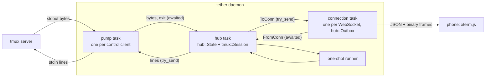
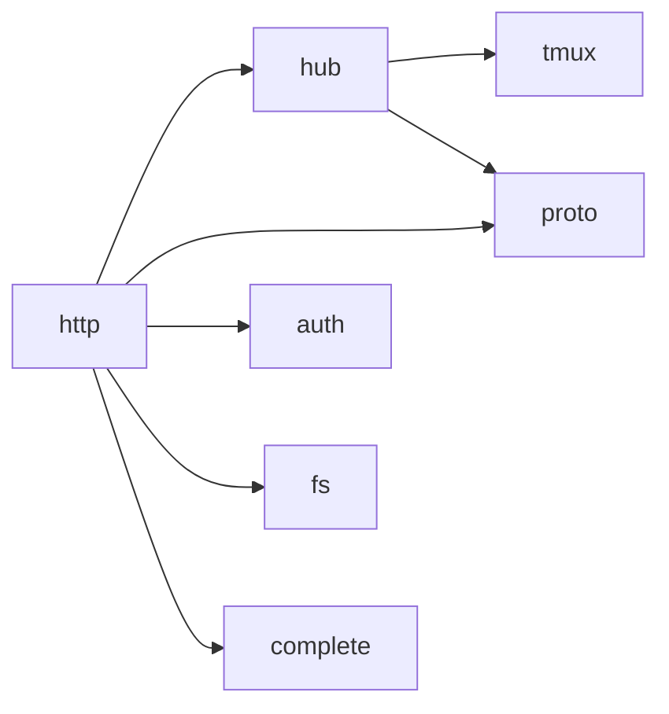
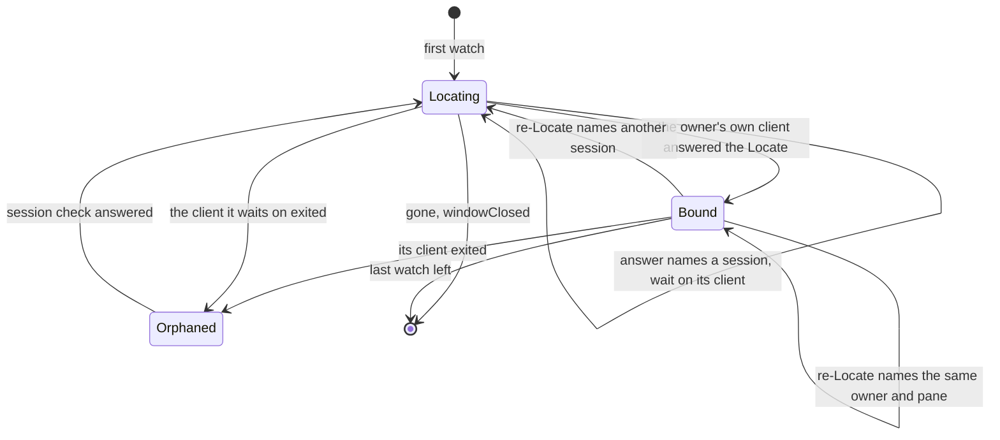
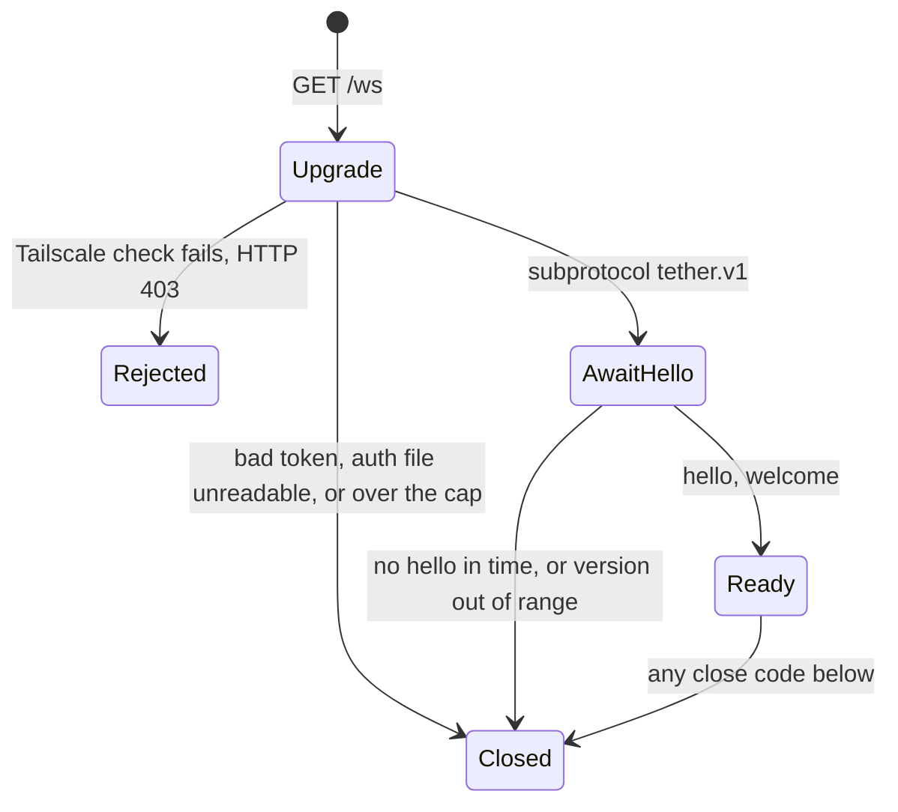

# Daemon core: tmux bridge, hub, wire protocol

The spec for `src/tmux/`, `src/hub/` and `src/proto/`. Settled ground: tmux is the
source of truth and tether never starts Jimmy's tmux server; xterm.js on the phone is
the only terminal emulator; 1 tab = 1 tmux window showing its active pane; the
[resource budget](plan.md#resource-budget) comes first. Reasons and rejected
alternatives are in [decisions.md](decisions.md).

**The design in one paragraph.** A *pump* task per `tmux -C` process moves bytes
between its pipes and one *hub* task. The hub keeps all state in one pure value,
`hub::State`, which holds a pure `tmux::Session` per control client: the session turns
tmux's bytes into events, the state turns events and client messages into effects. A
snapshot is one atomic tmux command list whose replies sit at an exact position in the
output stream, and it is the only way a terminal catches up: on open, reconnect,
resize or overflow. Each watched window has one *owner* control client, found by
asking tmux where the window is (*Locate*); only the owner's output counts. Ongoing
tmux work is *desired state* the hub reconciles when a control client has room; only
user requests can be refused as `busy`. The hub sends each connection only as many
bytes as that connection's *credit* allows; a watch whose output doesn't fit starves
and catches up by snapshot once the socket has drained.



## 1. Vocabulary

| Term | Meaning |
|---|---|
| **control client** | One `tmux -C attach-session` process, the pump that owns its pipes, and its `tmux::Session` in the hub. Attached to one tmux session for life. |
| **command group** | One line written to a control client: tmux commands joined by ` ; `, answered by one reply block per command that runs. |
| **watch** | One connection viewing one tmux window. Its id is chosen by the client, unique and never reused within the connection. A watch exists only while its tab is on screen. |
| **owner** | The control client of the session a watched window was last located in. Exactly one per watched window. |
| **Locate** | Asking tmux for a window's server, session and active pane. An empty answer means the window is gone (§3.4). |
| **pane stream** | The hub's state for the pane a watched window shows: whether its output is live, its size and its snapshot in flight (§4.3). Part of the window; it exists while the window has a watch. |
| **snapshot** | A pane's size plus **restore bytes** that rebuild it in a freshly reset xterm.js. |
| **boundary** | Where a snapshot's replies sit in the control client's byte stream: pane output before it is inside the snapshot, output after it is live. |
| **size vote** | A per-window size set with `refresh-client -C '@W:CxR'`; it caps that window (§3.6). |
| **desired state** | What tmux should be doing for the current watches: wanted panes, votes, cwd subscriptions, needed snapshots and Locates (§4.4). |
| **credit** | The bytes the hub may still have outstanding to one connection: sent on `ToConn` and not yet returned as written or discarded (§4.6). |
| **linger** | The time (§6) a control client stays attached after it owns no watched window. Nothing else lingers. |

## 2. Tasks and channels

| Task | Count | Owns | Never does |
|---|---|---|---|
| pump (`tmux::pump`) | one per control client | the `tmux -C` child, its stdin and stdout | parse or decide |
| hub (`hub::run`) | one | `hub::State` (control clients, windows with their streams, watches, connection credit), plus the pumps' line senders and the connections' channels | await anything but its inboxes and timer |
| connection (`http::ws`) | one per WebSocket | the socket, the handshake, its `hub::Outbox` | talk to tmux |
| one-shot (`tmux::oneshot`) | at most one at a time | one short `tmux -u -N` process | attach |

Tasks share no mutable state; they talk over channels.

- **Into the hub, senders wait.** Pumps send on one bounded channel, connections and
  the one-shot runner on another. A pump waiting for room stops reading stdout, so
  tmux stops writing. tmux queues the pane's output for the stalled client and, once a
  queued block is `pause-after` old, pauses the pane and drops what it queued (a Gap,
  §3.3). With only control clients attached, tmux stops reading the pane when a client
  falls behind, so a stall shorter than `pause-after` loses nothing; blocks already
  queued keep ageing, so a longer stall still ends in a Gap. While waiting, a pump
  keeps writing lines to stdin and a connection keeps moving `ToConn` into its outbox.
- **Out of the hub, nothing waits.** The hub uses `try_send`. A pump's line channel
  is as deep as its in-flight cap (§3.3), so it can't fill; if it does, the hub kills
  that client. A closed line channel means the pump has ended and its `Exited` is on
  the way, so the hub ignores that error. A connection's channel is sized from its credit (§4.6), so it can't
  fill either; if it does, the connection is wedged: dropped, close 4002.
- **One ordered stream per control client.** Replies, output and notifications reach
  the hub as raw bytes in tmux's order, and are parsed there.



`tmux/` depends on nothing internal; `proto/` is a leaf; `hub/` never sees sockets;
`http/` never names a tmux type.

## 3. `src/tmux/`: the bridge

```text
src/tmux/
  mod.rs       ids, Endpoint, Op, OneShotCmd, Event, Reply, Location, errors
  parse.rs     pure: bytes -> lines (blocks, notifications, %output decoding)
  session.rs   pure: Session, the sans-IO control client
  command.rs   pure: command builders, quoting, key-name validation
  reply.rs     pure: the formats asked of tmux, each beside the parser of its reply
  snapshot.rs  pure: state format, typed replies -> restore bytes
  layout.rs    pure: layout string -> pane sizes
  pump.rs      I/O: spawn `tmux -u -N -C`, bytes out, lines in
  oneshot.rs   I/O: one-shot `tmux -u -N` commands
  fake.rs      test support: a fake tmux server for the hub's tests (§8)
```

Everything but `pump.rs` and `oneshot.rs` is pure and tested from recorded fixtures.
`command.rs` puts a format into a command and `reply.rs` parses what tmux prints for it,
so each format and its parser change together; the snapshot's state format stays with
its parser in `snapshot.rs`. `fake.rs` is not part of the bridge: it reads the command
text `command.rs` writes, and the hub's tests use it (it is compiled in because the
integration tests in `tests/` need it).

### 3.1 Invoking tmux

- **Every invocation is `tmux -u -N [-L socket | -S path] …`**, built in one place
  (`Endpoint::command`, from an `Endpoint` of executable plus `Socket`: default, `-L`
  name or `-S` path), with `TMUX` removed from the environment (it would choose the
  socket when none is configured). The socket comes from config; tests use `-L`.
  - `-N`: with no server running, every command fails instead of starting one,
    `attach-session` and `new-session` included, with one of two no-server messages
    (§3.8) ([probe](research/probe-locate-subscriptions.md)).
  - `-u`: tmux 3.4 replaces non-ASCII characters and line breaks in format output
    (window names, `display-message`, listings) with `_` when the client's locale isn't
    UTF-8, and a systemd unit's may not be. `-u` forces UTF-8 on the control client
    and on every one-shot.
- **Control client:** `tmux -u -N … -C attach-session -t '$S' -f pause-after=3` over
  pipes (3.4 needs no pty; [probe-control-client.md](research/probe-control-client.md)),
  the last 4 KiB of stderr kept, `kill_on_drop(true)`.
- **Startup:** the first line is `display-message -p '<version, pid, start_time,
  window_width, window_height>'`. Its reply gives the version, the **server instance**
  `"<pid>-<start_time>"` and the size of the session's current window; the session
  then sets that as the client size (`refresh-client -C <W>x<H>`, §3.6) and only then
  reports `Ready`. One line can't do both: `refresh-client -C` doesn't expand formats.
  Without `-t`, `display-message` targets the attached session, so `Session` needs no
  session id; only the pump's `attach-session` names it. Setting the client size makes
  tmux send a `%layout-change` even when no size changed.
- **Versions:** an optional `name-` prefix, `MAJOR.MINOR`, an optional letter
  (`3.4`, `3.7b`, `next-3.6`). Below 3.4 the client stops with `TmuxTooOld`; an
  unparseable version counts as the newest known, with a warning.
- **Format strings** separate fields with a raw TAB inside single quotes (`\t` is
  literal there). A field holding user text goes last and is split with `splitn`.
- **Writing:** one group per line, never empty (an empty line detaches), no `\n` or
  `\r`; at most the in-flight cap of groups outstanding (§6).
- **Close:** the hub drops the line sender; the pump closes stdin, waits up to 1 s,
  then kills.

### 3.2 Parser (`parse.rs`)

`Parser::push(&mut self, chunk: &[u8], out: &mut Vec<Line>)` splits bytes into lines
without UTF-8 decoding, keeping a partial line across calls:

- **Outside a block:** `%begin T N F` opens one. `%output %P <data>` and
  `%extended-output %P <age> … : <data>` are pane output. Notifications used:
  `%pause`, `%continue`, `%layout-change`, `%window-close`, `%unlinked-window-close`,
  `%window-renamed`, `%unlinked-window-renamed`, `%window-pane-changed`,
  `%sessions-changed`, `%session-renamed`, `%subscription-changed`, `%exit`. Anything
  else (including `load-buffer`'s read errors, printed outside any block) is dropped;
  newer tmux adds notifications. The parser keeps only the length of such a line
  (`Line::Unknown`), and `Session`, being pure, logs nothing.
- **Inside a block:** every line is body, even one starting with `%`, until `%end` or
  `%error` with the **same `N` and `F`**. On 3.4 the `%pause`/`%continue` that
  `refresh-client -A` causes are written inside its block and ignored as body.
- **`%output` decoding:** `\` plus three octal digits is one byte; every other byte
  passes through. The result is `Bytes` and may be invalid UTF-8.
- **Limit** (§6): the parser caps only the length of a line. A longer line is
  discarded through its line end and reported as `Line::TooLong`, never as an error.
  The cap on a group's replies is `Session`'s (§3.3), since only it knows the groups.

Accepted: a captured line that is byte for byte the matching `%end T N F` ends the
block early. tmux's protocol has this ambiguity, and a pane can't predict `N`.

### 3.3 Session: the sans-IO control client (`session.rs`)

`tmux::Session` is the control-client protocol as a pure state machine, with no I/O
and no clock:

```rust
pub struct Step { pub events: Vec<Event>, pub lines: Vec<String> }

impl Session {
    pub fn new() -> (Session, Step);                       // the startup line
    pub fn feed(&mut self, bytes: &[u8]) -> Step;          // bytes from the pump
    pub fn request(&mut self, tag: Tag, op: Op) -> Step;   // caller checked capacity
    pub fn in_flight(&self) -> usize;
    pub fn wanted(&self) -> impl Iterator<Item = PaneId> + '_;
    pub fn exit_seen(&self) -> bool;                       // tmux sent %exit
}
```

Its rules:

- **Replies match by position.** tmux answers in order, but `N` comes from a
  server-wide counter. A **flag-1** block is the next reply for the oldest pending
  group; the group completes after one `%end` per command. `%error` completes it at
  once as failed: tmux skips the rest of a list after an error. A **flag-0** block
  (the attach reply, a hook) isn't tether's: it is dropped and never held in memory.
  A flag-1 block with nothing pending is `Event::Fatal`.
- **Reply cap.** The bodies of one group's replies are held up to 1 MiB together
  (§6). Past it the held bodies are dropped, later replies of the group are still
  matched and counted, and the group fails `TooLarge`; the control client survives
  and later groups answer normally. A `TooLong` line (§3.2) inside a block counts as
  past the cap.
- **Wanted panes.** `Snapshot` makes a pane wanted, `Release` unwants and pauses it.
  Output from a pane that is unwanted with no pause in flight is dropped and the pane paused
  (`refresh-client -A '%P:pause'`; a pause beyond the in-flight cap waits for a
  reply). This covers panes created later without listing anything, and keeps a
  non-owner's copy of a linked window's pane quiet (§4.2). Pausing affects only this
  client; tmux keeps reading the pane. Never `'%P:off'`: it crashes tmux 3.2a–3.6b
  when output is queued ([tmux-control-mode.md §6](research/tmux-control-mode.md)).
  A `Release` also invalidates the pane's outstanding snapshot attempts: none is
  re-sent (a list starts with `continue`, which would resume the pane just released),
  and when such an attempt's group ends, whatever its replies (torn ones included), the
  session answers `Done { tag, Err(Released) }`: no `Snapshot`, no retry. The Release
  marks the attempts outstanding when it is requested: Snapshot, Release, Snapshot of
  one pane answers the first `Released` even though the pane is wanted again, and the
  second is a new request. So a snapshot's tag always gets an answer, in stream order,
  and the hub needs no knowledge of what a Release invalidates (§4.4).
- **Pause tracking is bounded by work in flight.** A pane counts as pausing only while
  a pause of it (the session's own or a Release) is in flight or waiting for a slot;
  tmux 3.4 sends nothing from a pane after its pause reply. Output that arrives later
  means something resumed the pane, and it is paused again.
- **Loss.** `pause-after=3` bounds what tmux queues for a stalled tether. A `%pause`
  tether didn't request, for a wanted pane, means tmux dropped bytes: `Gap { pane }`.
  The next snapshot's `continue` resumes it. With pause-after on, output arrives as
  `%extended-output`. tmux sees a stall only once the pump has stopped reading, which
  is when the hub's inbox (2 MiB, §6) is full. With a non-control client (the laptop)
  attached to the pane's session, tmux keeps reading the pane and pauses it for the
  stalled client once a queued block is 3 s old. When every attached client is a
  control client that has fallen behind, tmux stops reading the pane instead, so a
  stall shorter than `pause-after` loses nothing and no `%pause` arrives (§2). Blocks
  tmux had already queued keep ageing, so a longer stall still ends in a Gap.
- **Torn snapshots.** User hooks run between the commands of a list. A hook that
  waits (`run-shell` without `-b`) lets tmux read the pane mid-list, so the pane's
  output lands outside both the capture and the live stream. A hook that doesn't wait
  (`display-message -p`) only adds a flag-0 block between the replies and lets no
  output in. A snapshot group is **torn** when `%output` for its own pane arrives
  between its first and last reply (output for other panes doesn't matter), or when
  the `<STATE>` re-read by the list's last command (§3.5) is not byte-identical to
  the first state reply. The session re-sends a torn list, 3 attempts in all, then fails
  it with `Torn`.
- **Snapshots in stream order:** `Snapshot { tag, pane, size, restore }` is emitted
  where the group completed, between the output events around it. The session turns
  the replies into restore bytes itself (§3.5), so the hub never sees tmux's state
  format.
- **Notifications.** `%layout-change` carries the window layout and the visible
  layout; `Layout` takes its pane sizes from the visible one, so a zoomed pane reports
  its full window size. `%sessions-changed` and `%session-renamed` both become
  `SessionsChanged`.
- **Startup order** (§3.1): `Ready` follows the client-size line, so no vote reaches
  tmux first. `%subscription-changed` for a `w<W>` subscription becomes `Cwd` (§3.7).
- **`%exit`** ends a control client whether tmux detached it, the server was killed
  or its stdin closed, so `exit_seen()` alone doesn't say why it ended (§4.5).

### 3.4 Commands (`command.rs`)

Typed builders only. *Maintenance* ops come from desired state and are never refused
(§4.4); *user* ops answer a client message and may get `busy`.

| Op | Command group | Kind |
|---|---|---|
| `Locate { window }` | `display-message -p -t @W '<pid, start_time, session_id, window_id, pane_id, pane_width, pane_height>'` | maint. |
| `LocateSession { session }` | `display-message -p -t '$S' '<pid, start_time, session_id>'` | maint. |
| `Snapshot { pane }` | §3.5 | maint. |
| `Release { pane }` | `refresh-client -A '%P:pause'` | maint. |
| `Vote { window, size }` / `ClearVote { window }` | `refresh-client -C '@W:CxR'` / `refresh-client -C '@W:'` | maint. |
| `Subscribe { window }` / `Unsubscribe { window }` | `refresh-client -B 'w<W>:@W:#{pane_current_path}'` / `refresh-client -B 'w<W>'` | maint. |
| `History { pane, start, end }` | `capture-pane -p -e -t %P -S <start> -E <end>` | user |
| `Input { window, items }` | text and bytes: `send-keys -t @W -H 68 69 …`, ≤ 512 bytes per command; a key: `send-keys -t @W <name>` | user |
| `Paste { window, path }` | `load-buffer -b tether-<tag> '<path>' ; paste-buffer -p -d -b tether-<tag> -t @W` | user |

- **Locate never errors.** On 3.4, `display-message -t` a missing window or session
  succeeds with the target fields empty, in control mode and as a one-shot, while
  `#{pid}` and `#{start_time}` still expand
  ([probe](research/probe-locate-subscriptions.md)). It parses into `Location {
  server, found: Option<{ session, pane, size }> }`; an empty `session_id` is gone.
  For a window linked into several sessions it names one; run on a client attached
  to one of them, that one.
- **Release unwants and pauses a pane, and answers the snapshots it outdates.** Its own
  group is `refresh-client -A '%P:pause'` and answers `Reply::Ok`. Each snapshot attempt
  of that pane still outstanding when it is requested is answered
  `TmuxError::Released` once its group ends (§3.3), never retried.
- **Input and paste target the window**: `-t @W` resolves to its active pane inside
  tmux, so keys can't race an active-pane change.
- **Text goes as `-H` hex**: no quoting, any byte, never a key name. Named keys go by
  name so tmux encodes them for the pane's modes. Without `-K`, `send-keys` writes to
  the pane directly, skipping the prefix, key tables and `escape-time` (from tmux's
  source; fixtures confirm it).
- **Key names** must match
  `^(?:[CM]-)*(?:(?:S-)?(?:Up|Down|Left|Right|Home|End|PageUp|PageDown|IC|DC|F(?:[1-9]|1[0-2]))|[A-Za-z0-9]|Enter|Escape|Tab|BTab|BSpace|Space)$`.
  tmux 3.4 types `S-Enter` as literal text
  ([probe-tmux.md §6](research/probe-tmux.md)), so Shift+Enter goes as CSI-u bytes.
  `tests/fixtures/proto/keys.json` lists every name the clients send; the Rust tests
  check each against the regex.
- **Paste buffers.** The buffer is named `tether-<tag>` after the request's `Tag`.
  tmux buffer names are server-wide, so tags are unique across all control clients
  (the hub draws them from one counter). `paste-buffer -d` deletes the buffer only on
  success, and tmux skips the rest of a failed list, so every failed paste group is
  followed by a separate `delete-buffer -b tether-<tag>` group whose own error is
  ignored. That covers every failure point (missing window, a hook killing the window
  between load and paste, a missing file). On 3.4 `load-buffer` of a missing file succeeds: its read error is printed
  outside any block (dropped, §3.2) and the group then fails at `paste-buffer` with
  `no buffer tether-<tag>`.
- **Paste files.** The connection task takes one of a few daemon-wide paste slots
  (§6), or answers `busy` itself, then writes the text to a 0600 file in
  `$XDG_RUNTIME_DIR/tether/`, so the hub only holds a `PasteFile`: the path plus its
  slot. That directory is tmpfs, charged to tether's memory, which is why the slots are
  counted. tmux has read the file when the group completes; the hub hands the
  `PasteFile` back in a `RemoveFile` effect on `Done` and on every path that drops the
  request (§4.4), and deleting it frees the slot. The daemon empties the directory at
  startup, after it has bound its port: a second daemon started by mistake fails to bind
  and must not delete a running daemon's in-flight pastes.
- **Quoting, on a control-client line:** user arguments go in single quotes (`'` as
  `'\''`) after doubling every `#` (tmux format-expands `-n` and `-c`); control
  characters are rejected. One-shots take arguments, not lines (§3.8).
- Never send a control client commands that wait (`run-shell`, `if-shell`, `wait-for`,
  `confirm-before`, `command-prompt`): one would stall every later reply. The one
  exception is `NewWindow`'s `if-shell -F` guard, on a one-shot (§3.8), which only
  evaluates a format.

### 3.5 Snapshot

On 3.4, tmux queues a pane's bytes for control clients before parsing them into the
grid, runs a command list in one command-queue pass with no pane read in between, and
keeps reply lines and output in one ordered queue per client. So output before the
group's first reply is in the captured grid and output after its last reply is not:
198/198 and 196/196 captures matched at full output speed, with no pausing
([probe-snapshot.md](research/probe-snapshot.md)).

```text
refresh-client -A '%P:continue' ; display-message -p -t %P '<STATE>' ;
capture-pane -p -e -N -t %P ; capture-pane -p -P -C -t %P ;
capture-pane -p -e -N -a -q -t %P ;
display-message -p -t %P '<STATE>'
```

- **`continue` goes first**, always. On a running pane it is a no-op on 3.4; it also
  resumes a pane tmux auto-paused or the session paused as unwanted.
- The alternate-screen capture has `-q`, so a pane without one succeeds, with one
  empty row, instead of aborting the list.
- **The state re-read goes last.** If it isn't byte-identical to the first `<STATE>`
  reply, the list is torn (§3.3): a hook changed the pane while the list ran. A
  hook that runs `send-keys -R` clears the screen, moves the cursor and turns keypad
  mode off with no size change and no output, so a size-only check would miss it. A
  hook that rewrites screen content while every state field stays the same is still
  missed.
- `<STATE>`, tab-separated, for 3.4: `pane_id pane_width pane_height alternate_on
  alternate_saved_x alternate_saved_y cursor_x cursor_y cursor_flag insert_flag
  keypad_cursor_flag keypad_flag wrap_flag origin_flag scroll_region_upper
  scroll_region_lower mouse_standard_flag mouse_button_flag mouse_all_flag
  mouse_utf8_flag mouse_sgr_flag pane_tabs`, from a per-version table in
  `snapshot.rs` (newer versions use the newest entry). `mouse_all_flag` is any-motion
  tracking (`?1003`); tmux's `mouse_any_flag` means that some mouse mode is on.
  `alternate_saved_x` and `_y` are 4294967295 until the alternate screen has been
  used, and stay so after `?47h` or `?1047h`, which save no cursor.
- The replies count against the group reply cap; a larger screen fails `TooLarge`.
- The session reads the replies as `PaneSnapshot { state: PaneState, active:
  Vec<Bytes>, pending: Bytes, saved: Vec<Bytes> }` (`snapshot.rs`, tmux's field
  names; `pending` already octal-decoded), composes the restore bytes, and emits only
  `Event::Snapshot { tag, pane, size, restore }`; `size` is the state's pane size.

**Boundary:** everything the hub saw for `%P` before the `Snapshot` event is inside
it; everything after is live. Stream order is the boundary.

**Restore bytes** (`snapshot::compose`, pure) rebuild the pane in a freshly reset
terminal of `cols × rows`, so the clients carry no restore logic:

1. `CSI ?7l`, so a too-wide line (the saved primary grid keeps its old size while the
   alternate screen is on; Unicode widths drift) is cut at the last column instead of
   wrapping and scrolling. Rows past `rows` are dropped.
2. If `alternate_on`: the saved primary grid (the `-a` capture), `CSI 0 m`, CUP to
   `alternate_saved` (clamped to the pane, so 4294967295 lands in the bottom-right
   corner), `CSI ?1049h`.
3. The active grid: line *i* is `CSI i+1;1H` and its captured bytes; an empty row is
   skipped. `-e` SGR state carries across lines, so nothing resets between them.
4. `CSI 0 m`; tab stops: `CSI 3 g`, then for each `pane_tabs` column a CUP to that
   column and `ESC H` (which sets a stop at the cursor's column); a scroll region that
   isn't full height: `CSI top+1;bottom+1 r`; `origin_flag`: `CSI ?6h`. Tab stops,
   region and origin mode apply to the screen in use only.
5. Modes: `CSI ?7h` if `wrap_flag`, and each mode that is on: `CSI ?1h`
   (keypad_cursor), `ESC =` (keypad), `CSI 4h` (insert), `CSI ?1000h` / `?1002h` /
   `?1003h` / `?1005h` / `?1006h` (mouse standard, button, all-motion from
   `mouse_all_flag`, utf8, sgr). The three tracking modes exclude each other in tmux
   3.4 and in xterm.js, and so do the two encodings; if both utf8 and sgr are set,
   sgr is written last and wins.
6. CUP to the cursor (region-relative under origin mode, a cursor outside the region
   clamped to its nearest row; a column past the last clamped); `CSI ?25l` if
   `cursor_flag` is 0.
7. The pending parser bytes (`-P -C`, decoded like `%output`), so the next live bytes
   complete the sequence tmux is holding.

Every position and region value from tmux is clamped to the pane, so odd input can't
panic.

Not restorable from 3.4:

- **Not in its formats:** the current SGR pen, character sets, cursor shape, title,
  bracketed paste, focus reporting. Paste goes through `paste-buffer -p`, which checks
  the real mode; the rest return when the application next sets them.
- **A pending wrap.** After a character in the last column tmux reports `cursor_x`
  equal to `cols`. Restore clamps it to `cols-1`, so the next character overwrites
  the last cell instead of wrapping.
- **The primary screen's region and tab stops behind an alternate screen.** The
  reported ones belong to the alternate screen; the primary keeps xterm.js's defaults,
  so after the application leaves the alternate screen its region and tab stops are
  default, not tmux's.
- **A saved cursor after `?47h` or `?1047h`:** none was saved, so it lands in a corner.

### 3.6 Sizing

**tmux 3.4's rules**
([probe-control-client.md](research/probe-control-client.md#sizing-the-part-that-shapes-the-resize-policy)):
a control client counts for sizing only once it sets a size, then for every window in
its session; attaching makes it `latest` for the session's current window; under
`window-size latest` a window takes `latest`'s size, and a size vote replaces the
client size for that window and **caps** it, whoever is `latest`.

**Policy: while the phone watches a window, the phone's size wins there; otherwise
tether leaves sizes alone.**

- **Client size = the session's current window size at attach** (§3.1). For windows it
  doesn't watch, the control client acts like a laptop-sized client, so nothing
  shrinks where it is `latest` or alone.
- **A vote on each watched window**, from the size in `watch` and each `resize`. It
  wins even when the laptop is `latest`. The keyboard never resizes. Two watches on
  one window: the last `watch` or `resize` wins (two phones aren't designed for).
- **A window with no watch left has its vote cleared** and returns to `latest`'s
  size, or the client size where the control client is `latest`. Leaving the screen,
  backgrounding and a dropped connection all end watches.
- Verified on 3.4 with a 200×50 pty client: unwatching the laptop's current window
  restored it to 200×49; when the laptop grew, unwatched windows followed to 220×59.
- **Accepted costs:** the laptop can't grow a window the phone watches (the vote is
  a cap); a cleared window on which no client is `latest` keeps the phone's size
  until the laptop types in it; a phone suspended without closing its socket keeps
  its vote until the idle timeout (§6).
- A watched pane's size change arrives as `%layout-change` in stream order and
  breaks its stream (§4.3).

### 3.7 cwd subscription

Completion and the file manager need the watched pane's cwd. The owner subscribes per
watched window:

```text
refresh-client -B 'w<W>:@W:#{pane_current_path}'
→ %subscription-changed w<W> $S @W <index> - : <path>
```

On 3.4 ([probe](research/probe-locate-subscriptions.md)) the first value arrives within
about a second, then one per change; tmux checks once a second, so faster changes
collapse into the last. A window subscription follows the **active pane**, and
reports only while the window is in the client's own session, which is the owner's.
The value is the foreground process's cwd, read by tmux from `/proc`: no shell
snippet needed, and it works inside TUIs. Cost: one format evaluation per watched
window per second inside tmux; tmux drops its timer with the last subscription. The
hub sends the value in `watching` (§5.3).

### 3.8 One-shots and endpoints (`oneshot.rs`)

`oneshot::run(&Endpoint, &OneShotCmd) -> Result<Reply, TmuxError>` runs one `tmux -u -N`
process that never attaches. It reads stdout (at most the 1 MiB reply cap) and the head
of stderr (4 KiB), and parses stdout into the same `Reply` a control client's op gets,
so the hub handles a Locate answer the same from either source. Stdin is closed, and a
child dropped at the timeout is killed.

- `List` (session sheet) answers `Reply::Listing { server, version, sessions }`:
  `display-message -p '#{version}\t#{pid}\t#{start_time}' ; list-clients -F
  '#{session_id}\t#{client_control_mode}' ; list-windows -a -F '#{session_id}\t#{window_id}\t#{window_index}\t#{window_active}\t#{window_activity}\t#{session_name}\t#{window_name}'`.
  "Attached elsewhere" is a client line with mode 0 (not a control client) for the
  session. Clients come before windows, and the window name is last and split with
  `splitn`: tmux 3.4 allows raw tabs and line breaks in a name set with `-n`, so a
  window name with a line break garbles only window lines, and a line that fits
  neither shape is skipped. A session name can't hold either (tmux escapes it).
- `Locate`, `LocateSession`: the ops' commands (§3.4) with `-t` set to the id, when the
  endpoint has no `Ready` control client. They answer `Reply::Location` and
  `Reply::SessionLocation`.
- `NewWindow`: `if-shell -F '#{!=:#{pid}-#{start_time},<server>}' tether-server-changed ;
  new-window -d -t '$S' [-n <name>] [-c <dir>] -P -F <created>`;
  `NewSession`: `new-session -d [-s <name>] [-c <dir>] -P -F <created>`. Both answer
  `Reply::Created { server, session, window }`. `<created>` is
  `'#{pid}\t#{start_time}\t#{session_id}\t#{window_id}'`: `created` carries a
  `WindowRef`, which names the server instance, and the hub may not know one for the
  endpoint yet.
- **`NewWindow` carries the server instance** its session id belongs to
  (`OneShotCmd::NewWindow { server, … }`, from the `SessionRef`), and tmux checks it:
  session ids restart at `$0` with every server, so on another instance `-t '$S'` would
  name some other session. The leading `if-shell -F` (a format test; it runs no shell
  and waits for nothing) takes `tether-server-changed` as its command on a different
  instance. That isn't a tmux command, so `if-shell` fails and tmux skips the rest of
  the list: nothing is created. The one-shot reads `tether-server-changed` in stderr as
  `NoServer`. The hub keeps no check of its own, because the instance it last saw can be
  stale or unknown, and tmux's check can't be.

**Arguments, not command lines.** A one-shot is an argv vector with no shell and no
quoting layer: tmux takes each argument literally, except that an argument ending in
`;` ends the command (`-n 'x;'` fails with `unknown command: -c`), and an argument that
is just `;` separates commands, which `List` uses. tether's own arguments are ids and
fixed formats. A user's `name` or `dir` gets every `#` doubled (tmux format-expands
both), a trailing `;` sent as `\;`, and control characters or a non-UTF-8 path refused
as `BadRequest` before any process starts.

**Errors.**

| Cause | `TmuxError` |
|---|---|
| tmux says `no server running on …` (stale socket) or `error connecting to … (No such file or directory)` (socket file missing); or stderr names `tether-server-changed`, the `NewWindow` guard | `NoServer` |
| any other non-zero exit | `Command(stderr)`, or the exit status when stderr is empty |
| still running after 2 s; the process is killed | `Timeout` |
| tmux couldn't be run | `Spawn(message)` |
| stdout past the 1 MiB reply cap | `TooLarge` |
| stdout not in the expected shape | `BadReply` |

`NoServer` starts no server. It means no server is running, or the one running isn't the
instance this one-shot was for (`NewWindow`'s guard), and the hub treats the two alike
(§5.3). tmux rewrites `$NAME` in a window or session name to
`\$NAME`, in control mode too; that is tmux's behaviour, not tether's escaping, and
names pass through as tmux returns them.

One at a time, 2 s timeout. The hub emits an effect, `run.rs` runs it in a task, and
the result returns as an `Input`. While the slot is taken, user one-shots get `busy`
and Locates wait.

**Endpoints.** Each tmux server tether talks to is an endpoint: `main`, from config,
and `scratch`. Server instances are written `"<endpoint>:<pid>-<start_time>"`, so a
window id routes to its endpoint by itself.

**Scratch shells (after the core MVP)** are sessions on a private server: the daemon
runs `systemd-run --user --scope --collect tmux -u -L tether-scratch new-session -d -P
-F '#{pid}\t#{start_time}\t#{session_id}\t#{window_id}'` (the creation format above;
no `-N`, since this one starts the server). Its own transient scope keeps the server out of
tether's cgroup, which is what the never-start-tmux rule protects. Scratch windows
are ordinary tabs on the same stream path. Closing a scratch tab kills its session;
the server exits with its last one.

### 3.9 Public interface

```rust
pub enum Op {
    Locate { window: WindowId }, LocateSession { session: SessionId },
    Snapshot { pane: PaneId }, Release { pane: PaneId },
    Vote { window: WindowId, size: Size }, ClearVote { window: WindowId },
    Subscribe { window: WindowId }, Unsubscribe { window: WindowId },
    History { pane: PaneId, start: i32, end: i32 },
    Input { window: WindowId, items: Vec<InputItem> },
    Paste { window: WindowId, path: PathBuf },
}

pub enum Event {
    Ready { server: ServerInstance, version: TmuxVersion },
    Output { pane: PaneId, bytes: Bytes },                 // wanted panes only
    Snapshot { tag: Tag, pane: PaneId, size: Size, restore: Bytes },
    Done { tag: Tag, result: Result<Reply, TmuxError> },  // a Reply, or the error
    Gap { pane: PaneId },
    Layout { window: WindowId, panes: Vec<(PaneId, Size)> },
    ActivePane { window: WindowId, pane: PaneId },
    WindowUnlinked { window: WindowId },                   // closed *or moved*
    WindowRenamed { window: WindowId, name: String },
    SessionsChanged,                                       // also a session rename
    Cwd { window: WindowId, path: String },
    Fatal(SessionError),
}

// One answer type for a control client's op and a one-shot's command.
pub enum Reply {
    Ok, Location(Location), SessionLocation(SessionLocation),
    History(Vec<Bytes>), Listing(Listing), Created(Created),
}
pub enum TmuxError {
    Command(String), PaneGone, Torn, TooLarge, BadRequest(&'static str), BadReply,
    Released,   // a snapshot attempt a Release outdated (§3.3)
    NoServer, Timeout, Spawn(String),
}
pub struct Listing { server: ServerInstance, version: TmuxVersion, sessions: Vec<ListedSession> }
pub struct ListedSession { id: SessionId, name: String, attached_elsewhere: bool,
                           windows: Vec<ListedWindow> }
pub struct ListedWindow { id: WindowId, index: u32, name: String, active: bool, activity: u64 }
pub struct Created { server: ServerInstance, session: SessionId, window: WindowId }

pub struct Endpoint { pub program: PathBuf, pub socket: Socket }
pub enum Socket { Default, Name(String), Path(PathBuf) }          // none, -L, -S
pub enum OneShotCmd {
    List, Locate { window: WindowId }, LocateSession { session: SessionId },
    NewWindow { server: ServerInstance, session: SessionId,
                name: Option<String>, dir: Option<PathBuf> },
    NewSession { name: Option<String>, dir: Option<PathBuf> },
}

// pump.rs
pub const READ_SIZE: usize = 16 * 1024;
pub enum PumpMsg { Bytes(Bytes), Exited { stderr_tail: String } }  // Exited is always last
pub fn spawn(endpoint: &Endpoint, session: SessionId, client: ClientId,
             out: mpsc::Sender<(ClientId, PumpMsg)>)
    -> (mpsc::Sender<String>, JoinHandle<()>);

// oneshot.rs
pub const TIMEOUT: Duration = Duration::from_secs(2);
pub async fn run(endpoint: &Endpoint, cmd: &OneShotCmd) -> Result<Reply, TmuxError>;
```

**The pump's contract.** `spawn` can't fail, and must run inside the tokio runtime. A
failure to start tmux arrives as `Exited` with a `stderr_tail` such as `can't run
tmux: …` and no `Bytes` before it, so the hub has one exit path (§4.5). `Exited` is
always the last message.

- **Lines in.** Each string on the line channel is written to stdin with a line end. The
  channel holds `MAX_IN_FLIGHT` (32) lines, so `try_send` can't find it full. A closed
  channel means the pump has ended and its `Exited` is on the way.
- **Close.** Dropping the line sender closes the client: stdin closes, tmux gets 1 s to
  exit, then it is killed. A hub inbox that has been dropped closes it the same way.
- **Bytes out.** Each read of up to `READ_SIZE` is one `Bytes`. While `out.send` waits
  for room, the pump reads no stdout and keeps writing lines to stdin (§2).

## 4. `src/hub/`: windows, streams, desired state

```text
src/hub/
  mod.rs        spawn, HubHandle, FromConn, ToConn, the limits (§6)
  state.rs      pure: State::handle(input, now) -> effects; the model, tmux events,
                pane streams
  owners.rs     pure: Locate answers, binding, control clients, exits, server instances
  requests.rs   pure: what connections ask (watch, input, paste, history, listings)
  reconcile.rs  pure: desired state -> ops, within capacity
  credit.rs     pure: each connection's credit, its reservations, sending to it
  time.rs       pure: what waits on time (next_deadline, timers)
  names.rs      pure: spelling servers, windows and sessions for control JSON
  outbox.rs     pure: per-connection delivery queue
  run.rs        the hub task: inboxes, timer, executing effects
```

`state.rs`, `owners.rs`, `requests.rs`, `reconcile.rs`, `credit.rs`, `time.rs` and
`names.rs` are one `impl State` split by concern; `State` is one value.

### 4.1 `State::handle`

```rust
pub enum Input {
    Connected(ConnId),                                  // a connection registered
    Pump(ClientId, PumpMsg), Conn(ConnId, FromConn),
    OneShot(Tag, Result<Reply, TmuxError>), Tick,
}
pub enum Effect {
    SpawnClient { client: ClientId, endpoint: Endpoint, session: SessionId },
    Write { client: ClientId, lines: Vec<String> }, CloseClient { client: ClientId },
    OneShot { tag: Tag, endpoint: Endpoint, cmd: OneShotCmd },
    Send { conn: ConnId, msg: ToConn }, DropConn { conn: ConnId },
    RemoveFile { file: PasteFile },
}
impl State {
    pub fn new(endpoints: Endpoints, now: Instant) -> State;
    pub fn handle(&mut self, input: Input, now: Instant) -> Vec<Effect>;
    pub fn next_deadline(&self) -> Option<Instant>;
}
```

`handle` feeds pump bytes to the client's session, applies events and client
messages, runs `reconcile` (§4.4) and returns the effects. `reconcile` runs only after
an input that may have changed what tmux should be doing: every input but pump bytes;
pump bytes that complete a group, produce an event other than `Output`, or starve a
watch; and any timer that fires. Bytes that only carry output delivered as it came,
the hot path, skip it. `run.rs` only executes the effects and sleeps until
`next_deadline()`: a linger end, a group's reply deadline, a crash respawn, a starved
watch's snapshot spacing. With nothing pending there is no timer.

- **Any input at or past `next_deadline()` counts as a Tick too.** The runtime may pick
  a ready pump or connection input over its timer, and a steady flow of output would
  then keep a deadline from ever firing (a starved watch's snapshot spacing, say). So
  `handle` fires every timer that is due and runs `reconcile` once, whatever the input
  was, pump output included. The deadline then drops out of `next_deadline()`: one
  that can't be acted on yet (the spacing is over but credit or a capture slot is
  missing) isn't reported again until something changes, so it can't spin the timer.
- **`State` owns every lifecycle; `run.rs` only mirrors it.** `DropConn { conn }` means
  the connection is gone from the hub, however it went: its own `Closed`, or dropped as
  wedged (§4.6). `CloseClient { client }` goes out whenever a started control client
  leaves the state, whether the hub closes it (linger, cap, kill) or it exited on its own.
  The executor removes its channel or pump entry for each, and a removal that finds
  nothing is harmless. Nothing the hub forgets stays in `run.rs`.

State:

- `clients`: endpoint, session, the phase (a crash respawn waiting out its delay,
  `Starting` with its `tmux::Session`, or `Ready` with the server instance), applied
  votes and subscriptions, `pending` (each tag in flight and what its reply is for),
  when a group last completed, linger deadline, last crash.
- `windows`: the watches on it, the vote (the latest `watch` or `resize` size), its
  phase and Locate state (§4.2), its stream (§4.3) and cwd.
- `conns`: credit outstanding and reserved (§4.6) and the connection's watches: window,
  whether it awaits a snapshot, when it last had one, what its last `watching` said.
- `exits`: exited clients whose session is being checked (§4.5).
- The one in-flight one-shot and what its answer is for; the live server instance per
  endpoint.

### 4.2 Windows, owners and Locate

A window's phase is `Locating { after, on }` (no owner yet), `Bound` (owner, session and
pane known) or `Orphaned` (the control client it belonged to, or was to bind to, exited;
waiting for the session check, §4.5). In `Locating`, `on` is the control client the
window was found to belong to, which may still be starting or waiting out a crash
delay: the window is located on it and binds only from its answer (item 3). `after` is
how the window's previous owner ended (§4.5), applied by the first answer that finds the
window still in that owner's session. Both are set only while `Locating`, so a window
that isn't locating has no `on` to clear. The hub holds a window only while a watch is on
it (it is created by the first `watch` and dropped with the last), so only such a window
can be located and reported closed.



1. **`watch`** is checked in this order, and each failure answers on that connection
   alone:
   - A watch id already active on the connection gets `error { badRequest }`; the
     active watch is unchanged.
   - A watch over the connection's cap ends at once with `watchEnded { error }`.
   - A `server` string that doesn't parse, or names an endpoint the daemon doesn't have,
     can never bind: it gets `serverExited` for that string, which closes the tab.
   - A window whose server instance isn't its endpoint's live one died with that
     server: `serverExited` is broadcast for the old instance and closes every tab on it
     (§4.5).

   Otherwise the watch joins the window, or creates it `Locating`. It awaits a
   snapshot; a `Bound` window's new watch gets `watching` at once.
2. **Locate** is one per window in flight; a trigger during it re-runs it afterwards.
   A `Bound` window locates on its owner, and a `Locating` one with an `on` on that
   control client, once it is `Ready`; otherwise it runs on any `Ready` client of the
   endpoint with room, else as a one-shot.
3. **A window binds only from a Locate its future owner answered itself.** A control
   client's replies are ordered with its own notifications only, so after an owner's
   answer every later `ActivePane` or unlink reaches the hub behind it. An answer from
   another client or a one-shot may predate a change the owner already reported, so it
   only names the session: the hub finds or spawns that session's client, the window
   stays `Locating` with `on` set to it (it waits while the client starts), and Locates
   again on it.
4. **Result:**
   - another server instance, or no server: the window's server is gone (§4.5);
   - empty: broadcast `windowClosed`, drop the window, its watches and stream (no
     `watchEnded`: the broadcast closes the tab);
   - session S: S's client is the owner (spawned if needed; at the cap with none
     lingering, the watches end with `watchEnded { error }`).
     - *The owner's own answer binds.* If the owner and pane are those it already has,
       nothing changes: the window stays bound and live, with no new snapshot. If not,
       the stream breaks (§4.3) and needs a snapshot from the new owner or pane.
     - *Any other answer* leaves the window `Locating` on that session's client, as in
       3.

   Each watch whose last `watching` is out of date gets a new one.
5. **A Locate or session check that fails** with anything but `NoServer` (tmux can't
   run, a timeout, an unexpected reply) ends the window's watches with `watchEnded {
   error }`. `NoServer` means the server is gone (§4.5). A Locate lost because its
   control client exited is not a failure: it is needed again (§4.4).
6. **Re-locate on:** `WindowUnlinked` from any client of the window's server (tmux sends
   close notifications for moves too), the owner exiting, a snapshot failing because the
   pane is gone. A `Bound` window stays bound, and its stream live, while the Locate
   runs: an unlink in some other session of a linked window changes nothing until an
   answer names another owner or pane. For a window the hub doesn't hold, which no watch
   is on, there is nothing to locate: a `WindowUnlinked` from the endpoint's reporter
   (§4.5) asks for a relisting instead, and `sessionsChanged` is broadcast (§5.3).
7. **Only the owner counts:** `Output`, `ActivePane`, `Layout` and `Cwd` are taken
   from the owner only. Other sessions' clients see a linked window's output too, but
   don't want the pane and pause it (§3.3); a former owner that still wants it gets
   `Release` from reconciliation.
8. **`ActivePane`** changes the window's pane and breaks its stream; **`Cwd`** updates
   the cwd. Both re-send `watching`.

A moved window keeps its tab: new owner, fresh snapshot.

### 4.3 Pane streams

A window shows one pane, so its stream is part of the window: the owner and pane come
from its `Bound` phase (§4.2), the watches from the window.

```rust
struct Stream {                 // one per window
    live: bool,                 // false: drop output until a snapshot lands
    size: Size,
    inflight: Option<Inflight>, // the snapshot that can make it live
}
struct Inflight { tag: Tag, reserved: Set<WatchKey> }
                                // reserved: the watches whose credit it holds
// per watch, on its connection: awaiting (gets the next snapshot, and no output),
// starved (awaiting because its output didn't fit), last snapshot time, last `watching`
```

| Event | Effect |
|---|---|
| created with the window (its first watch) | not live; snapshot needed |
| `Output` from the owner, live | `Output { watch, bytes }` to every watch not awaiting, if its connection's credit fits it (§4.6); a watch it doesn't fit starts awaiting |
| `Output` not live, or from another client | dropped: the coming snapshot holds it |
| `Snapshot` whose tag isn't `inflight` | dropped |
| `Snapshot` | live; size from it; sent to the watches it reserved for, which stop awaiting; the rest keep awaiting; live watches are undisturbed |
| **break:** a `Layout` giving the pane a new size (one repeating its size is no break), `Gap`, a new owner or pane (`ActivePane` included), the window leaving `Bound` | not live; every watch awaiting; `inflight` forgotten (a snapshot sent before the break may predate its cause); snapshot needed |
| a watch joins or sends `resync` | awaiting; snapshot needed |
| snapshot fails: pane gone | the window re-locates |
| snapshot fails: torn 3 times, or `TooLarge` (restore bytes over the capture reservation included) | `watchEnded { error }` for every watch, naming hooks or screen size; stream dropped |
| a watch leaves | removed from the window's watches; the credit it reserved goes back |
| last watch leaves | stream dropped; the pane stops being wanted |

### 4.4 Desired state and reconciliation

`handle` ends with `reconcile` whenever its input may have changed what tmux should
be doing (§4.1): compare that with what the hub has sent, and send the difference as
far as capacity allows. It walks a handful of windows.

| Desired, per control client C | Derived from | Sent as |
|---|---|---|
| wanted panes | the panes of the bound windows C owns | `Snapshot` when one is needed; `Release` for a wanted pane C owns no bound window for |
| size votes | bound windows C owns: the latest `watch` or `resize` size | `Vote`; `ClearVote` once C owns no bound window for it |
| cwd subscriptions | bound windows C owns | `Subscribe`; `Unsubscribe` once it owns none |
| snapshots | bound windows with awaiting watches, nothing in flight, and at least one awaiting watch whose connection can reserve credit (§4.6) | `Snapshot` |
| Locates | windows needing one, none in flight | `Locate` on the window's owner or the client it will bind to (§4.2), else on any `Ready` client, else a one-shot |
| session checks | exited clients (§4.5) | `LocateSession`, the same way |

**Capacity** (numbers in §6). A control client has a cap on groups in flight.
Maintenance may use all of it; a user request is accepted only below a lower
threshold, else `error { busy }`, so users can never starve maintenance. Snapshots
and history share a few capture slots daemon-wide, and each also needs its
connection's credit (§4.6); a snapshot waits for both, a history request without
either gets `busy`. Each reply and each credit return runs `handle`, so waiting work
goes out at once.

What the hub sent counts as applied (votes and subscriptions are recorded per
client; wanted panes live in the session): tmux runs groups in order, and a failure
on a window that has gone is harmless. Work in flight records where it runs; when
that control client exits, its unanswered Locates, session checks and snapshots become
needed again, and the next `reconcile` sends them elsewhere. (A Locate or session
check that is answered with a failure is not retried: §4.2.) Nothing is sent to a
client before it is `Ready`. Releases, cleared votes and unsubscribes go
first, then Locates, session checks, subscriptions, votes, snapshots. A snapshot the hub
stops waiting for (a stream break, the window ending, its last watch leaving) gives its
reservations back at once (§4.6), but its tag stays in the client's `pending` and keeps
its capture slot until tmux answers it or the client ends. A `Release` adds nothing for
the hub to work out: `Session` answers the pane's outstanding attempts `Released`
(§3.3), so those tags are answered like any other and their slots free then. (The hub
sends a Release only once no bound window of the client shows the pane, and the break
that left it has already returned the attempts' reservations.) A `Paste` the hub refuses or drops (busy, unknown watch, connection gone) emits
`RemoveFile`.

### 4.5 Control clients

- **One per tmux session that owns a watched window**, shared by all connections,
  attached to that session for life. Spawning costs about 2 ms and 5.3 MB; normally
  one exists, two briefly when switching sessions.
- **Spawned** when a Locate names a session without one. At the cap (§6) the oldest
  lingering client closes first; with none lingering, the window's watches end with
  `watchEnded { error }` ("too many sessions") and the window is dropped.
- **`Ready`** requires the endpoint's known server instance, or records it when none
  is known; a different one means the server restarted. A window whose owner is still
  starting waits for it, and if that client exits first, the window locates again.
- **Linger:** closes after the linger (§6) once it owns no watched window, unless one
  binds first.
- **Reply timeout.** A control client with groups in flight that completes none for
  10 s (§6) is killed. It is a progress deadline for the client, not a deadline per
  group, so it also covers `Session`'s own groups (the startup line, pauses), which
  the hub never tags.
- **Exit** (the pump reports `Exited`, its task panics, or the hub kills it for the
  reply timeout or a `Fatal` error): its streams stop being live, its windows
  (including those waiting for it to start) wait, and `LocateSession` checks its
  session first. The check runs for every exit the hub didn't cause itself (a linger or
  cap close needs none), whether or not any tab was watched, so `serverExited` and
  `sessionClosed` go out regardless. Then:
  - *No server, or a new instance:* broadcast `serverExited`; drop all of that
    server's windows, streams and watches; close its clients. Nothing starts tmux.
  - *Otherwise* each of its windows locates again: one now in another session rebinds
    to that session's client, one gone gets `windowClosed`. If the session was gone,
    `sessionClosed` is broadcast too.
  - *A window still in the same, live session* depends on how the client ended.
    `%exit` ends a client after a detach, `kill-server` and a closed stdin alike, which
    is why `LocateSession` runs first. With `%exit` seen and the session alive it was
    **detached** by another client (`attach -d`, `detach-client`): its watches get
    `watchEnded { detached }` and nothing reattaches. (A `systemctl stop` must not look
    like this: under the default kill mode systemd signals the `tmux -C` clients itself,
    and they exit as if detached while the sockets close. The unit's `KillMode=mixed`
    signals tether alone, [plan.md](plan.md#resource-budget).)
    Without it the client **crashed**, and so does one the hub killed for a `Fatal`
    error or the reply timeout: the hub respawns it after 1 s, kept only if the
    server instance is unchanged; a second crash within 60 s ends the watches with
    `watchEnded { error }`.
- **One reporter per endpoint.** Every control client receives `%window-renamed`,
  `%sessions-changed` and the window close notifications, so the hub turns them into
  `windowRenamed` and `sessionsChanged` only from the endpoint's lowest-id `Ready`
  client; otherwise each would be broadcast once per client.
- **`sessionsChanged` is coalesced per input.** It is sent for tmux's own
  `%sessions-changed` (and `%session-renamed`), and for a close or unlink notification
  about a window the hub doesn't hold (§4.2 item 6), both only from the reporter. Each
  sets a flag that `handle` clears, broadcasting once, when it finishes the input. So
  killing a session of four windows sends one `sessionsChanged`, not one per
  notification (measured on tmux 3.4). A burst split across two reads of the pipe is
  two inputs and sends two; the web debounces its relisting (§5.3). Closing a watched
  window sends `windowClosed` and no `sessionsChanged` of its own.

### 4.6 Credit and the outbox

Every byte bound from the hub to a socket is one number per connection, its credit
(§6), and the hub's bookkeeping is its only copy. (The connection's own small replies
never pass through the hub and are bounded separately, below.) The hub debits the credit
for every `ToConn` it sends; the connection returns those bytes over `FromConn` once
a frame is written to the socket or discarded unwritten. Payloads waiting in the
channel, in the outbox, and in the frame being written all count until then.

- **Charge.** `ToConn::charge()`, one pure function both sides call: the payload's
  length (restore bytes, output bytes, encoded JSON text), at least 64 bytes. The hub
  encodes JSON itself, so a message's charge is its exact size.
- **Output is gated.** Output that fits goes out. Output that doesn't is dropped and
  that watch starts awaiting (§4.3); its catch-up is the next snapshot. Only that
  watch starves; the connection's other watches keep their output while it fits.
- **Captures reserve first.** A snapshot reserves the capture reservation (§6) on
  each awaiting watch's connection before its group is issued; watches whose
  connection can't reserve stay awaiting for a later snapshot. A history request
  that can't reserve gets `error { busy }`; `listSessions` reserves the smaller
  listing reservation the same way. When the reply arrives, the hub charges the
  encoded size and returns the rest of the reservation to the credit. A snapshot
  whose restore bytes exceed the reservation fails `TooLarge`; a listing that
  doesn't fit gets `error { tmux }`. A reservation whose reply never comes back to
  this connection (the snapshot was superseded by a break, its client exited, the
  connection closed) is returned as soon as the hub stops waiting for it, which may
  be before tmux answers (§4.4).
- **Reserved credit is a counter, checked in debug builds.** What a connection has
  reserved is one number (`Conn.reserved`), moved by `reserve` and `unreserve` on every
  path above, because the output path reads it for every chunk and deriving it there
  means scanning the clients' pending work
  ([decisions.md](decisions.md#reserved-credit-stays-a-counter-with-a-debug-check)).
  Its invariant: it equals one capture reservation per watch a snapshot in flight
  reserved for and per history capture in flight, plus the listing reservation while a
  listing runs. Debug builds derive that sum and `debug_assert` it equals the counter
  for every connection at the end of each `handle` (`check_reservations`, `credit.rs`),
  so a path that forgets to return a reservation fails a hub test.
- **Two watches on one connection snapshot one at a time under load.** Credit is
  2 MiB and a reservation 1 MiB, so two reservations fit together only while nothing
  else is outstanding to the connection. With output or an earlier snapshot in flight,
  the second watch's snapshot waits for credit to return. That is correct, not a stall.
- **History is cut to the reservation, and an oversized capture is retried smaller.**
  `Session` caps a group's replies at 1 MiB raw (§3.3), but the `historyChunk` carries
  the rows as base64, a third larger, and has to fit the 1 MiB reservation too. There
  are three cases, by the raw size of the captured rows:
  - *Up to about 768 KiB:* the whole chunk fits.
  - *Between there and 1 MiB:* the capture succeeds, and the chunk keeps the leading
    rows whose encoding fits; the client sees a shorter `historyChunk` and asks again
    from where it ends.
  - *Over 1 MiB* (200 heavily styled 500-column rows): the group fails `TooLarge`. The
    hub reissues the capture with half the rows, and again with half of those, down to
    one row, so the client again sees a shorter `historyChunk`. A single row that still
    fails answers `error { tmux }`. The retries keep the request's reservation and
    capture slot.
- **Waiting snapshots go first.** While a connection has a snapshot waiting for
  credit, output to it fits only above that reservation, so a flooding watch can't
  hold off another watch's catch-up; it starves too, and both snapshot as credit
  returns.
- **Snapshot spacing** (§6): a watch that started awaiting because its output didn't
  fit is snapshotted no sooner than the spacing after its previous snapshot, so a
  flood on a slow link costs a few captures a second, not one per credit return.
- **The connection's own replies are not charged.** `welcome`, `pong` and the paste
  refusals the connection makes itself (over the paste limit, no free paste slot, the
  file can't be written: `inputTooLarge` or `busy`) never pass through the hub, so they
  hold no credit.
  They wait in a queue of 16 entries on the connection, written ahead of the outbox's
  frames. While 16 wait, the connection stops reading its socket, so a client that
  pings without reading can't grow the queue: the bound is the queue, not the credit
  (§6). `incompatible` is written directly during the handshake, before the connection
  has any state to charge.
- **Control JSON is never refused.** Every other `ToConn::Msg` (`watching`,
  `watchEnded`, closure broadcasts, `error`, `created`, `pong`) is charged but sent
  regardless, and may overdraw the credit by up to the overdraft (§6). A connection
  past its overdraft is wedged: dropped, close 4002. tmux names and error texts in
  these messages are cut to the name limit (§6), which bounds each one.

`hub::Outbox` is pure and owned by each connection task, which moves every `ToConn`
into it at once and writes frames from it when the socket is ready. It holds no
limits of its own; the credit bounds everything in it.

- **Per watch:** an ordered queue of output and snapshot frames. JSON goes on one
  connection-wide FIFO, written first.
- **A snapshot** replaces the watch's queued frames; the frames it replaces count as
  discarded.
- **Coalescing** (leading edge, interval in §6): a watch's output goes at once if its
  last frame left at least one interval ago, else when the interval ends, merged into
  one frame. Keystroke echoes are never delayed, and a flood goes out at most once
  per interval.
- **No list of watches.** A watch's queue exists only while it holds frames or its
  coalescing interval runs. The outbox forgets a watch, discarding its queue, on the
  connection's `unwatch(watch)` for the client's `unwatch` (a closed tab sends one
  too), and on its own when it is pushed a `ToConn::Msg` whose `ends` names the watch (the
  hub sets it on `watchEnded`). Never on an `error`: errors refuse one request and
  leave the watch as it was. Frames that arrive later for a forgotten watch are still
  written, and the client drops them (§5.4).
- **Returning credit.** `Outbox::written(charge)` and every discard add to a running
  total. `take_credit()` returns it and resets it; the connection sends a
  `FromConn::Credit` whenever it is non-zero, after a socket write and also after a
  `push` or `unwatch` that discarded frames. Credit returned by a discard would
  otherwise wait for the next write, which an idle socket may not make.
- `Outbox::next(now) -> Next::{Frame { frame, charge }, WaitUntil(Instant), Idle}`.

### 4.7 Public interface

```rust
pub struct Endpoints { pub main: Endpoint }
pub fn spawn(endpoints: Endpoints) -> (HubHandle, JoinHandle<()>);  // runs until every
                                                                    // HubHandle drops or one
                                                                    // calls stop, then until
                                                                    // every pump ends
impl HubHandle {
    pub async fn connect(&self) -> Result<(ConnId, mpsc::Receiver<ToConn>), HubGone>;
    pub async fn send(&self, conn: ConnId, msg: FromConn) -> Result<(), HubGone>;
                                                            // awaits inbox room
    pub async fn stop(&self) -> Result<(), HubGone>;        // shutdown, whatever handles remain
}
pub enum FromConn {
    Client(proto::ClientMsg),   // all but hello, ping, paste, which the hub ignores
    Paste { watch: u32, file: PasteFile },   // deleting it frees its slot
    Credit { bytes: u32 },   // charged bytes written or discarded since the last one
    Closed,
}
pub enum ToConn {                // ToConn::charge(): see §4.6
    Msg { json: proto::Encoded,  // JSON text, encoded by the hub
          ends: Option<u32> },   // the watch a watchEnded ends, which the outbox forgets
    Snapshot { watch: u32, size: proto::Size, restore: Bytes },
    Output { watch: u32, bytes: Bytes },
}
// outbox.rs: Outbox::{new, push, unwatch, next, written, take_credit}
```

There is no `HubConfig`: every limit is a constant in `hub/mod.rs` (§6). `HubGone`
means the hub ended, by panic or shutdown; a connection that gets it ends, and the
4004 close on shutdown stays with `main`. If the hub closes a connection's `ToConn`
channel, it dropped the connection as wedged (§4.6): the connection closes with 4002.
A `connect` whose reply can't be delivered, because the caller went away while it
waited, registers nothing. A connection registered for good always sends `Closed` when
it ends (`http/ws.rs` does on every path but a panic or the runtime's shutdown); one
that only drops its receiver stays registered until the hub next sends to it. That is
an accepted gap, not covered by extra machinery.

**The hub's task handle completes only after its pumps have.** When the last
`HubHandle` drops, or one calls `stop`, the hub closes every control client (dropping
its line sender) and then waits for each pump task to finish: stdin closed, tmux given
1 s to exit, then killed (§3.9). `main` awaits the handle, so the daemon exits only
after the `tmux -C` clients are gone, closed through stdin as a normal detach rather
than SIGKILLed by the process exit.

**`main` calls `stop` itself once `http::serve` returns.** Every connection task holds
a `HubHandle` through its `Ctx`, and axum's graceful shutdown never force-closes a
connection: a request still open when `serve`'s 2 s wait ends (a stalled raw response,
[fs.md](fs.md#limits-and-the-memory-ceiling)) keeps its handle, so "every handle
dropped" never comes. `stop` ends the hub regardless, and `main` then waits up to 2 s
for it. A `HubGone` from a call after `stop` is the connection's cue to end.

`http/` enforces the connection cap at the upgrade, and handles `hello`, `ping` and
the auth re-check itself, as well as writing a paste's text to its file (§3.4). It
sends `Credit` whenever `take_credit()` is non-zero.

## 5. `src/proto/`: the wire protocol

### 5.1 Transport

One WebSocket per app per host at `GET /ws`. Each daemon is one host and the app
connects to each directly, so the socket identifies the host and no message names
one. The token rides in the subprotocol list, `Sec-WebSocket-Protocol: tether.v1,
tether.auth.<token>`; the daemon answers `tether.v1`
([auth.md](auth.md#carrying-the-token)). Text frames carry JSON; binary frames carry
pane bytes; the protocol relies on WebSocket keeping them in order.

### 5.2 Handshake and versions



Close codes: **4000** idle; **4001** incompatible version; **4002** wedged; **4003**
protocol violation (including no `hello` in time); **4004** daemon shutdown; **4005**
over the connection cap; **4009** message too large; **4401** bad, unknown or revoked
token; **4503** auth unavailable (the daemon can't read `auth.toml`, so it can't judge
the token). The client reconnects after any of them except 4001 and 4401; after 4503 it
keeps its token and retries with the usual backoff
([auth.md](auth.md#carrying-the-token)).

- **The client speaks one version; the daemon holds a range,**
  `MIN_PROTOCOL..=PROTOCOL_VERSION` (both 1 now). `hello { protocol, client: { kind:
  "ios" | "web", build } }`. In range: `welcome { protocol, daemon: { version }, host:
  { id, name } }`. Out of range: `incompatible { min, max, daemonVersion }`, close
  4001; the app marks that host "update the app" (below `min`) or "update tether on
  <host>" (above `max`). `GET /auth/info` reports the same range.
- **Bump** for any change an older peer would misread (removed or renamed field or
  message, changed meaning). Optional fields and new message types need no bump: both
  sides ignore unknown ones, with a log. The version covers the HTTP routes too.
  `ClientMsg::decode` reports an unknown message type as `Decoded::Unknown { kind }`
  for the connection to log and ignore; serde's catch-all variant can't do it alone,
  since it matches only a message without a `data` field. A known type with bad data,
  or text that isn't a message, is a protocol violation (4003).
- **A bad token, an unreadable auth file and a socket over the cap** get the upgrade and
  then an immediate close (4401, 4503, 4005), because a browser WebSocket can't see a
  refused upgrade's status. The cap counts sockets from the upgrade, before `hello`. On
  its own timer the connection re-checks its device
  ([auth.md](auth.md#carrying-the-token)) and closes with 4401 if it was removed, or
  4503 if the file can't be read at that moment. Only `hello` is accepted before
  `welcome`.
- `host.id` is the persistent host id ([auth.md](auth.md#state-on-disk)).

### 5.3 JSON messages

Adjacently tagged, `{"type": "<name>", "data": {...}}`, camelCase.

- `WindowRef { server: string, window: u32 }`: `server` is the instance
  `"<endpoint>:<pid>-<start_time>"` and `window` the `@N`; a tab saved before a tmux
  restart can never bind to a new server's `@N`. `SessionRef { server, session: u32 }`,
  `PaneId = u32`, `Size { cols: u16, rows: u16 }` (clamped, §6).

**Client → daemon**

| Message | Fields | Meaning |
|---|---|---|
| `hello` | `protocol, client` | §5.2 |
| `ping` | `t` | on the ping interval (§6) while connected |
| `watch` | `watch: u32, window: WindowRef, size: Size` | the tab came on screen (§4.2). A reused active id gets `error { badRequest }`; a `server` that can't be a server of this daemon gets `serverExited` |
| `unwatch` | `watch` | the tab left the screen or closed |
| `resize` | `watch, size` | rotation or font change only |
| `resync` | `watch` | fresh snapshot needed (renderer recreated) |
| `input` | `watch, items: [{text} \| {key} \| {bytes: base64}]` | to the window's active pane, in order. Before `watching` it gets `error { busy }`, so the client sends input only to a bound watch |
| `paste` | `watch, text` | through `paste-buffer -p` |
| `history` | `req, watch, start, end` | scrollback rows by tmux line number (negative is history) |
| `listSessions` | `req: u32` | the session sheet |
| `newWindow` | `req, session: SessionRef, name?, dir?` | tmux refuses a `session` from another server instance, a restarted server or an earlier run of the daemon, on a hub that has never seen the live instance too (§3.8): the hub broadcasts `serverExited` for that instance and answers `error { noServer }`; no window is created. The connection checks `dir` with `fs::check_dir` (absolute, an existing directory; not the file roots) and passes it as given; a refusal is `error { badRequest }` ([fs.md](fs.md#path-resolution-fsopen)) |
| `newSession` | `req, name?, dir?, scratch?: bool` | `dir` as for `newWindow`. `scratch` after the core MVP; until then `scratch: true` gets `error { badRequest }` |

**Daemon → client**

| Message | Fields | Meaning |
|---|---|---|
| `welcome`, `incompatible` | §5.2 | |
| `pong` | `t` | |
| `watching` | `watch, window, session: SessionRef, pane, cwd: string \| null` | bound; re-sent when session, pane or cwd changes. `cwd` is null until tmux reports it |
| `watchEnded` | `watch, reason: detached \| error, message?` | the only way a watch ends from the daemon's side, apart from closure broadcasts; retryable: a tap sends a new `watch` |
| `windowClosed` | `window` | the window is gone: close its tabs. Sent only for a window that has a watch: the hub tracks a window only while one is on it (§4.2), so a tab that isn't on screen gets none. Its window's close reaches the web as `sessionsChanged` (below), and the web prunes such tabs against the `sessions` listing that prompts ([plan.md](plan.md#reconnect)) |
| `sessionClosed` | `session` | the session is gone; tabs close only on `windowClosed`, since windows move |
| `serverExited` | `server` | closes every tab on that server |
| `windowRenamed` | `window, name` | |
| `sessionsChanged` | | the listing changed: tmux reported a session created, closed or renamed, or a window nobody watches was closed or moved. At most one per input the hub handles, however many changes it brought (§4.5). The web refetches the listing, debounced, which also prunes its tabs ([plan.md](plan.md#reconnect)) |
| `sessions` | `req, tmux: TmuxListing \| null` | `null` when no tmux server is running. `TmuxListing` is `{ server, version, sessions: [{ id, name, attachedElsewhere, windows: [{ id, index, name, active, activity }] }] }`; `activity` in unix seconds |
| `historyChunk` | `req, watch, start, lines: [base64]` | `capture-pane -e` bytes per row, from `start`; may hold fewer rows than asked (§4.6), and the client asks again from where it ends |
| `created` | `req, window, session` | |
| `error` | `req?, watch?, code, message` | refuses one request; a watch it names stays as it was. `badRequest, noServer, tooManySessions, inputTooLarge, busy, tmux` |

A request that names a watch the connection doesn't have (`input`, `paste`, `history`)
gets `error { badRequest }`; `resize`, `resync` and `unwatch` for one are ignored.

Closure is a broadcast fact; `watchEnded` carries only retryable reasons.

### 5.4 Binary frames

Big-endian; the first byte is the kind, and an unknown kind is a protocol error.

```text
output   (0x01): kind u8 | watch u32 | bytes…
snapshot (0x02): kind u8 | watch u32 | cols u16 | rows u16 | restore bytes…
```

**Applying them** (`web/term/`, one serialized write pipeline per terminal): output
is queued as an xterm.js write. A snapshot waits until every earlier write's callback
has fired, then runs `term.reset()`, `term.resize(cols, rows)`, `term.write(restore)`;
later output queues behind it. Without the wait, bytes still inside xterm.js's write
queue would be parsed after the reset and could switch on a mode (insert, say) the
restore never switches off. Frames for a watch the client no longer has are dropped.
A snapshot clears xterm.js's scrollback; older rows come from `history`
([plan.md](plan.md#scroll)).

### 5.5 Type generation

Message types are defined once in `src/proto/messages.rs` and generated for TypeScript
with **ts-rs** into one file, `web/proto/generated/messages.ts`. A Rust test
(`src/proto/typescript.rs`) renders the file from ts-rs's declarations and fails while
the committed one differs, so `cargo test`, which preflight runs, checks it is current;
`UPDATE_PROTO_TYPES=1 cargo test --lib proto::typescript` rewrites it. The file exports
the two message types the web uses, `ClientMsg` and `ServerMsg`, the types they refer
to, and the constants `PROTOCOL_VERSION` and `CloseCode` (§5.2). A type the web needs
that no message refers to goes in the test's `declarations()` list; the test also
fails if a message refers to a type missing from it. Enums use
`#[serde(tag = "type", content = "data")]`, with camelCase names. `sessions.tmux` is
`TmuxListing | null` in TypeScript.

Swift needs only the `/auth/*` bodies in `src/proto/auth.rs`, which it hand-writes as
`Codable` types tested against JSON fixtures the Rust tests emit
([ios-shell.md](ios-shell.md#protocol-types-in-swift)). The binary frames are
hand-coded on each side with golden byte fixtures in `tests/fixtures/proto/`:
`frames.json` holds the frames both the Rust codec (`src/proto/frames.rs`) and
`web/proto/frames.ts` are tested against.

## 6. Limits and the memory ceiling

Every daemon constant lives here, except the file API's, which are in
[fs.md](fs.md#constants), and completion's, in [complete.md](complete.md#constants);
other documents link to this table.

| Limit | Value | When hit |
|---|---|---|
| connections, from the upgrade | 3 | close 4005 |
| watches per connection | 2 | `watchEnded { error }` |
| control clients | 3, lingering ones closed first | `watchEnded { error }` |
| control-client linger | 15 s | |
| groups in flight per control client | 32; user requests below 24 | user: `busy`; maintenance waits |
| capture slots (snapshot, history) | 2 daemon-wide | history: `busy`; snapshot waits |
| reply timeout | 10 s with groups in flight and none completing | kill the client (crashed) |
| line length (parser) | 1 MiB | line discarded; the group it falls in fails `TooLarge` |
| reply bodies per group (`Session`) | 1 MiB | group fails `TooLarge` |
| snapshot attempts | 3 | `Torn` |
| pump read size; pump → hub channel | 16 KiB; 128 chunks | the pump waits |
| connection → hub channel | 128 messages | the connection waits |
| credit per connection | 2 MiB outstanding | output: that watch starves; snapshot: waits; history, listing: `busy` |
| capture reservation (snapshot, history) | 1 MiB; a history chunk's base64 text must fit it | snapshot: `TooLarge`; history: fewer rows, and a `TooLarge` capture is retried with half the rows (§4.6) |
| listing reservation | 256 KiB | `error { tmux }` |
| control JSON overdraft | 64 KiB past the credit | wedged, 4002 |
| connection's own replies (`welcome`, `pong`, paste refusals), uncharged | 16 queued | the socket isn't read until one is written (§4.6) |
| hub → connection channel | (credit + overdraft) / 64 B charge floor = 33,792 messages, so it can't fill | wedged, 4002 |
| tmux names and error texts in messages | 256 bytes | cut |
| snapshot spacing for a starved watch | 250 ms | |
| output coalescing | 33 ms, frames ≤ 64 KiB | |
| one-shots | 1 at a time, 2 s timeout | user one-shots: `busy` |
| crash respawn | after 1 s; a second crash in 60 s ends the watches | |
| inbound WebSocket message | 512 KiB | close 4009 |
| input / paste per message | 4 KiB / 256 KiB | `error { inputTooLarge }` |
| paste slots (files awaiting tmux) | 4 daemon-wide | `error { busy }`, before writing |
| completion: carapace, history, PATH, paths | [complete.md](complete.md#constants) | |
| history per request | 200 rows | clamped |
| `hello` deadline | 10 s | close 4003 |
| ping / idle timeout | every 10 s / 25 s silent | close 4000; the 10 s timer also re-checks auth (removed: 4401; unreadable file: 4503) |
| size clamp | 20..=500 cols × 5..=300 rows | clamped |
| `pause-after` | 3 s | `Gap` → snapshot |
| scratch sessions | 2 | `error { tooManySessions }` |

**Memory ceiling**, with every item at its cap at once. Nothing grows with time.

| Item | Bound | MB |
|---|---|---|
| daemon: code, runtime, tasks | budget target | 5 |
| control clients | 3 × 5.3 MB measured | 16 |
| one-shot `tmux` | 1 × 4.9 MB measured | 5 |
| completion: indexes, caches, a carapace launch, and the kernel slab its scans leave (carapace itself runs in its own scope) | [complete.md](complete.md#memory-cpu-and-threads) | 14 |
| tmux chunks, pump → hub | 128 × 16 KiB | 2 |
| reply bodies | large ones only in the 2 capture slots × 1 MiB | 2 |
| payloads hub → socket: channel, outbox, frame being written | 3 connections × (2 MiB credit + 64 KiB overdraft) | 6.5 |
| WebSocket writer's copy of the frame being written | 3 × 1 MiB | 3 |
| inbound messages | 3 × (512 KiB + decoded copy) | 3 |
| paste files on tmpfs | 4 slots × 256 KiB | 1 |
| file API: a scan, raw responses, an upload (2 MiB of dirty pages between flushes included) | [fs.md](fs.md#limits-and-the-memory-ceiling) | 5 |
| kernel socket buffers, charged to the unit | 2 × 128 KiB (`SO_SNDBUF`, `SO_RCVBUF`, [fs.md](fs.md#constants)) per socket with data queued: the 3 WebSockets, 2 raw responses, 1 upload, and a couple of JSON replies (the fs waiter cap keeps the rest idle) | 2 |
| **ceiling** | | **~65** |

That is at the unit's `MemoryMax` ([plan.md](plan.md#resource-budget)), about 1 MB
over it, and above its `MemoryHigh` of 48 MB, where systemd starts throttling the
unit's tasks. The 2.4 MB of dentry and inode slab inside the completion row is
reclaimable, so the kernel shrinks it before the unit would be killed. The
[budget measurement](plan.md#resource-budget) checks the ceiling, reading
the unit's `memory.peak` (which counts kernel buffers and page cache), not RSS. If it
doesn't fit, lower the control-client cap first. The normal case, one control client
and one watch, is about 11 MB, plus up to 14 MB of completion state while Jimmy types
and for five minutes after (the slab is the part the idle drop doesn't free).

## 7. Failure handling

How each failure ends; §4.5 has the control-client details.

| Failure | Detected by | Response |
|---|---|---|
| tmux server exits | pumps hit EOF; `LocateSession` finds no server | `serverExited`; `sessions` has `tmux: null` |
| session killed | its client exits; `LocateSession` finds it gone | `sessionClosed`; windows re-locate |
| watched window closed | close notification, then an empty Locate | `windowClosed` |
| unwatched window closed | a close notification from the endpoint's reporter for a window the hub doesn't hold | `sessionsChanged` (once per input); the web relists and prunes the tab |
| `newWindow` for another server instance | the one-shot's `if-shell` guard (§3.8) | `serverExited` for that instance, `error { noServer }` |
| window moved, even a session's last one | close notification or client exit, then Locate finds another session | new owner, snapshot, `watching` |
| active pane exits | `ActivePane` | watches move to the new pane |
| snapshot torn 3 times, or too large | `Done { Err }` | `watchEnded { error }` naming the cause |
| detached by another client | exit with `%exit`, window still there | `watchEnded { detached }` |
| client crashed, killed, wedged (10 s) or `Fatal` | EOF without `%exit`, timer, parser | one respawn; a second within 60 s: `watchEnded { error }` |
| a Locate or session check fails (not `NoServer`) | its answer, or the one-shot's timeout | `watchEnded { error }` for the window's watches |
| user requests at the threshold | in-flight count | `error { busy }` |
| connection socket dies | `FromConn::Closed` | `DropConn`; its watches end; votes and subscriptions clear if no watch remains |
| connection wedged | control JSON past the overdraft, or its channel full | close 4002; the client reconnects |
| hub panics | `main` awaits it | exit 1; systemd restarts; clients reconnect and resync |
| device removed | the 10 s re-check | close 4401 |
| `auth.toml` unreadable | the 10 s re-check, or the token check at the upgrade | close 4503 (HTTP: 503); the client keeps its token and retries |
| shutdown (SIGTERM) | `main` | close sockets with 4004; `http::serve` waits up to 2 s for open requests, then `main` calls `HubHandle::stop` itself, because a stalled response's connection task outlives axum's graceful shutdown and keeps a handle (§4.7); the hub closes control clients' stdin and `main` waits up to 2 s for their pumps, exits 0; tmux is unaffected |
| tab from before a tmux restart | server instance differs | `serverExited` for the old instance |

Every failure ends as a message the phone can show. Logs carry framing metadata only
(kinds, lengths, tags), never control-client input or output.

## 8. Testing

**Recorded fixtures.** `cargo run --example record-tmux-fixtures -- [--tmux <path>]
--out tests/fixtures/tmux/<version>/ [scenario…]` starts a private server per scenario
(`-L tether-fixture-<pid>-<n>`, `nice -n 10`), attaches a control client as the daemon
does and drives a real `Session` over its pipes; set-up the daemon never does (splits,
hooks, moves) goes through one-shot `tmux` commands. Each scenario writes the raw
stdout (`.out`), every request with the stdout offset it was made at (`.script`) and
every line `Session` wrote (`.in`). Scenarios: startup; output from unwanted panes;
a pause at the reply cap; the snapshot boundary under a numbered flood; a snapshot
released while outstanding, which must be answered `Released`; snapshots of
an alternate screen, of styled text (SGR carried across rows, wide and combining
characters, an OSC 8 link, custom tab stops, wrap off, hidden cursor), of a scroll
region under origin mode, and of an alternate-screen TUI; a pane that is gone; hooks;
a Gap, with a terminal client attached through `script`; splits and layout changes;
window add, rename, kill, move and link; cwd subscriptions; Locate on live, killed and
moved windows; paste, including a missing file; `send-keys` of `C-b` and of `Escape`
then a key; history; detach from outside; kill-server. 3.4 is recorded on the dev
box, 3.7b on the Mac, both committed.

- **`Session`:** each `.out` is replayed whole, in 1-byte chunks and in 4 seeded random
  splits. The lines `Session` writes must equal the recorded `.in`, and its events
  must not depend on the chunking and must match the `.events` goldens. Targeted tests
  cover startup order, pausing on the first unwanted output (new panes included), the
  pause at the cap, boundary continuity over 3000 numbered lines, failure causes, torn
  retries, a Gap, notifications and Locate. Unit tests cover what no recording reaches
  cheaply: `TooLarge` with the client surviving, `TmuxTooOld`, and a reply with nothing
  pending. Pausing, gaps, torn snapshots and startup order are tested without real tmux.
- **`snapshot::compose`:** the recorded snapshots' restore bytes are fed to `vt100`
  0.18 (a dev-dependency) and compared with tmux's capture and state: cells, cursor,
  hidden cursor, alternate screen, application keys, mouse mode and encoding; for an
  alternate screen, `?1049l` and then the saved primary grid and its cursor. A blank
  cell and an unwritten cell count as equal, since tmux draws `-N` trailing spaces as
  written spaces and `\e[K` clears only to the background. vt100 0.18 models no
  autowrap, insert mode or tab stops, so those are checked on the restore bytes.
  **Continuity:** restoring snapshot 1 and feeding the live output up to snapshot 2
  ends identical to restoring snapshot 2 (the 3000-line flood, a scroll region under
  origin mode, an alternate screen). Before a change to `compose` is kept, every
  recorded snapshot's restore bytes also run through `@xterm/headless` 6.0.0 with the
  Unicode 11 addon, as `web/term/` does (`reset()`, `resize()`, `write()`), and cells
  and styles, cursor, modes, region, tab stops, the alternate screen and the primary
  behind it must match tmux.
- **`hub::State` and `Outbox`** (`tests/hub_state.rs`, and a unit test in
  `outbox.rs`): scripted inputs → effects, against a fake tmux that answers the lines
  the hub writes. The fake is built on `tmux/fake.rs`, which splits a line into its
  commands the way tmux's parser does (quotes and escapes removed), decodes
  `display-message` (target and format) and `capture-pane`, expands `#{name}` formats,
  and frames replies (`%begin`/`%end`/`%error`, numbered, none after an error). The
  test's fake keeps a model of tmux and answers any format from a lookup of tmux
  variables, so no test spells a state row by hand. Assertions name the ops the hub
  sent through `command::op`, never tmux command text, so a change in how a command is
  spelled (quoting a target, say) breaks `command.rs`'s fixture replays and nothing in
  the hub tests. A watch joining a live stream; output past the credit starving one
  watch, waiting snapshots ahead of output, and snapshot spacing; history and listings
  refused for credit, and a chunk cut to its reservation; every reservation returned
  when the hub stops waiting for its tag (every test also checks the reservation
  counter against the work in flight after each input, in debug builds, §4.6), and
  every charge returned exactly once (the
  outbox test covers coalescing, a snapshot replacing queued frames, and the credit
  returned); an active-pane change or a resize during a snapshot; a move to another
  session; a linked window watched from two sessions; binding only from the owner's
  own Locate answer; the owner exiting after its window moved; crash
  respawn and its limit, detach, kill-session, kill-server, a reply timeout and a wedged
  connection; user requests filling capacity while maintenance waits; a session ref
  from another server instance on `newWindow`, on a fresh hub too (the fake checks the
  instance as `if-shell` does); output arriving past the snapshot-spacing deadline
  standing in for the Tick, and a spent deadline not reported again; a closed
  connection and an exited client each emitting `DropConn` and `CloseClient`; every
  paste path deleting its file.
- **`proto`:** the golden frames in `tests/fixtures/proto/frames.json` (shared with
  `web/proto/frames.test.ts`), unknown message types against bad known ones, and the
  generated-TypeScript staleness test (§5.5).

**Real tmux** (`TETHER_TMUX_TESTS=1`, `tests/tmux_real.rs`, before each daemon-core
commit, on the dev box and the Mac; the private-server and terminal helpers are shared
with the replay tests and the recorder in `tests/support/`):

- **Boundary:** numbered lines at full speed and a TUI in the alternate screen; 200
  snapshots through the real session and pump. `vt100(restore + later output)` equals
  tmux's final capture, and every numbered line appears exactly once.
- **Torn:** with `set-hook -g after-display-message 'run-shell "sleep 0.3"'` and a
  flood, every snapshot is torn, retried, and none delivered with a gap. With
  `'display-message -p HOOKED'` as the hook, no snapshot is torn.
- **Gap:** a control client stalled for 7 s plus a terminal client (attached through
  `script`, like the laptop) on a flooded pane gets a Gap, and the next snapshot plus
  later output is continuous. With only control clients attached and a 2 s stall,
  shorter than `pause-after`, no Gap arrives and no line is lost; a longer stall can
  Gap there too, though not every time, so the Gap scenario uses the terminal client.
- **Sizing:** a 200×50 pty client plus a control client leave the sizes §3.6
  promises through watch, switch, unwatch and the laptop growing.
- **Lifecycle:** kill-server, kill-session, `detach-client`, `move-window` (including
  a session's last window) and SIGKILL of `tmux -C` each end as §7 says: whether `%exit`
  arrived, and what a `LocateSession` one-shot then answers. With no server, for a
  stale socket and a missing one alike, the pump reports `Exited` with no events,
  `List`, `LocateSession` and `NewSession` answer `NoServer`, and none starts a server,
  even with a `~/.tmux.conf` that creates a session.
- **Hub:** `tests/hub_real.rs` runs the real hub and pumps on a private server, with a
  connection that pushes everything through an `Outbox` and decodes the frames: a watch
  with the cwd report, input echo, and a snapshot on rewatch that shows the echo;
  `move-window` re-homing a watch with a fresh snapshot and output from the new owner,
  then `kill-window` broadcasting `windowClosed`; `kill-server` sending `serverExited`
  to every connection.
- **Pump:** dropping the line sender closes the client in under 1 s.
- **One-shots:** the listing detects a terminal client and keeps tab and UTF-8 window
  names. New windows and sessions keep names and directories containing `#{pane_id}`,
  `'`, spaces and a trailing `;`. An unknown session gives tmux's error, control
  characters give `BadRequest`, a Locate of a gone window gives `found: None`, and a
  `NewWindow` naming the wrong instance gives `NoServer` and creates no window. With
  the server stopped (`SIGSTOP`), the listing times out at 2 s and leaves no process.
- **Locale:** the whole suite also runs with no locale set, where a missing `-u` turns a
  non-ASCII window name into `_`.

## 9. Open risks

1. **The boundary is proven on 3.4 only.** The boundary test must pass on 3.7b before
   release and on every tmux upgrade.
2. **Sizing rests on `resize.c` internals**, verified for one laptop plus one control
   client; `aggressive-resize on` is untested. "The laptop can't grow a window the
   phone watches" needs Jimmy's confirmation; the alternative is dropping the vote
   after N idle minutes.
3. **Unicode width drift** between tmux and xterm.js can misplace cells; `resync`
   repaints.
4. **Every tab switch repaints from a snapshot.** Whether reset-and-write flashes in
   xterm.js 6 on iOS is measured in spike 3.
5. **User hooks:** a waiting hook makes snapshots torn (retried, then `Torn`);
   `destroy-unattached on` destroys a session when tether's lingering client closes, as
   the option says.
6. **Restore gaps:** one tmux scroll region and tab-stop set versus one per xterm.js
   screen, and no pending-wrap state (§3.5). The application's next redraw fixes both.
7. **`pause-after=3` is a guess**; measure it in the budget run.
8. **Opening a tab may snapshot twice:** the vote's `%layout-change` can land after
   the first snapshot and break the stream. Correct but wasteful; measure first.
9. **tmux master (after 3.7c, commit 19ec0de) delays notifications until a reply block
   closes.** A `%pause` that tether requested then lands outside its block, and
   `Session` reads it as tmux's own: a Gap. A `Release` quickly followed by a
   `Snapshot` of the same pane would cost one spurious extra snapshot. Not seen on 3.4
   or 3.7b; unverified on master.

## Sources

- [probe-control-client.md](research/probe-control-client.md),
  [probe-snapshot.md](research/probe-snapshot.md),
  [probe-tmux.md](research/probe-tmux.md),
  [probe-locate-subscriptions.md](research/probe-locate-subscriptions.md),
  [tmux-control-mode.md](research/tmux-control-mode.md).
- libtmux-rs (`~/.meridian/ref/libtmux-rs`): byte-oriented reading, FIFO reply slots,
  the `%end`-position snapshot boundary.
- tmux source (`~/.meridian/ref/tmux`): `control.c`, `cmd-queue.c`, `resize.c`,
  `server-client.c`, `cmd-refresh-client.c`.
