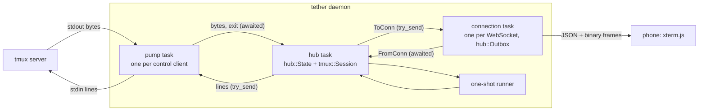
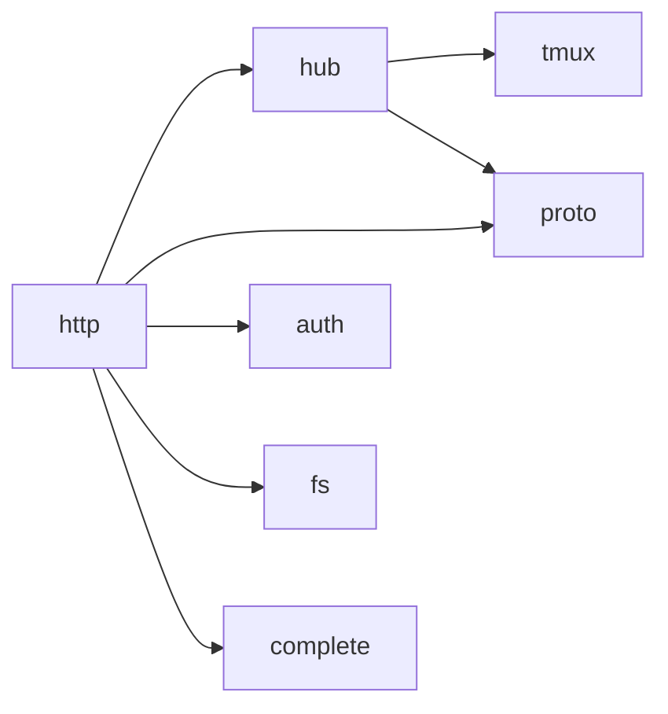
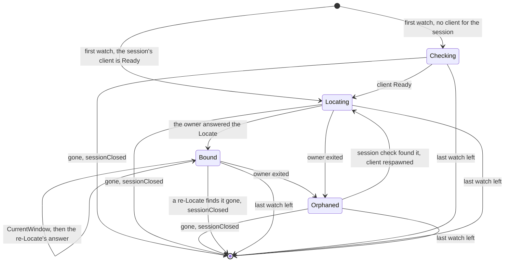
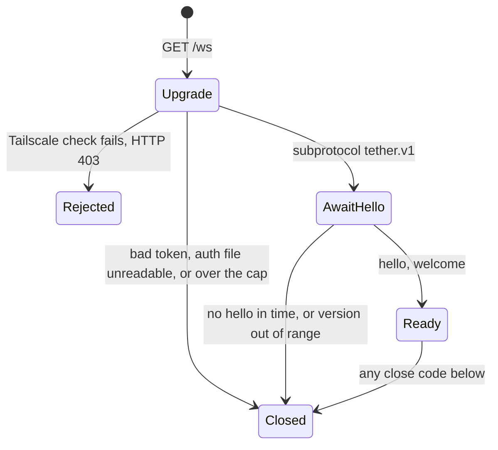

# Daemon core: tmux bridge, hub, wire protocol

The spec for `src/tmux/`, `src/hub/` and `src/proto/`. Settled ground: tmux is the
source of truth and tether never starts Jimmy's tmux server; xterm.js on the phone is
the only terminal emulator; 1 tab = 1 tmux session, showing its current window's active
pane and following it as `tmux attach` does; the
[resource budget](plan.md#resource-budget) comes first. Reasons and rejected
alternatives are in [decisions.md](decisions.md).

**The design in one paragraph.** A *pump* task per `tmux -C` process moves bytes
between its pipes and one *hub* task. The hub keeps all state in one pure value,
`hub::State`, which holds a pure `tmux::Session` per control client: the session turns
tmux's bytes into events, the state turns events and client messages into effects. A
snapshot is one atomic tmux command list whose replies sit at an exact position in the
output stream, and it is the only way a terminal catches up: on open, reconnect,
resize or overflow. Each watched session is a *view* whose *owner* is the control
client attached to that session; the owner reports when the session's current window
changes, the hub asks it which window and pane that is (*Locate*), and only the owner's
output counts. Ongoing
tmux work is *desired state* the hub reconciles when a control client has room; only
user requests can be refused as `busy`. The hub sends each connection only as many
bytes as that connection's *credit* allows; a watch whose output doesn't fit starves
and catches up by snapshot once the socket has drained.



## 1. Vocabulary

| Term | Meaning |
|---|---|
| **control client** | One `tmux -C attach-session` process, the pump that owns its pipes, and its `tmux::Session` in the hub. Attached to one tmux session for life. |
| **command group** | One line written to a control client: tmux commands joined by ` ; `, answered by one reply block per command that runs. |
| **watch** | One connection viewing one tmux session: the active pane of the session's current window. Its id is chosen by the client, unique and never reused within the connection. A watch exists only while its tab is on screen. |
| **view** | The hub's state for one watched session: its owner, the session's current window and that window's active pane, the pane stream and the claim (§4.2). It exists while a watch is on the session. |
| **current window** | The window a tmux session shows its attached clients; every client attached to the session shares it. tmux reports a change as `%session-window-changed`. |
| **owner** | The control client attached to a view's session. There is one view per watched session, and one owner per view. |
| **Locate** | Asking tmux for a session's server instance, current window and that window's active pane. An empty answer means the session is gone (§3.4). |
| **pane stream** | The hub's state for the pane a view shows: whether its output is live, its size and its snapshot in flight (§4.3). Part of the view. |
| **snapshot** | A pane's size plus **restore bytes** that rebuild it in a freshly reset xterm.js. |
| **boundary** | Where a snapshot's replies sit in the control client's byte stream: pane output before it is inside the snapshot, output after it is live. |
| **size vote** | A per-window size set with `refresh-client -C '@W:CxR'`; it caps that window, and sizes it while the control client is tmux's `latest` there. Cast only for a claimed window (§3.6). |
| **take** | The owner making itself tmux's `latest` for its session's current window with a same-session `switch-client`, just before the vote that follows it; tmux then sizes the window to the vote exactly (§3.6). |
| **claim** | A view's claim names the watch that acted last and the window it acted on, which is always the view's current window or the window a `selectWindow` is selecting. The owner votes that watch's size for it, taking `latest` when it starts voting the window. Another client acting **yields** it, and a change of current window drops it unless the change was the claim's own selection: the claim and the vote go, the watch stays (§3.6). |
| **window subscription** | The owner's `w<W>` subscription on a view's current window: its cwd and the other clients acting on it (§3.7). |
| **desired state** | What tmux should be doing for the current watches: wanted panes, votes, window subscriptions, needed snapshots and Locates (§4.4). |
| **credit** | The bytes the hub may still have outstanding to one connection: sent on `ToConn` and not yet returned as written or discarded (§4.6). |
| **linger** | The time (§6) a control client stays attached after it owns no view. Nothing else lingers. |

## 2. Tasks and channels

| Task | Count | Owns | Never does |
|---|---|---|---|
| pump (`tmux::pump`) | one per control client | the `tmux -C` child, its stdin and stdout | parse or decide |
| hub (`hub::run`) | one | `hub::State` (control clients, views with their streams, watches, connection credit), plus the pumps' line senders and the connections' channels | await anything but its inboxes and timer |
| connection (`http::ws`) | one per WebSocket | the socket, the handshake, its `hub::Outbox` | talk to tmux |
| one-shot (`tmux::oneshot`) | at most one at a time | one short `tmux -u -N` process | attach |

Tasks share no mutable state; they talk over channels.

- **Into the hub, senders wait.** Pumps send on one bounded channel, connections and
  the one-shot runner on another. A pump waiting for room stops reading stdout, so
  tmux stops writing. tmux queues the pane's output for the stalled client and, once a
  queued block is `pause-after` old, pauses the pane and drops what it queued (a Gap,
  §3.3). With only control clients attached, tmux stops reading the pane when a client
  falls behind, so a stall shorter than `pause-after` loses nothing; blocks already
  queued keep ageing, so a longer stall still ends in a Gap. While waiting, a pump
  keeps writing lines to stdin and a connection keeps moving `ToConn` into its outbox.
- **Out of the hub, nothing waits.** The hub uses `try_send`. A pump's line channel
  is as deep as its in-flight cap (§3.3), so it can't fill; if it does, the hub kills
  that client. A closed line channel means the pump has ended and its `Exited` is on
  the way, so the hub ignores that error. A connection's channel is sized from its credit (§4.6), so it can't
  fill either; if it does, the connection is wedged: dropped, close 4002.
- **One ordered stream per control client.** Replies, output and notifications reach
  the hub as raw bytes in tmux's order, and are parsed there.



`tmux/` depends on nothing internal; `proto/` is a leaf; `hub/` never sees sockets;
`http/` never names a tmux type.

## 3. `src/tmux/`: the bridge

```text
src/tmux/
  mod.rs       ids, Endpoint, Op, OneShotCmd, Event, Reply, Location, errors
  parse.rs     pure: bytes -> lines (blocks, notifications, %output decoding)
  session.rs   pure: Session, the sans-IO control client
  command.rs   pure: command builders, quoting, key-name validation
  reply.rs     pure: the formats asked of tmux, each beside the parser of its reply
  snapshot.rs  pure: state format, typed replies -> restore bytes
  layout.rs    pure: layout string -> pane sizes
  pump.rs      I/O: spawn `tmux -u -N -C`, bytes out, lines in
  oneshot.rs   I/O: one-shot `tmux -u -N` commands
  fake.rs      test support: a fake tmux server for the hub's tests (§8)
```

Everything but `pump.rs` and `oneshot.rs` is pure and tested from recorded fixtures.
`command.rs` puts a format into a command and `reply.rs` parses what tmux prints for it,
so each format and its parser change together; the snapshot's state format stays with
its parser in `snapshot.rs`. `fake.rs` is not part of the bridge: it reads the command
text `command.rs` writes, and the hub's tests use it (it is compiled in because the
integration tests in `tests/` need it).

### 3.1 Invoking tmux

- **Every invocation is `tmux -u -N [-L socket | -S path] …`**, built in one place
  (`Endpoint::command`, from an `Endpoint` of executable plus `Socket`: default, `-L`
  name or `-S` path), with `TMUX` removed from the environment (it would choose the
  socket when none is configured). The socket comes from config; tests use `-L`.
  - `-N`: with no server running, every command fails instead of starting one,
    `attach-session` and `new-session` included, with one of two no-server messages
    (§3.8) ([probe](research/probe-locate-subscriptions.md)).
  - `-u`: tmux 3.4 replaces non-ASCII characters and line breaks in format output
    (window names, `display-message`, listings) with `_` when the client's locale isn't
    UTF-8, and a systemd unit's may not be. `-u` forces UTF-8 on the control client
    and on every one-shot.
- **Control client:** `tmux -u -N … -C attach-session -t '$S' -f pause-after=3` over
  pipes (3.4 needs no pty; [probe-control-client.md](research/probe-control-client.md)),
  the last 4 KiB of stderr kept, `kill_on_drop(true)`.
- **Startup:** the first line is `display-message -p '<version, pid, start_time,
  window_width, window_height, client_name>'`. Its reply gives the version, the **server instance**
  `"<pid>-<start_time>"`, the size of the session's current window and the control
  client's own name (`client-<pid>`, which a take names, §3.6;
  [probe](research/probe-session-follow.md), §9); the session
  then sets that as the client size (`refresh-client -C <W>x<H>`, §3.6) and only then
  reports `Ready`. One line can't do both: `refresh-client -C` doesn't expand formats.
  Without `-t`, `display-message` targets the attached session. `Session::new` takes
  the session id the pump's `attach-session` names, so from its first byte it can tell
  its own session's `%session-window-changed` from other sessions' (§3.3). Setting the client size makes
  tmux send a `%layout-change` even when no size changed.
- **Versions:** an optional `name-` prefix, `MAJOR.MINOR`, an optional letter
  (`3.4`, `3.7b`, `next-3.6`). Below 3.4 the client stops with `TmuxTooOld`; an
  unparseable version counts as the newest known, with a warning.
- **Format strings** separate fields with a raw TAB inside single quotes (`\t` is
  literal there). A field holding user text goes last and is split with `splitn`.
- **Writing:** one group per line, never empty (an empty line detaches), no `\n` or
  `\r`; at most the in-flight cap of groups outstanding (§6).
- **Close:** the hub drops the line sender; the pump closes stdin, waits up to 1 s,
  then kills.

### 3.2 Parser (`parse.rs`)

`Parser::push(&mut self, chunk: &[u8], out: &mut Vec<Line>)` splits bytes into lines
without UTF-8 decoding, keeping a partial line across calls:

- **Outside a block:** `%begin T N F` opens one. `%output %P <data>` and
  `%extended-output %P <age> … : <data>` are pane output. Notifications used:
  `%pause`, `%continue`, `%layout-change`, `%window-add`, `%unlinked-window-add`,
  `%window-close`, `%unlinked-window-close`,
  `%window-renamed`, `%window-pane-changed`,
  `%session-window-changed`, `%session-changed`,
  `%sessions-changed`, `%session-renamed`, `%subscription-changed`, `%exit`. Anything
  else (including `load-buffer`'s read errors, printed outside any block) is dropped;
  newer tmux adds notifications. The parser keeps only the length of such a line
  (`Line::Unknown`), and `Session`, being pure, logs nothing.
- **Inside a block:** every line is body, even one starting with `%`, until `%end` or
  `%error` with the **same `N` and `F`**. On 3.4 the `%pause`/`%continue` that
  `refresh-client -A` causes are written inside its block and ignored as body.
- **`%output` decoding:** `\` plus three octal digits is one byte; every other byte
  passes through. The result is `Bytes` and may be invalid UTF-8.
- **Limit** (§6): the parser caps only the length of a line. A longer line is
  discarded through its line end and reported as `Line::TooLong`, never as an error.
  The cap on a group's replies is `Session`'s (§3.3), since only it knows the groups.

Accepted: a captured line that is byte for byte the matching `%end T N F` ends the
block early. tmux's protocol has this ambiguity, and a pane can't predict `N`.

### 3.3 Session: the sans-IO control client (`session.rs`)

`tmux::Session` is the control-client protocol as a pure state machine, with no I/O
and no clock:

```rust
pub struct Step { pub events: Vec<Event>, pub lines: Vec<String> }

impl Session {
    pub fn new(session: SessionId) -> (Session, Step);     // the startup line
    pub fn feed(&mut self, bytes: &[u8]) -> Step;          // bytes from the pump
    pub fn request(&mut self, tag: Tag, op: Op) -> Step;   // caller checked capacity
    pub fn in_flight(&self) -> usize;
    pub fn wanted(&self) -> impl Iterator<Item = PaneId> + '_;
    pub fn exit_seen(&self) -> bool;                       // tmux sent %exit
}
```

Its rules:

- **Replies match by position.** tmux answers in order, but `N` comes from a
  server-wide counter. A **flag-1** block is the next reply for the oldest pending
  group; the group completes after one `%end` per command. `%error` completes it at
  once as failed: tmux skips the rest of a list after an error. A **flag-0** block
  (the attach reply, a hook) isn't tether's: it is dropped and never held in memory.
  A flag-1 block with nothing pending is `Event::Fatal`.
- **Reply cap.** The bodies of one group's replies are held up to 1 MiB together
  (§6). Past it the held bodies are dropped, later replies of the group are still
  matched and counted, and the group fails `TooLarge`; the control client survives
  and later groups answer normally. A `TooLong` line (§3.2) inside a block counts as
  past the cap.
- **Wanted panes.** `Snapshot` makes a pane wanted, `Release` unwants and pauses it.
  Output from a pane that is unwanted with no pause in flight is dropped and the pane paused
  (`refresh-client -A '%P:pause'`; a pause beyond the in-flight cap waits for a
  reply). This covers panes created later without listing anything, and keeps a
  non-owner's copy of a linked window's pane quiet (§4.2). Pausing affects only this
  client; tmux keeps reading the pane. Never `'%P:off'`: it crashes tmux 3.2a–3.6b
  when output is queued ([tmux-control-mode.md §6](research/tmux-control-mode.md)).
  A `Release` also invalidates the pane's outstanding snapshot attempts: none is
  re-sent (a list starts with `continue`, which would resume the pane just released),
  and when such an attempt's group ends, whatever its replies (torn ones included), the
  session answers `Done { tag, Err(Released) }`: no `Snapshot`, no retry. The Release
  marks the attempts outstanding when it is requested: Snapshot, Release, Snapshot of
  one pane answers the first `Released` even though the pane is wanted again, and the
  second is a new request. So a snapshot's tag always gets an answer, in stream order,
  and the hub needs no knowledge of what a Release invalidates (§4.4).
- **Pause tracking is bounded by work in flight.** A pane counts as pausing only while
  a pause of it (the session's own or a Release) is in flight or waiting for a slot;
  tmux 3.4 sends nothing from a pane after its pause reply. Output that arrives later
  means something resumed the pane, and it is paused again.
- **Loss.** `pause-after=3` bounds what tmux queues for a stalled tether. A `%pause`
  tether didn't request, for a wanted pane, means tmux dropped bytes: `Gap { pane }`.
  The next snapshot's `continue` resumes it. With pause-after on, output arrives as
  `%extended-output`. tmux sees a stall only once the pump has stopped reading, which
  is when the hub's inbox (2 MiB, §6) is full. With a non-control client (the laptop)
  attached to the pane's session, tmux keeps reading the pane and pauses it for the
  stalled client once a queued block is 3 s old. When every attached client is a
  control client that has fallen behind, tmux stops reading the pane instead, so a
  stall shorter than `pause-after` loses nothing and no `%pause` arrives (§2). Blocks
  tmux had already queued keep ageing, so a longer stall still ends in a Gap.
- **Torn snapshots.** User hooks run between the commands of a list. A hook that
  waits (`run-shell` without `-b`) lets tmux read the pane mid-list, so the pane's
  output lands outside both the capture and the live stream. A hook that doesn't wait
  (`display-message -p`) only adds a flag-0 block between the replies and lets no
  output in. A snapshot group is **torn** when `%output` for its own pane arrives
  between its first and last reply (output for other panes doesn't matter), or when
  the `<STATE>` re-read by the list's last command (§3.5) is not byte-identical to
  the first state reply. The session re-sends a torn list, 3 attempts in all, then fails
  it with `Torn`.
- **Snapshots in stream order:** `Snapshot { tag, pane, size, restore }` is emitted
  where the group completed, between the output events around it. The session turns
  the replies into restore bytes itself (§3.5), so the hub never sees tmux's state
  format.
- **Notifications.** `%layout-change` carries the window layout and the visible
  layout; `Layout` takes its pane sizes from the visible one, so a zoomed pane reports
  its full window size, and the window's size from the layout's root (the `WxH` after
  the checksum). `%window-add`, `%unlinked-window-add`, `%window-close`,
  `%unlinked-window-close`, `%sessions-changed` and `%session-renamed` all become
  `SessionsChanged`. tmux sends `%session-window-changed $S
  @W` to every control client on the server, for every session
  ([probe](research/probe-session-follow.md)); the one naming the client's own session
  becomes `CurrentWindow { window }`, and the rest are dropped. It arrives before the
  new window's `%layout-change` and, for a foreground `new-window`, before its
  `%window-add`. `%session-changed $S` naming the client's own session is tmux
  confirming the attach or the owner's own take (§3.6) and is dropped; naming another
  session, it means tmux moved this client there, which it does when the attached
  session is destroyed under `detach-on-destroy off`, and it becomes `SessionChanged`.
  `%client-session-changed`, which every other control client receives for a take
  ([probe](research/probe-session-follow.md), §10), is dropped. One way to change a session's current window sends no
  notification: `swap-window` without `-d` (tmux's window menu has Swap Left and Swap
  Right) swaps two windows' places and never calls `session_set_current`, so each
  owner also subscribes to its session's current window id to catch it (§3.7).
- **Startup order** (§3.1): `Ready` follows the client-size line, so no vote reaches
  tmux first. `%subscription-changed` for a `w<W>` subscription becomes `Acted`, `Cwd`,
  both or neither (§3.7).
- **`%exit`** ends a control client whether tmux detached it, the server was killed
  or its stdin closed, so `exit_seen()` alone doesn't say why it ended (§4.5).

### 3.4 Commands (`command.rs`)

Typed builders only. *Maintenance* ops come from desired state and are never refused
(§4.4); *user* ops answer a client message and may get `busy`.

| Op | Command group | Kind |
|---|---|---|
| `Locate { session }` | `display-message -p -t '$S' '<pid, start_time, session_id, window_id, window_index, pane_id, pane_width, pane_height, window_width, window_height, window_name>'` | maint. |
| `Snapshot { pane }` | §3.5 | maint. |
| `Release { pane }` | `refresh-client -A '%P:pause'` | maint. |
| `Vote { window, size, take }` / `ClearVote { window }` | `refresh-client -C '@W:CxR'`; with `take`, `switch-client -c '<client>' -t '$S' ; refresh-client -C '@W:CxR'` (§3.6) / `refresh-client -C '@W:'` | maint. |
| `Subscribe { window }` / `Unsubscribe { window }` | `refresh-client -B 'w<W>:@W:<acts>\|#{pane_current_path}'` (§3.7) / `refresh-client -B 'w<W>'` | maint. |
| `WatchCurrent` / `UnwatchCurrent` | `refresh-client -B 'c::#{window_id}'` (§3.7) / `refresh-client -B 'c'` | maint. |
| `History { pane, start, end }` | §3.4 history capture group | user |
| `Input { window, items }` | text and bytes: `send-keys -t @W -H 68 69 …`, ≤ 512 bytes per command; a key: `send-keys -t @W <name>` | user |
| `Paste { window, path, enter }` | `load-buffer -b tether-<tag> '<path>' ; paste-buffer -p -d -b tether-<tag> -t @W`; with `enter`, prepend `copy-mode -q -t @W` and append `; send-keys -t @W Enter` | user |
| `SelectWindow { session, window, vote }` | `select-window -t '$S:@W' ; switch-client -c '<client>' -t '$S' ; refresh-client -C '@W:CxR'`: the select, then a take with the watch's size; without a vote, the `select-window` alone | user |

- **Locate never errors.** On 3.4 and 3.7b, `display-message -t` a missing session
  succeeds with the target fields empty, in control mode and as a one-shot, while
  `#{pid}` and `#{start_time}` still expand
  ([probe](research/probe-locate-subscriptions.md),
  [probe](research/probe-session-follow.md)). It parses into `Location { server, found:
  Option<{ window, index, pane, size, window_size, name }> }`; an empty `session_id` is gone. The
  window name goes last and is split with `splitn` (§3.1). The same op is the view's
  binding answer on its owner (§4.2) and the session check as a one-shot (§4.5).
- **Select names the session.** `-t '$S:@W'` selects the window in that session even
  when the window is linked into others, where a bare `@W` could resolve to another
  session ([probe](research/probe-session-follow.md)). Every client attached to the
  session moves with it, as tmux's own window keys do. The take follows the select
  in the same group: a control client's `select-window` makes no client `latest` for
  the window, and a take applies only to the session's current window, so after the
  select it makes the owner `latest` for the selected window and its vote sizes it to
  the watch, larger or smaller than the laptop. With the laptop `latest` on both
  windows, select-then-take reflowed the selected window once, straight to the vote;
  a vote ahead of the select reflowed it twice
  ([probe](research/probe-session-follow.md), §13, §16).
- **Release unwants and pauses a pane, and answers the snapshots it outdates.** Its own
  group is `refresh-client -A '%P:pause'` and answers `Reply::Ok`. Each snapshot attempt
  of that pane still outstanding when it is requested is answered
  `TmuxError::Released` once its group ends (§3.3), never retried.
- **Input and paste target the window** the client names, the one its tab was showing
  (§5.3): `-t @W` resolves to its active pane inside tmux, so keys can't race an
  active-pane change, and keys sent just before the session's current window changes
  still reach the window the user was looking at.
- **Text goes as `-H` hex**: no quoting, any byte, never a key name. Named keys go by
  name so tmux encodes them for the pane's modes. Without `-K`, `send-keys` writes to
  the pane directly, skipping the prefix, key tables and `escape-time` (from tmux's
  source; fixtures confirm it).
- **Key names** must match
  `^(?:[CM]-)*(?:(?:S-)?(?:Up|Down|Left|Right|Home|End|PageUp|PageDown|IC|DC|F(?:[1-9]|1[0-2]))|[A-Za-z0-9]|Enter|Escape|Tab|BTab|BSpace|Space)$`.
  tmux 3.4 types `S-Enter` as literal text
  ([probe-tmux.md §6](research/probe-tmux.md)), so Shift+Enter goes as CSI-u bytes.
  `tests/fixtures/proto/keys.json` lists every name the clients send; the Rust tests
  check each against the regex.
- **Paste buffers.** The buffer is named `tether-<tag>` after the request's `Tag`.
  tmux buffer names are server-wide, so tags are unique across all control clients
  (the hub draws them from one counter). `paste-buffer -d` deletes the buffer only on
  success, and tmux skips the rest of a failed list, so every failed paste group is
  followed by a separate `delete-buffer -b tether-<tag>` group whose own error is
  ignored. That covers every failure point (missing window, a hook killing the window
  between load and paste, a missing file). On 3.4 `load-buffer` of a missing file succeeds: its read error is printed
  outside any block (dropped, §3.2) and the group then fails at `paste-buffer` with
  `no buffer tether-<tag>`.
- **Paste then Enter is one group.** With `enter`, the list first runs
  `copy-mode -q -t @W`, which quietly quits any pane mode (a no-op outside a mode), then
  pastes and sends `Enter`. The phone's latest action therefore leaves a laptop's copy
  mode and reaches the program; a plain paste does not quit modes. Tmux skips later
  commands when any earlier command fails, so a paste that didn't land never gets its
  Enter. The group answers `Reply::Ok` only when every command succeeded, so `pasted`
  covers the paste and its Enter together, and an `error` can in principle follow a
  paste that landed when only the Enter failed (both target the same window in one list,
  so this needs the window to vanish between them).
- **Paste files.** The connection task takes one of a few daemon-wide paste slots
  (§6), or answers `busy` itself, then writes the text to a 0600 file in
  `$XDG_RUNTIME_DIR/tether/`, so the hub only holds a `PasteFile`: the path plus its
  slot. That directory is tmpfs, charged to tether's memory, which is why the slots are
  counted. tmux has read the file when the group completes; the hub hands the
  `PasteFile` back in a `RemoveFile` effect on `Done` and on every path that drops the
  request (§4.4), and deleting it frees the slot. The daemon empties the directory at
  startup, after the runtime lock is held and both sockets are established: a second
  daemon started by mistake must not delete a running daemon's in-flight pastes.
- **Quoting, on a control-client line:** user arguments go in single quotes (`'` as
  `'\''`) after doubling every `#` (tmux format-expands `-n` and `-c`); control
  characters are rejected. One-shots take arguments, not lines (§3.8).
- Never send a control client commands that wait (`run-shell`, `if-shell`, `wait-for`,
  `confirm-before`, `command-prompt`): one would stall every later reply. The one
  exception is `NewWindow`'s `if-shell -F` guard, on a one-shot (§3.8), which only
  evaluates a format.

**History ranges.** `History { pane, start, end }` runs this group:

```text
display-message -p -t %P '#{history_size} #{pane_height}' ;
capture-pane -p -e -N -T -t %P -S <start> -E <end+1> ;
capture-pane -p -J -t %P -S <start> -E <end+1> ;
display-message -p -t %P '#{history_size} #{pane_height}'
```

The bounds before and after must match or the answer is `Torn`. `capture-pane` clamps
its start to `-history_size` and its end to `pane_height - 1`; a request wholly above
the retained history can still print the top row. The tmux core recomputes the
intersection with those bounds, drops rows outside it, and returns the first real row
number with the physical rows. A range above the top is empty. This makes a request
that starts before retained history resume at the true top instead of labelling its
first row with the requested number. The paired captures include one lookahead row so
the final requested row's wrap bit is known when a continuation is in the next chunk;
the lookahead is removed from the returned rows and bitmap. A set bit says the row
continues into the next physical row. Unmatched or ambiguous boundaries stay unset.

### 3.5 Snapshot

On 3.4, tmux queues a pane's bytes for control clients before parsing them into the
grid, runs a command list in one command-queue pass with no pane read in between, and
keeps reply lines and output in one ordered queue per client. So output before the
group's first reply is in the captured grid and output after its last reply is not:
198/198 and 196/196 captures matched at full output speed, with no pausing
([probe-snapshot.md](research/probe-snapshot.md)).

```text
refresh-client -A '%P:continue' ; display-message -p -t %P '<STATE>' ;
capture-pane -p -e -N -t %P ;
capture-pane -p -N -T -t %P ; capture-pane -p -J -t %P ;
capture-pane -p -P -C -t %P ;
capture-pane -p -e -N -a -q -t %P ;
display-message -p -t %P '<STATE>'
```

- **`continue` goes first**, always. On a running pane it is a no-op on 3.4; it also
  resumes a pane tmux auto-paused or the session paused as unwanted.
- The alternate-screen capture has `-q`, so a pane without one succeeds, with one
  empty row, instead of aborting the list.
- **The state re-read goes last.** If it isn't byte-identical to the first `<STATE>`
  reply, the list is torn (§3.3): a hook changed the pane while the list ran. A
  hook that runs `send-keys -R` clears the screen, moves the cursor and turns keypad
  mode off with no size change and no output, so a size-only check would miss it. A
  hook that rewrites screen content while every state field stays the same is still
  missed.
- `<STATE>`, tab-separated, for 3.4: `pane_id pane_width pane_height alternate_on
  alternate_saved_x alternate_saved_y cursor_x cursor_y cursor_flag insert_flag
  keypad_cursor_flag keypad_flag wrap_flag origin_flag scroll_region_upper
  scroll_region_lower mouse_standard_flag mouse_button_flag mouse_all_flag
  mouse_utf8_flag mouse_sgr_flag pane_tabs`, from a per-version table in
  `snapshot.rs` (newer versions use the newest entry). `mouse_all_flag` is any-motion
  tracking (`?1003`); tmux's `mouse_any_flag` means that some mouse mode is on.
  `alternate_saved_x` and `_y` are 4294967295 until the alternate screen has been
  used, and stay so after `?47h` or `?1047h`, which save no cursor.
- The replies count against the group reply cap; a larger screen fails `TooLarge`.
- The active grid keeps its original `-e -N` capture for faithful painting. Two paired
  captures (`-N -T` physical rows and `-J` logical rows) derive wrap bits on every
  supported tmux version. They use the same full active-grid range and command list; a
  boundary is set only when the joined bytes align unambiguously. The pair adds roughly
  two copies of the active grid to the 1 MiB group reply cap; it is local daemon traffic,
  not part of a snapshot frame. The saved primary grid behind an alternate screen has
  no map because its old width is unavailable after resize.
- The session reads the replies as `PaneSnapshot { state: PaneState, active:
  Vec<Bytes>, active_wraps: WrapMap, pending: Bytes, saved: Vec<Bytes> }`
  (`snapshot.rs`, tmux's field names; `pending` already octal-decoded). The active wrap
  map is consumed only by
  `compose`, and never crosses the snapshot frame. It emits only
  `Event::Snapshot { tag, pane, size, restore }`; `size` is the state's pane size.

**Boundary:** everything the hub saw for `%P` before the `Snapshot` event is inside
it; everything after is live. Stream order is the boundary.

**Restore bytes** (`snapshot::compose`, pure) rebuild the pane in a freshly reset
terminal of `cols × rows`, so the clients carry no restore logic:

1. `CSI ?7l`, so a too-wide line (the saved primary grid keeps its old size while the
   alternate screen is on; Unicode widths drift) is cut at the last column instead of
   wrapping and scrolling. Rows past `rows` are dropped.
2. If `alternate_on`: the saved primary grid (the `-a` capture), `CSI 0 m`, CUP to
   `alternate_saved` (clamped to the pane, so 4294967295 lands in the bottom-right
   corner), `CSI ?1049h`.
3. The saved primary grid is painted with CUPs and no wrap map. The active grid stays
   under `CSI ?7l`; hard boundaries use CUP as before. At a mapped soft boundary, do
   not CUP: emit the continuation row's leading CSI/OSC styling and two-byte ESC
   sequences with wrap off, enable `CSI ?7h` for its first printable UTF-8 scalar, then
   turn wrap off and repaint the row
   from its start. That single character lets xterm set `isWrapped` on the previous row
   when its width agrees with tmux; repainting protects the continuation when widths
   differ, though a misplaced first glyph can remain at the previous row's end. Empty
   rows are skipped. The final painted row's bit is ignored because there is no
   continuation to paint. `-e` SGR state carries across rows, so nothing resets between
   them.
4. `CSI 0 m`; tab stops: `CSI 3 g`, then for each `pane_tabs` column a CUP to that
   column and `ESC H` (which sets a stop at the cursor's column); a scroll region that
   isn't full height: `CSI top+1;bottom+1 r`; `origin_flag`: `CSI ?6h`. Tab stops,
   region and origin mode apply to the screen in use only.
5. Modes: `CSI ?7h` if `wrap_flag`, and each mode that is on: `CSI ?1h`
   (keypad_cursor), `ESC =` (keypad), `CSI 4h` (insert), `CSI ?1000h` / `?1002h` /
   `?1003h` / `?1005h` / `?1006h` (mouse standard, button, all-motion from
   `mouse_all_flag`, utf8, sgr). The three tracking modes exclude each other in tmux
   3.4 and in xterm.js, and so do the two encodings; if both utf8 and sgr are set,
   sgr is written last and wins.
6. CUP to the cursor (region-relative under origin mode, a cursor outside the region
   clamped to its nearest row; a column past the last clamped); `CSI ?25l` if
   `cursor_flag` is 0.
7. The pending parser bytes (`-P -C`, decoded like `%output`), so the next live bytes
   complete the sequence tmux is holding.

Every position and region value from tmux is clamped to the pane, so odd input can't
panic.

Not restorable from 3.4:

- **Not in its formats:** the current SGR pen, character sets, cursor shape, title,
  bracketed paste, focus reporting. Paste goes through `paste-buffer -p`, which checks
  the real mode; the rest return when the application next sets them.
- **A pending wrap.** After a character in the last column tmux reports `cursor_x`
  equal to `cols`. Restore clamps it to `cols-1`, so the next character overwrites
  the last cell instead of wrapping.
- **The primary screen's region and tab stops behind an alternate screen.** The
  reported ones belong to the alternate screen; the primary keeps xterm.js's defaults,
  so after the application leaves the alternate screen its region and tab stops are
  default, not tmux's.
- **A saved cursor after `?47h` or `?1047h`:** none was saved, so it lands in a corner.

### 3.6 Sizing

**tmux's rules**
([probe-control-client.md](research/probe-control-client.md#sizing-the-part-that-shapes-the-resize-policy),
[probe-latest-activity.md](research/probe-latest-activity.md),
[probe-latest-client.md](research/probe-latest-client.md),
[probe-session-follow.md](research/probe-session-follow.md) §9–14):
a control client counts for sizing only once it sets a size, then for every window in
its session; attaching makes it `latest` for the session's current window; under
`window-size latest` a window takes `latest`'s size. A client becomes `latest` for
its session's current window by its own key, mouse or focus-in input, by attaching or
switching to it, or by resizing its terminal. A control client's `send-keys` and
`select-window` never make it `latest`; its `switch-client` to the session it is
already attached to does. A size vote replaces the client size for that window and
**caps** each dimension, whoever is `latest`; where the control client is `latest`, the
window takes the vote's size exactly.

**Policy: a window takes the size of the client that acted on it last.** That is
tmux's `latest`, which tether joins. While a watch has the claim, the owner votes the
watch's size for the window; when it starts voting a window, it first **takes**
`latest` there, so tmux sizes the window to the watch exactly, larger or smaller than
the laptop. When another client acts there, tmux makes that client `latest`, and the
hub clears the vote, which would otherwise still cap it. A view shows its session's
current window, so the claim is on that window and moves only by tether's own act.

- **A take** is `switch-client -c '<client>' -t '$S' ; refresh-client -C '@W:CxR'`, the
  owner's own name and session, then the vote. The switch makes the owner `latest` for
  the session's current window; the vote after it makes tmux recalculate, which 3.4
  needs (its switch sets `latest` after its own recalculation, so a switch alone leaves
  the window at the laptop's size until something else recalculates), and 3.7b
  tolerates. On both, the group takes a window from an 80×24 laptop to a 200×50 vote in
  one `%layout-change`, and the laptop's next key takes it back to 80×23 (probe §9,
  §11). It injects no key and leaves `window-size` as it was. **A take is due** when
  the hub can't count on tmux sizing the window by the vote:
  - the client has no applied vote on the window: a new claim, a claim after a yield,
    a claim on a window just made current, the first vote on a respawned client;
  - or the view's window size (from Locate and `Layout`) has moved off the standing
    vote since a `Layout` last showed it at the vote's size: tmux is sizing by a
    client whose act wasn't reported, such as a laptop key in the same second as its
    last reported act, which is reported only with its next act in a later second
    (§3.7);
  - or the act is the Fit tap (a `resize` repeating the watch's size), which always
    takes.

  Each claiming act (`watch`, `resize`, `input`, `paste`) sends the take that is due
  with its vote. A take that doesn't bring the window to the vote (another
  `window-size`, a second owner's vote on a linked window, §4.2) is not repeated until
  the vote is cast again or the user taps Fit, so a key never costs more than one. A
  vote whose size changes while tmux shows the window at the old vote (rotation, a
  second watch acting) needs no take. A `SelectWindow` carries its own take, after the
  select (§3.4); a take at any other time applies to the session's current window,
  which is the claim's window except while a change the hub hasn't heard of is on its
  way (costs, below).
- **A take goes before the act that needs it.** The take-and-vote group a claiming
  `input` or `paste` needs is written just before that request's own group, so the keys
  reach a window already at the watch's size; the two stay separate groups, so a failed
  take never drops keys (§4.4).
- **Client size = the session's current window size at attach** (§3.1). For windows
  with no vote, the control client acts like a laptop-sized client, so nothing
  shrinks where it is `latest` or alone. A window the owner took and no longer votes
  takes this size until a terminal acts there (below).
- **A watch claims** with every `watch`, `resize`, `input`, `paste`, `selectWindow`
  and `newWindow` naming it, and the owner votes that watch's size (from its `watch`
  and latest `resize`). The claim names a window:
  - `watch`, `resize`, and `input` or `paste` aimed at the current window claim the
    view's current window. Before the view is bound the claim waits, and takes the
    window the first Locate answer names; a `watch` with `claim: false` leaves any
    claim as it was.
  - `input` or `paste` aimed at another window (sent just before a change the client
    hadn't seen yet) claims nothing and leaves the claim where it was. While
    `selecting` is set, input or paste aimed at the view's current window (the one
    being left; the client hasn't had the new `watching` yet) still goes to that
    window but also leaves the claim on `selecting`.
  - `selectWindow` sets the view's `selecting` to its window and claims it before tmux
    confirms: its vote and take go in the same group, after the `select-window`
    (§3.4), and the vote counts as applied. tmux's `%session-window-changed` arrives after the group's reply
    ([probe](research/probe-session-follow.md)), and the owner's replies are ordered
    with its notifications, so `selecting` clears at the group's failure or at the
    first `CurrentWindow` or Locate answer from the owner after the group's reply. A
    `CurrentWindow` before the reply (the laptop switched first) leaves the claim on
    the selected window; one after it settles the claim by the rule below; and
    selecting the window already current, which tmux doesn't announce, ends with the
    Locate the reply triggers (§4.2). At the group's failure (the window has gone)
    tmux ran neither the take nor the vote, so the claim drops and the vote's record
    clears; the tab's next act claims again.
  - `newWindow` with a watch claims the window it created once its `created` answer
    arrives, if that window is current by then; if `created` comes first, the claim
    waits for the `CurrentWindow` naming it.
  Bringing the tab on screen claims (opening it, switching to it, returning from Home
  or Files, unlocking the phone into it), and so do rotating, typing, pasting and the
  client's **Fit** tap (a `resize` with its unchanged size). A `watch` with `claim:
  false` doesn't: the client sends it when it re-watches by itself (a reconnect, a
  retry) a tab that didn't hold the window when its watch ended. A tab that simply
  stays on screen claims nothing, nor do `history` and `resync`, so a phone propped on
  the desk never takes the window back while the laptop is in use, network blips
  included. The keyboard never resizes. Two watches on one window: the one that acted
  last holds the claim (two phones aren't designed for).
- **Another client acting yields the window.** The owner's window subscription (§3.7)
  reports `Acted` when a tmux client other than a control client acts on the window
  as tmux counts it for `latest`: a key, mouse or focus-in event while it is that
  client's current window, switching to it, attaching onto it, or resizing its
  terminal. When the reported window is the claim's, the hub drops the claim and
  clears the vote; the watch stays. tmux then
  sizes the window by `latest`, which that act almost always just made the other
  client (a script's `select-window` moves a client onto the window without making it
  `latest`; the window then goes to whoever is).
- **A window without a claim has no vote:** the claim yielded, or the claiming watch
  ended (leaving the screen, backgrounding, a dropped connection), even if another
  watch remains, which claims with its own next act. The window returns to `latest`'s
  size, which is the owner's client size where the owner took it and no terminal has
  acted there since.
- **A change of current window drops the claim** unless the claim's own window is the
  new current window: the window `selecting` names, or the window a `newWindow` with
  a watch created. A claim is never left on a window that isn't current.
  This holds for both ways the view learns of a change (`CurrentWindow`, from tmux's
  notification or the current-window subscription, and a Locate answer naming another
  window), so a claim never outlives its window's turn and comes back later. When
  the laptop's prefix-n, a window exiting, a `move-window`, a `swap-window` or a script
  changes the session's current window, the window left behind loses its vote and
  returns to `latest`'s size, and the new window keeps the size it had: no watch acted
  on it. What the window left behind gets depends on the cause:
  - the laptop's prefix-n: the laptop's size, since its prefix key is an act on the
    window being left (tmux's key handling; the real-tmux following test checks it
    with a take in place);
  - a change no terminal made (a window exiting, a script, tether's own `selectWindow`
    leaving it): the owner is still `latest` where it took, so it takes the owner's
    client size until a terminal acts there.

  Verified on 3.4 and 3.7b before takes: after prefix-n, clearing the old window's
  vote returned it to the laptop's 120×39, and the new one stayed at its size
  ([probe](research/probe-session-follow.md)). The next act from the tab (typing, Fit)
  claims the new window.
- Verified on 3.4 with a 200×50 pty client, before takes (the owner had attached at
  the laptop's size, so its client size and the laptop's agreed): unwatching the
  laptop's current window restored it to 200×49; when the laptop grew, unwatched windows followed to 220×59.
  On 3.4 and 3.7b: a vote cleared after the laptop typed returned the window to the
  laptop's size, and the subscription reported each act 0.55–0.97 s after it.
- **Accepted costs:**
  - Under a `window-size` other than tmux's default `latest` (`smallest`, `largest`,
    `manual`), a take changes nothing and the vote is only a cap; the band (§5.3,
    [browser-behaviors.md](client/browser-behaviors.md#terminal)) stays, and Fit can't
    clear it.
  - **A take is a real `switch-client`**, so tmux does what it does for one
    (probe §10, on 3.4 and 3.7b): the owner gets `%session-changed` for its own session
    and every other control client `%client-session-changed` (both dropped, §3.3); a
    `client-session-changed` hook in Jimmy's config runs, once per take, not per key;
    the session's activity and last-attached times advance, so anything ordering
    sessions by them counts the take as use of the session; the control client's key
    table resets, which tether never uses. The laptop's window-subscription entry
    doesn't change, so a take never reads as another client's act. No focus event
    reached the pane, and bell flags stayed.
  - **The owner stays `latest` where it took** once its vote clears without another
    terminal acting there (the tab left the screen, the connection dropped, tether's
    claim moved): the window takes the owner's client size, the session's window size
    when the owner attached (§3.1), until a terminal acts there, or until the owner
    detaches at the end of its linger and tmux sizes the window by the clients left
    (probe §12). The laptop's first key there takes it back.
  - A take that crosses a window change made elsewhere (tmux ran the change before the
    take, the hub hadn't heard yet) makes the owner `latest` for the newly current
    window, which then takes the owner's client size until a terminal acts there; the
    change's `CurrentWindow` drops the claim and clears the old vote as usual.
  - Yielding takes up to about a second, tmux's subscription check, and a key in the
    same second as that client's last reported act shows only with its next one. The
    laptop's first keys land at the phone's size.
  - A laptop act just before a claim can be reported just after it and yield the
    claim; the phone's next act claims again.
  - A dropped connection ends its watches, so a window the phone held returns to
    `latest`'s size until the re-watch claims it again.
  - Each claim or yield that changes the size reflows the pane and breaks its stream
    (§4.3): one snapshot per change.
  - A phone suspended without closing its socket keeps its claim until another client
    acts or the idle timeout (§6) ends the connection.
  - The laptop's prefix-n is a key pressed on the window being left, so its act may be
    reported after the change, or not at all once that window is unsubscribed. Either
    way nothing differs: the change of current window has already ended that window's
    claim and vote.
  - With only the phone attached, a window change it didn't make (typing `exit` in
    the shown window, so tmux picks another) shows the next window at its previous
    size, with the band, until the phone's next keystroke claims it.
  - `selectWindow` moves every terminal attached to the session, the laptop's
    included, as tmux's own window keys do (§3.4).
  - A foreground window that only flashes past (its shell exits at once) costs the
    tab its claim: tmux makes it current, then picks another.
  - `newWindow` can reflow the new window twice: tmux creates it at `latest`'s size,
    and the vote follows the `created` answer. It is a fresh shell, so the second
    snapshot is small.
- A watched pane's size change arrives as `%layout-change` in stream order and
  breaks its stream (§4.3).

### 3.7 Window subscription

The owner subscribes to each view's current window, and moves the subscription when
the current window changes (§4.4). The value carries two facts: which other clients
are acting on the window (§3.6), and the shown pane's cwd, which completion and the
file manager need.

**The current-window subscription.** An owner with a view also subscribes once to its
own session's current window id, which catches the one change of current window tmux
doesn't announce, `swap-window` (§3.3):

```text
refresh-client -B 'c::#{window_id}'
→ %subscription-changed c $S - - - : @W
```

An empty target is the attached session, so the value is one line per change, swaps
included; a window linked twice into the session adds no lines. A value naming
another window than the session's last becomes `CurrentWindow { window }`, as the
notification does, and one naming the same window is dropped. It carries no client
entries, so a terminal riding along on a switch can't read as an act. Cost: one format
evaluation per owner per second, and a line only on a change; tmux's notification
still gives the prompt follow, and this value only bounds a swap's lag at about a
second. On 3.4 and 3.7b, every swap that changed the current window, either
direction and with `-d`, sent its line 0.2–0.7 s later; a swap of two other windows,
typing, idling and a cwd change sent none
([probe](research/probe-session-follow.md), §8, §15).

```text
refresh-client -B 'w<W>:@W:<acts>|#{pane_current_path}'
→ %subscription-changed w<W> $S @W <index> - : <acts>|<path>

<acts> = #{L:#{?client_height,#{?client_control_mode,,#{?#{m:*#,#{client_name}#,*,#,#{window_active_clients_list}#,},#{client_name}.#{client_activity}.#{client_width}x#{client_height}.#{client_flags};,}},}}
```

`<acts>` has one entry, `name.activity.WxH.flags;`, for each tmux client that isn't a
control client and whose current window is `@W`, in any session the window is linked
into. `L:` loops over clients; inside it the format keeps the outer window, so
`#{window_active_clients_list}` still names `@W`'s viewers, and the comma-wrapped `m:`
tests exact membership (`/dev/pts/1` is not in `/dev/pts/12`). The outer
`client_height` condition is deliberate: tmux 3.4 puts a newly accepted but
unidentified client into `L:` before assigning its name, and expanding
`#{client_name}` in that state dereferences NULL. An initialized tty has a height;
clients without one cannot be a terminal client acting on this window. See
[the subscription format crash probe](research/tmux-subscription-format-crash.md).
Verified on 3.4 and 3.7b ([probe](research/probe-latest-activity.md)).

On 3.4 ([probe](research/probe-locate-subscriptions.md)) the first value arrives within
about a second, then one per change; tmux checks once a second, so faster changes
collapse into the last. A window subscription follows the **active pane**, and
reports only while the window is in the client's own session, which is the owner's.
The path is the foreground process's cwd, read by tmux from `/proc`: no shell snippet
needed, and it works inside TUIs.

`Session` keeps each window subscription's last entries and splits a value at its
first `|` (client names, tty paths or `client-<pid>`, hold none; the path, which may,
is last):

- **`Acted { window }`** when a client's entry is new or changed: new activity (a key,
  even into an unfocused terminal, such as a mouse wheel), a new size, or a client
  arriving on the window. Not acts: a client leaving, which drops its entry; a
  focus-out, the one change that only drops `focused` from the flags at the same size
  (tmux advances the activity but doesn't count it for `latest`); and any entry whose
  flags include `ignore-size`, which tmux doesn't size by. Entries split at `;`, and
  each from the right at its last three `.` into name, activity, size and flags (only
  the name may hold a `.`).
- **The baseline** is the first value after the `Subscribe`'s reply. A value for that
  name between an `Unsubscribe` and the next `Subscribe`'s reply is dropped: tmux runs
  commands and its subscription check on one loop, so nothing of the old subscription
  follows the `Unsubscribe`'s reply. A window change subscribes the new window after
  the change, so terminals that moved onto it with the session (the laptop, after a
  `selectWindow`) are in its baseline and are not acts; on 3.4 and 3.7b the laptop's
  entry appeared in the first value and stayed unchanged until it really acted
  ([probe](research/probe-session-follow.md)).
- **`Cwd { window, path }`** when the path changed. The hub sends it in `watching`
  (§5.3).

Cost: one format evaluation per view per second inside tmux, whose client loop
walks every tmux client; tmux drops its timer with the last subscription. A line
reaches the daemon only on a change: at most one a second per view while
another client types in it.

### 3.8 One-shots and endpoints (`oneshot.rs`)

`oneshot::run(&Endpoint, &OneShotCmd) -> Result<Reply, TmuxError>` runs one `tmux -u -N`
process that never attaches. It reads stdout (at most the 1 MiB reply cap) and the head
of stderr (4 KiB), and parses stdout into the same `Reply` a control client's op gets,
so the hub handles a Locate answer the same from either source. Stdin is closed, and a
child dropped at the timeout is killed.

- `List` (session sheet) answers `Reply::Listing { server, version, sessions }`:
  `display-message -p '#{version}\t#{pid}\t#{start_time}' ; list-windows -a -F
  '#{session_id}\t#{window_id}\t#{window_index}\t#{window_active}\t#{window_activity}\t#{session_name}\t#{window_name}'`.
  The server line comes first, then windows in session order. The window name is last
  and split with `splitn`: tmux 3.4 allows raw tabs and line breaks in a name set with
  `-n`, so a window name with a line break garbles only window lines, and a line that
  isn't a window line is skipped. A session name can't hold either (tmux escapes it).
- `Locate`: the op's command (§3.4), when the session has no `Ready` control client to
  ask (a view's first check, a session check after an exit). It answers
  `Reply::Location`.
- `NewWindow`: `if-shell -F '#{!=:#{pid}-#{start_time},<server>}' tether-server-changed ;
  new-window -t '$S' [-n <name>] [-c <dir>] -P -F <created>`, without `-d`, so the new
  window becomes the session's current window, as prefix-c makes it, and its tabs follow;
  `NewSession`: `new-session -d [-s <name>] [-c <dir>] -P -F <created>`. Both answer
  `Reply::Created { server, session, window }`. `<created>` is
  `'#{pid}\t#{start_time}\t#{session_id}\t#{window_id}'`: `created` carries a
  `WindowRef`, which names the server instance, and the hub may not know one for the
  endpoint yet.
- **`NewWindow` carries the server instance** its session id belongs to
  (`OneShotCmd::NewWindow { server, … }`, from the `SessionRef`), and tmux checks it:
  session ids restart at `$0` with every server, so on another instance `-t '$S'` would
  name some other session. The leading `if-shell -F` (a format test; it runs no shell
  and waits for nothing) takes `tether-server-changed` as its command on a different
  instance. That isn't a tmux command, so `if-shell` fails and tmux skips the rest of
  the list: nothing is created. The one-shot reads `tether-server-changed` in stderr as
  `NoServer`. The hub keeps no check of its own, because the instance it last saw can be
  stale or unknown, and tmux's check can't be.

**Arguments, not command lines.** A one-shot is an argv vector with no shell and no
quoting layer: tmux takes each argument literally, except that an argument ending in
`;` ends the command (`-n 'x;'` fails with `unknown command: -c`), and an argument that
is just `;` separates commands, which `List` uses. tether's own arguments are ids and
fixed formats. A user's `name` or `dir` gets every `#` doubled (tmux format-expands
both), a trailing `;` sent as `\;`, and control characters or a non-UTF-8 path refused
as `BadRequest` before any process starts.

**Errors.**

| Cause | `TmuxError` |
|---|---|
| tmux says `no server running on …` (stale socket) or `error connecting to … (No such file or directory)` (socket file missing); or stderr names `tether-server-changed`, the `NewWindow` guard | `NoServer` |
| any other non-zero exit | `Command(stderr)`, or the exit status when stderr is empty |
| still running after 2 s; the process is killed | `Timeout` |
| tmux couldn't be run | `Spawn(message)` |
| stdout past the 1 MiB reply cap | `TooLarge` |
| stdout not in the expected shape | `BadReply` |

`NoServer` starts no server. It means no server is running, or the one running isn't the
instance this one-shot was for (`NewWindow`'s guard), and the hub treats the two alike
(§5.3). tmux rewrites `$NAME` in a window or session name to
`\$NAME`, in control mode too; that is tmux's behaviour, not tether's escaping, and
names pass through as tmux returns them.

One at a time, 2 s timeout. The hub emits an effect, `run.rs` runs it in a task, and
the result returns as an `Input`. While the slot is taken, user one-shots get `busy`
and Locates wait.

**Endpoints.** Each tmux server tether talks to is an endpoint: `main`, from config,
and `scratch`. Server instances are written `"<endpoint>:<pid>-<start_time>"`, so a
window id routes to its endpoint by itself.

**Scratch shells (after the core MVP)** are sessions on a private server: the daemon
runs `systemd-run --user --scope --collect tmux -u -L tether-scratch new-session -d -P
-F '#{pid}\t#{start_time}\t#{session_id}\t#{window_id}'` (the creation format above;
no `-N`, since this one starts the server). Its own transient scope keeps the server out of
tether's cgroup, which is what the never-start-tmux rule protects. Scratch windows
are ordinary tabs on the same stream path. Closing a scratch tab kills its session;
the server exits with its last one.

### 3.9 Public interface

```rust
pub enum Op {
    Locate { session: SessionId },
    Snapshot { pane: PaneId }, Release { pane: PaneId },
    Vote { window: WindowId, size: Size, take: bool }, ClearVote { window: WindowId },
    Subscribe { window: WindowId }, Unsubscribe { window: WindowId },
    WatchCurrent, UnwatchCurrent,
    History { pane: PaneId, start: i32, end: i32 },
    Input { window: WindowId, items: Vec<InputItem> },
    Paste { window: WindowId, path: PathBuf, enter: bool },
    SelectWindow { session: SessionId, window: WindowId, vote: Option<Size> },
}

pub enum Event {
    Ready { server: ServerInstance, version: TmuxVersion },
    Output { pane: PaneId, bytes: Bytes },                 // wanted panes only
    Snapshot { tag: Tag, pane: PaneId, size: Size, restore: Bytes },
    Done { tag: Tag, result: Result<Reply, TmuxError> },  // a Reply, or the error
    Gap { pane: PaneId },
    Layout { window: WindowId, size: Size, panes: Vec<(PaneId, Size)> },
    ActivePane { window: WindowId, pane: PaneId },
    WindowRenamed { window: WindowId, name: String },
    CurrentWindow { window: WindowId },                    // own session's, §3.3, §3.7
    SessionChanged,                                        // moved to another session
    SessionsChanged,                                       // also a session rename
    Acted { window: WindowId },                            // another client acted on it (§3.7)
    Cwd { window: WindowId, path: String },
    Fatal(SessionError),
}

// One answer type for a control client's op and a one-shot's command.
pub enum Reply {
    Ok, Location(Location),
    History(Vec<Bytes>), Listing(Listing), Created(Created),
}
pub enum TmuxError {
    Command(String), PaneGone, Torn, TooLarge, BadRequest(&'static str), BadReply,
    Released,   // a snapshot attempt a Release outdated (§3.3)
    NoServer, Timeout, Spawn(String),
}
pub struct Listing { server: ServerInstance, version: TmuxVersion, sessions: Vec<ListedSession> }
pub struct ListedSession { id: SessionId, name: String, windows: Vec<ListedWindow> }
pub struct ListedWindow { id: WindowId, index: u32, name: String, active: bool, activity: u64 }
pub struct Created { server: ServerInstance, session: SessionId, window: WindowId }

pub struct Endpoint { pub program: PathBuf, pub socket: Socket }
pub enum Socket { Default, Name(String), Path(PathBuf) }          // none, -L, -S
pub enum OneShotCmd {
    List, Locate { session: SessionId },
    NewWindow { server: ServerInstance, session: SessionId,
                name: Option<String>, dir: Option<PathBuf> },
    NewSession { name: Option<String>, dir: Option<PathBuf> },
}

// pump.rs
pub const READ_SIZE: usize = 16 * 1024;
pub enum PumpMsg { Bytes(Bytes), Exited { stderr_tail: String } }  // Exited is always last
pub fn spawn(endpoint: &Endpoint, session: SessionId, client: ClientId,
             out: mpsc::Sender<(ClientId, PumpMsg)>)
    -> (mpsc::Sender<String>, JoinHandle<()>);

// oneshot.rs
pub const TIMEOUT: Duration = Duration::from_secs(2);
pub async fn run(endpoint: &Endpoint, cmd: &OneShotCmd) -> Result<Reply, TmuxError>;
```

**The pump's contract.** `spawn` can't fail, and must run inside the tokio runtime. A
failure to start tmux arrives as `Exited` with a `stderr_tail` such as `can't run
tmux: …` and no `Bytes` before it, so the hub has one exit path (§4.5). `Exited` is
always the last message.

- **Lines in.** Each string on the line channel is written to stdin with a line end. The
  channel holds `MAX_IN_FLIGHT` (32) lines, so `try_send` can't find it full. A closed
  channel means the pump has ended and its `Exited` is on the way.
- **Close.** Dropping the line sender closes the client: stdin closes, tmux gets 1 s to
  exit, then it is killed. A hub inbox that has been dropped closes it the same way.
- **Bytes out.** Each read of up to `READ_SIZE` is one `Bytes`. While `out.send` waits
  for room, the pump reads no stdout and keeps writing lines to stdin (§2).

## 4. `src/hub/`: views, streams, desired state

```text
src/hub/
  mod.rs        spawn, HubHandle, FromConn, ToConn, the limits (§6)
  state.rs      pure: State::handle(input, now) -> effects; the model, tmux events,
                pane streams
  owners.rs     pure: Locate answers, binding views, control clients, exits, server instances
  requests.rs   pure: what connections ask (watch, input, paste, history, listings)
  reconcile.rs  pure: desired state -> ops, within capacity
  credit.rs     pure: each connection's credit, its reservations, sending to it
  time.rs       pure: what waits on time (next_deadline, timers)
  names.rs      pure: spelling servers, windows and sessions for control JSON
  outbox.rs     pure: per-connection delivery queue
  run.rs        the hub task: inboxes, timer, executing effects
```

`state.rs`, `owners.rs`, `requests.rs`, `reconcile.rs`, `credit.rs`, `time.rs` and
`names.rs` are one `impl State` split by concern; `State` is one value.

### 4.1 `State::handle`

```rust
pub enum Input {
    Connected(ConnId),                                  // a connection registered
    Pump(ClientId, PumpMsg), Conn(ConnId, FromConn),
    OneShot(Tag, Result<Reply, TmuxError>), Tick,
}
pub enum Effect {
    SpawnClient { client: ClientId, endpoint: Endpoint, session: SessionId },
    Write { client: ClientId, lines: Vec<String> }, CloseClient { client: ClientId },
    OneShot { tag: Tag, endpoint: Endpoint, cmd: OneShotCmd },
    Send { conn: ConnId, msg: ToConn }, DropConn { conn: ConnId },
    RemoveFile { file: PasteFile },
}
impl State {
    pub fn new(endpoints: Endpoints, now: Instant) -> State;
    pub fn handle(&mut self, input: Input, now: Instant) -> Vec<Effect>;
    pub fn next_deadline(&self) -> Option<Instant>;
}
```

`handle` feeds pump bytes to the client's session, applies events and client
messages, runs `reconcile` (§4.4) and returns the effects. `reconcile` runs only after
an input that may have changed what tmux should be doing: every input but pump bytes;
pump bytes that complete a group, produce an event other than `Output`, or starve a
watch; and any timer that fires. Bytes that only carry output delivered as it came,
the hot path, skip it. `run.rs` only executes the effects and sleeps until
`next_deadline()`: a linger end, a group's reply deadline, a crash respawn, a starved
watch's snapshot spacing. With nothing pending there is no timer.

- **Any input at or past `next_deadline()` counts as a Tick too.** The runtime may pick
  a ready pump or connection input over its timer, and a steady flow of output would
  then keep a deadline from ever firing (a starved watch's snapshot spacing, say). So
  `handle` fires every timer that is due and runs `reconcile` once, whatever the input
  was, pump output included. The deadline then drops out of `next_deadline()`: one
  that can't be acted on yet (the spacing is over but credit or a capture slot is
  missing) isn't reported again until something changes, so it can't spin the timer.
- **`State` owns every lifecycle; `run.rs` only mirrors it.** `DropConn { conn }` means
  the connection is gone from the hub, however it went: its own `Closed`, or dropped as
  wedged (§4.6). `CloseClient { client }` goes out whenever a started control client
  leaves the state, whether the hub closes it (linger, cap, kill) or it exited on its own.
  The executor removes its channel or pump entry for each, and a removal that finds
  nothing is harmless. Nothing the hub forgets stays in `run.rs`.

State:

- `clients`: endpoint, session, the phase (a crash respawn waiting out its delay,
  `Starting` with its `tmux::Session`, or `Ready` with the server instance), applied
  votes and subscriptions, `pending` (each tag in flight and what its reply is for),
  when a group last completed, linger deadline, last crash.
- `views`, keyed by session: the watches on it, its claim (the watch that acted last
  and the window it acted on, possibly waiting for the first Locate, or none: §3.6),
  `selecting` (the window a `selectWindow` in flight is selecting), its phase and Locate
  state, its current window with that window's index, name and size (§4.2), whether a `Layout` has shown the window at the vote's size since the last take (§3.6), its stream
  (§4.3) and cwd.
- `conns`: credit outstanding and reserved (§4.6) and the connection's watches: session,
  its size (from `watch` and the latest `resize`), whether it awaits a snapshot, when
  it last had one, what its last `watching` said.
- `exits`: exited clients whose session is being checked (§4.5).
- The one in-flight one-shot and what its answer is for; the live server instance per
  endpoint.

### 4.2 Views, owners and Locate

A view is created by the first `watch` on a session and dropped with the last. Its
owner is the control client attached to that session, so finding the owner needs no
question to tmux; sessions don't move, so a view keeps its owner for life (respawned
after a crash, §4.5). What the hub asks the owner is which window the session shows.

A view's phase is `Checking` (no control client for its session yet: the session is
being checked, or its client is starting), `Locating` (the owner is `Ready`; a Locate
is needed or in flight), `Bound` (current window, its index and name, pane and size
known) or `Orphaned` (the owner exited; waiting for the session check, §4.5).



1. **`watch`** is checked in this order, and each failure answers on that connection
   alone:
   - A watch id already active on the connection gets `error { badRequest }`; the
     active watch is unchanged.
   - A watch over the connection's cap ends at once with `watchEnded { error }`.
   - A `server` string that doesn't parse, or names an endpoint the daemon doesn't have,
     can never bind: it gets `serverExited` for that string, which closes the tab.
   - A session whose server instance isn't its endpoint's live one died with that
     server: `serverExited` is broadcast for the old instance and closes every tab on it
     (§4.5).

   Otherwise the watch joins the session's view, or creates it. It awaits a snapshot; a
   `Bound` view's new watch gets `watching` at once.
2. **A session without a control client is checked first.** A one-shot Locate (or one
   on any `Ready` client of the endpoint) confirms the server instance and that the
   session exists, because session ids restart at `$0` with every server and an attach
   to a stale id would join some other session. Found: its client is spawned (at the
   cap with none lingering, the watches end with `watchEnded { limit }`), and the view
   waits for it to be `Ready`. Gone: `sessionClosed`. Another instance or no server:
   the server is gone (§4.5).
3. **A view binds only from its owner's own Locate answer.** A control client's
   replies are ordered with its own notifications, so after the owner's answer every
   later `CurrentWindow` or `ActivePane` reaches the hub behind it. One Locate
   per view is in flight; a trigger during it re-runs it afterwards.
4. **Result:**
   - another server instance, or no server: the server is gone (§4.5);
   - empty: the session is gone. Broadcast `sessionClosed`; drop the view, its watches
     and stream (no `watchEnded`: the broadcast closes the tabs);
   - found: if the window and pane are those the view has, nothing changes: it stays
     bound and live, with no new snapshot. If not, the stream breaks (§4.3) and needs a
     snapshot of the new pane.

   Each watch whose last `watching` is out of date gets a new one.
5. **A Locate or session check that fails** with anything but `NoServer` (tmux can't
   run, a timeout, an unexpected reply) ends the view's watches with `watchEnded {
   error }`. `NoServer` means the server is gone (§4.5). A Locate lost because its
   control client exited is not a failure: it is needed again (§4.4).
6. **Re-locate on:** the owner's `CurrentWindow` naming a window other than the view's
   (a `select-window` from any client, a foreground `new-window`, the current window
   closing or moving away, or a `swap-window` seen by the current-window subscription,
   §3.7), a `SelectWindow`'s reply (tmux announces nothing for a select of the window
   already current, and this answer ends its `selecting`), the owner respawning, a
   snapshot failing because the pane is gone. `CurrentWindow` sets the view's current window at once, so its claim, vote
   and subscription follow it in the same `reconcile` (§4.4); the Locate then finds the
   window's pane, size and name. A Locate answer naming another window than the view
   had is a change of current window too, with the same effect on the claim (§3.6). A `Bound` view stays bound, and its stream live, while
   the Locate runs. A
   window that only flashed past (a foreground window whose shell exits at once) is
   answered by whichever Locate runs after it: the answer, not the notification, names
   the window.
7. **Only the owner counts:** `Output` for the view's pane, and `CurrentWindow`,
   `ActivePane`, `Layout`, `WindowRenamed`, `Acted` and `Cwd` for its current window,
   are taken from the owner only. Other sessions' clients see a linked window's output
   too, and pause the pane unless they own a view showing that window themselves
   (§3.3); a former owner that still wants a pane gets `Release` from reconciliation.
8. **`ActivePane`** changes the view's pane and breaks its stream; **`Cwd`** updates
   the cwd; **`WindowRenamed`** updates the window name; **`Layout`** updates the
   window's size from its root (and the pane's size, §4.3). Each re-sends `watching`
   when what it carries changed. **`Acted { window }`** yields the view's claim when
   `window` is the claim's window; a late report for the window a `selectWindow` is
   leaving yields nothing (§3.6).
9. **`SessionChanged`** means tmux moved the owner to another session (its own was
   destroyed under `detach-on-destroy off`, [probe](research/probe-session-follow.md)).
   The hub closes that client, which belongs to one session for life, and checks the
   session as after an exit (§4.5). The close ends the client with `%exit`, so if the
   session is still alive (another client ran `switch-client -c` on tether's client),
   the exit reads as a detach: `watchEnded { detached }`, as for `detach-client`.

A view keeps its claim when its owner is respawned after a crash, and the new owner
votes it. Its new subscription starts a fresh baseline, so another client's act during
the gap is seen at that client's next act. A window linked into two watched sessions
can be shown by two views at once; each has its own owner and stream, and two claims
are two votes on it: one owner is `latest`, the other's vote still caps, so neither
screen gets exactly its size and the band shows on the one that doesn't fit. That costs
one more stream and a band Fit can't clear, only with two screens on one linked window
at once, and needs no rule of its own.

### 4.3 Pane streams

A view shows one pane, so its stream is part of the view: the owner and pane come
from its `Bound` phase (§4.2), the watches from the view.

```rust
struct Stream {                 // one per view
    live: bool,                 // false: drop output until a snapshot lands
    size: Size,
    inflight: Option<Inflight>, // the snapshot that can make it live
}
struct Inflight { tag: Tag, reserved: Set<WatchKey> }
                                // reserved: the watches whose credit it holds
// per watch, on its connection: awaiting (gets the next snapshot, and no output),
// starved (awaiting because its output didn't fit), last snapshot time, last `watching`
```

| Event | Effect |
|---|---|
| created with the view (its first watch) | not live; snapshot needed |
| `Output` from the owner, live | `Output { watch, bytes }` to every watch not awaiting, if its connection's credit fits it (§4.6); a watch it doesn't fit starts awaiting |
| `Output` not live, or from another client | dropped: the coming snapshot holds it |
| `Snapshot` whose tag isn't `inflight` | dropped |
| `Snapshot` | live; size from it; sent to the watches it reserved for, which stop awaiting; the rest keep awaiting; live watches are undisturbed |
| **break:** a `Layout` giving the pane a new size (one repeating its size is no break), `Gap`, a new window or pane (a Locate answer after a window change, `ActivePane`), the view leaving `Bound` | not live; every watch awaiting; `inflight` forgotten (a snapshot sent before the break may predate its cause); snapshot needed |
| a watch joins or sends `resync` | awaiting; snapshot needed |
| snapshot fails: pane gone | the view re-locates |
| snapshot fails: torn 3 times, or `TooLarge` (restore bytes over the capture reservation included) | `watchEnded { error }` for every watch, naming hooks or screen size; stream dropped |
| a watch leaves | removed from the view's watches; the credit it reserved goes back |
| last watch leaves | stream dropped; the pane stops being wanted |

### 4.4 Desired state and reconciliation

`handle` ends with `reconcile` whenever its input may have changed what tmux should
be doing (§4.1): compare that with what the hub has sent, and send the difference as
far as capacity allows. It walks a handful of views.

| Desired, per control client C | Derived from | Sent as |
|---|---|---|
| wanted panes | the panes of the bound views C owns | `Snapshot` when one is needed; `Release` for a wanted pane no bound view of C shows |
| size votes | the claimed window of each of C's views, which is its current window or the window `selecting` names: the claiming watch's size (§3.6) | `Vote`, with `take` when a take is due (§3.6: no applied vote, the window's size moved off a standing vote, or a Fit); `ClearVote` once no view of C claims the window |
| window subscriptions | the current windows of C's views, and the current-window subscription while C owns a view | `Subscribe`, `WatchCurrent`; `Unsubscribe` once no view of C shows the window, `UnwatchCurrent` once C owns none |
| snapshots | bound views with awaiting watches, nothing in flight, and at least one awaiting watch whose connection can reserve credit (§4.6) | `Snapshot` |
| Locates | views needing one, none in flight | `Locate` on the owner (§4.2) |
| session checks | views without a client, exited clients (§4.5) | `Locate` on any `Ready` client of the endpoint, else a one-shot |

**Capacity** (numbers in §6). A control client has a cap on groups in flight.
Maintenance may use all of it; a user request is accepted only below a lower
threshold, else `error { busy }`, so users can never starve maintenance. Snapshots
and history share a few capture slots daemon-wide, and each also needs its
connection's credit (§4.6); a snapshot waits for both, a history request without
either gets `busy`. Each reply and each credit return runs `handle`, so waiting work
goes out at once.

What the hub sent counts as applied (votes and subscriptions are recorded per
client; wanted panes live in the session): tmux runs groups in order, and a failure
on a window that has gone is harmless. Work in flight records where it runs; when
that control client exits, its unanswered Locates, session checks and snapshots become
needed again, and the next `reconcile` sends them elsewhere. (A Locate or session
check that is answered with a failure is not retried: §4.2.) Nothing is sent to a
client before it is `Ready`. Releases, cleared votes and unsubscribes go
first, then Locates, session checks, subscriptions, votes, snapshots. A `SelectWindow`
carries its own vote and take (§3.4) and records the vote as applied, so reconciliation
sends no second one. A claiming `input` or `paste` is admitted first, counting the
vote group it needs against the user threshold, and then that vote (with its take)
is written before the request's own group, so tmux sizes the window before the keys
reach it (§3.6). A snapshot the hub
stops waiting for (a stream break, the view ending, its last watch leaving) gives its
reservations back at once (§4.6), but its tag stays in the client's `pending` and keeps
its capture slot until tmux answers it or the client ends. A `Release` adds nothing for
the hub to work out: `Session` answers the pane's outstanding attempts `Released`
(§3.3), so those tags are answered like any other and their slots free then. (The hub
sends a Release only once no bound view of the client shows the pane, and the break
that left it has already returned the attempts' reservations.) A `Paste` the hub refuses or drops (busy, unknown watch, connection gone) emits
`RemoveFile`.

**Every paste is answered exactly once, by its `req`** (§5.3). The hub records the
paste's `(conn, req, watch)` with its tag in the client's `pending`. `Done { Ok }`
sends `pasted { req, watch }`; `Done { Err }` sends `error { req, watch, tmux }` with
tmux's message. A paste the hub refuses gets `error { req, watch, code }` at once:
`badRequest` for a watch the connection doesn't have, `busy` for a watch not yet
`watching` or a client at the user threshold. A paste is never resent: if its control
client exits or is closed with the tag unanswered (`settle`: a crash, the reply
timeout, a linger close), the hub sends `error { req, watch, tmux }` with the message
"tmux stopped answering before confirming the paste; it may have been sent". The
answer goes even if the watch has ended since; a connection that has gone gets
nothing.

### 4.5 Control clients

- **One per watched tmux session**, shared by all connections, attached to that session
  for life. Spawning costs about 2 ms and 5.3 MB; normally one exists, two briefly
  when switching sessions.
  Following a session's window costs no memory beyond the window model it replaced:
  one view per watched session holds what one watched window held.
- **Spawned** when a session check finds a watched session without one (§4.2). At the
  cap (§6) the oldest lingering client closes first; with none lingering, the view's
  watches end with `watchEnded { limit }` naming the host and the tmux session names
  holding the control-client slots, and the view is dropped.
- **`Ready`** requires the endpoint's known server instance, or records it when none
  is known; a different one means the server restarted. A view whose owner is still
  starting waits for it, and if that client exits first, the session is checked again.
- **Linger:** closes after the linger (§6) once it owns no view, unless one binds
  first.
- **Reply timeout.** A control client with groups in flight that completes none for
  10 s (§6) is killed. It is a progress deadline for the client, not a deadline per
  group, so it also covers `Session`'s own groups (the startup line, pauses), which
  the hub never tags.
- **Exit** (the pump reports `Exited`, its task panics, the hub kills it for the reply
  timeout or a `Fatal` error, or closes it on `SessionChanged`): its streams stop being
  live, its views (including those waiting for it to start) wait, and a one-shot
  Locate checks its session first. The check runs for every exit the hub didn't cause
  itself (a linger or cap close needs none), whether or not any tab was watched, so
  `serverExited` and `sessionClosed` go out regardless. Then:
  - *No server, or a new instance:* broadcast `serverExited`; drop all of that
    server's views, streams and watches; close its clients. Nothing starts tmux.
  - *The session is gone:* broadcast `sessionClosed`; drop its views. With tmux's
    default `detach-on-destroy on`, destroying the session ends its control client with
    `%exit`; with `off`, tmux moves the client to another session instead and the hub
    closes it on `SessionChanged` (§4.2). Both land here.
  - *The session is alive:* it depends on how the client ended. `%exit` ends a client
    after a detach, `kill-server` and a closed stdin alike, which is why the check runs
    first. With `%exit` seen and the session alive it was **detached** by another client
    (`attach -d`, `detach-client`): its watches get `watchEnded { detached }` and
    nothing reattaches. (A `systemctl stop` must not look like this: under the default
    kill mode systemd signals the `tmux -C` clients itself, and they exit as if
    detached while the sockets close. The unit's `KillMode=mixed` signals tether alone,
    [plan.md](plan.md#resource-budget).) Without it the client **crashed**, and so does
    one the hub killed for a `Fatal` error or the reply timeout: the hub respawns it
    after 1 s, kept only if the server instance is unchanged, and its views locate
    again; a second crash within 60 s ends the watches with `watchEnded { error }`.
- **One reporter per endpoint.** Every control client receives `%sessions-changed` and
  the window add and close notifications, so the hub turns them into `sessionsChanged`
  only from the endpoint's lowest-id `Ready` client; otherwise each would be broadcast
  once per client. Window renames are not broadcast: a view's own current window
  reaches its watches in `watching` (§4.2), and lists show no window names until the
  window switcher fetches a listing.
- **`sessionsChanged` is coalesced per input.** It is sent for tmux's own
  `%sessions-changed` (and `%session-renamed`) and for every window added, closed or
  unlinked, all only from the reporter, since each changes a session's window count in
  the listing. Each sets a flag that `handle` clears, broadcasting once, when it
  finishes the input. So killing a session of four windows sends one
  `sessionsChanged`, not one per notification (measured on tmux 3.4). A burst split
  across two reads of the pipe is two inputs and sends two; the web debounces its
  relisting (§5.3).

### 4.6 Credit and the outbox

Every byte bound from the hub to a socket is one number per connection, its credit
(§6), and the hub's bookkeeping is its only copy. (The connection's own small replies
never pass through the hub and are bounded separately, below.) The hub debits the credit
for every `ToConn` it sends; the connection returns those bytes over `FromConn` once
a frame is written to the socket or discarded unwritten. Payloads waiting in the
channel, in the outbox, and in the frame being written all count until then.

- **Charge.** `ToConn::charge()`, one pure function both sides call: the payload's
  length (restore bytes, output bytes, encoded JSON text), at least 64 bytes. The hub
  encodes JSON itself, so a message's charge is its exact size.
- **Output is gated.** Output that fits goes out. Output that doesn't is dropped and
  that watch starts awaiting (§4.3); its catch-up is the next snapshot. Only that
  watch starves; the connection's other watches keep their output while it fits.
- **Captures reserve first.** A snapshot reserves the capture reservation (§6) on
  each awaiting watch's connection before its group is issued; watches whose
  connection can't reserve stay awaiting for a later snapshot. A history request
  that can't reserve gets `error { busy }`; `listSessions` reserves the smaller
  listing reservation the same way. When the reply arrives, the hub charges the
  encoded size and returns the rest of the reservation to the credit. A snapshot
  whose restore bytes exceed the reservation fails `TooLarge`; a listing that
  doesn't fit gets `error { tmux }`. A reservation whose reply never comes back to
  this connection (the snapshot was superseded by a break, its client exited, the
  connection closed) is returned as soon as the hub stops waiting for it, which may
  be before tmux answers (§4.4).
- **Reserved credit is a counter, checked in debug builds.** What a connection has
  reserved is one number (`Conn.reserved`), moved by `reserve` and `unreserve` on every
  path above, because the output path reads it for every chunk and deriving it there
  means scanning the clients' pending work
  ([decisions.md](decisions.md#reserved-credit-stays-a-counter-with-a-debug-check)).
  Its invariant: it equals one capture reservation per watch a snapshot in flight
  reserved for and per history capture in flight, plus the listing reservation while a
  listing runs. Debug builds derive that sum and `debug_assert` it equals the counter
  for every connection at the end of each `handle` (`check_reservations`, `credit.rs`),
  so a path that forgets to return a reservation fails a hub test.
- **Two watches on one connection snapshot one at a time under load.** Credit is
  2 MiB and a reservation 1 MiB, so two reservations fit together only while nothing
  else is outstanding to the connection. With output or an earlier snapshot in flight,
  the second watch's snapshot waits for credit to return. That is correct, not a stall.
- **History is fit with its bitmap and oversized captures are retried smaller.**
  `Session` caps a group's replies at 1 MiB raw (§3.3), including the history-bounds
  records, physical payload with one lookahead row, and joined-row alignment capture.
  The `historyChunk` carries rows, the captured `historySize` and a packed
  wrap map as base64, and has to fit the 1 MiB reservation too. A 200-row bitmap is at
  most 25 bytes (about 36 base64 characters); the fitting loop counts the packed bitmap
  for each candidate prefix before admitting its next row, then slices rows and bits
  together. The two captures make the tmux reply cap normally bind before the socket
  reservation: the hub reissues an oversized capture with half the requested rows, and
  again with half of those, down to one. A single row that still exceeds the group cap
  ends with `error { tmux }`. The fit limit remains a second guard on encoded JSON and
  reserved credit.
- **Waiting snapshots go first.** While a connection has a snapshot waiting for
  credit, output to it fits only above that reservation, so a flooding watch can't
  hold off another watch's catch-up; it starves too, and both snapshot as credit
  returns.
- **Snapshot spacing** (§6): a watch that started awaiting because its output didn't
  fit is snapshotted no sooner than the spacing after its previous snapshot, so a
  flood on a slow link costs a few captures a second, not one per credit return.
- **The connection's own replies are not charged.** `welcome`, `pong` and the paste
  refusals the connection makes itself (over the paste limit, no free paste slot, the
  file can't be written: `inputTooLarge` or `busy`) never pass through the hub, so they
  hold no credit.
  They wait in a queue of 16 entries on the connection, written ahead of the outbox's
  frames. While 16 wait, the connection stops reading its socket, so a client that
  pings without reading can't grow the queue: the bound is the queue, not the credit
  (§6). `incompatible` is written directly during the handshake, before the connection
  has any state to charge.
- **Control JSON is never refused.** Every other `ToConn::Msg` (`watching`,
  `watchEnded`, closure broadcasts, `error`, `created`, `pong`) is charged but sent
  regardless, and may overdraw the credit by up to the overdraft (§6). A connection
  past its overdraft is wedged: dropped, close 4002. tmux names and error texts in
  these messages are cut to the name limit (§6), which bounds each one.

`hub::Outbox` is pure and owned by each connection task, which moves every `ToConn`
into it at once and writes frames from it when the socket is ready. It holds no
limits of its own; the credit bounds everything in it.

- **Per watch:** an ordered queue of output and snapshot frames. JSON goes on one
  connection-wide FIFO, written first.
- **A snapshot** replaces the watch's queued frames; the frames it replaces count as
  discarded.
- **Coalescing** (leading edge, interval in §6): a watch's output goes at once if its
  last frame left at least one interval ago, else when the interval ends, merged into
  one frame. Keystroke echoes are never delayed, and a flood goes out at most once
  per interval.
- **No list of watches.** A watch's queue exists only while it holds frames or its
  coalescing interval runs. The outbox forgets a watch, discarding its queue, on the
  connection's `unwatch(watch)` for the client's `unwatch` (a closed tab sends one
  too), and on its own when it is pushed a `ToConn::Msg` whose `ends` names the watch (the
  hub sets it on `watchEnded`). Never on an `error`: errors refuse one request and
  leave the watch as it was. Frames that arrive later for a forgotten watch are still
  written, and the client drops them (§5.4).
- **Returning credit.** `Outbox::written(charge)` and every discard add to a running
  total. `take_credit()` returns it and resets it; the connection sends a
  `FromConn::Credit` whenever it is non-zero, after a socket write and also after a
  `push` or `unwatch` that discarded frames. Credit returned by a discard would
  otherwise wait for the next write, which an idle socket may not make.
- `Outbox::next(now) -> Next::{Frame { frame, charge }, WaitUntil(Instant), Idle}`.

### 4.7 Public interface

```rust
pub struct Endpoints { pub main: Endpoint }
pub fn spawn(endpoints: Endpoints) -> (HubHandle, JoinHandle<()>);  // runs until every
                                                                    // HubHandle drops or one
                                                                    // calls stop, then until
                                                                    // every pump ends
impl HubHandle {
    pub async fn connect(&self) -> Result<(ConnId, mpsc::Receiver<ToConn>), HubGone>;
    pub async fn send(&self, conn: ConnId, msg: FromConn) -> Result<(), HubGone>;
                                                            // awaits inbox room
    pub async fn stop(&self) -> Result<(), HubGone>;        // shutdown, whatever handles remain
}
pub enum FromConn {
    Client(proto::ClientMsg),   // all but hello, ping, paste, which the hub ignores
    Paste { req: u32, watch: u32, enter: bool, file: PasteFile },   // deleting it frees its slot
    Credit { bytes: u32 },   // charged bytes written or discarded since the last one
    Closed,
}
pub enum ToConn {                // ToConn::charge(): see §4.6
    Msg { json: proto::Encoded,  // JSON text, encoded by the hub
          ends: Option<u32> },   // the watch a watchEnded ends, which the outbox forgets
    Snapshot { watch: u32, size: proto::Size, restore: Bytes },
    Output { watch: u32, bytes: Bytes },
}
// outbox.rs: Outbox::{new, push, unwatch, next, written, take_credit}
```

There is no `HubConfig`: every limit is a constant in `hub/mod.rs` (§6). `HubGone`
means the hub ended, by panic or shutdown; a connection that gets it ends, and the
4004 close on shutdown stays with `main`. If the hub closes a connection's `ToConn`
channel, it dropped the connection as wedged (§4.6): the connection closes with 4002.
A `connect` whose reply can't be delivered, because the caller went away while it
waited, registers nothing. A connection registered for good always sends `Closed` when
it ends (`http/ws.rs` does on every path but a panic or the runtime's shutdown); one
that only drops its receiver stays registered until the hub next sends to it. That is
an accepted gap, not covered by extra machinery.

**The hub's task handle completes only after its pumps have.** When the last
`HubHandle` drops, or one calls `stop`, the hub closes every control client (dropping
its line sender) and then waits for each pump task to finish: stdin closed, tmux given
1 s to exit, then killed (§3.9). `main` awaits the handle, so the daemon exits only
after the `tmux -C` clients are gone, closed through stdin as a normal detach rather
than SIGKILLed by the process exit.

**`main` calls `stop` itself once `http::serve` returns.** Every connection task holds
a `HubHandle` through its `Ctx`, and axum's graceful shutdown never force-closes a
connection: a request still open when `serve`'s 2 s wait ends (a stalled raw response,
[fs.md](fs.md#limits-and-the-memory-ceiling)) keeps its handle, so "every handle
dropped" never comes. `stop` ends the hub regardless, and `main` then waits up to 2 s
for it. A `HubGone` from a call after `stop` is the connection's cue to end.

`http/` enforces the connection cap at the upgrade, and handles `hello`, `ping` and
the auth re-check itself, as well as writing a paste's text to its file (§3.4). It
sends `Credit` whenever `take_credit()` is non-zero.

## 5. `src/proto/`: the wire protocol

### 5.1 Transport

One WebSocket per app per host at `GET /ws`. Each daemon is one host and the app
connects to each directly, so the socket identifies the host and no message names
one. The daemon negotiates only `tether.v1`. Native clients send the credential beside
it as `tether.auth.<token>` in `Sec-WebSocket-Protocol`; browsers send only
`tether.v1` ([auth.md](auth.md#carrying-the-token)). Text frames carry JSON; binary
frames carry pane bytes; the protocol relies on WebSocket keeping them in order.

Configuration, runtime-directory and below-minimum-budget startup errors exit with
status 78; all other startup failures, including a held runtime lock or socket bind
errors, exit with status 1 (`main.rs`, `runtime.rs`).

### 5.2 Handshake and versions



Close codes: **4000** idle; **4001** incompatible version; **4002** wedged; **4003**
protocol violation (including no `hello` in time); **4004** daemon shutdown; **4005**
over the connection cap; **4009** message too large; **4401** device or node admission
refused (including a missing, ambiguous, unknown or revoked native token, or a node
that is not enrolled or no longer admitted); **4503** authentication unavailable (the
daemon cannot read `auth.toml`, the bounded auth lane is busy, or tailnet identity is
unavailable, so it cannot decide whether to admit the device). **4423** is reserved for
passkey unlock and is not sent.
The client reconnects after any sent code except 4001 and 4401; after 4503 it keeps its
credential and retries with the usual backoff
([auth.md](auth.md#carrying-the-token)).

- **The client speaks one version; the daemon holds a range,**
  `MIN_PROTOCOL..=PROTOCOL_VERSION` (both 2 now: version 2 made a watch name a session,
  [decisions.md](decisions.md#tabs-follow-a-session), and a version-1 peer would send
  window watches the daemon can't read). `hello { protocol, client: { kind:
  "ios" | "web", build } }`. In range: `welcome { protocol, daemon: { version }, host:
  { id, name } }`; `daemon.completion` says whether this tier offers suggestions. Out
  of range: `incompatible { min, max, daemonVersion }`, close
  4001; the app marks that host "update the app" (below `min`) or "update tether on
  <host>" (above `max`). `GET /auth/info` reports the same range.
- **Bump** when an older peer would act wrongly on the new shape. A removed or renamed
  field or message, or changed meaning, needs a bump if an older peer would misread it;
  a removed field whose absence an older peer reads as its harmless default needs no
  bump (for example, the removed attachment note was effectively false). Optional
  fields and new message types need no bump: both sides ignore unknown ones, with a log.
  The version covers the HTTP routes too.
  `ClientMsg::decode` reports an unknown message type as `Decoded::Unknown { kind }`
  for the connection to log and ignore; serde's catch-all variant can't do it alone,
  since it matches only a message without a `data` field. A known type with bad data,
  or text that isn't a message, is a protocol violation (4003).
- **A refused device, an unavailable identity or a socket over the cap** gets the
  upgrade and then an immediate close (4401, 4503, 4005), because a browser WebSocket
  can't see a refused upgrade's status. The cap counts sockets from the upgrade, before
  `hello`. On its own timer the connection re-checks its device
  ([auth.md](auth.md#carrying-the-token)): refused admission closes with 4401, while an
  unreadable auth file or unavailable identity closes with 4503. Only `hello` is
  accepted before `welcome`.
- `host.id` is the persistent host id ([auth.md](auth.md#state-on-disk)).

### 5.3 JSON messages

Adjacently tagged, `{"type": "<name>", "data": {...}}`, camelCase.

- `SessionRef { server: string, session: u32 }`: `server` is the instance
  `"<endpoint>:<pid>-<start_time>"` and `session` the `$N`; a tab saved before a tmux
  restart can never bind to a new server's `$N`. `WindowRef { server, window: u32 }`
  names a window the same way. `ShownWindow { id: u32, index: u32, name: string, size: Size }`, `size` being the window's (a split pane is smaller), which the client compares with its own for the band (§3.6),
  `PaneId = u32`, `Size { cols: u16, rows: u16 }` (clamped, §6). A `window: u32` field
  in a request is a window on the watch's server.

**Client → daemon**

| Message | Fields | Meaning |
|---|---|---|
| `hello` | `protocol, client` | §5.2 |
| `ping` | `t` | on the ping interval (§6) while connected |
| `watch` | `watch: u32, session: SessionRef, size: Size, claim?: bool` | the tab came on screen (§4.2); claims the session's current window unless `claim` is `false` (§3.6). A reused active id gets `error { badRequest }`; a `server` that can't be a server of this daemon gets `serverExited` |
| `unwatch` | `watch` | the tab left the screen or closed |
| `resize` | `watch, size` | rotation or font change, or the Fit tap re-sending the same size; claims the window (§3.6) |
| `resync` | `watch` | fresh snapshot needed (renderer recreated) |
| `input` | `watch, window, items: [{text} \| {key} \| {bytes: base64}]` | to `window`'s active pane, in order: the window the tab showed when the input was made, from its last `watching`; claims it if it is the current window (§3.6). Before `watching` it gets `error { busy }`, so the client sends input only to a bound watch. If tmux refuses it (the window has gone) the answer is `error { watch, code: tmux }`, which the client shows; an inserted path's failure shows this way |
| `paste` | `req, watch, window, text, enter?: bool` | to `window`, as `input`; claims it if it is the current window (§3.6); through `paste-buffer -p`; with `enter`, then Enter in the same tmux group, skipped if the paste fails (§3.4). Answered exactly once: `pasted`, or `error` with this `req` (§4.4) |
| `history` | `req, watch, start, end` | scrollback rows by tmux line number (negative is history), from the pane the view shows when the hub handles it |
| `selectWindow` | `req, watch, window` | makes `window` the watch's session's current window, then takes it at the watch's size (§3.4); claims it (§3.6). Success shows as the `watching` that follows; a refusal is `error { req, watch }` (`busy`, or `tmux` for a window that has gone) |
| `listSessions` | `req: u32` | the session lists and the window switcher |
| `newWindow` | `req, session: SessionRef, name?, dir?, watch?` | creates a window and makes it the session's current window (§3.8); with `watch`, a watch on that session, claims it (§3.6). The window switcher sends `watch` whenever its tab is watching; a reconnecting tab's creation claims nothing. tmux refuses a `session` from another server instance, a restarted server or an earlier run of the daemon, on a hub that has never seen the live instance too (§3.8): the hub broadcasts `serverExited` for that instance and answers `error { noServer }`; no window is created. The connection checks `dir` with `fs::check_dir` (absolute, an existing directory; not the file roots) and passes it as given; a refusal is `error { badRequest }` ([fs.md](fs.md#path-resolution-fsopen)) |
| `newSession` | `req, name?, dir?, scratch?: bool` | `dir` as for `newWindow`. `scratch` after the core MVP; until then `scratch: true` gets `error { badRequest }` |

**Daemon → client**

| Message | Fields | Meaning |
|---|---|---|
| `welcome`, `incompatible` | §5.2 | |
| `pong` | `t` | |
| `watching` | `watch, session: SessionRef, window: ShownWindow, pane, cwd: string \| null` | bound; re-sent when the shown window, its name or size, the pane or the cwd changes. `cwd` is null until tmux reports it. Input, paste and path insertion name `window.id` from the latest one |
| `watchEnded` | `watch, reason: detached \| error \| limit, message?` | the only way a watch ends from the daemon's side, apart from closure broadcasts; `limit` names the control-client slots; retryable: a tap sends a new `watch` |
| `sessionClosed` | `session` | the session is gone: close its tabs. Sent for a watched session when its view finds it gone (§4.2), and after a control client's exit (§4.5). A session killed under a tab that isn't on screen reaches the web as `sessionsChanged`, and the web prunes such tabs against the `sessions` listing that prompts ([plan.md](plan.md#reconnect)) |
| `serverExited` | `server` | closes every tab on that server |
| `sessionsChanged` | | the listing changed: tmux reported a session created, closed or renamed, or a window added, closed or moved. At most one per input the hub handles, however many changes it brought (§4.5). The web refetches the listing, debounced, which also prunes its tabs ([plan.md](plan.md#reconnect)) |
| `sessions` | `req, tmux: TmuxListing \| null` | `null` when no tmux server is running. `TmuxListing` is `{ server, version, sessions: [{ id, name, windows: [{ id, index, name, active, activity }] }] }`; `activity` in unix seconds |
| `historyChunk` | `req, watch, pane, start, historySize?, lines: [base64], wraps: base64` | `pane` is the pane the rows came from; the client drops a chunk whose pane isn't its latest `watching.pane`, and its history cache starts over when that pane changes, so a window change made elsewhere never puts one window's scrollback above another's. `capture-pane -e` bytes per physical row; `start` is the true tmux line number of `lines[0]`. Bit `i` of the packed bitmap says row `i` wraps to the next row. May hold fewer rows than asked (§4.6); the client follows the returned `start`, including an empty range that advanced to the retained-history top, and joins wrapped rows for copy only while `historySize` stays unchanged |
| `created` | `req, window: WindowRef, session: SessionRef` | |
| `pasted` | `req, watch` | tmux ran the paste (and its Enter, if asked) |
| `error` | `req?, watch?, code, message` | refuses one request; a watch it names stays as it was. `badRequest, noServer, tooManySessions, inputTooLarge, busy, tmux`. A refusal of a request that carries `req` (`paste`, `history`, the listing and creation requests) always carries it, including the connection's own paste refusals |

A request that names a watch the connection doesn't have (`input`, `paste`, `history`,
`selectWindow`) gets `error { badRequest }`; `resize`, `resync` and `unwatch` for one are ignored.

Closure is a broadcast fact; `watchEnded` carries only retryable reasons.

### 5.4 Binary frames

Big-endian; the first byte is the kind, and an unknown kind is a protocol error.

```text
output   (0x01): kind u8 | watch u32 | bytes…
snapshot (0x02): kind u8 | watch u32 | cols u16 | rows u16 | restore bytes…
```

**Applying them** (`web/term/`, one serialized write pipeline per terminal): output
is queued as an xterm.js write. A snapshot waits until every earlier write's callback
has fired, then runs `term.reset()`, `term.resize(cols, rows)`, `term.write(restore)`;
later output queues behind it. Without the wait, bytes still inside xterm.js's write
queue would be parsed after the reset and could switch on a mode (insert, say) the
restore never switches off. Frames for a watch the client no longer has are dropped.
A snapshot clears xterm.js's scrollback; older rows come from `history`
([plan.md](plan.md#scroll)).

### 5.5 Type generation

WebSocket message types are defined in `src/proto/messages.rs`; the shared HTTP error
types are in `src/proto/error.rs`. Both are generated for TypeScript with **ts-rs** into
one file, `web/proto/generated/messages.ts`. A Rust test
(`src/proto/typescript.rs`) renders the file from ts-rs's declarations and fails while
the committed one differs, so `cargo test`, which preflight runs, checks it is current;
`UPDATE_PROTO_TYPES=1 cargo test --lib proto::typescript` rewrites it. The file exports
the two message types the web uses, `ClientMsg` and `ServerMsg`, their referenced types,
`ErrorBody` and `HttpError` for HTTP failures, and the constants `PROTOCOL_VERSION` and `CloseCode` (§5.2). A type the web needs that no
message refers to goes in the test's `declarations()` list; the test also
fails if a message refers to a type missing from it. Enums use
`#[serde(tag = "type", content = "data")]`, with camelCase names. `sessions.tmux` is
`TmuxListing | null` in TypeScript.

Swift needs only the `/auth/*` bodies in `src/proto/auth.rs`, which it hand-writes as
`Codable` types tested against JSON fixtures the Rust tests emit
([ios-shell.md](ios-shell.md#protocol-types-in-swift)). The binary frames are
hand-coded on each side with golden byte fixtures in `tests/fixtures/proto/`:
`frames.json` holds the frames both the Rust codec (`src/proto/frames.rs`) and
`web/proto/frames.ts` are tested against.

## 6. Limits and the memory ceiling

Every daemon constant lives here, except the file API's, which are in
[fs.md](fs.md#constants), and completion's, in [complete.md](complete.md#constants);
other documents link to this table. Most are fixed. Three scale with the memory
budget, and those come from the tier table below. Every memory figure is in MiB.

### 6.1 The memory budget

`memory_budget_mib` in `config.toml` ([plan.md](plan.md#config)), default 72, is the
most memory tether's unit may hold that the kernel can't reclaim. At startup `main`
reads it, then the cgroup limit:

1. Find the cgroup2 mount in `/proc/self/mountinfo` (filesystem type `cgroup2`):
   `/sys/fs/cgroup` on a unified host, `/sys/fs/cgroup/unified` on a hybrid one.
2. Take the path from the `0::` line of `/proc/self/cgroup`, relative to that
   mount's root (mountinfo's fourth field).
3. Walk from that directory up to the mount point, reading `memory.max` and
   `memory.high` at each level. The limit is the lowest `memory.max` that isn't
   `max`.
4. A missing or unreadable file means no limit at that level. `memory.max` is absent
   where the parent doesn't enable the memory controller and at the root. A missing
   mount, `0::` line or unparsable file means no limit at all, with a warning naming
   the file. Never refuse to start because `/proc` or `/sys` looks odd.
5. Floor the limit to whole MiB.

The **effective budget** is the lower of the configured budget and that limit.

- **Below 42 MiB:** the daemon logs `memory budget <n> MiB (config <c>, unit <u>) is
  below the minimum of 42 MiB` and exits with status 78, as for every configuration
  error ([plan.md](plan.md#resource-budget)).
- **The limit below the configured budget:** a warning names both, and the limit
  governs. The limit above the budget is logged at info: the budget governs.
- **No limit found under systemd** (`INVOCATION_ID` is set): a warning, "no cgroup
  memory limit is in force; the budget alone sizes the caps". This is the case on a
  cgroup v1 or hybrid host, where the memory controller is v1 and a user unit's
  `MemoryMax` isn't enforced, and on a host that doesn't delegate `memory` to the
  user manager. Outside systemd (a dev run, macOS) no limit is expected and nothing
  is logged.
- **A `memory.high` below the effective budget less 4 MiB:** a warning, "MemoryHigh
  <h> is below what tether may hold at its caps; remove it", since the unit would
  stall at caps (`MemoryHigh` in [plan.md](plan.md#resource-budget)). It changes no
  cap.
- The startup log line names the effective budget, the tier, and its caps.

The budget is read once. A change takes effect at the next start, including one made
with `systemctl --user set-property`, which changes the cgroup at once but not the
caps. `memory_budget_mib` is not written by the Settings sheet.

**The tiers.** The effective budget picks one row. Each row's unreclaimable ceiling
(§6.3) plus 4 MiB of headroom fits the lowest budget in its range, so no cap in the
row can bring the unit to `MemoryMax`. Above 72 nothing more opens.

| Effective budget, MiB | Control clients | Connections (sockets) | Completion |
|---|---|---|---|
| 72 and up (default) | 3 | 3 | on |
| 64–71 | 2 | 3 | on |
| 58–63 | 1 | 3 | on |
| 53–57 | 1 | 2 | on |
| 42–52 | 1 | 2 | off |

**Why these scale and nothing else.** Each scaled cap is a count of things the user
can see and name (sessions, connections, suggestions), and refusing one more costs a
wait or a retry, never a wrong result. Every other limit stays fixed:

- **Per-message and per-frame bounds** (inbound message, input and paste per
  message, frame size, line length, reply bodies per group, tmux names): they are
  protocol and security bounds, and a peer must not see them change with the host's
  tuning.
- **Per-connection credit, overdraft and the capture reservation:** a snapshot of the
  largest clamped screen has to fit the reservation, and the reservation has to fit
  the credit. Shrinking them would fail snapshots, not refuse them.
- **Small slots** (capture 2, paste 4, raw responses 2, shell 4) and **one-shots,
  scans, uploads (1 each), watches per connection (2):** together they cost under
  6 MiB at every tier, and halving them would save 2.5 MiB for four more
  budget-dependent caps.
- **The connection backstop (64) and hyper's buffers (16 KiB):** together 2.1 MiB.
  The backstop has to stay above the sum of the routes' caps and waiters (§6.4), or a
  native reconnect would queue behind a browser's page load.
- **Blocking lanes and `TasksMax`:** they bound threads, not memory.
- **Timeouts, deadlines and coalescing:** time, not memory.
- **Completion's constants**, when completion is on: halving them would change
  ranking with the budget. Completion is on or off.

The tier table and per-item costs in KiB live in `src/budget.rs`. Its unit test checks
the five published §6.3 ceilings against the spec, recomputes each tier from fixed and
per-cap costs, and verifies its 4 MiB headroom against the tier boundary. `Caps` has
three fields; the hub's `State`, the socket semaphore and `complete` take theirs once,
at construction.

### 6.2 Limits

| Limit | Value | When hit |
|---|---|---|
| connections, from the upgrade | tier table: 3 by default; browser tabs, the PWA and native all count | close 4005 |
| connection permits, the backstop | 64 across both Unix sockets, upgraded sockets included (§6.4) | stop accepting; the Unix listen backlog holds newcomers |
| hyper buffer per connection | 16 KiB, read and write each | a larger request head: 431 |
| header-read and idle timeout | 100 s | connection closed |
| watches per connection | 2 | `watchEnded { error }` |
| control clients | tier table: 3 by default, for every tmux server tether attaches to (a scratch server's included, when scratch shells land); lingering ones closed first | `watchEnded { limit }` naming the sessions that hold the slots |
| control-client linger | 15 s | |
| groups in flight per control client | 32; user requests below 24 | user: `busy`; maintenance waits |
| capture slots (snapshot, history) | 2 daemon-wide | history: `busy`; snapshot waits |
| reply timeout | 10 s with groups in flight and none completing | kill the client (crashed) |
| line length (parser) | 1 MiB | line discarded; the group it falls in fails `TooLarge` |
| reply bodies per group (`Session`) | 1 MiB | group fails `TooLarge` |
| snapshot attempts | 3 | `Torn` |
| pump read size; pump → hub channel | 16 KiB; 128 chunks | the pump waits |
| connection → hub channel | 128 messages | the connection waits |
| credit per connection | 2 MiB outstanding | output: that watch starves; snapshot: waits; history, listing: `busy` |
| capture reservation (snapshot, history) | 1 MiB; a history chunk's base64 text must fit it | snapshot: `TooLarge`; history: fewer rows, and a `TooLarge` capture is retried with half the rows (§4.6) |
| listing reservation | 256 KiB | `error { tmux }` |
| control JSON overdraft | 64 KiB past the credit | wedged, 4002 |
| connection's own replies (`welcome`, `pong`, paste refusals), uncharged | 16 queued | the socket isn't read until one is written (§4.6) |
| hub → connection channel | (credit + overdraft) / 64 B charge floor = 33,792 messages, so it can't fill | wedged, 4002 |
| tmux names and error texts in messages | 256 bytes | cut |
| snapshot spacing for a starved watch | 250 ms | |
| output coalescing | 33 ms, frames ≤ 64 KiB | |
| one-shots | 1 at a time, 2 s timeout | user one-shots: `busy` |
| crash respawn | after 1 s; a second crash in 60 s ends the watches | |
| inbound WebSocket message | 512 KiB | close 4009 |
| input / paste per message | 4 KiB / 256 KiB | `error { inputTooLarge }` |
| paste slots (files awaiting tmux) | 4, daemon-wide | `error { busy }`, before writing |
| completion: carapace, history, PATH, paths | [complete.md](complete.md#constants); off in the lowest tier | off: `welcome.daemon.completion` is `false`, and a `/complete` that arrives anyway answers `200 {"chips": []}`, building nothing |
| history per request | 200 rows | clamped |
| `hello` deadline | 10 s | close 4003 |
| ping / idle timeout | every 10 s / 25 s silent | close 4000; the 10 s timer also re-checks auth (removed: 4401; unreadable file: 4503) |
| size clamp | 20..=500 cols × 5..=300 rows | clamped |
| `pause-after` | 3 s | `Gap` → snapshot |
| scratch sessions | 2 | `error { tooManySessions }` |
| whois calls | 2 in flight daemon-wide, 16 distinct addresses waiting | the 17th: `503 busy` at once; joining an existing address takes no slot |
| shell slots and waiters | 4 and 16 | the 17th waiter: `503 busy` at once |
| shell stall | 30 s for the socket to take the next slice | aborted |
| shell size | 3 MiB embedded, 1.5 MiB per file, 128 files | the build fails |

**A cap refusal says which kind it is.** `busy` clears within a second or so, and the
client retries soon. `watchEnded { reason: "limit", message }` is the control-client
cap, which clears only when another session's tabs close or the budget is raised.
Its message names the cap and the sessions holding it: "tether on devbox allows 1
tmux session at a time; open now: work". A lingering client doesn't hold a slot,
since the next watch closes it, so once the user closes the named session's tabs on
any device, the next attempt succeeds. The socket cap keeps its own close code, 4005.

### 6.3 The memory ceiling

With every item at its cap at once, in MiB. Nothing grows with time. Measured rows
(control client, one-shot, completion, slab) were recorded in MB and are taken here
as MiB, which overstates them by 5%. The default column is the 72-and-up tier.

| Item | Bound | Per cap | Default |
|---|---|---|---|
| daemon: code, runtime, tasks | budget target | | 5 |
| one-shot `tmux` | 1 × 4.9 measured | | 4.9 |
| tmux chunks, pump → hub | 128 × 16 KiB | | 2 |
| file API, fixed part: a scan, an upload (2 MiB of dirty pages between flushes included), a listing page | [fs.md](fs.md#limits-and-the-memory-ceiling), with 16 KiB hyper buffers | | 3.5 |
| HTTP connections not upgraded | (64 permits − sockets) × (16 KiB read + 16 KiB write buffer + ~4 KiB state) | | 2.1 |
| kernel socket buffers, fixed part: an upload and a couple of JSON replies | 3 × 256 KiB | | 0.75 |
| reply bodies, in the capture slots | 2 × 1 MiB | | 2 |
| paste files on tmpfs (`shmem`) | 4 × 256 KiB | | 1 |
| raw responses: a 64 KiB chunk and its channel, kernel buffers | 2 × 0.5 | | 1 |
| shell slots: kernel buffers | 4 × 256 KiB | | 1 |
| LocalAPI answers and parse: 2 whois plus 1 tailnet-state read | 3 × (64 KiB + parse) | | 0.3 |
| control clients | 5.3 measured each | 5.3 | 15.9 |
| sockets: payloads hub → socket (2 MiB credit + 64 KiB overdraft), the writer's copy of a frame (1 MiB), an inbound message and its decoded copy (1 MiB), kernel buffers (256 KiB) | each | 4.31 | 12.9 |
| completion, on: indexes, caches, a carapace launch | [complete.md](complete.md#memory-cpu-and-threads), less the slab | | 11.3 |
| **unreclaimable ceiling** | | | **63.6** |
| completion's dentry and inode slab (reclaimable) | measured | | 2.4 |
| embedded shell pages (clean, file-backed, reclaimable) | at most the 3 MiB embedded | | 3 |
| **ceiling** | | | **69.0** |

By tier, the unreclaimable ceiling is 63.6 (72 and up), 58.3 (64–71), 53.0 (58–63),
48.8 (53–57) and 37.5 (42–52). Each plus the 4 MiB headroom fits the lowest budget in
its range.

**What has to fit.** The rule is held on the unreclaimable ceiling: it plus the
headroom must fit the effective budget, which is never above `MemoryMax`. The
reclaimable rows can take the unit to `MemoryMax`, where the kernel reclaims clean
file pages and reclaimable slab synchronously before it kills. The unit sets no
`MemoryHigh`: below the unreclaimable ceiling, a soft limit can't be met by reclaim
and turns into a sleep on every allocation instead.

One write could leave unreclaimable memory outside these rows: an upload to a
memory-backed filesystem (tmpfs, ramfs: `/tmp` on many distributions, `/dev/shm`,
`$XDG_RUNTIME_DIR`), whose pages stay charged to the unit for as long as the file
exists. The file API refuses such uploads
([fs.md](fs.md#errors), `memory_backed`). Paste files are the one deliberate tmpfs
write, bounded by their row.

The [budget measurement](plan.md#resource-budget) checks each tier at the bottom of
its range: under load at every cap, sample the unit's `memory.stat` every 100 ms; the
largest `anon + shmem + file_dirty + file_writeback + kernel + sock −
slab_reclaimable`, divided by 2²⁰, must not exceed the row's computed unreclaimable
ceiling, and `memory.events` must show no `oom_kill`. Record `memory.peak` beside it.
If a measurement exceeds a row, the row's cost is raised in `src/budget.rs`, and the
test moves the tier boundary. The `kernel` key needs Linux 5.18 or later; on older
kernels replace `kernel − slab_reclaimable` with `kernel_stack + pagetables +
percpu + slab_unreclaimable`. The tiers are claimed for the glibc build the unit runs
(`%h/.cargo/bin/tether`); the musl release binaries are unmeasured.

The normal case, one control client and one watch, is about 11 MiB, plus up to
14 MiB of completion state while Jimmy types and for five minutes after (the slab is
the part the idle drop doesn't free).

### 6.4 HTTP connections

**One rule bounds HTTP.** Each route caps its own concurrency and, when its
waiters are full, answers at once: `503 busy` with `Retry-After: 1`, or 4005 for a
socket. Waiters are bounded by count, never by a timer, except on the auth lane,
whose waiters give up after its 10 s wait. A connection cap sits behind them as a
backstop, sized above their sum so that ordinary bursts never reach it, and the
native app's reconnect never queues behind a browser's page load.

| Route | Served at once | Waiting | When full |
|---|---|---|---|
| `/ws` | tier table: 3 sockets by default | — | close 4005 |
| file API | 1 scan, 2 raw, 1 upload | 8 on the fs lane | `503 busy` at once |
| `/complete` | 4 | — | `503 busy` at once |
| node-lane identity (whois) | 2 calls | 16 distinct addresses; joins don't take a slot | `503 busy` at once |
| shell | 4 slots | 16, in arrival order, no deadline | `503 busy` at once |
| auth routes, and each device route's credential read | the auth lane's 2 threads | a handful; a read takes milliseconds | `503 busy` after the lane's 10 s wait |

Those caps add up to about 60 connections with the auth lane's handful and the idle
connections tailscaled keeps pooled to the daemon: at most 2, held for 90 s (Go's
default `MaxIdleConnsPerHost`, which Serve doesn't change; `IdleConnTimeout: 90 *
time.Second` in its proxy transport). The backstop is **64 connections**, so
reaching it means a flood, and a flood only denies service.

**The accept loop.** `http::serve` owns its accept loop rather than calling
`axum::serve`. A `Listener` wrapper could cap connections alone, but the memory
bound needs hyper's buffer size, and axum 0.8.9 builds each connection with
hyper's defaults and no hook (`serve/mod.rs`). At the default (8 KiB + 400 KiB per
buffer), 61 connections could hold about 25 MiB. The loop:

- accepts on both daemon Unix sockets, `$XDG_RUNTIME_DIR/tether/serve.sock` and
  `$XDG_RUNTIME_DIR/tether/local.sock`, sharing the same 64 permits. The front gate
  runs before routing; only requests that pass receive its copyable `NodeLane` view
  in their extensions ([auth.md](auth.md#sockets-and-the-tailscale-check));
- takes one of the **64 connection permits** before each `accept`. With none free it
  stops accepting, and the kernel's listen backlog holds newcomers: `somaxconn` on
  the Unix socket (mio passes −1), where only tailscaled and Jimmy's own processes can
  queue. The permit lives inside the connection's I/O
  wrapper, so it moves into an upgraded socket and is freed only when the socket
  closes. The wrapper forwards `poll_write_vectored` and `is_write_vectored`, so
  hyper keeps queueing body `Bytes` instead of copying them into its write buffer;
- sizes each socket's kernel buffers with `small_buffers`, on the Unix stream as on
  TCP;
- does not inspect peer credentials. The socket itself selects the front, and the
  private runtime directory limits which Unix users can connect;
- serves the connection with hyper's `http1::Builder`. The daemon has only ever
  spoken HTTP/1.1 (axum's `http1` feature), and tailscaled proxies plain-HTTP
  backends over HTTP/1.1. The builder gets a tokio timer, **`max_buf_size` of
  16 KiB** (it bounds the read and the write buffer alike, and a request head that
  doesn't fit is answered 431), a **100 s header-read timeout**, and
  `with_upgrades()` for `/ws`.

The header-read timeout also closes idle keep-alive connections, since hyper arms
it at every request head. 100 s is above tailscaled's 90 s idle timeout, so
tailscaled always closes an idle connection first and never sends a request on one
the daemon is closing. Go doesn't retry a POST on such a connection, so a shorter
timeout would turn a rare enrolment or upload into a 502. tailscaled forwards
complete heads at once, so a slow sender can only be a local process, and the
permits bound how many such connections there can be.

**Shutdown.** Each connection task lives in a `JoinSet` and runs `tokio::select!`
between the connection future and a shutdown `watch` receiver. On the signal it calls
`UpgradeableConnection::graceful_shutdown()` and keeps polling the connection, as
axum's own `serve` does; hyper-util's `GracefulShutdown` has no impl for the `http1`
upgradeable connection. The loop stops accepting and sets `stop` (every socket
closes with 4004, as today). At the 2 s deadline it aborts every connection task
still in the `JoinSet`, so a stalled raw response is closed instead of outliving
`serve`. It then waits for the upgraded sockets' slots until the same deadline, as
today. axum spawns upgraded sockets outside the `JoinSet`, so one that misses the
deadline still holds a `Ctx`, and `main` keeps calling `HubHandle::stop`.

### Static shell

The daemon serves the production browser build from its embedded asset manifest at
the canonical Serve origin; the iOS app continues to bundle and serve its own copy.
Only explicitly routed shell files (`/`, `/manifest.webmanifest`, `/sw.js`, icons and
`/assets/*`) are served. A missing asset or unknown API path is a 404, never an
`index.html` rewrite. Shell and `/auth/info` skip device identity and browser-origin
checks so a bookmark or cold PWA launch can load the code; the Tailscale login/Funnel
check and `Host: localhost` rule still apply on `serve.sock`.

At build time `build.rs` runs the web production build, then embeds deterministic
gzip and raw variants. The shell is bounded to 128 files, 3 MiB total and 1.5 MiB per
file; every build refuses a larger bundle. Four responses may stream at once and 16
wait, in arrival order. A 30 s no-progress write deadline aborts a stalled client and
releases its slot. Static files use content hashes for immutable caching; the root,
manifest and service worker use `no-cache` and ETags. The generated manifest's name
is `tether <host>`.

## 7. Failure handling

How each failure ends; §4.5 has the control-client details.

| Failure | Detected by | Response |
|---|---|---|
| tmux server exits | pumps hit EOF; a Locate finds no server | `serverExited`; `sessions` has `tmux: null` |
| watched session killed | its client exits (`%exit`, or `%session-changed` naming another session under `detach-on-destroy off`); a Locate finds it gone | `sessionClosed` |
| unwatched session killed | `%sessions-changed` from the endpoint's reporter | `sessionsChanged` (once per input); the web relists and prunes the tab |
| shown window closed, moved away, switched or swapped | `CurrentWindow` from the owner (tmux's notification, or the current-window subscription for a swap), then a Locate | the view follows: new window, snapshot, `watching` |
| `selectWindow` for a window that has gone | tmux's error | `error { req, watch, tmux }`; the claim the select had moved drops, and the view still shows its window |
| `newWindow` for another server instance | the one-shot's `if-shell` guard (§3.8) | `serverExited` for that instance, `error { noServer }` |
| active pane exits | `ActivePane` | watches move to the new pane |
| snapshot torn 3 times, or too large | `Done { Err }` | `watchEnded { error }` naming the cause |
| detached by another client | exit with `%exit`, window still there | `watchEnded { detached }` |
| client crashed, killed, wedged (10 s) or `Fatal` | EOF without `%exit`, timer, parser | one respawn; a second within 60 s: `watchEnded { error }` |
| a Locate or session check fails (not `NoServer`) | its answer, or the one-shot's timeout | `watchEnded { error }` for the view's watches |
| user requests at the threshold | in-flight count | `error { busy }` |
| control client exits with a paste unanswered | its exit, the tag still in `pending` | `error { req, watch, tmux }` saying it may have been sent; never resent |
| control-client cap full | the budget-tier cap, with no lingering client to close | `watchEnded { limit }` naming sessions holding slots |
| socket cap full | the upgrade-time socket permit | close 4005; client reconnects with its host backoff |
| a take fails (the session went between the hub's view and tmux's) | the vote group's `Done { Err }` | nothing more: the window keeps its size, and the session's end reaches the hub as its own failure |
| another client acts on a claimed window | `Acted` from the owner's window subscription (§3.7) | the claim yields and the vote clears; the watch stays; tmux sizes the window by `latest` (§3.6) |
| the session's current window changes without a tether act | `CurrentWindow` | the claim drops and the old window's vote clears; the new window keeps its size until the tab acts (§3.6) |
| connection socket dies | `FromConn::Closed` | `DropConn`; its watches and their claims end, so those votes clear; subscriptions clear if no watch remains |
| connection wedged | control JSON past the overdraft, or its channel full | close 4002; the client reconnects |
| hub panics | `main` awaits it | exit 1; systemd restarts; clients reconnect and resync |
| device removed | the 10 s re-check | close 4401 |
| node removed, no longer eligible, or canonical origin changes | the 10 s re-check | close 4401 |
| tailnet state or whois unavailable | LocalAPI timeout/read or the 30 s hold expiring | request: `503 identity_unavailable`; three consecutive whois re-check failures: close 4503 |
| `auth.toml` unreadable | the 10 s re-check, or the token check at the upgrade | close 4503 (HTTP: 503); the client keeps its token and retries |
| shutdown (SIGTERM) | `main` | close sockets with 4004; `http::serve` waits up to 2 s for open requests, then `main` calls `HubHandle::stop` itself, because a stalled response's connection task outlives axum's graceful shutdown and keeps a handle (§4.7); the hub closes control clients' stdin and `main` waits up to 2 s for their pumps, exits 0; tmux is unaffected |
| tab from before a tmux restart | server instance differs | `serverExited` for the old instance |

Every failure ends as a message the phone can show. Logs carry framing metadata only
(kinds, lengths, tags), never control-client input or output.

## 8. Testing

**Recorded fixtures.** `cargo run --example record-tmux-fixtures -- [--tmux <path>]
--out tests/fixtures/tmux/<version>/ [scenario…]` starts a private server per scenario
(`-L tether-fixture-<pid>-<n>`, `nice -n 10`), attaches a control client as the daemon
does and drives a real `Session` over its pipes; set-up the daemon never does (splits,
hooks, moves) goes through one-shot `tmux` commands. Each scenario writes the raw
stdout (`.out`), every request with the stdout offset it was made at (`.script`) and
every line `Session` wrote (`.in`). Scenarios: startup; output from unwanted panes;
a pause at the reply cap; the snapshot boundary under a numbered flood; a snapshot
released while outstanding, which must be answered `Released`; snapshots of
an alternate screen, of styled text (SGR carried across rows, wide and combining
characters, an OSC 8 link, custom tab stops, wrap off, hidden cursor), of a scroll
region under origin mode, and of an alternate-screen TUI; a pane that is gone; hooks;
a Gap, with a terminal client attached through `script`; splits and layout changes;
window add, rename, kill, move and link; `swap-window` of the current window, seen only by the current-window subscription; `%session-window-changed` from a terminal client's prefix-n, a control client's `select-window`, a foreground `new-window` and a shell exiting, for the client's own session and another's; `%session-changed` under `detach-on-destroy off`; a take (the control client's `switch-client` to its own session, then its vote) with the terminal client smaller and larger than the vote, with its `%session-changed` and, on a second control client, `%client-session-changed`; the current-window subscription through the terminal client's prefix-n and a `swap-window` each way; window subscriptions (cwd, and a terminal client typing, switching away and back, and resizing); Locate on live and killed
sessions; paste, including a missing file, and paste with `enter`, whose Enter must not run when the paste fails; `send-keys` of `C-b` and of `Escape`
then a key; history; detach from outside; kill-server. 3.4 is recorded on the dev
box, 3.7b on the Mac, both committed (3.7b: `src/tmux/.context/TODO`).

- **`Session`:** each `.out` is replayed whole, in 1-byte chunks and in 4 seeded random
  splits. The lines `Session` writes must equal the recorded `.in`, and its events
  must not depend on chunking. Targeted tests cover startup order, pausing on the first
  unwanted output (new panes included), the
  pause at the cap, boundary continuity over 3000 numbered lines, failure causes, torn
  retries, a Gap, notifications and Locate, `CurrentWindow` only for the client's own
  session, `%session-changed` for its own session dropped and for another
  `SessionChanged`, `%client-session-changed` dropped, `Layout` carrying the window's
  size, the startup line's client name, and window-subscription values: the first
  only a baseline, a new or changed entry `Acted`, a focus-out alone and an
  `ignore-size` client nothing, a key while unfocused `Acted`, a removed entry nothing,
  a path change
  `Cwd` alone, a `|` in the path, a value queued before an `Unsubscribe` arriving
  before the next `Subscribe`'s reply. Unit tests cover what no recording reaches
  cheaply: `TooLarge` with the client surviving, `TmuxTooOld`, and a reply with nothing
  pending. Pausing, gaps, torn snapshots and startup order are tested without real tmux.
- **`snapshot::compose`:** the recorded snapshots' restore bytes are fed to `vt100`
  0.18 (a dev-dependency) and compared with tmux's capture and state: cells, cursor,
  hidden cursor, alternate screen, application keys, mouse mode and encoding; for an
  alternate screen, `?1049l` and then the saved primary grid and its cursor. A blank
  cell and an unwritten cell count as equal, since tmux draws `-N` trailing spaces as
  written spaces and `\e[K` clears only to the background. vt100 0.18 models no
  autowrap, insert mode or tab stops, so those are checked on the restore bytes.
  **Continuity:** restoring snapshot 1 and feeding the live output up to snapshot 2
  ends identical to restoring snapshot 2 (the 3000-line flood, a scroll region under
  origin mode, an alternate screen). Before a change to `compose` is kept, every
  recorded snapshot's restore bytes also run through `@xterm/headless` 6.0.0 with the
  Unicode 11 addon, as `web/term/` does (`reset()`, `resize()`, `write()`), and cells
  and styles, cursor, modes, region, tab stops, the alternate screen and the primary
  behind it must match tmux.
- **`hub::State` and `Outbox`** (`tests/hub_state.rs`, with its fake hub in
  `tests/support/fake_hub.rs`, and a unit test in `outbox.rs`): scripted inputs → effects,
  against a fake tmux that answers the lines the hub writes. The fake is built on
  `tmux/fake.rs`, which splits a line into its
  commands the way tmux's parser does (quotes and escapes removed), decodes
  `display-message` (target and format) and `capture-pane`, expands `#{name}` formats,
  and frames replies (`%begin`/`%end`/`%error`, numbered, none after an error). The
  test's fake keeps a model of tmux and answers any format from a lookup of tmux
  variables, so no test spells a state row by hand. Assertions name the ops the hub
  sent through `command::op`, never tmux command text, so a change in how a command is
  spelled (quoting a target, say) breaks `command.rs`'s fixture replays and nothing in
  the hub tests. A watch joining a live stream; output past the credit starving one
  watch, waiting snapshots ahead of output, and snapshot spacing; history and listings
  refused for credit, and a chunk cut to its reservation; every reservation returned
  when the hub stops waiting for its tag (every test also checks the reservation
  counter against the work in flight after each input, in debug builds, §4.6), and
  every charge returned exactly once (the
  outbox test covers coalescing, a snapshot replacing queued frames, and the credit
  returned); an active-pane change or a resize during a snapshot; a current-window
  change during a snapshot and during a Locate; a claim following `selectWindow` and
  surviving the `reconcile` that sent its vote, with another client's `CurrentWindow`
  arriving before the group's reply and after it, and a select of the window already
  current; and
  `newWindow`'s claim landing whichever of `created` and `CurrentWindow` comes first; a
  window change from another client dropping the claim and clearing the old vote; a
  linked window shown by two views; binding only from the owner's own Locate answer;
  `SessionChanged` closing the client and reporting `sessionClosed`; crash
  respawn and its limit, detach, kill-session, kill-server, a reply timeout and a wedged
  connection; user requests filling capacity while maintenance waits; a session ref
  from another server instance on `newWindow`, on a fresh hub too (the fake checks the
  instance as `if-shell` does); output arriving past the snapshot-spacing deadline
  standing in for the Tick, and a spent deadline not reported again; a closed
  connection and an exited client each emitting `DropConn` and `CloseClient`; every
  paste path deleting its file and answering its `req` exactly once (`pasted`, a
  refusal, a tmux error, its control client exiting); claims: `watch`, `resize`,
  `input` and `paste` each claim and vote, `history`, `resync` and `watch { claim:
  false }` don't, a claim surviving an owner crash and respawn is voted on the new
  client, `Acted` clears
  the vote and keeps the watch, the next `input` votes again; takes: a vote on a window
  with no applied vote carries `take` (a new claim, after `Acted`, after a window
  change, the first vote on a respawned client), a size change of a standing vote
  doesn't, a Fit always does, a `Layout` moving the window off a standing vote makes
  the next `input` take once and a take that leaves it off is not repeated until Fit,
  a claiming `input` and `paste` write their vote group before their own, and a
  `SelectWindow` records its vote so no second take follows; `selecting`: an `input`
  aimed at the window being left keeps the claim on the selected window, a late
  `Acted` for the window being left yields nothing, a select of the current window
  ends `selecting` with the Locate its reply triggers, and a failed select drops the
  claim; `Acted` from a client that
  isn't the owner changes nothing, and the claiming watch leaving clears the vote while
  a second watch on the window stays unclaimed.
- **`proto`:** the golden frames in `tests/fixtures/proto/frames.json` (shared with
  `web/proto/frames.test.ts`), unknown message types against bad known ones, and the
  generated-TypeScript staleness test (§5.5).

**Real tmux** (`TETHER_TMUX_TESTS=1`, `tests/tmux_real.rs`, before each daemon-core
commit, on the dev box and the Mac; the private-server and terminal helpers are shared
with the replay tests and the recorder in `tests/support/`):

- **Boundary:** numbered lines at full speed and a TUI in the alternate screen; 200
  snapshots through the real session and pump. `vt100(restore + later output)` equals
  tmux's final capture, and every numbered line appears exactly once.
- **Torn:** with `set-hook -g after-display-message 'run-shell "sleep 0.3"'` and a
  flood, every snapshot is torn, retried, and none delivered with a gap. With
  `'display-message -p HOOKED'` as the hook, no snapshot is torn.
- **Gap:** a control client stalled for 7 s plus a terminal client (attached through
  `script`, like the laptop) on a flooded pane gets a Gap, and the next snapshot plus
  later output is continuous. With only control clients attached and a 2 s stall,
  shorter than `pause-after`, no Gap arrives and no line is lost; a longer stall can
  Gap there too, though not every time, so the Gap scenario uses the terminal client.
- **Sizing:** a 200×50 pty client plus a control client leave the sizes §3.6
  promises through watch, switch, unwatch and the laptop growing. Claim and yield, on
  3.4 and 3.7b, each with a watch smaller than the pty and one larger than it (a
  274×53 watch against an 80×24 pty): a watch sizes the pty's current window exactly
  to the watch; the pty typing there returns it to the pty's size within 2 s while
  the watch stays live; the watch's `input`, and separately a Fit, size it to the
  watch again; the watch leaving gives the window the owner's client size, and the
  pty's next key returns it to the pty's size; with `window-size smallest` a take
  leaves the size alone; the pty resizing its terminal yields it; a second
  pty attaching onto the window, and a pty in another session the window is linked
  into, each yield it; with `focus-events on`, the pty's focus-out yields nothing and
  its focus-in yields; the pty typing in another window or session yields nothing.
  Following, on 3.4 and 3.7b: `selectWindow` sizes the selected window to the watch,
  larger than the pty and with the pty `latest` on that window, with one `%layout-change` and the pty attached to the same session moves with it
  without yielding; the pty's prefix-n moves the view, clears the old window's vote
  (it returns to the pty's size) and votes nothing on the new one; `newWindow` with a
  watch makes the new window current and sizes it to the watch; `swap-window` of the
  shown window moves the view within about 2 s.
- **Lifecycle:** kill-server, kill-session, `detach-client`, `move-window` (including
  a session's last window) and SIGKILL of `tmux -C` each end as §7 says: whether `%exit`
  arrived, and what a `Locate` one-shot then answers. With `detach-on-destroy off`,
  kill-session and closing a session's last window move the control client
  (`%session-changed`), and the hub closes it and reports `sessionClosed`. With no server, for a
  stale socket and a missing one alike, the pump reports `Exited` with no events,
  `List`, `Locate` and `NewSession` answer `NoServer`, and none starts a server,
  even with a `~/.tmux.conf` that creates a session.
- **Hub:** `tests/hub_real.rs` runs the real hub and pumps on a private server, with a
  connection that pushes everything through an `Outbox` and decodes the frames: a watch
  with the cwd report, input echo, and a snapshot on rewatch that shows the echo;
  `watching` re-sent with the window's new size after the pty takes the window back,
  and again after the watch's `input` takes it;
  a `select-window` from a one-shot moving the watch to the new window with one fresh
  snapshot and one `watching`, and input naming the old window still landing there;
  the shown window's shell exiting, and `move-window` taking it to another session,
  each moving the watch to the window tmux makes current; `kill-session` broadcasting
  `sessionClosed`, with `detach-on-destroy` on and off; new windows and a new session
  broadcasting `sessionsChanged`; `kill-server` sending `serverExited` to every
  connection.
- **Pump:** dropping the line sender closes the client in under 1 s.
- **One-shots:** the listing detects a terminal client and keeps tab and UTF-8 window
  names. New windows and sessions keep names and directories containing `#{pane_id}`,
  `'`, spaces and a trailing `;`. An unknown session gives tmux's error, control
  characters give `BadRequest`, a Locate of a gone session gives `found: None`, and a
  `NewWindow` naming the wrong instance gives `NoServer` and creates no window. With
  the server stopped (`SIGSTOP`), the listing times out at 2 s and leaves no process.
- **Locale:** the whole suite also runs with no locale set, where a missing `-u` turns a
  non-ASCII window name into `_` (not yet wired: `src/tmux/.context/TODO`).

## 9. Open risks

1. **The boundary is proven on 3.4 only.** The boundary test must pass on 3.7b before
   release and on every tmux upgrade.
2. **Sizing rests on `resize.c` internals and a format trick**, verified for one
   laptop plus one control client on 3.4 and 3.7b; `aggressive-resize on` is untested.
   Yielding depends on the window subscription's client loop (§3.7): a tmux that
   renames `L:`, `window_active_clients_list` or `client_activity` leaves claims
   unyielded, so the laptop can't take a shown window back (the cost before
   2026-10-24). Taking rests on `server_client_set_session` setting `latest` on a
   same-session `switch-client`, and on 3.4 on the vote after it recalculating; a tmux
   that skips a switch to the session already attached, or stops setting `latest`
   there, leaves tether's size a cap again (the cost before 2026-10-25). The real-tmux
   sizing test, with a watch larger than the pty, catches both.
3. **Unicode width drift** between tmux and xterm.js can misplace cells; `resync`
   repaints.
4. **A tmux crash path tether's control clients can reach on 3.4 and 3.7b.**
   `control_notify_session_window_changed` dereferences the session's current window
   without a NULL check (`control-notify.c`, 3.4); tmux 3.8 fixed a deferred
   notification firing after its session was destroyed (upstream `035447b0`, issue
   5244). The path runs only with a control client attached, which tether always has,
   and the session-follow design does not change that. The trigger is unprobed; probe
   it on 3.4 before relying on following in daily use.
5. **Every tab switch repaints from a snapshot.** Whether reset-and-write flashes in
   xterm.js 6 on iOS is measured in spike 3.
6. **User hooks:** a waiting hook makes snapshots torn (retried, then `Torn`);
   `destroy-unattached on` destroys a session when tether's lingering client closes, as
   the option says.
7. **Restore gaps:** one tmux scroll region and tab-stop set versus one per xterm.js
   screen, and no pending-wrap state (§3.5). The application's next redraw fixes both.
8. **`pause-after=3` is a guess**; measure it in the budget run.
9. **Opening a tab may snapshot twice:** the vote's `%layout-change` can land after
   the first snapshot and break the stream, and so can a claim or yield later (§3.6).
   Correct but wasteful; measure first.
10. **tmux master (after 3.7c, commit 19ec0de) delays notifications until a reply block
   closes.** A `%pause` that tether requested then lands outside its block, and
   `Session` reads it as tmux's own: a Gap. A `Release` quickly followed by a
   `Snapshot` of the same pane would cost one spurious extra snapshot. Not seen on 3.4
   or 3.7b; unverified on master.

## Sources

- [probe-control-client.md](research/probe-control-client.md),
  [probe-snapshot.md](research/probe-snapshot.md),
  [probe-tmux.md](research/probe-tmux.md),
  [probe-locate-subscriptions.md](research/probe-locate-subscriptions.md),
  [probe-latest-activity.md](research/probe-latest-activity.md),
  [tmux-control-mode.md](research/tmux-control-mode.md).
- libtmux-rs (`~/.meridian/ref/libtmux-rs`): byte-oriented reading, FIFO reply slots,
  the `%end`-position snapshot boundary.
- tmux source (`~/.meridian/ref/tmux`): `control.c`, `cmd-queue.c`, `resize.c`,
  `server-client.c`, `cmd-refresh-client.c`.
