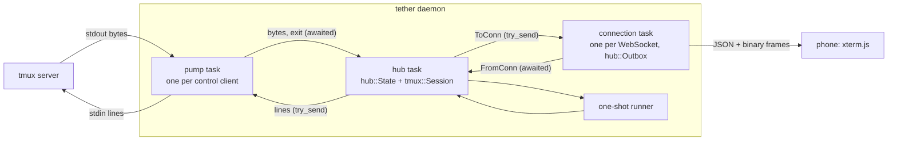
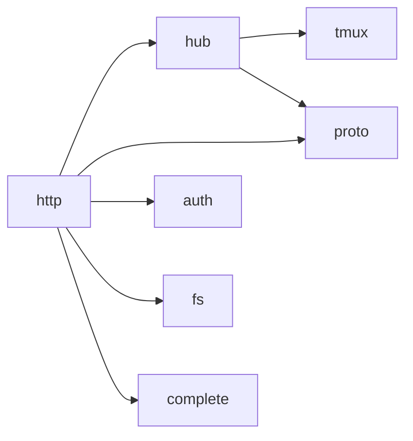
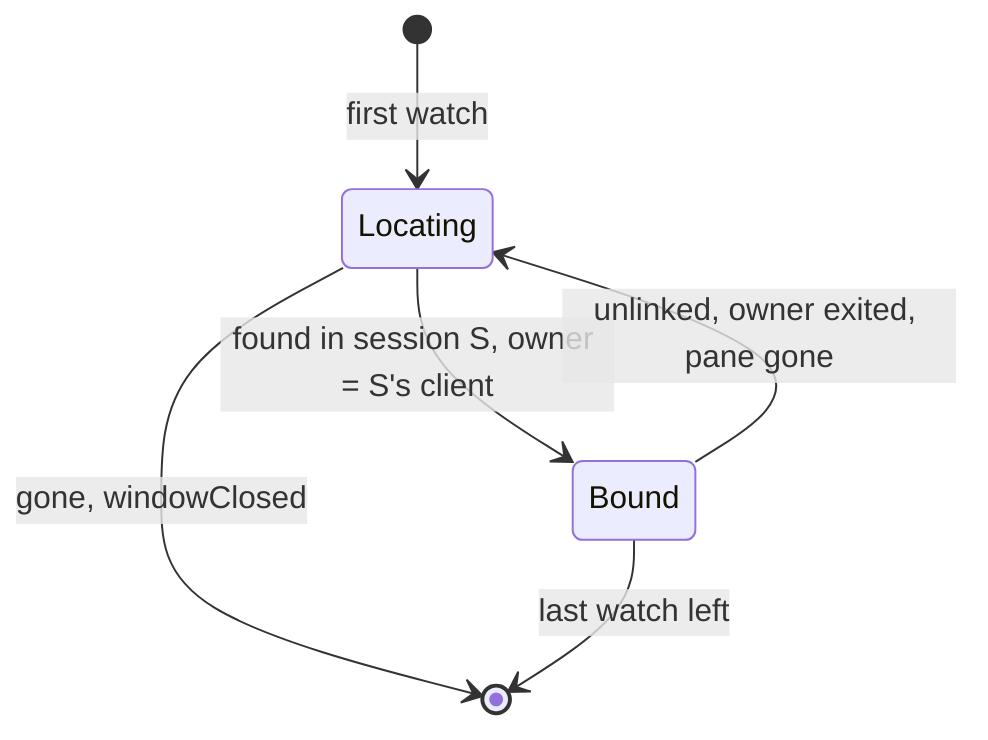
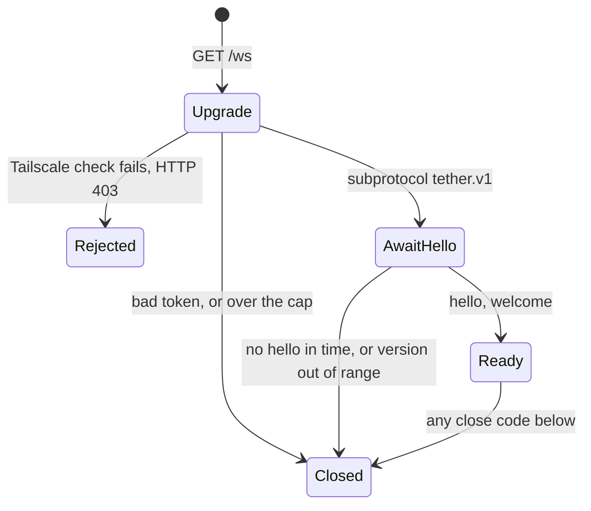

# Daemon core: tmux bridge, hub, wire protocol

The spec for `src/tmux/`, `src/hub/` and `src/proto/`. Settled ground: tmux is the
source of truth and tether never starts Jimmy's tmux server; xterm.js on the phone is
the only terminal emulator; 1 tab = 1 tmux window showing its active pane; the
[resource budget](plan.md#resource-budget) comes first. Reasons and rejected
alternatives are in [decisions.md](decisions.md).

**The design in one paragraph.** A *pump* task per `tmux -C` process moves bytes
between its pipes and one *hub* task. The hub keeps all state in one pure value,
`hub::State`, which holds a pure `tmux::Session` per control client: the session turns
tmux's bytes into events, the state turns events and client messages into effects. A
snapshot is one atomic tmux command list whose replies sit at an exact position in the
output stream, and it is the only way a terminal catches up: on open, reconnect,
resize or overflow. Each watched window has one *owner* control client, found by
asking tmux where the window is (*Locate*); only the owner's output counts. Ongoing
tmux work is *desired state* the hub reconciles when a control client has room; only
user requests can be refused as `busy`. Each connection's outbox drops output when it
overflows and pulls a snapshot once the socket drains.



## 1. Vocabulary

| Term | Meaning |
|---|---|
| **control client** | One `tmux -C attach-session` process, the pump that owns its pipes, and its `tmux::Session` in the hub. Attached to one tmux session for life. |
| **command group** | One line written to a control client: tmux commands joined by ` ; `, answered by one reply block per command that runs. |
| **watch** | One connection viewing one tmux window. Its id is chosen by the client, unique and never reused within the connection. A watch exists only while its tab is on screen. |
| **owner** | The control client of the session a watched window was last located in. Exactly one per watched window. |
| **Locate** | Asking tmux for a window's server, session and active pane. An empty answer means the window is gone (§3.4). |
| **pane stream** | The hub's state for a pane at least one watch shows (§4.3). Created with its first watch, dropped with its last. |
| **snapshot** | A pane's size plus **restore bytes** that rebuild it in a freshly reset xterm.js. |
| **boundary** | Where a snapshot's replies sit in the control client's byte stream: pane output before it is inside the snapshot, output after it is live. |
| **size vote** | A per-window size set with `refresh-client -C '@W:CxR'`; it caps that window (§3.6). |
| **desired state** | What tmux should be doing for the current watches: wanted panes, votes, cwd subscriptions, needed snapshots and Locates (§4.4). |
| **linger** | The time (§6) a control client stays attached after it owns no watched window. Nothing else lingers. |

## 2. Tasks and channels

| Task | Count | Owns | Never does |
|---|---|---|---|
| pump (`tmux::pump`) | one per control client | the `tmux -C` child, its stdin and stdout | parse or decide |
| hub (`hub::run`) | one | `hub::State`: sessions, windows, streams, watches, connection senders | await anything but its inboxes and timer |
| connection (`http::ws`) | one per WebSocket | the socket, the handshake, its `hub::Outbox` | talk to tmux |
| one-shot (`tmux::oneshot`) | at most one at a time | one short `tmux -N` process | attach |

Tasks share no mutable state; they talk over channels.

- **Into the hub, senders wait.** Pumps send on one bounded channel, connections and
  the one-shot runner on another. A pump waiting for room stops reading stdout, so
  tmux stops writing: it pauses a wanted pane after `pause-after` (§3.3), or, when
  tether is the pane's only client, stops reading the pane. While waiting, a pump
  keeps writing lines to stdin and a connection keeps moving `ToConn` into its outbox.
- **Out of the hub, nothing waits.** The hub uses `try_send`. A pump's line channel
  is as deep as its in-flight cap (§3.3), so it can't fill; if it does, the hub kills
  that client. A full connection channel means the connection is wedged: dropped,
  close 4002.
- **One ordered stream per control client.** Replies, output and notifications reach
  the hub as raw bytes in tmux's order, and are parsed there.



`tmux/` depends on nothing internal; `proto/` is a leaf; `hub/` never sees sockets;
`http/` never names a tmux type.

## 3. `src/tmux/`: the bridge

```text
src/tmux/
  mod.rs       ids, Op, Event, Location, PaneSnapshot
  parse.rs     pure: bytes -> lines (blocks, notifications, %output decoding)
  session.rs   pure: Session, the sans-IO control client
  command.rs   pure: command builders, quoting, key-name validation
  snapshot.rs  pure: state format, replies -> restore bytes
  layout.rs    pure: layout string -> pane sizes
  pump.rs      I/O: spawn `tmux -N -C`, bytes out, lines in
  oneshot.rs   I/O: one-shot `tmux -N` commands
```

Everything but `pump.rs` and `oneshot.rs` is pure and tested from recorded fixtures.

### 3.1 Invoking tmux

- **Every invocation is `tmux -N [-L socket | -S path] …`.** With no server running,
  `-N` makes every command fail with `no server running`, `attach-session` and
  `new-session` included ([probe](research/probe-locate-subscriptions.md)). The socket
  comes from config; tests use `-L`.
- **Control client:** `tmux -N … -C attach-session -t '$S' -f pause-after=3` over
  pipes (3.4 needs no pty; [probe-control-client.md](research/probe-control-client.md)),
  the last 4 KiB of stderr kept, `kill_on_drop(true)`.
- **Startup:** the first line is `display-message -p '<version, pid, start_time,
  window_width, window_height>'`. Its reply gives the version, the **server instance**
  `"<pid>-<start_time>"` and the size of the session's current window; the session
  then sets that as the client size (`refresh-client -C <W>x<H>`, §3.6) and only then
  reports `Ready`. One line can't do both: `refresh-client -C` doesn't expand formats.
- **Versions:** an optional `name-` prefix, `MAJOR.MINOR`, an optional letter
  (`3.4`, `3.7b`, `next-3.6`). Below 3.4 the client stops with `TmuxTooOld`; an
  unparseable version counts as the newest known, with a warning.
- **Format strings** separate fields with a raw TAB inside single quotes (`\t` is
  literal there). A field holding user text goes last and is split with `splitn`.
- **Writing:** one group per line, never empty (an empty line detaches), no `\n` or
  `\r`; at most the in-flight cap of groups outstanding (§6).
- **Close:** the hub drops the line sender; the pump closes stdin, waits up to 1 s,
  then kills.

### 3.2 Parser (`parse.rs`)

`Parser::push(&mut self, chunk: &[u8], out: &mut Vec<Line>)` splits bytes into lines
without UTF-8 decoding, keeping a partial line across calls:

- **Outside a block:** `%begin T N F` opens one. `%output %P <data>` and
  `%extended-output %P <age> … : <data>` are pane output. Notifications used:
  `%pause`, `%continue`, `%layout-change`, `%window-close`, `%unlinked-window-close`,
  `%window-renamed`, `%unlinked-window-renamed`, `%window-pane-changed`,
  `%sessions-changed`, `%session-renamed`, `%subscription-changed`, `%exit`. Anything
  else (including `load-buffer`'s read errors, printed outside any block) is dropped
  with a debug log of its length; newer tmux adds notifications.
- **Inside a block:** every line is body, even one starting with `%`, until `%end` or
  `%error` with the **same `N` and `F`**. On 3.4 the `%pause`/`%continue` that
  `refresh-client -A` causes are written inside its block and ignored as body.
- **`%output` decoding:** `\` plus three octal digits is one byte; every other byte
  passes through. The result is `Bytes` and may be invalid UTF-8.
- **Limits** (§6): a partial line, and a group's reply bodies in total, are capped.
  Past either cap, the excess is discarded to the next line or block end and the
  group fails `TooLarge`; the control client survives.

Accepted: a captured line that is byte for byte the matching `%end T N F` ends the
block early. tmux's protocol has this ambiguity, and a pane can't predict `N`.

### 3.3 Session: the sans-IO control client (`session.rs`)

`tmux::Session` is the control-client protocol as a pure state machine, with no I/O
and no clock:

```rust
pub struct Step { pub events: Vec<Event>, pub lines: Vec<String> }

impl Session {
    pub fn new(session: SessionId) -> (Session, Step);   // the startup line
    pub fn feed(&mut self, bytes: &[u8]) -> Step;          // bytes from the pump
    pub fn request(&mut self, tag: Tag, op: Op) -> Step;   // caller checked capacity
    pub fn in_flight(&self) -> usize;
}
```

Its rules:

- **Replies match by position.** tmux answers in order, but `N` comes from a
  server-wide counter. A **flag-1** block is the next reply for the oldest pending
  group; the group completes after one `%end` per command. `%error` completes it at
  once as failed: tmux skips the rest of a list after an error. A **flag-0** block
  (the attach reply, a hook) isn't tether's and is dropped. A flag-1 block with
  nothing pending is `Event::Fatal`.
- **Wanted panes.** `Snapshot` makes a pane wanted, `Release` unwants and pauses it.
  Output from a pane neither wanted nor paused is dropped and the pane paused
  (`refresh-client -A '%P:pause'`; a pause beyond the in-flight cap waits for a
  reply). This covers panes created later without listing anything, and keeps a
  non-owner's copy of a linked window's pane quiet (§4.2). Pausing affects only this
  client; tmux keeps reading the pane. Never `'%P:off'`: it crashes tmux 3.2a–3.6b
  when output is queued ([tmux-control-mode.md §6](research/tmux-control-mode.md)).
- **Loss.** `pause-after=3` bounds what tmux queues for a stalled tether. A `%pause`
  tether didn't request, for a wanted pane, means tmux dropped bytes: `Gap { pane }`.
  The next snapshot's `continue` resumes it. With pause-after on, output arrives as
  `%extended-output`.
- **Torn snapshots.** User hooks run between the commands of a list, and a waiting
  hook (`run-shell` without `-b`) lets output in mid-list, outside both the capture
  and the live stream. A snapshot group with any `%output` or flag-0 block between its
  first and last reply is torn; the session re-sends it, 3 attempts in all, then fails
  it with `Torn`.
- **Snapshots in stream order:** `Snapshot { tag, pane, snapshot }` is emitted where
  the group completed, between the output events around it (§3.5).
- **Startup order** (§3.1): `Ready` follows the client-size line, so no vote reaches
  tmux first. `%subscription-changed` for a `w<W>` subscription becomes `Cwd` (§3.7).
  The session notes whether `%exit` was seen.

### 3.4 Commands (`command.rs`)

Typed builders only. *Maintenance* ops come from desired state and are never refused
(§4.4); *user* ops answer a client message and may get `busy`.

| Op | Command group | Kind |
|---|---|---|
| `Locate { window }` | `display-message -p -t @W '<pid, start_time, session_id, window_id, pane_id, pane_width, pane_height>'` | maint. |
| `LocateSession { session }` | `display-message -p -t '$S' '<pid, start_time, session_id>'` | maint. |
| `Snapshot { pane }` | §3.5 | maint. |
| `Release { pane }` | `refresh-client -A '%P:pause'` | maint. |
| `Vote { window, size }` / `ClearVote { window }` | `refresh-client -C '@W:CxR'` / `refresh-client -C '@W:'` | maint. |
| `Subscribe { window }` / `Unsubscribe { window }` | `refresh-client -B 'w<W>:@W:#{pane_current_path}'` / `refresh-client -B 'w<W>'` | maint. |
| `History { pane, start, end }` | `capture-pane -p -e -t %P -S <start> -E <end>` | user |
| `Input { window, items }` | text and bytes: `send-keys -t @W -H 68 69 …`, ≤ 512 bytes per command; a key: `send-keys -t @W <name>` | user |
| `Paste { window, path }` | `load-buffer -b tether-<n> '<path>' ; paste-buffer -p -d -b tether-<n> -t @W` | user |

- **Locate never errors.** On 3.4, `display-message -t` a missing window or session
  succeeds with the target fields empty, in control mode and as a one-shot, while
  `#{pid}` and `#{start_time}` still expand
  ([probe](research/probe-locate-subscriptions.md)). It parses into `Location {
  server, found: Option<{ session, pane, size }> }`; an empty `session_id` is gone.
  For a window linked into several sessions it names one; run on a client attached
  to one of them, that one.
- **Input and paste target the window**: `-t @W` resolves to its active pane inside
  tmux, so keys can't race an active-pane change.
- **Text goes as `-H` hex**: no quoting, any byte, never a key name. Named keys go by
  name so tmux encodes them for the pane's modes. Without `-K`, `send-keys` writes to
  the pane directly, skipping the prefix, key tables and `escape-time` (from tmux's
  source; fixtures confirm it).
- **Key names** must match
  `^(?:[CM]-)*(?:(?:S-)?(?:Up|Down|Left|Right|Home|End|PageUp|PageDown|IC|DC|F(?:[1-9]|1[0-2]))|[A-Za-z0-9]|Enter|Escape|Tab|BTab|BSpace|Space)$`.
  tmux 3.4 types `S-Enter` as literal text
  ([probe-tmux.md §6](research/probe-tmux.md)), so Shift+Enter goes as CSI-u bytes.
  `tests/fixtures/proto/keys.json` lists every name the clients send; the Rust tests
  check each against the regex.
- **Paste files.** The connection task takes one of a few daemon-wide paste slots
  (§6), or answers `busy` itself, then writes the text to a 0600 file in
  `$XDG_RUNTIME_DIR/tether/`, so the hub only holds a `PasteFile`: the path plus its
  slot. That directory is tmpfs, charged to tether's memory, which is why the slots are
  counted. tmux has read the file when the group completes; the hub hands the
  `PasteFile` back in a `RemoveFile` effect on `Done` and on every path that drops the
  request (§4.4), and deleting it frees the slot. The daemon empties the directory at
  startup.
- **Quoting:** user arguments go in single quotes (`'` as `'\''`) after doubling every
  `#` (tmux format-expands `-n` and `-c`); control characters are rejected.
- Never send commands that wait (`run-shell`, `if-shell`, `wait-for`,
  `confirm-before`, `command-prompt`): one would stall every later reply.

### 3.5 Snapshot

On 3.4, tmux queues a pane's bytes for control clients before parsing them into the
grid, runs a command list in one command-queue pass with no pane read in between, and
keeps reply lines and output in one ordered queue per client. So output before the
group's first reply is in the captured grid and output after its last reply is not:
198/198 and 196/196 captures matched at full output speed, with no pausing
([probe-snapshot.md](research/probe-snapshot.md)).

```text
refresh-client -A '%P:continue' ; display-message -p -t %P '<STATE>' ;
capture-pane -p -e -N -t %P ; capture-pane -p -P -C -t %P ;
capture-pane -p -e -N -a -q -t %P
```

- **`continue` goes first**, always. On a running pane it is a no-op on 3.4; it also
  resumes a pane tmux auto-paused or the session paused as unwanted.
- The alternate-screen capture goes last with `-q`, so a pane without one gives an
  empty success instead of aborting the list.
- `<STATE>`, tab-separated, for 3.4: `pane_id pane_width pane_height alternate_on
  alternate_saved_x alternate_saved_y cursor_x cursor_y cursor_flag insert_flag
  keypad_cursor_flag keypad_flag wrap_flag origin_flag scroll_region_upper
  scroll_region_lower mouse_standard_flag mouse_button_flag mouse_any_flag
  mouse_utf8_flag mouse_sgr_flag pane_tabs`, from a per-version table in
  `snapshot.rs` (newer versions use the newest entry).
- The replies count against the group reply cap; a larger screen fails `TooLarge`.

**Boundary:** everything the hub saw for `%P` before the `Snapshot` event is inside
it; everything after is live. Stream order is the boundary.

**Restore bytes** (`snapshot::compose`, pure) rebuild the pane in a freshly reset
terminal of `cols × rows`, so the clients carry no restore logic:

1. `CSI ?7l`, so a too-wide line (the saved primary grid keeps its old size while the
   alternate screen is on; Unicode widths drift) can't wrap and scroll. Rows past
   `rows` are dropped.
2. If `alternate_on`: the saved primary grid (the `-a` capture), `CSI 0 m`, CUP to
   `alternate_saved`, `CSI ?1049h`.
3. The active grid: line *i* is `CSI i+1;1H` and its captured bytes. `-e` SGR state
   carries across lines, so nothing resets between them.
4. `CSI 0 m`; tab stops: `CSI 3 g`, then `ESC H` at each `pane_tabs` column; a scroll
   region that isn't full height: `CSI top+1;bottom+1 r`; `origin_flag`: `CSI ?6h`.
5. Modes: `CSI ?7h` if `wrap_flag`, and each mode that is on: `CSI ?1h`
   (keypad_cursor), `ESC =` (keypad), `CSI 4h` (insert), `CSI ?1000h` / `?1002h` /
   `?1003h` / `?1005h` / `?1006h` (mouse standard, button, any, utf8, sgr).
6. CUP to the cursor (region-relative under origin mode; a column past the last is
   clamped); `CSI ?25l` if `cursor_flag` is 0.
7. The pending parser bytes (`-P -C`, decoded like `%output`), so the next live bytes
   complete the sequence tmux is holding.

Not restorable from 3.4: bracketed paste, focus reporting, character sets, the
current SGR pen, a pending wrap, the title. Paste goes through `paste-buffer -p`,
which checks the real mode; the rest return when the application next sets them.

### 3.6 Sizing

**tmux 3.4's rules**
([probe-control-client.md](research/probe-control-client.md#sizing-the-part-that-shapes-the-resize-policy)):
a control client counts for sizing only once it sets a size, then for every window in
its session; attaching makes it `latest` for the session's current window; under
`window-size latest` a window takes `latest`'s size, and a size vote replaces the
client size for that window and **caps** it, whoever is `latest`.

**Policy: while the phone watches a window, the phone's size wins there; otherwise
tether leaves sizes alone.**

- **Client size = the session's current window size at attach** (§3.1). For windows it
  doesn't watch, the control client acts like a laptop-sized client, so nothing
  shrinks where it is `latest` or alone.
- **A vote on each watched window**, from the size in `watch` and each `resize`. It
  wins even when the laptop is `latest`. The keyboard never resizes. Two watches on
  one window: the last `watch` or `resize` wins (two phones aren't designed for).
- **A window with no watch left has its vote cleared** and returns to `latest`'s
  size, or the client size where the control client is `latest`. Leaving the screen,
  backgrounding and a dropped connection all end watches.
- Verified on 3.4 with a 200×50 pty client: unwatching the laptop's current window
  restored it to 200×49; when the laptop grew, unwatched windows followed to 220×59.
- **Accepted costs:** the laptop can't grow a window the phone watches (the vote is
  a cap); a cleared window on which no client is `latest` keeps the phone's size
  until the laptop types in it; a phone suspended without closing its socket keeps
  its vote until the idle timeout (§6).
- A watched pane's size change arrives as `%layout-change` in stream order and
  breaks its stream (§4.3).

### 3.7 cwd subscription

Completion and the file manager need the watched pane's cwd. The owner subscribes per
watched window:

```text
refresh-client -B 'w<W>:@W:#{pane_current_path}'
→ %subscription-changed w<W> $S @W <index> - : <path>
```

On 3.4 ([probe](research/probe-locate-subscriptions.md)) the first value arrives within
about a second, then one per change; tmux checks once a second, so faster changes
collapse into the last. A window subscription follows the **active pane**, and
reports only while the window is in the client's own session, which is the owner's.
The value is the foreground process's cwd, read by tmux from `/proc`: no shell
snippet needed, and it works inside TUIs. Cost: one format evaluation per watched
window per second inside tmux; tmux drops its timer with the last subscription. The
hub sends the value in `watching` (§5.3).

### 3.8 One-shots and endpoints (`oneshot.rs`)

- `list` (session sheet): `display-message -p '#{version}\t#{pid}\t#{start_time}' ;
  list-windows -a -F <fmt> ; list-clients -F '#{client_session}\t#{client_control_mode}'`.
  "Attached elsewhere" counts non-control clients. `no server running` maps to
  `TmuxError::NoServer`.
- `locate`, `locate_session`: the ops' commands, when the endpoint has no `Ready`
  control client.
- `new_window`: `new-window -d -t '$S' [-n <name>] [-c <dir>] -P -F '#{window_id}'`;
  `new_session`: `new-session -d [-s <name>] [-c <dir>] -P -F
  '#{session_id}\t#{window_id}'`.

One at a time, 2 s timeout. The hub emits an effect, `run.rs` runs it in a task, and
the result returns as an `Input`. While the slot is taken, user one-shots get `busy`
and Locates wait.

**Endpoints.** Each tmux server tether talks to is an endpoint: `main`, from config,
and `scratch`. Server instances are written `"<endpoint>:<pid>-<start_time>"`, so a
window id routes to its endpoint by itself.

**Scratch shells (after the core MVP)** are sessions on a private server: the daemon
runs `systemd-run --user --scope --collect tmux -L tether-scratch new-session -d -P -F
'#{session_id}\t#{window_id}'`. Its own transient scope keeps the server out of
tether's cgroup, which is what the never-start-tmux rule protects. Scratch windows
are ordinary tabs on the same stream path. Closing a scratch tab kills its session;
the server exits with its last one.

### 3.9 Public interface

```rust
pub enum Op {
    Locate { window: WindowId }, LocateSession { session: SessionId },
    Snapshot { pane: PaneId }, Release { pane: PaneId },
    Vote { window: WindowId, size: Size }, ClearVote { window: WindowId },
    Subscribe { window: WindowId }, Unsubscribe { window: WindowId },
    History { pane: PaneId, start: i32, end: i32 },
    Input { window: WindowId, items: Vec<InputItem> },
    Paste { window: WindowId, path: PathBuf },
}

pub enum Event {
    Ready { server: ServerInstance, version: TmuxVersion },
    Output { pane: PaneId, bytes: Bytes },                 // wanted panes only
    Snapshot { tag: Tag, pane: PaneId, snapshot: PaneSnapshot },
    Done { tag: Tag, result: Result<Reply, TmuxError> },  // Location, history rows, or ()
    Gap { pane: PaneId },
    Layout { window: WindowId, panes: Vec<(PaneId, Size)> },
    ActivePane { window: WindowId, pane: PaneId },
    WindowUnlinked { window: WindowId },                   // closed *or moved*
    WindowRenamed { window: WindowId, name: String },
    SessionsChanged,
    Cwd { window: WindowId, path: String },
    Fatal(SessionError),
}

pub struct PaneSnapshot { pub pane: PaneId, pub size: Size, pub restore: Bytes }

// pump.rs: dropping the returned sender closes the client.
pub fn spawn(endpoint: &Endpoint, session: SessionId, client: ClientId,
             out: mpsc::Sender<(ClientId, PumpMsg)>)
    -> Result<(mpsc::Sender<String>, JoinHandle<()>), SpawnError>;
pub enum PumpMsg { Bytes(Bytes), Exited { stderr_tail: String } }
```

## 4. `src/hub/`: windows, streams, desired state

```text
src/hub/
  mod.rs        spawn, HubHandle, FromConn, ToConn
  state.rs      pure: State::handle(input, now) -> effects
  reconcile.rs  pure: desired state -> ops, within capacity
  outbox.rs     pure: per-connection delivery queue
  run.rs        the hub task: inboxes, timer, executing effects
```

### 4.1 `State::handle`

```rust
pub enum Input { Pump(ClientId, PumpMsg), Conn(ConnId, FromConn), OneShot(Tag, OneShotResult), Tick }
pub enum Effect {
    SpawnClient { client: ClientId, endpoint: Endpoint, session: SessionId },
    Write { client: ClientId, lines: Vec<String> }, CloseClient { client: ClientId },
    OneShot { tag: Tag, cmd: OneShotCmd },
    Send { conn: ConnId, msg: ToConn }, DropConn { conn: ConnId },
    RemoveFile { file: PasteFile },
}
impl State {
    pub fn handle(&mut self, input: Input, now: Instant) -> Vec<Effect>;
    pub fn next_deadline(&self) -> Option<Instant>;
}
```

`handle` feeds pump bytes to the client's session, applies events and client
messages, runs `reconcile` (§4.4) and returns the effects. `run.rs` only executes
them and sleeps until `next_deadline()`: a linger end, a group's reply deadline,
a crash respawn. With nothing pending there is no timer.

State: `clients` (endpoint, session, `tmux::Session`, `Starting`/`Ready`, applied
votes and subscriptions, linger deadline, last crash); `windows` (owner, session,
active pane, cwd, Locate state, watches); `streams`; `watches` (window, size);
connection senders; the live server instance per endpoint; and `pending`, which maps
each tag to what its reply is for.

### 4.2 Windows, owners and Locate



1. **`watch`** counts against the connection's cap; a watch over it ends at once
   with `watchEnded { error }`. A window whose server instance
   isn't its endpoint's live one died with that server: `serverExited` for the old
   instance closes every tab on it. A `Bound` window's new watch joins its pane's
   stream and gets `watching` at once; otherwise the window is `Locating`.
2. **Locate** runs on any `Ready` client of the endpoint, else as a one-shot; one per
   window in flight, and a trigger during it re-runs it afterwards. A Locate that gets
   no usable answer (its client exits, the one-shot fails or times out) is needed
   again (§4.4).
3. **Result:**
   - another server instance, or no server: the window's server is gone (§4.5);
   - empty: broadcast `windowClosed`, drop the window, its watches and stream (no
     `watchEnded`: the broadcast closes the tab);
   - session S: the owner is S's client, spawned if needed (the window binds when it
     is `Ready`). If the owner or pane changed, the watches move to the located pane's
     stream under the new owner, which needs a snapshot. Every watch gets `watching`.
4. **Re-locate on:** `WindowUnlinked` from any client (tmux sends close notifications
   for moves too), the owner exiting, a snapshot failing because the pane is gone.
5. **Only the owner counts:** `Output`, `ActivePane`, `Layout` and `Cwd` are taken
   from the owner only. Other sessions' clients see a linked window's output too, but
   don't want the pane and pause it (§3.3); a former owner that still wants it gets
   `Release` from reconciliation.
6. **`ActivePane`** moves the window's watches to the new pane's stream; **`Cwd`**
   updates the cwd. Both re-send `watching`.

A moved window keeps its tab: new owner, fresh snapshot.

### 4.3 Pane streams

```rust
struct Stream {
    window: WindowRef, owner: ClientId, size: Size,
    live: bool,                 // false: drop output until a snapshot lands
    inflight: Option<Tag>,      // the snapshot whose reply can make it live
    awaiting: Set<WatchKey>,    // watches that get the next snapshot
    watches: Set<WatchKey>,
}
```

| Event | Effect |
|---|---|
| created (first watch on the pane) | not live; snapshot needed |
| `Output` from the owner, live | `Output { watch, bytes }` to every watch |
| `Output` not live, or from another client | dropped: the coming snapshot holds it |
| `Snapshot` whose tag isn't `inflight` | dropped |
| `Snapshot`, not live | live; size from it; sent to every watch |
| `Snapshot`, live | sent to `awaiting` only; live watches are undisturbed |
| **break:** new size in `Layout`, `Gap`, new owner | not live; every watch awaiting; `inflight` forgotten (a snapshot sent before the break may predate its cause); snapshot needed |
| a watch joins, sends `resync`, or its outbox pulls | awaiting; snapshot needed |
| snapshot fails: pane gone | the window re-locates |
| snapshot fails: torn 3 times, or `TooLarge` | `watchEnded { error }` for every watch, naming hooks or screen size; stream dropped |
| a watch leaves | removed from `watches` and `awaiting` |
| last watch leaves | stream dropped; the pane stops being wanted |

### 4.4 Desired state and reconciliation

Every `handle` ends with `reconcile`: compare what tmux should be doing with what the
hub has sent, and send the difference as far as capacity allows. It walks a handful
of windows and streams.

| Desired, per control client C | Derived from | Sent as |
|---|---|---|
| wanted panes | streams C owns | `Snapshot` when one is needed; `Release` for a wanted pane C owns no stream for |
| size votes | windows C owns with a watch: the latest `watch` or `resize` size | `Vote`; `ClearVote` once the window has no watch |
| cwd subscriptions | windows C owns with a watch | `Subscribe`; `Unsubscribe` once it has none |
| snapshots | streams not live, or with awaiting watches, and nothing in flight | `Snapshot` |
| Locates | windows needing one, none in flight | `Locate` on any `Ready` client, else a one-shot |
| session checks | exited clients (§4.5) | `LocateSession`, the same way |

**Capacity** (numbers in §6). A control client has a cap on groups in flight.
Maintenance may use all of it; a user request is accepted only below a lower
threshold, else `error { busy }`, so users can never starve maintenance. Snapshots
and history share a few capture slots daemon-wide; a snapshot waits for one, a
history request gets `busy`. Each reply frees capacity and runs `handle`, so waiting
work goes out at once.

What the hub sent counts as applied (votes and subscriptions are recorded per
client; wanted panes live in the session): tmux runs groups in order, and a failure
on a window that has gone is harmless. Work in flight records where it runs; when
that control client exits, or a one-shot fails or times out, its unanswered Locates,
session checks and snapshots become needed again, and the next `reconcile` sends them
elsewhere. Nothing is sent to a client before it is `Ready`. Releases, cleared votes and unsubscribes go
first, then Locates, subscriptions, votes, snapshots. A `Paste` the hub refuses or
drops (busy, unknown watch, connection gone) emits `RemoveFile`.

### 4.5 Control clients

- **One per tmux session that owns a watched window**, shared by all connections,
  attached to that session for life. Spawning costs about 2 ms and 5.3 MB; normally
  one exists, two briefly when switching sessions.
- **Spawned** when a Locate names a session without one. At the cap (§6) the oldest
  lingering client closes first; with none lingering, the window's watches end with
  `watchEnded { error }` ("too many sessions") and the window is dropped.
- **`Ready`** requires the endpoint's known server instance, or records it when none
  is known; a different one means the server restarted. A window whose owner is still
  starting waits for it, and if that client exits first, the window locates again.
- **Linger:** closes after the linger (§6) once it owns no watched window, unless one
  binds first.
- **Exit** (the pump reports `Exited`, its task panics, or the hub kills it for a
  group unanswered past the reply timeout, or `Fatal`): its streams stop being live,
  its windows (including those waiting for it to start) wait, and `LocateSession`
  checks its session first. Then:
  - *No server, or a new instance:* broadcast `serverExited`; drop all of that
    server's windows, streams and watches; close its clients. Nothing starts tmux.
  - *Otherwise* each of its windows locates again: one now in another session rebinds
    to that session's client, one gone gets `windowClosed`. If the session was gone,
    `sessionClosed` is broadcast too.
  - *A window still in the same, live session* depends on how the client ended. With
    `%exit` seen it was **detached** by another client (`attach -d`,
    `detach-client`): its watches get `watchEnded { detached }` and nothing reattaches.
    Without it the client **crashed**: the hub respawns it after 1 s, kept only if the
    server instance is unchanged; a second crash within 60 s ends the watches with
    `watchEnded { error }`.

### 4.6 Outbox: backpressure and coalescing

`hub::Outbox` is pure and owned by each connection task, which moves every `ToConn`
into it at once and writes frames from it when the socket is ready.

- **Per watch:** an ordered queue of output and snapshot frames, and a state, `Live`
  or `Starved`, with a flag for an outstanding snapshot request. A new watch starts
  `Starved` with its request outstanding (the `watch` message). JSON goes on one
  connection-wide FIFO, written first.
- **Output** joins a `Live` watch's queue (merged with queued output); a `Starved`
  watch drops it. **A snapshot** replaces the watch's queued frames, makes it `Live`
  and clears the request.
- **Budget** of queued output per connection (§6). Past it, every watch's queued
  output is dropped and every watch starves.
- **Pull, don't push.** A `Starved` watch with no request outstanding emits
  `NeedSnapshot` once everything queued for it is written and the pull spacing (§6)
  has passed since its last request, so snapshots follow what the link delivers, not
  the pane's output rate.
- **JSON FIFO** (§6): past its cap the connection is wedged (4002).
- **Coalescing** (leading edge, interval in §6): a watch's output goes at once if its
  last frame left at least one interval ago, else when the interval ends, merged into
  one frame. Keystroke echoes are never delayed, and a flood goes out at most once
  per interval.
- The outbox forgets a watch on the client's `unwatch` (a closed tab sends one too)
  and on `watchEnded`, never on an `error`: errors refuse one request and leave the
  watch as it was.
- `Outbox::next(now) -> Next::{Frame, WaitUntil(Instant), Idle}`; `Outbox::written(watch)`.

### 4.7 Public interface

```rust
impl Hub { pub fn spawn(cfg: HubConfig, endpoints: Endpoints) -> (HubHandle, JoinHandle<()>); }
impl HubHandle {
    pub async fn connect(&self) -> (ConnId, mpsc::Receiver<ToConn>);
    pub async fn send(&self, conn: ConnId, msg: FromConn);   // awaits inbox room
}
pub enum FromConn {
    Client(proto::ClientMsg),   // all but hello, ping, paste
    Paste { watch: WatchId, file: PasteFile },   // deleting it frees its slot
    NeedSnapshot { watch: WatchId },
    Closed,
}
pub enum ToConn {
    Msg(proto::ServerMsg),
    Snapshot { watch: WatchId, size: Size, restore: Bytes },
    Output { watch: WatchId, bytes: Bytes },
}
```

`http/` enforces the connection cap at the upgrade, and handles `hello`, `ping` and
the auth re-check itself.

## 5. `src/proto/`: the wire protocol

### 5.1 Transport

One WebSocket per app per host at `GET /ws`. Each daemon is one host and the app
connects to each directly, so the socket identifies the host and no message names
one. The token rides in the subprotocol list, `Sec-WebSocket-Protocol: tether.v1,
tether.auth.<token>`; the daemon answers `tether.v1`
([auth.md](auth.md#carrying-the-token)). Text frames carry JSON; binary frames carry
pane bytes; the protocol relies on WebSocket keeping them in order.

### 5.2 Handshake and versions



Close codes: **4000** idle; **4001** incompatible version; **4002** wedged; **4003**
protocol violation (including no `hello` in time); **4004** daemon shutdown; **4005**
over the connection cap; **4009** message too large; **4401** bad, unknown or revoked
token. The client reconnects after any of them except 4001 and 4401.

- **The client speaks one version; the daemon holds a range,**
  `MIN_PROTOCOL..=PROTOCOL_VERSION` (both 1 now). `hello { protocol, client: { kind:
  "ios" | "web", build } }`. In range: `welcome { protocol, daemon: { version }, host:
  { id, name } }`. Out of range: `incompatible { min, max, daemonVersion }`, close
  4001; the app marks that host "update the app" (below `min`) or "update tether on
  <host>" (above `max`). `GET /auth/info` reports the same range.
- **Bump** for any change an older peer would misread (removed or renamed field or
  message, changed meaning). Optional fields and new message types need no bump: both
  sides ignore unknown ones, with a log. The version covers the HTTP routes too.
- **A bad token and a socket over the cap** get the upgrade and then an immediate
  close, because a browser WebSocket can't see a refused upgrade's status. The cap
  counts sockets from the upgrade, before `hello`. On its own timer the connection
  re-checks its device ([auth.md](auth.md#carrying-the-token)) and closes with 4401 if
  it was removed. Only `hello` is accepted before `welcome`.
- `host.id` is the persistent host id ([auth.md](auth.md#state-on-disk)).

### 5.3 JSON messages

Adjacently tagged, `{"type": "<name>", "data": {...}}`, camelCase.

- `WindowRef { server: string, window: u32 }`: `server` is the instance
  `"<endpoint>:<pid>-<start_time>"` and `window` the `@N`; a tab saved before a tmux
  restart can never bind to a new server's `@N`. `SessionRef { server, session: u32 }`,
  `PaneId = u32`, `Size { cols: u16, rows: u16 }` (clamped, §6).

**Client → daemon**

| Message | Fields | Meaning |
|---|---|---|
| `hello` | `protocol, client` | §5.2 |
| `ping` | `t` | on the ping interval (§6) while connected |
| `watch` | `watch: u32, window: WindowRef, size: Size` | the tab came on screen (§4.2) |
| `unwatch` | `watch` | the tab left the screen or closed |
| `resize` | `watch, size` | rotation or font change only |
| `resync` | `watch` | fresh snapshot needed (renderer recreated) |
| `input` | `watch, items: [{text} \| {key} \| {bytes: base64}]` | to the window's active pane, in order. Before `watching` it gets `error { busy }`, so the client sends input only to a bound watch |
| `paste` | `watch, text` | through `paste-buffer -p` |
| `history` | `req, watch, start, end` | scrollback rows by tmux line number (negative is history) |
| `listSessions` | `req: u32` | the session sheet |
| `newWindow` | `req, session: SessionRef, name?, dir?` | `dir` checked against the file roots by the connection |
| `newSession` | `req, name?, dir?, scratch?: bool` | `scratch` after the core MVP |

**Daemon → client**

| Message | Fields | Meaning |
|---|---|---|
| `welcome`, `incompatible` | §5.2 | |
| `pong` | `t` | |
| `watching` | `watch, window, session: SessionRef, pane, cwd: string \| null` | bound; re-sent when session, pane or cwd changes. `cwd` is null until tmux reports it |
| `watchEnded` | `watch, reason: detached \| error, message?` | the only way a watch ends from the daemon's side, apart from closure broadcasts; retryable: a tap sends a new `watch` |
| `windowClosed` | `window` | closes every tab on the window, watched or not |
| `sessionClosed` | `session` | the session is gone; tabs close only on `windowClosed`, since windows move |
| `serverExited` | `server` | closes every tab on that server |
| `windowRenamed` | `window, name` | |
| `sessionsChanged` | | refetch the listing if the sheet is open |
| `sessions` | `req, tmux: notRunning \| { server, version, sessions: [{ id, name, attachedElsewhere, windows: [{ id, index, name, active, activity }] }] }` | `activity` in unix seconds |
| `historyChunk` | `req, watch, start, lines: [base64]` | `capture-pane -e` bytes per row |
| `created` | `req, window, session` | |
| `error` | `req?, watch?, code, message` | refuses one request; a watch it names stays as it was. `badRequest, noServer, tooManySessions, inputTooLarge, busy, tmux` |

Closure is a broadcast fact; `watchEnded` carries only retryable reasons.

### 5.4 Binary frames

Big-endian; the first byte is the kind, and an unknown kind is a protocol error.

```text
output   (0x01): kind u8 | watch u32 | bytes…
snapshot (0x02): kind u8 | watch u32 | cols u16 | rows u16 | restore bytes…
```

**Applying them** (`web/term/`, one serialized write pipeline per terminal): output
is queued as an xterm.js write. A snapshot waits until every earlier write's callback
has fired, then runs `term.reset()`, `term.resize(cols, rows)`, `term.write(restore)`;
later output queues behind it. Without the wait, bytes still inside xterm.js's write
queue would be parsed after the reset and could switch on a mode (insert, say) the
restore never switches off. Frames for a watch the client no longer has are dropped.
A snapshot clears xterm.js's scrollback; older rows come from `history`
([plan.md](plan.md#scroll)).

### 5.5 Type generation

Message types are defined once in `src/proto/` and generated for TypeScript with
**ts-rs** into `web/src/proto/generated/`; preflight checks they are current. Enums use
`#[serde(tag = "type", content = "data")]`. Swift needs only the `/auth/*` bodies in
`src/proto/auth.rs`, which it hand-writes as `Codable` types tested against JSON
fixtures the Rust tests emit ([ios-shell.md](ios-shell.md#protocol-types-in-swift)).
The binary frames are hand-coded on each side with golden byte fixtures in
`tests/fixtures/proto/`.

## 6. Limits and the memory ceiling

Every daemon constant lives here; other documents link to this table.

| Limit | Value | When hit |
|---|---|---|
| connections, from the upgrade | 3 | close 4005 |
| watches per connection | 2 | `watchEnded { error }` |
| control clients | 3, lingering ones closed first | `watchEnded { error }` |
| control-client linger | 15 s | |
| groups in flight per control client | 32; user requests below 24 | user: `busy`; maintenance waits |
| capture slots (snapshot, history) | 2 daemon-wide | history: `busy`; snapshot waits |
| reply timeout per group | 10 s | kill the client (crashed) |
| parser partial line / replies per group | 1 MiB / 1 MiB | group fails `TooLarge` |
| pump read size; pump → hub channel | 16 KiB; 128 chunks | the pump waits |
| connection → hub channel | 128 messages | the connection waits |
| hub → connection channel | 256 messages | wedged, 4002 |
| outbox output budget per connection | 256 KiB | every watch starves |
| outbox JSON FIFO | 256 messages | wedged, 4002 |
| snapshot pull spacing | 250 ms | |
| output coalescing | 33 ms, frames ≤ 64 KiB | |
| one-shots | 1 at a time, 2 s timeout | user one-shots: `busy` |
| crash respawn | after 1 s; a second crash in 60 s ends the watches | |
| inbound WebSocket message | 512 KiB | close 4009 |
| input / paste per message | 4 KiB / 256 KiB | `error { inputTooLarge }` |
| paste slots (files awaiting tmux) | 4 daemon-wide | `error { busy }`, before writing |
| completion: carapace run | 300 ms timeout, 1 at a time | no flag suggestions |
| history per request | 200 rows | clamped |
| `hello` deadline | 10 s | close 4003 |
| ping / idle timeout | every 10 s / 25 s silent | close 4000; the 10 s timer also re-checks auth |
| size clamp | 20..=500 cols × 5..=300 rows | clamped |
| `pause-after` | 3 s | `Gap` → snapshot |
| scratch sessions | 2 | `error { tooManySessions }` |

**Memory ceiling**, with every item at its cap at once. Nothing grows with time.

| Item | Bound | MB |
|---|---|---|
| daemon: code, runtime, tasks | budget target | 5 |
| control clients | 3 × 5.3 MB measured | 16 |
| one-shot `tmux` | 1 × 4.9 MB measured | 5 |
| carapace | 1 run, unmeasured | ~15 |
| tmux chunks, queued and in transit to connections | 2 × 128 × 16 KiB | 4 |
| reply bodies | large ones only in the 2 capture slots | 2 |
| snapshots awaiting delivery | 3 connections × (2 pending + 1 being written) × 1 MiB | 9 |
| outboxes | 3 × (256 KiB + JSON FIFO) | 1.5 |
| inbound messages | 3 × (512 KiB + decoded copy) | 3 |
| paste files on tmpfs | 4 slots × 256 KiB | 1 |
| **ceiling** | | **~62** |

That fits the unit's `MemoryMax` ([plan.md](plan.md#resource-budget)) with little
room, and carapace is a guess; the
[budget measurement](plan.md#resource-budget) checks it. If it doesn't fit, lower the
control-client cap first. The normal case, one control client and one watch, is about
11 MB.

## 7. Failure handling

How each failure ends; §4.5 has the control-client details.

| Failure | Detected by | Response |
|---|---|---|
| tmux server exits | pumps hit EOF; `LocateSession` finds no server | `serverExited`; `sessions` reports `notRunning` |
| session killed | its client exits; `LocateSession` finds it gone | `sessionClosed`; windows re-locate |
| window closed | close notification, then an empty Locate | `windowClosed` |
| window moved, even a session's last one | close notification or client exit, then Locate finds another session | new owner, snapshot, `watching` |
| active pane exits | `ActivePane` | watches move to the new pane |
| snapshot torn 3 times, or too large | `Done { Err }` | `watchEnded { error }` naming the cause |
| detached by another client | exit with `%exit`, window still there | `watchEnded { detached }` |
| client crashed, killed, wedged (10 s) or `Fatal` | EOF without `%exit`, timer, parser | one respawn; a second within 60 s: `watchEnded { error }` |
| user requests at the threshold | in-flight count | `error { busy }` |
| connection socket dies | `FromConn::Closed` | its watches end; votes and subscriptions clear if no watch remains |
| connection wedged | channel full or JSON FIFO overflow | close 4002; the client reconnects |
| hub panics | `main` awaits it | exit 1; systemd restarts; clients reconnect and resync |
| device removed | the 10 s re-check | close 4401 |
| shutdown (SIGTERM) | `main` | close sockets with 4004, close control clients' stdin, exit; tmux is unaffected |
| tab from before a tmux restart | server instance differs | `serverExited` for the old instance |

Every failure ends as a message the phone can show. Logs carry framing metadata only
(kinds, lengths, tags), never control-client input or output.

## 8. Testing

**Recorded fixtures.** `cargo run --example record-tmux-fixtures -- --tmux <path>
--out tests/fixtures/tmux/<version>/` drives scripted scenarios against `tmux -L
tether-fixture-$$ -f /dev/null` and writes the lines sent (`.in`) and the raw stdout
(`.out`). Scenarios: startup; output with every C0 byte, backslashes and invalid
UTF-8; a `yes` flood; lists failing in the middle and at the start; a hook firing; a
capture with `%`-prefixed lines; pause, continue, auto-pause; splits and layout
changes; window add, rename, kill, move and link; `select-pane`; cwd subscriptions;
Locate on live, killed and moved windows; paste, including a missing file;
`send-keys` of `C-b` and of `Escape` then a key; detach from outside; kill-server.
3.4 is recorded on the dev box, 3.7b on the Mac, both committed.

- **`Session`:** each `.out` in random chunk splits (fixed seeds, 1-byte chunks
  included) with its requests, against golden events and lines: pausing, gaps, torn
  snapshots and startup order are tested without real tmux.
- **`snapshot::compose`:** per-mode unit tests, and restore bytes fed to `vt100` (a
  dev-dependency) compared with the capture.
- **`hub::State` and `Outbox`:** scripted inputs → effects. A watch joining a live
  stream; starvation and pull spacing; an active-pane change or a resize during a
  snapshot; a move to another session; a linked window watched from two sessions; the
  owner exiting after its window moved; user requests filling capacity while
  maintenance waits; every paste path deleting its file.

**Real tmux** (`TETHER_TMUX_TESTS=1`, before each daemon-core commit, on the dev box
and the Mac):

- **Boundary:** numbered lines at full speed and a TUI in the alternate screen; 200
  snapshots through the real session and pump. `vt100(restore + later output)` equals
  tmux's final capture, and every numbered line appears exactly once.
- **Torn:** with `set-hook -g after-display-message 'run-shell "sleep 0.3"'` and a
  flood, every snapshot is torn, retried, and none delivered with a gap.
- **Sizing:** a 200×50 pty client plus a control client leave the sizes §3.6
  promises through watch, switch, unwatch and the laptop growing.
- **Lifecycle:** kill-server, kill-session, `detach-client`, `move-window` (including
  a session's last window) and SIGKILL of `tmux -C` each end as §7 says. With no
  server, watching and creating a session start none, even with a `~/.tmux.conf` that
  creates a session.

## 9. Open risks

1. **The boundary is proven on 3.4 only.** The boundary test must pass on 3.7b before
   release and on every tmux upgrade.
2. **Sizing rests on `resize.c` internals**, verified for one laptop plus one control
   client; `aggressive-resize on` is untested. "The laptop can't grow a window the
   phone watches" needs Jimmy's confirmation; the alternative is dropping the vote
   after N idle minutes.
3. **Unicode width drift** between tmux and xterm.js can misplace cells; `resync`
   repaints.
4. **Every tab switch repaints from a snapshot.** Whether reset-and-write flashes in
   xterm.js 6 on iOS is measured in spike 3.
5. **User hooks:** a waiting hook makes snapshots torn (retried); `destroy-unattached
   on` destroys a session when tether's lingering client closes, as the option says.
6. **Restore gaps:** one tmux scroll region versus one per xterm.js screen, and no
   pending-wrap state. The application's next redraw fixes both.
7. **`pause-after=3` is a guess**; measure it in the budget run.
8. **Opening a tab may snapshot twice:** the vote's `%layout-change` can land after
   the first snapshot and break the stream. Correct but wasteful; measure first.

## Sources

- [probe-control-client.md](research/probe-control-client.md),
  [probe-snapshot.md](research/probe-snapshot.md),
  [probe-tmux.md](research/probe-tmux.md),
  [probe-locate-subscriptions.md](research/probe-locate-subscriptions.md),
  [tmux-control-mode.md](research/tmux-control-mode.md).
- libtmux-rs (`~/.meridian/ref/libtmux-rs`): byte-oriented reading, FIFO reply slots,
  the `%end`-position snapshot boundary.
- tmux source (`~/.meridian/ref/tmux`): `control.c`, `cmd-queue.c`, `resize.c`,
  `server-client.c`, `cmd-refresh-client.c`.
