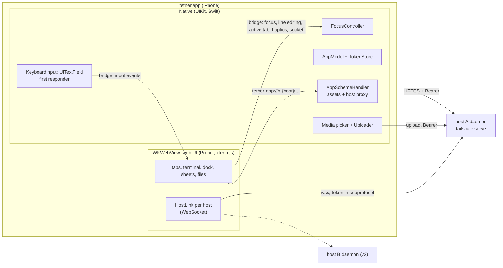

# iOS shell: the native app

> **Client UX update (2026-10-22):** Start with [client design and Mac handoff](client/README.md).
> Its approved browser/mobile navigation and minimal layout supersede conflicting
> UI rules below. Subsystem invariants remain in force; touch, clipboard and the phone
> dock retain explicit device gates.

The native shell and web adapter implement bridge v7; the device-only checks below still
need Jimmy's iPhone.

tether's phone client is a Swift app: a `WKWebView` runs the web UI (terminal, tabs,
the phone dock, sheets, file manager), and native code owns the first responder,
keyboard geometry, auth, media and lifecycle.
The web UI is bundled in the app and served from a custom scheme. The app connects to
each host's daemon directly. The terminal's keystrokes come from a native first
responder, not from a text field in the page.

Auth is in [auth.md](auth.md), the wire protocol in
[daemon-core.md §5](daemon-core.md#5-srcproto-the-wire-protocol), and the checks this
design still needs on the phone in the [device checklist](#device-checklist). Reasons
and rejected alternatives are in [decisions.md](decisions.md).



## What is native and what is web

Native code takes what WebKit can't do well on iOS, or what must not depend on the
web content process: keyboard ownership, secrets, system integration. Everything a
user looks at for long stays in the web UI, so Jimmy iterates on it without
rebuilding the app.

| Native (Swift) | Web (`web/`, in the WKWebView) |
|---|---|
| Keyboard: the first responder, software and hardware keys | Terminal rendering (xterm.js), touch gestures, selection overlay |
| Nothing drawn above the keyboard: one native `UITextField` responder with terminal/line targets and system keyboard traits | The dock: current-tab button and keyboard control at rest; line mirror above the key row while the keyboard is up; the sessions sheet; the terminal's edit menu (Copy, Paste) |
| Focus: who holds the keyboard; native owns terminal and line editing, WebKit owns sheet fields | File manager and viewers; the editor (v2) |
| Keyboard geometry: sizing the web view | Host protocol: WebSocket per host, tabs, reconnect |
| Auth: Face ID lock, tokens in the Keychain, lock screen | |
| Hosts: host list, Add host and enrolment screens | Server cards and grouped sessions (from the native host list) |
| Media: photo picker, camera, image paste, JPEG conversion, uploads; pasteboard reads and writes | Upload chips, path insertion through the normal input path |
| Haptics, video player, share extension (later) | Requests for them, over the bridge |
| Lifecycle and network signals; saved workspace | Reacting to them: reconnect, restore tabs |

The keyboard-shown layout from [plan.md](plan.md#layout), split by owner. Everything
above the keyboard is the web view; native draws no accessory.

```text
┌──────────────────────────────────────┐
│ terminal (web; same rows, keeps the  │  WKWebView, frame ends at the
│ last row visible unless cursor needs │  top of the keyboard
│ the bottom edge)                     │
│ [ Type or dictate a line          ]  │  web dock: always-visible line mirror
│ esc ← ↑ ↓ → ^R ^C tab … [⌨↓]         │  web dock: text-only key row and hide
├──────────────────────────────────────┤
│           iOS keyboard               │  system; Return label follows target
└──────────────────────────────────────┘
```

With the keyboard down, the web view fills the screen and the current-tab button and
keyboard control sit at the bottom safe area without a blank band. The toggle is in the
key row while the keyboard is up and in the resting bar while down. The dock's rules are in
[browser-behaviors.md](client/browser-behaviors.md#phone-dock); native's part is to own
the terminal and line targets, keep WebKit first responder for sheet fields, and size the
web view.

## Where the web UI comes from

The native app's web UI is **bundled in the app** and served by a
`WKURLSchemeHandler`. P4a always uses bundled assets; the Debug-build dev-server source
switch remains deferred to `ios/.context/FUTURE`. Separately, the daemon embeds and serves the production browser build
at its canonical tailnet origin ([auth.md](auth.md#canonical-origin)); the iOS app
does not load that copy or register its service worker.

**The scheme handler** (`ios/Tether/Web/AppSchemeHandler.swift`) serves two kinds of
origin:

- **`tether-app://ui/`**: web assets from the app bundle's `WebUI/` folder. The page and
  its scripts live here.
- **`tether-app://h-{host_id}/…`**: a proxy to that host's daemon (`/fs/*`,
  `/complete`) over HTTPS, with `Authorization: Bearer`
  ([auth.md](auth.md#carrying-the-token)). Each host gets its own origin, different
  from the UI's, so the UI's `script-src 'self'` can never cover a daemon response.
  The handler forwards the method (`GET`, `POST`, and `PUT` in v2) and the body;
  streams the response; passes the request headers `Range`, `If-Match`, `Content-Type`
  and the response headers `Content-Range`, `ETag`, `Content-Type`; adds the security
  headers below and `Access-Control-Allow-Origin: tether-app://ui`, since the page
  fetches these cross-origin. It also adds `Access-Control-Expose-Headers:
  Content-Range, ETag`: a cross-origin page can read only the CORS-safelisted response
  headers (`Content-Type`, `Content-Length` and a few others), so without the list the
  page could not read the file size from `Content-Range` or the validator from `ETag`.
  It answers a CORS preflight (`OPTIONS`) itself, allowing
  `tether-app://ui`, those methods and those request headers, and never forwards one:
  the daemon answers no preflight ([auth.md](auth.md#carrying-the-token)). The routes
  are in [fs.md](fs.md). After `webView(_:stop:)` it cancels the
  upstream request and never calls that task again (WebKit raises an exception if it
  does).
  - **Compatibility gate:** the handler proxies to a host only once that host's
    `GET /auth/info` has reported, in this app session, a protocol range that contains
    the app's version. Native asks it: the first proxied request to a host holds while
    the handler fetches `/auth/info` once (later requests join the same check), then
    goes through, or gets `409 {"error": "incompatible"}` if the range excludes the
    app. A check that gets no answer fails the held requests as a network error and is
    not remembered. Only a compatible answer is kept. The protocol version covers the HTTP routes
    ([daemon-core.md §5.2](daemon-core.md#52-handshake-and-versions)). The app's
    version is `DaemonProtocol.version` (`TetherKit/AuthTypes.swift`), which moves with
    `PROTOCOL_VERSION` (2 since tabs follow a session); enrolment checks it too.
  - Only `/fs/*`, `/complete`, and exact `GET /auth/info` are permitted. The
    percent-encoded path and trailing slash are forwarded unchanged. `OPTIONS` is
    answered locally before the compatibility gate; a disallowed route never reaches
    the daemon.
  - Protected requests require a cached native token. While locked the handler returns
    local `423 {"error":"locked"}`; without a token it returns local
    `401 {"error":"not_enrolled"}`. A daemon `401` revokes the cached token only if
    the request actually carried it. Cross-origin redirects are refused.

For HTTP endpoints, P4b builds proxy URLs from `PlatformHost.handle`; native resolves
them to the private `baseURL` and supplies the per-host token. The production browser
adapter uses `location.origin` and carries no credential; the daemon judges it as an
enrolled tailnet node. Native requests use the same endpoints without browser Origin
checks.

### Web content security

The page holds the WebSocket token and can call the bridge, and the file viewer shows
files from repos and agent output. Untrusted content must never run as script in
`tether-app://ui`:

- **Navigation.** A `WKNavigationDelegate` allows only the app's own document
  (`tether-app://ui/index.html`, and reloads of it) in the main frame. Every other
  navigation, link or `window.open` is cancelled; `http`, `https` and `mailto` URLs go
  to `openURL` (Safari), anything else is dropped. In-app links (a relative link in
  rendered Markdown, a file path) are intercepted by the web router first. The web
  viewers use no iframes.
- **Bridge.** The `tether` message handler rejects any message whose
  `frameInfo.isMainFrame` is false or whose frame origin isn't `tether-app://ui`.
- **CSP on the app's assets**, a response header set by the scheme handler:
  `default-src 'self'; script-src 'self'; style-src 'self' 'unsafe-inline'; img-src
  'self' tether-app: blob: data:; media-src 'self' blob:; connect-src 'self'
  tether-app: wss:; frame-src 'none'; object-src 'none'; base-uri 'none'` (`wss:`
  because each host's socket is on its own `*.ts.net` name). P4a has no dev-server mode
  or relaxed CSP path.
- **Every proxied response** also gets `Content-Security-Policy: sandbox` and
  `X-Content-Type-Options: nosniff`.
- Rendered Markdown and Mermaid stay behind DOMPurify and Mermaid's strict mode
  ([plan.md](plan.md#security)).

**Video** doesn't go through the scheme handler: custom-scheme media loading has a
history of dropping `Range` (WebKit bug 203302, fixed 2021, unverified on iOS 26). The
web asks native to play a video, and native opens `AVPlayerViewController` on the
daemon's `/fs/raw` URL with the Authorization header (`AVURLAssetHTTPHeaderFieldsKey`).
The file-manager spike checks it; if the header option fails, add a short-lived
single-path media ticket to auth, not before.

**Development:** the Debug app uses bundled assets and enables Web Inspector. The
Debug dev-server asset-source switch and HMR route are not implemented in P4a. Desktop
browser development uses the browser adapter and its Vite proxy; it does not stand in
for the native bridge.

The Xcode build runs `ios/scripts/build-web.sh` from a build phase (`pnpm --dir web
run build`, output copied to `WebUI/`), so the app carries the web UI from this checkout.

## Transport

**The WebSocket lives in the web UI**, one per host (`web/src/net/HostLink`). Output
frames go daemon → JS with no bridge crossing; keystrokes cross the bridge once
(native → JS) before going out on the socket.

**Socket resolution.** Inside native `HostLink`, the web sends `{type:"socket",
host}`. Native replies `{url, token}`, `{locked:true}` or `{notEnrolled:true}`; for an
enrolled host, `url` is `wss://<stored host>/ws`. The URL and token are returned only to
that Link and are never put in `PlatformHost`, workspace, storage or general page state.
No Keychain read occurs in the WebKit callback; the app lock has already loaded the
token map into memory.

Rejected: `baseURL` on `PlatformHost` (exposes host routing in page state);
`WebSocket` over `tether-app://` (a scheme handler cannot carry it); native
`URLSessionWebSocketTask` (the fallback below, only if spike 3 shows stuck sockets).

*Fallback, behind the same `HostLink` interface:* a native `URLSessionWebSocketTask`
per host, with output forwarded to JS over the bridge as base64. Keystroke to echo
crosses the bridge once either way, so bridge latency can't favour the native socket;
under heavy output it only makes it worse. What decides is socket reliability:

- **Spike 3** (in the app, against a real daemon): if a WKWebView WebSocket gets
  stuck after resume and the stuck-socket recovery ([plan.md](plan.md#reconnect)) doesn't
  clear it, the socket moves to native.
- **The device checklist** measures the keystroke crossing as an acceptance check: p99
  under a 1 MB/s output flood within one 60 Hz frame (16 ms). Above that, tune input
  coalescing and the page's output batching; moving the socket native would not help,
  since the echo would cross the bridge instead.

## Keyboard

### The input responder

`KeyboardInput: UITextField` is the one first responder for the app's Terminal. It is
hidden (alpha 0.01, non-interactive, zero-size) in the root view outside the web view;
`FocusController` selects its target without transferring first responder.

- `autocorrectionType`, `autocapitalizationType`, `spellCheckingType`, `smartQuotesType`,
  `smartDashesType`, `smartInsertDeleteType` and `inlinePredictionType` are all `.no`;
  `keyboardType = .default` keeps locale IMEs and dictation available without enabling
  suggestions. Public text-field traits remove predictions on the app's line without
  WebKit swizzling.
- In `terminal`, committed text is sent as typed; Backspace on an empty field sends
  `BSpace`, and Return sends `Enter`. The field is cleared after each committed terminal
  text so edits cannot arrive after they were sent.
- In `line`, UITextField owns marked text, dictation, the spacebar caret trackpad and
  selection; each edit is mirrored through `lineEdit`. Return is `.send` and sends
  `lineReturn` unless IME composition is active. Native assigns generations for edits and
  line loads; the app-started web line owner reconciles native edits with the draft store and
  sends `lineSet` only when the bound draft differs from the last native text.
- The web draws a non-editable `LineMirror`, with tap-to-place caret and a long-press
  Paste / Select all / Clear menu. There are no selection handles. A line wraps and grows
  to five visual lines, then scrolls inside; it is still one logical line.
- WebKit remains first responder for search, rename, Files and other sheet fields. Those
  fields keep WebKit's ordinary keyboard chrome; the app has no WebKit accessory hook.

Standard user-driven paste remains required. The line mirror's Paste menu asks the web
 to read the pasteboard; one line edits the buffer, text with line breaks is sent to the
 terminal as one paste without Enter, and an image follows the existing image route. The
 terminal's edit menu Paste asks native over the bridge (`readPasteboard`); native reads
 `UIPasteboard`, sending text back and uploading an image itself. iOS shows its "Allow
 Paste" prompt unless Jimmy sets tether's Paste from Other Apps to Allow.

### Hardware keyboard

> Key delivery remains required. Custom application shortcuts below are deferred; do not add a shortcut system to the minimal client.

- `pressesBegan`/`pressesEnded` on `KeyboardInput` handle hardware keys. In `terminal`,
  the mapped special keys and chords go to tmux and plain printing keys arrive through
  `UITextField`. In `line`, printable keys, ←/→, Backspace and ⌘V edit the buffer;
  Return sends it; Esc returns focus to the terminal, while Tab, ↑/↓ and Ctrl chords go
  to tmux. With ctrl or alt armed,
  native diverts only a one-grapheme insert at a collapsed caret. The web applies the
  chord rule; a chordable character goes to tmux, while an unchordable one is disarmed
  and inserted back into the line at the caret. Other insert shapes stay in UIKit and
  clear native's armed state; their next `lineEdit` disarms the web state.
- Key repeat for consumed keys: `pressesBegan` reports key-down once, so
  `KeyboardInput` repeats (400 ms delay, then every 33 ms) until `pressesEnded` or the focus mode
  changes (a held Esc in `line` returns to the terminal and must not go on to send Escapes to tmux).
  All repeat timers stop when the responder resigns or the app becomes inactive. If
  the device checklist shows iOS repeating `pressesBegan` itself, the timer goes. `UIKeyCommand`
  fires once per press, so it isn't used for terminal keys.
- In `terminal`, Option acts as Meta (`M-<key>`) for letters and digits; Option plus any printable
  non-alphanumeric ASCII character sends ESC followed by that character, while
  Option+Space is the allowlisted `M-Space`. Option-typed accented characters are in
  `line` only, where printable keys edit the draft.
- `UIKeyCommand` covers app shortcuts only: Cmd+T new tab, Cmd+W close tab, Cmd+1…9
  switch tab, with `wantsPriorityOverSystemBehavior`.
- A hardware keyboard changes nothing in the dock: the key row stays as it is.

`TetherKit/KeyMapper` turns a `UIKey` (`keyCode`, `modifierFlags`,
`charactersIgnoringModifiers`) into input events. It is pure,
unit-tested, and the only place the Swift side spells key names.

### How input reaches the terminal

In `terminal`, native sends keyboard and hardware events to the web, which puts them on
the active tab's watch. In `line`, native owns text editing and reports `lineEdit` and
`lineReturn`; one non-React line owner subscribes at app start, waits for draft storage,
reconciles the boot snapshot, applies native events and sends `lineSet` only when the
bound draft differs from native's last reported text. A `lineSet` advances the native
generation and replies with it. Return captures the old generation, then native clears
and advances before sending the event. If the page is not ready, Return stays in the
native field and warns; it is not queued. The platform forwards line events to subscribers,
and the app-started owner buffers them only until draft hydration. The dock key row sends
line characters to the native field via `lineInsert`, its unmodified ← and → via `lineCaretStep` and the box's Send button via `lineSubmit`; `routeKey` (web) decides which keys go where, and native owns the text and caret, so the web never computes a native caret index. The web tells native when ctrl or alt
is armed, so a one-grapheme insert at a collapsed caret can be routed as a terminal chord.

```text
InputEvent = { text: string }    // literal text
           | { key: string }     // tmux key name: "Escape", "BTab", "C-c", "M-Enter", "Up"
           | { bytes: string }   // raw bytes, base64: Shift+Enter and modified punctuation
           | { paste: string }   // bracketed paste through tmux
```

- The web maps these onto the protocol's `input` and `paste` messages
  ([daemon-core.md §5.3](daemon-core.md#53-json-messages)). A tab sends input only once
  its watch is bound (`watching`).
- Key names are plain strings checked by the daemon's allowlist
  ([daemon-core.md §3.4](daemon-core.md#34-commands-commandrs)). `KeyMapperTests`
  iterates every mapped key code and modifier set against a faithful copy of
  `src/tmux/command.rs:is_key_name`; the test comment points to that source.
- **Shift+Enter** goes as `bytes`, never the key `S-Enter`, which tmux 3.4 types as
  literal text.
- Ctrl+Space is the allowlisted `C-Space` key. Ctrl+`[`, Ctrl+`/` and Ctrl+`\\`, plus
  Option with printable non-alphanumeric ASCII, are raw `bytes` (base64); Option
  prefixes the character with ESC. Option+Space is `M-Space`.
- The web splits `text` longer than the `input` limit
  ([daemon-core.md §6](daemon-core.md#6-limits-and-the-memory-ceiling)) into several
  messages; bulk text goes as `paste`.
- Native coalesces events from one run-loop turn (fast hardware typing, key repeat)
  into one bridge call, in order.
- If the dock's ctrl or alt is armed, the web's `apply()` decides whether an input forms
  a chord. In native `line`, only one grapheme inserted at a collapsed caret is diverted
  to that rule; an unchordable character is disarmed and restored with `lineInsert` at
  the caret. Any other insert shape clears native's armed state and stays in UIKit; its
  next `lineEdit` disarms the web state. The browser line field uses the same rule. One
  dispatch, `ArmedModifiers.route(key, owner)`, reads the live armed state, commits the modifier
  it uses and returns where the key goes; the key row (each repeat tick too), the browser field's
  `beforeinput`/Esc and the native text path all call it. An unchordable key inserts into the line
  only while line owns the keyboard, and is never sent bare to tmux. IME composition disarms the one-shot modifier.
- The web sends `activeTab { tab: TabKey | null }` whenever the active tab changes.
  Native caches that key, so each coalesced input batch needs one bridge call; the web
  still drops stale-tab batches before routing them.

### Focus: one controller, native

`FocusController` (Swift) is the only code that changes first responder. The web
(`web/platform/native/`) asks for focus over the bridge; it never focuses a native
responder. Terminal's native responder stays the same object while its target changes.

| State | First responder | Keyboard | Entered by |
|---|---|---|---|
| `hidden` | `KeyboardInput`, with an empty `inputView` | down | `focus hidden`: the keyboard toggle while `terminal` or `line` owns it; a screen that needs the keyboard down |
| `terminal` | `KeyboardInput` | up | `focus terminal`: toggle from `hidden`; a tap on the cursor row or the row above/below while down; a terminal tap or esc from `line` while up; restore after interruption |
| `line` | `KeyboardInput` | up, Return labelled Send | `focus line`: tap the dock box; restore after interruption |
| `webText` | WebKit content view | WebKit's | a sheet or Files screen needs its own field; overlay / destination opens |
| `select` | WebKit content view | down | `focus select` when terminal selection needs WebKit |

- **One responder, two targets.** Switching `terminal` ↔ `line` changes the mode and
  Return label, then calls `reloadInputViews()` on the same field. Tapping the dock box
  in `terminal` keeps the keyboard up and switches to editing. The box appears only while
  the keyboard is up; a terminal tap or esc in `line` returns
  to `terminal` without hiding it.
- **Hidden keeps native ownership.** `hidden` sets `KeyboardInput.inputView` to the
  empty view and reloads it. Hardware keys still arrive and route to the terminal; a page
  tap cannot steal first responder.
- **The guard.** In `hidden`, `terminal` and `line`, `canResignFirstResponder` refuses
  WebKit's attempt to take the responder, unless `FocusController` is explicitly moving
  to `webText` or `select`.
- **Fields off Terminal.** Before a sheet or another destination's editable field is
  used, the web asks for `webText`, which resigns `KeyboardInput`; WebKit then owns the
  sheet field and its ordinary keyboard chrome. On close the held Terminal target is
  restored synchronously; the app does not require a new tap to raise the keyboard.
- **Selection** ([plan.md](plan.md#select-copy-and-paste)) still uses the web selection
  layer and its `select` focus mode when it needs WebKit. The line mirror has its own
  tap-to-place caret and Paste / Select all / Clear menu; it has no handles and does not
  borrow WebKit focus.
- **Native coverage gates focus and input.** While the lock screen or native server
  sheet covers the app, `FocusController.set` records requested state rather than
  changing the responder; uncovering applies the latest requested destination. A queued
  terminal input batch is dropped while locked or covered, so it cannot leak keys behind
  the cover.
- **Restore after interruptions.** Native restores its exact wanted mode after
  foreground, a native sheet or a web content process restart. A wanted `line` returns as
  `line`; Boot carries the native edit and its tab, and the web reconciles that snapshot
  into the durable draft store after loading storage. A wanted `webText` from Files or a
  sheet remains WebKit-owned. The lock screen is a native cover:
  it lowers the keyboard, suppresses hardware input until unlock, and restores the latest
  requested destination.
- **System dismissal** of the software keyboard, with no hardware keyboard attached
  (`GCKeyboard.coalesced` is nil), moves `terminal` or `line` to `hidden` and sends a
  viewport with `keyboard: false`. The web clears the corresponding focus owner but keeps
  the line draft. With a hardware keyboard attached, native keeps the current target.

### Keyboard geometry

Native sizes the web view, so the web never measures the keyboard.

- On `keyboardWillChangeFrame`, native moves the web view's bottom edge to the top of
  the keyboard, with the keyboard's curve and duration. The dock, at the bottom of the
  web view, rides on the keyboard. With the
  keyboard hidden, the web view fills the screen.
- On every change native sends the v2 `viewport` object: `layout`, `density`,
  `directInput`, `scheme`, `width`, `stableHeight`, `visibleHeight`, `keyboardInset`,
  `safeArea` and `keyboard`. Heights and insets are CSS-pixel-equivalent points. The
  native view moves above a docked keyboard, so the keyboard covers none of the web
  view: `keyboardInset` is 0 there, and the dock and sheets sit at the bottom of the
  resized view without rising. The key row sits flush against the keyboard. Only the
  browser reports a nonzero value, the part of
  the page the keyboard hides; the web rises by exactly that. `keyboard` is how the
  keyboard-up chrome knows the frame it took was at least 120 pt.
- **Appearance.** Settings offers System / Light / Dark. The app reports the effective
  scheme to the web: System follows `traitCollection.userInterfaceStyle`, while an
  explicit Light or Dark overrides it. Native chrome and the web use the same effective
  scheme; a system trait change must not override an explicit choice.
- **Every `viewport` carries the full-screen layout's `safeArea`, including while the
  keyboard is up.** The web view that ends above the keyboard has no bottom inset of its own
  (its `env(safe-area-inset-bottom)` is 0), but the web sizes tmux from `stableHeight`
  and `safeArea`, and pads with the top and side insets from `safeArea` (`--safe-*` in
  `web/ui/tokens/semantic.css`). The bottom padding is always the view's own
  `env(safe-area-inset-bottom)`, so the key row meets the keyboard with no band. Native
  therefore sends the insets of the full-screen layout in every message, so a rotation
  while the keyboard is up gives the rows the collapsed layout has.
- The web computes the tmux size from `stableHeight` and width only, and sends a
  new size only when that geometry or font size changes (Fit re-sends the same one,
  [daemon-core.md §3.6](daemon-core.md#36-sizing)). A keyboard change never
  resizes tmux, and neither does the status strip appearing or going. The columns
  come from `width` minus the left and right insets, each side at least a 4 px edge
  inset (`--term-edge`) so text never touches the glass; the rows from
  `stableHeight` minus the top and bottom insets and the dock, at the current
  cell size (`web/term/size.ts`). The web measures that chrome (the dock's resting slot,
  the tab bar) only when layout, density, width or the safe area change, never from a
  surface the shrinking web view has shortened (client-architecture.md §5.4; the daemon clamps what it receives,
  [daemon-core.md §6](daemon-core.md#6-limits-and-the-memory-ceiling)). **The strip is
  not subtracted:** it shows only while the keyboard is up and the tab is live, so
  counting it would resize tmux each time chips came or went. It shortens the terminal
  area as the keyboard does, and the pan below keeps the last rows in view. The edge
  inset costs a column in a 393-wide portrait view (56 to 55 columns, measured in the
  dev shim) and none in landscape, where the side insets are larger.
- **The pan.** With the keyboard up, and with the strip showing, the terminal area
  (above the dock and strip) is shorter than the terminal's rows, and the terminal
  keeps its rows ([plan.md](plan.md#layout)). The renderer (`web/term/xterm.ts`, `terminalBottomPan`)
  slides the terminal so the last row meets the bottom of that area. If that would put
  the cursor above the area's top, it instead puts the cursor row's bottom there. It
  never pans down or past the last row, and does not pan while every row fits or while
  scrolled into history. The area's height and cursor row decide the pan; the web keeps
  no keyboard flag for it. The dock recomputes the area when `visibleHeight` changes,
  including the app's native resize with `keyboardInset` still 0. The slide animates with the
  keyboard's curve and duration when the area changes size (`--ease-keyboard`,
  `--dur-keyboard`); a cursor move jumps, as text does.
- `webView.scrollView`: `contentInsetAdjustmentBehavior = .never`, `bounces = false`,
  `keyboardDismissMode = .none`; zoom off in the viewport meta.

*Fallback, decided by the device checklist:* leave the web view full size and send
only the keyboard height, if resizing the frame makes WebKit relayout badly or WebKit
also adjusts for the keyboard itself. The app's line mirror is non-editable, so it cannot
be WebKit-scrolled as a focused field.

### Haptics

`Haptics` owns one UIKit feedback generator for each supported semantic kind and
triggers it when the bridge request arrives.

| Event | Feedback | Triggered by |
|---|---|---|
| Key row key down | light impact | web, via `haptic` (`key`), on pointer-down |
| ctrl or alt armed or disarmed | medium impact | web, via `haptic` (`modifier`) |
| ^C or ^D | warning notification | native for hardware keys; web requests `haptic` (`warning`) for the dock |
| Tab switch | selection changed | web, via `haptic` |
| Long-press fires (word selection begins) | rigid impact | web, via `haptic` |
| Upload done / failed | success / error notification | native |

## The bridge

Bridge version 7 has one `tether` message handler
(`WKScriptMessageHandlerWithReply`) and a page entry point, invoked in the page
content world: `window.__tether.receive(messages)` accepts an array of native events.
The native shell does not query page state; web sends `activeTab` when selection changes,
and native uses that cache for terminal keyboard targeting. Uploads name their own host and id (below). Each bridge message is a
flat JSON object with a `type`; request fields are beside `type`. Every message and
representative reply has one shared fixture in
`ios/TetherKit/Tests/Fixtures/bridge/`; the Swift tests decode and re-encode each one.
The web and Swift tests read those same files. The daemon never sees the bridge. The token
normally stays inside `HostLink`; on refusal, `hostRejected` echoes the exact presented
token to native solely for comparison and revocation, never into storage or logs.

| Web → native | Reply | Purpose |
|---|---|---|
| `ready` | `Boot { bridgeVersion: 7, hosts, workspace, viewport, preferences, lifecycle, focusMode, lineSnapshot }` | Start and restore the saved workspace (opaque JSON) and native keyboard target/editing copy if WebKit's content process restarted |
| `socket { host }` | `{ url, token }`, `{ locked: true }` or `{ notEnrolled: true }` | Resolve the WebSocket endpoint and credential inside `HostLink`; keep both there except echoing the exact refused token to native for `hostRejected` |
| `hostRejected { host, token }` | `null` | Clear that exact rejected token only, then re-publish `hosts` |
| `recreateWebView` | `null` | Discard/reload the page after unrecoverable WebSocket connection failure |
| `saveWorkspace { workspace }` | `null` | Persist the entire workspace JSON as given |
| `focus { mode }` | `null` | `terminal`, `line`, `hidden`, `webText` or `select`; native alone changes first responder |
| `activeTab { tab: TabKey | null }` | `null` | Update native's cached target for coalesced keyboard batches |
| `lineSet { text, caret, tab }` | Native generation | Load the web-owned draft into native's editing copy and bind it to the tab atomically; native advances its generation and returns it to the web owner |
| `lineCaret { index }` | `null` | Move the native editing caret to a UTF-16 offset |
| `lineCaretStep { step }` | `null` | `-1` or `1`: move the native caret one character left or right with UIKit's own text positions (a selection collapses toward the step); dropped while the keyboard has marked text |
| `lineInsert { text }` | `null` | Insert a one-line key-row character or paste |
| `lineSubmit {}` | `null` | The web's Send button: submit the native line exactly as Return does (the whole line, then Enter; the box empties and keeps focus); dropped while the keyboard composes |
| `lineSelectAll {}` | `null` | Select the native editing copy's full line for the mirror's menu |
| `modifiers { armed }` | `null` | Keep native's one-shot ctrl/alt routing in step with the web's modifier owner |
| `draftGet { key: TabKey }` | `DraftRecord` or `null` | Read the line-field draft |
| `draftPut { record, baseRevision }` | `"ok"`, `"conflict"` or `"failed"` | Revision-checked draft write |
| `draftDelete { key: TabKey }` | `null` | Delete one draft |
| `draftList` | `DraftRecord[]` | List drafts |
| `copy { text }` | `"ok"` | User-initiated terminal Copy always writes the system pasteboard |
| `readPasteboard { tab: TabKey, id }` | `{ text }`, `{ uploading: id }`, `"empty"` or `"denied"` | Paste text, or upload an image to the tab's host under the web-chosen `id`. The first `upload` event follows this reply |
| `haptic { kind }` | `null` | `key`, `modifier`, `rigid`, `selection` or the ^C/^D `warning` |
| `pickMedia { id, host }` | `null` | Present the native media action sheet, then upload the pick to `host` under the web-chosen `id`. Needs no open tab |
| `playVideo { host, path }` | `null` | Play an authenticated `/fs/raw` resource |
| `setPreference { name, value }` | Every `Preferences` | Native keeps the choice (`appearance`, `textSize` or `relock`), applies it, and answers with all three; an unknown name or value is a refused request. The web shows the reply. Only the web's Settings changes a preference, so native sends no change event |
| `manageHosts` | `null` | Present the native server management sheet from the web's Home/Settings entry |
| `openURL { url }` | `null` | Open only `http`, `https` or `mailto` externally |
| `ack { id }` | `null` | Optional latency-measurement acknowledgement |

| Native → web | Payload | Purpose |
|---|---|---|
| `input { tab: TabKey, events: InputEvent[] }` | The addressed terminal's native keyboard events | Web drops the batch if `tab` is no longer the active key |
| `lineEdit { gen, text, tab, selection, marked }` | Native's line contents, owning tab and UTF-16 selection / marked ranges | Web ignores stale generations and updates the bound tab draft, even if focus has since moved |
| `lineReturn { gen, text, tab }` | Return outside marked-text composition; captures the text and tab at the key press | Web sends that captured line and Enter even if later edits or a tab switch arrive before it is handled; if the page is not ready, native leaves the line in the field and warns rather than queueing Return |
| `viewport { viewport: Viewport }` | Full v2 geometry; includes `keyboardInset` | Size terminal, dock and other viewport-relative UI |
| `lifecycle { lifecycle: Lifecycle }` | `visible`, `online`, `locked`, `covered` | One state for app foreground, connectivity, app lock and native coverage |
| `hosts { hosts: PlatformHost[] }` | Native host handles and labels; never base URLs or tokens | Refresh host admission / connection state |
| `upload { id, progress, path?, error?, cancelled? }` | `id` is the one the web sent with `pickMedia` or `readPasteboard`; the web routes by it alone. `path`, `error` or `cancelled` ends the stream; `cancelled` is a dismissed picker | Update upload UI; the web decides where the path goes (a pasted image inserts it, a Files upload offers it) |

There are no separate `network`, `lock` or `lifecycle.covered` messages in v2. A
connectivity, lock, foreground or native-screen change publishes the whole `lifecycle`
object. P4b handles `{ locked: true }` by suspending socket requests until a lifecycle
event reports unlocked; `{ notEnrolled: true }` is a token refusal for that host, not a
browser enrolment flow. User-initiated `copy` is not the server OSC 52 path and is never
gated here. The exact per-message rules and lane gaps are in the P4b handoff artifact.

### Preferences

Native owns the preferences (`UserDefaults`, defaults System, Default, 1 hour) and the web
asks to change one with `setPreference`. Web-owned preferences were rejected: native must
apply appearance and the relock before the web loads or without it. Appearance has one owner, SwiftUI: `.preferredColorScheme` on the root view
(`nil` for System) reads the published preferences, so the lock screen, the
server sheet, the keyboard and the web view agree from the first frame; the viewport's `scheme` keeps reporting
the effective scheme (a trait change publishes it, as does a system change under System).
The relock choice sets the delay `sceneChanged(.active)` compares with the time the app
entered the background, on a clock that counts through sleep and can't be set back
(`ContinuousClock`); an elapsed time that is negative locks. At launch has no delay.
A stored preference decodes field by field: an unreadable value takes that field's default,
except `relock`, which takes 5 min. `setPreference` is refused while locked, and a change to
a longer relock needs a fresh Face ID evaluation first; a declined or failed one leaves the
stored choice and the reply says so. The text size is the web's to apply.

### Boot and host payloads

```text
HostEntry = { id: string, name: string, baseURL: string }
PlatformHost = { handle: string, hostId: string | null,
                 name: string | null, pageOrigin: string | null }
TabKey = { host: string, session: { server: string, session: string } }
Boot = { bridgeVersion: 7, hosts: PlatformHost[],
         workspace: JSON | null, viewport: Viewport,
         preferences: Preferences, lifecycle: Lifecycle, focusMode: FocusMode,
         lineSnapshot: NativeLineSnapshot | null }
Preferences = { appearance: "system" | "light" | "dark",
                textSize: "small" | "default" | "large" | "larger",
                relock: "5min" | "1hour" | "launch" }
FocusMode = "hidden" | "terminal" | "line" | "webText" | "select"
NativeLineSnapshot = { tab: TabKey, gen: number, text: string,
                       selection: TextRange, marked: TextRange | null }
TextRange = { start: number, end: number }  // UTF-16 offsets
```

When WKWebView's content process restarts, the native shell keeps its first responder and
route fragment. `Boot.focusMode` restores `terminal` or `line` as the web focus owner; if a
native screen currently covers the web view, it reports the target saved for that screen's
return. When that target is `line`, `lineSnapshot` carries the live native edit, caret,
marked range, generation and owning tab. The app-started native line owner reconciles the
snapshot after draft storage's initial list; `lineDrafts` remains the durable owner. The
line owner buffers native events until drafts are ready, then applies them in order so
hydration never replaces a newer native edit with stale storage. `LineField` only renders
the resulting draft and native selection state.

- `HostEntry` is native storage and includes the HTTPS `baseURL`; `PlatformHost` is the
  bridge-safe form (`handle` resolves `tether-app://h-{handle}`, `pageOrigin: null`
  means token admission). Never send the base URL or token to JS.
- A terminal tab is a tmux session, so `TabKey` names the session (server instance and
  `$N`). Bridge version 7 carries `TabKey` in line, draft and active-tab messages; a Files
  tab has no `TabKey`, and `activeTab` is `null` while one is active.
- Native stores the saved workspace as raw JSON under one key and never decodes it (Swift
  has no workspace types), so a newer web build's version round-trips. The web owns
  terminal and Files tabs, their identities, each Files tab's folder or preview, and the
  meaning of `active`; native does not turn the workspace into a parallel tab model. The
  web parser discards any version but the current one. Native deletes the old
  `tether.workspace.v1` and `.v2` keys at launch.
- The auth DTO fixtures are generated by the Rust fixture test and live beside Swift's
  tests in `ios/TetherKit/Tests/Fixtures/auth/`.

## Lifecycle and reconnect

| Event (native signal) | What happens |
|---|---|
| Launch | Load the bundled UI; `ready` returns the bridge `Boot`; the web restores `workspace` and starts host connections. If a token item exists or saved hosts indicate a missing item needs recovery, native covers the UI and attempts one Face ID read ([auth.md](auth.md#swift-side-keychain-item-and-app-lock)); a fresh app with no tokens opens without a prompt. |
| Background (`scenePhase == background`) | Native starts a short background task and publishes `lifecycle { visible:false, online, locked, covered }`, then ends the task after the web callback or expiration. The web closes sockets. Native keeps tokens in memory until a lock. |
| A native screen covers the terminal (server list, Add host, or lock screen) | Native blurs any WebKit text field and covers the terminal. A server sheet sets `Lifecycle.covered`; the lock screen uses `Lifecycle.locked`. The web's single watch predicate unwatches the hidden active tab. On sheet dismissal native republishes the whole lifecycle snapshot. |
| Foreground (`scenePhase == active`) | If the selected 5 min or 1 hour interval was exceeded, native drops its token map and attempts one Keychain read to unlock; At launch never relocks merely on foreground. Otherwise restore focus without a prompt. The web recomputes admission and reconnects as needed. |
| Reachability change (`NWPathMonitor`) | Native updates `Lifecycle.online`; the web resets backoff/reconnects closed or stale sockets when `online` changes. |
| Web content process killed (`webViewWebContentProcessDidTerminate`) | Native reloads the page; `boot` restores tabs from the native copy, which survives this; focus is restored |
| Web asks for a fresh web view (`recreateWebView`, after two consecutive connect timeouts: iOS 26 can leave a new WebSocket stuck in CONNECTING after resume) | Native discards the `WKWebView` and loads a new one, then it follows the same path as a killed content process: `boot` restores tabs from the native copy, the web reconnects, focus is restored |
| Host unreachable for a while | Tabs stay "reconnecting" ([plan.md](plan.md#reconnect)). Past 10 s, the pill's detail says "Can't reach devbox. Is Tailscale on?": the app cannot read the VPN state, and Tailscale off is the usual cause |

iOS suspends the app in the background and its sockets die, native or not; resume
speed is what the design optimizes.

## Files and sharing

**Photo, camera, image paste (MVP), native.** `pickMedia` from the web opens a menu:
Photo Library (`PHPickerViewController`, no permission prompt), Camera
(`UIImagePickerController`), Paste image. The edit menu's Paste with an image on the
pasteboard (`readPasteboard`) starts at step 1 too. Then:

1. The web states the destination: `pickMedia { id, host }` names the host Files shows and
   the id every `upload` event for this pick carries (`readPasteboard` carries its own id and
   the tab's host). Native keeps no tab: the web decides where a finished path goes, so
   switching tabs while picking changes nothing and Upload works with no tab open. A dismissed
   picker sends a terminal `upload { cancelled }` so the web's stream ends. Native sends the
   first progress event after its reply, so the web's stream exists before it arrives.
2. Native converts the image to JPEG at quality 0.9 with a 2048 px longest side.
3. `Uploader` posts to `/fs/upload?name=image.jpg` with the Bearer token
   ([fs.md](fs.md#post-fsupload)). It runs one request at a time, allows at most four
   queued uploads, retries up to three `503 busy` responses after `Retry-After`, and
   reports progress. A fifth queued request is refused with an upload error.
4. On success, `upload` carries the absolute path. The web types the shell-quoted path,
   without Enter, into the tab the user pasted into (an image from the edit menu's Paste),
   and only offers "Insert path" for a Files upload (client-architecture.md §7.5). If the tab
   closed meanwhile, the web explains that the file remains available but cannot be inserted.

**Share extension (after the paid account).** A `TetherShare` target accepts images
and movies, copies them into the App Group container (`Inbox/<uuid>.<ext>` plus a
manifest), and tells Jimmy to open tether. On the next foreground the app offers "Send
1 photo to main:1?" and runs the upload above. The extension never touches tokens or
the network. App Groups are likely unavailable to a free Personal Team, which is why
this waits.

**Clipboard (v2).** User-initiated `copy` writes `UIPasteboard` and is never gated by
the server-write policy. OSC 52 writes remain disabled in the web client; the bridge
does not expose a server-origin copy route. User-initiated Paste reads the pasteboard
through `readPasteboard`.

## Hosts

`HostStore` keeps native entries `{id, name, baseURL}` in `UserDefaults`; tokens live
in the Keychain ([auth.md](auth.md#swift-side-keychain-item-and-app-lock)). The bridge
maps these to `PlatformHost` and never sends `baseURL`. Manual Add host is two steps:
the MagicDNS name or setup link plus an optional one-time code, then the device name
(prefilled from `UIDevice.current.name`) and Add. The code is eight native one-character
fields in two groups of four; the separator is drawn, not part of the value. Typing
uppercases letters, advances between cells and disables autocorrection/spell checking;
a whole-code paste with or without a dash fills the cells. An empty code stays the
already-enrolled node-mint path. A pasted setup link
(`https://<name>/#code=<code>`) fills the host and code. Add validates `/auth/info`,
enrolls and stores the daemon's `host_id` and `https://<that name>`; a refusal stays on
the device-name step, with Back preserving all entered fields.

The browser's enrolment screen hands the host over as
`tether://add?host=<origin>&code=<code>` (the code is optional). Native validates the
HTTPS origin and opens Add host at step 1 with the host and, when present, code
prefilled. The link never sends a request: the user taps Next, then Add. With a code,
Add requests `/auth/info`, posts `POST /auth/node/enroll` with that code and
`UIDevice.current.name`, then posts the same route with an empty code to mint the
token. Both requests send `Origin` and no `Sec-Fetch-*`; the second mint is retried
once if it fails. This one code enrols the phone's node, so Safari and the PWA on it
need no code of their own. Without a code, Add makes only the empty-code mint request.
Both paths store the returned token and host on success. A wrong or expired code shows
"That code is wrong or has expired", and a node policy refusal says this device can't use
tether on this server, with the server's reason, on the device-name step; an empty-code
`401 not_enrolled` stays there with its existing error.
Back returns to step 1 without losing either field. The link doesn't choose a tmux session:
the web owns the route and active tab, and native has no host/session-open bridge
operation, so dismissing the sheet reveals the web's existing screen and workspace.
The web Home/Settings host-management entry sends `manageHosts` to present the native
sheet (Settings > Servers, and "Add a server" when there are none). There is no floating
native control.

## Project layout

```text
ios/
  project.yml            XcodeGen spec: Tether app; generated project is ignored
  Tether/
    TetherApp.swift, AppModel.swift, App/RootView.swift
    Web/                 WebShellController, AppSchemeHandler
    Input/               KeyboardInput, FocusController
    Auth/                TokenStore, HostStore, DraftStore, AuthClient
    Hosts/               SwiftUI server list and enrolment form
    Media/               Uploader; picker and video presentation
    Support/             Haptics
  TetherKit/             Foundation-only Swift package and tests
    Tests/Fixtures/bridge/ one flat fixture for each v4 message, shared with web tests
    Tests/Fixtures/auth/   auth DTO fixtures emitted by src/proto/auth.rs
  scripts/check.sh       XcodeGen, `swift test`, simulator `xcodebuild`
  scripts/build-web.sh   Xcode build phase: pnpm build → bundled WebUI/
```

- **UIKit for the shell, SwiftUI for screens.** First responder, input views and
  WKWebView control are UIKit concepts; the host list, Add host and lock screen are
  SwiftUI views.
- **XcodeGen.** `project.yml` is committed; `Tether.xcodeproj` is generated and
  gitignored. Agents on the Linux box can edit Swift files and the YAML but can't run
  Xcode, and a hand-edited `project.pbxproj` breaks easily.
- **Generated Info.plist:** generated launch screen (required for full device-sized
  windows), `NSFaceIDUsageDescription` and `NSCameraUsageDescription`; no ATS exceptions
  (`*.ts.net` certificates are publicly trusted). Bundle id is `com.jimmyyao.tether`.
  The signing team is deliberately unset; Jimmy selects it in Xcode.
- **Builds and tests run on the Mac.** `ios/scripts/check.sh` runs `xcodegen`, `swift
  test` for TetherKit, and an `xcodebuild` for the simulator. The Linux preflight
  doesn't build iOS.

### Protocol types in Swift

Swift needs the bridge DTOs and the auth DTOs, the `/auth/*` bodies defined in `src/proto/auth.rs`
([auth.md](auth.md#endpoints)). They are hand-written `Codable` types in TetherKit,
tested against JSON fixtures. The bridge fixtures are shared with P4b; auth fixtures are
emitted by the Rust tests. Key names are strings checked against the daemon's shared key
fixture. If the socket ever moves native, the WebSocket messages get the same treatment.

## Distribution

- **Now:** Jimmy's individual team `D4K9ZT557F`, wildcard development profile
  (`iOS Team Provisioning Profile: *`, expiry 2027-10-24) against the paired iPhone, so
  an install lasts a year instead of a free team's seven days. The wildcard profile has
  no App Groups, so no share extension. Builds come from `xcodebuild` on the Mac (or
  Xcode); the team stays out of `project.yml` and is passed on the command line.
  Developer Mode must be on.
- **Later:** paid account, TestFlight internal testing (builds last 90 days), App
  Groups and the share extension.

## Device checklist

Run after P4b on Jimmy's iPhone, against a real daemon and scratch tmux server
(`tmux -L`), never personal sessions. First check the native responder, custom-scheme
asset/proxy behavior and bridge events in Simulator; then do the keyboard and auth
checks on device. Each row is a pass condition; record answers in [research/](research/)
and fix this spec from them. The current Simulator cannot show the software keyboard.

| Area | Check |
|---|---|
| Covered focus | While the lock screen and server sheet are up, send each focus destination from web; no keyboard or terminal input appears above the cover, and uncovering restores the most recently requested destination |
| Keyboard stays as set | Guard on: scroll and fling the terminal; with the keyboard up, tap the terminal from the line field and use esc, ←/→ and tmux keys. The keyboard stays up and input goes to the intended target |
| Restored without a tap | A web sheet opened and closed, the native server sheet, 10 s in the background, Notification and Control Center, a killed web content process: verify the intended focus and keyboard return; a line target returns as `line`, not `terminal` |
| Hidden keeps input | Hidden with the empty `inputView`: no blank keyboard area; hardware keys still reach the terminal; only a tap on or beside the cursor opens the keyboard |
| One keyboard / line target | With the keyboard up, one tap on the box selects `line`; a terminal tap or esc returns to `terminal` without hiding it (the tap does nothing else: no click in a mouse-mode app), and Hide closes either mode. Confirm the idle box has no caret, the focused box has a caret and Send, the terminal cursor is solid or hollow as appropriate, and no first tap is lost. Send (the web button, `lineSubmit`) acts as Return and keeps line focus. Long press opens Paste / Select all / Clear; tap places the caret and spacebar trackpad follows it. The line wraps to five visual lines and scrolls internally. |
| Key row with the box focused | ← and → step the caret one character: a held arrow repeats at 33 ms without skipping or lagging, an emoji or accented letter is one step, a selection collapses toward the arrow. ↑ ↓ ^R ^C tab ⇧tab ⏎ reach tmux. esc and a terminal tap return typing to the terminal with the keyboard up. Exactly one cursor is live: the terminal's solid block or the box's caret, never both, and no tap is lost. During Chinese/Korean composition the row's ← → do nothing (note whether that feels dead and committing first would be better). Hardware ← → move the caret and hardware Esc returns to the terminal. The row marks esc ← → \| ~ / - as acting on the box. |
| Selection | With `line` holding the native keyboard, verify whether WebKit's selection handles and Copy work; when they need WebKit, `focus select` must release it and release restores `line` |
| Keyboard toggle / restore | Toggle raises `terminal` from hidden and closes `terminal` or `line`; system dismissal resets the web owner; selection and sheet close restore the expected mode. Background, native server sheet, 10 s in background, Notification / Control Center, and web-process restart restore `line` as `line` without a new tap. |
| Geometry | The key row meets the keyboard with no blank band and the box sits above it, in both geometry variants; WebKit does not also scroll for the keyboard; tmux's size changes only on rotation, including a rotation with the keyboard up |
| Appearance | System follows device changes; explicit Light and Dark survive them and agree in native chrome (lock screen, the server sheet, the keyboard) and web content, including after a relaunch and with the app locked at launch |
| Text size | Each size resizes the shown tmux window once (`tmux display -p '#{window_width}'` changes with each size) and survives a relaunch |
| Face ID relock | For each of 5 min, 1 hour and At launch: a background trip shorter than the interval returns with no prompt; one longer asks for Face ID first thing on foreground. At launch never asks on foreground, however long the trip, and asks once after a process restart. Changing the setting takes effect at the next background trip. Choosing a longer interval or At launch asks for Face ID first, and cancelling leaves the old choice selected |
| Predictions / sheet fields | No predictive strip in the native `line` target. Search, rename and Files fields stay WebKit-owned with ordinary keyboard chrome. |
| Line input | With ctrl armed, a single `c` sends `C-c`, a single `.` returns to the line at the caret, and a QuickType/autocorrection multi-character insert stays in the line and disarms. Dictation into the terminal target, including revisions that arrive after send-and-clear; Chinese/Korean composition and candidate Return (candidate acceptance must not send); spacebar trackpad; `lineEdit` latency per keystroke including held Backspace; 1→5-line growth and internal scroll. |
| Hardware keys | In `line`, printable keys / ←/→ / Backspace / ⌘V edit; Return sends; Esc returns to terminal, while Tab / ↑/↓ / Ctrl chords reach tmux. Verify terminal target still handles all existing keys, warning haptic on ^C/^D, and held-key repeat stops on release and deactivation. |
| Paste | The terminal edit menu's Paste with text and image, with "Allow Paste" set to Ask and Allow; the line menu inserts one-line text and sends text containing line breaks as one terminal paste; image route remains available. |
| Keychain unlock ([auth.md](auth.md#recovery)) | One item holds the token map; one read prompts once and subsequent requests use memory only. Check each relock setting on either side of its threshold and At launch across foreground and process restart. Reset tokens deletes the item and leaves every saved host not enrolled; after adding an alternate Face ID appearance, record the read's exact `OSStatus` |
| Keychain update | With an existing token item and a successful unlock, add or remove a host; `SecItemUpdate` reuses the unlock's `LAContext`, raises no second Face ID prompt and leaves the UI responsive |

## Open risks

- **Hidden UITextField behavior** (high): verify `.no` traits remove predictive strip in
  `line`, and confirm terminal-target dictation revisions after send-and-clear, Chinese/Korean
  composition, IME candidate Return and the spacebar trackpad on Jimmy's iOS version.
- **Selection while the line target holds the keyboard** (medium): determine whether WebKit's
  handles or Copy require `select`; if so, verify the selection target releases and restores
  the same native line responder.
- **Target switch continuity** (medium): `reloadInputViews()` may flicker or reset the
  keyboard page when switching terminal ↔ line; phone check.
- **Mirror latency and hit testing** (medium): `lineEdit` must keep up with typing and
  the mirrored caret must track tap and spacebar movement; phone check.
- **WKWebView adjusting for a keyboard it doesn't own**, fighting the frame resize.
  Device checklist, both geometry variants.
- **Bridge latency under load**: unmeasured on iOS 26. Device checklist.
- **Bridge web adapter** (bridge 6) (`web/platform/native/`) is built and decodes every
  shared fixture. Simulator-verified: boot, token socket to a real daemon, listing, Home
  safe area, background closes the socket and resume reconnects. Not verified (the
  Simulator takes no touch or key input from here): the keyboard toggle through
  `focus terminal`/`hidden`, `keyboardInset`, rotation, `select` and callout. Device
  checklist.
- **The empty-`inputView` trick for `hidden`** is common practice, not documented
  behaviour. Device checklist.
- **WebSocket after resume in WKWebView** (WebKit 308073, seen in Safari): spike 3. A
  Tailscale issue (#20882) reports serve WebSocket failures over HTTP/2; WKWebView's
  WebSockets are expected to use HTTP/1.1, unverified.
- **Cross-origin fetches and CSP on custom schemes**: whether WebKit applies CORS
  between `tether-app://ui` and `tether-app://h-{host}` as expected, and honours
  `sandbox` on custom-scheme responses, is unverified on iOS 26. The file-manager
  spike checks both; navigation and the bridge's origin check hold without them.
- **Video through the native player with an auth header**: the file-manager spike.
- **Debug web-source switch and Vite HMR from the custom scheme** are deferred; P4a
  uses bundled assets with Web Inspector.
- **Weekly reinstall on the free team** until the paid account.
