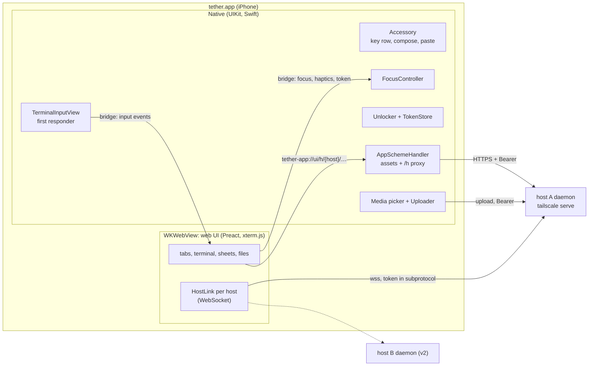

# iOS shell: the native app

tether's phone client is a Swift app: a `WKWebView` runs the web UI (terminal, tabs,
sheets, file manager), and native code owns the keyboard, auth, media and lifecycle.
The web UI is bundled in the app and served from a custom scheme. The app connects to
each host's daemon directly. The terminal's keystrokes come from a native first
responder, not from a text field in the page.

This replaces [plan.md §4.5 and §6.1](plan.md#45-native-ios-app). Auth is in
[auth.md](auth.md). The wire protocol and handshake belong to
[daemon-core.md](daemon-core.md). Spike 1, which gates this design, is
[spike-1-keyboard.md](spike-1-keyboard.md).



## What is native and what is web

Native code takes what WebKit can't do well on iOS, or what must not depend on the web
content process: keyboard ownership, secrets, system integration. Everything a user
looks at for long stays in the web UI, so Jimmy iterates on it without rebuilding the
app.

| Native (Swift) | Web (`web/`, in the WKWebView) |
|---|---|
| Keyboard: the first responder, software and hardware keys, modifiers | Terminal rendering (xterm.js), touch gestures, selection overlay |
| Accessory above the keyboard: key row, compose field, paste control | Tab bar, suggestion strip, `[+]` session sheet |
| Focus: who holds the keyboard, and lending it to web text inputs | File manager and viewers; the editor (v2) |
| Keyboard geometry: sizing the web view | Host protocol: WebSocket per host, tabs, reconnect state machine |
| Auth: Face ID lock, tokens in the Keychain, lock screen | |
| Hosts: host list, Add host and enrolment screens | Host picker in the `[+]` sheet (from the native host list) |
| Media: photo picker, camera, image paste, HEIC→JPEG, uploads | Upload progress chips, path insertion through the normal input path |
| Haptics, short text prompts, video player, share extension (later) | Requests for them, over the bridge |
| Lifecycle and network signals; saved tab list | Reacting to them: reconnect, restore tabs |

The keyboard-shown layout from [plan.md §5](plan.md#5-layout-and-collapsed-state),
split by owner:

```text
┌──────────────────────────────────────┐
│ terminal (web; same rows, pans so    │  WKWebView, frame ends at the
│ the cursor row stays visible)        │  top of the accessory
│ [<] (●main:1 ×)(◌api:2 ×)…   [+] [⊞] │  web: tab bar
│ git checkout ‹feat/›‹main›‹--track›  │  web: suggestion strip
├──────────────────────────────────────┤
│ ┌ compose (optional) ───────[Paste]┐ │  native inputAccessoryView
│ esc  tab  ctrl  ⇧tab ▸swipe     [⌨̲] │  native key row
├──────────────────────────────────────┤
│           iOS keyboard               │  system; no ⌃ ⌄ ✓ bar: that bar
└──────────────────────────────────────┘  belongs to WebKit form fields
```

## Where the web UI comes from

**Decision: bundled in the app**, served by a `WKURLSchemeHandler` at
`tether-app://ui/`, with a Debug-build switch that takes the assets from a dev server
instead.

| | Bundled (chosen) | Loaded from each daemon |
|---|---|---|
| Multi-host | One UI, talking to several daemons | Which host serves the UI that shows tabs from all hosts? Each origin needs its own storage and auth |
| Version skew | One UI, checked per host by the protocol handshake; a host outside the UI's range shows "update tether on devbox" | UI always matches the daemon that served it, but not the other hosts |
| Offline launch | Instant; saved tabs show "reconnecting" | Blank page or a cached copy of unknown age |
| Dev iteration | Needs the dev-server switch below | A daemon redeploy per web change |
| Daemon size | No embedded web assets | rust-embed of the whole UI |

**The scheme handler** (`ios/Tether/Web/AppSchemeHandler.swift`) routes by path:

- `/h/{host_id}/…` → the host's daemon over HTTPS, with `Authorization: Bearer` from
  [auth.md](auth.md#carrying-the-token). It streams the response, passes the request
  headers `Range`, `If-Match` and `If-None-Match` and the response headers
  `Content-Range`, `ETag` and `Content-Type` through, and adds the security headers
  below. A `401` means the device was removed from that host: the handler marks the
  host "not enrolled" ([auth.md](auth.md#carrying-the-token)) and passes the `401` to
  the web, without retrying. After `webView(_:stop:)` for a
  task it cancels the upstream request and never calls that task again (WebKit
  raises an exception if it does).
- everything else → web assets: the app bundle's `WebUI/` folder, or, in dev mode,
  the dev server.

Consequences: the web UI fetches relative URLs (`/h/{host}/fs/list`), so it needs no
CORS and never holds a token for HTTP; `` works with auth; the daemon serves
no UI (plan §4.6 no longer embeds assets).

### Web content security

The page holds the WebSocket token and can call the bridge, and the file viewer shows
files from repos and agent output. So untrusted content must never run as script in
the app's origin, `tether-app://ui`:

- **Navigation.** A `WKNavigationDelegate` allows only the app's own document
  (`tether-app://ui/index.html`, and reloads of it) in the main frame. Every other
  navigation, link or `window.open` is cancelled; `http`, `https` and `mailto` URLs
  go to `openURL`, which opens Safari, and anything else is dropped. In-app links
  (a relative link in rendered Markdown, a file path) are intercepted by the web
  router before they become navigations. The web viewers use no iframes.
- **Bridge.** The `tether` message handler rejects any message whose
  `frameInfo.isMainFrame` is false or whose frame origin isn't `tether-app://ui`.
- **CSP on the app's assets**, set by the scheme handler as a response header:
  `default-src 'self'; script-src 'self'; style-src 'self' 'unsafe-inline'; img-src
  'self' blob: data:; media-src 'self' blob:; connect-src 'self' wss:; frame-src
  'none'; object-src 'none'; base-uri 'none'` (`wss:` because each host's socket is
  on its own `*.ts.net` name). This is plan §9's strict CSP; the shell owns it now
  that the daemon serves no HTML. In Debug dev-server mode the handler relaxes it as
  far as Vite's dev client needs (inline scripts for HMR), never in a release build.
- **Headers on every proxied `/h/…` response:** `Content-Security-Policy: sandbox`
  and `X-Content-Type-Options: nosniff`. If anything does load a raw HTML or SVG file
  as a document, it runs in an opaque origin with no script. Whether WebKit honours
  `sandbox` on custom-scheme responses is unverified; navigation and the bridge check
  hold without it.
- Rendered Markdown and Mermaid stay behind DOMPurify and Mermaid's strict mode
  (plan §9).

**Video** doesn't go through the scheme handler. Custom-scheme media loading has a
history of dropping `Range` (WebKit bug 203302, fixed 2021, unverified on iOS 26), so
the web asks native to play a video and native opens `AVPlayerViewController` on the
daemon's `/h/{host}/fs/raw` URL with the Authorization header
(`AVURLAssetHTTPHeaderFieldsKey`). The file-manager spike checks it. If the header
option fails, add a short-lived single-path media ticket to auth; don't build it
before then.

**Dev mode** (Debug builds only; Settings → Web UI source):

- *Bundled* (default).
- *Dev server* at a URL such as `https://devbox.tail…ts.net:8443`, published with
  `tailscale serve` as in [plan.md §13.2](plan.md#132-running-the-phone-spikes). The
  scheme handler fetches assets from it; the origin stays `tether-app://ui`, so auth,
  storage and the `/h` proxy behave exactly as in a release build. Vite HMR connects
  to an explicit `server.hmr = { protocol: "wss", host, clientPort: 8443 }`. Vite
  6.0.9+ requires its HMR token: keep the check on; if it blocks the custom scheme,
  fall back to a reload (three-finger double tap reloads the web view in Debug).
- Web Inspector: `webView.isInspectable = true` in Debug, so Safari on the Mac can
  attach.
- A desktop browser also runs the web UI, against a real daemon: Vite's proxy
  forwards `/h` and the WebSocket and adds a token from `tether device add`
  ([auth.md](auth.md#cli)). A dev shim stands in for the bridge (DOM key events as
  input, no haptics). Playwright uses the same path.

The release build runs `scripts/build-web.sh` from an Xcode build phase:
`vite build`, output copied to the bundle's `WebUI/`. A release app therefore always
carries the web UI from the same commit.

## Transport

**Decision: the WebSocket lives in the web UI**, one per host (`web/src/net/HostLink`),
as plan §4.4 describes. Output frames go daemon → JS with no bridge crossing.
Keystrokes cross the bridge once (native → JS) before going out on the socket.

*Fallback, behind the same `HostLink` interface:* a native `URLSessionWebSocketTask`
per host, with input sent natively and output forwarded to JS over the bridge.
`callAsyncJavaScript` accepts only JSON-like arguments, so output would travel as
base64 strings, and every output chunk would cross the bridge.

Keystroke to echo crosses the bridge once either way. With the socket in JS the
keystroke crosses (native → JS) and the echo arrives in JS directly. With a native
socket the keystroke skips the bridge, but the echo, and all other output, crosses
(native → JS). So bridge latency can't favour the native socket; under heavy output
it only makes it worse. What decides the transport is socket reliability:

- **Spike 3** (in the app, against a real daemon): if a WKWebView WebSocket gets stuck
  after resume (WebKit 308073 was seen in Safari, not WKWebView) and the stuck-socket
  recovery in plan §4.4 (one new socket, then recreating the web view) doesn't clear
  it, move the socket to native.
- **Spike 1** measures the keystroke crossing only as an acceptance check: p99 under
  a 1 MB/s output flood must stay within one 60 Hz frame (16 ms), otherwise input
  coalescing needs work ([spike-1-keyboard.md](spike-1-keyboard.md#what-the-numbers-decide)).

## Keyboard

### The input responder

`TerminalInputView: UIView, UIKeyInput` is the first responder whenever the terminal
has the keyboard. It is invisible and zero-size, and sits in the root view, not inside
the web view.

- `UIKeyInput`, not `UITextInput` or a hidden `UITextView`. Terminal input is sent the
  moment it's typed, so there is nothing for autocorrect, marked text or predictions
  to edit afterwards. A `UITextView` would need a shadow buffer and diffing to undo
  corrections the pane has already received.
- Traits: `autocorrectionType = .no`, `autocapitalizationType = .none`,
  `spellCheckingType = .no`, `smartQuotesType = .no`, `smartDashesType = .no`,
  `smartInsertDeleteType = .no`, `inlinePredictionType = .no`,
  `keyboardType = .asciiCapable`, `returnKeyType = .default`.
- `hasText` always returns `true`, so Backspace reaches `deleteBackward` on an empty
  line.
- `insertText("\n")` sends Enter; `deleteBackward()` sends BSpace; any other text
  goes as literal text.
- Dictation, CJK input and autocorrect belong to the compose field
  ([plan.md §6.2](plan.md#62-autocorrect-and-text-input)). Apple says `UIKeyInput`
  conformers get "a small subset of keyboards": expected and fine for a terminal.
- Lost with `UIKeyInput`: iOS's long-press-space trackpad (it needs `UITextInput`).
  Trackpad mode starts from a two-finger press on the terminal or a drag on the key
  row's arrow group ([plan.md §7.2](plan.md#72-cursor-movement)).

Spike 1 checks what this view really gets on iOS 26: QuickType bar or not, Backspace
on empty, the double-space period, swipe typing.

### The accessory

`TerminalInputView.inputAccessoryView` is a `UIInputView(inputViewStyle: .keyboard)`
holding, top to bottom:

- **Compose field** (hidden by default; toggled per tab from the key row): a native
  `UITextView` with autocorrect, dictation and all keyboards. Return inserts a
  newline; the send button sends the text as a paste followed by Enter
  ([plan.md §7.3](plan.md#73-select-copy-and-paste)). Switching between compose and
  terminal swaps first responder between two native views, which leaves the keyboard
  up.
- **Key row:** the Termius-style groups of four from
  [plan.md §6.4](plan.md#64-agent-keybindings-and-key-row-groups), in a paging scroll
  view, plus hide-keyboard fixed at the end. Group 3's `^V img` opens the media menu
  ([below](#files-and-sharing)). Keys are `UIControl`s, which never take first
  responder.
- **Paste:** a `UIPasteControl` in the row. It pastes without iOS's "Allow Paste"
  prompt, which reading `UIPasteboard` directly would show each time. Its target is
  `TerminalInputView`, whose `pasteConfiguration` accepts text and images: text is
  sent as a `paste`, images go to upload. Cmd+V on a hardware keyboard reaches the
  same `paste(itemProviders:)`, which doesn't prompt either.

*Rejected:* putting the tab bar and suggestion strip in the accessory too. The tab
bar must also show with the keyboard hidden, when there is no accessory, so it would
exist twice; the suggestion chips come from the daemon over the web's socket and are
computed from the web terminal's buffer (plan §6.3), so a native strip would only
mirror web state over the bridge. The accessory holds what must be native: keys with
haptics, the paste control, and the text view that allows dictation.

The key row's configuration (groups, order) is native, stored in `UserDefaults`.
Reordering it in the app is v2; the MVP ships plan §6.4's groups.

**Modifiers** live in native `ModifierState`: Ctrl and Alt are sticky for one key and
locked by double tap, and apply to the next key from any source (key row, software
keyboard, hardware keyboard). With Ctrl locked, ^C and ^D ask for confirmation in a
native alert. Ctrl + a letter becomes the key `C-<letter>`; Alt + a key becomes
`M-<key>`.

### Hardware keyboard

- `pressesBegan`/`pressesEnded` on `TerminalInputView` handle keys that aren't plain
  text: Esc, Tab, Shift+Tab, arrows, Home/End/PgUp/PgDn, F-keys, and anything with
  Ctrl or Option. Those presses are consumed. Plain printing keys go to `super`, so
  they arrive through `insertText` in the active keyboard layout.
- Key repeat for consumed keys (arrows above all): `pressesBegan` reports key-down
  only once, so `HardwareKeys` runs its own repeat timer (400 ms delay, then every
  33 ms) until `pressesEnded`. If spike 1 shows iOS repeating `pressesBegan` by
  itself, the timer goes. `UIKeyCommand` fires once per press, so it isn't used for
  terminal keys.
- Option acts as Meta (`M-<key>`), as in terminal apps; Option-typed accented
  characters are not available in the terminal input (the compose field has them).
- `UIKeyCommand` covers app shortcuts only: Cmd+T new tab, Cmd+W close tab, Cmd+1…9
  switch tab, Cmd+K clear compose. `wantsPriorityOverSystemBehavior` is set on them.
- When a hardware keyboard is connected (`GCKeyboard.coalesced != nil`, updated from
  `GCKeyboardDidConnect`/`DidDisconnect`), the key row collapses to a thin strip
  holding modifiers state and hide; iOS still shows the accessory without the
  software keyboard.

`TetherKit/KeyMapper` turns a `UIKey` (`keyCode`, `modifierFlags`,
`charactersIgnoringModifiers`) and key-row keys into input events. It is pure and
unit-tested, and it is the only place the Swift side spells key names.

### How input reaches the terminal

Native sends input events to the web, which tags them with the active tab's pane and
puts them on that host's socket. Input takes the same path whether it comes from the
software keyboard, the key row, a hardware key, a suggestion chip, the compose field,
or a photo path after upload (inserted by the web itself).

```text
InputEvent = { text: string }    // literal text
           | { key: string }     // tmux key name: "Escape", "BTab", "C-c", "M-Enter", "Up"
           | { bytes: string }   // raw bytes, base64: only Shift+Enter (CSI-u ESC [13;2u)
           | { paste: string }   // bracketed paste through tmux
```

- The web maps these onto the protocol's `input { watch, items }` and
  `paste { watch, text }` messages ([daemon-core.md §5.3](daemon-core.md#53-json-messages)).
  The compose field's send is a `paste` followed by `{ key: "Enter" }`.
- Key names are plain strings checked by the daemon's allowlist regex
  ([daemon-core.md §3.4](daemon-core.md#34-commands-commandrs)). The contract is a
  fixture, `tests/fixtures/proto/keys.json`, listing every name the clients send:
  the Rust tests check each against the regex, and the KeyMapper tests check that
  KeyMapper emits nothing outside it.
- **Shift+Enter** is sent as `bytes`, never as the key `S-Enter`, which tmux 3.4 types
  as literal text (plan §6.5).
- **Esc Esc** (plan §6.4 group 3) is two `Escape` events about 50 ms apart; native
  times the gap and sends them as two bridge calls.
- The web splits any `text` longer than the protocol's 4 KiB `input` limit into
  several messages; bulk text goes as `paste`.
- Native coalesces events produced in the same run-loop turn (fast hardware typing,
  key repeat) into one bridge call, in order.
- The web routes to the active tab. Native doesn't know about tabs or panes.

### Focus: one controller, native

`FocusController` (Swift) is the only code that changes first responder. The web's
`input/` module ([plan.md §11](plan.md#11-code-structure-and-standards)) shrinks to a
client of it: it sends requests over the bridge and never focuses an element itself.

| State | First responder | Keyboard | Entered by |
|---|---|---|---|
| `hidden` | `TerminalInputView`, with an empty `inputView` and no accessory | down | hide key, a sheet that needs the screen |
| `terminal` | `TerminalInputView` | up | `[⌨]`, a tap on the terminal while hidden, the end of any borrow |
| `compose` | compose `UITextView` | up | compose toggle, a tap in the field |
| `webText` | WebKit's content view, once the user taps the field | WebKit's own (with its ⌃ ⌄ ✓ bar) | the web opening a surface with a web text input (the v2 editor) |
| `nativeModal` | a native alert or sheet's own field | up or down | native prompts, Add host |

- **Hiding doesn't give up first responder.** `hidden` sets
  `TerminalInputView.inputView` to an empty zero-height view and the accessory to nil,
  then calls `reloadInputViews()`; showing restores both. The terminal input stays
  first responder, so hardware keys still arrive and a tap while hidden can't let
  WebKit take over.
- **The guard.** In `terminal` and `hidden`, `TerminalInputView.canResignFirstResponder`
  returns `false` unless `FocusController` is the one moving focus. A tap on the web
  content then can't take first responder, and the keyboard stays up through
  scrolling, terminal taps, tab-bar and chip taps, and web sheets.
- **State comes from the responder, not from keyboard notifications.** A hardware
  keyboard connecting hides the software keyboard but changes no state; only
  `keyboardState` to the web changes, so the layout follows.
- **Borrowing for web text inputs.** The web sends `focus("webText")` when it opens a
  surface that has an editable element (the CodeMirror editor, v2), before the user
  taps into it. `FocusController` lowers the guard and resigns the terminal input;
  WebKit focuses the editor on the tap. When the surface closes, the web sends
  `focus("terminal")`, and native makes `TerminalInputView` first responder again. A
  native app may show the keyboard without a user gesture, so the hand-back needs no
  tap. Accepted cost: between opening the editor and tapping into it the keyboard is
  down. If WebKit's ✓ closes the editor's keyboard, the state stays `webText` with
  the keyboard down until the user taps the editor again or closes it.
- **No other web text inputs.** Rename, new window name and new file name ask native
  for a prompt (`prompt` on the bridge, a `UIAlertController` with a text
  field) and get the string back. This leaves the editor as the only borrower in the
  MVP. Live search (v2 scrollback search, a file filter) can't work through a modal
  prompt, so it becomes a second `webText` borrower when it's built. The
  web lint rule from plan §11 now bans `<input>`, `<textarea>` and `contenteditable`
  outside the editor, and xterm.js's helper textarea is made inert (`tabindex=-1`,
  `inert`, `disableStdin`).
- **Selection** (plan §7.3) relies on WebKit's selection, handles and Copy menu, and
  these may need WebKit's content view as first responder. Spike 1 checks it with the
  guard on. If they don't work, entering selection mode sends `focus("select")`:
  the guard drops, WebKit selects, the keyboard goes down, and native restores
  `terminal` automatically when selection ends. That still meets plan §6.1's target:
  nothing makes the user tap to get the keyboard back.
- **Restore after interruptions.** `FocusController` remembers the wanted state. On
  foreground, after a native sheet, after a web content process restart, it restores
  it.
- **System dismissal** of the software keyboard is rare without a ✓ bar. It changes
  no focus state: native only reports `keyboardState { visible: false }` to the web,
  and `[⌨]` or a tap on the terminal calls `reloadInputViews()` (and
  `becomeFirstResponder()` if needed) to bring it back.

### Keyboard geometry

Native sizes the web view so the web never measures the keyboard: plan §5's
`visualViewport` workarounds go away.

- On `keyboardWillChangeFrame`, native moves the web view's bottom edge to the top
  of the keyboard plus accessory, animated with the keyboard's curve and duration.
  With the keyboard hidden, the web view fills the screen.
- With every change, native sends `viewport { width, height, safeArea, keyboard:
  bool, collapsedHeight, reason }`, where `reason` is `initial`, `keyboard`,
  or `rotation`. `collapsedHeight` is the height the web view would have with
  the keyboard hidden in the current orientation.
- The web computes the tmux size only from `collapsedHeight` and width, and resizes
  tmux only on `initial` and `rotation` (plus font-size changes). A `keyboard` change
  never resizes tmux: the terminal keeps its rows and pans so the cursor row sits
  above the tab bar ([plan.md §4.2](plan.md#42-tmux-integration-control-mode)).
- `webView.scrollView`: `contentInsetAdjustmentBehavior = .never`, `bounces = false`,
  `keyboardDismissMode = .none`; zoom off in the viewport meta.

*Alternative kept for the spike:* leave the web view full size and send only the
keyboard height, if resizing the frame makes WebKit relayout badly or WebKit adjusts
for the keyboard by itself as well.

### Haptics

`Haptics` keeps one prepared generator per kind and calls `prepare()` on the
anticipating touch-down, as Apple advises.

| Event | Feedback | Triggered by |
|---|---|---|
| Key row key down | light impact | native, directly |
| Modifier lock on/off | medium impact | native |
| ^C/^D confirmation shown | warning notification | native |
| Tab switch, chip accepted | selection changed | web, via `haptic` |
| Selection mode starts | rigid impact | web |
| Upload done / failed | success / error notification | native |

## The bridge

One message handler named `tether` (`WKScriptMessageHandlerWithReply`, so web
requests return promises), and one entry point in the page,
`window.__tether.receive(messages)`, which native calls with
`callAsyncJavaScript(_:arguments:in:in:)` in the page content world. Every message is
a JSON object with a `type`. The boot reply carries `bridgeVersion`; a mismatch
between bundled web and native code can only happen in dev mode, and shows an error
banner.

| Web → native | Reply | Purpose |
|---|---|---|
| `ready` | `boot { bridgeVersion, hosts, tabs, settings, viewport, keyboard }` | Start; restore the saved tabs |
| `token { host }` | `{ token }`, `{ locked }` or `{ notEnrolled }` | WebSocket token ([auth.md](auth.md#carrying-the-token)) |
| `saveTabs { tabs }` | | Persist the open-tab list |
| `keyboard { show }` | | `[⌨]`, a tap on the terminal |
| `focus { mode }` | | `terminal`, `webText`, `select` |
| `haptic { kind }` | | Semantic haptics |
| `prompt { title, message, initial }` | `string` or `null` | Short text entry |
| `pickMedia { host }` | | The web file manager's upload button |
| `playVideo { host, path }` | | Native player |
| `active { host }` | | The active tab's host, for key-row uploads; sent on every tab switch |
| `openURL { url }` | | Links leave the app |
| `ack { id }` | | Spike 1 latency measurement only |

| Native → web | Purpose |
|---|---|
| `input { events: InputEvent[] }` | Keystrokes, key row, compose, paths |
| `viewport { … }` | Geometry, above |
| `keyboardState { visible, focus }` | Keep `[⌨]` and the layout in sync |
| `lifecycle { phase }` | `active`, `background` |
| `network { reachable, interface }` | Reconnect trigger |
| `auth { host, state }` | `unlocked`, `locked`, `notEnrolled`, `faceIdChanged` |
| `hosts { hosts }` | Host list changed |
| `upload { id, host, progress, path?, error? }` | Upload chips; on `path`, the web inserts it into the tab recorded at the first message |

The bridge types are written twice, in `web/src/native/bridge.ts` and
`ios/TetherKit/Sources/TetherKit/Bridge.swift`. Both test suites decode the same
fixtures in `ios/TetherKit/Tests/fixtures/bridge/*.json`. The bridge is app-internal
and the daemon never sees it, so it doesn't belong in the Rust protocol crate.

## Lifecycle and reconnect

| Event (native signal) | What happens |
|---|---|
| Launch | Load the UI from the bundle; `boot` restores tabs as "reconnecting"; the lock screen shows if needed ([auth.md](auth.md#swift-side-keychain-item-and-app-lock)); once unlocked, the web connects every host with an open tab |
| Background (`sceneDidEnterBackground`) | Native sends `lifecycle background` inside a short `beginBackgroundTask`; the web closes its sockets cleanly. The daemon starts the 15 s linger at once, instead of after its 25 s idle timeout, and the laptop gets its window size back sooner ([daemon-core.md §3.7](daemon-core.md#37-sizing)) |
| A native screen covers the terminal (host list, Add host, settings) | The web sends `visibility { visible: false }` and keeps the socket and its pings, so size votes clear; `true` when the terminal shows again. (The lock screen only follows a background, when the sockets are already closed.) |
| Foreground (`sceneDidBecomeActive`) | Lock check first; then `lifecycle active`; the web reconnects at once and re-sends `watch` with `resume { gen, seq }` for the visible tab (ring replay within the linger, otherwise a snapshot; [daemon-core.md §4.3](daemon-core.md#43-watching-a-window)); `FocusController` restores the keyboard |
| Network change (`NWPathMonitor`: satisfied, or interface changed) | `network` → the web resets backoff and reconnects sockets that are closed or silent past a heartbeat |
| Web content process killed (`webViewWebContentProcessDidTerminate`) | Native reloads the page; `boot` restores tabs from the native copy; focus is restored. Tabs live natively so they survive this |
| Host unreachable for a while | Tabs stay "reconnecting" (plan §4.4). Past 10 s, the pill's detail says "Can't reach devbox. Is Tailscale on?": the app can't read the VPN state, and Tailscale off is the usual cause |

iOS suspends the app in the background and its sockets die, native or not; resume
speed is what the design optimizes, as in plan §2.

## Files and sharing

**Photo, camera, image paste (MVP), native.** The key row's `^V img` key (or
`pickMedia` from the web) opens a menu: Photo Library (`PHPickerViewController`, no
permission prompt), Camera (`UIImagePickerController`), Paste image (through the paste
control). Then:

1. `ImageConverter` (ImageIO) re-encodes HEIC to JPEG at quality 0.9, longest side
   2048 px unless "Send original" is on.
2. `Uploader` posts to `/h/{host}/fs/upload` with the Bearer token, reporting
   progress over the bridge.
3. On success, native reports the absolute path in an `upload` message. The web
   inserts it, shell-quoted and without Enter, as `text` input into the tab that was
   active when the upload started; it recorded that tab from the upload's first
   message (plan §8 step 4).

The upload goes to the host of the active tab, which the web reports with `active`
on every tab switch.

This replaces plan §8's in-page HEIC conversion for the app.

**Share extension (after the paid account).** A `TetherShare` target accepts images
and movies, copies them into the App Group container (`Inbox/<uuid>.<ext>` plus a
manifest), and tells Jimmy to open tether. On the next foreground the app offers
"Send 1 photo to main:1?" and runs the upload above. The extension never touches
tokens or the network. App Groups are likely unavailable to a free Personal Team,
which is why this waits.

**Clipboard (v2 notes).** Native code may write `UIPasteboard` without a gesture, so
an OSC 52 copy from the server can go straight to the clipboard (behind a setting),
replacing plan §7.3's "Copy from server" chip.

## Hosts

`HostStore` keeps the host list in `UserDefaults`: `{host_id, name, baseURL}`. Tokens
live in the Keychain ([auth.md](auth.md#swift-side-keychain-item-and-app-lock)). The MVP has
one host, but the store, the bridge and every URL already carry the host id. Add host
(SwiftUI) takes the MagicDNS name and the enrolment code. A host whose name changes
keeps its `host_id`; Jimmy edits its URL.

## Project layout

```text
ios/
  project.yml            XcodeGen spec: Tether app, TetherTests; TetherShare later
  Tether/
    App/                 AppDelegate, SceneDelegate, RootViewController
    Web/                 WebShell (WKWebView setup), AppSchemeHandler, Bridge
    Input/               TerminalInputView, Accessory (key row, compose, paste),
                         HardwareKeys, ModifierState, FocusController, KeyboardGeometry
    Auth/                TokenStore, Unlocker, AuthClient (auth.md)
    Hosts/               HostStore, HostsView, AddHostView (SwiftUI)
    Media/               MediaPicker, ImageConverter, Uploader, VideoPlayer
    Support/             Haptics, Settings, Info.plist, Tether.entitlements
  TetherKit/             Swift package, no UIKit: KeyMapper, Bridge types,
                         Generated/ (protocol types); `swift test`
  scripts/build-web.sh   Xcode build phase: vite build → bundle WebUI/
  spikes/keyboard/       spike 1 (deleted once it has answered)
```

- **UIKit for the shell, SwiftUI for screens.** First responder, `inputAccessoryView`
  and WKWebView control are UIKit concepts; host list, Add host, lock screen and
  settings are SwiftUI views in `UIHostingController`s.
- **XcodeGen.** `project.yml` is committed; `Tether.xcodeproj` is generated and
  gitignored. Agents on the Linux box can edit Swift files and the YAML but can't run
  Xcode, and a hand-edited `project.pbxproj` breaks easily. *Rejected:* a committed
  `.xcodeproj` (unreviewable diffs, agent edits break it), Tuist (more machinery for
  one app), a bare Swift package (can't build an app with entitlements and
  extensions).
- **Info.plist:** `NSFaceIDUsageDescription`, `NSCameraUsageDescription`; no ATS
  exceptions (the `*.ts.net` certificates are publicly trusted). Bundle id and team
  are set in `project.yml`.
- **Builds and tests run on the Mac.** `ios/scripts/check.sh` runs `xcodegen`, `swift
  test` for TetherKit, and an `xcodebuild` for the simulator. The Linux preflight
  doesn't build iOS. A macOS CI job can run `swift test` later.

### Protocol types in Swift

Swift needs few protocol types: the auth DTOs (`/auth/*` bodies, defined in
`src/proto/auth.rs`, [auth.md](auth.md#endpoints)) and, only if the socket moves
native, the WebSocket messages. Key names are strings with a shared fixture (above),
not generated types.
[daemon-core.md §5.5](daemon-core.md#55-type-generation-typeshare) generates the
protocol types with **typeshare** for TypeScript and Swift. The Swift output goes to
`ios/TetherKit/Sources/TetherKit/Generated/`, the TypeScript to
`web/src/proto/generated/`, from one script, and preflight checks that both are
current. If typeshare fails daemon-core's spike, the fallback there is
ts-rs plus hand-written Swift `Codable` mirrors; for the app that means the auth DTOs
only, tested against JSON fixtures the Rust tests emit.

## Distribution

- **Now:** Xcode on Jimmy's Mac, free Personal Team. Profiles last 7 days, so he
  reinstalls from Xcode weekly; at most 3 apps on the device; no App Groups, so no
  share extension. Developer Mode must be on.
- **Later:** paid account, TestFlight internal testing (builds last 90 days), App
  Groups and the share extension.

## What the app relies on in the protocol

[daemon-core.md §5](daemon-core.md#5-srcproto-the-wire-protocol) owns the wire
protocol. The app depends on these parts of it:

- one WebSocket per host at `/h/{host}/ws`, the token in the subprotocol list, and
  `host` on every message that names a session or window (§5.1);
- version ranges in `hello`/`welcome`, `incompatible` with close 4001 marking just that
  host, and the same range in `GET /auth/info` (§5.2). A reload can't fetch a
  different UI, so plan §4.4's reload-on-mismatch doesn't apply;
- close 4401 on a bad or revoked token, both right after the upgrade and from the
  connection's own 10 s re-check ([auth.md](auth.md#carrying-the-token)); the app
  marks the host "not enrolled" and doesn't retry;
- `ping` every 10 s for as long as the socket is open, visible or not; `visibility`
  affects only size votes;
- `welcome.daemon.instance`: a new instance means discarding saved `resume`
  positions for that host;
- `resize` only on rotation and font change, never for the keyboard (§3.7);
- `/h/{host}/fs/upload` returning the absolute path, and `/fs/raw` honouring `Range`
  for the native video player ([plan.md §8](plan.md#8-file-manager)).

## Open risks

- **The guard vs WebKit's selection** (medium): if WebKit needs first responder to
  select, selection briefly drops the keyboard. Spike 1.
- **WKWebView adjusting for a keyboard it doesn't own**, fighting the frame resize.
  Spike 1, both geometry variants.
- **Bridge latency under load**: unmeasured on iOS 26. Spike 1 checks it against one
  frame.
- **The empty-`inputView` trick for `hidden`** is common practice, not documented
  behaviour. Spike 1 checks it.
- **WebSocket after resume in WKWebView** (WebKit 308073 seen in Safari): spike 3.
  A Tailscale issue (#20882) reports serve WebSocket failures when the client
  negotiates HTTP/2; WKWebView's WebSockets are expected to use HTTP/1.1, unverified.
- **Video through the native player with an auth header**: the file-manager spike.
- **Vite HMR from the custom scheme**: reload is the fallback; it only affects dev
  speed.
- **Weekly reinstall on the free team** until the paid account.
