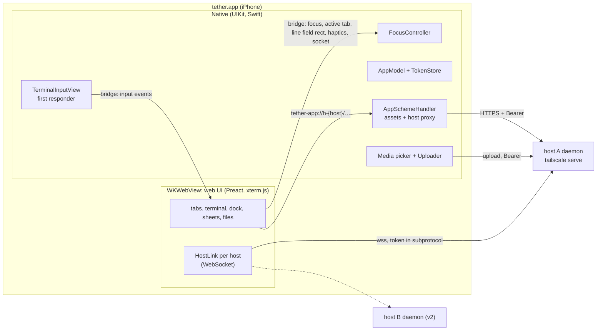

# iOS shell: the native app

> **Client UX update (2026-10-22):** Start with [client design and Mac handoff](client/README.md).
> Its approved browser/mobile navigation and minimal layout supersede conflicting
> UI rules below. Subsystem invariants remain in force; touch, clipboard and the phone
> dock retain explicit device gates.

P4a implements the native shell and the Swift side of bridge v2. The bridge's web
adapter is P4b; the device-only checks below still need Jimmy's iPhone.

tether's phone client is a Swift app: a `WKWebView` runs the web UI (terminal, tabs,
the phone dock, sheets, file manager), and native code owns the first responder,
keyboard geometry, auth, media and lifecycle.
The web UI is bundled in the app and served from a custom scheme. The app connects to
each host's daemon directly. The terminal's keystrokes come from a native first
responder, not from a text field in the page.

Auth is in [auth.md](auth.md), the wire protocol in
[daemon-core.md §5](daemon-core.md#5-srcproto-the-wire-protocol), and the checks this
design still needs on the phone in the [device checklist](#device-checklist). Reasons
and rejected alternatives are in [decisions.md](decisions.md).



## What is native and what is web

Native code takes what WebKit can't do well on iOS, or what must not depend on the
web content process: keyboard ownership, secrets, system integration. Everything a
user looks at for long stays in the web UI, so Jimmy iterates on it without
rebuilding the app.

| Native (Swift) | Web (`web/`, in the WKWebView) |
|---|---|
| Keyboard: the first responder, software and hardware keys | Terminal rendering (xterm.js), touch gestures, selection overlay |
| Nothing drawn above the keyboard: no `inputAccessoryView`; a native terminal responder and system keyboard traits | The dock: one row at rest (tab chip, line field, toggle), and the fixed key row while the keyboard is up; the session switcher sheet; the terminal's edit menu (Copy, Paste) |
| Focus: who holds the keyboard, and lending it to the line field and other web text inputs | File manager and viewers; the editor (v2) |
| Keyboard geometry: sizing the web view | Host protocol: WebSocket per host, tabs, reconnect |
| Auth: Face ID lock, tokens in the Keychain, lock screen | |
| Hosts: host list, Add host and enrolment screens | Host picker in the session switcher (from the native host list) |
| Media: photo picker, camera, image paste, JPEG conversion, uploads; pasteboard reads and writes | Upload chips, path insertion through the normal input path |
| Haptics, video player, share extension (later) | Requests for them, over the bridge |
| Lifecycle and network signals; saved workspace | Reacting to them: reconnect, restore tabs |

The keyboard-shown layout from [plan.md](plan.md#layout), split by owner. Everything
above the keyboard is the web view; native draws no accessory.

```text
┌──────────────────────────────────────┐
│ terminal (web; same rows, pans so    │  WKWebView, frame ends at the
│ the cursor row stays visible)        │  top of the keyboard
│ esc ^R ^C tab ctrl alt | ~ / - [⌨]  │  web dock: fixed key row and toggle (keyboard up)
│ [main 2] [ Type or dictate a line ]   │  web dock: tab chip and one-line field
├──────────────────────────────────────┤
│           iOS keyboard               │  system; WebKit's ⌃ ⌄ ✓ bar hidden
└──────────────────────────────────────┘
```

With the keyboard down, the web view fills the screen and the dock, one row without the
key row, sits on the bottom safe area. The toggle is in the key row while the keyboard
is up and in this dock row while it is down. The fixed row has no arrow keys; the
terminal's long-press arrow pad owns touch arrows. The dock's rules are in
[browser-behaviors.md](client/browser-behaviors.md#phone-dock); native's part is to own
the terminal input, lend the line field to WebKit, and size the web view.

## Where the web UI comes from

The native app's web UI is **bundled in the app** and served by a
`WKURLSchemeHandler`. P4a always uses bundled assets; the Debug-build dev-server source
switch remains deferred to `ios/.context/FUTURE`. Separately, the daemon embeds and serves the production browser build
at its canonical tailnet origin ([auth.md](auth.md#canonical-origin)); the iOS app
does not load that copy or register its service worker.

**The scheme handler** (`ios/Tether/Web/AppSchemeHandler.swift`) serves two kinds of
origin:

- **`tether-app://ui/`**: web assets from the app bundle's `WebUI/` folder. The page and
  its scripts live here.
- **`tether-app://h-{host_id}/…`**: a proxy to that host's daemon (`/fs/*`,
  `/complete`) over HTTPS, with `Authorization: Bearer`
  ([auth.md](auth.md#carrying-the-token)). Each host gets its own origin, different
  from the UI's, so the UI's `script-src 'self'` can never cover a daemon response.
  The handler forwards the method (`GET`, `POST`, and `PUT` in v2) and the body;
  streams the response; passes the request headers `Range`, `If-Match`, `Content-Type`
  and the response headers `Content-Range`, `ETag`, `Content-Type`; adds the security
  headers below and `Access-Control-Allow-Origin: tether-app://ui`, since the page
  fetches these cross-origin. It also adds `Access-Control-Expose-Headers:
  Content-Range, ETag`: a cross-origin page can read only the CORS-safelisted response
  headers (`Content-Type`, `Content-Length` and a few others), so without the list the
  page could not read the file size from `Content-Range` or the validator from `ETag`.
  It answers a CORS preflight (`OPTIONS`) itself, allowing
  `tether-app://ui`, those methods and those request headers, and never forwards one:
  the daemon answers no preflight ([auth.md](auth.md#carrying-the-token)). The routes
  are in [fs.md](fs.md). After `webView(_:stop:)` it cancels the
  upstream request and never calls that task again (WebKit raises an exception if it
  does).
  - **Compatibility gate:** the handler proxies to a host only once that host's
    `GET /auth/info` has reported, in this app session, a protocol range that contains
    the app's version; otherwise it answers `409 {"error": "incompatible"}` without
    contacting the daemon. The protocol version covers the HTTP routes
    ([daemon-core.md §5.2](daemon-core.md#52-handshake-and-versions)).
  - Only `/fs/*`, `/complete`, and exact `GET /auth/info` are permitted. The
    percent-encoded path and trailing slash are forwarded unchanged. `OPTIONS` is
    answered locally before the compatibility gate; a disallowed route never reaches
    the daemon.
  - Protected requests require a cached native token. While locked the handler returns
    local `423 {"error":"locked"}`; without a token it returns local
    `401 {"error":"not_enrolled"}`. A daemon `401` revokes the cached token only if
    the request actually carried it. Cross-origin redirects are refused.

For HTTP endpoints, P4b builds proxy URLs from `PlatformHost.handle`; native resolves
them to the private `baseURL` and supplies the per-host token. The production browser
adapter uses `location.origin` and carries no credential; the daemon judges it as an
enrolled tailnet node. Native requests use the same endpoints without browser Origin
checks.

### Web content security

The page holds the WebSocket token and can call the bridge, and the file viewer shows
files from repos and agent output. Untrusted content must never run as script in
`tether-app://ui`:

- **Navigation.** A `WKNavigationDelegate` allows only the app's own document
  (`tether-app://ui/index.html`, and reloads of it) in the main frame. Every other
  navigation, link or `window.open` is cancelled; `http`, `https` and `mailto` URLs go
  to `openURL` (Safari), anything else is dropped. In-app links (a relative link in
  rendered Markdown, a file path) are intercepted by the web router first. The web
  viewers use no iframes.
- **Bridge.** The `tether` message handler rejects any message whose
  `frameInfo.isMainFrame` is false or whose frame origin isn't `tether-app://ui`.
- **CSP on the app's assets**, a response header set by the scheme handler:
  `default-src 'self'; script-src 'self'; style-src 'self' 'unsafe-inline'; img-src
  'self' tether-app: blob: data:; media-src 'self' blob:; connect-src 'self'
  tether-app: wss:; frame-src 'none'; object-src 'none'; base-uri 'none'` (`wss:`
  because each host's socket is on its own `*.ts.net` name). P4a has no dev-server mode
  or relaxed CSP path.
- **Every proxied response** also gets `Content-Security-Policy: sandbox` and
  `X-Content-Type-Options: nosniff`.
- Rendered Markdown and Mermaid stay behind DOMPurify and Mermaid's strict mode
  ([plan.md](plan.md#security)).

**Video** doesn't go through the scheme handler: custom-scheme media loading has a
history of dropping `Range` (WebKit bug 203302, fixed 2021, unverified on iOS 26). The
web asks native to play a video, and native opens `AVPlayerViewController` on the
daemon's `/fs/raw` URL with the Authorization header (`AVURLAssetHTTPHeaderFieldsKey`).
The file-manager spike checks it; if the header option fails, add a short-lived
single-path media ticket to auth, not before.

**Development:** the Debug app uses bundled assets and enables Web Inspector. The
Debug dev-server asset-source switch and HMR route are not implemented in P4a. Desktop
browser development uses the browser adapter and its Vite proxy; it does not stand in
for the native bridge.

The Xcode build runs `ios/scripts/build-web.sh` from a build phase (`pnpm --dir web
run build`, output copied to `WebUI/`), so the app carries the web UI from this checkout.

## Transport

**The WebSocket lives in the web UI**, one per host (`web/src/net/HostLink`). Output
frames go daemon → JS with no bridge crossing; keystrokes cross the bridge once
(native → JS) before going out on the socket.

**Socket resolution.** Inside native `HostLink`, the web sends `{type:"socket",
host}`. Native replies `{url, token}`, `{locked:true}` or `{notEnrolled:true}`; for an
enrolled host, `url` is `wss://<stored host>/ws`. The URL and token are returned only to
that Link and are never put in `PlatformHost`, workspace, storage or general page state.
No Keychain read occurs in the WebKit callback; the app lock has already loaded the
token map into memory.

Rejected: `baseURL` on `PlatformHost` (exposes host routing in page state);
`WebSocket` over `tether-app://` (a scheme handler cannot carry it); native
`URLSessionWebSocketTask` (the fallback below, only if spike 3 shows stuck sockets).

*Fallback, behind the same `HostLink` interface:* a native `URLSessionWebSocketTask`
per host, with output forwarded to JS over the bridge as base64. Keystroke to echo
crosses the bridge once either way, so bridge latency can't favour the native socket;
under heavy output it only makes it worse. What decides is socket reliability:

- **Spike 3** (in the app, against a real daemon): if a WKWebView WebSocket gets
  stuck after resume and the stuck-socket recovery ([plan.md](plan.md#reconnect)) doesn't
  clear it, the socket moves to native.
- **The device checklist** measures the keystroke crossing as an acceptance check: p99
  under a 1 MB/s output flood within one 60 Hz frame (16 ms). Above that, tune input
  coalescing and the page's output batching; moving the socket native would not help,
  since the echo would cross the bridge instead.

## Keyboard

### The input responder

`TerminalInputView: UIView, UIKeyInput` is the first responder whenever the terminal
has the keyboard. It is invisible and zero-size, and sits in the root view, not inside
the web view.

- `UIKeyInput`, not `UITextInput` or a hidden `UITextView`: terminal input is sent the
  moment it's typed, so there is nothing for autocorrect, marked text or predictions
  to edit afterwards.
- Traits: `autocorrectionType = .no`, `autocapitalizationType = .none`,
  `spellCheckingType = .no`, `smartQuotesType = .no`, `smartDashesType = .no`,
  `smartInsertDeleteType = .no`, `inlinePredictionType = .no`,
  `keyboardType = .asciiCapable`, `returnKeyType = .default`.
- `hasText` always returns `true`, so Backspace reaches `deleteBackward` on an empty
  line.
- `insertText("\n")` sends Enter; `deleteBackward()` sends BSpace; other text goes as
  literal text.
- Dictation, CJK input and autocorrect belong to the dock's line field
  ([plan.md](plan.md#autocorrect-and-text-input)). `UIKeyInput` conformers get "a small
  subset of keyboards", which is fine for a terminal.
- `UIKeyInput` loses iOS's long-press-space trackpad (it needs `UITextInput`). Arrows
  on touch come from the web's long-press arrow pad
  ([plan.md](plan.md#cursor-movement)).

The [device checklist](#device-checklist) checks what this view really gets on iOS 26:
the QuickType bar, Backspace on empty, the double-space period, swipe typing.

### The line field: lending first responder to WebKit

The dock's line field is a web `<input>`, so typing in it needs WebKit's content view
as first responder, while the guard (below) keeps every other tap on the page from
taking it. Native lends it by place, not by message:

- The web reports the line field's rect, in web view coordinates, with bridge
  `lineField { rect }` whenever the dock lays out, and `rect: null` when Terminal is
  covered by an overlay or another destination.
- A passive native recognizer on the web view (`cancelsTouchesInView = false`, never
  recognizing, simultaneous with WebKit's) sees each touch-down before WebKit acts on
  it. A touch that begins inside the rect lowers the guard.
- WebKit focuses the field on the tap and takes first responder straight from
  `TerminalInputView`, so a keyboard that was up stays up and only its traits change.
  WebKit asks for first responder after the touch has ended (its tap recognizer fires
  at touch end, then the page handles the click), so the guard stays down until the
  web confirms: the field's `focusin` sends `focus webText`, and `FocusController`
  enters `webText`. If no confirmation arrives within 500 ms of the touch ending (a
  drag, a cancelled tap), the guard comes back up.
- The field is `enterkeyhint="send"`, so its keyboard shows the blue send key, while
  `TerminalInputView` keeps `returnKeyType = .default`: the Return key is one of the
  focus cues ([browser-behaviors.md](client/browser-behaviors.md#phone-dock)).
- The keyboard toggle from the line field: the web's focus controller blurs the field,
  then sends `focus hidden`; native makes `TerminalInputView` first responder with the empty
  `inputView`, so the keyboard goes down and hardware keys go to the terminal.
- Native suppresses the WebKit form accessory bar (⌃ ⌄ ✓) by overriding
  `inputAccessoryView` on the internal `WKContentView` subclass. This uses private
  WebKit structure; if that class path is absent the app safely leaves the system bar
  in place. Confirm the behavior on Jimmy's device.

Standard user-driven paste remains required. In the line field it is WebKit's own paste
menu. The terminal's edit menu (a long-press released, [plan.md](plan.md#select-copy-and-paste))
has Paste, which asks native over the bridge (`readPasteboard`); native reads `UIPasteboard`, sending text back and
uploading an image itself. iOS shows its "Allow Paste" prompt unless Jimmy sets
tether's Paste from Other Apps to Allow.

### Hardware keyboard

> Key delivery remains required. Custom application shortcuts below are deferred; do not add a shortcut system to the minimal client.

- `pressesBegan`/`pressesEnded` on `TerminalInputView` handle keys that aren't plain
  text: Esc, Tab, Shift+Tab, arrows, Home/End/PgUp/PgDn, F-keys, anything with Ctrl
  or Option. Those presses are consumed. Plain printing keys go to `super` and arrive
  through `insertText` in the active layout.
- Key repeat for consumed keys: `pressesBegan` reports key-down once, so
  `TerminalInputView` repeats (400 ms delay, then every 33 ms) until `pressesEnded`.
  All repeat timers stop when the responder resigns or the app becomes inactive. If
  the device checklist shows iOS repeating `pressesBegan` itself, the timer goes. `UIKeyCommand`
  fires once per press, so it isn't used for terminal keys.
- Option acts as Meta (`M-<key>`) for letters and digits; Option plus any printable
  non-alphanumeric ASCII character sends ESC followed by that character, while
  Option+Space is the allowlisted `M-Space`. Option-typed accented characters are in
  the line field only.
- `UIKeyCommand` covers app shortcuts only: Cmd+T new tab, Cmd+W close tab, Cmd+1…9
  switch tab, with `wantsPriorityOverSystemBehavior`.
- A hardware keyboard changes nothing in the dock: the key row stays as it is.

`TetherKit/KeyMapper` turns a `UIKey` (`keyCode`, `modifierFlags`,
`charactersIgnoringModifiers`) into input events. It is pure,
unit-tested, and the only place the Swift side spells key names.

### How input reaches the terminal

Native sends the terminal input's events to the web, which puts them on the active
tab's watch: the software keyboard and hardware keys. The dock's key row and line
field are web controls and reach the tab without crossing the bridge. The web applies
an armed ctrl or alt from the key row to the next native event (`c` becomes `C-c`), so
modifier arming has one owner for every source.

```text
InputEvent = { text: string }    // literal text
           | { key: string }     // tmux key name: "Escape", "BTab", "C-c", "M-Enter", "Up"
           | { bytes: string }   // raw bytes, base64: Shift+Enter and modified punctuation
           | { paste: string }   // bracketed paste through tmux
```

- The web maps these onto the protocol's `input` and `paste` messages
  ([daemon-core.md §5.3](daemon-core.md#53-json-messages)). A tab sends input only once
  its watch is bound (`watching`).
- Key names are plain strings checked by the daemon's allowlist
  ([daemon-core.md §3.4](daemon-core.md#34-commands-commandrs)). `KeyMapperTests`
  iterates every mapped key code and modifier set against a faithful copy of
  `src/tmux/command.rs:is_key_name`; the test comment points to that source.
- **Shift+Enter** goes as `bytes`, never the key `S-Enter`, which tmux 3.4 types as
  literal text.
- Ctrl+Space is the allowlisted `C-Space` key. Ctrl+`[`, Ctrl+`/` and Ctrl+`\\`, plus
  Option with printable non-alphanumeric ASCII, are raw `bytes` (base64); Option
  prefixes the character with ESC. Option+Space is `M-Space`.
- The web splits `text` longer than the `input` limit
  ([daemon-core.md §6](daemon-core.md#6-limits-and-the-memory-ceiling)) into several
  messages; bulk text goes as `paste`.
- Native coalesces events from one run-loop turn (fast hardware typing, key repeat)
  into one bridge call, in order.
- The web sends `activeTab { tab: TabKey | null }` whenever the active tab changes.
  Native caches that key, so each coalesced input batch needs one bridge call; the web
  still drops stale-tab batches before routing them.

### Focus: one controller, native

`FocusController` (Swift) is the only code that changes first responder. The web
(`web/native/`) asks for focus changes over the bridge and never focuses an element.

| State | First responder | Keyboard | Entered by |
|---|---|---|---|
| `hidden` | `TerminalInputView`, with an empty `inputView` | down | `focus hidden`: the keyboard toggle while an input holds the keyboard; a surface that needs the screen |
| `terminal` | `TerminalInputView` | up | `focus terminal`: the keyboard toggle while the keyboard is down; restoration after an interruption. Never a tap on the terminal |
| `webText` | WebKit's content view, once the user taps a field | WebKit's own | a touch in the line field's rect while on Terminal (above); `focus webText` on any other destination or overlay |
| `select` | WebKit's content view | down | `focus select`, only if selection needs it (below) |

- **Hiding doesn't give up first responder.** `hidden` sets
  `TerminalInputView.inputView` to an empty zero-height view,
  then calls `reloadInputViews()`; showing restores it. Hardware keys still arrive,
  and a terminal tap while hidden can't let WebKit take over or show the keyboard.
- **The guard.** In `terminal` and `hidden`, `canResignFirstResponder` returns `false`
  unless `FocusController` is moving focus or a touch began in the line field's rect.
  Taps on web content then can't take first responder. Scrolling, terminal taps,
  tab-chip and key-row taps do not change keyboard visibility. A web sheet sends
  `focus webText` (the resting mode off Terminal), which lowers the keyboard; closing
  it sends the Terminal resting mode, which raises it again.
- **Focus is owned separately from geometry.** A hardware keyboard can leave the
  terminal responder active while `viewport.keyboard` is false; native does not infer
  focus from that geometry. If iOS dismisses the software keyboard with no hardware
  keyboard connected, native moves to `hidden`; the viewport reports keyboard false.
- **Borrowing for web text inputs off Terminal.** The web sends `focus webText` when it
  opens a surface with an editable element, before the user taps into it; `FocusController`
  lowers the guard and resigns the terminal input, and WebKit focuses the editor on the
  tap. On close the web sends `focus terminal`, and native makes `TerminalInputView`
  first responder again with no tap needed. Accepted: the keyboard is down between
  opening the editor and tapping into it.
- **xterm.js's helper textarea** is made inert (`tabindex=-1`, `inert`,
  `disableStdin`): the terminal input is native's.
- **Selection** ([plan.md](plan.md#select-copy-and-paste)) relies on WebKit's
  selection, handles and Copy menu, which may need WebKit's content view as first
  responder. The device checklist checks it with the guard on. If they don't work,
  selection mode sends `focus select`: the guard drops, WebKit selects, the keyboard
  goes down, and native restores the earlier state when selection ends.
- **Native coverage gates focus and input.** While the lock screen or native server
  sheet covers the app, `FocusController.set` records web focus requests into the
  pre-cover state rather than changing the responder; uncovering applies the latest
  requested destination. A queued terminal input batch is dropped while locked or
  covered, so it cannot leak keys behind the cover.
- **Restore after interruptions.** `FocusController` remembers the wanted state and
  restores it on foreground, after a native sheet, and after a web content process
  restart. A wanted `webText` from the line field comes back as `terminal`: WebKit
  focuses a field only on a tap, and the keyboard coming back up is what matters.
  `webText` from Files or a web sheet stays `webText`; it does not steal focus for the
  terminal. The lock screen is a native cover: it lowers the keyboard, suppresses
  hardware input until unlock, and restores the latest requested destination.
- **System dismissal** of the software keyboard, with no hardware keyboard attached
  (`GCKeyboard.coalesced` is nil): `FocusController` moves to `hidden` and sends a
  `viewport` with `keyboard: false`. The web must reflect that dismissal in its focus
  owner; one toggle press requests `focus terminal` and `reloadInputViews()` brings the
  software keyboard back. With a hardware keyboard attached, native keeps `terminal`
  because keys still go to the responder. v2 has no separate hardware-keyboard field,
  so this distinction remains a device-gated behavior to verify.

### Keyboard geometry

Native sizes the web view, so the web never measures the keyboard.

- On `keyboardWillChangeFrame`, native moves the web view's bottom edge to the top of
  the keyboard, with the keyboard's curve and duration. The dock, at the bottom of the
  web view, rides on the keyboard. With the
  keyboard hidden, the web view fills the screen.
- On every change native sends the v2 `viewport` object: `layout`, `density`,
  `directInput`, `scheme`, `width`, `stableHeight`, `visibleHeight`, `keyboardInset`,
  `safeArea` and `keyboard`. Heights and insets are CSS-pixel-equivalent points. The
  native view moves above a docked keyboard; `keyboardInset` is the bottom obstruction
  between stable and visible height and remains required even when the view is resized.
- **Every `viewport` carries the full-screen layout's `safeArea`, including while the
  keyboard is up.** The web view that ends above the keyboard has no bottom inset of its own
  (its `env(safe-area-inset-bottom)` is 0), but the web sizes tmux from `stableHeight`
  and sets its padding from `safeArea` (`--safe-*` in `web/ui/tokens.css`). Native
  therefore sends the insets of the full-screen layout in every message, so a rotation
  while the keyboard is up gives the rows the collapsed layout has.
- The web computes the tmux size from `stableHeight` and width only, and sends a
  new size only when that geometry or font size changes (Fit re-sends the same one,
  [daemon-core.md §3.6](daemon-core.md#36-sizing)). A keyboard change never
  resizes tmux, and neither does the status strip appearing or going. The columns
  come from `width` minus the left and right insets, each side at least a 4 px edge
  inset (`--term-edge`) so text never touches the glass; the rows from
  `stableHeight` minus the top and bottom insets and the dock, at the current
  cell size (`web/term/size.ts`; the daemon clamps what it receives,
  [daemon-core.md §6](daemon-core.md#6-limits-and-the-memory-ceiling)). **The strip is
  not subtracted:** it shows only while the keyboard is up and the tab is live, so
  counting it would resize tmux each time chips came or went. It shortens the terminal
  area as the keyboard does, and the pan below keeps the cursor row in view. The edge
  inset costs a column in a 393-wide portrait view (56 to 55 columns, measured in the
  dev shim) and none in landscape, where the side insets are larger.
- **The pan.** With the keyboard up, and with the strip showing, the terminal area
  (above the dock and strip) is shorter than the terminal's rows, and the terminal
  keeps its rows ([plan.md](plan.md#layout)). The renderer (`web/term/xterm.ts`, `cursorPan`) slides
  the terminal up just far enough that the bottom of the cursor row meets the bottom of
  that area: never down, never past the last row, and not at all while every row fits.
  The area's height and the cursor row decide it, so the web keeps no keyboard flag for
  it, and it follows the cursor as well as the keyboard. The slide animates with the
  keyboard's curve and duration when the area changes size (`--ease-keyboard`,
  `--dur-keyboard`); a cursor move jumps, as text does.
- `webView.scrollView`: `contentInsetAdjustmentBehavior = .never`, `bounces = false`,
  `keyboardDismissMode = .none`; zoom off in the viewport meta.

*Fallback, decided by the device checklist:* leave the web view full size and send
only the keyboard height, if resizing the frame makes WebKit relayout badly or WebKit
also adjusts for the keyboard itself (it may scroll a focused line field into view).

### Haptics

`Haptics` owns one UIKit feedback generator for each supported semantic kind and
triggers it when the bridge request arrives.

| Event | Feedback | Triggered by |
|---|---|---|
| Key row key down | light impact | web, via `haptic` (`key`), on pointer-down |
| ctrl or alt armed or disarmed | medium impact | web, via `haptic` (`modifier`) |
| ^C or ^D | warning notification | native for hardware keys; web requests `haptic` (`warning`) for the dock |
| Tab switch | selection changed | web, via `haptic` |
| Long-press fires (arrow pad or word selection) | rigid impact | web, via `haptic` |
| Upload done / failed | success / error notification | native |

## The bridge

Bridge version 2 has one `tether` message handler
(`WKScriptMessageHandlerWithReply`) and a page entry point, invoked in the page
content world: `window.__tether.receive(messages)` accepts an array of native events.
The native shell does not query page state; web sends `activeTab` when selection changes,
and native uses that cache for keyboard and media targeting. Each bridge message is a
flat JSON object with a `type`; request fields are beside `type`. Every message and
representative reply has one shared fixture in
`ios/TetherKit/Tests/Fixtures/bridge/`; the Swift tests decode and re-encode each one.
P4b's tests should read those same files. The daemon never sees the bridge. The token
normally stays inside `HostLink`; on refusal, `hostRejected` echoes the exact presented
token to native solely for comparison and revocation, never into storage or logs.

| Web → native | Reply | Purpose |
|---|---|---|
| `ready` | `Boot { bridgeVersion: 2, hosts, workspace, viewport, lifecycle }` | Start and restore the `SavedWorkspace` |
| `socket { host }` | `{ url, token }`, `{ locked: true }` or `{ notEnrolled: true }` | Resolve the WebSocket endpoint and credential inside `HostLink`; keep both there except echoing the exact refused token to native for `hostRejected` |
| `hostRejected { host, token }` | `null` | Clear that exact rejected token only, then re-publish `hosts` |
| `recreateWebView` | `null` | Discard/reload the page after unrecoverable WebSocket connection failure |
| `saveWorkspace { workspace }` | `null` | Persist the entire v1 `SavedWorkspace` |
| `focus { mode }` | `null` | `terminal`, `hidden`, `webText` or `select`; native alone changes first responder |
| `activeTab { tab: TabKey | null }` | `null` | Update native's cached target for coalesced keyboard batches and media actions |
| `lineField { rect }` | `null` | Update the line field's rect in web-view coordinates, or `null` when unavailable |
| `draftGet { key: TabKey }` | `DraftRecord` or `null` | Read the line-field draft |
| `draftPut { record, baseRevision }` | `"ok"`, `"conflict"` or `"failed"` | Revision-checked draft write |
| `draftDelete { key: TabKey }` | `null` | Delete one draft |
| `draftList` | `DraftRecord[]` | List drafts |
| `copy { text }` | `"ok"` | User-initiated terminal Copy always writes the system pasteboard |
| `readPasteboard { tab: TabKey }` | `{ text }`, `{ uploading: id }`, `"empty"` or `"denied"` | Paste text or start a native image upload for the addressed tab |
| `haptic { kind }` | `null` | `key`, `modifier`, `rigid`, `selection` or the ^C/^D `warning` |
| `pickMedia` | `null` | Present the native media action sheet for the cached active tab, then upload to that tab |
| `playVideo { host, path }` | `null` | Play an authenticated `/fs/raw` resource |
| `manageHosts` | `null` | Present the native server management sheet from the web's Home/Settings entry |
| `openURL { url }` | `null` | Open only `http`, `https` or `mailto` externally |
| `ack { id }` | `null` | Optional latency-measurement acknowledgement |

| Native → web | Payload | Purpose |
|---|---|---|
| `input { tab: TabKey, events: InputEvent[] }` | The addressed terminal's native keyboard events | Web drops the batch if `tab` is no longer the active key |
| `viewport { viewport: Viewport }` | Full v2 geometry; includes `keyboardInset` | Size terminal, dock and other viewport-relative UI |
| `lifecycle { lifecycle: Lifecycle }` | `visible`, `online`, `locked`, `covered` | One state for app foreground, connectivity, app lock and native coverage |
| `hosts { hosts: PlatformHost[] }` | Native host handles and labels; never base URLs or tokens | Refresh host admission / connection state |
| `upload { id, host, tab, progress, path?, error? }` | `tab` is the original `TabKey` | Update upload UI; on success queue the shell-quoted path as text for that tab, without Enter |

There are no separate `network`, `lock` or `lifecycle.covered` messages in v2. A
connectivity, lock, foreground or native-screen change publishes the whole `lifecycle`
object. P4b handles `{ locked: true }` by suspending socket requests until a lifecycle
event reports unlocked; `{ notEnrolled: true }` is a token refusal for that host, not a
browser enrolment flow. User-initiated `copy` is not the server OSC 52 path and is never
gated here. The exact per-message rules and lane gaps are in the P4b handoff artifact.

### Boot and host payloads

```text
HostEntry = { id: string, name: string, baseURL: string }
PlatformHost = { handle: string, hostId: string | null,
                 name: string | null, pageOrigin: string | null }
TabKey = { host: string, window: { server: string, window: string } }
SavedWorkspace = { version: 1, tabs: { key: TabKey, session: string,
                  window: string }[], active: string | null,
                  files: SavedFilesPlace | null,
                  expanded: Record<string, string[]>, hostName?: string }
Boot = { bridgeVersion: 2, hosts: PlatformHost[],
         workspace: SavedWorkspace | null, viewport: Viewport,
         lifecycle: Lifecycle }
```

- `HostEntry` is native storage and includes the HTTPS `baseURL`; `PlatformHost` is the
  bridge-safe form (`handle` resolves `tether-app://h-{handle}`, `pageOrigin: null`
  means token admission). Never send the base URL or token to JS.
- Native treats `SavedWorkspace` as an opaque v2 snapshot and saves it as given. The web
  owns tabs, their keys and the meaning of `active`; native does not turn the workspace
  into a parallel tab model.
- The auth DTO fixtures are generated by the Rust fixture test and live beside Swift's
  tests in `ios/TetherKit/Tests/Fixtures/auth/`.

## Lifecycle and reconnect

| Event (native signal) | What happens |
|---|---|
| Launch | Load the bundled UI; `ready` returns bridge-v2 `Boot`; the web restores `workspace` and starts host connections. If a token item exists or saved hosts indicate a missing item needs recovery, native covers the UI and attempts one Face ID read ([auth.md](auth.md#swift-side-keychain-item-and-app-lock)); a fresh app with no tokens opens without a prompt. |
| Background (`scenePhase == background`) | Native starts a short background task and publishes `lifecycle { visible:false, online, locked, covered }`, then ends the task after the web callback or expiration. The web closes sockets. Native keeps tokens in memory until foreground after more than five minutes away. |
| A native screen covers the terminal (server list, Add host, or lock screen) | Native blurs any WebKit text field and covers the terminal. A server sheet sets `Lifecycle.covered`; the lock screen uses `Lifecycle.locked`. The web's single watch predicate unwatches the hidden active tab. On sheet dismissal native republishes the whole lifecycle snapshot. |
| Foreground (`scenePhase == active`) | After more than five minutes in background, native drops its token map and attempts one Keychain read to unlock. A shorter trip restores focus without a prompt. The web recomputes admission and reconnects as needed. |
| Reachability change (`NWPathMonitor`) | Native updates `Lifecycle.online`; the web resets backoff/reconnects closed or stale sockets when `online` changes. |
| Web content process killed (`webViewWebContentProcessDidTerminate`) | Native reloads the page; `boot` restores tabs from the native copy, which survives this; focus is restored |
| Web asks for a fresh web view (`recreateWebView`, after two consecutive connect timeouts: iOS 26 can leave a new WebSocket stuck in CONNECTING after resume) | Native discards the `WKWebView` and loads a new one, then it follows the same path as a killed content process: `boot` restores tabs from the native copy, the web reconnects, focus is restored |
| Host unreachable for a while | Tabs stay "reconnecting" ([plan.md](plan.md#reconnect)). Past 10 s, the pill's detail says "Can't reach devbox. Is Tailscale on?": the app cannot read the VPN state, and Tailscale off is the usual cause |

iOS suspends the app in the background and its sockets die, native or not; resume
speed is what the design optimizes.

## Files and sharing

**Photo, camera, image paste (MVP), native.** `pickMedia` from the web opens a menu:
Photo Library (`PHPickerViewController`, no permission prompt), Camera
(`UIImagePickerController`), Paste image. The edit menu's Paste with an image on the
pasteboard (`readPasteboard`) starts at step 1 too. Then:

1. Native captures the `TabKey` from its cached `activeTab` bridge message; the upload
   goes to that tab's host and keeps that tab key even if the user switches while picking.
2. Native converts the image to JPEG at quality 0.9 with a 2048 px longest side.
3. `Uploader` posts to `/fs/upload?name=image.jpg` with the Bearer token
   ([fs.md](fs.md#post-fsupload)). It runs one request at a time, allows at most four
   queued uploads, retries up to three `503 busy` responses after `Retry-After`, and
   reports progress. A fifth queued request is refused with an upload error.
4. On success, `upload` carries the absolute path. The web offers insertion of the
   shell-quoted path as `text` input, without Enter, for the original `TabKey`; it does
   not insert automatically. If the tab closed meanwhile, the web explains that the
   file remains available but cannot be inserted into that tab.

**Share extension (after the paid account).** A `TetherShare` target accepts images
and movies, copies them into the App Group container (`Inbox/<uuid>.<ext>` plus a
manifest), and tells Jimmy to open tether. On the next foreground the app offers "Send
1 photo to main:1?" and runs the upload above. The extension never touches tokens or
the network. App Groups are likely unavailable to a free Personal Team, which is why
this waits.

**Clipboard (v2).** User-initiated `copy` writes `UIPasteboard` and is never gated by
the server-write policy. OSC 52 writes remain disabled in the web client; the bridge
does not expose a server-origin copy route. User-initiated Paste reads the pasteboard
through `readPasteboard`.

## Hosts

`HostStore` keeps native entries `{id, name, baseURL}` in `UserDefaults`; tokens live
in the Keychain ([auth.md](auth.md#swift-side-keychain-item-and-app-lock)). The bridge
maps these to `PlatformHost` and never sends `baseURL`. Add host takes the MagicDNS
name and enrolment code, validates `/auth/info`, enrolls, and stores the daemon's
`host_id` and `https://<that name>`. The web Home/Settings host-management entry sends
`manageHosts` to present the native sheet; remove the temporary floating Servers button
when that entry is wired in P4b.

## Project layout

```text
ios/
  project.yml            XcodeGen spec: Tether app; generated project is ignored
  Tether/
    TetherApp.swift, AppModel.swift, App/RootView.swift
    Web/                 WebShellController, AppSchemeHandler
    Input/               TerminalInputView, FocusController, LineFieldLender
    Auth/                TokenStore, HostStore, DraftStore, AuthClient
    Hosts/               SwiftUI server list and enrolment form
    Media/               Uploader; picker and video presentation
    Support/             Haptics
  TetherKit/             Foundation-only Swift package and tests
    Tests/Fixtures/bridge/ one flat fixture for each v2 message, shared with P4b
    Tests/Fixtures/auth/   auth DTO fixtures emitted by src/proto/auth.rs
  scripts/check.sh       XcodeGen, `swift test`, simulator `xcodebuild`
  scripts/build-web.sh   Xcode build phase: pnpm build → bundled WebUI/
```

- **UIKit for the shell, SwiftUI for screens.** First responder, input views and
  WKWebView control are UIKit concepts; the host list, Add host and lock screen are
  SwiftUI views.
- **XcodeGen.** `project.yml` is committed; `Tether.xcodeproj` is generated and
  gitignored. Agents on the Linux box can edit Swift files and the YAML but can't run
  Xcode, and a hand-edited `project.pbxproj` breaks easily.
- **Generated Info.plist:** generated launch screen (required for full device-sized
  windows), `NSFaceIDUsageDescription` and `NSCameraUsageDescription`; no ATS exceptions
  (`*.ts.net` certificates are publicly trusted). Bundle id is `com.jimmyyao.tether`.
  The signing team is deliberately unset; Jimmy selects it in Xcode.
- **Builds and tests run on the Mac.** `ios/scripts/check.sh` runs `xcodegen`, `swift
  test` for TetherKit, and an `xcodebuild` for the simulator. The Linux preflight
  doesn't build iOS.

### Protocol types in Swift

Swift needs the bridge DTOs and the auth DTOs, the `/auth/*` bodies defined in `src/proto/auth.rs`
([auth.md](auth.md#endpoints)). They are hand-written `Codable` types in TetherKit,
tested against JSON fixtures. The bridge fixtures are shared with P4b; auth fixtures are
emitted by the Rust tests. Key names are strings checked against the daemon's shared key
fixture. If the socket ever moves native, the WebSocket messages get the same treatment.

## Distribution

- **Now:** Xcode on Jimmy's Mac, free Personal Team. Profiles last 7 days, so he
  reinstalls from Xcode weekly; at most 3 apps on the device; no App Groups, so no
  share extension. Developer Mode must be on.
- **Later:** paid account, TestFlight internal testing (builds last 90 days), App
  Groups and the share extension.

## Device checklist

Run after P4b on Jimmy's iPhone, against a real daemon and scratch tmux server
(`tmux -L`), never personal sessions. First check the native responder, custom-scheme
asset/proxy behavior and bridge events in Simulator; then do the keyboard and auth
checks on device. Each row is a pass condition; record answers in [research/](research/)
and fix this spec from them. The current Simulator cannot show the software keyboard.

| Area | Check |
|---|---|
| Covered focus | While the lock screen and server sheet are up, send each focus destination from web; no keyboard or terminal input appears above the cover, and uncovering restores the most recently requested destination |
| Keyboard stays as set | Guard on: scroll and fling the terminal, tap it, tap the tab chip and key-row keys. The keyboard never changes, and typing goes to the tab on screen |
| Restored without a tap | A web sheet opened and closed, the native server sheet, 10 s in the background, Notification and Control Center, a killed web content process: verify the intended focus and keyboard return; a line field focus returns to the terminal responder |
| Hidden keeps input | Hidden with the empty `inputView`: no blank keyboard area; hardware keys still reach the terminal; taps on the page don't show the keyboard |
| Line field lending | Tap the field from `terminal` and from `hidden`: the keyboard switches without dropping and rising; a drag that starts on the field leaves the guard up afterwards; the toggle from the field lowers the keyboard and the field loses DOM focus. Record whether WebKit's ⌃ ⌄ ✓ bar appears. With the field focused: key-row taps and a terminal scroll keep the field and the keyboard; an image pasted through the field's paste menu reaches the page's `paste` event with its file (else the notice points to the edit menu and Files); Return (`enterkeyhint=send`) sends and keeps focus; rotation keeps the field focused |
| Selection | WebKit's handles and Copy over the selection layer with the guard on; otherwise the `focus select` path |
| Geometry | The dock rides the keyboard without a jump, in both geometry variants; WebKit does not also scroll for the keyboard; tmux's size changes only on rotation, including a rotation with the keyboard up |
| Terminal input | Is there a QuickType bar? `hello world. it's "fine" -- ok` arrives exactly; two spaces stay two spaces; Backspace on an empty line sends BSpace; swipe typing and dictation (record what happens) |
| Hardware keys | Esc; Ctrl+C, D, R, A, Z, B, Space, `[` `/` `\\`; Option+B, `.`, `<`, `>`, `=`, `` ` ``, `|`, Space and Enter; Cmd+V; verify warning haptic on ^C/^D; held keys stop on release and app deactivation |
| Latency | Keystroke round trip native → page → `ack`, p99 under a 1 MB/s output flood: at most 16 ms |
| Paste | The edit menu's Paste with text and with an image, with "Allow Paste" set to Ask and to Allow; the line field's paste menu with one line, two lines and an image |
| Keychain unlock ([auth.md](auth.md#recovery)) | One item holds the token map; one read prompts once and subsequent requests use memory only; after more than five minutes in background, unlock once; Reset tokens deletes the item and leaves every saved host not enrolled; after adding an alternate Face ID appearance, record the read's exact `OSStatus` |
| Keychain update | With an existing token item and a successful unlock, add or remove a host; `SecItemUpdate` reuses the unlock's `LAContext`, raises no second Face ID prompt and leaves the UI responsive |

## Open risks

- **The guard vs WebKit's selection** (medium): if WebKit needs first responder to
  select, selection briefly drops the keyboard. Device checklist.
- **Lending the line field by touch location** (medium): relies on a passive recognizer
  seeing the touch before WebKit focuses the field, and on WebKit taking first
  responder straight from `TerminalInputView`. Device checklist.
- **WebKit form accessory bar:** suppression uses an internal `WKContentView` subclass;
  if that private class path is absent, the system bar remains. Verify that the hook
  works on Jimmy's iPhone and still fails safely if a future WebKit changes it.
- **WKWebView adjusting for a keyboard it doesn't own**, fighting the frame resize.
  Device checklist, both geometry variants.
- **Bridge latency under load**: unmeasured on iOS 26. Device checklist.
- **Bridge v2 web adapter is P4b.** Consume the shared Swift fixtures, route the whole
  `lifecycle`/`viewport` snapshots, gate token admission, and wire the keyboard toggle
  to the native responder. The P4a screenshot proves bundled UI loads, not that P4b's
  host transport or bridge routes work.
- **The empty-`inputView` trick for `hidden`** is common practice, not documented
  behaviour. Device checklist.
- **WebSocket after resume in WKWebView** (WebKit 308073, seen in Safari): spike 3. A
  Tailscale issue (#20882) reports serve WebSocket failures over HTTP/2; WKWebView's
  WebSockets are expected to use HTTP/1.1, unverified.
- **Cross-origin fetches and CSP on custom schemes**: whether WebKit applies CORS
  between `tether-app://ui` and `tether-app://h-{host}` as expected, and honours
  `sandbox` on custom-scheme responses, is unverified on iOS 26. The file-manager
  spike checks both; navigation and the bridge's origin check hold without them.
- **Video through the native player with an auth header**: the file-manager spike.
- **Debug web-source switch and Vite HMR from the custom scheme** are deferred; P4a
  uses bundled assets with Web Inspector.
- **Weekly reinstall on the free team** until the paid account.
