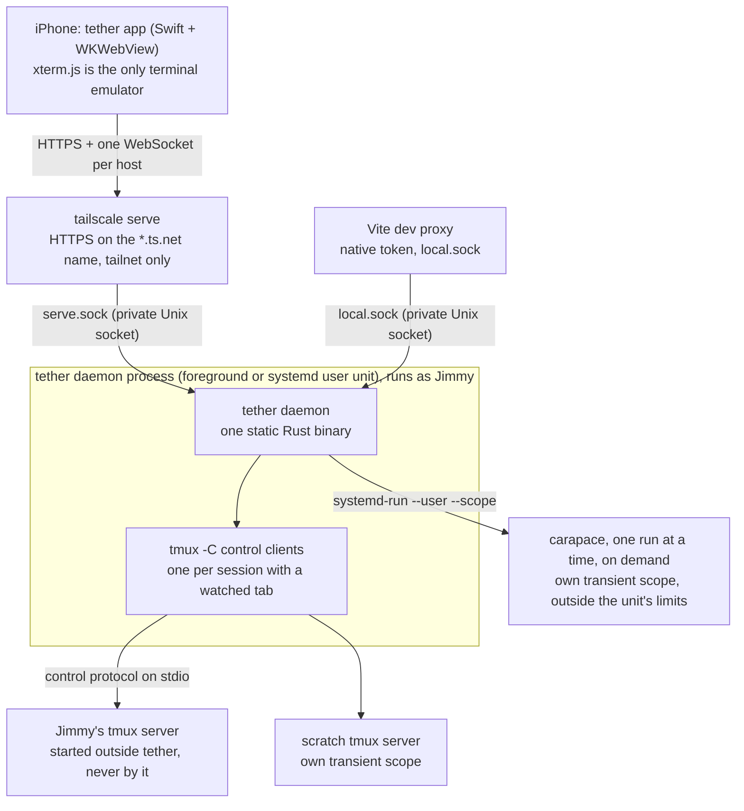

# tether: product and UX spec

> **Client UX update (2026-10-22):** Start with [client design and Mac handoff](client/README.md).
> Its approved browser/mobile navigation and minimal layout supersede conflicting
> UI rules below. Subsystem invariants remain in force; touch, clipboard and the phone
> dock retain explicit device gates.

tether is a phone-first client for the tmux sessions on Jimmy's dev server, reached
only over his tailnet. This document is the product and UX spec and the index of the
design: what tether does and how it looks and behaves on the phone. Each subsystem
has its own spec, and every decision, with the alternatives rejected, is logged in
[decisions.md](decisions.md).

Build each subsystem to its settled spec, run its gating spikes ([Spikes](#spikes)),
and record decisions in decisions.md.

## The design documents

| Document | Covers |
|---|---|
| plan.md (this) | Goal, product rules, layout, keyboard, touch, file manager, security overview, code structure, phases, spikes |
| [daemon-core.md](daemon-core.md) | `src/tmux/`, `src/hub/`, `src/proto/`: control mode, snapshots, pane streams, the WebSocket protocol, and every daemon limit |
| [ios-shell.md](ios-shell.md) | The native iOS app: keyboard, focus, bridge, scheme handler, lifecycle, media |
| [auth.md](auth.md) | Native device tokens, enrolled-node browser admission, enrolment and auth routes |
| [fs.md](fs.md) | `src/fs/`: roots, path resolution, the `/fs/*` routes, uploads, their limits |
| [setup.md](setup.md) | `src/setup/`: foreground and background `tether setup`, `tether teardown`, publishing on the tailnet, and setup checks |
| [complete.md](complete.md) | `src/complete/`: `POST /complete`, the history, PATH, carapace and path sources, the shell snippet, how they stay inside the budget |
| [decisions.md](decisions.md) | The decision log: what, why, alternatives rejected, who, when |
| [plan-review.md](plan-review.md) | The first review of this plan, kept as a record |
| [research/](research/) | Evidence: probes on the dev box, iOS and WebKit facts, libraries, prior art |

## Goal

A phone-first client for the tmux sessions on Jimmy's dev server, reached only over
his tailnet. It needs:

- **Tabs**, one per tmux session, like `tmux attach`, plus a session list for quickly
  reopening one.
- **Holding up on spotty travel connections:** no polling from the phone, a cheap
  reconnect that sends a fresh screen snapshot, and tabs that stay open
  ("reconnecting") until their tmux session is gone.
- **A keyboard as good as Termius's**, plus a suggestion strip (history, commands,
  flags, paths).
- **A built-in file manager:** upload or paste photos and insert the file path into
  the terminal (MVP); view images and video with range streaming, view code and
  markdown (MVP) and diffs (v2); edit, create and rename files (v2).

Agent status and notifications are out of scope: Jimmy's agent harness already
handles notifications. Why tether is worth building, and which projects to study, is
in [research/prior-art.md](research/prior-art.md).

## Product rules

Jimmy's decisions, as they stand ([log](decisions.md#jimmys-decisions)):

- **Device:** iPhone 17 Pro, iOS 26. The layout stays responsive, so rotation and a
  future iPad work.
- **Client:** a native Swift app hosting the web UI in a WKWebView, with a native
  first responder owning the keyboard ([ios-shell.md](ios-shell.md)). Installed from
  Xcode until a paid Apple account brings TestFlight.
- **tmux:** 3.4 on the server, 3.7b on the Mac, `window-size latest`, default prefix
  `C-b`, the laptop sometimes attached at the same time. A window takes the size of
  the client that acted on it last, as tmux's `latest` does: opening a tab, typing,
  pasting, rotating, a font change or Fit sizes it to exactly the phone's size, whether
  the laptop's terminal is larger or smaller, and the laptop typing takes it back; a
  window tether stops holding with nobody else acting there keeps the size it had when
  tether attached until the laptop types ([daemon-core.md §3.6](daemon-core.md#36-sizing)). The keyboard
  never resizes it.
- **Tabs:** 1 tab = 1 tmux session, as `tmux attach` is: it shows the session's current
  window's active pane full screen and follows the current window when any client
  changes it. A window switcher, with the session's windows when it has two or more,
  changes and creates windows. Jimmy doesn't split panes; a split window shows its
  active pane and follows it. Tabs never close on network loss.
- **Shell:** shell-agnostic, with one OSC 133 snippet in his dotfiles and carapace for
  completion.
- **Files:** project roots picked in the app; one uploads folder; HEIC converted on
  the phone; no video thumbnails; no file watcher. The MVP views and uploads; edit,
  new file and rename come in v2. Move, mkdir and delete are done in the terminal.
- **Auth:** allowlisted Tailscale login plus two device lanes: an iOS device token
  behind Face ID and an enrolled tailnet node for the browser/PWA. Both use the same
  one-time code and can be revoked with `tether device remove` ([auth.md](auth.md)).
- **Hosts:** the app connects to each host's daemon directly; one host in the MVP.
- **Server platform:** Linux is the primary host. A Mac can host too, with the
  standalone Tailscale app, under a weaker local boundary: Serve reaches tether on a
  loopback port guarded by a path secret that tether publishes and rotates at each
  start, instead of a socket in a private directory. It is supported only on a Mac
  whose one user account is Jimmy's, and serves only
  while he is logged in ([auth.md](auth.md#the-mac-front)). A Mac
  is also a fine client: its browser is judged by whois on the host it connects to.
  The Mac records the 3.7b tmux fixtures ([daemon-core.md §8](daemon-core.md#8-testing))
  and builds the iOS app.
  On macOS there is no cgroup or hard memory cap; the budget only sizes the counts.
- **Scratch shell:** kept, landing after the core MVP.

## Architecture

The daemon runs as Jimmy on the dev box. On Linux, plain `tether setup` runs it in
the terminal; `tether setup --background` installs it as a systemd user unit. On a Mac,
the LaunchAgent in Jimmy's login session owns the front phones can reach. It talks to
tmux directly through control mode: no SSH, no wrapping of commands or agents.



Inside the daemon ([layout](#code-structure-and-standards)):

- **tmux bridge and hub** ([daemon-core.md](daemon-core.md)): control mode, snapshots,
  pane streams, scrollback (`history`), the WebSocket protocol.
- **completion** (`/complete`): history, PATH, carapace (outside the unit, in its own
  scope), paths; lazy ([Suggestion strip](#suggestion-strip), [complete.md](complete.md)).
- **file API** (`/fs/*`): rooted, range-capable, uploads ([fs.md](fs.md)).
- **auth**: the Tailscale check, native-token and enrolled-node lanes, and live
  revocation ([auth.md](auth.md)).

**tether never starts Jimmy's tmux server.** A tmux server first started from inside a
systemd unit lives in that unit's cgroup: it dies on `systemctl --user stop`, and
tether's memory limit would cover tmux and every agent in it
([probe-tmux.md §7](research/probe-tmux.md)). So Jimmy starts tmux outside tether, as
today, and tether runs every tmux command with `-N`, which fails instead of starting a
server ([daemon-core.md §3.1](daemon-core.md#31-invoking-tmux)). With no server
running, the app says so and offers nothing that would start one. The scratch server
is the one exception, started in its own transient scope so it never lives in
tether's cgroup.

### Tabs and the session sheet

One tab opens one tmux session and shows its current window, following it when the
laptop, a script or tether's window switcher changes it; within the window it follows
the active pane. The label is the actual session name, then the current window's
name; identity is the stable server/session ID, never the display name. Lists show
sessions only.

Desktop Terminal + opens the existing-session picker only; on the phone the dock's
tab chip opens the session switcher. New session is on Home, and on the phone also in
the switcher; New window is in the window switcher (the phone's switcher sheet, the
desktop's active-tab menu). Both take an optional name and absolute start directory.
Session search is local; refresh is event-driven. Another-client
attachment does not identify a laptop. Closing a tab never kills its tmux process.
See [the interaction contract](client/browser-behaviors.md) for the full behavior.
Scratch shells are outside this minimal client pass.

### Reconnect

The phone repaints every tab from a fresh snapshot whenever it (re)watches it: after a
reconnect, a tab switch, or returning from another screen. Only the tab on screen is
watched.

- Heartbeat while connected, and the daemon's idle timeout, are in
  [daemon-core.md §6](daemon-core.md#6-limits-and-the-memory-ceiling); nothing runs
  while disconnected.
- The client reconnects immediately on becoming visible or coming back online, with
  the heartbeat as the backstop.
- **Connect timeout:** iOS 26 can leave a new WebSocket stuck in CONNECTING after
  resume ([WebKit 308073](https://bugs.webkit.org/show_bug.cgi?id=308073),
  [ios-web.md §2](research/ios-web.md)). If a socket isn't open within a few seconds,
  the client tries one new socket and then recreates the web view. All state that
  matters is on the server.
- **Tabs never close on network loss.** A dropped tab shows "reconnecting…" on its
  pill indefinitely. Retries back off with jitter: 0.5 s, 1, 2, 4… capped at 30 s. The
  backoff resets and a retry fires at once on becoming visible, coming online, or a
  tap on the pill. A tab closes only when the daemon reports its session or server gone
  (`sessionClosed`, `serverExited`), when a `sessions` listing no longer has its session
  (below), or when Jimmy closes it.
- **Pruning.** The daemon sends `sessionClosed` for a watched session, and only the tab
  on screen has a watch ([daemon-core.md §4.2](daemon-core.md#42-views-owners-and-locate)),
  so a session killed under another tab would leave that tab open. The web therefore
  asks each host for a `sessions` listing on every connect and prunes against it, and
  prunes against every later listing too (the sheet opening, a pull to refresh, the
  `sessionsChanged` refetch, debounced). The daemon sends `sessionsChanged` when tmux
  creates, closes or renames a session or adds or closes a window, so a kill under an
  off-screen tab is pruned within moments instead of at the next listing. A tab goes
  when no session in the listing has its `SessionRef` (instance and id): another
  `server` instance counts as gone, and a listing of `tmux: null` has no sessions, so it
  closes the host's tabs as
  `serverExited` would. The listing covers the `main` tmux server only, so it never prunes scratch
  tabs (after the core MVP). A refused or failed listing prunes nothing.

### Stack

Versions verified 2026-10-21 ([libraries.md](research/libraries.md),
[rust-crates.md](research/rust-crates.md)). The daemon is Rust
([research/rust-vs-go.md](research/rust-vs-go.md)).

| Area | Pick | Notes |
|---|---|---|
| Runtime | tokio, current-thread runtime, 8 blocking threads split into bounded-wait lanes | see [Resource budget](#resource-budget) |
| HTTP | axum 0.8, tower-http 0.7 | `/fs/raw` stays custom, so root checks and range limits are tether's own |
| Web assets | built by Vite and embedded in the daemon | the same web UI is bundled in the iOS app; the daemon serves browser/PWA shell paths |
| Auth | sha2, subtle, getrandom | [auth.md](auth.md#crates) |
| Tailscale LocalAPI | bounded keep-alive client over tailscaled's Unix socket: status, Serve config and per-request whois | |
| systemd and logs | sd-notify (`READY=1`, `STOPPING=1`; no watchdog), tracing + tracing-subscriber writing to stderr, which the journal captures | no watchdog because it needs a periodic timer, which breaks the zero-wakeup idle; no tracing-journald because stderr already reaches the journal |
| Protocol types | ts-rs (TypeScript); Swift hand-written for the auth DTOs | [daemon-core.md §5.5](daemon-core.md#55-type-generation) |
| tmux parser | hand-written, pure, fixture-tested | libtmux-rs studied for ideas only |
| Server-side emulator | none | xterm.js on the phone is the only emulator |
| Renderer | xterm.js 6 with addons webgl, web-links, unicode11 | WebGL with DOM fallback; behind `term/`, so ghostty-web can be tried later |
| App shell | Preact 11, Vite, TypeScript strict | |
| File viewer | markdown-it + DOMPurify; Shiki on demand with a language allowlist; Mermaid on demand with `securityLevel: "strict"` (v2) | DOMPurify is mandatory: no Markdown parser sanitizes |
| Completion | carapace-bin 1.8, pinned; export JSON parsed loosely | absence or failure means no flag suggestions |

### Config

`~/.config/tether/config.toml`. Every key is optional, the file may not exist, and
unknown keys are ignored, so an older daemon reads a newer config. An annotated example,
and the note on `TMUX_TMPDIR` under systemd, are in [running.md](../running.md).

| Key | Default | Meaning |
|---|---|---|
| `name` | the MagicDNS machine name | the host's name in the app: `/auth/info.name`, `welcome.host.name` |
| `memory_budget_mib` | 72 | the memory budget in MiB, at least 42; selects the control-client/socket caps and whether completion runs ([daemon-core.md §6.1](daemon-core.md#61-the-memory-budget)); read at startup and keep `MemoryMax` equal to it |
| `[tmux] program` | `tmux` | the tmux executable; an absolute path if the unit's `PATH` doesn't find it |
| `[tmux] socket_name` | none | `tmux -L <name>` |
| `[tmux] socket_path` | none | `tmux -S <path>`; not together with `socket_name` |
| `roots`, `uploads_dir` | none, `~/tether-uploads` | project roots and the uploads folder; read on every file request; Files adds and removes roots ([fs.md](fs.md#roots)) |
| `[complete] history` | the most recently modified of `~/.zsh_history`, `~/.bash_history`, fish's history | the one history file the suggestion strip reads; set it when the shell's `$HISTFILE` is elsewhere ([complete.md](complete.md#history)) |
| `[complete] path` | the daemon's own `PATH` | the `PATH` the command index scans and carapace runs with; set it to the interactive shell's `PATH`, since the systemd user manager's lacks what rc files add ([complete.md](complete.md#commands-on-path)) |
| `[complete] carapace` | `carapace` on that `PATH` | the carapace binary; absent or failing means no flag chips ([complete.md](complete.md#carapace)) |

With neither socket key, tether uses tmux's default socket.

## Resource budget

The dev server is already overloaded and crashes, and more than one user may run tether
there. Targets: daemon idle RSS under ~5 MB with no phone connected, about 0% CPU when
nobody is connected, a hard cap on CPU and memory on Linux that the user can tighten,
and no way to make the existing crashes worse. On macOS the budget only sizes counts;
there is no cgroup or hard memory/CPU cap.

- **Event-driven:** control-mode events, no periodic capture, no `tmux ls` loop. With
  no phone connected, tether holds no control clients and no pane state once the
  control-client linger has passed.
- **Nothing held for panes nobody views:** a pane's state exists only while a tab on
  screen shows it, and unviewed panes are paused in tmux.
- **Everything bounded, sized by one setting:** every queue, buffer and cap and the
  resulting memory ceiling are in [daemon-core.md §6](daemon-core.md#6-limits-and-the-memory-ceiling).
  `memory_budget_mib` defaults to 72 MiB and must be at least 42. The lower of it and
  the cgroup v2 memory limit at startup selects one of five tiers: control clients
  (tmux sessions), sockets, and completion on/off. A tighter budget refuses another
  session with a `limit` message naming sessions holding the slots. Below 42 MiB, or
  on any `ConfigError`, the daemon exits 78 instead of restarting.
- **Blocking work is isolated:** the 8-thread Tokio blocking pool is split into lanes;
  a hung filesystem operation cannot consume auth threads. All blocking work enters
  through `src/blocking.rs`; Tokio filesystem APIs are disabled. Lane budgets:

  | Lane | Threads | Wait | Waiting callers | Work |
  |---|---:|---:|---:|---|
  | `fs` | 4 | 10 s | 8 shared across scans, raw responses and blocking calls | file API |
  | `index` | 1 | 300 ms | uncapped | history and PATH indexes |
  | `dir` | 1 | 300 ms | uncapped | directory checks and completion listings |
  | `auth` | 2 | 10 s | uncapped | auth files and paste files |

  A caller that exceeds its lane wait receives `busy` or skips that completion source;
  the permit stays with work that is still running. Uploads stream to disk; listings are
  paged; previews truncated; scrollback comes in fixed chunks.
- **Completion is lazy:** PATH indexes build on first use; carapace runs one at a time
  in its own transient systemd scope, so its 17–44 MB per run never counts against this
  unit. Completion state is freed after 5 idle minutes. It is not constructed below a
  53 MiB effective budget; `welcome.daemon.completion` tells clients whether to ask.
  Limits: [complete.md](complete.md#constants).
- **Memory-backed uploads are refused:** tmpfs/ramfs pages would remain charged to the
  daemon after the request, outside its budget rows. Disk-backed uploads flush every
  2 MiB.
- **No heavy server work:** HEIC conversion happens on the phone; videos stream as-is
  over HTTP Range; no thumbnails, no transcoding, no file watcher.
- **Crash safety:** tmux is the source of truth. If tether restarts, clients reconnect
  and repaint from snapshots.

**systemd user unit** (`contrib/tether.service`): `Type=notify`, `KillMode=mixed`,
`Restart=on-failure` with a backoff (`RestartSec=2`, `RestartSteps=5`,
`RestartMaxDelaySec=60`, `StartLimitIntervalSec=0`), `RestartPreventExitStatus=78`,
`MemoryMax=72M`, `CPUQuota=50%`, `CPUQuotaPeriodSec=10ms`, `CPUWeight=20`, `Nice=10`,
`IOWeight=10`, `IOSchedulingClass=idle`, `TasksMax=32`, `OOMScoreAdjust=500` (the
kernel kills tether before tmux or the agents), and
`Environment=GLIBC_TUNABLES=glibc.malloc.mmap_threshold=131072`.

- `KillMode=mixed` sends SIGTERM to tether alone, so it closes sockets with 4004 and its
  control clients itself. Under the default kill mode, systemd also signals the
  `tmux -C` clients directly, and the hub would report them as detached while the
  sockets close, so a phone could get `watchEnded { detached }` instead of reconnecting.
  SIGKILL after the stop timeout still reaches every process in the cgroup.
- Exit 78 (`EX_CONFIG`) means config could not be read or parsed, contradicts itself,
  `$HOME` is missing, or the effective budget is below 42 MiB. A restart cannot fix
  those failures. The backoff stays for a Tailscale service that is not up at boot.
- `MemoryMax=72M` matches the default. The daemon reads the cgroup v2 limit at startup
  and uses it if lower than `memory_budget_mib`; lowering the unit limit and restarting
  is safe, raising it needs both settings. There is no `MemoryHigh`: the unreclaimable
  ceiling plus 4 MiB fits every tier, and reclaimable page cache is reclaimed at
  `MemoryMax`. A lower `MemoryHigh` would stall allocation instead of making caps safe.
- `CPUQuota=50%` holds the whole unit to half of one core. The quota is per cgroup and
  spent across CPUs. A throttled keystroke can wait at most one 10 ms period, within one
  60 Hz frame; the 50% quota stretches bursts by up to double. `CPUWeight` and `Nice`
  still make tether yield under contention.
- `GLIBC_TUNABLES` pins glibc's mmap threshold at 128 KiB. glibc raises that threshold
  after the first large free, so completion's indexes would land in the heap and stay
  resident after its idle drop; pinned, each is its own mapping and goes back to the
  kernel on free, with no `unsafe` call ([complete.md](complete.md#memory-cpu-and-threads)).
  It affects only the glibc build, the one `cargo install` makes and the unit runs. The
  Linux release binaries are static musl, which ignore it; musl's behaviour is
  unmeasured.
- `TasksMax` counts threads and processes in the cgroup. The runtime thread, 8 blocking
  threads, up to 3 control clients, a one-shot and a `systemd-run` stay below 32. A
  carapace run (a Go binary starts several threads) counts only as `systemd-run` until
  it moves into its own scope.
- `MemoryMax` covers the daemon, its control clients and one-shots. tmux, the scratch
  server and carapace run outside the unit: carapace in a transient scope with its own
  limits ([complete.md](complete.md#where-carapace-runs-its-own-scope)). The unit's
  hard limits require cgroup v2 memory and CPU controller delegation; the daemon warns
  under systemd when no memory limit is enforced.
- Measure budget tiers on the dev box under load as described in
  [daemon-core.md §6.3](daemon-core.md#63-the-memory-ceiling); the Mac is not a proxy
  for the Linux unit.

## Layout

The [client interaction contract](client/browser-behaviors.md) and
[interactive mockup](client/mockups/index.html) define current layout for all three
clients. Desktop has a Home/Terminal/Files icon rail and top terminal tabs, without a
back arrow. Mobile Home has Sessions/Files navigation; on touch, Terminal is
full-bleed above a dock that is always visible. At rest it is one row: a tab chip that
opens the session switcher (open tabs, every session, search and creation), a line
field that grows from one to five visual lines and then scrolls inside, and the keyboard
toggle. The field remains one logical line. While the keyboard is up, a key row sits
above that row, and the dock rides on top of the keyboard. The phone browser, the PWA and
the native app share the dock, drawn by the web
([Phone dock](client/browser-behaviors.md#phone-dock)).

Use actual tmux names, typography and color, not dot markers or dot separators.
No rename/kill controls, extended-key/files sheet, or suggestion UI is part of this
minimal pass.

Keyboard opening does not resize tmux: tmux is sized with the resting dock in place and
the keyboard down, and the terminal keeps its last row at the bottom of the visible area
above the dock's key row and resting row. If that would put the cursor above the area's
top, the cursor row meets the bottom instead. The pan never goes past the last row, does
nothing while every row fits, and is off while scrolled into history; platform safe areas
are respected.

## Keyboard

### Keyboard behaviour

On touch, the dock's keyboard toggle is the only tether control that opens and closes
the on-screen keyboard. It stays visible in either state: with the keyboard down it
raises it for the terminal input, and with either input holding the keyboard it lowers
it. In the app, one native `UITextField` owns the keyboard for both targets: the toggle
selects `terminal`, where keys go to tmux; tapping the dock box selects `line`, where keys
edit the draft. The browser and PWA use their own textarea editor for the line. A tap on
the terminal never lowers the keyboard. With the keyboard down, a
tap on the cursor's row or the row directly above or below it raises it for the terminal
input, as the toggle does (not while scrolled back into history, where the cursor is off
screen). Taps elsewhere keep their meaning: with app mouse mode on, a tap is sent as a
click (near the cursor it also raises the keyboard); without it, a tap does nothing,
except that OSC 133 prompt-row cursor placement may move the cursor while the terminal
input already has the keyboard. Scroll, selection, tab changes and reconnects leave the keyboard as it is.
Opening a sheet lowers it; a tap that closes it restores the held owner in that tap
(native raises the same responder, and the browser refocuses its input). Escape or Back
leaves the keyboard down. An interruption restores the native target, including `line`.
Desktop
click-to-focus is unchanged. The native mechanics are in
[ios-shell.md](ios-shell.md#keyboard), the touch rules in
[terminal interaction](client/terminal-interaction-design.md).

### Autocorrect and text input

- The terminal target never gets autocorrect, auto-capitalization, smart punctuation or
  predictions: keystrokes go as typed, so there is no text for iOS to correct after
  it's sent. The app's hidden `KeyboardInput: UITextField` disables all prediction and
  smart-edit traits in both targets and uses the locale's default keyboard layout so
  IMEs and dictation remain available; in `terminal` it forwards committed text directly.
- The line target uses that same native field in the app, with autocorrection,
  autocapitalization, spell checking, smart punctuation and inline prediction off. The
  web draws a non-editable mirror there; the browser/PWA keeps its textarea with
  autocomplete, autocorrect, spellcheck and capitalization off, though Safari may still
  show its system prediction strip. Native marked text, dictation, the spacebar caret
  trackpad and selection are mirrored to the app's box. Return is Send in `line` and
  Return in `terminal`; sending a line uses the existing paste-and-Enter path, while a
  paste with line breaks goes to the terminal as one paste without Enter.

### Suggestion strip

> Deferred UI option, not part of the minimal approved client layout. Revisit after core input/device probes.

A row of chips above the key row; tapping a chip sends the remaining characters (a
diff against what's typed). The backend, with each source's parsing, caching, limits
and the shell snippet, is [complete.md](complete.md). Sources, ranked:

1. **Shell history:** the history file (zsh, bash or fish format; path from config or
   the shell's default), deduplicated, ranked by recency and frequency, filtered by
   the prefix.
2. **Commands on PATH:** an index built on first use, rebuilt when a `PATH`
   directory changes.
3. **Subcommands and flags: carapace** ([carapace-bin](https://github.com/carapace-sh/carapace-bin)),
   one Go binary covering 1000+ commands, independent of the shell, run only when a
   chip is needed after a command word, in its own scope with the limits in
   [complete.md](complete.md#constants); results are cached per (command, args, stem)
   for 30 s. If carapace is missing or fails, flags aren't offered.
4. **Paths** relative to the pane's cwd: a directory listing, cached briefly.

**Reading the command line on the phone.** A dotfile snippet for zsh (`precmd` /
`preexec`) and bash (`PROMPT_COMMAND` plus a preexec hook) emits OSC 133 A/B/C/D
around prompt and command. tmux passes OSC bytes through control mode with
`allow-passthrough` off ([probe-tmux.md §1](research/probe-tmux.md)), and the phone's
xterm.js parses them with registered handlers. The client reads the command text from
its own buffer, between the input-start mark and the cursor, so the strip stays right
after Tab, ↑ or readline edits.

- Without the snippet, the client falls back to reading from the prompt end to the
  cursor with a prompt regex, and shows nothing when unsure. Inside TUIs there is no
  prompt, so the strip hides.
- The client asks for chips with `POST /complete {before, after, cwd}`
  ([complete.md](complete.md#request-and-response)) through its host's scheme-handler
  origin. `cwd` is the snippet's OSC 7 path when the prompt sent one, else the tab's
  current directory from `watching`
  ([daemon-core.md §3.7](daemon-core.md#37-window-subscription)), which needs no snippet.
  `/complete` is plain HTTP in `src/complete/` and never touches tmux.

### The key row

Shown above the dock's resting row while the keyboard is up, the same in the browser,
the PWA and the app. One fixed row, most used first: esc, ←, ↑, ↓, →, ^R, ^C, tab, ctrl,
alt, `|`, `~`, `/`, `-`, scrolling horizontally. The arrows sit together in the order of
a keyboard's cluster, after esc. ctrl and alt arm the next key; the arrows repeat while
held. Control keys always go to the terminal; character keys go where typing goes. The
terminal has no other arrow input on touch ([Cursor movement](#cursor-movement)). Command recall is the shell's own (↑, ^R),
including commands typed on the desktop; the line field keeps no history. Details are
in [Phone dock](client/browser-behaviors.md#phone-dock).

- **^B sends one Ctrl+B.** tether's `send-keys` writes straight to the pane, past
  tmux's key bindings, so the prefix never intercepts it.
- **No tmux-prefix key**, for the same reason; tmux actions (new window, rename, kill)
  live in the app's UI.
- More keys (⇧tab, esc esc, Ctrl+J newline) are candidates from what the agent CLIs
  bind ([research/agent-keybindings.md](research/agent-keybindings.md)); the row
  scrolls, so adding one costs no space.

### Sending keys and tmux.conf

tether sends input with `send-keys`; only Shift+Enter is hand-encoded. Checked on tmux
3.4 ([probe-tmux.md §6](research/probe-tmux.md)):

| Input | Command | Bytes the pane receives |
|---|---|---|
| Literal text (UTF-8) | `send-keys -t @W -H <hex>` ([daemon-core.md §3.4](daemon-core.md#34-commands-commandrs)) | the text as typed |
| Shift+Tab | `send-keys BTab` | `ESC [ Z` |
| Alt+Enter (Codex newline) | `send-keys M-Enter`; Alt+key is `M-<key>` | `ESC CR` |
| Newline (preferred) | `send-keys C-j` | `LF` |
| Shift+Enter | `send-keys -H 1b 5b 31 33 3b 32 75` (CSI-u `ESC [13;2u`) | the raw bytes |
| Mouse wheel | `send-keys -H` with SGR 1006 bytes | the raw bytes |
| Esc Esc | two `send-keys Escape`, ~50 ms apart | two `ESC` |

`send-keys S-Enter` types the literal text `S-Enter` on 3.4. Whether apps accept the
CSI-u bytes unrequested is checked in spike 3; Ctrl+J stays the default newline. Arrow
and function keys go by tmux key name, so tmux encodes them for the pane's cursor-key
mode.

**tmux.conf.** tether never edits it, and its input path needs none of these; Jimmy
agreed to add them for the laptop:

- `set -s escape-time 10`: how long tmux waits after an Esc typed in a terminal
  client. Keys from `send-keys` skip that parser.
- `set -s extended-keys on` with `set -as terminal-features '*:extkeys'`: modified keys
  such as Shift+Enter from a modern terminal reach the app.
- `set -g set-clipboard on`: optional; tether sees OSC 52 either way.

## Touch

Core MVP. Spikes 5–8 prototype these before feature work.

### Scroll

- **Normal screen:** native-feeling momentum scroll.
  - xterm.js holds the lines that scrolled off since the tab's last snapshot. Above
    them, older lines come from tmux on demand through `history`, about 200 lines a
    request, cached on the phone per tab with a cap, and offset by the lines xterm.js
    already holds. Nothing is fetched unless Jimmy scrolls.
  - xterm.js can't prepend lines, so fetched history renders in a DOM view above the
    live terminal, sharing the selection overlay's row renderer. Spike 6 settles this.
  - New output while scrolled up doesn't yank to the bottom; ⤓ appears instead.
  - *Fallback:* drive tmux copy-mode; simpler, less native.
- **Alternate screen or mouse mode** (Claude Code, vim, less, htop), detected from
  xterm.js's state (seeded by the snapshot's modes): vertical swipes become mouse-wheel
  events (SGR 1006) or ↑/↓ keys, scaled by velocity.
- Horizontal swipes on the terminal do nothing, to avoid fighting the system back
  gesture; swiping the key row scrolls its keys.

### Cursor movement

- **Arrows** are the key row's ← ↑ ↓ → ([The key row](#the-key-row)). A long-press on the terminal selects text and sends no mouse event, in
  mouse-mode apps too ([Select, copy and paste](#select-copy-and-paste)). (iOS's
  long-press-space trackpad isn't available to the native input view, and isn't mapped in
  the browser.)
- **Tap to position** on the current prompt line: the column delta between cursor and
  tap, sent as ←/→. Only when the OSC 133 marks (or the prompt regex) show a shell
  prompt and the tap is inside the input region; single line only in the MVP.

### Select, copy and paste

The [researched interaction design](client/terminal-interaction-design.md) is the
current direction. A long-press fires with a haptic and highlights the word under the
finger at once. Dragging while still held moves the selection's far end to the cell under
the finger, across rows, within the snapshot (the rows in view and those kept above them;
no autoscroll at the edges). Releasing shows the handles to adjust it and tether's edit
menu: Copy, and Paste, which sends the clipboard to the terminal as one paste without
Enter. A long-press over a blank cell opens the menu with Paste alone on release. It must not trigger a remote click. Prototype
native selection handles with a bounded, immutable logical-text snapshot; rendering
one DOM node per physical terminal row is not enough to preserve copied newlines.
Current snapshot restoration loses wrap metadata, so capture/restore must be resolved
before correct copy after reconnect/history can be promised. Unicode cell mapping,
streaming output, native menus, and gesture arbitration require device verification.

Paste goes through tmux `load-buffer` and `paste-buffer -p -d`; tmux adds bracketed
markers only when the receiving application requests them. The line field's Return
uses this same route, with one Enter in the same tmux group, skipped if the paste fails. Embedded or trailing newlines may still execute
commands. Clipboard access uses real user gestures and platform-supported controls;
no background read or synthetic paste event is a substitute. Images use the existing
upload/path-insertion route. Custom multi-tap selection and clipboard sync are outside
the minimal pass.

### Reading on a small screen

Portrait gives about 45–50 columns, and Claude Code and Codex wrap badly at that
width.

- **Pinch to change font size, per tab (MVP).** It changes the column count, so it is
  one of the deliberate resizes.
- **Landscape (MVP)** gets the full width.
- **Pan mode, per tab (v2):** `window-size manual` on that window keeps the laptop's
  size while the phone pans across it.
- **Fonts and wide characters (MVP):** a bundled Nerd Font; the `unicode11` addon,
  tested with Claude Code's spinner glyphs; a ghostty-web renderer spike is the
  escalation.
- **Links (MVP):** URLs are tappable. **File paths (v2):** tapping a path an agent
  printed opens it in the file viewer, resolved against the tab's cwd.
  **`localhost:3000` links (later):** "open via dev box" publishes the port with
  `tailscale serve`.
- **Search (v2):** `@xterm/addon-search` over the live buffer, text search over loaded
  history, and a server-side search over `capture-pane` for the rest.
- **Activity dots (v2):** a dot on tabs with new output or a bell, from tmux format
  subscriptions on `#{window_activity_flag}` and `#{window_bell_flag}`. A
  subscription reports only windows in its control client's own session
  ([probe](research/probe-locate-subscriptions.md)), so dots for other sessions need
  more than one subscription; settled when built.
- **Typing latency on cellular:** spike 3 measures echo latency; at 200 ms or more,
  predictive local echo moves to v2.

## File manager

Opened from `[⊞]` or `[<]`, as a sheet over the terminal; the keyboard stays put.

**Roots.** Project roots are chosen in Files: its path field completes folders under
`$HOME` and adds one with "Add this folder", and each root has Remove
([interaction contract](client/browser-behaviors.md#files)). The uploads folder
(`uploads_dir`, default `~/tether-uploads`) is browsable like a root and moves in
`config.toml`. Both are saved in `~/.config/tether/config.toml`. A tab opens the file manager at its cwd (from
`watching`) if that's inside a root, otherwise at the root picker. No file watcher:
listings are read on open, on pull-to-refresh, and after tether's own file operations.
A path field heads the list: typed into, it completes the next existing folder from
listings the client already holds, one request per folder entered, never one per
keystroke ([interaction contract](client/browser-behaviors.md#files)).

**API.** The routes, path resolution, roots management, limits and errors are in
[fs.md](fs.md). The web reaches them through its host's scheme-handler origin,
`tether-app://h-{host}/fs/…` ([ios-shell.md](ios-shell.md#where-the-web-ui-comes-from));
video goes to the native player instead. MVP: list, raw (Range) and upload. v2: save
an edit, new file, rename.

**Editing (v2).** With no file watcher, the conflict check is the ETag taken at open:
a save whose `If-Match` no longer matches is refused, and the editor offers reload or
overwrite. Creates and renames never replace a file. Only UTF-8 text under a size cap
opens in the editor (CodeMirror 6, loaded on demand). It borrows the keyboard from the
terminal input while open ([ios-shell.md](ios-shell.md#focus-one-controller-native)).

**Photo → terminal (MVP),** native ([ios-shell.md](ios-shell.md#files-and-sharing)):
pick, take or paste a photo (`^V img`, or the file manager's upload button); HEIC is
re-encoded to JPEG on the phone (quality 0.9, longest side 2048 px unless "send
original"); it uploads to `uploads_dir` with a timestamped name; its quoted absolute
path is typed into the tab it was started from, without Enter. The web shows no upload
progress yet: it handles only the finished upload's path, so native's progress reports
([ios-shell.md](ios-shell.md#files-and-sharing)) have no UI.

**Viewers:**

| Viewer | Phase | Notes |
|---|---|---|
| Code | MVP | Shiki, on demand, language allowlist |
| Markdown | MVP | markdown-it, sanitized with DOMPurify |
| Images | MVP | zoom and pan, loaded lazily |
| Video | MVP | native player over Range requests; no server thumbnails |
| Binary | MVP | metadata; large files paged |
| Diffs | v2 | from `git diff` / `git status` in the cwd |
| PDFs | v2 | |
| repo-viewer parity | v2 | Mermaid (lazy, strict), the folder image gallery, the hidden-file rules, gitignore handling; needed before repo-viewer is archived |

**Bandwidth:** only small listings load until something is tapped; image previews
load as they scroll into view; upload has a "resize / send original" toggle.

## Security

**Runs as Jimmy, no SSH keys.** The daemon runs as Jimmy in the terminal or a
background service, and attaches to his tmux server directly.

**Tailnet only.** The daemon binds `serve.sock` and `local.sock` in
`$XDG_RUNTIME_DIR/tether/`, a private `0700` directory. `tether setup` publishes only
`serve.sock` (Tailscale 1.94 or later), as Tailscale's operator
([setup.md](setup.md)). The daemon starts
without LocalAPI and refuses Funnel traffic per request; it does not make Funnel a
startup gate. On Tailscale 1.98.9 and later changing Serve after publishing a Unix
socket needs root, or an operator who may run `sudo tailscale`. See [running.md](../running.md).

**Identity and device lanes.** Every request requires an allowed
`Tailscale-User-Login` and no Funnel marker. The native iOS app presents its device
token on either front. A browser/PWA presents no credential and is admitted as its
Tailscale node only on `serve.sock`, only when that socket is the single root HTTPS
Serve handler and its node stable ID plus login is enrolled in `auth.toml`. The node
lane rejects tagged, shared-in, subnet-routing and self nodes. `local.sock` is native
only. `tether device remove` revokes either kind; live sockets are rechecked every 10
seconds. The full rules are in [auth.md](auth.md).

**Canonical origin and browser requests.** The daemon trusts the browser lane only
when `serve.sock` is named exactly once across the Serve config, as the sole `/`
handler of one HTTPS entry with Funnel off. It checks `Host: localhost`, one
`X-Forwarded-Host` matching that origin, exact `Origin` on upgrades and mutations,
and `Sec-Fetch-Site: same-origin` on reads. API responses are `no-store` with
`Cross-Origin-Resource-Policy: same-origin`; the embedded shell has a restrictive
CSP. Native auth remains cookie-free and needs no Origin exception.
The native UI at `tether-app://ui` has a separate scheme-handler CSP and sandbox for
daemon responses ([ios-shell.md](ios-shell.md#web-content-security)).

**Device files fail closed.** The daemon reads `auth.toml` on every check. An unreadable
or malformed file returns a retryable unavailable response (HTTP 503, socket close
4503), never a false revoked-device result. An unknown field rejects only its device
row. One unprotected route is remote code execution.

**Rendered content is untrusted:** DOMPurify on all rendered HTML, Mermaid with
`securityLevel: "strict"`, and the CSP above.

**Logging:** never log terminal contents, control-client input or output, pastes, or
file contents. File writes are logged by path and action.

**File safety:** a roots allowlist with canonicalized paths, checked for every write's
target as well as every read; creates and renames never replace a file; size caps on
upload and edit; nothing in the uploads folder is ever executed by tether
([fs.md](fs.md#path-resolution-fsopen)).
## Long-term

- **Multi-host (v2):** the app connects to each host's daemon directly. The daemon
  stays single-host, with no host in its routes or messages; the app keys everything
  by host id (the Keychain token map, the host store, the `h-{host}` origins), so
  adding hosts changes nothing on the daemon.
- **Version skew:** the client speaks one protocol version, each daemon accepts a
  range ([daemon-core.md §5.2](daemon-core.md#52-handshake-and-versions)), checked per
  host.
- **tmux versions:** fixtures from 3.4 and 3.7b; features gated on the detected
  version. libtmux-rs tests 3.2a–3.7b and is the reference for version quirks.
- **Web UI version:** bundled in the app, one build per app version.
- **Config compatibility:** unknown TOML keys are ignored, so an older daemon reads a
  newer config.
- **repo-viewer parity (v2):** the viewer list above; repo-viewer is archived only
  after it lands.
- **Meridian:** the only link is a CLI command, `tether notify` (later), which Jimmy's
  harness could call to badge a tab.

## Code structure and standards

### Layout

One crate to start; split a part out only when it starts changing on its own.

```text
src/tmux/      sans-IO control client (parser, Session, snapshot), pump, one-shots
src/hub/       sans-IO hub State, reconcile, per-connection Outbox, the hub task
src/proto/     wire messages (source of the TypeScript types), handshake
src/http/      axum routes (/ws, /fs/*, /auth/*, /complete, embedded shell), auth middleware
src/blocking.rs blocking pool lanes; the only owner of spawn_blocking
src/files.rs   shared stamps, state-file lock, and whole-file temp writes
src/auth/      LocalAPI identity, native/node devices, admission and enrolment (auth.md)
src/runtime.rs private runtime directory, single-instance lock, serve/local Unix sockets
src/fs/        the only place paths are resolved and checked against roots
src/complete/  /complete: history, PATH index, carapace runner (bounded, cached; complete.md)
src/setup/     tether setup and teardown: checks, foreground run, service install and publication (setup.md)
web/           one Preact app embedded by the daemon and bundled into the iOS app:
  main.tsx, index.html pick the Platform, boot it and render App
  platform/
    types.ts      Platform interface and every type it names; no implementation
    browser/      index.ts assembles and boots the Platform; transport.ts, viewport.ts,
                  lifecycle.ts, storage.ts, uploads.ts, clipboard.ts, links.ts,
                  restart.ts, pwa.ts (updates and install)
    native/       bridge v4 and adapter for the Swift shell
    test/         in-memory Platform for vitest and the Playwright harness
  proto/          generated wire types, binary frames, HostLink and session identity
  net/            host.ts, http.ts, hosts.ts (registry), admission.ts (pure)
  tabs/           connection.ts, driver.ts, input.ts, keymap.ts, status.ts
  term/           pipeline.ts, size.ts, prompt.ts, xterm.ts, xterm-input.ts
  touch/          phone-owned input, gesture recognizer and selection
  workspace/      pure tab state, active tab, restore, pruning and labels
  sessions/       per-host listing cache, search, expansion and creation requests
  drafts/         per-tab line-field drafts, Return send state and eviction
  files/          /fs client and FileBrowser; render/ holds markdown and code viewers
  app/            App context, controller (owns the sessions cache), router.ts, focus.ts,
                  listing.ts, persist.ts
  screens/
    shell/        rail, destination frame and host banner
    home/         open tabs, sessions list, creation dialogs and phone bottom nav
    picker/       the desktop session picker
    switcher/     the phone session switcher
    terminal/     tab strip, terminal surface, status band and the phone dock; terminals.ts
                  holds the renderer and every tab's driver outside Preact
    files/        folder list, preview, upload and path insertion
    enrol/        enrolment and admission-problem screens
    settings/     Remove this device, Clear local data, Add to Home Screen
  ui/
    tokens/       primitives.css, semantic.css, components.css, fonts.css
    primitives/   Button, IconButton, Tooltip, TextField, SearchField, Dialog (sheet
                  variant), Disclosure, Row, RovingList, TabStrip, Banner, Toast,
                  StatusBand, EmptyState, Spinner, Icon, LineInput
    store.ts, theme.ts, hostProblem.ts
  sw/             service worker and the Vite plugin that builds it, after the main bundle
  public/         manifest template and web app icons (render-icons regenerates the PNGs)
  harness/        test-mode entry, imports per-lane fixtures; never in production builds
  e2e/            Playwright specs against the harness; `*.real.ts` specs run a real daemon
                  through shared/stack.ts
ios/           Swift app (XcodeGen) and the TetherKit package (ios-shell.md)
```

Dependency rules: `hub/` never sees HTTP, `http/` never talks to tmux, and
`complete/` never touches tmux. The renderer stays behind `term/`.

The web `workspace/` is a pure reducer over tabs, not the navigation owner. It handles
`hostsKnown`, `opened`, `closed`, `activated`, `listing`, `sessionClosed`, `serverExited`,
`restored`, `watching` and `navigated` events. It emits `save`, `navigate`,
`focus` and `notice`;
the controller applies navigation through the router before focus effects. The terminal
lane's `Terminals` owns every tab driver: it covers each one except `shownTab(workspace)`,
and is the one way a path is inserted into a tab (`canInsert`, `insertPath`). The router alone owns
destinations, overlays and Files places. `Platform.subscribe` is one change channel:
`app/controller.ts` handles app, host, viewport, lifecycle, storage and update changes,
and deliberately leaves input and draft events to their lane owners' direct
subscriptions. Those consumers are added with the terminal and phone input lanes. Screens
call their own cores through `useApp()`; each screen owns a CSS module beside it. In
`platform/browser/`, `index.ts` also owns boot: there is no separate `boot.ts` module.
No-op workspace events preserve the same state, so they do not save; views select the
slice they need and storage coalesces writes within a microtask.

### Standards

- **Match mars-agents:** edition 2024, clap derive, serde + toml, thiserror,
  write-to-temp-then-rename, an AGENTS.md per module.
- **Pure cores, thin I/O.** The control-client protocol (`tmux::Session`) and the hub
  (`hub::State`) are sans-IO state machines: input in, events or effects out, no
  I/O, no clock. Tasks around them only move bytes and execute effects
  ([daemon-core.md §2](daemon-core.md#2-tasks-and-channels)). No `Arc<Mutex<…>>` maps.
- **Bounded everything**, with the drop-and-snapshot rule in one place, the hub's
  per-connection credit ([daemon-core.md §4.6](daemon-core.md#46-credit-and-the-outbox)).
- **The `%output` decoder works on bytes, not strings.**
- No `unsafe` outside `src/launchd.rs`, the macOS socket-activation call (`lib.rs`
  denies it, `main.rs` forbids it), no `unwrap` in daemon paths, and a panicking task surfaces
  as an error rather than a silently dead tab.
- **Protocol types defined once in Rust** and generated for TypeScript (ts-rs);
  terminal output in binary frames, control messages as JSON.
- **Frontend:** TypeScript strict. Five lint-enforced rules keep ownership clear:
  1. Raw `<button>`, `<input>`, `<textarea>`, `<select>` and `contenteditable` elements
     live only in `ui/primitives/`, `term/xterm-input.ts`, `touch/owned-input.ts` and the
     browser upload picker. Screens use primitives.
  2. Only `app/focus.ts` calls `.focus()` or `.blur()`; focusable elements register with
     its `ui/focus.ts` port. A focus that must raise the software keyboard happens
     synchronously in the user's gesture; other focus can follow render/navigation.
  3. Browser globals are confined to `platform/`: `webkit`, `visualViewport`,
     `indexedDB`, `localStorage`, `sessionStorage`, `navigator`, `open`, `matchMedia`,
     `BroadcastChannel`, `document.visibilityState` and `document.hasFocus`, whether
     accessed bare or through `window`, `globalThis` or `self`.
  4. Only `main.tsx` imports browser/native implementations; tests and `harness/` alone
     import `platform/test/`; only `term/` imports xterm; screens do not import adapters.
  5. `workspace/`, `sessions/`, `drafts/`, `tabs/`, `net/admission.ts` and
     `touch/gesture.ts` are sans-IO: no Preact, `window` or `document`. `proto/link.ts`
     may use `WebSocket`; `files/render/` may use the DOM.
- **Tests:** recorded fixtures for tmux 3.4 and 3.7b, pure hub state-machine tests, and
  a manual real-phone checklist. The web client has unit tests plus Playwright on
  Chromium and WebKit against `web/harness/` (`npm --prefix web run e2e`); axe checks
  every route in both themes and densities. `web/scripts/checks.mjs` enforces source
  rules and shell budgets. Vite's production build plugin rejects test/harness modules
  in the module graph; a manifest-only check cannot detect those transitive imports.
  Playwright's WebKit cannot reproduce the iOS keyboard, so it cannot replace the phone.
  `TETHER_PREFLIGHT_E2E=1` opts the browser suite into `scripts/preflight.sh full`; it is
  otherwise run explicitly, since the preflight environment must have its browsers
  installed. The `*.real.ts` specs (`pnpm --dir web run e2e:real`) run a real daemon on a
  private tmux 3.4 and 3.7b; they need the tmux builds under `~/.cache/tether-tmux` and are
  never part of preflight.

## Phases

The spikes come first. The native app's keyboard checks are in
[ios-shell.md's device checklist](ios-shell.md#device-checklist).

### MVP

- **Daemon:** the control-mode bridge with snapshots and pane pausing; never starts
  tmux; the resource budget met and measured; foreground mode and systemd unit with
  limits and `sd-notify`; the protocol version handshake.
- **iOS app:** WKWebView shell with the bundled web UI (the Debug dev-server switch is
  deferred: `ios/.context/FUTURE`);
  the native terminal input and keyboard geometry under the web dock; focus
  controller; haptics; lifecycle signals; Xcode install.
- **Auth:** `tailscale serve` only, with the Funnel check; the login allowlist from
  LocalAPI; a device token per phone behind Face ID; one middleware on every route;
  strict CSP.
- **Tabs and layout:** 1 tab = 1 session, following its current window; the window
  switcher; collapsed and keyboard states; safe areas; the desktop's attach-only "+"
  picker, the phone's session switcher, and creation actions; pinch font size per tab;
  landscape.
- **Reconnect:** indefinite "reconnecting" with backoff and instant retry; the connect
  timeout with web view recreation; a snapshot on every (re)watch; prompt release of
  server state; WebGL context loss handled by recreating the renderer, with DOM
  fallback.
- **Keyboard:** the phone dock in every touch client: one keyboard toggle, the line
  field (Return sends the line and Enter), the key row with one-shot ctrl and alt;
  native focus ownership. Modifier locking is deferred. Verify dictation/IME and
  hardware keyboards.
- **Touch:** momentum scroll with lazy history, wheel translation, jump-to-bottom,
  trackpad and tap-to-position, DOM selection with copy, paste through tmux.
- **Display:** xterm.js 6 WebGL, Nerd Font, `unicode11`, tappable URLs.
- **Suggestion strip (deferred client UI):** backend completion capabilities do not
  require suggestion controls in the minimal client.
- **Files:** browse the roots; view code, markdown and images; stream video in the
  native player; photo pick or paste → uploads folder → path insert.
- **After the core MVP:** the scratch shell.

### v2

- File editing with a conflict check, new file, rename. Resumable multi-upload. Diff
  viewer. PDFs. repo-viewer parity.
- OSC 52 ↔ iOS clipboard and tmux-buffer sync. Snippets.
- Multi-host.
- Paid Apple account: TestFlight, App Groups, the share extension.
- Activity and bell dots, scrollback search, tappable file paths, per-tab pan mode.
- Predictive local echo, if spike 3 shows 200 ms+ echo on travel links.

### Later

- WebTransport or QUIC.
- "Open via dev box" for `localhost` links.
- `tether notify`, a hook Jimmy's harness can call to badge a tab.
- A server-side terminal model (`vt100`), if a feature needs screen contents on the
  server.
- A ghostty-web renderer, if Unicode width problems persist.
- A raw-pty "raw view" (`tmux attach` in a pty), only if control mode fails on some
  workload.

## Spikes

### Order

Prototype in this order before feature work. Spike 2 runs on the server, in parallel
with the phone spikes.

1. **Keyboard ownership** has no spike: input is the web dock, and its open native
   questions are in [ios-shell.md's device checklist](ios-shell.md#device-checklist),
   run during P4.
2. **Daemon core against real tmux** (server only), as tether's own integration tests
   ([daemon-core.md §8](daemon-core.md#8-testing)): the snapshot boundary on 3.4 here
   and 3.7b on the Mac, recording the fixtures; `send-keys` bypassing `escape-time`
   and the prefix; and the memory ceiling measured, with completion active (carapace itself runs in its
   own scope, so the unit's `memory.peak` includes only its launch).
3. **Reconnect**, in the app against a real daemon: WKWebView WebSocket recovery after
   10+ minutes locked (including stuck CONNECTING); the snapshot repaint on tab switch
   (does it flash?); WebGL context loss after backgrounding; echo latency on cellular;
   whether agents accept CSI-u Shift+Enter.
4. **Auth end to end:** enrolment from the app against the real `*.ts.net` host, the
   token surviving a daemon restart, `tether device remove` closing a live socket.
5. **Selection overlay:** native handles over xterm.js, alignment at different font
   sizes.
6. **Momentum scroll** with lazy history (the DOM view above the live terminal), plus
   wheel translation inside Claude Code.
7. **Tap-to-position and trackpad mode** with OSC 133 marks parsed by xterm.js.
8. **Clipboard and files:** WebKit's Copy menu on the overlay, the native paste
   control with text and images, `paste-buffer -p`, OSC 52; cross-origin fetches to the
   host origin, `sandbox` on proxied responses, and video with an auth header.

### Running the phone spikes

Spikes are throwaway code, kept out of `src/`, `web/` and `ios/Tether/`, and deleted
once they've answered.

- **Spikes 3–8** run their web pages inside the app, through the Debug build's
  dev-server switch ([ios-shell.md](ios-shell.md#where-the-web-ui-comes-from)). That
  switch is deferred (`ios/.context/FUTURE`), so these steps need it built first:
  1. Run the page from Vite behind a private Unix socket using `TETHER_SOCKET`.
     Its proxy presents a native token to `local.sock`. A spike that needs a live terminal attaches to a tmux server on
     its own socket (`tmux -L tether-spike`), which Jimmy starts from a shell; spike
     code never starts it.
  2. Publish it on the tailnet with root: `sudo tailscale serve --bg --https=8443
     unix:<the Vite socket>`. Never `tailscale funnel`; `tailscale serve status` should
     show the handler as tailnet-only. For Vite, allow the `ts.net` host
     (`server.allowedHosts`) and point HMR at the public port.
  3. In the app's Debug settings, set the web UI source to
     `https://<machine>.<tailnet>.ts.net:8443`.
  4. Safari's Web Inspector on the Mac attaches to the app's web view. The spike page
     also shows an on-screen log.
  5. Tear down: `sudo tailscale serve --https=8443 off`, then stop the local process.

Spike 2 needs none of this: it is a test harness against tmux on the box (and the
Mac), on its own `-L` socket.

## Still open

- **Spike outcomes:** the boundary on 3.7b and the measured memory ceiling (spike 2), and the repaint on
  tab switch (spike 3).
- **Touch, copy and phone dock gates:** see [the client research](client/terminal-interaction-design.md).
  Rename/kill menus are not in scope and need no new protocol for this pass.
- Open risks per subsystem: [daemon-core.md](daemon-core.md#9-open-risks),
  [ios-shell.md](ios-shell.md#open-risks), [auth.md](auth.md#open-risks).
