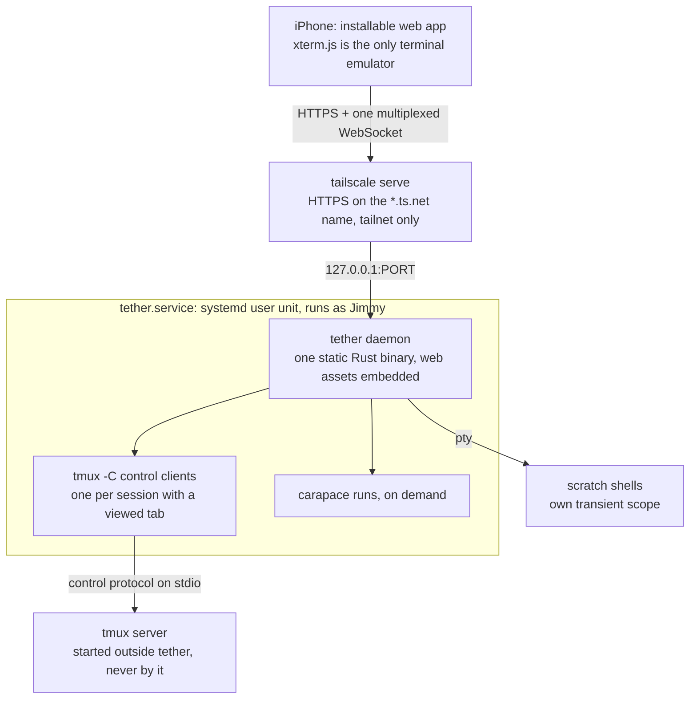
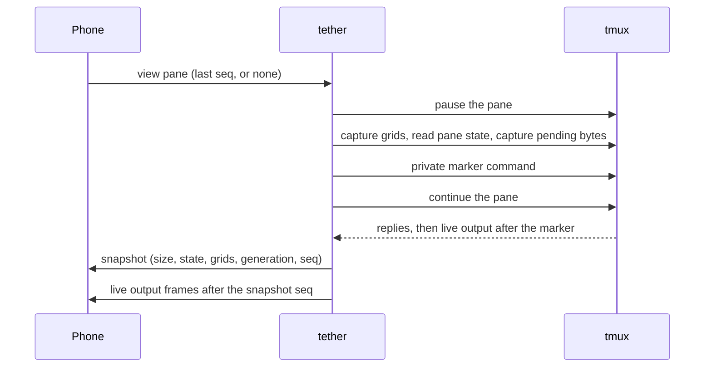

# tether: design plan

tether's current design. Revised 2026-10-21 (ET). This revision folds in the review
in [plan-review.md](plan-review.md), which is kept as the review record; plan.md alone
is the design to build from. The evidence behind the decisions is in
[research/](research/):

- [probe-tmux.md](research/probe-tmux.md): runtime tests on the dev box (tmux 3.4,
  systemd 255).
- [tmux-control-mode.md](research/tmux-control-mode.md): how tmux, iTerm2, WezTerm,
  tmuxy and libtmux-rs handle control mode, snapshots and flow control.
- [ios-web.md](research/ios-web.md): iOS 26 WebKit behaviour (keyboard, lifecycle,
  storage, passkeys, xterm.js).
- [libraries.md](research/libraries.md) and [rust-crates.md](research/rust-crates.md):
  library versions and health.

No code is written yet. Before building a subsystem, settle its design here, run the
spikes that gate it (§13), and record decisions with the alternatives rejected.

## Decisions

### Jimmy's decisions (2026-10-21)

Kept as stated. Where the review corrects one, the correction follows it.

- **Device:** iPhone 17 Pro only. The layout stays responsive, so rotation and a future
  iPad work.
- **tmux:** 3.4 on the server (3.7b on the Mac), with the laptop sometimes attached at
  the same time. `window-size latest` is confirmed. The prefix is the default `C-b`.
  Jimmy will add the recommended tmux.conf lines (§6.5).
  *Review correction:* tether resizes the window only on tab open and rotation, never
  when the keyboard opens or closes (§4.2). `allow-passthrough on` is no longer
  recommended: tether sees OSC bytes without it (§6.5).
- **Tabs:** 1 tab = 1 tmux window, showing the active pane full screen (he doesn't split
  panes). Tabs never auto-close on network loss.
- **Shell:** shell-agnostic, with a single OSC 133 snippet (he's OK adding it) and
  carapace for completion.
- **Files:** project roots picked in the app (saved in the server config), with no file
  watcher. One uploads folder. HEIC is converted on the phone. No video thumbnails.
  Write operations are **edit, new file and rename, in v2**; the MVP views and uploads.
  Move, mkdir and delete-to-trash are dropped: they're done in the terminal
  (decided 2026-10-21, replacing the review's rename/move/mkdir/delete set).
- **Auth:** the Tailscale login and hostname are auto-detected through LocalAPI (no
  manual config), plus a Face ID passkey in the MVP. ACLs are optional.
  *Review correction:* the detected hostname is pinned in the config on first start,
  because it is the passkey relying-party ID; passkey enrolment requires a one-time
  code printed on the server, not just the Tailscale headers (§9).
- **Scratch shell:** kept. A native fallback via TestFlight or Xcode is acceptable.
  *Review correction:* a native wrapper fixes the keyboard only if it implements a
  native input view; a thin WKWebView alone shares WebKit's behaviour (§4.5).
- **Scope:** tmux tabs plus a session list, cheap reconnect on spotty links, a
  Termius-grade keyboard with tool autocomplete, and a file manager. Agent status and
  notifications are out of scope, because Jimmy's agent harness already handles
  notifications.

### Decisions on the review's open questions (Jimmy, 2026-10-21)

The review raised three questions that only Jimmy could settle. All three are decided.

1. **Keyboard: decided 2026-10-21, native Swift shell first.** Jimmy chose a native
   iOS app (WKWebView hosting the web UI, with a native first responder owning the
   keyboard) over the installable web app with the system keyboard, and over a
   keyboard drawn in HTML. iOS shows the keyboard only from a user gesture, and the
   system accessory bar's Done button closes it and can't be hidden
   ([ios-web.md §1](research/ios-web.md)). The HTML keyboard was rejected because it
   has no haptics and makes prose typing worse. A paid Apple Developer account and
   TestFlight come later; Xcode installs from the Mac until then. **§4.5, §6.1, §9
   (passkeys) and §13 still describe the PWA-first plan and are being revised in the
   iOS shell design.**
2. **Multi-host (v2): the app connects to each host directly.** The native app keeps
   a list of hosts and a device key enrolled on each; each host runs its own
   single-host daemon, and tabs from several hosts share one UI. Rejected: a hub
   daemon proxying the other hosts, which was the answer only while the client was a
   web app (each `*.ts.net` origin would need its own installed app, cookies and
   passkey). For a native app it adds a single point of failure on a box that already
   crashes, an extra hop, and daemon-to-daemon auth. One app per host is rejected for
   the obvious reason. Host ids still appear in URLs and the protocol from day one;
   the MVP has one host. Consequence for the iOS shell design: one UI must talk to
   several daemons, which favours bundling the web UI in the app over loading it from
   each host, and the version handshake works per host.
3. *Decided 2026-10-21, see "Files" above.*

## 1. Goal

From Jimmy, corrected to match the decisions above (one tab per window, file write
operations in v2). A phone-first client for the tmux sessions on his dev server,
reached only over his tailnet. It needs:

- **Tabs**, one per tmux window, plus a session list for quickly reopening one.
- **Holding up on spotty travel connections:** no polling from the phone, a cheap
  reconnect that sends a fresh screen snapshot, and tabs that stay open
  ("reconnecting") until their tmux window is gone.
- **A keyboard as good as Termius's**, plus an app-provided suggestion strip (history,
  commands, flags, paths).
- **A built-in file manager:** upload or paste photos and insert the file path into the
  terminal (MVP); view images and video with range streaming, view code and markdown
  (MVP) and diffs (v2); edit, create and rename files (v2).

## 2. Prior art

| Project | What it is | Transport / reconnect | Mobile UX | Files | License / maturity | Borrow / avoid |
|---|---|---|---|---|---|---|
| [herdr](https://herdr.dev) | Background server that owns agent terminals. Marks each agent working, blocked, idle or done. Has a socket API and adds machines over SSH | Its own client↔server socket. Agents keep running while detached | Desktop TUI. No mobile client | No | OSS, popular (the site claims about 44k stars) | Inspiration only. Status features are out of scope. Server-owned terminals that outlive clients are the idea we borrow (tmux already gives us that) |
| [ttyd](https://github.com/tsl0922/ttyd) | Serves one command's pty over WebSocket to xterm.js | WS. The client auto-reconnects, but each connection respawns the command | A plain web terminal. No extra key bar or tabs | ZMODEM/trzsz upload only | MIT, mature (C/libwebsockets) | The simplest day-0 fallback: `ttyd -W tmux attach -t main` behind `tailscale serve`. Use `attach`, not `new -A`: `new -A` starts a tmux server when none is running, inside ttyd's own service (§4.1) |
| [GoTTY](https://github.com/sorenisanerd/gotty) (fork of yudai/gotty) | Same idea in Go | WS, basic reconnect | Basic | No | MIT, moderately maintained | Go reference for pty→WS |
| [WeTTY](https://github.com/butlerx/wetty) | Node + xterm.js web terminal that runs ssh/login | WS (socket.io) | Basic | No | MIT, mature | Avoid running ssh-in-browser; attach locally instead |
| [sshx](https://github.com/ekzhang/sshx) | Collaborative web terminal over a relay, infinite canvas | WS via relay, E2E encrypted. Reconnects with sequence-numbered replay | Canvas is awkward on a phone | No | MIT, Rust | Borrow: sequence numbers plus resume-from-offset framing |
| [tmate](https://tmate.io) / [upterm](https://github.com/owenthereal/upterm) | Share a terminal through a relay | SSH-based | Uses a native SSH client | No | ISC / Apache-2.0 | Not relevant (sharing, not phone UX) |
| [mosh](https://mosh.org) | UDP State Synchronization Protocol. The server keeps a screen model and sends only diffs toward the latest state. Survives roaming, sleep and IP changes. Local echo | UDP/SSP. No byte replay, just "make the screen current" | Needs a native client | No | GPL-3, mature, slow-moving (no scrollback, no OSC 52 in older builds) | Borrow the core idea: sync state, not bytes. Snapshot on reconnect. Predictive local echo |
| [Eternal Terminal](https://eternalterminal.dev) | Reconnecting TCP. Buffers and replays missed bytes; supports native scrollback | TCP + replay buffer | No good iOS client | No | Apache-2.0 | Replay buffer is the alternative to snapshotting. Unbounded catch-up is bad on cellular |
| [Blink Shell](https://blink.sh) ([source](https://github.com/blinksh/blink)) | iOS SSH/mosh terminal | Best-in-class mosh on iOS | Strong keyboard handling, smart keys | Files.app integration, scp | GPL-3 source, paid app | Benchmark for keyboard and key-bar ergonomics. Native, so its keyboard is not a web precedent |
| [Termius](https://termius.com) ([keyboard](https://docs.termius.com/terminal/mobile-terminal), [autocomplete](https://docs.termius.com/terminal/autocomplete-and-shell-integration)) | Cross-platform SSH client (Jimmy's current tool) | SSH. iOS suspends it, so it drops | Keyboard benchmark: an always-visible add-on above the keyboard shows the first 3 groups of 4 keys, reorderable and customizable. A side panel has the extended keyboard, snippets and history. Shift+Tab included for Claude Code. Press-and-drag acts as arrow keys, double-tap sends Tab. Autocomplete covers history, paths and commands with arguments, using shell integration over extra SSH exec channels. Collapsed bottom bar: back, host pill with ×, +, keyboard toggle | SFTP | Proprietary, freemium | Match its keyboard and collapsed bar. Its disconnect pain comes from iOS backgrounding a TCP session |
| [Moshi](https://getmoshi.app) | iOS terminal built for coding agents (SSH + mosh) | mosh survives sleep and app kills | Agent-focused. Push, Dynamic Island and Watch approvals | Limited | Proprietary | Closest commercial competitor. Its notification UX is out of scope here |
| tmux [control mode](https://github.com/tmux/tmux/wiki/Control-Mode), used by [iTerm2](https://iterm2.com/documentation-tmux-integration.html) | tmux emits structured `%output`, `%window-add`, `%session-changed` and similar events | Text protocol over stdio | iTerm2 maps tmux windows to native tabs | n/a | Part of tmux (ISC) | The building block for per-pane streams and native tabs. tether uses plain `tmux -C`; `-CC` is the iTerm2 variant. Pitfalls: output escaping, snapshot boundaries, flow control, resize (§4.2, §4.3) |
| [zellij web client](https://zellij.dev) (added in 0.43) | Zellij serves sessions to the browser | WS, built-in auth tokens | Browser, not phone-optimized | No | MIT | Shows a multiplexer-native web UI works. Jimmy uses tmux, though |
| [VibeTunnel](https://vibetunnel.sh) ([source](https://github.com/amantus-ai/vibetunnel)) | Wraps commands with `vt`, browser terminal for Mac (now Linux too). Built for watching agents | WS / SSE, Tailscale recommended | Mobile web works, but has open iOS keyboard reports. Native iOS is WIP | Basic file browser, git follow mode | MIT, beta | Borrow: mobile web layout. Its iOS keyboard issues show a hidden textarea alone doesn't solve the keyboard. Avoid: wrapping commands |
| [Happy (Coder)](https://happy.engineering) ([source](https://github.com/slopus/happy)) | Native iOS/Android/web app for Claude Code and Codex. Encrypted relay you can self-host | E2E relay, push notifications | Chat UI, voice, permission prompts | File mentions | MIT, very active (~22k stars) | Avoid wrapping the agent CLI. Omnara's archived wrapper shows the upkeep cost |
| [Omnara](https://omnara.com) | Was a mobile dashboard and voice control for agents. Pivoted in 2026 to a managed agent platform; the old wrapper repo is archived | Hosted relay | iOS/Android (was) | – | Apache-2.0 / closed app | Cautionary tale about wrapping agents |
| [Claude Code Remote Control](https://docs.anthropic.com/en/docs/claude-code) | Official: continue a local Claude session from the Claude app | Anthropic relay | Native | – | Proprietary | Claude-only. Doesn't cover tmux or other CLIs |
| Paseo, AgentsRoom, Onepilot, CodeAgentsMobile ([list](https://cosyra.com/guides/relay-apps-vs-cloud-containers.html)) | Other agent relay apps | Mostly relays | Native | Varies | Mixed | Shows how crowded the agent-chat space is. Terminal + tmux + files is less covered |
| [code-server](https://github.com/coder/code-server) / [VS Code tunnels](https://code.visualstudio.com/docs/remote/tunnels) | Full IDE in the browser | WS, reconnect overlay, MS relay for tunnels | Unusable on a phone | Excellent | MIT / proprietary | Borrow: reconnect-overlay UX and the file-explorer model. Too heavy for this |
| [filebrowser](https://github.com/filebrowser/filebrowser) | Self-hosted web file manager | HTTP, range streaming | Okay on mobile | Upload, rename, move, delete, preview | Apache-2.0, mature | Reference for file-manager features |
| [xterm.js](https://xtermjs.org) | Terminal renderer used by VS Code | – | Mobile input is the weak spot (IME, selection, touch) | – | MIT | Renderer of choice (xterm.js 6). Expect custom work on touch input, selection and the key bar |

### Young projects that overlap (2026)

Five small projects now cover parts of tether. None has a license, so they are for
study only: read the code, copy nothing.

| Project | Overlap | What to study first |
|---|---|---|
| [terminal-web](https://github.com/AaronFei/terminal-web) | Tailscale + tmux + tabs + image paste for AI CLIs | Its iOS input code ([session.ts](https://github.com/AaronFei/terminal-web/blob/main/web/session.ts)): keeps keyboard state when tapping the key bar, slides content with VisualViewport instead of resizing the terminal, tunes xterm's hidden input for iOS and CJK |
| [tmuxy](https://github.com/flplima/tmuxy) | Control mode + server-side vt100 + web client (92 stars) | Its restore code: modes restored around capture, stale output suppressed during setup, pause-after, manual window sizing; it documents Unicode width drift |
| [tmux-mobile](https://github.com/vokako/tmux-mobile) | Mobile tmux client on xterm.js 6 | Its [gesture and selection design](https://github.com/vokako/tmux-mobile/blob/main/docs/design-docs/pages/terminal-gestures.md) (xterm 6 has no touch support of its own) |
| [mobile-tty](https://github.com/elidickinson/mobile-tty) | Server-owned sessions for iPhone Safari | Its [iOS input plan](https://github.com/elidickinson/mobile-tty/blob/main/docs/plan-ios-input.md) and VisualViewport grid sizing |
| [ting.sh](https://github.com/andrewting19/ting.sh) | Mobile web terminal | Its changelog of per-iOS-version fixes (touch scrolling, keyboard avoidance, 16 px input, immediate focus) |

Evidence: [ios-web.md §6](research/ios-web.md), [tmux-control-mode.md §9](research/tmux-control-mode.md).
The Rust library [libtmux-rs](https://github.com/libtmux/libtmux-rs) is the reference
for the snapshot boundary (§4.3).

### Notes

- **Why Termius drops.** iOS suspends a backgrounded app after a few seconds, and
  TCP/SSH dies with it. mosh avoids this by being stateless over UDP. Any web or native
  client is suspended too. The fix is to make resume instant and cheap, not to try to
  stay connected.
- **Two families, nobody bridges them.** (a) Terminal transports: ttyd, mosh, ET,
  Blink. Robust but blind to what's running. (b) Agent dashboards: herdr, Happy, Moshi,
  Omnara. These either wrap the agent CLIs or are desktop-only. Jimmy's harness already
  does notifications, so tether needs only (a), done well on a phone.

## 3. Gap

No mature, licensed project offers all of the following together, so tether is still
worth building:

- An existing tmux server as the source of truth, with no wrapping of commands or agents.
- A phone-first UI: window tabs, a quick switcher, a key bar.
- mosh-like state-sync reconnect over the web, with tabs that survive any outage.
- A Termius-grade keyboard plus server-side completion that knows the pane's cwd.
- A built-in file manager tied to the pane's cwd, with photo paste → path insert and
  video streaming.
- Tailnet-only access with no third-party relay.

terminal-web and tmuxy come closest (§2). Read terminal-web's iOS input code and
tmuxy's restore code before building the matching tether subsystems.

## 4. Architecture

### 4.1 Overview

tether talks to tmux directly through control mode. Jimmy owns the app, so no SSH
client, keys or wrapping are involved. The daemon runs as Jimmy on the dev box, in a
systemd user unit, and is reached only through `tailscale serve`.



Inside the daemon (module layout in §11):

- **tmux bridge:** control-mode parser, command/reply matching, the snapshot hand-off
  (§4.3), one task per control client.
- **hub:** viewers per pane, sequence numbers, ring buffers, the decision to replay or
  snapshot (§4.4).
- **scrollback API:** `capture-pane` ranges on demand.
- **completion service:** history, PATH, carapace, paths; lazy (§6.3).
- **file API:** rooted, range-capable, uploads (§8).
- **auth:** LocalAPI identity, passkeys, one middleware on every route (§9).
- **scratch shells:** optional pty, no tmux, not persistent.

**tether never starts the tmux server.** A tmux server first started from inside a
systemd unit lives in that unit's cgroup: it dies on `systemctl --user stop`, and
tether's `MemoryMax=64M` would cover tmux and every agent in it
([probe-tmux.md §7](research/probe-tmux.md)). An already-running server started
outside the unit survives the unit stopping. So:

- Jimmy starts tmux outside tether, as today (from a shell, or under its own user unit
  or `systemd-run --user --scope`).
- tether spawns tmux only as `tmux -C attach-session -t <id>` (fails if no server
  runs) and as read-only one-shot commands such as `tmux list-sessions` (also fail
  instead of starting a server). It never runs a bare `tmux` or `tmux -C`, both of
  which default to `new-session`.
- New sessions and windows are created with `new-session -d` and `new-window` sent
  over a control client (attached first to any existing session if none is open), so
  they always land in the running server.
- With no server running, the app says so and offers nothing that would start one.

### 4.2 tmux integration: control mode

**Version.** tmux 3.4 is enough. Control mode, `refresh-client -C`, per-client
`-f pause-after`/`no-output` and the `list-panes` state fields all exist in 3.4
([probe-tmux.md §3, §5](research/probe-tmux.md)). Upgrading the server (the Mac has
3.7b) is optional. tether keeps recorded protocol fixtures from both versions and
gates features on the version it detects (§10).

**Control clients.** A control client is a separate `tmux -C` process of about 5.3 MB
RSS, running in tether's cgroup ([probe-tmux.md §8](research/probe-tmux.md)). tether
holds one per tmux session that has a viewed tab. Only one tab is visible on the phone
at a time, so this is normally one client, and none while no phone is connected. The
client is closed a few seconds after its last viewer leaves.

- *Deferred:* one control client per phone that switches sessions as tabs
  change. It would cap the cost at one client, but whether switching behaves cleanly
  (events, sizing, the attached flag) is unverified. Spike 2 checks it; adopt it if it
  holds.
- The probe ran control clients under `script` to give them a tty. Spike 2 checks
  whether 3.4 accepts `-C` over plain pipes; otherwise tether allocates a pty per
  client.

**Model.** 1 tab = 1 tmux window, showing that window's active pane full screen.
Jimmy doesn't split panes. If a window does get split, the tab shows the active pane,
and a small "⧉ 2 panes" badge switches between them.

**Unviewed panes.** A control client receives output for every pane in its session,
not just the viewed one. With `refresh-client -f pause-after=N` enabled, tether
pauses each pane nobody views with `refresh-client -A '%N:pause'`, including panes
that appear later (`%window-add`, `%layout-change`). The quotes are required;
unquoted it is a parse error ([probe-tmux.md §5](research/probe-tmux.md)).
A lingering client with no viewers gets the client-wide `-f no-output`. Viewing a
paused pane always starts with a fresh snapshot, because pausing discards output.

- *Never* `refresh-client -A '%N:off'`: libtmux-rs records tmux crashes with queued
  output on 3.2a, 3.4, 3.5a and 3.6 ([tmux-control-mode.md §6](research/tmux-control-mode.md)).

**Resize policy** (the laptop is sometimes attached at the same time):

- The window option stays `window-size latest` (the default since 3.1), so whichever
  client was used most recently sets the window size. tether does not change global
  tmux options.
- The phone's control client sets its size with `refresh-client -C WxH`. Each call
  resizes the window and sends one SIGWINCH to the app, and the laptop sees the new
  size too ([probe-tmux.md §4](research/probe-tmux.md)). Attaching or sending keys
  alone does not resize.
- So tether sends `refresh-client -C` only when a tab opens, on rotation, and when the
  font size changes (pinch, §7.4). **Opening or closing the keyboard never resizes
  tmux**: the keyboard covers the bottom rows and the view pans to keep the cursor row
  visible (§5).
- Unverified: whether, after Jimmy types on the laptop, the phone's next keystroke
  takes the size back under `latest`. If it doesn't, tether re-sends
  `refresh-client -C` when a tab regains focus or the app resumes. Spike 2 checks it.
- A per-tab pan mode (v2) sets `window-size manual` on that one window, pinning the
  laptop's size while the phone pans across it; tether restores the option when the
  toggle goes off.

**Session list.** The "+" sheet loads sessions and windows with one-shot
`tmux list-sessions -F` / `list-windows -a -F` when it opens or is pulled to refresh.
While a control client is attached, `%window-add`, `%window-close`,
`%unlinked-window-close`, `%window-renamed` and `%sessions-changed` keep open tabs
current. Nothing polls. The "attached on laptop" flag counts non-control clients
(`list-clients -F '#{client_control_mode}'`), since tether's own control clients also
count as attached.

**Protocol pitfalls** the parser must handle (§11):

- `%output` is octal-escaped: C0 bytes and backslash are escaped, bytes ≥ 0x80 pass
  through. Decode bytes, not strings; pane output can be invalid UTF-8.
- Command replies sit between `%begin` and `%end`/`%error`, and reply payload lines
  can start with `%`. Parse them only inside the matching guard.
- With pause-after on, output arrives as `%extended-output %N <age> : <data>`
  ([probe-tmux.md §5](research/probe-tmux.md)).

**The "+" sheet:**

- **Attach:** a list of sessions → windows (name, last activity, "attached on laptop"
  flag). Tapping a window opens a tab.
- **New tmux window or session:** name and start dir (a picker over the configured
  project roots, plus path completion). Disabled when no tmux server is running (§4.1).
- **Scratch shell (no tmux):** included because it's cheap (portable-pty plus the same
  renderer). It has a striped "⚠ scratch, not persistent" pill. Because tabs never time
  out, a scratch shell stays alive across reconnects as long as tether runs; it dies if
  tether restarts or you close it. Capped at 2. Each runs in its own transient scope
  (`systemd-run --user --scope`), so what you run in it doesn't count against
  tether's memory and task limits.

### 4.3 Snapshots and live output

**Decision: no server-side terminal emulator in the MVP.** tmux already holds each
pane's screen. A snapshot is assembled from tmux (captures plus pane state), and
xterm.js on the phone is the only terminal emulator.

- *Rejected: a vt100 or alacritty_terminal model per viewed pane.* It would be a second
  emulator that can disagree with both tmux and xterm.js, cost memory per pane, and
  still need the same capture/live hand-off below. `alacritty_terminal` is far heavier
  again ([rust-crates.md](research/rust-crates.md)).
- *When vt100 comes back:* if a feature needs the screen contents on the server
  (server-side current-command state independent of the phone, deterministic replay to
  several clients, a canonical cell protocol, or xterm.js and tmux disagreeing too often
  on Unicode width). It would be `vt100` 0.18, pinned, fixture-tested, and fed behind
  the same snapshot boundary ([tmux-control-mode.md](research/tmux-control-mode.md),
  final recommendation).

**What a snapshot contains.** `capture-pane -e` alone loses the cursor, the alternate
screen, mouse and keypad modes, and any half-received escape sequence
([tmux-control-mode.md §4](research/tmux-control-mode.md)). A tether snapshot is:

| Part | Source (tmux 3.4) |
|---|---|
| Current grid | `capture-pane -p -e -t %N` |
| Saved grid, while an app is in the alternate screen | `capture-pane -p -e -a -t %N` when `alternate_on=1`, so leaving the alternate screen shows the right content |
| Pane state | `list-panes -F` with `pane_width`, `pane_height`, `alternate_on`, `alternate_saved_x/y`, `cursor_x/y`, `cursor_flag`, `insert_flag`, `keypad_cursor_flag`, `keypad_flag` and the six `mouse_*_flag` fields ([probe-tmux.md §3](research/probe-tmux.md)) |
| Pending parser bytes | `capture-pane -p -P -C -t %N`. This path escapes differently from `%output` (controls escaped, backslashes not), per iTerm2's source |
| Generation and seq | tether's own counters (§4.4) |

The client resets its xterm.js instance, sets the size, applies the state as escape
sequences (alternate screen, cursor position and visibility, keypad and mouse modes),
writes the grids, then appends live output.

Not restorable from tmux 3.4: bracketed-paste mode, scroll region, character sets,
focus reporting. Bracketed paste doesn't need restoring because tether pastes through
tmux (§7.3). The rest return when the app next sets them; a TUI that looks wrong after
resume is fixed by its next redraw.

**The hand-off is a protocol, not "capture then stream".** `capture-pane` has no
position in the output stream: its `%begin` number identifies the command, not a byte
offset ([probe-tmux.md §2](research/probe-tmux.md)). tether uses an explicit
boundary, the approach libtmux-rs implements and tests (`PaneOutput::snapshot`,
[tmux-control-mode.md §2](research/tmux-control-mode.md)):



1. `refresh-client -A '%N:pause'`.
2. The capture and state commands from the table.
3. A private marker, for example `display-message -p 'tether-mark-<n>'`.
4. `refresh-client -A '%N:continue'`.

Output for the pane that arrives before the marker is already in the captured grid
and is dropped. Output after `continue` is live. The invariant: **every byte the pane
produces reaches the phone exactly once, inside the snapshot or after it.** One risk
to check: while paused, tmux keeps parsing the pane into its grid but discards the
client's copy, so bytes read between the capture and `continue` would be in neither.
tether sends the four steps in one write, which gives tmux the best chance of running
them back to back. Spike 2 measures loss and duplication with output streaming at full
speed and settles the final sequence.

**When tether takes a new snapshot:** first view of a pane; reconnect when replay
isn't possible (§4.4); after any pause/continue (pausing discards output); after a
resize (new generation); when a client's send queue overflows; whenever the boundary
is uncertain. The phone discards frames from an older generation.

**OSC sequences.** OSC 133, OSC 7 and OSC 52 appear in `%output` whether
`allow-passthrough` is on or off ([probe-tmux.md §1](research/probe-tmux.md)). tether
forwards them untouched; the phone's xterm.js handles them (§6.3, §7.3).

### 4.4 Transport and reconnect

| Option | Pros | Cons | Verdict |
|---|---|---|---|
| WebSocket over HTTPS | Works in every browser and with `tailscale serve`. One socket carries all panes | Head-of-line blocking, and it dies while iOS has the app suspended | Use it, with state sync on top |
| WebTransport / QUIC | Survives network switches, datagrams | Safari support is uneven, needs a QUIC server, and does nothing while the app is suspended | Later, behind feature detection |
| mosh-style UDP SSP | Best on bad links | Browsers can't send raw UDP, and libmosh is GPL | Borrow the semantics only |

**Framing.** Terminal output travels in binary WebSocket frames; control messages are
JSON. Message types are defined once in Rust and generated for TypeScript (§11). Every
message that names a pane, window, session or file carries a host id (pending
decision 2); the MVP has one host.

**Version handshake (MVP, from day one).** The service worker can serve an old UI
against a new daemon. The client's first message carries its protocol version; on a
mismatch the server says so and the client reloads to fetch the new UI. If the
versions still differ after one reload, it shows an error instead of looping.

**Sequence numbers and replay.**

- Every output frame carries a per-pane seq and the pane's snapshot generation.
- The hub keeps a ring buffer of about 256 KB of decoded output per viewed pane. It
  lives as long as the pane's viewer state: it outlasts a dropped WebSocket by the
  few-second linger, then goes away with the control client.
- On reconnect the client sends `{pane, generation, lastSeq}` for its open tabs. If
  the generation is unchanged and the bytes after `lastSeq` are still in the ring, the
  server replays them. Otherwise it sends a snapshot (§4.3). After a long gap the
  state is gone, so the answer is always a snapshot. Scrollback is fetched lazily
  (§7.1).

**Coalescing and backpressure.** Output is batched into at most one frame per pane
every ~33 ms (about 30 fps). Bytes can't be skipped the way mosh skips frames, so when
a client's bounded send queue overflows, tether drops the queued output and sends a
fresh snapshot instead. This rule lives in one place in the hub (§11).

**Liveness.**

- Heartbeat every ~10 s while connected (nothing runs while disconnected).
- The client reconnects immediately on `visibilitychange`→visible, `pageshow` and
  `online`, but these events can be missing on iOS, so the heartbeat is the backstop.
- Connect timeout: iOS 26 can leave a new WebSocket stuck in CONNECTING after resume
  until the page reloads ([WebKit 308073](https://bugs.webkit.org/show_bug.cgi?id=308073),
  [ios-web.md §2](research/ios-web.md)). If a socket isn't open within a few seconds,
  the client tries one new socket, then reloads the page. All state that matters is on
  the server; the open-tab list is kept in local storage, which survives the reload.

**Tabs never auto-close on network loss.** A dropped tab shows "reconnecting…" on its
pill indefinitely. Retries use backoff with jitter: 0.5 s, 1, 2, 4… capped at 30 s. The
backoff resets and a retry fires immediately on visible, `pageshow`, `online`, or a tap
on the pill. A tab closes only when the server reports that its tmux window or session
is gone (`%window-close`, `%unlinked-window-close`, `%sessions-changed`, or the window
missing from the list on reconnect), or when you close it.

**Server resources are separate from tab lifetime.** The server drops a pane's viewer
state, and the session's control client, a few seconds after the last viewer leaves.
The tab stays open on the phone; the next view rebuilds everything with one snapshot.

### 4.5 Installable web app vs native iOS app

**Decision: the installable web app (PWA) for the MVP**, assuming pending decision 1
lands on "rarely closes".

- The photo picker, camera (`<input type=file accept="image/*,video/*">`) and clipboard
  image paste all work.
- The missing pieces are a "Share to tether" entry in the iOS share sheet and haptics
  (`navigator.vibrate` is unsupported on iOS, [ios-web.md §5](research/ios-web.md)).
- Neither option can keep a socket alive in the background, so the plan is fast resume.
- Web Push would work for a Home Screen app but is out of scope.

**Native fallback.** A thin WKWebView wrapper on its own shares WebKit's viewport,
lifecycle, WebGL and IME behaviour, so it fixes nothing
([ios-web.md, claim 14](research/ios-web.md)). The native fallback is a WKWebView shell
whose keyboard is owned by a native `UITextView` first responder with a custom
`inputAccessoryView`; the web layer receives key events from it and remains the whole
UI. That shell also brings haptics and the share sheet. Passkeys inside a WKWebView
need an associated domain, so tether would serve the `apple-app-site-association`
file. Build it if spike 1 fails, or up front if Jimmy chooses "never closes".

### 4.6 Stack and libraries

**Rust (chosen) vs Go.**

- Rust: idle memory about 2–5 MB with no garbage collector, versus roughly 10–20 MB for
  Go, and memory use stays predictable under bursts. That matters on an already
  overloaded box. Bounded channels make backpressure explicit. One static musl binary
  with no runtime dependencies.
- Go: faster to write, with excellent `creack/pty` and `coder/websocket`, and embedding
  `tsnet` would allow in-process identity checks. It loses on idle memory and GC
  behaviour under load; pick it only if shipping speed matters more than resources.

**Libraries** (versions verified 2026-10-21; [libraries.md](research/libraries.md),
[rust-crates.md](research/rust-crates.md)):

| Area | Pick | Why, and what was rejected |
|---|---|---|
| Runtime | tokio, current-thread runtime, `max_blocking_threads` capped (§4.7) | |
| HTTP | axum 0.8, tower-http 0.7 for static assets | tower-http covers static files and single ranges; `/fs/raw` stays custom so root checks and range limits are tether's own |
| Assets | rust-embed 8 | include_dir is older and leaves MIME/ETag/range to us; memory-serve keeps every asset in memory |
| Passkeys | webauthn-rs 0.5.5 + @simplewebauthn/browser 14 | webauthn-rs is pre-1.0, so pin it; its MPL-2.0 is file-level copyleft, which matters only if tether modifies its files |
| Tailscale LocalAPI | Own ~100-line client over the tailscaled unix socket (hyper), only `status` and the serve config | tailscale-localapi and tslocal are small single-maintainer crates, a poor base for the auth boundary |
| systemd and logs | sd-notify (`READY=1`, watchdog), tracing + tracing-subscriber, optional tracing-journald | Journald is an output layer, not the only logger |
| Protocol types | ts-rs | typeshare only if a native Swift client happens, because it also emits Swift; specta adds a runtime model plain DTOs don't need |
| tmux parser | Hand-written, pure, fixture-tested, after reading libtmux-rs and tmuxctl | libtmux-rs is alpha ("not recommended for production"); tmuxctl is 0.1 with no visible users. Spike 2 compares them against the hand-written parser on 3.4 and 3.7b fixtures; adopt only a parser layer, never a session-management abstraction |
| Server-side emulator | None in the MVP; vt100 0.18 if needed later (§4.3) | alacritty_terminal is too heavy; Ghostty's Rust bindings are unstable and need Zig |
| Scratch shells | portable-pty 0.9, blocking I/O kept off the tokio threads | Only for scratch shells, never for the tmux path |
| Renderer | xterm.js 6 with addons webgl, search, web-links, serialize, unicode11 | xterm 6 removed the canvas renderer: WebGL with DOM fallback. ghostty-web 0.4 is worth a later client-only spike for Unicode; the renderer sits behind `term/` so it can be swapped |
| App shell | Preact 11, Vite, TypeScript strict | Svelte 5 only if it's materially faster for the implementer; don't mix them |
| File viewer | markdown-it + DOMPurify; Shiki loaded on demand with a language allowlist (highlight.js if Shiki proves too costly); Mermaid on demand with `securityLevel: "strict"` (v2) | marked works too, but neither parser sanitizes HTML, so DOMPurify is mandatory either way |
| Completion | carapace-bin 1.8, pinned; its export JSON parsed loosely (known fields, unknown ignored) | Its output has no stability promise; absence or failure means "no suggestions" |

**Frontend shape:** xterm.js (WebGL renderer, DOM fallback), a DOM text overlay for
selection (§7.3), the Preact app, and a service worker for the app shell.

### 4.7 Resource budget

The dev server is already overloaded and crashes. Targets: daemon idle RSS under
~5 MB with no phone connected, about 0% CPU when nobody is connected, and no way to
make the existing crashes worse. The MVP gate is meeting this budget, measured on the
box.

**Purely event-driven.** Control-mode events only: no polling timers, no periodic
`capture-pane`, no `tmux ls` loop. With no phone connected tether holds no control
clients and no pane state.

**Per-view cost.** Each attached control client is its own ~5.3 MB process in
tether's cgroup ([probe-tmux.md §8](research/probe-tmux.md)). Budget = daemon + 5.3 MB
per session with a viewed tab (normally one) + ring buffers.

**Nothing held for panes nobody views.** Viewer state is created on view (seeded by
one snapshot), unviewed panes are paused (§4.2), and everything is dropped a few
seconds after the last viewer leaves.

**Bounded everything:**

- a ring buffer of about 256 KB per viewed pane (past it, the client gets a snapshot);
- bounded per-client send queues (overflow means a snapshot, §4.4);
- caps on connections, attached sessions and scratch shells;
- uploads streamed straight to disk;
- paged listings and truncated previews;
- scrollback served in fixed-size chunks.

**Completion is lazy and cached (§6.3).** The PATH index is built on first use and
refreshed when a PATH directory's mtime changes (checked on request; no file watcher).
carapace runs per request with a timeout and a concurrency of 1.

**No heavy server work in the MVP or v2.** HEIC conversion happens on the phone (§8).
No video thumbnails or transcoding; videos stream as-is via HTTP Range. Image previews
are the images themselves, loaded lazily. No file watcher.

**systemd user unit (sketch):** `Type=notify`, `Restart=on-failure`, `RestartSec=2`,
`MemoryHigh=48M`, `MemoryMax=64M`, `CPUWeight=20`, `Nice=10`, `IOWeight=10`,
`IOSchedulingClass=idle`, `TasksMax=32`, plus `OOMScoreAdjust=500` so the kernel kills
tether before tmux or the agents.

- `TasksMax` counts threads and processes in the cgroup. tokio's blocking pool (file
  I/O, process spawning) can grow to 512 threads by default, so set
  `max_blocking_threads` (e.g. 8). The total, including control-client processes and a
  carapace run (a Go binary starts several threads), must stay under 32, or thread and
  process creation fails under load.
- `MemoryMax` covers the daemon, the control clients and carapace. tmux and scratch
  shells run outside the unit (§4.1, §4.2).

**Crash safety.** tmux is the source of truth. If tether restarts, clients reconnect
and get a snapshot.

**Measure it.** A debug endpoint (behind auth) reports RSS, tasks, attached clients and
buffer use.

## 5. Layout and collapsed state

Modelled on Jimmy's two Termius screenshots, but with tabs at the bottom: the host pill
becomes a horizontally scrollable row of tab pills. Optimized for iPhone 17 Pro and
fully responsive: CSS grid/flex sized from `visualViewport`, with terminal columns and
rows recomputed on rotation. Landscape and a future iPad get the same UI with wider
tab pills. The iPhone 17 Pro has a Dynamic Island, so in portrait the top inset
(~59–62 pt) holds no UI, and in landscape neither do the side insets. All bars respect
`env(safe-area-inset-*)`: the bottom bar sits above the home indicator, and nothing
goes under the Dynamic Island. Use `viewport-fit=cover` and `100dvh`, but treat the
viewport numbers as hints: iOS 26 has open bugs with stale heights and offsets
([ios-web.md §1](research/ios-web.md)).

**Collapsed** (keyboard hidden; the default when reading):

```text
┌──────────────────────────────────────┐ ← safe-area top (status bar)
│ jimyao@pop-os:~/proj$ claude         │
│ …full-screen terminal…               │
│                                      │
│                                 [⤓]  │ ← jump-to-bottom (only when scrolled up)
├──────────────────────────────────────┤
│ [<] (●main:1 ×)(◌api:2 ×)(●lo…▸ [+] [⌨] │ ← floating bottom bar, scrolls sideways
└──────────────────────────────────────┘ ← safe-area bottom (home indicator)
```

- `[<]` goes back to the session home (and the file manager entry point).
- Tab pill (1 tab = 1 tmux window): `session:window` name, a state dot, and ×.
- The dot shows ● connected, ◌ pulsing while reconnecting (indefinitely, with the
  next-retry time; tap to retry now), ✕ grey briefly when the window is gone (then the
  pill is removed), or a striped pill for scratch. Activity and bell dots come in v2
  (§7.4).
- Tapping a pill switches tab and keeps the keyboard state. Long-press gives rename,
  detach, or kill session (with confirmation).
- `[+]` opens the session sheet (§4.2).
- `[⌨]` opens or closes the keyboard, and is the one-tap recovery when iOS closes it.

The tmux window size is computed from this collapsed layout and stays fixed while the
keyboard opens and closes.

**Keyboard shown:**

```text
┌──────────────────────────────────────┐
│ terminal (same rows; pans so the     │
│ cursor row stays above the bars)     │
├──────────────────────────────────────┤
│ [<] (●main:1 ×)(◌api:2 ×)…   [+] [⊞] │ ← same tab bar; ⊞ = extended keys / files panel
│ ┌ Use voice typing here… ─[Paste][AI]┐│ ← compose field (dictation-friendly, sent on ⏎)
│ git checkout ‹feat/›‹main›‹--track› ││ ← suggestion strip (§6.3), only while suggestions exist
│ esc  tab  ctrl  ⇧tab ▸swipe     [⌨̲]  │ ← key row (group 1, §6.4); last key hides the keyboard
├──────────────────────────────────────┤
│ iOS accessory bar (system: ⌃ ⌄ ✓)    │ ← system-owned, can't be hidden; ✓ closes the keyboard
│           iOS keyboard               │
└──────────────────────────────────────┘
```

- The bars are positioned from `visualViewport` height and offset, not
  `window.innerHeight`. The system accessory bar's height varies (44 and 59 px in host
  apps; a 62 px gap reported in iOS 26 standalone), so it is measured, never hard-coded.
- When the keyboard opens, the terminal keeps its rows. The view slides so the cursor
  row sits just above the bars; the covered rows are reachable by scrolling. This is
  terminal-web's approach, and it avoids a SIGWINCH to the app and to the laptop on
  every keyboard toggle.
- The compose field is optional per tab, for dictation and longer prompts: text is
  edited locally and sent as a paste plus Enter (§7.3). iOS autocorrect is allowed only
  here.
- `[Paste]` pastes the clipboard (§7.3).
- `[AI]` is a placeholder; later it could be a snippet picker.
- The key row follows the Termius model: groups of 4 keys, user-reorderable, the first
  group always visible and the rest a swipe away (§6.4).
- Ctrl and Alt are sticky for one key, or locked by double-tap. A locked modifier is
  shown unmistakably, and Ctrl+C or Ctrl+D sent while Ctrl is locked asks for
  confirmation.
- `[⊞]` opens a sheet with the extended keyboard, the file manager, history and (v2)
  snippets.

## 6. Keyboard

### 6.1 Keyboard behaviour: rarely closes, one tap to recover

This follows pending decision 1's recommendation. It is the #1 product risk, so it is
spike 1 (§13).

**What iOS allows** ([ios-web.md §1](research/ios-web.md)):

- `element.focus()` shows the keyboard only when called synchronously inside a user
  gesture (`touchend`, `click`). A focus call after an `await` or a timer won't.
- The system accessory bar (up, down, ✓) is system-owned. The page can't hide or size
  it, and ✓ closes the keyboard, without a reliable `blur` on the field.
- `visualViewport` can report stale heights and offsets, and in iOS 26 standalone apps
  `innerHeight` can equal `visualViewport.height` while the keyboard is up
  ([WebKit 301994](https://bugs.webkit.org/show_bug.cgi?id=301994)), so
  `innerHeight - visualViewport.height` is not a keyboard detector.

**The target.** Nothing tether does closes the keyboard: scrolling output, tapping
the terminal, selecting text, switching tabs, reconnects, toolbar taps, and opening or
closing a sheet all leave it open. When iOS closes it anyway (✓, a system event), one
tap on `[⌨]` or on the terminal brings it back.

**Approach:**

- One persistent hidden `<textarea>` (off-screen but not `display:none`, opacity ~0,
  font-size ≥ 16 px to avoid zoom) is the single input sink for every tab. Tab switches
  only re-route where input goes; the focused element never changes.
- Every tappable element (key row, tab pills, suggestion chips, sheet buttons) is one
  shared component that calls `preventDefault()` on `pointerdown`/`touchstart`/
  `mousedown`, so tapping it never takes focus from the sink; its action runs on
  `pointerup`. A lint rule bans raw `<button>` and `<input>` elsewhere (§11).
- The terminal surface never takes focus. xterm.js's own helper textarea is disabled
  or redirected to the shared sink.
- `blur` handler: if the keyboard is wanted and the blur didn't come from the toggle,
  refocus in the same event turn when possible; otherwise refocus on the next touch
  anywhere.
- Sheets (file manager, session list) are overlays in the same document and use no
  native `<select>` or `<input>`. Exception: text inputs such as rename borrow focus
  and hand it back to the sink when they close.
- Reconnects never re-render the input element.
- Keyboard state comes from several signals together: the sink's focus state,
  `visualViewport.height` against a baseline measured with the keyboard hidden,
  `visualViewport.offsetTop`, and focus events. Tolerate stale values; when the
  signals disagree, `[⌨]` is the recovery.
- Bars are laid out from `visualViewport` resize and scroll events, without layout
  loops during iOS's keyboard "bounce". The tmux size never follows these events
  (§4.2).
- **Hardware keyboard:** if detected, hide the key row (as Termius does) and forward
  the real key events.

**Fallback:** if spike 1 can't meet even this target on current iOS, ship the same web
UI inside the native shell described in §4.5.

### 6.2 Autocorrect and text input

- The terminal input never gets autocorrect, auto-capitalization or smart quotes. The
  sink has `autocapitalize=off autocorrect=off autocomplete=off spellcheck=false`,
  `inputmode="text"`, and optionally `enterkeyhint="send"`.
- Those attributes stop correction and AutoFill, not the QuickType predictive bar.
  Assume the bar may show, and measure it in spike 1. Password-field tricks that hide
  it break dictation and IME and are not used.
- Dictation and CJK input in xterm's hidden textarea have open iOS 26 bugs
  ([ios-web.md §4](research/ios-web.md)). The compose field is the safe path:
  dictation goes there by default, and only the compose field allows autocorrect.

### 6.3 Suggestion strip (tool autocomplete)

A row of chips above the key row; tapping a chip sends the remaining characters (a diff
against what's already typed). Sources, ranked:

1. **Shell history:** the history file (zsh/bash/fish formats; path from config or the
   shell's default), deduplicated, ranked by recency and frequency, filtered by the
   current prefix.
2. **Commands on PATH:** an index built once and cached, refreshed when a PATH
   directory's mtime changes.
3. **Subcommands and flags: carapace** ([carapace.sh](https://carapace.sh),
   [carapace-bin](https://github.com/carapace-sh/carapace-bin)). One Go binary covering
   1000+ commands, independent of the shell. tether runs it only when a chip is needed
   after a command word: `carapace <cmd> export "" <args…>` returns JSON with values
   and descriptions. 300 ms timeout, concurrency 1, `nice`, results cached per
   (cmd, args prefix) with an LRU cap. No resident completion daemon, and no zsh or
   fish needed. If carapace isn't installed or fails, flags are simply not offered.
   *Rejected:* fish's `complete -C` and zsh capture via zpty (shell-specific, heavier).
4. **Paths** relative to the pane's cwd (`#{pane_current_path}`): a directory listing,
   cached briefly.

**Knowing the current command line is the hard part.**

| Approach | How | Pros | Cons |
|---|---|---|---|
| A. Shell integration (OSC 133 marks) | A dotfile snippet emits OSC 133 A/B/C/D around prompt and command, plus OSC 7 for cwd | Exact prompt start, input start and command state | Needs a one-time dotfile change. Inside TUIs (Claude Code, vim) there's no prompt, so the strip hides |
| B. Read the cursor line from the screen | Text from prompt end to cursor on the current row | No setup | Prompt detection is heuristic. Breaks on multi-line, right prompts and wrapped lines |
| C. Track typed input locally | The client mirrors what it sent | Simple | Wrong after history recall, Tab completion and readline edits |

**Decision: A + B, shell-agnostic, read on the phone.** One small snippet works in
both zsh (`precmd`/`preexec`) and bash (`PROMPT_COMMAND` plus a PS0/DEBUG-trap preexec,
or the bash-preexec approach); it emits OSC 133 A/B/C/D and OSC 7. Jimmy has agreed to
add it.

- The OSC bytes reach the phone untouched (§4.3). xterm.js parses them with
  registered OSC handlers and records where input begins and whether a prompt is
  active.
- Because the phone's xterm.js is the only emulator (§4.3), the client reads the
  command text from its own buffer, between the input-start mark and the cursor, so
  the strip stays right after Tab, ↑ or readline edits. It sends the line, cursor
  position and pane id to the server, which answers with chips; cwd comes from
  `#{pane_current_path}` on the server.
- Without the snippet, fall back to B with a prompt regex, and show nothing when
  unsure. C is used only for chips typed in the same burst.
- The marks are optional metadata: shell integration may be missing, and marks emitted
  while a pane was paused are lost until the next prompt.

The earlier open caveat (does tmux pass OSC 133 through?) is resolved: control mode
delivers OSC bytes in `%output` with `allow-passthrough` off
([probe-tmux.md §1](research/probe-tmux.md)).

### 6.4 Agent keybindings and key-row groups

Sources:

- Claude Code: [interactive mode](https://code.claude.com/docs/en/interactive-mode),
  [terminal config](https://code.claude.com/docs/en/terminal-config).
- Codex CLI: [tooltips](https://github.com/openai/codex/blob/main/codex-rs/tui/tooltips.txt),
  [backtrack source](https://github.com/openai/codex/blob/main/codex-rs/tui/src/app_backtrack.rs),
  [cheat sheet](https://linuru.com/codex-cli/).
- opencode: [keybinds](https://opencode.ai/docs/keybinds/),
  [v2 keybinds](https://opencode.ai/v2/docs/cli/keybinds/),
  [agents](https://opencode.ai/docs/agents/),
  [Shift+Tab agent-cycle change](https://github.com/anomalyco/opencode/issues/49133).

| Key | Claude Code | Codex CLI | opencode |
|---|---|---|---|
| Esc | interrupt, close dialog | interrupt. With an empty composer, starts backtrack | interrupt session |
| Esc Esc | clear draft, or rewind menu if empty | backtrack: edit a previous message | – |
| Shift+Tab | cycle permission mode (normal / auto-accept / plan) | – | cycle agents (v2 default; Tab in older versions) |
| Tab | accept autocomplete | queue a message while working | (old) switch agent |
| Ctrl+C | interrupt or clear. Twice exits | exit | exit |
| Ctrl+D | exit (twice) | – | exit |
| Newline | Ctrl+J or `\`+Enter. Shift+Enter needs terminal support | Ctrl+J or Alt+Enter | Shift+Enter / Ctrl+J |
| Ctrl+R | reverse history search | – | rename session |
| Ctrl+T | task checklist | transcript overlay | – |
| Ctrl+O | transcript viewer | copy last response | recent sessions |
| Ctrl+V | paste image | paste image | paste |
| Ctrl+B | background task (press twice when typed through tmux) | – | background tools |
| Ctrl+G | open in $EDITOR | open in $EDITOR | – |
| Ctrl+L / Ctrl+S / Ctrl+Z | redraw / stash prompt / suspend | clear UI / – / – | – |
| Ctrl+X | prefix (Ctrl+X Ctrl+E, Ctrl+X Ctrl+K) | – | leader (Ctrl+X then n, l, c…) |
| Ctrl+P | history up | – | command palette |
| Arrows | history, menus, dialog tabs | history, transcript nav | subagent navigation |
| `@` `/` `!` `?` | file mention / slash cmd / bash mode / help | `/` cmds, `!` shell, `?` shortcuts | `@` agent or file, `/` cmds |

**Key-row groups** (Termius-style groups of 4; group 1 always visible next to the
hide-keyboard key, swipe for more):

1. **Core:** esc · tab · ctrl · ⇧tab. Esc and Shift+Tab are the top agent keys.
2. **Arrows:** ← ↑ ↓ →. Also available via the trackpad gesture (§7.2).
3. **Agent controls:** ^C · esc esc (one tap sends two Escapes about 50 ms apart) ·
   ⏎ newline (sends Ctrl+J, which works everywhere) · ^V img.
4. **Symbols:** / · @ · ! · |.
5. **Ctrl combos:** ^R · ^T · ^O · ^B.
6. **More:** alt · ^X (leader) · ^G · ^D · ~ · - · \` · \\. Reorderable.

- **^B sends a single Ctrl+B.** tether's `send-keys` writes keys straight to the pane,
  bypassing tmux's key bindings, so the prefix never intercepts it; the "press twice"
  advice applies only when typing through the laptop's tmux client.
- **No tmux-prefix key.** For the same reason a prefix sent through `send-keys` would
  reach the app, not tmux. tmux actions (new window, rename, kill) live in the app's UI
  (§4.2, §5).
- **^V img:** Ctrl+V in Claude Code and Codex reads the server's clipboard, which
  doesn't exist on a headless box. So ^V img opens the photo picker, uploads the image,
  and inserts the file path instead (§8). Both agents accept image paths in the prompt.

### 6.5 Sending keys and tmux.conf

tether sends input with `send-keys` on the control client; nothing is hand-encoded
except Shift+Enter. All of the following were checked on tmux 3.4
([probe-tmux.md §6](research/probe-tmux.md)):

| Input | Command | Bytes the pane receives |
|---|---|---|
| Literal text (UTF-8) | `send-keys -l -t %N '<text>'` | the text as typed |
| Shift+Tab | `send-keys BTab` | `ESC [ Z` |
| Alt+Enter (Codex newline) | `send-keys M-Enter`; Alt+key in general is `M-<key>` | `ESC CR` |
| Newline (preferred) | `send-keys C-j` | `LF` |
| Shift+Enter | `send-keys -H 1b 5b 31 33 3b 32 75` (CSI-u `ESC [13;2u`) | the raw bytes |
| Mouse wheel (§7.1) | `send-keys -H` with SGR 1006 bytes | the raw bytes |
| Esc Esc | two `send-keys Escape`, ~50 ms apart | two `ESC` |

- `send-keys S-Enter` does **not** work on 3.4: tmux types the literal text `S-Enter`.
  Shift+Enter is sent as raw CSI-u bytes; whether an app accepts them unrequested is
  checked in spike 1. Ctrl+J stays the default newline key because every agent accepts
  it.
- Arrow and function keys go as tmux key names, so tmux encodes them for the pane's
  current cursor-key mode.

**tmux.conf.** tether never edits it. Jimmy agreed to add the lines below. None is
required by tether's own input path; the keys in the table above were probed with
`extended-keys on` and arrive as the standard bytes shown.

- `set -s escape-time 10`: recommended for the laptop. It sets how long tmux waits
  after an Esc typed into a terminal client before treating it as a lone Esc. Keys
  from `send-keys` don't go through that parser (from tmux's source; spike 2 confirms).
- `set -s extended-keys on` with `set -as terminal-features '*:extkeys'`: recommended
  for the laptop, so modified keys such as Shift+Enter from a modern terminal reach
  the app. An app that asks tmux for extended keys then also receives modified keys
  from `send-keys` in that form.
- `set -g set-clipboard on`: optional. tether sees OSC 52 in `%output` either way.
- `set -g allow-passthrough on`: **dropped.** OSC 133, OSC 7 and OSC 52 reach control
  mode with it off ([probe-tmux.md §1](research/probe-tmux.md)).

## 7. Touch interactions

Core MVP. Spikes 5–8 (§13) prototype them before feature work.

### 7.1 Scroll

- **Normal screen:** native-feeling momentum scroll through scrollback.
  - History is fetched lazily in chunks of about 200 lines with
    `capture-pane -p -e -S -<start> -E -<end>` (negative line numbers address history;
    ANSI attributes kept) and cached on the phone per pane with a cap.
  - Nothing is fetched unless you scroll.
  - xterm.js can't prepend lines above its existing scrollback, so fetched history
    renders in a DOM view above the live terminal, sharing the selection overlay's row
    renderer (§7.3). Spike 6 settles this.
  - New output while scrolled up doesn't yank you to the bottom; a ⤓ jump-to-bottom
    button appears instead.
  - *Alternative kept as fallback:* drive tmux copy-mode. Simpler but less native.
- **Alternate screen or mouse mode** (Claude Code, vim, less, htop), detected from the
  phone's xterm.js state (seeded by the snapshot's `alternate_on` and `mouse_*` flags):
  vertical swipes become mouse-wheel events (SGR 1006, sent with `send-keys -H`) or ↑/↓
  keys, scaled by velocity.
- Horizontal swipes on the terminal do nothing by default, to avoid fights with the
  system back gesture. Swiping on the tab bar scrolls the tab pills.

### 7.2 Cursor movement

- **Trackpad mode:** long-press on the space bar, or two-finger press on the terminal,
  then drag. Drag distance becomes ←/→/↑/↓ with acceleration, like Termius's
  press-and-drag arrows.
- **Tap to position** on the current prompt line: compute the column delta between the
  cursor and the tap, then send that many ←/→. Enabled only when the OSC 133 marks (or
  the B heuristic) show a shell prompt and the tap is inside the input region. Single
  line only in the MVP; multi-line input would need ↑/↓ support from the shell.

### 7.3 Select, copy and paste

- **Selection.** Long-press enters selection mode. The WebGL renderer can't be
  selected natively, so the visible rows (plus loaded scrollback) are rendered as real
  DOM text in an overlay with the same monospace metrics. iOS's native selection
  handles, loupe and Copy menu then work. Double-tap selects a word, triple-tap a line,
  and "Select output" selects the last command's output when OSC 133 marks are present.
- **Copy.** `navigator.clipboard.writeText` is called inside the gesture (the Copy
  menu tap).
- **Paste** (from `[Paste]` or the long-press menu) goes through tmux: `set-buffer` into
  a tether buffer, then `paste-buffer -p -d` into the pane. With `-p`, tmux adds the
  bracketed-paste markers only if the app enabled bracketed paste, a mode tmux 3.4
  doesn't expose to tether (§4.3). Multi-line text has to be quoted for tmux's
  command parser; the fixtures cover it.
- **iOS clipboard quirks** ([ios-web.md §5](research/ios-web.md)):
  - `navigator.clipboard.readText()`/`read()` work only inside a gesture and may show
    the system Paste callout, which has known misses.
  - Image reads may be refused, and images may be normalized to PNG. Fall back to the
    native `paste` event on the hidden textarea, which also catches image paste and
    routes it to upload (§8).
- **Clipboard sync (v2).** An app's OSC 52 write (nvim, an agent CLI's copy command)
  reaches the phone in the output stream; xterm.js hands it to tether's UI, which can write the iOS clipboard
  only on the next user gesture, so it shows a "Copy from server" chip. Phone copies can
  optionally be pushed into a tmux buffer (`set-buffer`).

### 7.4 Reading on a small screen

Portrait gives about 45–50 columns, and Claude Code and Codex wrap badly at that width.

- **Pinch to change font size, per tab (MVP).** Changing the font size changes the
  column count, so it is one of the deliberate resizes (§4.2).
- **Landscape (MVP)** gets the full width; rotation recomputes the size.
- **Pan mode, per tab (v2):** `window-size manual` on that window keeps the laptop's
  size while the phone pans across it (§4.2).
- **Fonts and wide characters (MVP).** Bundle a Nerd Font so prompt glyphs render.
  Emoji and East Asian widths differ between tmux and xterm.js and push the cursor out
  of place; use the `unicode11` addon and test with Claude Code's spinner glyphs. A
  ghostty-web renderer spike (later) is the escalation.
- **Links (MVP):** URLs are tappable (web-links addon). **File paths (v2):** tapping a
  path printed by an agent opens it in the file viewer, resolved against the pane's cwd.
  **`localhost:3000` links (later):** "open via dev box" publishes the port with
  `tailscale serve`.
- **Search the scrollback (v2):** `@xterm/addon-search` over the live buffer, text
  search over the loaded history view, and a server-side search over
  `capture-pane` output for history not loaded yet.
- **Activity dots (v2):** a dot on tabs with new output or a bell, from tmux format
  subscriptions (`refresh-client -B`, e.g. on `#{window_activity_flag}` and
  `#{window_bell_flag}`). Event-driven and coalesced by tmux, so it fits the budget.
  This is basic terminal UX, separate from the agent notifications that are out of
  scope. Whether a subscription can target windows of other sessions is checked when
  this is built.
- **Typing latency on cellular:** spike 3 measures echo latency on travel-grade links.
  If it shows 200 ms+, predictive local echo (mosh's main benefit) moves from later to
  v2.

## 8. File manager

Opened from `[⊞]` or `[<]`, as a sheet over the terminal. The keyboard stays put.

**Roots.**

- Chosen in the app. A Settings sheet browses from `$HOME` (listed on demand, one
  directory at a time) and adds or removes project roots, saved in
  `~/.config/tether/config.toml` (`roots = [...]`).
- The uploads folder `uploads_dir` defaults to `~/tether-uploads`, is changed in the
  same sheet, and is browsable like a root.
- Config writes are atomic (write to a temp file, then rename); unknown keys are
  ignored (§10).
- Each tab opens at its pane's cwd if that's inside a root, otherwise at the root
  picker.
- No file watcher: listings are read on demand (on open, pull-to-refresh, or after
  tether's own file operations).
- `src/fs/` is the only place paths are resolved: `canonicalize` (which resolves
  symlinks), then a check against the roots.

**API.** Every route sits behind the auth middleware (§9) and carries the host id
(decision 2): the paths below sit under `/h/{host}`, e.g.
`/h/{host}/fs/list`.

| Route | Phase | Notes |
|---|---|---|
| `GET /fs/list` | MVP | paged |
| `GET /fs/raw` | MVP | Range (single range), ETag, correct MIME type; this is how video streams in Safari |
| `POST /fs/upload` | MVP single file streamed to disk; v2 chunked, resumable, multi-file | size cap |
| `PUT /fs/file` | v2 | save an edit: body is the new content, `If-Match` the ETag it was opened at; `412` if the file changed on disk |
| `POST /fs/create` | v2 | new empty file; fails if the path exists (`O_EXCL`) |
| `POST /fs/rename` | v2 | new name in the same directory; fails if the target exists (`renameat2 RENAME_NOREPLACE` on Linux, `renamex_np RENAME_EXCL` on macOS) |

**Editing (v2).** There is no file watcher, so the conflict check is the ETag taken
when the file was opened: a save whose `If-Match` no longer matches is refused, and the
editor offers reload or overwrite. Saves are atomic (temp file in the same directory,
`fsync`, rename) and keep the file's mode. Only UTF-8 text under a size cap opens in
the editor; anything else is view-only. The editor is CodeMirror 6, loaded on demand.
In the native shell the editor needs the system keyboard, so it takes first responder
from the terminal input while open and hands it back on close (§4.5).

**Photo → terminal (MVP):**

1. Pick, take or paste a photo.
2. HEIC is converted on the phone. With `<input type=file accept="image/*">`, iOS
   usually hands over a JPEG already. If it's still `image/heic`, the client decodes it
   with `createImageBitmap` (or `` + canvas) and re-encodes with
   `canvas.toBlob('image/jpeg', 0.9)` before upload. Optional downscale (longest side
   2048 px) with a "send original" toggle. Pasted images may already be PNG (§7.3).
3. Upload to `uploads_dir` with a timestamped name.
4. Insert the quoted absolute path into the pane with `send-keys -l`, without Enter.

**Viewers:**

| Viewer | Phase | Notes |
|---|---|---|
| Code | MVP | Shiki, loaded on demand with a language allowlist |
| Markdown | MVP | markdown-it, output sanitized with DOMPurify |
| Images | MVP | zoom and pan, loaded lazily |
| Video | MVP | `<video>` over Range requests; no server thumbnails |
| Binary | MVP | metadata view; large files are paged |
| Diffs | v2 | from `git diff` / `git status` in the cwd; unified on phone, side-by-side on iPad |
| PDFs | v2 | |
| repo-viewer parity | v2 | Mermaid (lazy, strict), the folder image gallery, the always-hidden/show-hidden rules, gitignore handling; needed before repo-viewer is archived |

**Bandwidth.** Only small listings load until you tap something. Image previews load
lazily as they scroll into view. Upload has a "resize / send original" toggle.

## 9. Security and auth

**Runs as Jimmy, no SSH keys.** tether runs as Jimmy on the dev box (a systemd user
unit) and attaches to his tmux server directly (§4.1).

**Tailnet only.** Bind to `127.0.0.1:PORT` and publish with
`tailscale serve --https=443 http://127.0.0.1:PORT`, which gives a `*.ts.net`
certificate. Never `tailscale funnel`. At startup tether reads the serve config from
LocalAPI and refuses to run if Funnel is enabled for its port.

**Identity.**

- `tailscale serve` adds `Tailscale-User-Login` (plus name and profile picture) to
  proxied requests. tether accepts a request only if the connection comes from loopback
  and the login matches the allowlist. Requests without the header are denied.
- The allowlist is auto-detected at startup from LocalAPI `/localapi/v0/status`
  (`Self.UserID` → `User[...].LoginName`): the node owner's login. Override with
  `--allow-login` (repeatable).
- *Dropped:* the LocalAPI whois cross-check on the `X-Forwarded-For` address. That
  address comes from headers too, so it adds nothing.
- Header trust is weak locally: any process on the box can reach 127.0.0.1 and send a
  fake `Tailscale-User-Login`. That isn't the real threat, because those processes
  already run as Jimmy and can drive tmux directly. The real gap is passkey enrolment,
  closed by the enrolment code below.
- Tailscale ACLs/grants are optional hardening. On a personal tailnet only his own
  devices exist. If he ever shares the tailnet or the node, add a grant that limits
  `tcp:443` on the dev box to his user or devices.

**Face ID passkey (WebAuthn, MVP).**

- **Enrolment needs a code from the server.** `tether passkey enroll`, run in a shell on
  the box, prints a one-time code (or a link containing it), valid for a few minutes
  and for one registration. If registration trusted headers alone, a local agent, or
  anyone who reaches the port before Jimmy enrols, could register their own passkey.
- **Register inside the installed app.** A Home Screen app has its own cookies,
  separate from Safari's, so enrolment and sign-in happen in the installed app.
- **Session.** Unlocking sets an HttpOnly, Secure, SameSite=Strict session cookie
  (e.g. 12 h, sliding), required again after it expires or on a new device.
- **RP ID.** Detected from LocalAPI status (`Self.DNSName`, the MagicDNS hostname minus
  the trailing dot) on first start, then pinned in the config (`rp_id`). Changing the
  hostname makes every passkey unusable, so a later mismatch logs a warning and keeps
  the pinned value. Override with `--rp-id`.
- **Recovery:** `tether passkey reset` on the server, then enrol again.

**One check on every route.** The passkey session protects the WebSocket, every `/fs`
route, the scratch shell and the debug endpoint through a single middleware. One
unprotected route is remote code execution.

**Web hardening:** check `Origin` equals the `ts.net` host; require a per-session token
on the WebSocket upgrade; a strict CSP with no inline script; no cross-origin requests.

**Rendered content is untrusted.** Markdown and Mermaid in the file viewer come from
repos and agent output: DOMPurify on all rendered HTML, Mermaid with
`securityLevel: "strict"`, and the CSP above.

**Logging.** Never log terminal contents, pastes or file contents; output often
contains secrets. File writes are logged (path and action only).

**File safety:** roots allowlist with canonicalized paths, checked for the target of
every write as well as every read; creates and renames never replace an existing file;
upload and edit size caps; files in the uploads folder are never executed by tether.

**Scratch shells** are clearly labelled and capped at 2.

## 10. Long-term decisions made now

- **Multi-host (v2):** the app connects to each host directly (decision 2). The MVP
  already puts a host id in every URL and protocol message, so adding hosts changes
  neither the daemon's auth nor its URL design.
- **Version skew (MVP):** protocol version in the WebSocket handshake, reload on
  mismatch (§4.4).
- **tmux versions (MVP):** recorded `%output` and reply fixtures from 3.4 (server) and
  3.7b (Mac); features gated on the detected version. libtmux-rs tests 3.2a–3.7b and is
  the reference for version quirks.
- **Config compatibility (MVP):** unknown TOML keys are ignored, so an older daemon
  reads a newer config.
- **Native wrapper (later):** if it's built, switch type generation from ts-rs to
  typeshare, which also emits Swift.
- **repo-viewer parity (v2):** the viewer list in §8; repo-viewer is archived only after
  it lands. Unlike repo-viewer, which was read-only on purpose, tether edits, creates
  and renames files (v2).
- **Meridian:** the only link is a CLI command, `tether notify` (later), which Jimmy's
  harness could call to badge a tab. Keep it that way.

## 11. Code structure and standards

### Layout

One crate to start; split only when a part starts changing on its own.

```text
src/tmux/      control-mode parser (pure: bytes in, events out), command/reply
               matching, snapshot hand-off, one task per control client
src/hub/       viewers per pane, sequence numbers, ring buffers, when to snapshot
src/proto/     wire messages (source of the TS types), version handshake
src/http/      axum routes, WebSocket upgrade, embedded assets, auth middleware
src/auth/      LocalAPI identity, WebAuthn, session cookie, enrolment code
src/fs/        the only place paths are resolved and checked against roots;
               list, raw (Range), upload, edit/create/rename
src/complete/  history, PATH index, carapace runner (bounded, cached)
src/scratch/   pty shells
web/           Vite app, built into the binary:
  input/       the one module that owns focus and the keyboard
  term/        xterm.js wrapper; touch to keys/mouse translation
  tabs/        per-tab connection state machine
  sheets/ fs/
```

Dependency rules: `hub/` never sees HTTP, and `http/` never talks to tmux. The terminal
renderer stays behind `term/` so ghostty-web can be swapped in later.

### Standards

- **Match mars-agents:** edition 2024, clap derive, serde + toml, thiserror,
  write-to-temp-then-rename, an AGENTS.md per module.
- **Tasks that own state.** Each control client and each WebSocket is a task with its
  own state and bounded queues between them; no shared `Arc<Mutex<…>>` maps. The rule
  for dropping output and falling back to a snapshot lives in one place (`hub/`).
- **Cap tokio's blocking pool** with `max_blocking_threads` to fit `TasksMax=32`
  (§4.7).
- **The `%output` decoder works on bytes, not strings** (§4.2).
- `#![forbid(unsafe_code)]`, no `unwrap` in daemon paths, and a task that panics
  surfaces as an error rather than a silently dead tab.
- **Protocol types defined once in Rust** and generated for TypeScript (ts-rs).
  Terminal output in binary WebSocket frames, control messages as JSON.
- **Frontend:** every tappable element uses the one shared component that cancels the
  `pointerdown` default, with a lint rule banning raw `<button>` and `<input>`
  elsewhere. Tab state is an explicit state machine, not flags. TypeScript strict.
- **Tests:** recorded `%output` fixtures (3.4 and 3.7b) for the parser and the snapshot
  hand-off, plus a manual checklist on the phone. Playwright's WebKit doesn't reproduce
  the iOS keyboard, so it can't stand in for the phone.

## 12. Features by phase

The spikes (§13) come first; they gate the native-shell fallback, which is acceptable
via TestFlight or Xcode.

### MVP

- **Daemon:** control-mode bridge with the snapshot hand-off and pane pausing; never
  starts tmux; resource budget met and measured; systemd unit with limits and
  `sd-notify`; protocol version handshake; host id in URLs and messages.
- **Auth:** `tailscale serve` only, with the Funnel check; Tailscale-login allowlist
  from LocalAPI; Face ID passkey with server-issued enrolment code, enrolled in the
  installed app; RP ID pinned; one auth middleware on every route; strict CSP.
- **Tabs and layout:** 1 tab = 1 window; collapsed and keyboard states; responsive
  layout and safe areas; the "+" sheet (attach, new window or session on the running
  server, scratch shell); pinch font size per tab; landscape.
- **Reconnect:** indefinite "reconnecting" with backoff and instant retry; connect
  timeout with reload for stuck sockets; replay for short gaps, snapshot otherwise;
  prompt release of server state; WebGL context loss handled by recreating the
  renderer, with DOM fallback.
- **Keyboard:** rarely closes with one-tap recovery; agent-oriented key groups (§6.4);
  clear modifier-lock state and confirmation for ^C/^D while locked; compose field
  with Paste, dictation's default home; keys sent via tmux; hardware keyboard support.
- **Touch:** momentum scroll with lazy scrollback, wheel translation, jump-to-bottom,
  trackpad and tap-to-position, DOM selection with copy, paste through tmux.
- **Display:** xterm.js 6 WebGL, Nerd Font, `unicode11`, tappable URLs.
- **Suggestion strip:** history, PATH and paths, with the OSC 133 snippet; carapace
  flags if installed.
- **Files:** browse the configured roots; view code, markdown and images; stream video
  via Range; photo pick or paste (client-side HEIC→JPEG) → uploads folder → path insert.

### v2

- File editing: edit with a conflict check on save, new file, rename (§8). Resumable multi-upload. Diff viewer. PDFs. repo-viewer parity (Mermaid,
  gallery, hidden-file rules, gitignore).
- OSC 52 ↔ iOS clipboard and tmux-buffer sync. Snippets.
- Multi-host: the app connects to each host's daemon directly (decision 2).
- Activity and bell dots, scrollback search, tappable file paths, per-tab pan mode.
- Predictive local echo, if spike 3 shows 200 ms+ echo on travel links.

### Later

- Native WKWebView shell with a native input view, haptics and share sheet, if spike 1
  or decision 1 didn't already force it.
- WebTransport/QUIC; predictive local echo (if not promoted to v2).
- "Open via dev box" for `localhost` links.
- `tether notify`, an optional hook Jimmy's harness can call to badge a tab.
- A server-side `vt100` model, if a feature needs screen contents on the server (§4.3).
- A ghostty-web renderer, if Unicode width problems persist.
- A raw-pty "raw view" (`tmux attach` in a pty) as an escape hatch, only if control mode
  fails on some workload.

## 13. Spikes

### 13.1 Order

Prototype in this order before feature work. Spike 2 runs on the server and can go in
parallel with the phone spikes.

1. **Keyboard** (go/no-go gate for the native shell, and the evidence for decision 1).
   The "rarely closes" target across every interaction in §6.1, on current iOS, in the
   installed app. Includes: keyboard open/close without resizing tmux (the view pans
   instead); measuring the system accessory bar and whether QuickType shows; the
   multi-signal keyboard detector; dictation and IME through the compose field; whether
   agents accept CSI-u Shift+Enter.
2. **Snapshot hand-off** (server only, on this box). Pause, capture, marker, continue
   with a pane printing sequence-numbered lines at full speed; assert every line
   reaches the client exactly once across snapshot and stream, including the
   capture-to-continue window (§4.3). Record fixtures on tmux 3.4 here and 3.7b on the
   Mac. Also settle on this box: the hand-written parser against tmuxctl and libtmux-rs
   on those fixtures; `tmux -C` over pipes vs a pty; one switching control client vs
   one per session; whether phone input takes the window size back under
   `window-size latest`; that `send-keys` bypasses `escape-time` and the prefix.
3. **Resume and reconnect.** WebSocket recovery after 10+ minutes locked (including
   the stuck-CONNECTING reload path); WebGL context loss after backgrounding and the
   recreate/DOM fallback; echo latency on cellular.
4. **Passkeys.** Registration (with the enrolment code) and sign-in inside the installed
   app on the real `*.ts.net` host, and the session cookie surviving app restarts.
5. **Selection overlay:** native handles over xterm.js, alignment at different font
   sizes.
6. **Momentum scroll** with lazy scrollback (including the history view above the live
   terminal, §7.1), plus wheel translation inside Claude Code.
7. **Tap-to-position and trackpad mode** with OSC 133 marks parsed by xterm.js on the
   phone.
8. **Clipboard:** gesture-bound copy, the Paste callout, image paste, the `paste-buffer
   -p` path, OSC 52 round trip.

### 13.2 Running the phone spikes

Spikes are throwaway code, kept out of `src/` and `web/` and deleted once they've
answered their question.

1. **Serve a dev build on this box.** Run the spike page from a local process bound to
   loopback, e.g. the Vite dev server on `127.0.0.1:5173`. A spike that needs a live
   terminal includes a throwaway WebSocket bridge to a tmux server on its own socket
   (`tmux -L tether-spike`), which Jimmy starts from a shell; the spike code only
   attaches, never starts it.
2. **Publish it on the tailnet:**
   `tailscale serve --bg --https=8443 http://127.0.0.1:5173`. This gives HTTPS on the
   machine's `*.ts.net` name, reachable only from the tailnet. Never `tailscale funnel`;
   `tailscale serve status` should show the handler as tailnet-only. Use a port other
   than 443 so the spike's origin (and its installed app, cookies and storage) stays
   separate from tether's. Passkeys are scoped to the hostname, not the port, so
   spike 4 still exercises the real RP ID; delete the test passkey afterwards. For
   Vite, allow the `ts.net` host (`server.allowedHosts`) and point HMR at the public
   port (`server.hmr.clientPort: 8443`).
3. **Open it on the iPhone** at `https://<machine>.<tailnet>.ts.net:8443/` in Safari.
4. **Install it where the spike needs standalone mode:** Share → Add to Home Screen
   (with "Open as Web App" on), then launch from the icon. Spikes 1, 3 and 4 must run
   standalone, since the shipping app is standalone and its viewport, lifecycle and
   cookies differ from Safari's. Rerun 5–8 standalone before calling them done. The
   installed app has its own cookies and storage: sign in or enrol inside it.
5. **See what happened.** Safari's Web Inspector on the Mac can attach to the iPhone
   (enable Web Inspector in the iPhone's Safari settings). The spike page also shows an
   on-screen log and posts its events to the local process.
6. **Tear down:** `tailscale serve --https=8443 off`, then stop the local process.

Spike 2 needs none of this: it is a test harness against tmux on this box (and the Mac
for 3.7b), using its own `-L` socket so the real tmux server is never touched.

## 14. What's still open

- **Jimmy's calls:** the three proposed decisions at the top (keyboard goal, multi-host
  shape, file write operations).
- **Spike outcomes (§13):** most importantly whether the keyboard can meet "rarely
  closes" in iOS Safari (the native shell is the agreed fallback), and whether the
  snapshot hand-off is loss-free at full output speed.
- **Unverified details** carried by spike 2: `tmux -C` without a tty, one switching
  control client, the phone reclaiming the window size under `latest`, and `send-keys`
  bypassing `escape-time` and the prefix.
