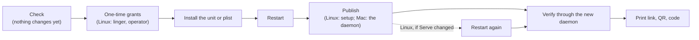

# Setup: `tether setup` and `tether teardown`

On Linux, plain `tether setup` runs tether in the terminal, publishes it on Jimmy's
tailnet, and prints the link to open on his phone, its QR code, and a fresh enrolment
code. Ctrl-C or SIGTERM stops that process; the Serve entry remains. `tether setup
--background` instead installs the systemd user service and runs it beyond the
terminal. On a Mac, plain `tether setup` refuses without changing anything; use
`--background` to install the LaunchAgent, which owns the port phones can reach.
`tether teardown` removes the service when installed and withdraws tether's Serve
entry. All commands run as Jimmy. On Linux, background setup may ask for a password
up to twice, for linger and the Tailscale operator; foreground setup may ask only for
the operator. Once the operator is set, setup and teardown need no `sudo`. On a Mac
nothing needs `sudo`.

This spec assumes [auth.md](auth.md): its sections on sockets and the Tailscale
check, the Mac front (the path secret and launchd's socket), and the canonical
origin, the one rule that decides whether a Serve config publishes tether safely.



The diagram is the background-service path. The foreground path skips service
installation and linger: it checks the host, grants
the operator if needed, binds the daemon's sockets, publishes the Unix target, refreshes
the daemon's tailnet-state cache, issues the code and prints the report, then serves
until signalled. The report goes to stdout; daemon logs start on stderr after the report.
The link comes from the daemon's own canonical-origin calculation, not a separately
constructed URL or a `local.sock` poll.

Each step either succeeds or stops setup with one message that names the cause and
the fix. A failed background step leaves everything before it in place, and a rerun
picks up where it stopped.

| Background step | Linux (systemd user unit) | Mac (LaunchAgent) |
|---|---|---|
| Install | `~/.config/systemd/user/tether.service`, the embedded `contrib/tether.service`, as is | `~/Library/LaunchAgents/com.jimmyyao.tether.plist`, the embedded `contrib/com.jimmyyao.tether.plist` with `@HOME@` and `@PATH@` filled in |
| Restart | `daemon-reload`, `enable`, `restart` | `bootstrap`, or `bootout` then `bootstrap` when the plist changed, or `kickstart -k` |
| Publish | setup writes the Serve entry through LocalAPI | the daemon writes it at its start |
| Verify | the new daemon's `GET /auth/info` over `local.sock` reports `browserOrigin` | the same |

## Checks

Setup first gathers facts without changing anything, judges them all, and reports
every failed check in one run. Any failed check stops setup before it changes
anything. Warnings print and setup carries on.

These rows describe `tether setup --background`. Plain Linux `tether setup` keeps only
the checks for non-root, a usable configured tmux program on setup's own `PATH`, and
Tailscale reachability, login, version, MagicDNS, certificates and operator. Its
`TMUX_TMPDIR` is inherited by the daemon, and it can use `--config`, so neither the
service-environment comparison nor the warning applies. It does not check the binary
path, systemd, the user manager, systemd version or cgroup controllers. On a Mac, plain
setup refuses before it reads config or changes anything.

| Check | How | Message when it fails |
|---|---|---|
| Not root | effective UID | "Run tether setup as the user whose tmux tether serves, not as root." |
| Default config | no `--config` | "tether setup --background installs a service that reads the default config path; drop --config." |
| The binary is the one the service runs | the canonical path of `current_exe()` equals the canonical path of `~/.cargo/bin/tether`, which both `contrib/` files name | "The service runs ~/.cargo/bin/tether, but this is <path>. Install it with `cargo install --path .`, then run `~/.cargo/bin/tether setup --background`." If `~/.cargo/bin/tether` is missing, the first sentence becomes "~/.cargo/bin/tether doesn't exist." If `CARGO_HOME` is set to another directory, the message adds "cargo installs into $CARGO_HOME/bin; use [Manual setup](../running.md#manual-setup)." |
| The service sees the same files | the config path and `state_dir()` each side resolves, with `config::xdg()`'s rules, from setup's environment and from the service's (Linux: `systemctl --user show-environment`; Mac: launchd sets no `XDG_*`) | "Your shell sets <VAR>=<value>, so tether setup would use <dir> while the service uses <dir>: it would read another config and another device list." Linux fix: "Unset it, or give the user manager the same value with `systemctl --user set-environment <VAR>=<value>`." Mac fix: "Unset it before running `tether setup --background`." |
| `TMUX_TMPDIR` | set in setup's environment, and `[tmux]` has no socket key | Warning: "Your shell sets TMUX_TMPDIR; the service won't see it. Set `[tmux] socket_path` in config.toml." |
| tmux | `[tmux] program` from `config.toml`, found on the service's `PATH` (Linux: the user manager's; Mac: setup's own `PATH`, which goes into the plist) | Not found anywhere: "tmux isn't installed (no `tmux` on the service's PATH)." Found only on setup's `PATH`: "tmux is at <path>, which the service's PATH doesn't reach. Set `[tmux] program = "<path>"` in config.toml." |
| Linux foreground: tmux | `[tmux] program` from `config.toml`, executable on setup's own `PATH` | "tmux isn't available at <program> on this shell's PATH. Install tmux or set `[tmux] program` to its executable path." |
| tailscaled reachable | LocalAPI `/status` answers | Linux: "tailscaled isn't running: no LocalAPI socket at /var/run/tailscale/tailscaled.sock. Install Tailscale (https://tailscale.com/download/linux), then `sudo systemctl enable --now tailscaled`." Mac: "Can't reach the Tailscale app. Install the standalone app from tailscale.com (1.104 or later), open it and sign in." Mac, token unreadable: "Your account must be an admin: tether reads Tailscale's LocalAPI token from /Library/Tailscale." |
| Logged in | `BackendState` is `Running` and `Self` is present; `Starting` is polled for up to 10 s | Linux `NeedsLogin`: "Tailscale isn't logged in: run `sudo tailscale login`." Linux `Stopped`: "Tailscale is stopped: run `sudo tailscale up` (if it asks you to repeat your settings, add the flags it names)." Mac: "Sign in from the Tailscale app" or "Connect from the Tailscale app." |
| Version | `Version` from `/status`, major.minor | Linux below 1.94: "Tailscale <v> can't proxy to a Unix socket; upgrade to 1.94 or later." Mac below 1.104: "The Tailscale app <v> is older than 1.104, the oldest tether is tested with; update it." |
| MagicDNS and HTTPS certificates | `Self.DNSName`, its trailing dot stripped, is set and in `CertDomains` | No DNS name: "MagicDNS is off for your tailnet; turn it on at https://login.tailscale.com/admin/dns." Not in `CertDomains` while logged in: "HTTPS certificates are off for your tailnet. Turn them on under HTTPS Certificates at https://login.tailscale.com/admin/dns, then rerun `tether setup --background`." |
| Linux: systemd | `/run/systemd/system` exists | "This Linux doesn't run systemd; tether setup supports systemd only. Follow Manual setup in docs/running.md." |
| Linux: user manager | `/run/user/<uid>/systemd/private` exists. Setup runs every `systemctl --user` with `XDG_RUNTIME_DIR=/run/user/<uid>` when its own environment lacks it, as under `su -` | "No systemd user manager is running for <user>. Log in as <user> directly (SSH or a console, not su or sudo), then rerun." |
| Linux: systemd version | `systemctl --version`, only when `/run/systemd/system` exists | Warning below 254: "systemd <v> ignores the unit's restart backoff; tether restarts every 2 s instead, which still works." |
| Linux: cgroup controllers | the user manager's `cgroup.controllers` lists `cpu` and `memory` | Warning, also when the file is missing (cgroup v1 or hybrid): "The user manager hasn't been delegated the <controller> controller, so the unit's CPUQuota and MemoryMax aren't enforced." |
| Linux: operator | `/localapi/v0/prefs` `OperatorUser`, which needs only read access | Empty or Jimmy: passes (empty becomes a grant, below). Another user: "Tailscale's operator is <other>. tether setup won't replace it; run `sudo tailscale set --operator=$USER` if you mean to, then rerun." |
| Mac: one account | `dscl . -list /Users UniqueID`, accounts with UID 501 or above | "This Mac has another login account (<name>). tether's Mac defences assume yours is the only one, so setup won't install it here." |
| Mac: a GUI session | `launchctl print gui/<uid>` succeeds | "You aren't logged in at this Mac's screen. Log in there first: tether runs only while you're logged in." |
| Mac: a hand install | the installed plist, if any, names port 7851 | "tether was installed by hand on port <n>. Keep that install (Manual setup), or run `tether teardown` and then `tether setup --background`, which uses 7851." |
| Mac: the front's port | when no loaded job of tether's holds it, bind `127.0.0.1:7851` and close it | "Another process holds 127.0.0.1:7851 (`lsof -nP -iTCP:7851`). Stop it, or install by hand with another port (Manual setup in docs/running.md)." |

An unreadable installed plist socket port is a setup check error, so it joins any
other failures before setup changes anything. Other Tailscale diagnostics include
"Tailscale isn't ready (backend state: <state>).", "Tailscale returned an
unrecognized version: <version>.", Linux's "Can't reach Tailscale LocalAPI: <cause>.",
and "Can't read Tailscale's Serve operator: <cause>." when prefs fail.

If the shell leaves an XDG directory variable unset while the user manager has a
different value, the check says "Your shell leaves <VAR> unset" and shows both
resolved paths. On Linux it offers `systemctl --user unset-environment <VAR>`; the
same comparison uses each process's home directory when the XDG variable is unset.

A missing tmux server isn't a failure: tether attaches when one starts. A successful
setup adds "No tmux server yet on <socket>; start tmux as you usually do." as a note,
not a change. Serve conflicts, such as another app at `/` of the
MagicDNS name, Funnel, or a TCP forward on 443, aren't checks either: the
canonical-origin rule judges them at publication ([Publication](#publication)).

## Already running (Linux foreground)

Foreground setup starts only after `Runtime::open` acquires the daemon-wide flock. If
the lock is held, setup refuses before publishing. When the systemd user service is
active, it says: "tether is already running as your service. `tether setup
--background` restarts it and prints a new code; `systemctl --user stop tether` frees
this terminal's run." Otherwise it says: "Another tether is already running; stop it
first." The service-state query only chooses the message; the flock remains the single
instance mechanism.

## One-time grants (Linux)

After the checks pass, `tether setup --background` makes the two system changes Linux
needs; plain `tether setup` only makes the operator grant. Each grant is skipped when
already in place. Setup prints each command before running it, attached to the terminal,
so `sudo` or polkit asks for the password there. Without a terminal on stdin, setup
prints only the grant commands still needed (not as commands it is running) and exits 1
with "Linux grants need a terminal. Rerun `<the same setup command>` in a terminal, or
run the printed commands first." For a background run this is `tether setup
--background`; for a foreground run it is `tether setup`. No foreground run enables
linger because it ends with its terminal.

1. **Linger**, so the service starts at boot and outlives logout. If `loginctl
   show-user $USER -p Linger` says `no`, setup runs `loginctl enable-linger`. polkit
   often allows that for a user's own account, and over SSH may ask for a password
   through `pkttyagent`. Any non-zero exit is retried once as `sudo loginctl
   enable-linger $USER`.
2. **Operator**, so Jimmy's account can write Tailscale's Serve config through
   LocalAPI. If `OperatorUser` is empty, setup prints
   `sudo tailscale set --operator=<user>`, then runs it.

These are the only privileged commands tether runs.

## Installing the background service

Only `tether setup --background` installs or updates a service. Plain Linux setup
leaves service files and service state alone; on a Mac it refuses before changing
anything.

The unit and the plist come from `contrib/`, embedded with `include_str!`. The unit
is installed byte for byte. The plist gets `@HOME@` and `@PATH@` replaced with
setup's `HOME` and `PATH`, XML-escaped (`&`, `<`, `>`).

The installed file belongs to setup. When it differs from what setup would write,
setup copies the old file to `state_dir()/setup-backup/<file name>.<UTC timestamp>`,
replaces it, and says so: "Replaced tether.service, which differed from this
tether's; the old copy is <path>." On Linux, Jimmy's own settings live in drop-ins
(`systemctl --user edit tether`), which setup never touches and lists as notes when it
finds them. A Mac has no drop-ins; a hand-edited plist is replaced like any other
difference.

Before restarting, setup reads the running daemon's `daemonVersion` from `GET
/auth/info` over `local.sock`, if one answers, and the socket's inode, so the report
can say which version it replaced and verification can tell the new daemon from the
old.

**Linux restart:** `systemctl --user daemon-reload`, `enable tether`, then `restart
tether`, which also starts a stopped unit. The unit is `Type=notify`, so `restart`
returns once the new daemon has bound its sockets, or fails; on failure setup prints
the last 20 lines of `journalctl --user -u tether` and exits 1.

**Mac restart:** if the job is disabled (`launchctl print-disabled gui/<uid>` lists
`"com.jimmyyao.tether" => disabled` or the older `=> true`), setup first runs
`launchctl enable gui/<uid>/com.jimmyyao.tether`. Then: if the job isn't loaded,
`launchctl bootstrap gui/<uid> <plist>`; if it's loaded and the plist changed,
`bootout` and then `bootstrap`, since launchd rereads a plist only at bootstrap.
Setup polls `launchctl print gui/<uid>/com.jimmyyao.tether` for up to 5 s after
`bootout` before bootstrapping; if the job still appears loaded, setup stops with an
error. If it's loaded and unchanged, setup runs `launchctl kickstart -k
gui/<uid>/com.jimmyyao.tether`. The success report lists "Enabled tether in Login
Items" as a change when it first runs `enable`. If `bootstrap`
fails, setup prints launchctl's error and "If tether is off under System Settings →
General → Login Items, turn it on and rerun." On macOS 13 and later the first
bootstrap shows a "Background Items Added" notification.

**Every background run restarts tether**, so `tether setup --background` applies an
upgrade, a `config.toml` change or a fix. The phone reconnects by itself. A foreground
run stops with its terminal; stop it with Ctrl-C before starting it again. `tether
enroll` prints a fresh code without touching a running daemon.

## Publication

### Linux: setup writes the entry

For `--background`, setup publishes after the new daemon starts and `serve.sock` exists.
For foreground setup, the daemon binds `serve.sock` first, then setup publishes before
it starts accepting requests. Both use the same plan, judge and compare-and-swap as the
Mac daemon, over `ServeTarget::Unix`:

1. `GET /localapi/v0/serve-config` and its `Etag`.
2. `plan_publish(config, name, &target)` removes tether's handlers from every Web
   entry, then drops entries left without handlers and `TCP` entries left unused
   whose only field is `HTTPS: true`. It adds `{"Proxy":
   "unix:/run/user/<uid>/tether/serve.sock"}`, the service's runtime directory, at `/` of
   `Web["<MagicDNS name>:443"]` (the name's trailing dot stripped), and adds
   `TCP["443"] = {HTTPS: true}` if that port has no entry. `Web` entries store only
   handlers; HTTPS is represented by `TCP[port].HTTPS`. Every other field and handler
   is kept. A handler re-added unchanged at its existing entry and mount is not
   reported as removed; each other removed handler is printed ("Removed tether's old
   handler at <entry> <mount>").
3. The planned config is parsed and judged with `canonical_origin(&target)`. A refused
   plan writes nothing, and setup prints the refusal, which names the conflict and its
   fix: Funnel, a TCP forward on 443, another handler in the entry. A plan equal to the
   current config writes nothing.
4. `POST` with `If-Match`. A `412` re-reads and re-plans, three times at most.
5. If the POST changed the config, background setup restarts the service again, so the
   daemon sees the new entry at once rather than after its cache, up to 10 s old, expires.
   Foreground setup refreshes that daemon's shared tailnet-state cache in process before
   it prints; it does not poll `local.sock` or start serving before the report.

**Tether's handlers** are the ones a matcher recognises from the proxy string alone,
with no live socket, so publication and teardown share it. On Linux: a proxy of
exactly `unix:/run/user/<uid>/tether/serve.sock`, plus, in publication only, the old loopback
daemon's `http://127.0.0.1:7850` at `/` of a `:443` entry, where that daemon's
instructions put it. On a Mac: a tether-shaped proxy
(`http://127.0.0.1:<port>/tether-<43 base64url characters>`) on the plist's port.
The socket's inode matters only to the judge, which still refuses a second reference
to the socket under another spelling.

A refusal leaves the service installed and running, reachable on `local.sock`; setup
exits 1, and a rerun after the fix publishes. The judge identifies `serve.sock` by its
inode, which is why the daemon starts before publication.

Each failed POST gets its own message, from typed `SetServeConfigError` variants:

| Answer | Cause | Setup prints |
|---|---|---|
| `403`, body `serve config denied` | Jimmy isn't the operator | "Tailscale refused the write: your account isn't its operator. Run `sudo tailscale set --operator=$USER`, then rerun the same setup command." Background setup names `tether setup --background`; foreground names `tether setup`. |
| `401` | On Tailscale 1.100 and later, a non-root operator may write a config that serves any Unix socket or path only if tailscaled, as root, can run `sudo --other-user=<user> --list tailscale`. The check covers the whole config, other apps' handlers included | "Tailscale <v> requires an operator who may run `sudo tailscale` to change a config that serves a Unix socket or a path. Allow this account to run `sudo tailscale`, then rerun the same setup command." |
| `412` three times | another writer kept changing Serve | "Tailscale's Serve config kept changing while tether wrote it; rerun the same setup command." |
| other | LocalAPI's own error | "Tailscale refused the Serve write: <status and body>." |

The Linux daemon never writes Serve. Its refusal messages, which `tether enroll`,
`/auth/info` and the log show, name `tether setup` as the fix. If Jimmy resets Serve,
tether stays unpublished until he reruns setup.

### Mac: the daemon publishes

`tether serve --publish` writes its own entry at each start with a new path secret
([auth.md](auth.md#the-mac-front)). Setup restarts it, then waits.

### Verification

Background setup reads `GET /auth/info` over `local.sock`, with the client `tether
enroll` uses on a Mac, built for both platforms. Linux `tether enroll` keeps judging
LocalAPI itself, since it must work while the daemon is down. Foreground setup verifies
in-process: after writing Serve it refreshes the daemon's shared tailnet-state cache and
gets the origin through the same `Auth::browser_origin` path `/auth/info` uses. It
prints only that reported origin.

Background setup looks for `local.sock` in the service's runtime directory, not its own: on Linux
`/run/user/<uid>/tether/`; on a Mac under `getconf DARWIN_USER_TEMP_DIR`, since an SSH
session may lack `TMPDIR`. It ignores answers from a socket whose inode is the one it
read before the restart, and keeps polling through connection errors and non-2xx
answers, for up to 30 s, until the new daemon reports `browserOrigin` (published) or a
`browserRefused` with `browserPending` false, and the origin must equal the expected
`https://<MagicDNS name>`. A different non-empty origin keeps setup polling and is
included in the final timeout diagnostic. `browserPending` is a field `/auth/info`
gains for this: true while a Mac publication is still waiting or retrying, when
`browserRefused` carries its last error; that last error is included in the timeout
diagnostic. It is always false on Linux. A final refusal is printed and setup exits
1. At the timeout setup prints "tether didn't report a publication within
30 s" and the last 20 lines of its log (`journalctl --user -u tether` on Linux,
`~/Library/Logs/tether.log` on a Mac), plus, on a Mac, the last exit status from
`launchctl print`.

## Output

On success either path issues a new enrolment code (`Store::set_pending`, 10 minutes,
replacing any earlier code, as `tether enroll` does). Background setup prints, here on Linux:

```text
tether 0.0.2 is running as your systemd user service, started at boot (was 0.0.1).
Nothing else to change.
Published on your tailnet:

  https://pop-os.tail852a76.ts.net

  ▄▄▄▄▄▄▄ ▄ ▄▄ ▄▄▄▄▄▄▄
  █ ▄▄▄ █ ▀█▄▀ █ ▄▄▄ █      (QR code of the link)
  ...

Enrolment code: 7KQ4-XM2P, for one device, valid for 10 minutes.
  Phone browser: scan the QR code or open the link, then enter the code.
  iOS app: Add host, pop-os.tail852a76.ts.net, code 7KQ4-XM2P.
`tether enroll` prints a new code. `tether teardown` removes all of this.
```

On a Mac the first line reads "running as your LaunchAgent, started when you log
in". "(was …)" appears when a daemon answered before the restart. Below that line
setup lists what it changed ("Enabled linger", "Replaced tether.service…",
"Removed tether's old handler…"), or "Nothing else to change." That line depends
only on changes; drop-in notices and "No tmux server yet…" appear separately under
"Notes:". The link is on a line of its own, for copying. A failed run prints no code.

Foreground Linux's first line is "tether <v> is running in this terminal; Ctrl-C stops
it." The QR, clipboard copy and code follow the same report format. Its final banner
says that the Serve entry stays when tether stops and `tether teardown` removes it.

**The QR code** uses the `qrcode` crate (0.14, MIT or Apache-2.0, MSRV 1.67) with
`default-features = false`. Without its `image` feature it pulls in no other crate
and adds about 50 KB to a stripped release binary (measured on macOS arm64: 387 KB
against 337 KB for an empty program). It renders with `Dense1x2` half-block
characters, two modules per character cell, about 37 by 19 cells for a 35-character
link, and prints only when stdout is a terminal. It encodes the link alone.

**The clipboard.** When stdout is a terminal, setup also writes the link to the
clipboard with OSC 52 (`ESC ] 52 ; c ; <base64> BEL`). Over SSH this reaches the
local machine's clipboard where the terminal allows it, and terminals that don't are
expected to ignore it. Setup prints "Copied the link to your clipboard (if your
terminal allows it)." It can't tell whether the copy landed.

## Teardown

`tether teardown` checks only that it isn't run as root. It first reads what is
installed and running (the unit or plist, whether the service is active or the job
loaded, and on a Mac the port the plist names, 7851 when it is missing or unreadable),
then does only the steps that state needs, so a rerun, or a teardown after turning
tether off under Login Items, finishes what is left:

If no service is installed, teardown skips the stop and file-removal steps and withdraws
only tether's matcher-recognized Serve entry. It does not require a systemd unit.

1. **Mac, job loaded: check Tailscale first.** Read the serve config through
   LocalAPI. If it can't, teardown stops before touching the service, so tether keeps
   holding its port while Serve still points at it: "Can't reach Tailscale to remove
   tether's Serve entry; open the Tailscale app and rerun."
2. **Stop and disable the service**, if it's installed: Linux `systemctl --user
disable --now tether`; Mac `launchctl bootout gui/<uid>/com.jimmyyao.tether` when
the job is loaded. If the Linux unit file is missing but the service is still
active, teardown runs `systemctl --user stop tether`. If a running service fails to
stop, teardown stops and prints the error: it doesn't remove a unit or plist under a
running daemon.
3. **Withdraw tether's handlers** from every Web entry, with tether's matcher
   ([Publication](#linux-setup-writes-the-entry)) and, on a Mac, that port, through
   `plan_withdraw`, `If-Match` and the three-try re-plan. Entries left without
   handlers and unused `TCP` entries whose only field is `HTTPS: true` are dropped;
   every other entry, handler and field stays. A `403` says to make the account the
   Tailscale operator and rerun `tether teardown`; a repeated `412` likewise says to
   rerun teardown. A `401` gets "Tailscale <v> requires an operator who may run
   `sudo tailscale` to change a config that serves a Unix socket or a path. Remove
   tether's entry as root: `sudo tailscale serve --https=443 off`, or grant this
   account access and rerun tether teardown."
4. **Remove the file**: the unit, then `daemon-reload`; or the plist.

If the withdrawal fails on Linux, teardown still removes the unit: Serve then points
at a socket in a private directory, and answers `502`. It reports any service or
handler removals it knows succeeded, but does not claim "Nothing to remove" when the
withdrawal failed. On a Mac it keeps the plist,
so a rerun knows the port, and prints first "Serve still points at 127.0.0.1:<port>,
which any process can now bind. Remove it now: `tailscale serve --https=443 off`, or
rerun tether teardown once Tailscale answers", and exits 1. That window, from the
`bootout` until the entry is gone, is the one [auth.md's threat
model](auth.md#threat-model) accepts for a one-account Mac.

Teardown keeps `state_dir()` (enrolled devices and `host_id`, so a later setup brings
the phone's existing host back), `config.toml`, the binary, any drop-ins in
`tether.service.d/`, linger and the operator grant. It prints how to drop the last
two: `sudo loginctl disable-linger $USER`, which also stops Jimmy's other user units
running while he is logged out, and `sudo tailscale set --operator=`. With nothing
installed and no handler of tether's in Serve, teardown reports "Nothing to remove."
only if the Serve read and withdrawal succeeded.

## Exit status

`0` when published and the link printed (setup, including Ctrl-C from a foreground
run), or everything removed (teardown);
`1` for any failed check or step; clap's `2` for usage. Setup doesn't use `78`, which
belongs to the daemon's unit.

## Code structure

```text
src/setup/
  AGENTS.md
  mod.rs           background/foreground setup() and teardown(): step sequence,
                   shared success tail and exit status
  checks.rs        sans-IO: gathered Facts -> validated Tailnet, or check findings;
                   platform-specific warning findings are returned separately
  install.rs       sans-IO: the embedded unit and plist, the plist substitution, and
                   per-platform service plans and the previous bytes of a differing file
  systemd.rs       Linux: owns its Host and TeardownHost, gathers host facts and runs
                   systemd actions; aliased as `platform` in mod.rs
  launch_agent.rs  macOS: owns its Host and TeardownHost, gathers host facts and runs
                   LaunchAgent actions; aliased as `platform` in mod.rs
  report.rs        the success text and the QR code
src/auth/publish.rs   plan_publish and plan_withdraw over ServeTarget and tether's
                      matcher; the compare-and-swap loop shared by the Mac task, setup
                      and teardown
src/auth/identity.rs  ServeTarget's proxy URL and matcher; read_auth_info on both
                      platforms
src/auth/localapi.rs  Status's Version, BackendState and CertDomains; prefs();
                      SetServeConfigError's Denied (403) and NotLocalAdmin (401)
src/proto/auth.rs     AuthInfo's browserPending (Swift mirrors AuthInfo by hand)
src/main.rs           CLI dispatch for the Setup and Teardown subcommands
src/daemon.rs         daemon assembly and serving, including the post-bind hook setup uses
src/blocking.rs       the shared current-thread tokio runtime, capped at the daemon's
                      blocking-thread budget
```

`launch_agent.rs` is named apart from `src/launchd.rs`, the daemon's socket-activation
module and the one place `unsafe` is allowed; setup needs no `unsafe`. Setup runs on
the shared current-thread runtime capped at the daemon's eight blocking threads.
Background setup uses LocalAPI and `local.sock`; foreground setup calls the daemon's
`Auth` in process. Each platform module owns its own host and teardown state behind the
`platform` alias; the pure policy modules build on both platforms.

The pure cores carry the policy logic:

- `checks`: background setup's table tests cover each row of [Checks](#checks) from a
  `Facts` value, including the version parse (`1.94.0-t…`, `1.104.2-tc…`), resolved
  directories and messages. The reduced foreground check path is covered by S12 on
  pop-os.
- `install`: absent, identical, differing, loaded, unloaded and disabled combinations
  to their actions; the plist with a `PATH` holding `&`, `<` and spaces is valid XML
  (`plutil -lint` on macOS CI).
- `publish`: Unix-target plans: an empty or null config; the old `7850` handler at `/`
  of `:443` removed and elsewhere kept; another app's `/` handler, Funnel and a TCP
  forward on 443 refuse without writing; unknown fields survive; a handler under an
  old MagicDNS name is removed; withdrawal without a live socket, on both targets.
- LocalAPI write errors: the fake-LocalAPI integration tests (`LocalApi::at`) answer
  `403`, `401` and `412`, and each maps to its message.

The platform executors in `systemd.rs` and `launch_agent.rs` only run commands and read files,
with no seam for faking them: the probe gates cover them. Foreground Linux's reduced
findings are also covered by S12 on the target host.

## Probe gates

| Gate | On | Check |
|---|---|---|
| S1 | pop-os | From a fresh state (no unit, linger off, no operator), `tether setup --background` over SSH asks for at most two passwords, publishes, prints link, QR and code. The iPhone camera opens the link; Safari enrols with the code; the iOS app adds the host |
| S2 | pop-os | A rerun with `--background`: same link, new code, one restart, "Nothing else to change". `tailscale serve status --json` before and after differ only in tether's handler; another app's entry on another port survives byte for byte |
| S3 | pop-os | Background refusals without writing: another app at `/` of `<name>:443`, Funnel on, a TCP forward on 443. Without a terminal, `tether setup --background` prints the grant commands and exits 1 |
| S4 | pop-os and a container | Tailscale 1.94–1.98 and 1.100 or later: `tether setup --background` writes as operator; an operator who may not `sudo tailscale` gets the `401` message on 1.100+ and succeeds on 1.98; a non-operator gets the `403` message; teardown with another app's Unix handler present, on 1.100+ |
| S5 | pop-os | Upgrade from the loopback-TCP daemon and from a current one: `cargo install` a newer build, rerun `tether setup --background`; `/auth/info` reports the new version, the 7850 handler is replaced, a `MemoryMax` drop-in survives, an edited unit is backed up and replaced |
| S6 | pop-os | Reboot: tether runs before any login, published; the phone reconnects |
| S7 | pop-os | `tether teardown` removes the unit and tether's handler only; a second teardown says "Nothing to remove"; `tether setup --background` again brings the iOS app's host back with its existing token. With no unit installed, teardown withdraws the handler only |
| S8 | pop-os | `cargo run -- setup --background` refuses with the binary message; `XDG_STATE_HOME=/elsewhere` refuses and `XDG_STATE_HOME=$HOME/.local/state` passes; `su - jimmy` with linger on reaches the user manager |
| S9 | the Mac | Fresh `tether setup --background`: plist written and bootstrapped, the notification shows, published, phone works. Rerun kickstarts with a new secret, and verification waits for the new process. Port 7851 held, a hand install on another port, a second macOS account and an SSH session with no screen login each refuse before installing. Turned off under Login Items, then setup: `launchctl enable` brings it back, or the message says how. A `PATH` holding `&` installs. Teardown removes the plist and the entry, and a second teardown says "Nothing to remove"; with Tailscale quit, teardown stops before the `bootout`; turned off under Login Items, then teardown, removes the entry. A LocalAPI error during publication keeps verification polling (`browserPending`) until the daemon publishes |
| S10 | iPhone | The QR scans from a dark and a light terminal theme, in Termius and in tether's own terminal (xterm.js line height can open gaps between half blocks) |
| S11 | a Linux container | `tether setup --background` on a distribution without systemd, a logged-out tailscaled, Tailscale 1.92, and a test tailnet with HTTPS certificates off: each gets its message and changes nothing |
| S12 | pop-os | Plain `tether setup` in a terminal publishes and the phone enrols; Ctrl-C exits 0 and the phone shows 502, then reconnects on a rerun. With the service running, foreground setup refuses. `cargo run -- setup` works |
| S13 | the Mac | Plain `tether setup` refuses with the `--background` message and changes nothing |

S11 needs a Tailscale auth key for a test tailnet, which is Jimmy's to give. Without
one, the fake-LocalAPI tests cover its messages.

## Not in setup

- **A code in the QR.** The QR encodes the link alone. A link that carries the code
  needs web and iOS work, and leaves the code in browser history.
- **Other install locations.** Setup accepts only `~/.cargo/bin/tether`. A release
  binary installed elsewhere would need an `ExecStart=` drop-in on Linux and a third
  plist placeholder on a Mac.
